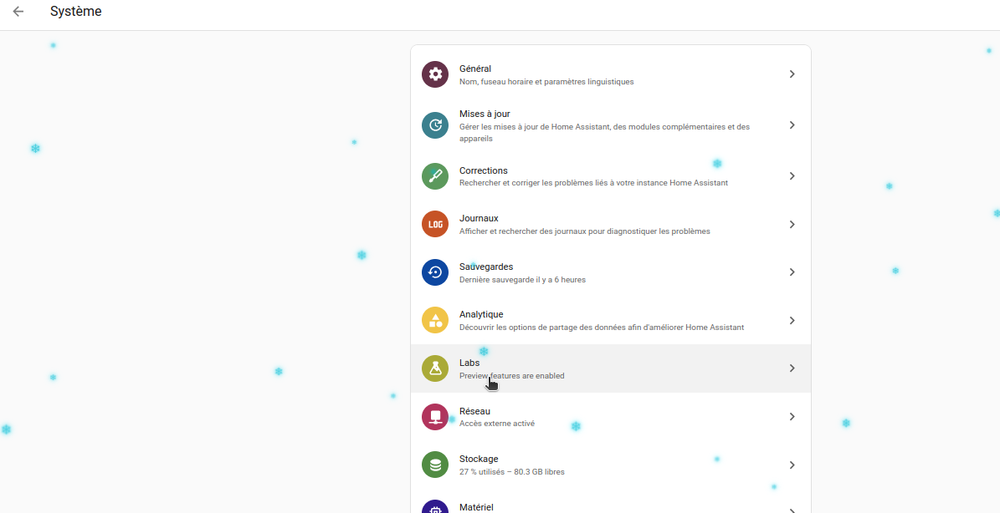
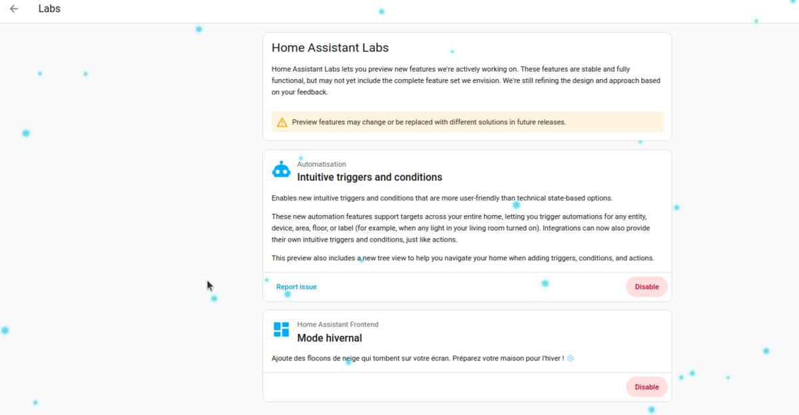
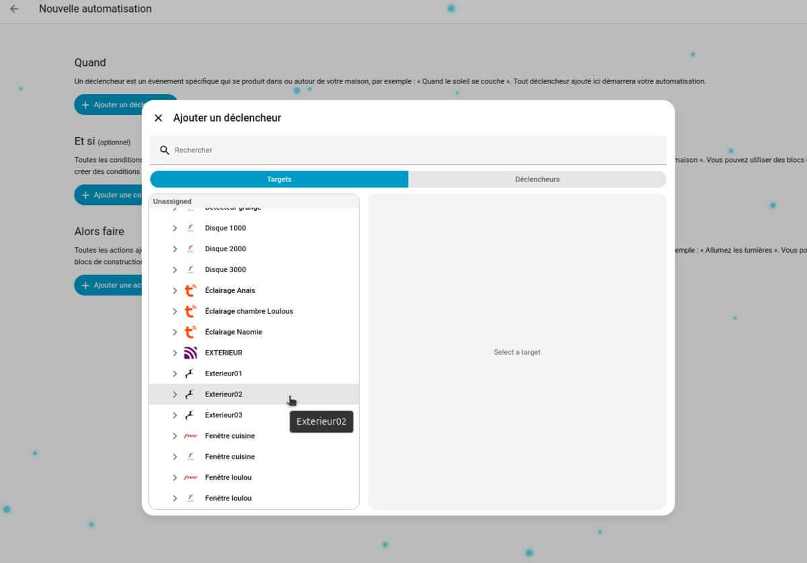
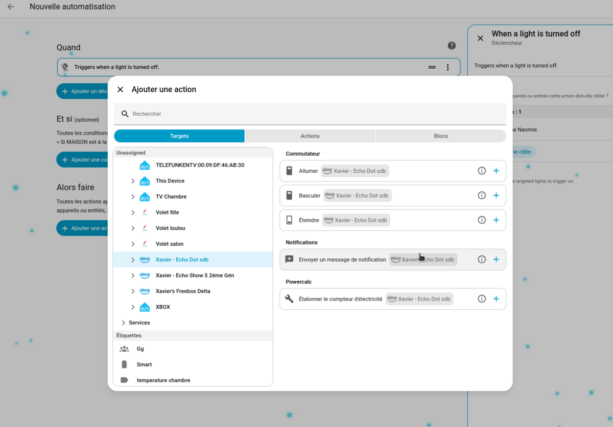
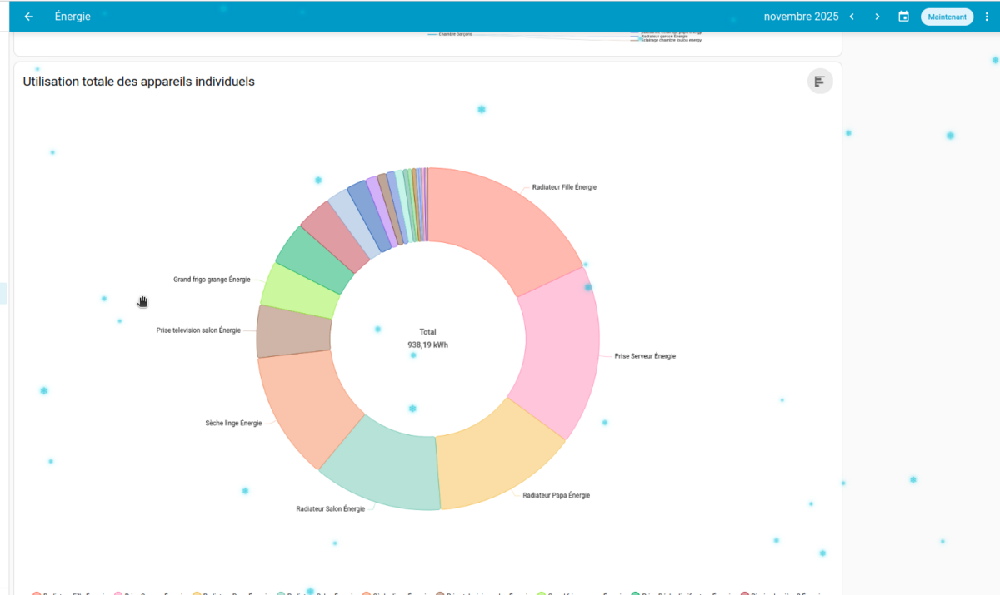
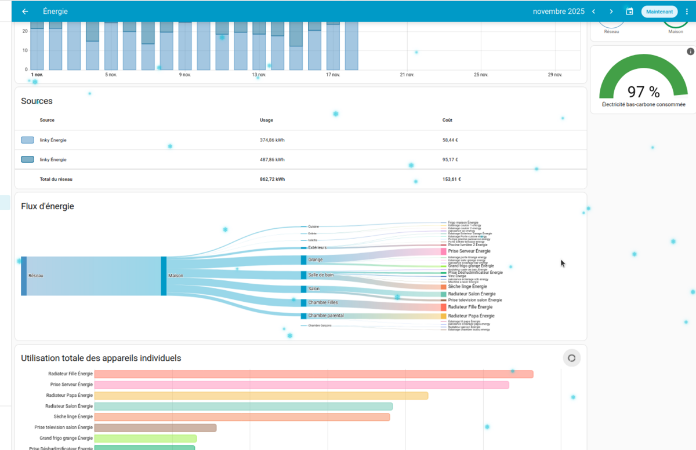
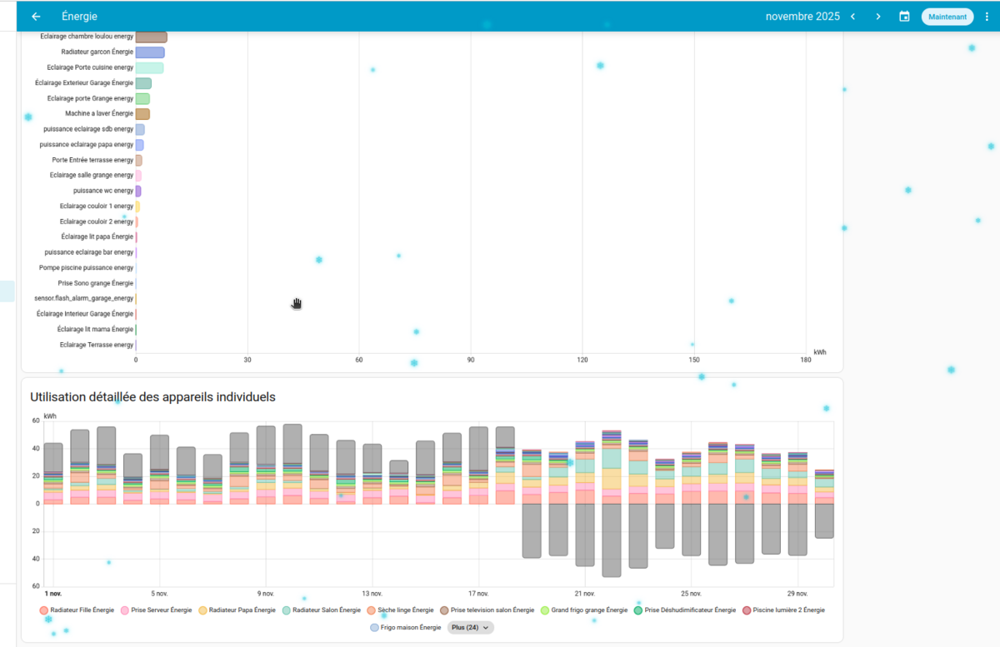

<a href="https://forumdomotique.com/actualites/home-assistant/home-assistant-2025-12-labs-tableau-de-bord-energie/">Lire et commenter sur Forum Domotique</a>

# Modification de Home Assistant 2025.12 : la mise à jour de décembre 2025 repousse les limites avec les Labs et un tableau de bord énergie boosté

- **Type :** Actualité
- **Catégorie :** Actualité domotique & maison connectée > Home Assistant
- **Lien :** https://forumdomotique.com/actualites/home-assistant/home-assistant-2025-12-labs-tableau-de-bord-energie/
- **Date de publication :** 30 novembre 2025 à 21:15 (Europe/Paris)
- **Auteur :** XAV59213

---

On l'attendait avec impatience, elle arrive pile pour les fêtes ! La mise à jour Home Assistant de décembre 2025 (2025.12), sortie comme prévu le premier mercredi du mois, marque la fin d'année en beauté avec des innovations audacieuses qui transforment l'expérience utilisateur.

Des Labs pour tester les features du futur Grande révolution de cette version 2025.12 : l'introduction des "Home Assistant Labs", un espace dédié aux previews de fonctionnalités expérimentales.

### **Home Assistant Labs : Plongez dans les Fonctionnalités Expérimentales du Futur**

Introduit avec la mise à jour Home Assistant 2025.12, sortie le 3 décembre 2025, **Home Assistant Labs** représente une révolution pour les utilisateurs curieux et les early adopters. C'est un espace dédié aux "preview features" – des fonctionnalités entièrement développées et testées, mais encore en phase de raffinement avant d'être intégrées de manière permanente. Contrairement aux bêtas, qui se concentrent sur la stabilité des releases à venir, Labs vise à collecter des retours réels sur l'ergonomie, le design et l'usage quotidien. L'idée ? Permettre à la communauté de shape le futur de Home Assistant sans compromettre la stabilité de votre installation principale.

#### **Comment Activer et Utiliser Labs ?**

Pour ajouter le système Home Assistant Labs à votre instance Home Assistant, utilisez ce bouton My :

<!-- source : https://my.home-assistant.io/badges/config_flow_start.svg -->

Rien de plus simple – tout est optionnel et sans risque :

1. **Accès** : Allez dans **Paramètres > Système > Labs**. Vous y verrez une liste de fonctionnalités en preview, avec des descriptions claires, des liens vers la doc et des formulaires de feedback.
2. **Activation** : Cochez simplement la case pour activer une feature. Pas de redémarrage requis – les changements s'appliquent instantanément.
3. **Sécurité** : Les Labs sont isolés ; activer une preview n'impacte pas vos automatisations existantes ou votre setup stable. Si une feature ne vous plaît pas, désactivez-la en un clic.
4. **Feedback** : Chaque Labs inclut des boutons pour signaler des bugs, suggérer des améliorations ou voter pour des priorités. Les devs de Home Assistant s'en servent pour itérer rapidement.

Pour les développeurs d'intégrations custom : Déclarez vos previews dans le manifest.json de votre intégration, avec des liens vers GitHub pour les issues et la doc. C'est standardisé et facile à implémenter.

#### **Les Premières Fonctionnalités en Labs**

Au lancement de la 2025.12, Labs démarre en fanfare avec des ajouts festifs et pratiques. Voici les highlights :

**Mode Hiver ❄️** : La star du lancement ! Activez-le pour transformer votre interface en paysage enneigé, avec des flocons qui tombent doucement. Parfait pour l'ambiance des fêtes – et un test idéal pour voir comment les animations impactent les perfs sur vos devices (tablettes murales, etc.). C'est ludique, mais ça prépare le terrain pour des thèmes dynamiques saisonniers.

**Sélecteur Intuitif pour Triggers/Conditions/Actions** : Une refonte du sélecteur qui change la donne pour les automatisations. Naviguez par étage > zone > device, et voyez instantanément les options disponibles (ex. : "Allumer les lumières de Noël si étiquette 'fêtes' est active"). C'est encore en polish, d'où sa place en Labs – testez et dites ce que vous en pensez !

**Autres Teasers** : Des previews comme des suggestions AI avancées pour les scripts (basées sur vos patterns d'usage) ou des dashboards contextuels par contexte (maison, vacances). Plus de features arriveront mensuellement, avec un focus sur l'UX et l'IA locale.

#### **Ce que ça change pour vous**

Labs n'est pas juste un bac à sable ; c'est une façon collaborative de co-créer Home Assistant. Imaginez tester un mode "Éco Hiver" qui optimise vos chauffages en temps réel, ou un éditeur visuel pour les flux Matter/Thread, avant que ça devienne standard. Pour les power users, c'est l'outil pour anticiper les évolutions ; pour les débutants, un moyen safe d'explorer sans casser quoi que ce soit.

**Attention** : Les designs peuvent évoluer (et changer) en fonction des feedbacks. Si vous gérez une installation critique (ex. : maison connectée pour seniors), restez en mode stable.

👉 Pour les early adopters, c'est l'occasion de shape le futur de HA sans risquer la stabilité de votre setup principal. Attention, ces features sont en évolution et pourraient changer.

Éditeur d'automatisations : triggers et conditions intuitifs L'éditeur d'automatisations continue son ascension avec un redesign complet des dialogues pour ajouter triggers, conditions et actions.

- Interface plus épurée et lisible.
- Suggestions contextuelles basées sur vos entités habituelles.
- Copie/coller amélioré et sidebar redimensionnable.

Résultat : créer des automatisations complexes devient un jeu d'enfant, sans YAML pour les débutants.

Améliorations du dashboard : undo/redo et onglets mobiles Les dashboards gagnent en maturité avec des outils pros :

- Undo/redo natif dans l'éditeur (comme dans les automatisations depuis 2025.10).

- Dashboard par défaut système-wide, synchronisé sur tous les appareils.
- Onglets mobiles pour une navigation fluide sur téléphone ou tablette.
- Suggestions d'entités basées sur vos patterns d'usage.

Attention : vos favoris actuels pourraient disparaître lors de la migration vers le dashboard intégré – un petit réajustement s'impose.

Tableau de bord Énergie : puissance en temps réel et suivi eau Le dashboard Énergie, pilier de la domotique éco-responsable, s'enrichit sérieusement :

- Monitoring de la puissance en temps réel pour vos appareils.
- Suivi des consommations d'eau individuelles (sources, descentes).
- Graphiques pie pour comparer mois actuel vs. précédent.
- Insights au niveau des devices pour cibler les gaspillages.

C'est un outil indispensable pour optimiser votre conso hivernale et réduire la facture.

Suppression d'intégrations obsolètes : Domino's Pizza au placard Home Assistant fait le ménage avec la fin du support pour certaines intégrations peu utilisées :

- Domino's Pizza (personne ne commandait via HA, avouons-le !).
- Autres stubs comme Gammu pour les modems anciens.

⏳ Si vous en dépendez, migrez vers des alternatives avant la mise à jour. Un message d'alerte apparaîtra dans les Réparations.

Nouvelles intégrations et virtuals : BLE et qualité de l'air Côté hardware, on accueille :

- Philips Hue BLE pour les ampoules Bluetooth low energy.
- Victron BLE pour les systèmes solaires.
- Google Air Quality Index (attention aux quotas mensuels !).
- Virtual integrations pour une meilleure discoverabilité (stubs gérés par d'autres).

Plus de 20 intégrations existantes upgradées, comme Reolink pour les cams ou VeSync avec verrou enfant.

Helpers supprimables en un clic et OAuth2 résilient Petits ajouts qui comptent :

- Supprimez directement les helpers (compteurs, timers) depuis le panneau.
- Gestion OAuth2 améliorée : retry auto en cas de perte réseau, sans reconfiguration manuelle.
- Ajout d'entités aux widgets Android Auto depuis le dialog "more info".

Correctifs 2025.12.1 : patchs express Un hotfix rapide (2025.12.1) a suivi pour stabiliser :

- Intégrations Matter et Thread (sensibilité pour capteurs Heiman).
- Bugs mineurs sur Roborock et Xbox.

La réactivité reste au top, comme toujours.

Ce qu’on en retient

| **Fonction** | **Ce que ça change** |
| --- | --- |
| ✅ Home Assistant Labs | Testez les previews comme le mode Hiver sans risque |
| ✅ Éditeur automatisations redesign | Triggers/conditions plus intuitifs, suggestions smart |
| ✅ Undo/redo dans dashboards | Édition sans peur, onglets mobiles inclus |
| ✅ Énergie : puissance RT et eau | Insights device-level pour une conso optimisée |
| ✅ Nouvelles intégrations BLE/Air | Plus de compatibilité hardware éco |
| ⚠️ Fin support Domino's & co | Migrez vos rares setups obsolètes |

Votre avis nous intéresse ! Vous avez déjà installé la mise à jour Home Assistant de décembre 2025 ? Que pensez-vous des Labs, du redesign des automatisations, ou des boosts du dashboard Énergie ? Partagez en commentaires !

---

## Commentaires de XAV59213 sur cet article (1)

### Commentaire 1 — 1 décembre 2025 à 16:03 (Europe/Paris)

- **Identifiant :** `66`
- **Lien :** https://forumdomotique.com/actualites/home-assistant/home-assistant-2025-12-labs-tableau-de-bord-energie/?do=findComment&comment=66

Désolé 🤣
