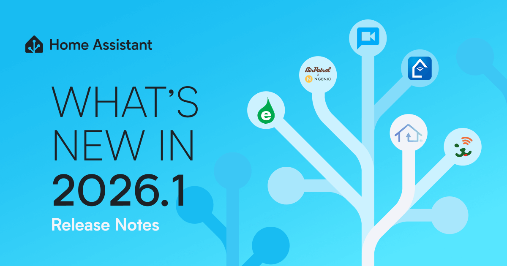
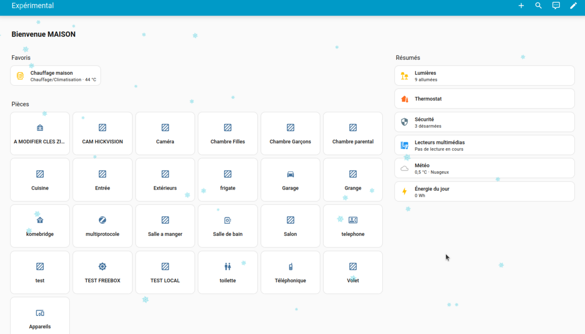
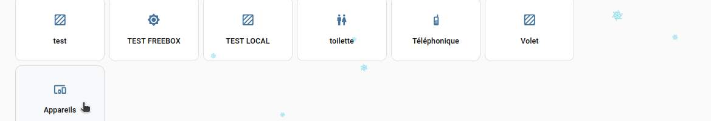
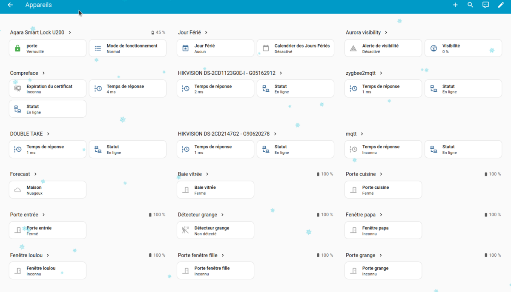
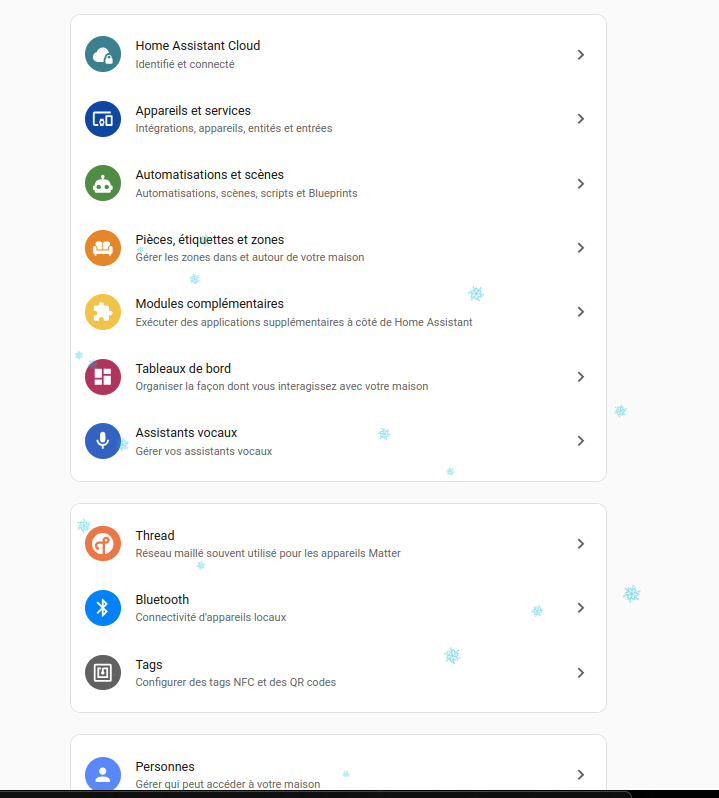
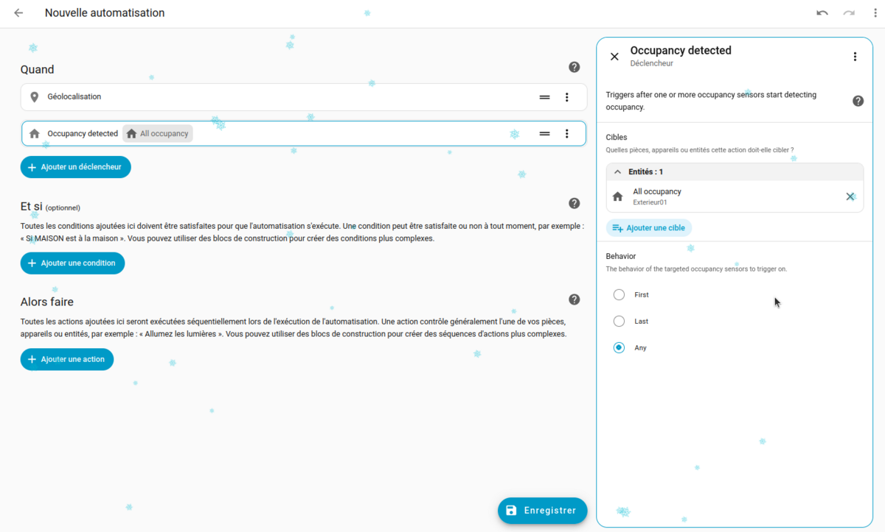

<a href="https://forumdomotique.com/actualites/home-assistant/home-assistant-20261-la-mise-%C3%A0-jour-de-janvier-2026-am%C3%A9liore-le-tableau-de-bord-et-les-automatisations-r11/">Lire et commenter sur Forum Domotique</a>

# Home Assistant 2026.1 : la mise à jour de janvier 2026 améliore le tableau de bord et les automatisations

- **Type :** Actualité
- **Catégorie :** Actualité domotique & maison connectée > Home Assistant
- **Lien :** https://forumdomotique.com/actualites/home-assistant/home-assistant-20261-la-mise-%C3%A0-jour-de-janvier-2026-am%C3%A9liore-le-tableau-de-bord-et-les-automatisations-r11/
- **Date de publication :** 10 janvier 2026 à 14:59 (Europe/Paris)
- **Auteur :** XAV59213

---

👋 Bonne année à tous ! L'équipe de Home Assistant commence 2026 sur les chapeaux de roues avec la version 2026.1, sortie le 7 janvier. Cette mise à jour, un peu plus légère en raison des fêtes, apporte néanmoins des améliorations bienvenues, notamment sur l'ergonomie du tableau de bord mobile, une navigation plus fluide vers les protocoles comme Zigbee ou Z-Wave, et des déclencheurs d'automatisations plus intuitifs. On y trouve aussi huit nouvelles intégrations et quelques tweaks pratiques pour l'énergie et les logs.

Si vous n'avez pas encore mis à jour, direction le menu **Paramètres > Système > Mises à jour** pour installer Home Assistant Core 2026.1. Assurez-vous d'avoir une sauvegarde récente au cas où !

## Améliorations du tableau de bord Home

📱 Le tableau de bord "Home" continue d'évoluer pour une expérience plus fluide, surtout sur mobile. Désormais, sur les appareils mobiles, les cartes de résumé pour les lumières, le climat, la sécurité, les médias, la météo et l'énergie s'affichent directement en haut de l'écran, sans avoir à cliquer sur des onglets. Plus besoin de taps inutiles pour accéder aux infos essentielles !

Sur desktop, rien ne change : ces résumés restent sous l'en-tête "Pour vous" dans la barre latérale. Une nouvelle page "Appareils" a été ajoutée, listant tous les dispositifs non assignés à une zone, pour les retrouver et les contrôler plus facilement. Pratique pour les setups complexes !

## Navigation facilitée vers les protocoles

🛠️ La page des Paramètres a été réorganisée pour mettre en avant les tableaux de bord des protocoles. La section dédiée (Zigbee, Z-Wave, Thread, etc.) apparaît maintenant juste après les paramètres principaux. Les menus ne s'affichent que si l'intégration correspondante est configurée, évitant le clutter inutile.

C'est un gain de temps pour les utilisateurs qui gèrent des réseaux sans fil variés – plus besoin de fouiller dans les menus pour accéder à ces outils.

## Nouveaux déclencheurs et conditions pour les automatisations

🤖 Home Assistant Labs poursuit son travail sur des déclencheurs plus "humains" et faciles à comprendre. Activables via **Paramètres > Système > Labs**, ces nouveaux triggers permettent de créer des automatisations sans plonger dans les états techniques. Par exemple :

- **Bouton** : Se déclenche quand un bouton est pressé.
- **Climat** : Sur changement de mode HVAC, température cible, ou franchissement de seuils.
- **Traqueur de dispositifs** : Quand quelqu'un arrive ou part de la maison, y compris le premier arrivée ou dernier départ.
- **Humidificateur** : Sur allumage/extinction, humidification, ou seuils d'humidité.
- **Lumière** : Sur changement de luminosité ou seuils.
- **Verrou** : Sur verrouillage, déverrouillage, ouverture ou blocage.
- **Scène** : Quand une scène est activée.
- **Sirène** : Sur allumage/extinction.
- **Mise à jour** : Quand une mise à jour est disponible.

Ces triggers supportent les cibles par zones, étages ou labels. Le flux d'automatisation a été redesigné pour une visualisation plus claire. Idéal pour les débutants ou pour des setups rapides !

## Nouvelles intégrations

✅ Huit nouvelles intégrations rejoignent la famille Home Assistant :

- **Airpatrol** : Contrôle des unités de climatisation via WiFi.
- **eGauge** : Moniteurs d'énergie pour usages résidentiels ou commerciaux, surtout solaires.
- **Fluss+** : Bouton intelligent pour déclencher des routines.
- **Fish Audio** : Synthèse vocale pour une génération de parole naturelle.
- **Fressnapf Tracker** : Suivi GPS des animaux de compagnie.
- **HomeLink** : Déclencheurs depuis les véhicules pour routines domotiques.
- **Watts Vision+** : Contrôle de zones de chauffage intelligentes.
- **WebRTC** : Streaming caméra interne (pour devs).

De plus, **Levoit** est maintenant géré via VeSync.

## Autres changements notables

⚡ Quelques tweaks bienvenus :

- Contrôle du volume pour haut-parleurs Matter via LevelControl.
- Lien direct vers l'historique dans la carte de graphiques statistiques.
- Badge d'état personnalisable dans les cartes d'éléments d'image.
- Nouvelle unité "gallons par jour" pour le débit volumique (utile pour les cuves à fioul).
- Sélecteur de dates fixe dans le tableau de bord Énergie.
- Améliorations ESPHome pour des réponses API bidirectionnelles.
- Optimisation des logs ; option pour réactiver les doublons si besoin.
- Nouveau sélecteur "choose" pour des inputs UI flexibles.

## Changements cassants et dépréciations

⚠️ Attention aux breaking changes :

- Coolmaster : Mode ventilateur "medium" au lieu de "med".
- Tailscale : Capteur "Supports hairpinning" supprimé.
- UniFi Protect : États en snake_case (ex. "mechanical" au lieu de "Mechanical").
- Telegram bot : Paramètres inutiles supprimés dans les actions.
- VeSync : Mode "advancedSleep" devient "advanced_sleep".

Pas de dépréciations majeures cette fois, mais vérifiez les notes complètes pour les détails techniques.

## Résumé des nouveautés

| Fonctionnalité | Description | Impact |
| --- | --- | --- |
| Tableau de bord mobile | Résumés directs pour lumières, climat, etc. | Ergonomie mobile ↑ |
| Page Appareils | Liste des dispositifs orphelins | Gestion plus simple |
| Navigation protocoles | Accès rapide à Zigbee, Z-Wave... | Temps gagné pour les pros |
| Déclencheurs intuitifs | Triggers "humains" via Labs | Automatisations accessibles |
| Nouvelles intégrations | 8 ajouts (Airpatrol, eGauge...) | Plus d'options hardware |
| Tableau Énergie | Sélecteur dates fixe | Navigation fluide |
| Optimisations logs | Moins de doublons | Performances ↑ |

### Ce qui a vraiment changé en 2 ans

**Avant** → Très puissant… mais technique, intimidant pour les non-geeks

**Maintenant** → Toujours très puissant… **mais beaucoup plus accueillant** → Triggers du style « quand la dernière personne quitte la maison », « quand la luminosité dépasse X », « quand quelqu’un appuie sur le bouton du salon » → Dashboard mobile enfin agréable (plus de galère de tabs) → Labs permet de tester l'avenir sans tout casser

### Pour conclure sur cette nouvelle version (janvier 2026)

Home Assistant est passé en 24–36 mois d'une plateforme **réservée aux passionnés techniques** à une solution **domotique moderne grand public locale** qui rivalise sérieusement avec les gros écosystèmes cloud (mais sans cloud et sans abonnement).

Le cap 2026 semble clair : continuer à rendre l'expérience **familiale** et **naturelle**, tout en gardant la profondeur pour les bidouilleurs.

Bref… chapeau à l'équipe et à la communauté ! C'est probablement la meilleure période pour (re)démarrer ou migrer vers Home Assistant. 🚀

---

## Commentaires de XAV59213 sur cet article (1)

### Commentaire 1 — 12 janvier 2026 à 16:29 (Europe/Paris)

- **Identifiant :** `101`
- **Lien :** https://forumdomotique.com/actualites/home-assistant/home-assistant-20261-la-mise-%C3%A0-jour-de-janvier-2026-am%C3%A9liore-le-tableau-de-bord-et-les-automatisations-r11/?do=findComment&comment=101

## Patch releases

### 2026.1.1 - January 12

- Fix Hikvision NVR binary sensors not being detected ([@ptarjan](https://github.com/ptarjan) - [#160254](https://github.com/home-assistant/core/pull/160254)) ([hikvision docs](https://www.home-assistant.io/integrations/hikvision/))
- Bump eheimdigital to 1.5.0 ([@autinerd](https://github.com/autinerd) - [#160312](https://github.com/home-assistant/core/pull/160312)) ([eheimdigital docs](https://www.home-assistant.io/integrations/eheimdigital/))
- Bump ZHA to 0.0.84 ([@TheJulianJES](https://github.com/TheJulianJES) - [#160440](https://github.com/home-assistant/core/pull/160440)) ([zha docs](https://www.home-assistant.io/integrations/zha/))
- Bump pyOverkiz to 1.19.4 ([@iMicknl](https://github.com/iMicknl) - [#160457](https://github.com/home-assistant/core/pull/160457)) ([overkiz docs](https://www.home-assistant.io/integrations/overkiz/))
- Fix JSON serialization of time objects in anthropic tool results ([@dcermak](https://github.com/dcermak) - [#160459](https://github.com/home-assistant/core/pull/160459)) ([anthropic docs](https://www.home-assistant.io/integrations/anthropic/))
- Add asyncio-level timeout to Backblaze B2 uploads ([@ElCruncharino](https://github.com/ElCruncharino) - [#160468](https://github.com/home-assistant/core/pull/160468)) ([backblaze_b2 docs](https://www.home-assistant.io/integrations/backblaze_b2/))
- Fix Requirement parsing in RequirementsManager ([@epenet](https://github.com/epenet) - [#160485](https://github.com/home-assistant/core/pull/160485))
- Add Nettleie optimization option ([@osohotwateriot](https://github.com/osohotwateriot) - [#160494](https://github.com/home-assistant/core/pull/160494)) ([osoenergy docs](https://www.home-assistant.io/integrations/osoenergy/))
- Bump python-otbr-api to 2.7.1 ([@emontnemery](https://github.com/emontnemery) - [#160496](https://github.com/home-assistant/core/pull/160496)) ([thread docs](https://www.home-assistant.io/integrations/thread/)) ([otbr docs](https://www.home-assistant.io/integrations/otbr/))
- fix rain sensor for some rare velux windows ([@wollew](https://github.com/wollew) - [#160504](https://github.com/home-assistant/core/pull/160504)) ([velux docs](https://www.home-assistant.io/integrations/velux/))
- Fix trigger selectors ([@bramkragten](https://github.com/bramkragten) - [#160519](https://github.com/home-assistant/core/pull/160519)) ([climate docs](https://www.home-assistant.io/integrations/climate/)) ([light docs](https://www.home-assistant.io/integrations/light/)) ([humidifier docs](https://www.home-assistant.io/integrations/humidifier/))
- Bump Intergas Incomfort-client to v0.6.11 ([@jbouwh](https://github.com/jbouwh) - [#160520](https://github.com/home-assistant/core/pull/160520)) ([incomfort docs](https://www.home-assistant.io/integrations/incomfort/))
- Revert “Update voluptuous and voluptuous-openapi” ([@synesthesiam](https://github.com/synesthesiam) - [#160530](https://github.com/home-assistant/core/pull/160530))
- Bump serialx to v0.6.2 ([@puddly](https://github.com/puddly) - [#160545](https://github.com/home-assistant/core/pull/160545)) ([zha docs](https://www.home-assistant.io/integrations/zha/)) ([homeassistant_hardware docs](https://www.home-assistant.io/integrations/homeassistant_hardware/))
- Catch any migration failures in Teslemetry ([@Bre77](https://github.com/Bre77) - [#160549](https://github.com/home-assistant/core/pull/160549)) ([teslemetry docs](https://www.home-assistant.io/integrations/teslemetry/))
- Fix AttributeError for missing/incomplete health data in Tractive ([@bieniu](https://github.com/bieniu) - [#160553](https://github.com/home-assistant/core/pull/160553)) ([tractive docs](https://www.home-assistant.io/integrations/tractive/))
- Bump pysilero-vad to 3.1.0 ([@synesthesiam](https://github.com/synesthesiam) - [#160554](https://github.com/home-assistant/core/pull/160554)) ([assist_pipeline docs](https://www.home-assistant.io/integrations/assist_pipeline/))
- Fix for older Fritzbox models which do not support smarthome triggers ([@mib1185](https://github.com/mib1185) - [#160555](https://github.com/home-assistant/core/pull/160555)) ([fritzbox docs](https://www.home-assistant.io/integrations/fritzbox/))
- Bump google-air-quality-api to 2.1.2 ([@Thomas55555](https://github.com/Thomas55555) - [#160561](https://github.com/home-assistant/core/pull/160561)) ([google_air_quality docs](https://www.home-assistant.io/integrations/google_air_quality/))
- Fix Climate signal in Teslemetry ([@Bre77](https://github.com/Bre77) - [#160571](https://github.com/home-assistant/core/pull/160571)) ([teslemetry docs](https://www.home-assistant.io/integrations/teslemetry/))
- Bump pysma to 1.1.0 ([@kellerza](https://github.com/kellerza) - [#160583](https://github.com/home-assistant/core/pull/160583)) ([sma docs](https://www.home-assistant.io/integrations/sma/))
- Bump opower to 0.16.1 ([@tronikos](https://github.com/tronikos) - [#160588](https://github.com/home-assistant/core/pull/160588)) ([opower docs](https://www.home-assistant.io/integrations/opower/))
- Fix config flow bug in Tesla Fleet ([@Bre77](https://github.com/Bre77) - [#160591](https://github.com/home-assistant/core/pull/160591)) ([tesla_fleet docs](https://www.home-assistant.io/integrations/tesla_fleet/))
- Add missing segment speed icons for WLED ([@Tommatheussen](https://github.com/Tommatheussen) - [#160597](https://github.com/home-assistant/core/pull/160597)) ([wled docs](https://www.home-assistant.io/integrations/wled/))
- Better handling of ratelimiting from Tibber ([@Danielhiversen](https://github.com/Danielhiversen) - [#160599](https://github.com/home-assistant/core/pull/160599)) ([tibber docs](https://www.home-assistant.io/integrations/tibber/))
- Change device class to energy_storage for some enphase_envoy battery entities ([@catsmanac](https://github.com/catsmanac) - [#160603](https://github.com/home-assistant/core/pull/160603)) ([enphase_envoy docs](https://www.home-assistant.io/integrations/enphase_envoy/))
- Fix Z-Wave creating notification binary sensor for idle state ([@MartinHjelmare](https://github.com/MartinHjelmare) - [#160604](https://github.com/home-assistant/core/pull/160604)) ([zwave_js docs](https://www.home-assistant.io/integrations/zwave_js/))
- Bump pynintendoparental to 2.3.2 ([@pantherale0](https://github.com/pantherale0) - [#160626](https://github.com/home-assistant/core/pull/160626)) ([nintendo_parental_controls docs](https://www.home-assistant.io/integrations/nintendo_parental_controls/))
- Update frontend to 20260107.1 ([@bramkragten](https://github.com/bramkragten) - [#160644](https://github.com/home-assistant/core/pull/160644)) ([frontend docs](https://www.home-assistant.io/integrations/frontend/))
- Bump pyhik to 0.4.0 ([@ptarjan](https://github.com/ptarjan) - [#160654](https://github.com/home-assistant/core/pull/160654)) ([hikvision docs](https://www.home-assistant.io/integrations/hikvision/))
- Bump greeclimate to 2.1.1 ([@cmroche](https://github.com/cmroche) - [#160683](https://github.com/home-assistant/core/pull/160683)) ([gree docs](https://www.home-assistant.io/integrations/gree/))
- Bump pysilero-vad to 3.2.0 ([@synesthesiam](https://github.com/synesthesiam) - [#160691](https://github.com/home-assistant/core/pull/160691)) ([assist_pipeline docs](https://www.home-assistant.io/integrations/assist_pipeline/))
- Revert bthome-ble back to 3.16.0 to fix missing data ([@Ernst79](https://github.com/Ernst79) - [#160694](https://github.com/home-assistant/core/pull/160694)) ([bthome docs](https://www.home-assistant.io/integrations/bthome/))
- Fix missing key for brew by weight in lamarzocco ([@zweckj](https://github.com/zweckj) - [#160722](https://github.com/home-assistant/core/pull/160722)) ([lamarzocco docs](https://www.home-assistant.io/integrations/lamarzocco/))
- Bump pytado 0.18.16 ([@erwindouna](https://github.com/erwindouna) - [#160724](https://github.com/home-assistant/core/pull/160724)) ([tado docs](https://www.home-assistant.io/integrations/tado/))
- Bump python-homewizard-energy to 10.0.1 ([@DCSBL](https://github.com/DCSBL) - [#160736](https://github.com/home-assistant/core/pull/160736)) ([homewizard docs](https://www.home-assistant.io/integrations/homewizard/))
- Fix fitbit icon ([@joostlek](https://github.com/joostlek) - [#160750](https://github.com/home-assistant/core/pull/160750)) ([fitbit docs](https://www.home-assistant.io/integrations/fitbit/))
