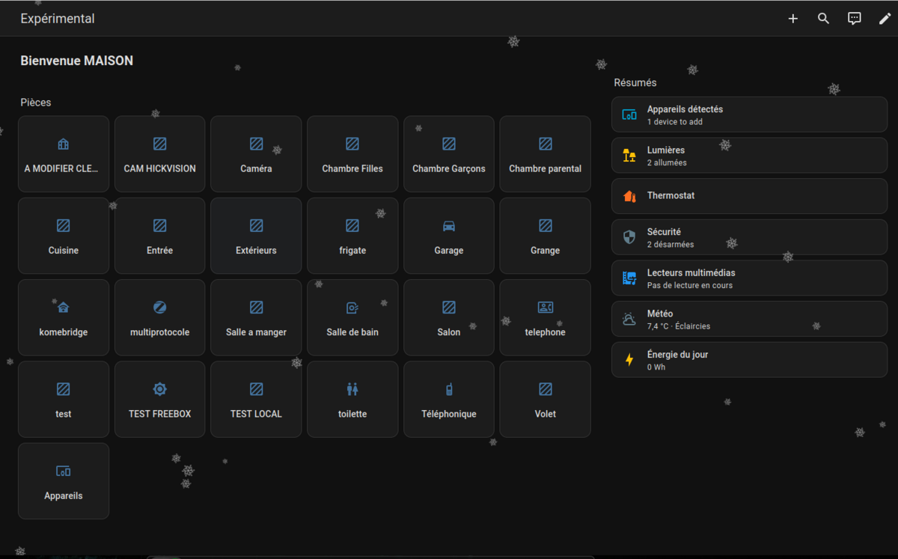
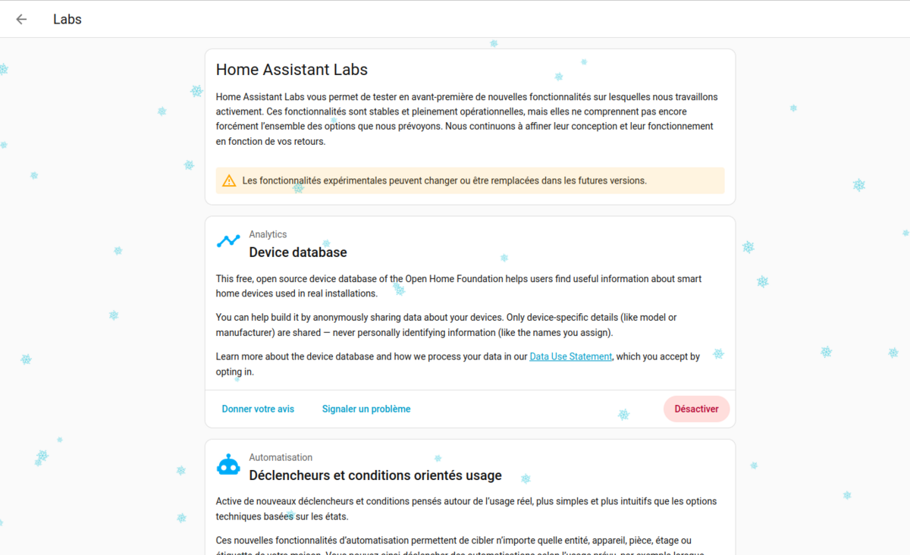
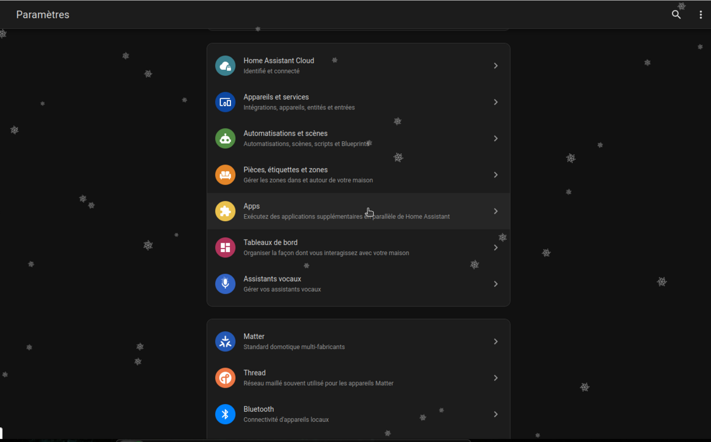
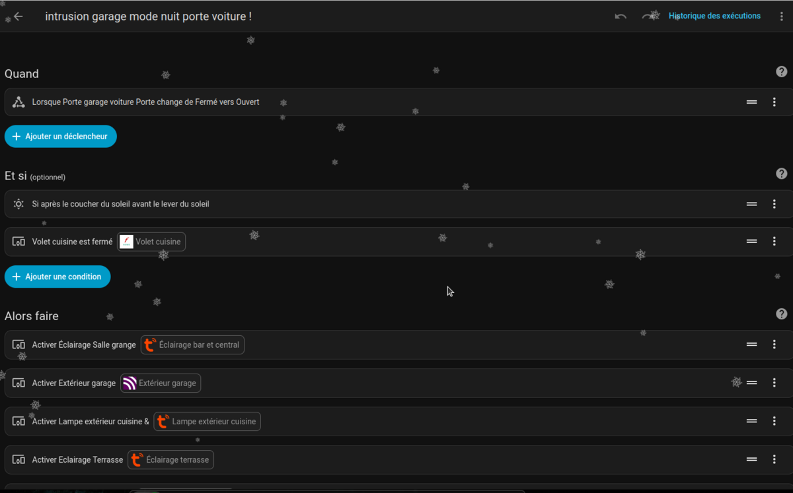
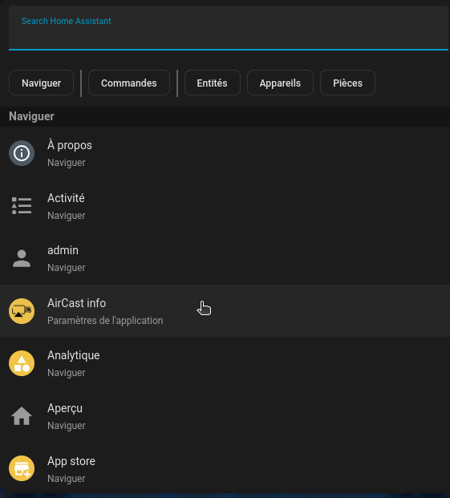
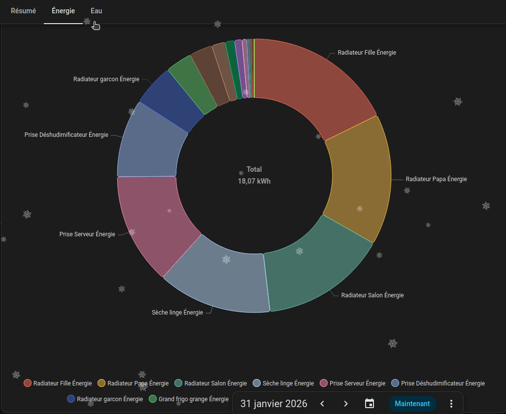

<a href="https://forumdomotique.com/actualites/home-assistant/home-assistant-20262-la-mise-%C3%A0-jour-de-f%C3%A9vrier-2026-rend-le-dashboard-home-par-d%C3%A9faut-et-lance-la-device-database-r12/">Lire et commenter sur Forum Domotique</a>

<section class="carousel photo-carousel" data-carousel data-lightbox aria-roledescription="carrousel" aria-label="Photos de l’article (6)" tabindex="0">

<figure class="photo-slide" data-slide>
  
</figure>
<figure class="photo-slide" data-slide>
  
</figure>
<figure class="photo-slide" data-slide>
  
</figure>
<figure class="photo-slide" data-slide>
  
</figure>
<figure class="photo-slide" data-slide>
  
</figure>
<figure class="photo-slide" data-slide>
  
</figure>

<button type="button" class="carousel-nav" data-prev aria-label="Photo précédente">‹</button>
<button type="button" class="carousel-nav" data-next aria-label="Photo suivante">›</button>

Faites défiler les photos, ou ouvrez-les pour les agrandir (si JavaScript est activé).

</section>

# Home Assistant 2026.2 : la mise à jour de février 2026 rend le dashboard Home par défaut et lance la Device Database

- **Type :** Actualité
- **Catégorie :** Actualité domotique & maison connectée > Home Assistant
- **Lien :** https://forumdomotique.com/actualites/home-assistant/home-assistant-20262-la-mise-%C3%A0-jour-de-f%C3%A9vrier-2026-rend-le-dashboard-home-par-d%C3%A9faut-et-lance-la-device-database-r12/
- **Date de publication :** 31 janvier 2026 à 12:07 (Europe/Paris)
- **Auteur :** XAV59213

---

Après une 2026.1 un peu plus calme post-fêtes, l'équipe frappe fort avec la 2026.2 ! Sortie officielle le 4 février 2026, cette version transforme le dashboard "Home" en vue par défaut (avec migration douce pour les anciens), introduit la fameuse **Device Database** (opt-in, pour aider l'écosystème open home), renomme les Add-ons en **Apps** avec un store repensé, et ajoute encore plus de triggers/conditions "humains" via Labs.

Comme d'habitude, mettez à jour via **Paramètres > Système > Mises à jour**. Sauvegarde recommandée avant !

## Le dashboard Home devient la norme (et c'est génial)

🏠 Le dashboard "Home" que l'on testait depuis plusieurs mois est maintenant **la vue par défaut** pour les nouvelles installations et pour les utilisateurs qui n'ont pas customisé leur vue principale.

<!-- source : https://cdn.forumdomotique.com/monthly_2026_01/Capturedcrandu2026-01-3111-53-41.png.22ccdf75d78b03baf132cf92213f637b.png -->

- Si votre vue par défaut est vierge ou basique → HA vous propose gentiment de passer au nouveau Home (sans écraser quoi que ce soit).
- Vous préférez l'ancien ? Créez simplement une vue "Overview (legacy)" via le menu Créer un dashboard.
- Les **appareils découverts** (nouveaux Zigbee, Matter, etc.) apparaissent maintenant directement sur ce dashboard Home → plus besoin de traquer les notifications ou d'aller dans Intégrations > Appareils.

C'est le plus gros changement d'ergonomie depuis longtemps : le dashboard est enfin centré sur "ce qui se passe chez vous" plutôt que sur une liste technique.

## Device Database : aidez la communauté (opt-in !)

🔍 Annoncé au State of the Open Home 2025, la **Device Database** arrive enfin en beta publique !

<!-- source : https://cdn.forumdomotique.com/monthly_2026_01/Capturedcrandu2026-01-3111-48-27.png.7beb9cf58461eea13dfe1a192ba49629.png -->

- Opt-in via **Labs** (Paramètres > Système > Labs).
- Elle collecte anonymement des stats sur vos appareils (modèles, firmwares, intégrations utilisées) pour aider fabricants et développeurs à mieux supporter le matériel open.
- **Aucune donnée personnelle** n'est envoyée sans consentement explicite.
- Un blog dédié est prévu début février pour expliquer comment participer.

C'est un gros pas pour améliorer la compatibilité globale sans forcer quoi que ce soit.

## Add-ons → Apps : le magasin repensé

📦 Gros rebranding : les **Add-ons** deviennent des **Apps** !

<!-- source : https://cdn.forumdomotique.com/monthly_2026_01/Capturedcrandu2026-01-3111-54-14.png.7465bfe1d26084d2bdcc5acb086c3324.png -->

- Le Supervisor gère maintenant un "App Store" redesigné, plus clair et plus rapide.
- Installation, mises à jour, logs, configuration : tout est plus fluide.
- Les add-ons existants migrent automatiquement (pas de réinstallation requise).
- Certains add-ons populaires (comme ESPHome, Music Assistant, Frigate) gagnent des améliorations spécifiques dans cette release.

## Automatisations encore plus naturelles (Labs)

🤖 Labs continue d'évoluer : nouveaux triggers et conditions "en langage courant" :

<!-- source : https://cdn.forumdomotique.com/monthly_2026_01/Capturedcrandu2026-01-3111-55-56.png.4360a4476613850dd9f3a18bcbe42776.png -->

- **Quand un appareil est découvert** (nouveau !).
- **Quand l'énergie dépasse un seuil quotidien/hebdo**.
- **Quand une mise à jour d'intégration est disponible** (pas seulement core).
- Améliorations sur les conditions "personne à la maison", "luminosité ambiante", "état du verrou".

Le tout avec un éditeur visuel plus lisible et des suggestions intelligentes.

## Nouvelles intégrations

✅ Six ajouts frais :

- **Cloudflare R2** → Sauvegardes directes sur R2 (alternative S3 pas chère).
- **Green Planet Energy** → Suivi conso énergie verte.
- **HDFury** → Intégration HDMI/ARC pour home-cinema.
- **NRGkick** → Chargeurs EV intelligents.
- **Prana** → Ventilation intelligente (VMC).
- **uHoo** → Capteurs qualité air indoor.

- Améliorations Matter (thermostats, serrures, stores), Reolink, ESPHome, Music Assistant.

## Autres pépites

- Recherche globale rapide (Ctrl+K / Cmd+K) pour tout trouver : entités, appareils, services, automatisations.

<!-- source : https://cdn.forumdomotique.com/monthly_2026_01/Capturedcrandu2026-01-3111-57-49.png.09347ec2d1a4d4452b431da1c52ef299.png -->

- Nouvelles cartes dashboard (énergie circulaire, prédictions IA simplifiées).

<!-- source : https://cdn.forumdomotique.com/monthly_2026_01/Capturedcrandu2026-01-3111-58-59.png.64212f1507f0d6d400e1d535dce7a740.png -->

- Meilleure gestion Thread/Matter (panneau dédié remis en avant).
- Optimisations perf sur gros setups (logs, recorder).
- Unit converters plus flexibles (dépréciations annoncées pour 2026.11).

## Breaking changes à surveiller

⚠️ Quelques points :

- Add-ons → Apps : les URLs / API d'add-ons changent légèrement (ex. portainer → apps).
- Anciens dashboards "Overview" deviennent legacy.
- Certaines stats Matter renommées (snake_case forcé).
- Dépréciations unit_class et mean_type (devront être explicitement null en 2026.11).

Vérifiez les notes complètes pour votre setup !

## Résumé des nouveautés

| Fonctionnalité | Description | Impact |
| --- | --- | --- |
| Dashboard Home par défaut | Migration douce, appareils découverts visibles | Ergonomie familiale massive |
| Device Database | Opt-in analytics communauté | Meilleure compatibilité future |
| Add-ons → Apps | Store redesigné, migration auto | Plus moderne & fluide |
| Recherche globale Ctrl+K | Accès instantané partout | Gain de temps énorme |
| Triggers Labs avancés | Découverte appareil, seuils énergie… | Automatisations intuitives |
| Nouvelles intégrations | Cloudflare R2, NRGkick, uHoo… | + hardware supporté |
| Matter/Thread polish | Panneau + thermostats/serrures améliorés | Stabilité Matter ↑ |

Notes officielles : [blog release 2026.2](https://www.home-assistant.io/blog/2026/02/04/release-20262/) (ou [rc.home-assistant.io](https://rc.home-assistant.io) pour la beta) et [changelog complet](https://www.home-assistant.io/changelogs/core-2026.2/).

Qu'en pensez-vous de cette 2026.2 ? Prêt à activer la Device Database ? Partagez en commentaires !
