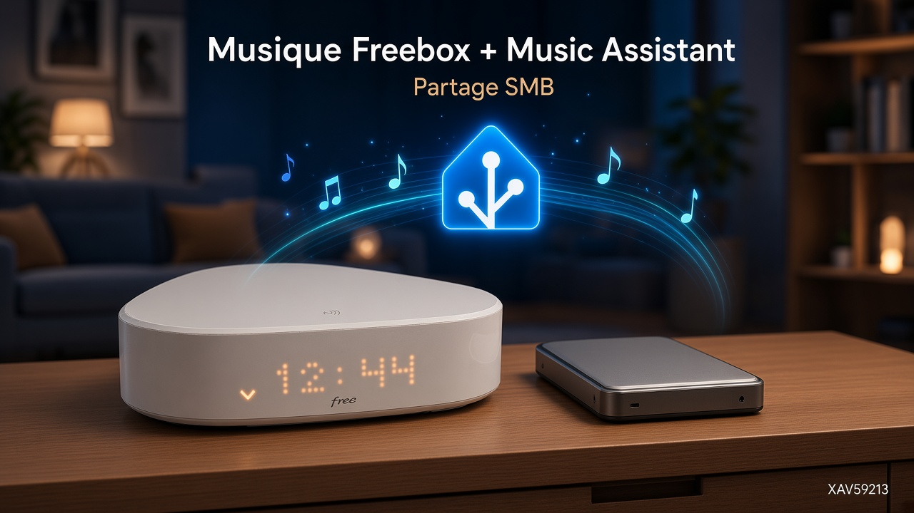
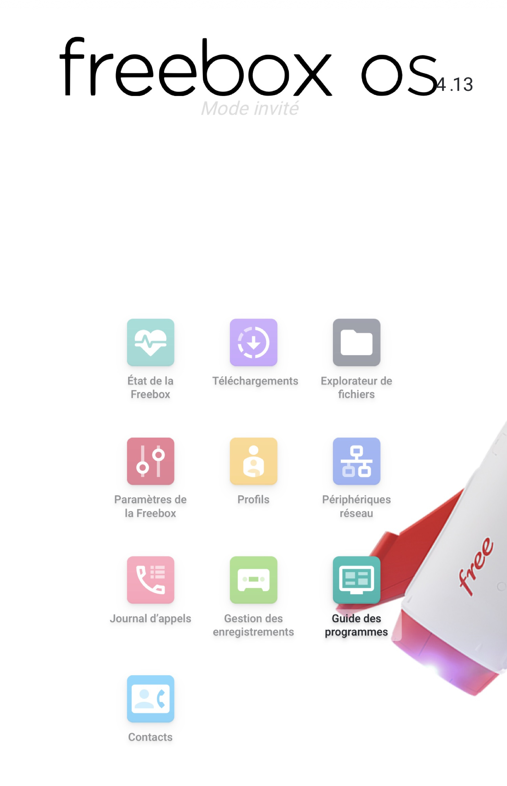
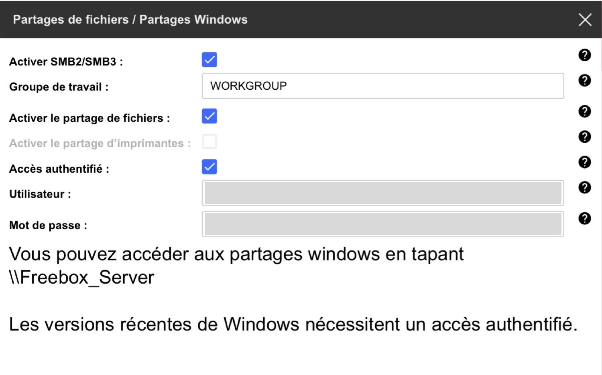
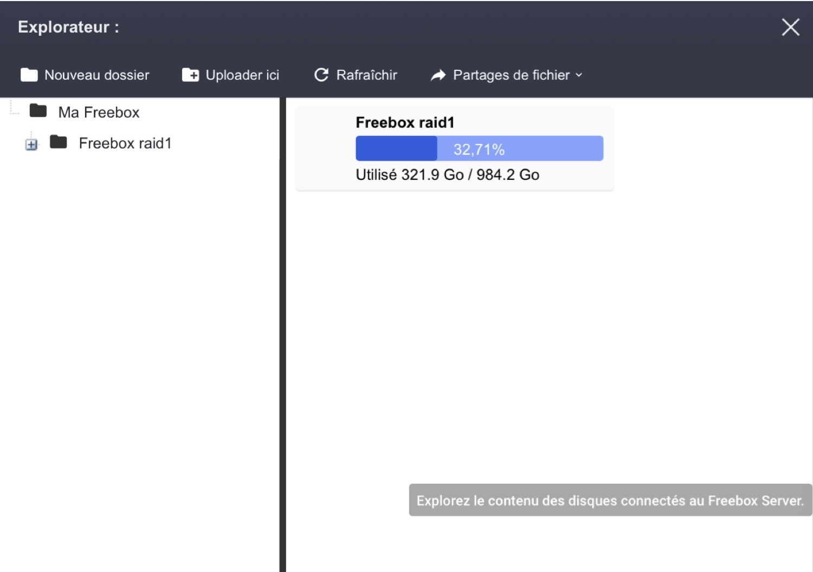
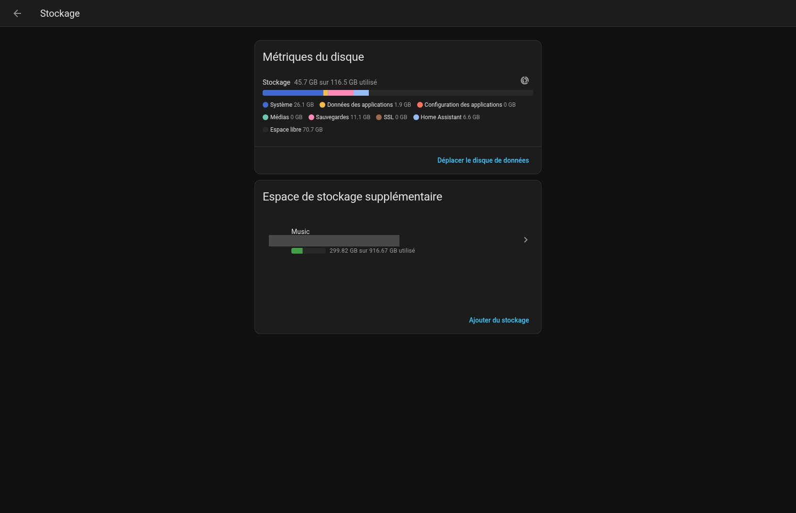
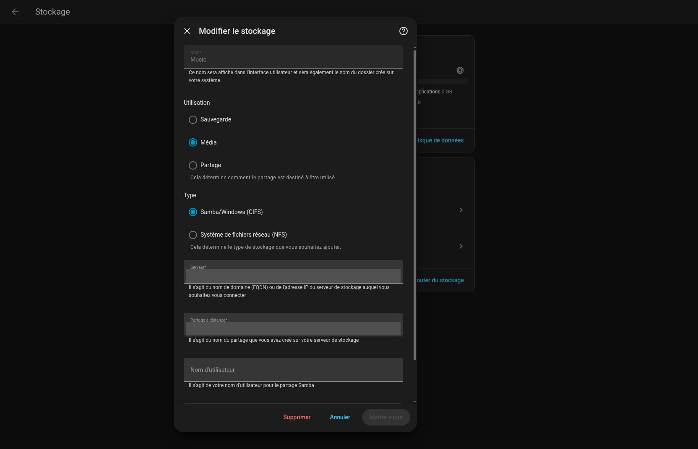
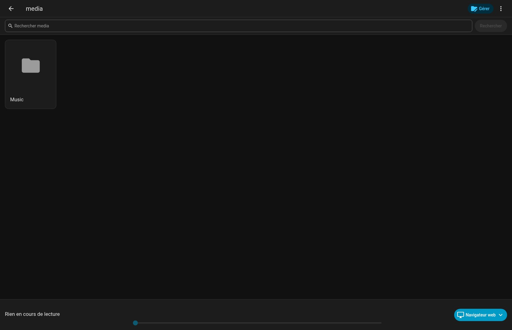
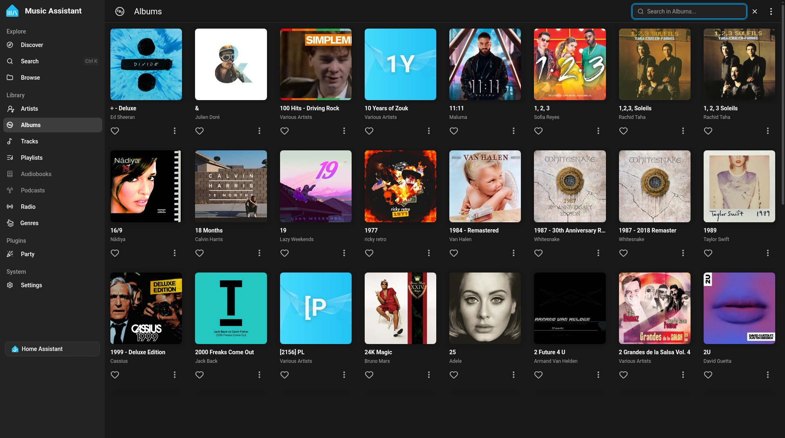
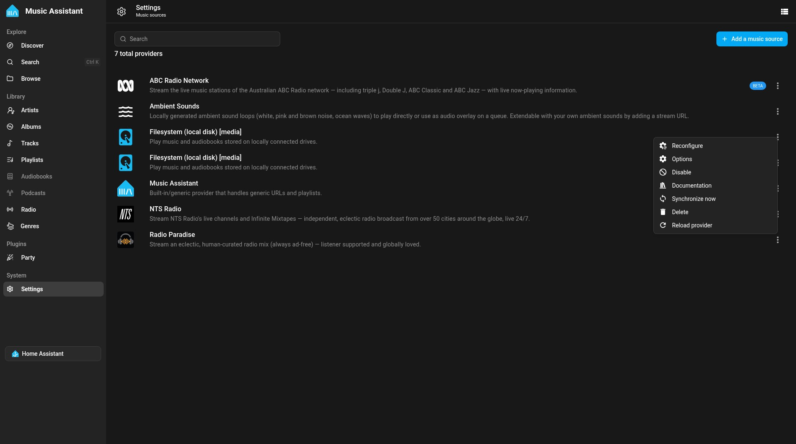

# Comment ajouter la musique stockée sur le disque dur de votre Freebox à Music Assistant via partage SMB

**Guide complémentaire.** Pour l’écouter ensuite sur vos Echo Dot et Echo Show, voir le guide [Installer Music Assistant dans Home Assistant et lire ses MP3 sur les Echo Dot et Echo Show]({{ '/contenus/guides/music-assistant-echo/article.html' | relative_url }}).

## Pourquoi brancher le disque de la Freebox

J’ai beaucoup de musique sur le disque de ma **Freebox Delta**. L’idée n’est pas de passer par le Freebox Player pour l’écouter dans le salon : je veux que ces fichiers vivent dans **Music Assistant**, à côté de Home Assistant, et que je puisse les envoyer sur les enceintes de la maison, y compris plus tard sur les Echo.

Music Assistant sait lire une bibliothèque de fichiers (MP3, FLAC, et d’autres formats). Deux chemins existent pour y faire arriver un disque réseau :

- **l’option A**, que j’ai réellement utilisée : monter le partage **Windows (SMB)** dans Home Assistant, comme stockage réseau d’usage **Média**, puis pointer Music Assistant vers le dossier local `/media` ;
- **l’option B**, proposée par la documentation officielle de Music Assistant : ajouter directement le fournisseur **Filesystem (remote share)**, et laisser Music Assistant monter le SMB lui-même.

Chez moi, c’est bien l’option A. Les captures du 21 décembre 2025 le montrent, et, en novembre 2026, les fichiers sont toujours au même endroit : `/media/Music/`.

## Prérequis

- une Freebox avec un disque (interne, RAID ou USB) où se trouve la musique, et Home Assistant **sur le même réseau local** que la Freebox ;
- **Music Assistant** déjà installé. La [documentation officielle](https://www.music-assistant.io/installation/) recommande Home Assistant OS, avec Music Assistant comme application. Sur Home Assistant OS, Music Assistant ne voit que le dossier `/media` ;
- le partage Windows (SMB) de la Freebox activé, de préférence en **SMB 2 / SMB 3**, pas en SMB 1.

Au moment où je prépare cette mise à jour, le 21 novembre 2026 :

- Home Assistant Core **2026.11.2**, Supervisor 2026.11.0, OS **18.5** ;
- Music Assistant Server **2.10.13** ;
- Freebox OS **4.13** (en décembre 2025, les captures montraient encore la 4.9).

## Activer le partage Windows (SMB) sur Freebox OS

On se connecte à Freebox OS, en local, à l’adresse habituelle [mafreebox.freebox.fr](http://mafreebox.freebox.fr).

Sur cette page d’accueil, la version **4.13** apparaît à côté du logo. La capture a été faite en **mode invité**. Ensuite, dans **Paramètres de la Freebox**, on passe en **Mode avancé**, puis on ouvre **Partage de fichiers → Partages Windows**.

Sur cette fenêtre, en novembre 2026 (Freebox OS 4.13) :

- **Activer SMB2/SMB3** : coché. C’est le bon réglage : la documentation de Home Assistant demande de rester en **Auto (2.1+)** et d’éviter les modes *Legacy*, surtout le **1.0**, moins sûrs. Music Assistant, de son côté, recommande **SMB 3.0** ou plus ;
- **Activer le partage de fichiers** : coché ;
- **Groupe de travail** : `WORKGROUP` ;
- **Accès authentifié** : coché.

L’interface indique aussi que l’on peut joindre les partages Windows en tapant **`\\Freebox_Server`**, et que **les versions récentes de Windows nécessitent un accès authentifié**.

Je recommande d’activer cet accès authentifié, avec un identifiant et un mot de passe dédiés, puis de les saisir dans le stockage réseau de Home Assistant. C’est l’option la plus sûre. Chez moi, le montage Home Assistant fonctionne aussi lorsque le champ utilisateur y est laissé vide ; cela peut donc marcher ainsi, mais ce n’est pas le réglage que je conseille en priorité. Je ne publie ni mon identifiant ni mon mot de passe.

Si le nom `Freebox_Server` ne se résout pas depuis Home Assistant, on utilise l’adresse IP locale de la Freebox.

> **Exemple fictif**, clairement indiqué, ce n’est pas mon adresse : `192.168.1.254`. Ne recopiez pas une adresse trouvée dans un vieil écran : prenez celle de *votre* Freebox, dans Freebox OS ou dans la liste des appareils du réseau.

Pour que ce nom ou cette adresse ne change pas, on peut, à titre de précaution, réserver l’IP de la Freebox dans le DHCP. Ce n’est pas obligatoire : plus simplement, on peut aussi s’appuyer sur le nom `Freebox_Server` s’il répond bien en permanence.

Pour connaître le **nom exact du volume** et du dossier musique, on ouvre l’**Explorateur de fichiers** de Freebox OS.

Chez moi, le disque s’appelle **Freebox raid1**. C’est là que se trouve le dossier `Musiques`. Le nom du volume, puis celui de ce dossier, serviront tout à l’heure dans Home Assistant.

L’assistance Free rappelle un piège utile : en **mode Bridge**, le partage Windows du Server n’est plus accessible. La Freebox doit rester routeur pour que ce guide s’applique.

## Option A — celle que j’ai choisie : monter le partage dans Home Assistant, puis le fournisseur local dans Music Assistant

C’est la méthode qui correspond à mon installation, et aussi, dans l’esprit, à ce que recommande Music Assistant : monter le partage **côté hôte**, puis le présenter au serveur comme un dossier local. Sur Home Assistant OS, ce « hôte », c’est la page **Stockage**.

### Ajouter le stockage réseau

Dans Home Assistant :

1. Aller dans **Paramètres → Système → Stockage**.
2. Choisir **Ajouter un stockage réseau**.
3. Remplir le formulaire, par exemple ainsi (valeurs **fictives**, à adapter) :

| Champ | Exemple fictif | Remarque |
| --- | --- | --- |
| **Nom** | `Music` | Lettres, chiffres et tirets bas seulement. Ce nom devient le dossier sous `/media`. Chez moi, ce nom est bien `Music`, d’où le chemin `/media/Music/`. |
| **Utilisation** | **Média** | Obligatoire pour que Music Assistant, qui ne voit que `/media` sur Home Assistant OS, puisse lire les fichiers. |
| **Serveur** | `Freebox_Server` ou, si besoin, `192.168.1.254` | Le nom indiqué par Freebox OS, ou un exemple d’IP typique, **pas** la mienne. |
| **Protocole** | **Samba/Windows (CIFS)** |  |
| **Partage à distance** | `MonVolume/Musiques` | Exemple de forme. Chez moi, d’après l’explorateur : `Freebox raid1/Musiques`. Respectez les espaces et la casse. |
| **Nom d’utilisateur** / **Mot de passe** | ceux définis dans Freebox OS | Le plus sûr : les saisir ici. Chez moi, le montage fonctionne aussi avec le champ utilisateur laissé vide. Ne les publiez pas. |

4. Cliquer sur **Connecter**.

D’après la [documentation officielle de Home Assistant OS](https://www.home-assistant.io/common-tasks/os/#network-storage), le choix de la version CIFS n’apparaît que si la connexion échoue, ou si le stockage utilise déjà une ancienne version. On laisse **Auto (2.1+)**. On ne descend sur *Legacy (2.0)* ou *Legacy (1.0)* que si le serveur ne sait vraiment rien faire d’autre, et on évite le 1.0.

Si tout va bien, le stockage apparaît dans la liste, et un dossier du même nom se crée tout seul dans **Médias**. Chez moi, le 21 décembre 2025, le dossier **Music** était bien là, avec le contenu du dossier musique de la Freebox.

Le stockage `Music` apparaît bien dans la liste, en usage Média. J’ai masqué l’adresse du serveur et le chemin du partage.

C’est l’écran **Modifier le stockage** du montage déjà en place, pas le formulaire d’ajout. On y voit le nom `Music`, l’usage **Média** et le type **Samba/Windows (CIFS)**. L’adresse du serveur et le nom du partage sont masqués. Le champ **Nom d’utilisateur** est vide : chez moi, le montage fonctionne ainsi, mais je recommande tout de même de le renseigner, avec le mot de passe, pour un accès authentifié.

Dans **Médias**, au niveau `/media`, le dossier `Music` est bien là. C’est celui que Home Assistant crée à partir du nom du stockage réseau.

### Ajouter le fournisseur dans Music Assistant

Ensuite, dans l’interface de Music Assistant (la barre latérale de Home Assistant, ou le port **8095** en local) :

1. Ouvrir **Paramètres**, puis l’onglet des **fournisseurs de musique** (*Music Providers*).
2. **Ajouter un nouveau fournisseur**.
3. Choisir **Filesystem (local disk)**, pas le fournisseur distant.
4. Indiquer le chemin vers les fichiers : chez moi, c’est **`/media`**, avec le type de contenu **Music [default]**.
5. Enregistrer, puis lancer une synchronisation (**Synchronisez maintenant**).

Ce réglage est celui de mon installation actuelle, confirmé en novembre 2026 sur Music Assistant 2.10.13. Le fournisseur parcourt **tout** `/media`. Les MP3, eux, sont dans `/media/Music/` — c’est le dossier créé par le stockage réseau nommé `Music`. Le type de contenu **Music [default]** sert à ne retenir que les fichiers audio, même s’il existe d’autres dossiers sous `/media`.

Un point important : il ne faut **pas déclarer deux fois** le même fournisseur sur `/media`. Chez moi, deux lignes **Filesystem (local disk) [media]** apparaissent dans la liste, et cela crée des doublons dans la bibliothèque. Une seule entrée suffit.

![Les fournisseurs de musique dans Music Assistant, avec deux lignes Filesystem (local disk) [media]](images/09-ma-fournisseurs.jpg)

On voit ici les deux fournisseurs locaux sur `/media` : c’est précisément le cas à éviter, pour ne pas se retrouver avec des doublons.

![Configuration du fournisseur Filesystem (local disk) : type de contenu Music [default], chemin /media](images/10-ma-filesystem-config.jpg)

Mon premier article parlait aussi du fournisseur **Filesystem (remote share)**. En pratique, d’après mes propres écrans, ce n’est pas celui que j’ai fini par utiliser : le partage est monté dans Home Assistant, et Music Assistant lit un dossier local.

## Option B — le fournisseur SMB directement dans Music Assistant

Je n’ai pas de journal montrant que cette option tourne chez moi aujourd’hui. Je la résume d’après la [documentation officielle des sources Filesystem](https://www.music-assistant.io/music-providers/local-files/), pour celles et ceux qui préfèrent ne pas passer par la page Stockage de Home Assistant.

On ajoute le fournisseur **Filesystem (remote share)**, puis :

- le nom d’hôte (ou l’adresse IP) du serveur, par exemple `Freebox_Server` ;
- le nom du partage, et éventuellement un sous-dossier ;
- le nom d’utilisateur et le mot de passe, s’il y en a.

Les options avancées, toujours d’après cette page :

- **SMB Version** : `Auto`, `SMB 1.0`, `SMB 2.0`, `SMB 2.1`, `SMB 3.0` (valeur par défaut) ou `SMB 3.1.1`. La documentation recommande **SMB 3.0 ou plus**, ou `Auto` pour laisser négocier. On évite **SMB 1.0** ;
- **Cache Mode** : `Strict`, `Loose (Recommended)` (valeur par défaut) ou `None`. **Loose** est conseillé pour une bibliothèque musicale, davantage sollicitée en lecture.

Music Assistant précise aussi que ce montage est prévu pour le **réseau local** : le logiciel n’ajoute ni chiffrement ni contrôle d’accès de son cru. Le partage ne doit pas être ouvert sur Internet.

Sur Home Assistant OS, si cette option B refuse de monter le disque, revenir à l’option A : c’est celle qui, chez moi, fonctionne.

## Organiser les dossiers et les tags

Un dossier dédié à la musique, sur le disque de la Freebox, simplifie le montage : on ne partage que ce qu’il faut, et Music Assistant n’a pas à parcourir tout le reste.

La [documentation officielle](https://www.music-assistant.io/music-providers/local-files/) donne ensuite des règles utiles, que je n’invente pas comme étant « ma » méthode :

- les tags **Title**, **Artist**, **Album**, **Album Artist** et **Track number** sont considérés comme obligatoires pour que la bibliothèque se construise correctement. Pour du MP3, ce sont les tags ID3 ;
- le genre, les identifiants MusicBrainz et un numéro de disque aident beaucoup pour le classement et pour relier un fichier local à une éventuelle source de streaming ;
- l’organisation idéale est `artiste/album`, avec des noms de dossiers alignés sur les tags (sans les caractères non alphanumériques : par exemple `AC/DC` devient `ACDC`) ;
- un classement plus libre sera quand même importé, mais Music Assistant pourra moins s’appuyer sur les noms de dossiers ;
- les pochettes intégrées aux fichiers, ou une image à côté des morceaux, sont prises en charge. Une image à côté est même présentée comme le meilleur choix ;
- les dossiers dont le nom commence par un tiret bas sont ignorés ;
- les noms de fichiers et de dossiers doivent être en **UTF-8**. Un accent mal encodé (vieil encodage Windows) fait sauter le fichier à la synchronisation ;
- sur un partage **SMB**, les emoji et certains caractères spéciaux dans les noms ne sont pas gérés : ces éléments sont ignorés, avec un avertissement dans les journaux.

Chez moi, les trois cohabitent : des dossiers par artiste, des dossiers par album, et des fichiers posés un peu partout. Ce mélange n’est pas un problème. Music Assistant s’appuie surtout sur les tags des MP3 (les tags ID3) : ce qui compte, c’est qu’ils soient bien remplis, davantage que l’arbre des dossiers.

## Synchroniser la bibliothèque

Après l’enregistrement du fournisseur, Music Assistant parcourt les fichiers. Le menu du fournisseur propose ensuite **Synchronisez maintenant** pour relancer un passage.

Je ne connais plus la durée de ma première synchronisation complète : les journaux sont trop anciens pour la retrouver. Sur une grande bibliothèque, il faut s’armer de patience pour ce premier passage.

Ensuite, les synchronisations incrémentales automatiques tournent toutes les **12 heures**. Quand quelque chose a changé, elles durent environ **10 secondes**. La nuit, l’analyse audio en arrière-plan traite environ **144 morceaux** en à peu près **8 minutes**.

Une fois la sync terminée, les albums, artistes et pistes apparaissent dans la bibliothèque. S’il existe aussi une source de streaming, Music Assistant peut relier un même morceau d’un côté et de l’autre, et, à la lecture, choisir automatiquement la version de meilleure qualité, par exemple un FLAC local plutôt qu’un flux compressé.

Aujourd’hui, dans Music Assistant 2.10.13, les statistiques de la bibliothèque (**Settings → About → Library Statistics**) donnent, à peu près : **2 700 pistes**, **1 200 albums**, **1 900 artistes** et **10 listes de lecture**.

## Les pièges que j’ai notés

> **Piège.** Le nom du partage doit être **exactement** celui de l’explorateur Freebox, espaces et casse compris. Avant de blâmer Home Assistant, on peut tester depuis un PC Windows : `\\Freebox_Server\` puis le nom du volume. Si le nom d’hôte ne répond pas, on essaie l’adresse IP (la vôtre, pas un exemple recopié).

> **Piège.** Un « accès refusé » vient souvent d’une version SMB trop ancienne, ou d’un identifiant manquant. Sur la Freebox, on active **SMB2/SMB3**. Dans Home Assistant, on reste en **Auto (2.1+)**. On évite SMB 1.

> **Piège.** En **mode Bridge**, le partage Windows de la Freebox n’est plus joignable. Il faut que le Server reste routeur.

> **Piège.** Le partage doit rester sur le réseau **local**. On ne l’expose pas sur Internet.

> **Piège.** Une synchronisation lente ou incomplète vient souvent de tags pauvres, d’un encodage de nom incorrect, ou de caractères spéciaux sur le SMB. On corrige les tags, on relance **Synchronisez maintenant**, et l’on regarde les journaux de Music Assistant si des fichiers sont ignorés.

> **Piège.** Sur Home Assistant OS, Music Assistant ne voit que `/media`. Un stockage réseau d’usage **Sauvegarde** ou **Partager** n’apparaîtra pas au bon endroit pour ce guide. Il faut l’usage **Média**.

> **Piège.** Si l’on déclare deux fois le fournisseur **Filesystem (local disk)** sur le même `/media`, Music Assistant voit les fichiers en double. Une seule entrée suffit.

## Lire cette musique sur les Echo Dot et l’Echo Show

Une fois la bibliothèque dans Music Assistant, l’envoyer sur une Echo n’est pas un simple bouton. Chez moi, le 18 novembre 2026, les MP3 de `/media/Music/` ne sont sortis des Echo Dot et de l’Echo Show qu’après le réglage du skill Alexa personnel, de l’add-on **Music Assistant Alexa API**, et du reverse proxy.

J’ai raconté cette partie dans le guide [Installer Music Assistant dans Home Assistant et lire ses MP3 sur les Echo Dot et Echo Show]({{ '/contenus/guides/music-assistant-echo/article.html' | relative_url }}).

Le point déjà utile ici : dans Home Assistant, chaque Echo apparaît plusieurs fois, et seuls les lecteurs Music Assistant, ceux dont le nom se termine par **`_3`**, jouent un fichier de la bibliothèque.

## Mon retour d’expérience

Mon vécu, c’est que maintenant je peux lire les MP3 pour faire la fête. Plus besoin d’aller sur YouTube : tout est dans Music Assistant.

## En résumé

Sur une Freebox Delta, j’active le partage Windows en **SMB 2 / SMB 3**, avec un accès authentifié, je repère le nom exact du volume et du dossier musique (chez moi, `Freebox raid1` et `Musiques`), puis je monte ce partage dans **Paramètres → Système → Stockage**, en usage **Média**, sous le nom `Music`. Home Assistant crée alors `/media/Music/`. Dans Music Assistant, j’ajoute le fournisseur **Filesystem (local disk)** avec le chemin `/media` et le type de contenu **Music [default]**, une seule fois — deux fournisseurs sur le même `/media` donnent des doublons —, je synchronise, et la bibliothèque se remplit. Les MP3 se trouvent dans `/media/Music/`. C’est cette option A que j’utilise vraiment. L’option B, le fournisseur SMB distant, existe dans la documentation, mais ce n’est pas mon montage actuel.

Ensuite, pour écouter sur les Echo, je renvoie vers le guide Music Assistant + Echo.

**Guide complémentaire.** Pour l’écouter ensuite sur vos Echo Dot et Echo Show, voir le guide [Installer Music Assistant dans Home Assistant et lire ses MP3 sur les Echo Dot et Echo Show]({{ '/contenus/guides/music-assistant-echo/article.html' | relative_url }}).

## Guides complémentaires

- [Installer Music Assistant dans Home Assistant et lire ses MP3 sur les Echo Dot et Echo Show]({{ '/contenus/guides/music-assistant-echo/article.html' | relative_url }})

— XAV59213
