
<a href="https://forumdomotique.com/guides-tutoriels/home-assistant/guide-du-smlight-slzb-mr4u-installation-multi-radio-d%C3%A9di%C3%A9-%C3%A0-lopen-border-router-pour-matter-over-thread-r11/">Lire et commenter sur Forum Domotique</a>

<section class="carousel photo-carousel" data-carousel data-lightbox aria-roledescription="carrousel" aria-label="Photos de l’article (16)" tabindex="0">

<figure class="photo-slide" data-slide>
  <a href="images/Capturedcrandu2025-12-1411-57-15.png" data-full="images/Capturedcrandu2025-12-1411-57-15.png" data-alt="Photo 1 — Guide du SMLight SLZB-MR4U : Installation multi-radio dédié à l’Open Border Router pour Matter over Thread" aria-label="Agrandir la photo 1 : Photo 1 — Guide du SMLight SLZB-MR4U : Installation multi-radio dédié à l’Open Border Router pour Matter over Thread">
    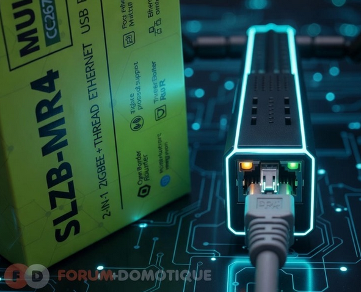
  </a>
</figure>
<figure class="photo-slide" data-slide>
  
</figure>
<figure class="photo-slide" data-slide>
  
</figure>
<figure class="photo-slide" data-slide>
  <a href="images/Capturedcrandu2025-12-1310-17-35.png" data-full="images/Capturedcrandu2025-12-1310-17-35.png" data-alt="Photo 4 — Guide du SMLight SLZB-MR4U : Installation multi-radio dédié à l’Open Border Router pour Matter over Thread" aria-label="Agrandir la photo 4 : Photo 4 — Guide du SMLight SLZB-MR4U : Installation multi-radio dédié à l’Open Border Router pour Matter over Thread">
    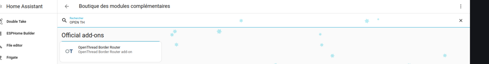
  </a>
</figure>
<figure class="photo-slide" data-slide>
  <a href="images/Capturedcrandu2025-12-1411-00-06.png" data-full="images/Capturedcrandu2025-12-1411-00-06.png" data-alt="Photo 5 — Guide du SMLight SLZB-MR4U : Installation multi-radio dédié à l’Open Border Router pour Matter over Thread" aria-label="Agrandir la photo 5 : Photo 5 — Guide du SMLight SLZB-MR4U : Installation multi-radio dédié à l’Open Border Router pour Matter over Thread">
    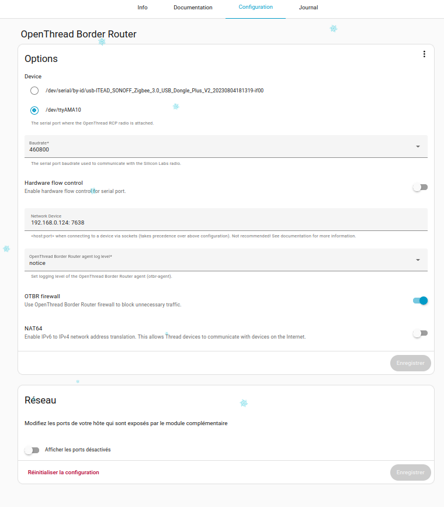
  </a>
</figure>
<figure class="photo-slide" data-slide>
  <a href="images/Capturedcrandu2025-12-1411-06-01.png" data-full="images/Capturedcrandu2025-12-1411-06-01.png" data-alt="Photo 6 — Guide du SMLight SLZB-MR4U : Installation multi-radio dédié à l’Open Border Router pour Matter over Thread" aria-label="Agrandir la photo 6 : Photo 6 — Guide du SMLight SLZB-MR4U : Installation multi-radio dédié à l’Open Border Router pour Matter over Thread">
    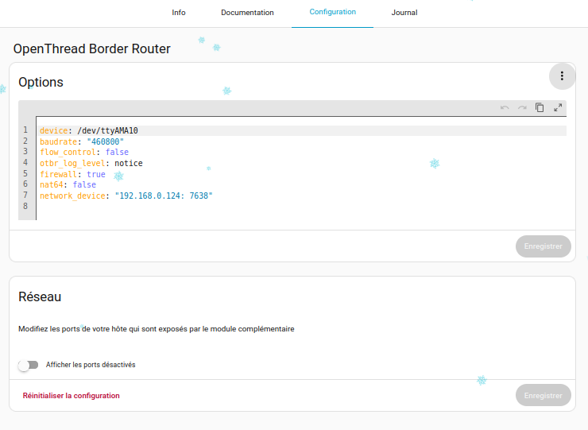
  </a>
</figure>
<figure class="photo-slide" data-slide>
  <a href="images/Capturedcrandu2025-12-1310-24-18.png" data-full="images/Capturedcrandu2025-12-1310-24-18.png" data-alt="Photo 7 — Guide du SMLight SLZB-MR4U : Installation multi-radio dédié à l’Open Border Router pour Matter over Thread" aria-label="Agrandir la photo 7 : Photo 7 — Guide du SMLight SLZB-MR4U : Installation multi-radio dédié à l’Open Border Router pour Matter over Thread">
    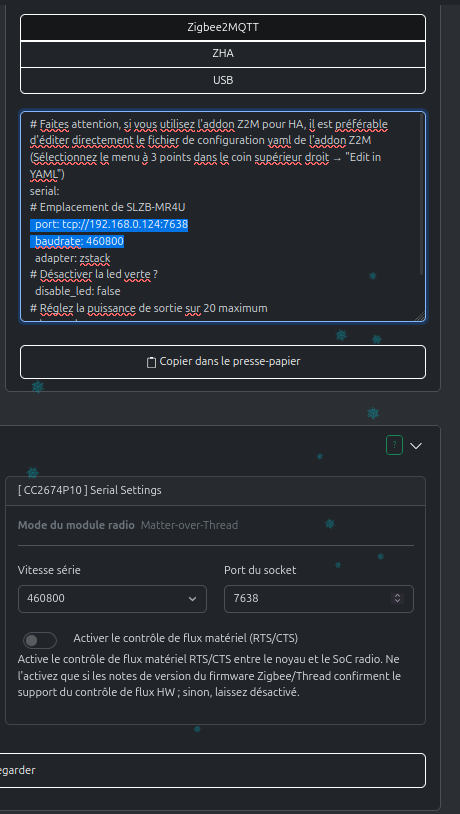
  </a>
</figure>
<figure class="photo-slide" data-slide>
  <a href="images/Capturedcrandu2025-12-1411-01-50.png" data-full="images/Capturedcrandu2025-12-1411-01-50.png" data-alt="Photo 8 — Guide du SMLight SLZB-MR4U : Installation multi-radio dédié à l’Open Border Router pour Matter over Thread" aria-label="Agrandir la photo 8 : Photo 8 — Guide du SMLight SLZB-MR4U : Installation multi-radio dédié à l’Open Border Router pour Matter over Thread">
    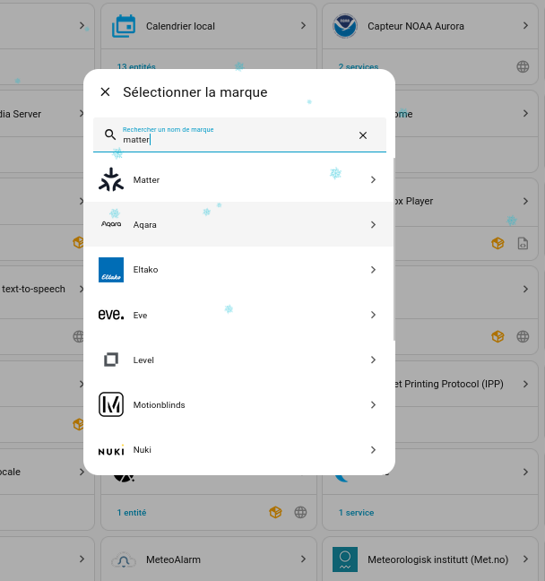
  </a>
</figure>
<figure class="photo-slide" data-slide>
  
</figure>
<figure class="photo-slide" data-slide>
  <a href="images/Capturedcrandu2025-12-2314-55-49.png" data-full="images/Capturedcrandu2025-12-2314-55-49.png" data-alt="Photo 10 — Guide du SMLight SLZB-MR4U : Installation multi-radio dédié à l’Open Border Router pour Matter over Thread" aria-label="Agrandir la photo 10 : Photo 10 — Guide du SMLight SLZB-MR4U : Installation multi-radio dédié à l’Open Border Router pour Matter over Thread">
    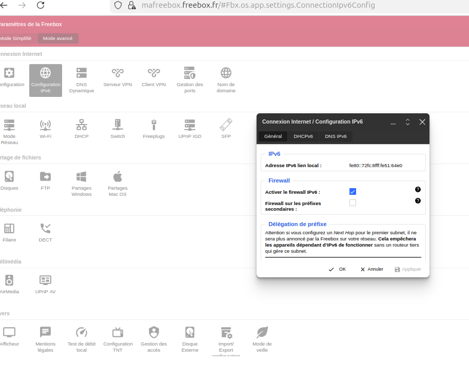
  </a>
</figure>
<figure class="photo-slide" data-slide>
  <a href="images/Capturedcrandu2025-12-2314-52-51.png" data-full="images/Capturedcrandu2025-12-2314-52-51.png" data-alt="Photo 11 — Guide du SMLight SLZB-MR4U : Installation multi-radio dédié à l’Open Border Router pour Matter over Thread" aria-label="Agrandir la photo 11 : Photo 11 — Guide du SMLight SLZB-MR4U : Installation multi-radio dédié à l’Open Border Router pour Matter over Thread">
    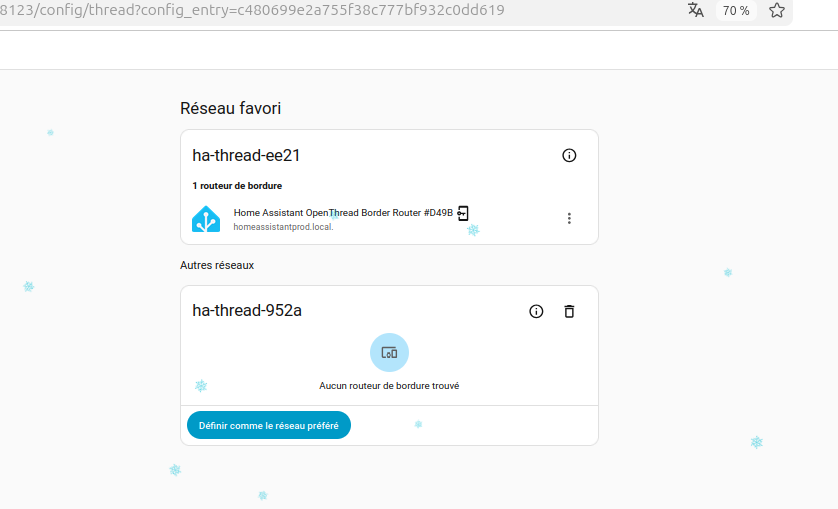
  </a>
</figure>
<figure class="photo-slide" data-slide>
  <a href="images/Capturedcrandu2025-12-2314-59-51.png" data-full="images/Capturedcrandu2025-12-2314-59-51.png" data-alt="Photo 12 — Guide du SMLight SLZB-MR4U : Installation multi-radio dédié à l’Open Border Router pour Matter over Thread" aria-label="Agrandir la photo 12 : Photo 12 — Guide du SMLight SLZB-MR4U : Installation multi-radio dédié à l’Open Border Router pour Matter over Thread">
    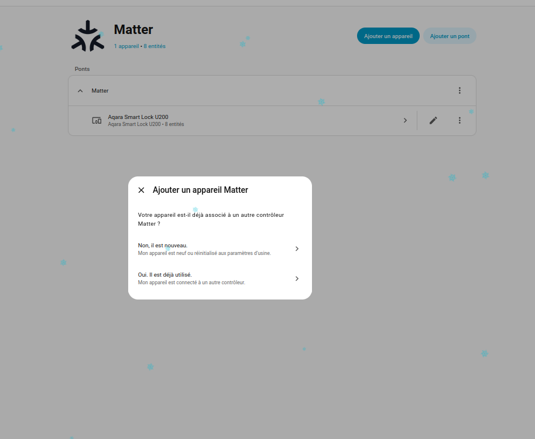
  </a>
</figure>
<figure class="photo-slide" data-slide>
  <a href="images/Capturedcrandu2025-12-2317-30-06.png" data-full="images/Capturedcrandu2025-12-2317-30-06.png" data-alt="Photo 13 — Guide du SMLight SLZB-MR4U : Installation multi-radio dédié à l’Open Border Router pour Matter over Thread" aria-label="Agrandir la photo 13 : Photo 13 — Guide du SMLight SLZB-MR4U : Installation multi-radio dédié à l’Open Border Router pour Matter over Thread">
    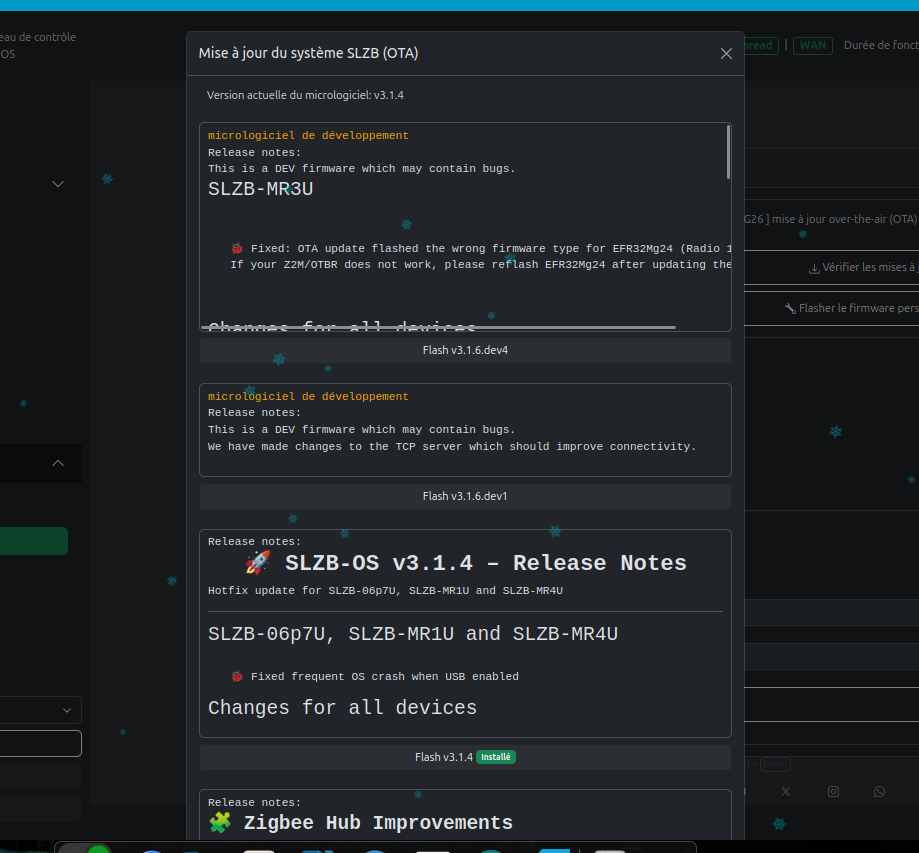
  </a>
</figure>
<figure class="photo-slide" data-slide>
  <a href="images/Capturedcrandu2025-12-2317-30-43.png" data-full="images/Capturedcrandu2025-12-2317-30-43.png" data-alt="Photo 14 — Guide du SMLight SLZB-MR4U : Installation multi-radio dédié à l’Open Border Router pour Matter over Thread" aria-label="Agrandir la photo 14 : Photo 14 — Guide du SMLight SLZB-MR4U : Installation multi-radio dédié à l’Open Border Router pour Matter over Thread">
    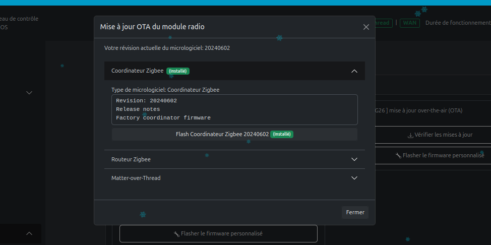
  </a>
</figure>
<figure class="photo-slide" data-slide>
  <a href="images/Capturedcrandu2025-12-2317-30-57.png" data-full="images/Capturedcrandu2025-12-2317-30-57.png" data-alt="Photo 15 — Guide du SMLight SLZB-MR4U : Installation multi-radio dédié à l’Open Border Router pour Matter over Thread" aria-label="Agrandir la photo 15 : Photo 15 — Guide du SMLight SLZB-MR4U : Installation multi-radio dédié à l’Open Border Router pour Matter over Thread">
    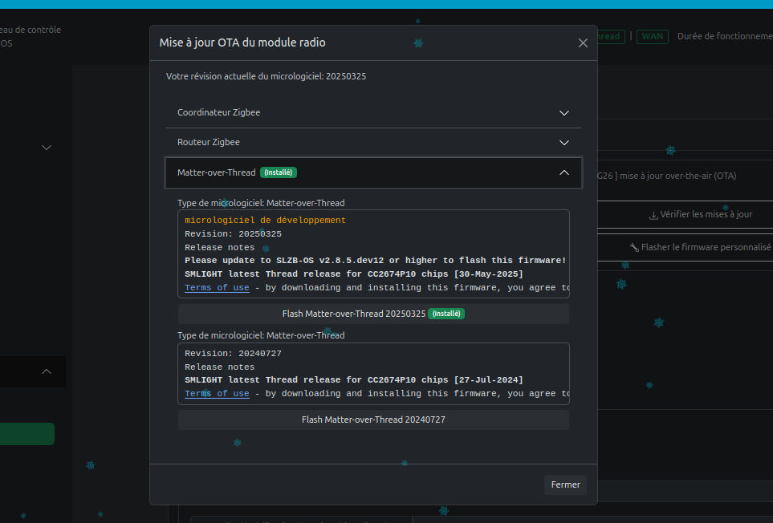
  </a>
</figure>
<figure class="photo-slide" data-slide>
  <a href="images/Capturedcrandu2025-12-2317-48-03.png" data-full="images/Capturedcrandu2025-12-2317-48-03.png" data-alt="Photo 16 — Guide du SMLight SLZB-MR4U : Installation multi-radio dédié à l’Open Border Router pour Matter over Thread" aria-label="Agrandir la photo 16 : Photo 16 — Guide du SMLight SLZB-MR4U : Installation multi-radio dédié à l’Open Border Router pour Matter over Thread">
    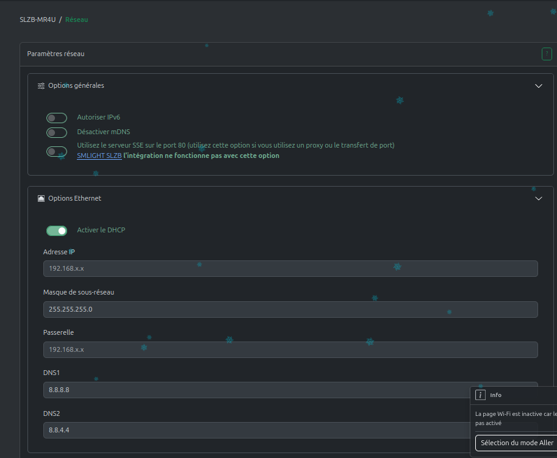
  </a>
</figure>

<button type="button" class="carousel-nav" data-prev aria-label="Photo précédente">‹</button>
<button type="button" class="carousel-nav" data-next aria-label="Photo suivante">›</button>

Faites défiler les photos, ou ouvrez-les pour les agrandir (si JavaScript est activé).

</section>

# Guide du SMLight SLZB-MR4U : Installation multi-radio dédié à l’Open Border Router pour Matter over Thread

- **Type :** Guide
- **Catégorie :** Guides & tutoriels domotique > Home Assistant
- **Lien :** https://forumdomotique.com/guides-tutoriels/home-assistant/guide-du-smlight-slzb-mr4u-installation-multi-radio-d%C3%A9di%C3%A9-%C3%A0-lopen-border-router-pour-matter-over-thread-r11/
- **Date de publication :** 17 décembre 2025 à 13:16 (Europe/Paris)
- **Auteur :** XAV59213

---

Ces dernières semaines, j’ai beaucoup réfléchi à la façon d’intégrer plus sereinement des appareils Matter over Thread dans mon installation domotique.

Avec l’arrivée progressive de nouveaux capteurs et interrupteurs compatibles Thread, je sentais que mon ancien setup Z2mqtt commençait à montrer ses limites pour accueillir cette nouvelle génération de devices. J’avais déjà exploré Zigbee2MQTT avec des modules SMLight par le passé, mais cette fois, mon intérêt s’est porté spécifiquement sur la partie Thread et Matter.

Quand j’ai découvert le **SLZB-MR4U**, une version évoluée de la série multi-radio de SMLight, l’idée d’avoir un coordinateur capable de gérer un réseau Thread de manière dédiée, tout en gardant une radio Zigbee puissante, m’a vraiment séduit.

Je voulais un dispositif que je puisse placer au centre de la maison, alimenté en PoE pour oublier les contraintes d’alimentation, et configuré comme Open Border Router pour que Home Assistant prenne la main sur le réseau Matter. C’est exactement ce que promet ce module, et après plusieurs semaines d’utilisation intensive, je peux dire qu’il tient largement ses promesses sur cet aspect.

L’installation physique est un jeu d’enfant. J’ai branché un câble Ethernet PoE directement depuis mon switch, et le module s’est alimenté instantanément. Pas besoin de bloc secteur encombrant, ce qui est un vrai plus quand on veut le placer dans les combles ou au centre de la maison. Une fois connecté au réseau, l’adresse IP apparaît facilement via le routeur ou en scannant le réseau local. L’interface web SLZB-OS est accessible en quelques clics, et c’est là que tout se joue pour la configuration. Pour mon usage centré sur l’Open Border Router, j’ai d’abord mis à jour le firmware SLZB-OS vers la dernière version stable, puis j’ai configuré la radio Texas Instruments CC2674P10 (Radio 2) en mode Matter over Thread en flashant le firmware RCP dédié. L’autre radio, la Silicon Labs EFR32MG26 (Radio 1), je l’ai mise en coordinateur Zigbee pour en profiter en parallèle lors de tests secondaires, mais l’intérêt principal restait Thread. Certaines versions précoces demandaient un reflash manuel pour stabiliser le mode OTBR, mais avec les firmwares récents, tout est fluide. Une fois cela fait, le module expose un port spinel accessible via l’IP du dispositif, généralement sur le port 6638 ou 7638 (similaire selon la radio choisie).

La mise en route dans Home Assistant suit une procédure maintenant bien rodée, mais qui demande un peu d’attention pour éviter les pièges classiques. J’ai installé l’add-on **OpenThread Border Router** depuis le magasin d’add-ons,en veillant à activer les options avancées dans les paramètres pour débloquer le champ Network Device.

Ensuite, il suffit d’entrer l’adresse du module au format ip:port, sans http ni rien d’autre. Le démarrage peut prendre un moment la première fois, le temps que le backbone Thread se forme. J’ai rencontré un petit accroc au début avec des timeouts spinel dans les logs, mais un simple reflash de la puce EFR32 via l’interface web a tout résolu, et depuis, c’est d’une stabilité exemplaire.

Une fois l’add-on lancé, j’ajoute l’intégration Matter dans Home Assistant, puis l’intégration Open Thread Border Router, et le réseau Thread est prêt.

Home Assistant devient alors le commissioner Matter, ce qui simplifie énormément l’appairage des nouveaux appareils.

L’intégration dans Home Assistant est particulièrement fluide quand on se concentre sur le rôle d’Open Border Router. L’add-on OTBR communique directement avec la radio réseau du **SLZB-MR4U**, et une fois configuré, tout apparaît automatiquement. Les appareils Thread rejoignent le réseau sans intervention manuelle compliquée, et Home Assistant gère le commissioning Matter de façon transparente. Ce qui simplifie vraiment la vie, c’est de ne plus dépendre d’un hub propriétaire pour les devices Matter : tout passe par HA, avec les automatisations habituelles.

En activant la seconde radio pour quelques tests, le module tient la charge sans broncher. À éviter peut-être les firmwares trop expérimentaux au début, mieux vaut partir sur des versions stables pour la puce EFR32MG26.

Ce qui ressort le plus après cette utilisation, c’est la flexibilité offerte par cette double radio dédiée et la connectivité PoE qui permet un placement optimal. La portée et la stabilité en mode Open Border Router sont excellentes, et le fait de pouvoir centraliser Zigbee et Thread dans un seul boîtier sans compromis rend l’installation plus propre. Côté améliorations, j’aurais aimé une documentation encore plus détaillée sur les spécificités de la version U, comme le passthrough USB qui peut être utile pour des setups hybrides, même si je ne l’ai pas exploité ici. Quelques utilisateurs ont signalé des besoins de reflash initial pour stabiliser Thread, mais avec les mises à jour récentes, cela semble résolu. Globalement, c’est un module qui gagne en maturité rapidement grâce au support actif de SMLight.

Après ces semaines de test centrées sur la configuration Open Border Router, je garde sans hésiter le **SLZB-MR4U** dans mon installation principale. Il répond parfaitement à ceux qui veulent un réseau Matter over Thread robuste et intégré nativement à Home Assistant, tout en conservant la possibilité d’un Zigbee puissant en parallèle. Si vous avez déjà une base Zigbee solide et que vous envisagez d’ajouter des appareils Thread sans multiplier les dongles, ce module est une solution crédible et durable. Il simplifie la transition vers Matter sans sacrifier la fiabilité, et c’est exactement ce que je cherchais.

---

<section class="article-comments" id="commentaires">

## Commentaires de XAV59213 sur cet article (4)

### Commentaire 1 — 23 décembre 2025 à 09:07 (Europe/Paris)

- **Identifiant :** `77`
- **Lien :** https://forumdomotique.com/guides-tutoriels/home-assistant/guide-du-smlight-slzb-mr4u-installation-multi-radio-d%C3%A9di%C3%A9-%C3%A0-lopen-border-router-pour-matter-over-thread-r11/?do=findComment&comment=77

Salut [@Kyrille](https://forumdomotique.com/profile/925-kyrille/)

Peux tu envoyer les logs de OpenThread Border Router?

Pour la puce j’ai utilisé la CC26

### Commentaire 2 — 23 décembre 2025 à 15:01 (Europe/Paris)

- **Identifiant :** `79`
- **Lien :** https://forumdomotique.com/guides-tutoriels/home-assistant/guide-du-smlight-slzb-mr4u-installation-multi-radio-d%C3%A9di%C3%A9-%C3%A0-lopen-border-router-pour-matter-over-thread-r11/?do=findComment&comment=79

Salut [@Kyrille](https://forumdomotique.com/profile/925-kyrille/) !

Désolé que ce soit la galère de ton côté, c’est frustrant quand on a l’impression d’avoir tout fait correctement…

Pour répondre précisément à tes nouvelles questions :

**Firmware de la puce radio** : J’utilise une CC2674P10 avec le firmware **MoT (Matter over Thread) v2.4.0** (le dernier stable recommandé par SMLight à fin décembre 2025).

**SLZBOS** (le firmware du coordinateur Zigbee/Multiprotocole sur la même clé SMLight SLZB-07) : Version **SLZBOS 2025.11.15** (la dernière disponible en décembre 2025 sur le repo GitHub de SMLight).

C’est important de ne pas prendre une version trop ancienne, car certaines versions antérieures avaient des conflits de ressources quand MoT et Zigbee tournaient sur la même puce.

- **IPv6 dans la partie réseau** : Oui, **absolument activé et autorisé sur mon routeur** .

  

Concernant la **synchronisation des credentials Thread** dans l’app Companion : tu as raison, j’aurais dû la mentionner plus explicitement !

C’est une étape clé sur Android. Dans l’app HA Companion : **Settings > Companion app > Troubleshooting > Sync Thread credentials** Il faut souvent le faire 2-3 fois (et attendre quelques secondes entre chaque tentative) jusqu’à voir clairement le message "Home Assistant and this device use the same network" avec l’icône clé + téléphone.

Pour infos moi je suis sur Apple

1. Dans l’app Companion iOS :

   Va dans **Réglages > Appareils et services > Thread**.

   Sélectionne **Configurer** (sous Services).

   En bas de la boîte "Réseau préféré", choisis **Envoyer les identifiants au téléphone** (ou l’option pour importer les credentials Apple vers HA ).

   
2. Puis, pour ajouter l’appareil Matter :

   Dans l’app Companion : **Réglages > Appareils et services > + > Ajouter un appareil Matter**.

   Choisis "Non, c’est un nouvel appareil" > Scanner le QR code ou entrer le code manuel.

   L’iPhone utilise alors le border router Apple pour transférer les credentials Thread, et l’appareil s’ajoute à HA.

Si ça reste bloqué ou ne confirme pas, c’est souvent là que l’appairage échoue ensuite.

Petit recap des points critiques :

1. Sync credentials répété jusqu’à confirmation claire.
2. IPv6 bien activé .
3. Firmware MoT récent sur la CC2674P10.

Courage, on va trouver la petite différence qui bloque ! 😊

Merci pour tes retours !

### Commentaire 3 — 23 décembre 2025 à 17:29 (Europe/Paris)

- **Identifiant :** `81`
- **Lien :** https://forumdomotique.com/guides-tutoriels/home-assistant/guide-du-smlight-slzb-mr4u-installation-multi-radio-d%C3%A9di%C3%A9-%C3%A0-lopen-border-router-pour-matter-over-thread-r11/?do=findComment&comment=81

SMLight ne publie pas de repo GitHub public pour le firmware du coordinateur radio lui-même (le "SLZB-OS" pour la partie Zigbee/Thread sur la puce CC26/EFR32). Tout passe par leur web flasher officiel

Tu doit être sur la 3.1.4 pour L'OS les 2 autres c'est de la dev v3.1.6.dev1 et v3.1.6.dev4

Mon os slzb

<!-- source : https://cdn.forumdomotique.com/monthly_2025_12/Capturedcrandu2025-12-2317-30-06.png.f3b87484546ac3451ec04f9a1234950c.png -->

Ma puce [ EFR32MG26 ] coordinateur zigbee

<!-- source : https://cdn.forumdomotique.com/monthly_2025_12/Capturedcrandu2025-12-2317-30-43.png.5e34541fecf201a426cb3f2772b280ba.png -->

Ma puce [ CC2674P10 ] coordinateur Matter-over-Thread

<!-- source : https://cdn.forumdomotique.com/monthly_2025_12/Capturedcrandu2025-12-2317-30-57.png.f7f9d0e710ba7d871aa510bb73a5a0f9.png -->

Et pour répondre a" Ça revient surement au même que votre "iPhone utilise alors le border router Apple" (qui m'a remis la puce à l'oreille), c'est à dire que HA a encore besoin d'aide pour l'appairage (l'application Google Home dans le cas d'Android)."

C'est exactement ça !😉

Et de mon coter je n'est pas activer l ip v6 sur le slzb

<!-- source : https://cdn.forumdomotique.com/monthly_2025_12/Capturedcrandu2025-12-2317-48-03.png.02b7b8b3bd31f05643da0d4f1ac46f5a.png -->

### Commentaire 4 — 23 décembre 2025 à 17:58 (Europe/Paris)

- **Identifiant :** `83`
- **Lien :** https://forumdomotique.com/guides-tutoriels/home-assistant/guide-du-smlight-slzb-mr4u-installation-multi-radio-d%C3%A9di%C3%A9-%C3%A0-lopen-border-router-pour-matter-over-thread-r11/?do=findComment&comment=83

Maintenant que ton credentials est bon sur Home Assistant, tu devrais plus avoir de galères pour ajouter du matos ;)

</section>
