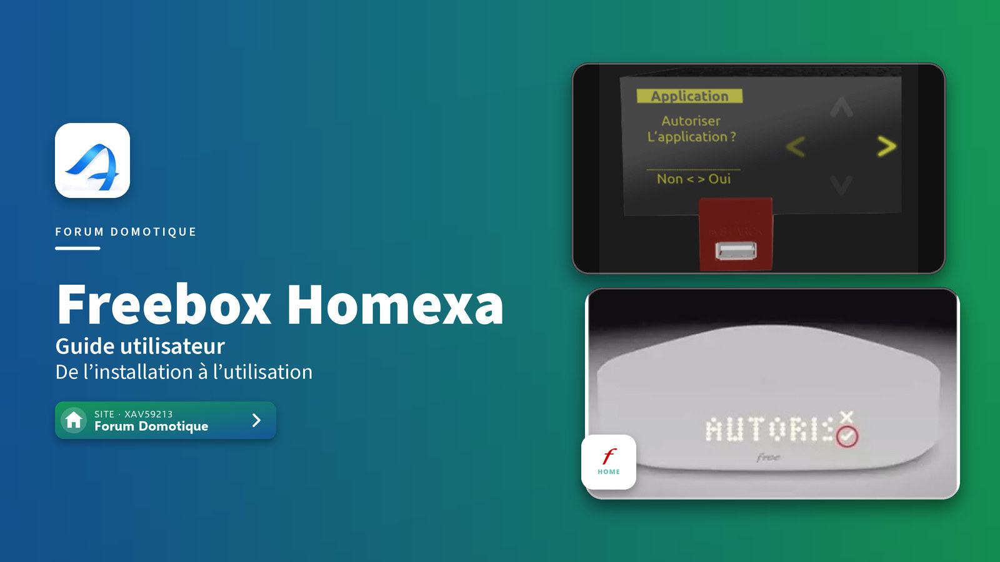
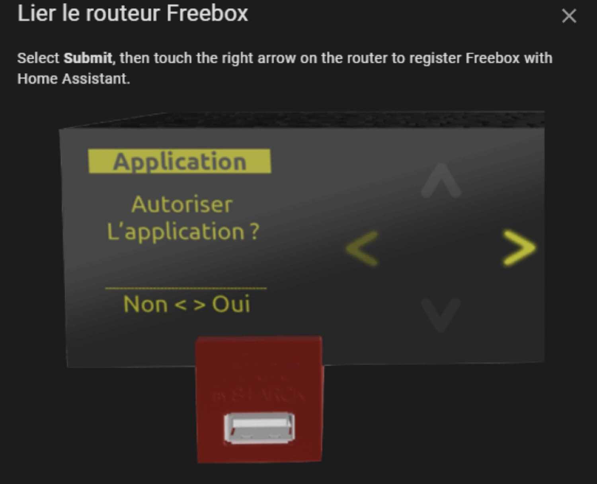
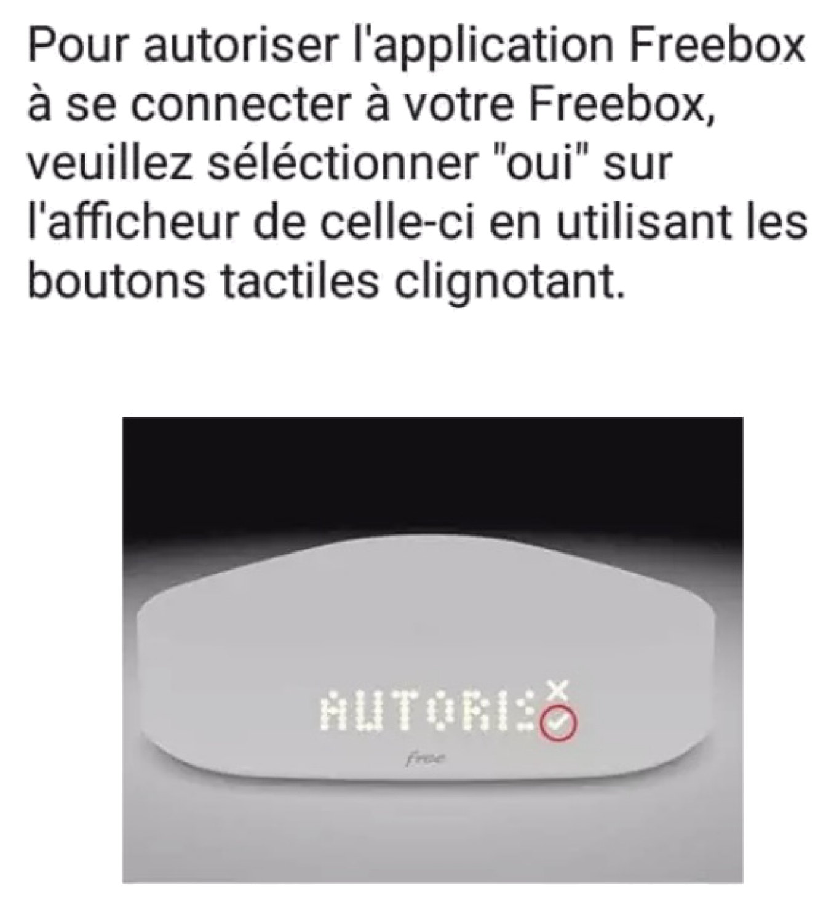
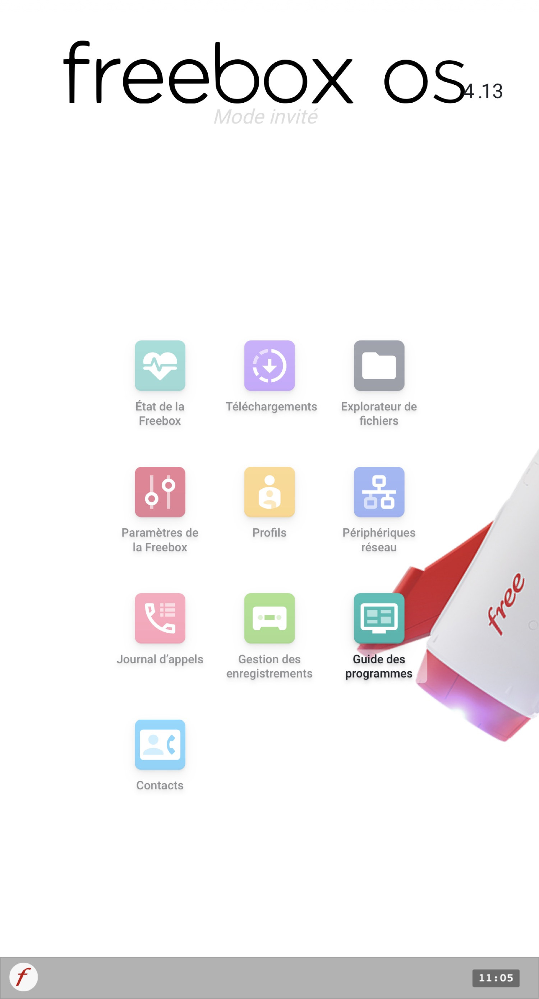
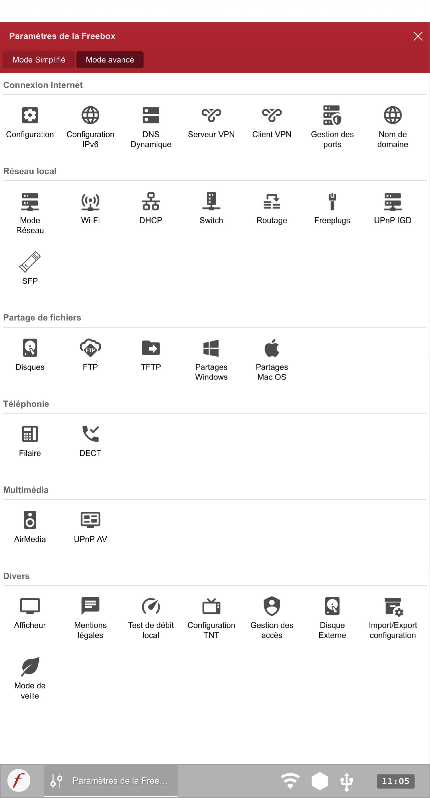
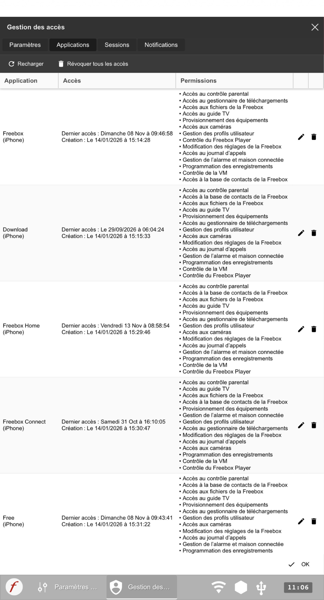
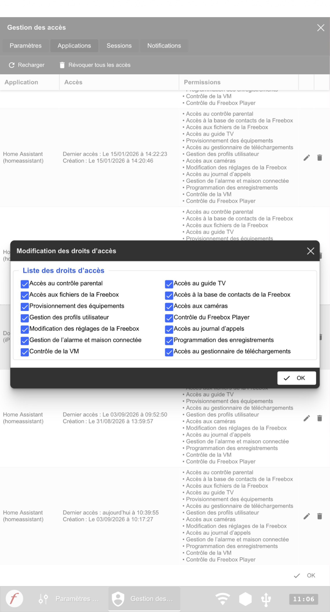
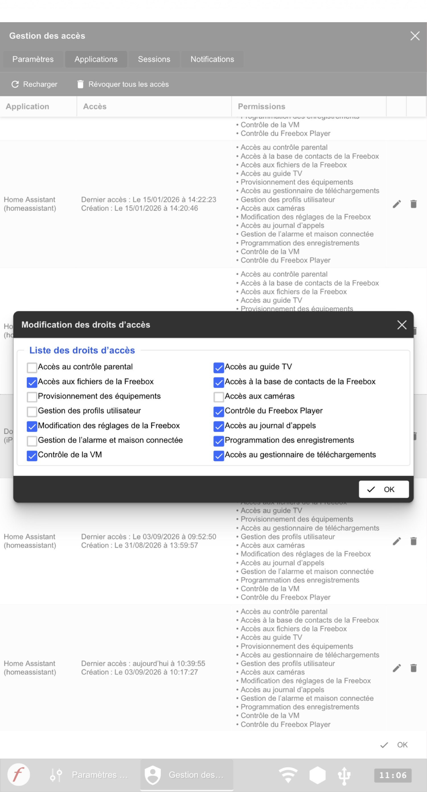
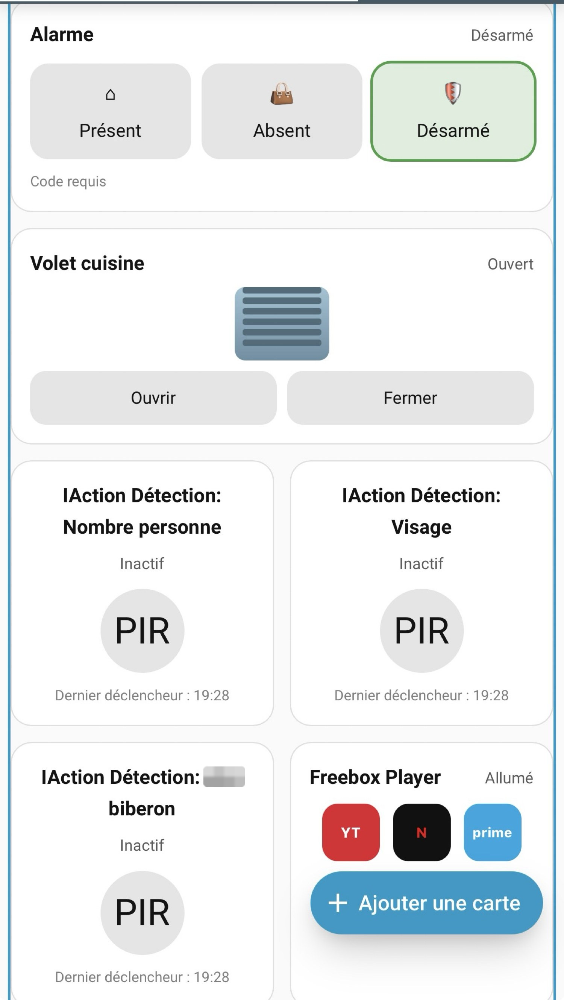

# Guide utilisateur Freebox Homexa : de l’installation à l’utilisation (v28.8.24)

Suite à la mise à jour **28.8.24**, voici le guide complet : de l’installation HACS jusqu’à l’usage quotidien. Le contenu reprend le [sujet publié sur Forum Domotique le 27 septembre 2026](https://forumdomotique.com/forums/topic/4008-guide-utilisateur-freebox-homexa-de-linstallation-%C3%A0-lutilisation-v28824/).

**Projet indépendant, non affilié à Free.**

- Dépôt : [github.com/XAV59213/freebox_homexa](https://github.com/XAV59213/freebox_homexa)
- Sujet d’origine : [Présentation du projet](https://forumdomotique.com/forums/topic/101-pr%C3%A9sentation-du-projet-freebox_homexa/)
- Archive du sujet 4008 sur ce site : [Guide utilisateur Freebox Homexa (v28.8.24)]({{ '/sujets/4008-guide-utilisateur-freebox-homexa-de-linstallation-a-lutilisation-v28824/messages.html' | relative_url }})

<a href="https://forumdomotique.com/forums/topic/4008-guide-utilisateur-freebox-homexa-de-linstallation-%C3%A0-lutilisation-v28824/">Lire et commenter sur Forum Domotique</a> · <a href="https://github.com/XAV59213/freebox_homexa">Dépôt HACS : Freebox Homexa</a>

## Sommaire

1. [C’est quoi Homexa ?](#cest-quoi-homexa)
2. [Prérequis](#prerequis)
3. [Installation HACS](#installation-hacs)
4. [Appairage (Server / Delta Devialet)](#appairage)
5. [Dans Home Assistant](#dans-home-assistant)
6. [Services utiles](#services-utiles)
7. [Dépannage](#depannage)

## 1. C’est quoi Homexa ? {#cest-quoi-homexa}

Intégration custom Home Assistant qui regroupe Server, pack Home, répéteurs, LAN/Wi-Fi et Player.

- **Freebox Server** — état, réseau, Wi-Fi, débits
- **Freebox Home** — interrupteurs, caméras, volets, PIR, contacts
- **Alarme** — Présent / Absent / Désarmé (comme l’app Free)
- **Clients LAN / Wi-Fi** — device_tracker + RSSI (dBm)
- **Répéteurs F-RP01A** — capteur En ligne + clients
- **Player** — Devialet, Mini 4K, Pop : volume, sources, télécommande

> **HDMI sur le Player** = sortie TV en CEC (One Touch Play). Ça réveille la TV. Ça ne change pas l’entrée HDMI 1/2/3.

## 2. Prérequis {#prerequis}

- Home Assistant **2026.8.0+**
- HACS
- Freebox OS (Révolution, Mini 4K, Delta, Pop, Ultra)
- « Permettre les nouvelles demandes d’associations » coché dans Freebox OS
- Être devant la box : l’appairage se valide **sur l’écran / la façade**

> **Astuce forum** — poll Home à 5 s + intégration officielle Freebox encore active = API saturée. Désactive l’officielle.

## 3. Installation HACS {#installation-hacs}

1. HACS → trois points → **Dépôts personnalisés**
2. URL : `https://github.com/XAV59213/freebox_homexa`
3. Catégorie : **Integration**
4. Installer **Freebox Homexa** puis redémarrer HA

Mise à jour : HACS → Freebox Homexa → Mettre à jour → reboot HA.

## 4. Appairage — deux modèles, deux formats {#appairage}

Paramètres → Appareils et services → Ajouter une intégration → **Freebox Homexa**.  
Host : `mafreebox.freebox.fr` / IP LAN / `xxx.fbxos.fr`. Pas de token dans configuration.yaml.

### Server / Révolution — écran + flèches

Popup HA « Lier le routeur Freebox ». Clique **Valider**, puis sur le Server la **flèche droite = Oui**.

*Écran Server : Autoriser l’application ? Non < > Oui. La flèche droite valide l’autorisation.*

### Delta / Devialet — façade tactile

Sur la façade Devialet, choisir **oui** avec les **boutons tactiles clignotants** (ce n’est pas le même geste que les flèches du Server).

*Façade Delta / Devialet : message AUTORIZ + boutons tactiles.*

### Droits dans Freebox OS

Ensuite dans Freebox OS → Applications : droits **Home, Player, LAN, Wi-Fi**.

*Accueil de Freebox OS : on ouvre ensuite les paramètres.*

*Paramètres en mode avancé : **Gestion des accès** se trouve dans Divers.*

*Gestion des accès, onglet Applications.*

*Tous les droits cochés pour l’application Home Assistant.*

*Exemple de droits partiels, si l’on ne souhaite pas tout autoriser.*

### Options (Configurer)

- Suivre les clients LAN → device_tracker
- Capteurs RSSI Wi-Fi → dBm
- Device Homexa par client → à décocher si doublons HA 2026.8
- Intervalle Home → 5 / 10 / 15 / 20 / 25 / 30 s
- Code télécommande Player → 8 chiffres (Réglages → Système → Informations)

## 5. Dans Home Assistant {#dans-home-assistant}

*Dashboard Lovelace Homexa : alarme, volet, capteurs PIR et Freebox Player.*

**Alarme — mapping app Free**

| App Free | Home Assistant |
| --- | --- |
| Présent | armed_home |
| Absent | armed_away |
| Désarmé | disarmed |
| Armement | arming |
| Sirène | triggered |

PIN masqué dans les attributs. PIR / contacts = binary_sensor. Volets = cover. F-RP01A = En ligne + clients.

Player : volume, mute, play/pause. Sources : TV, HDMI CEC, YouTube, Netflix, Disney+, Prime.  
Remote : power, tv, ok, flèches, vol_inc / vol_dec, mute, play, 0–9.

## 6. Services utiles {#services-utiles}

- `freebox_homexa.reboot` — redémarre le Server
- `freebox_homexa.reload` — rediscover Home
- `freebox_homexa.remote` — touche Player
- `freebox_homexa.tv_guide` / `play_channel` — guide / chaîne TNT

Exemples concrets :

- Téléphone `not_home` 10 min → `alarm_arm_away`. Retour → désarmer ou Présent. Réserve l’IP DHCP.
- PIR on + nuit → lumière. Poll 5–10 s si l’officielle est off.
- `media_player.select_source` YouTube / Netflix. HDMI CEC = réveil TV seulement.
- Groupe cover pour les volets après sunset.

## 7. Dépannage {#depannage}

| Symptôme | Piste |
| --- | --- |
| Intégration morte | HA 2026.8.0+ |
| bad_json alarme | Homexa 28.8.2+ |
| 2 boutons d’alarme seulement | Passer en 28.8+ |
| Répéteur invisible | Reboot HA |
| Player absent | Droit Player + reboot |
| Remote muet | Code 8 chiffres |
| HDMI ≠ entrée TV | Normal : CEC uniquement |
| Pas de RSSI | Client Ethernet ou droit LAN manquant |
| Doublons devices | Décocher device par client |
| PIR à la traîne | Officielle off + poll 5/10 s |

Logs : Paramètres → Système → Journaux, filtre `freebox_homexa`.

Licence MIT. Vos retours (modèle de box, Player, nombre de répéteurs) font avancer la suite.
