<p class="forum-cta"><a href="https://forumdomotique.com/guides-tutoriels/home-assistant/installer-sonoff-zbminil2-home-assistant-zigbee-sans-neutre/">Lire et commenter sur Forum Domotique</a></p>


<section class="carousel photo-carousel" data-carousel data-lightbox aria-roledescription="carrousel" aria-label="Photos de l’article (16)" tabindex="0">
<div class="carousel-track" data-track>
<figure class="photo-slide" data-slide>
  <a href="images/Designsanstitre.png" data-full="images/Designsanstitre.png" data-alt="Photo 1 — Installer et configurer le SONOFF ZBMINIL2 ZigBee sur Home Assistant : guide complet (poussoir, va-et-vient, interrupteur simple)" aria-label="Agrandir la photo 1 : Photo 1 — Installer et configurer le SONOFF ZBMINIL2 ZigBee sur Home Assistant : guide complet (poussoir, va-et-vient, interrupteur simple)">
    
  </a>
</figure>
<figure class="photo-slide" data-slide>
  <a href="images/Capturedcrandu2025-10-0514-06-17.png" data-full="images/Capturedcrandu2025-10-0514-06-17.png" data-alt="Photo 2 — Installer et configurer le SONOFF ZBMINIL2 ZigBee sur Home Assistant : guide complet (poussoir, va-et-vient, interrupteur simple)" aria-label="Agrandir la photo 2 : Photo 2 — Installer et configurer le SONOFF ZBMINIL2 ZigBee sur Home Assistant : guide complet (poussoir, va-et-vient, interrupteur simple)">
    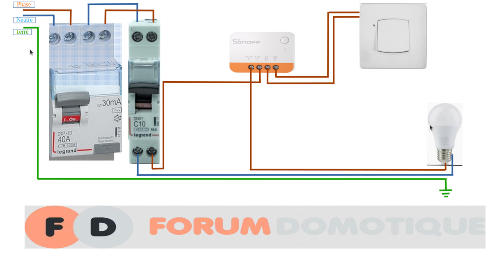
  </a>
</figure>
<figure class="photo-slide" data-slide>
  <a href="images/Capturedcrandu2025-10-0513-53-26.png" data-full="images/Capturedcrandu2025-10-0513-53-26.png" data-alt="Photo 3 — Installer et configurer le SONOFF ZBMINIL2 ZigBee sur Home Assistant : guide complet (poussoir, va-et-vient, interrupteur simple)" aria-label="Agrandir la photo 3 : Photo 3 — Installer et configurer le SONOFF ZBMINIL2 ZigBee sur Home Assistant : guide complet (poussoir, va-et-vient, interrupteur simple)">
    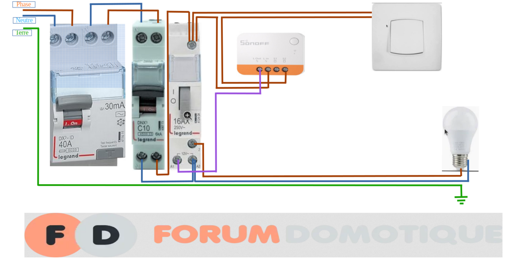
  </a>
</figure>
<figure class="photo-slide" data-slide>
  <a href="images/Capturedcrandu2025-10-0511-36-52.png" data-full="images/Capturedcrandu2025-10-0511-36-52.png" data-alt="Photo 4 — Installer et configurer le SONOFF ZBMINIL2 ZigBee sur Home Assistant : guide complet (poussoir, va-et-vient, interrupteur simple)" aria-label="Agrandir la photo 4 : Photo 4 — Installer et configurer le SONOFF ZBMINIL2 ZigBee sur Home Assistant : guide complet (poussoir, va-et-vient, interrupteur simple)">
    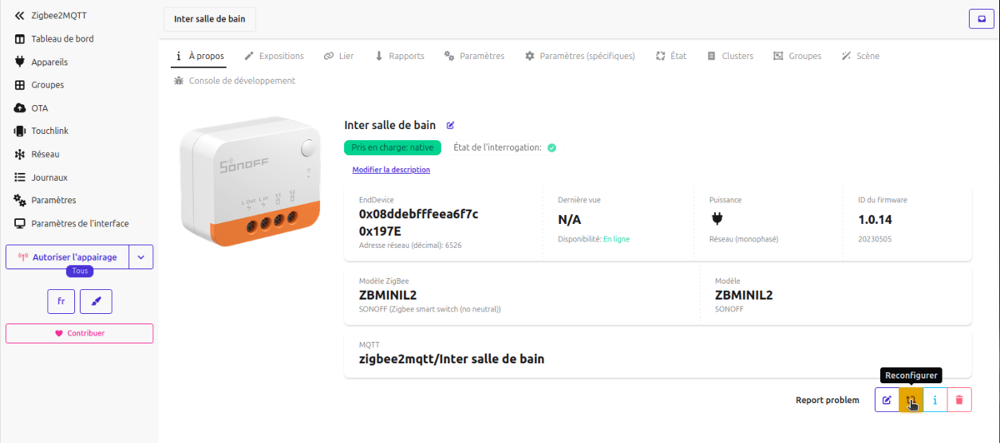
  </a>
</figure>
<figure class="photo-slide" data-slide>
  <a href="images/RND1Nw2S.jpeg" data-full="images/RND1Nw2S.jpeg" data-alt="Photo 5 — Installer et configurer le SONOFF ZBMINIL2 ZigBee sur Home Assistant : guide complet (poussoir, va-et-vient, interrupteur simple)" aria-label="Agrandir la photo 5 : Photo 5 — Installer et configurer le SONOFF ZBMINIL2 ZigBee sur Home Assistant : guide complet (poussoir, va-et-vient, interrupteur simple)">
    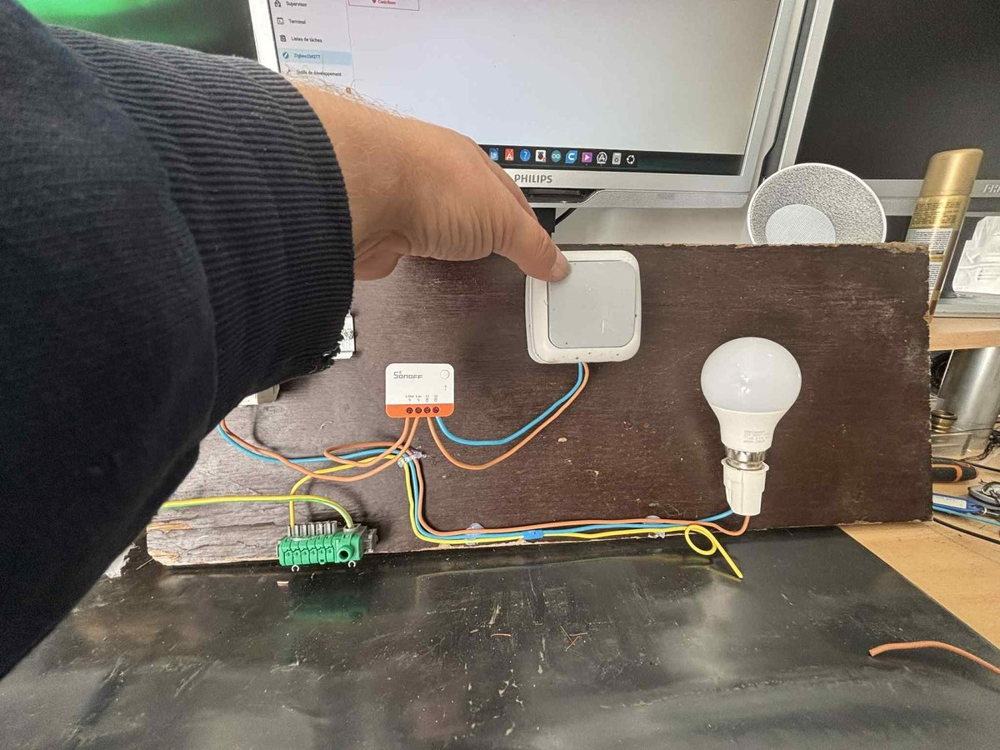
  </a>
</figure>
<figure class="photo-slide" data-slide>
  <a href="images/i0KL-Ffj.jpeg" data-full="images/i0KL-Ffj.jpeg" data-alt="Photo 6 — Installer et configurer le SONOFF ZBMINIL2 ZigBee sur Home Assistant : guide complet (poussoir, va-et-vient, interrupteur simple)" aria-label="Agrandir la photo 6 : Photo 6 — Installer et configurer le SONOFF ZBMINIL2 ZigBee sur Home Assistant : guide complet (poussoir, va-et-vient, interrupteur simple)">
    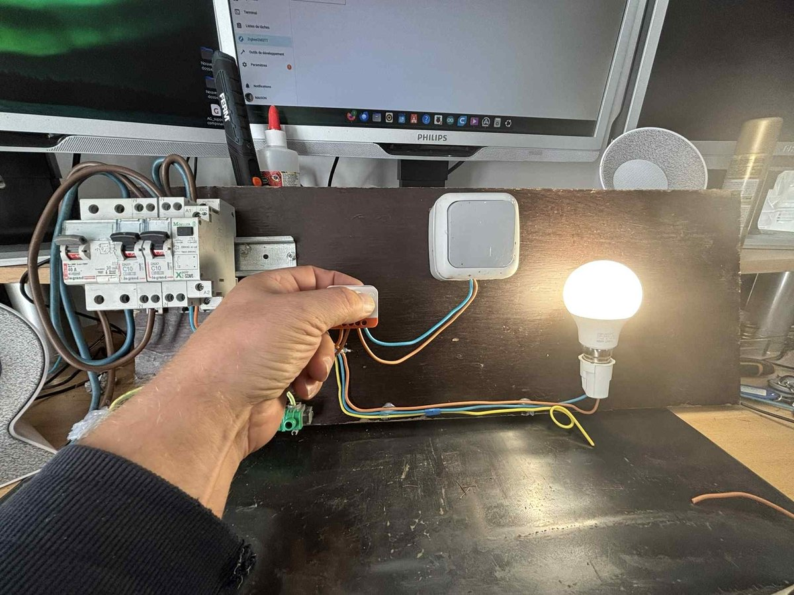
  </a>
</figure>
<figure class="photo-slide" data-slide>
  <a href="images/Capturedcrandu2025-10-0515-11-04.png" data-full="images/Capturedcrandu2025-10-0515-11-04.png" data-alt="Photo 7 — Installer et configurer le SONOFF ZBMINIL2 ZigBee sur Home Assistant : guide complet (poussoir, va-et-vient, interrupteur simple)" aria-label="Agrandir la photo 7 : Photo 7 — Installer et configurer le SONOFF ZBMINIL2 ZigBee sur Home Assistant : guide complet (poussoir, va-et-vient, interrupteur simple)">
    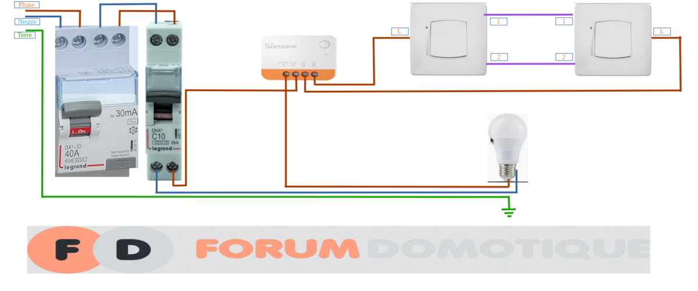
  </a>
</figure>
<figure class="photo-slide" data-slide>
  <a href="images/4_gEKwTD.jpeg" data-full="images/4_gEKwTD.jpeg" data-alt="Photo 8 — Installer et configurer le SONOFF ZBMINIL2 ZigBee sur Home Assistant : guide complet (poussoir, va-et-vient, interrupteur simple)" aria-label="Agrandir la photo 8 : Photo 8 — Installer et configurer le SONOFF ZBMINIL2 ZigBee sur Home Assistant : guide complet (poussoir, va-et-vient, interrupteur simple)">
    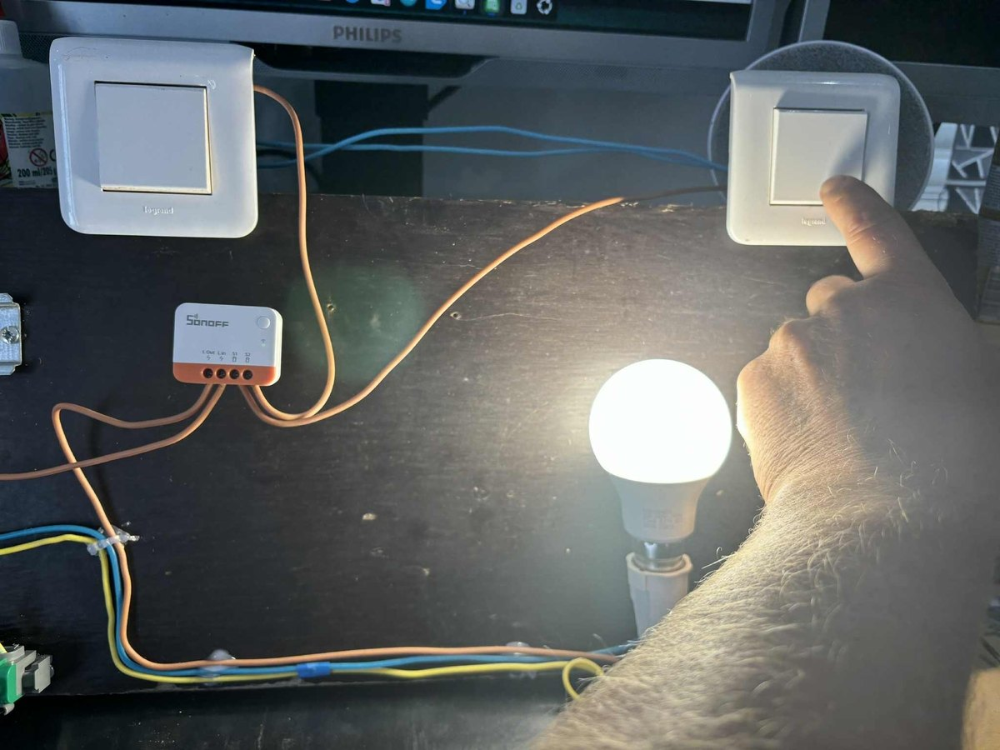
  </a>
</figure>
<figure class="photo-slide" data-slide>
  <a href="images/14_U2HQv.jpeg" data-full="images/14_U2HQv.jpeg" data-alt="Photo 9 — Installer et configurer le SONOFF ZBMINIL2 ZigBee sur Home Assistant : guide complet (poussoir, va-et-vient, interrupteur simple)" aria-label="Agrandir la photo 9 : Photo 9 — Installer et configurer le SONOFF ZBMINIL2 ZigBee sur Home Assistant : guide complet (poussoir, va-et-vient, interrupteur simple)">
    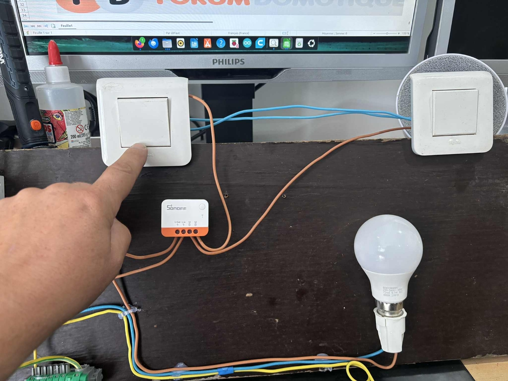
  </a>
</figure>
<figure class="photo-slide" data-slide>
  <a href="images/Capturedcrandu2025-10-0516-47-44.png" data-full="images/Capturedcrandu2025-10-0516-47-44.png" data-alt="Photo 10 — Installer et configurer le SONOFF ZBMINIL2 ZigBee sur Home Assistant : guide complet (poussoir, va-et-vient, interrupteur simple)" aria-label="Agrandir la photo 10 : Photo 10 — Installer et configurer le SONOFF ZBMINIL2 ZigBee sur Home Assistant : guide complet (poussoir, va-et-vient, interrupteur simple)">
    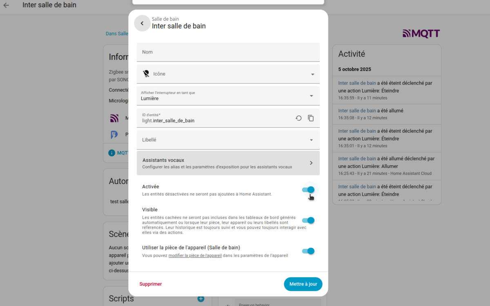
  </a>
</figure>
<figure class="photo-slide" data-slide>
  <a href="images/Capturedcrandu2025-10-0516-47-35.png" data-full="images/Capturedcrandu2025-10-0516-47-35.png" data-alt="Photo 11 — Installer et configurer le SONOFF ZBMINIL2 ZigBee sur Home Assistant : guide complet (poussoir, va-et-vient, interrupteur simple)" aria-label="Agrandir la photo 11 : Photo 11 — Installer et configurer le SONOFF ZBMINIL2 ZigBee sur Home Assistant : guide complet (poussoir, va-et-vient, interrupteur simple)">
    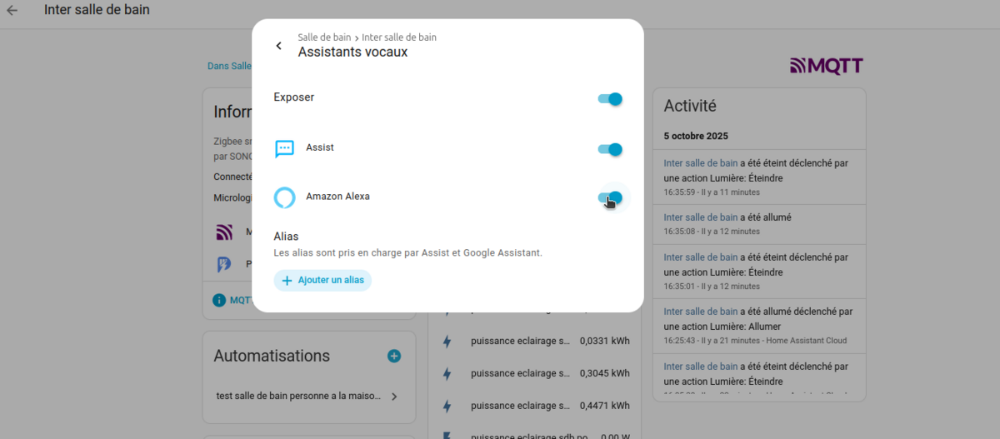
  </a>
</figure>
<figure class="photo-slide" data-slide>
  <a href="images/GtMtj-VX.jpeg" data-full="images/GtMtj-VX.jpeg" data-alt="Photo 12 — Installer et configurer le SONOFF ZBMINIL2 ZigBee sur Home Assistant : guide complet (poussoir, va-et-vient, interrupteur simple)" aria-label="Agrandir la photo 12 : Photo 12 — Installer et configurer le SONOFF ZBMINIL2 ZigBee sur Home Assistant : guide complet (poussoir, va-et-vient, interrupteur simple)">
    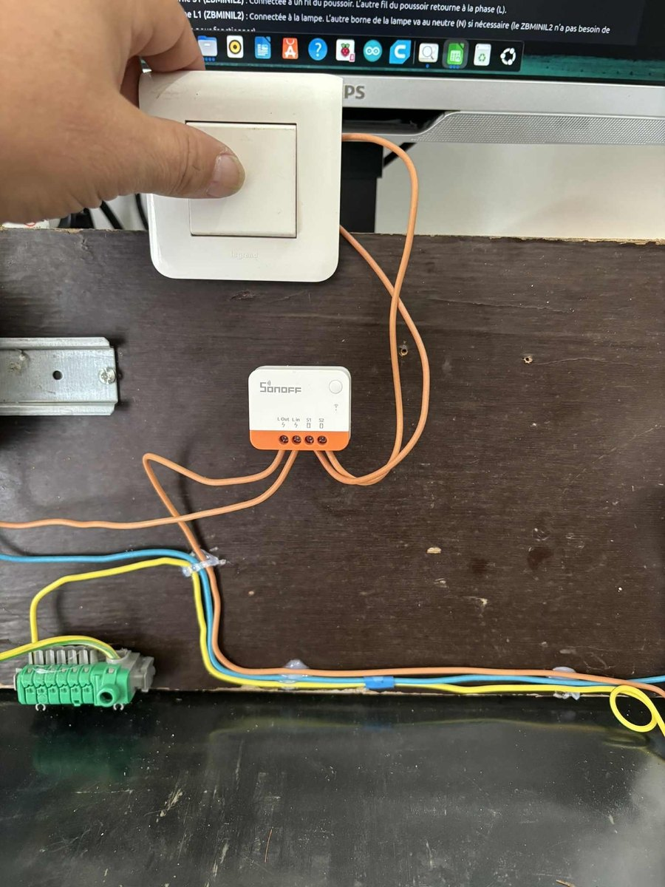
  </a>
</figure>
<figure class="photo-slide" data-slide>
  <a href="images/WkRSS5P3.jpeg" data-full="images/WkRSS5P3.jpeg" data-alt="Photo 13 — Installer et configurer le SONOFF ZBMINIL2 ZigBee sur Home Assistant : guide complet (poussoir, va-et-vient, interrupteur simple)" aria-label="Agrandir la photo 13 : Photo 13 — Installer et configurer le SONOFF ZBMINIL2 ZigBee sur Home Assistant : guide complet (poussoir, va-et-vient, interrupteur simple)">
    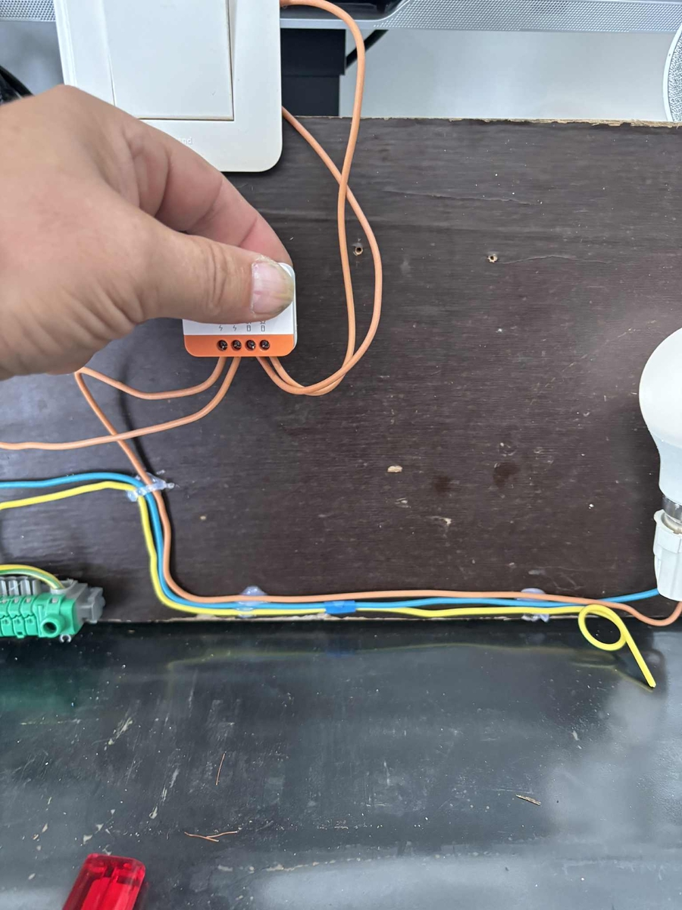
  </a>
</figure>
<figure class="photo-slide" data-slide>
  <a href="images/lvVVFstT.jpeg" data-full="images/lvVVFstT.jpeg" data-alt="Photo 14 — Installer et configurer le SONOFF ZBMINIL2 ZigBee sur Home Assistant : guide complet (poussoir, va-et-vient, interrupteur simple)" aria-label="Agrandir la photo 14 : Photo 14 — Installer et configurer le SONOFF ZBMINIL2 ZigBee sur Home Assistant : guide complet (poussoir, va-et-vient, interrupteur simple)">
    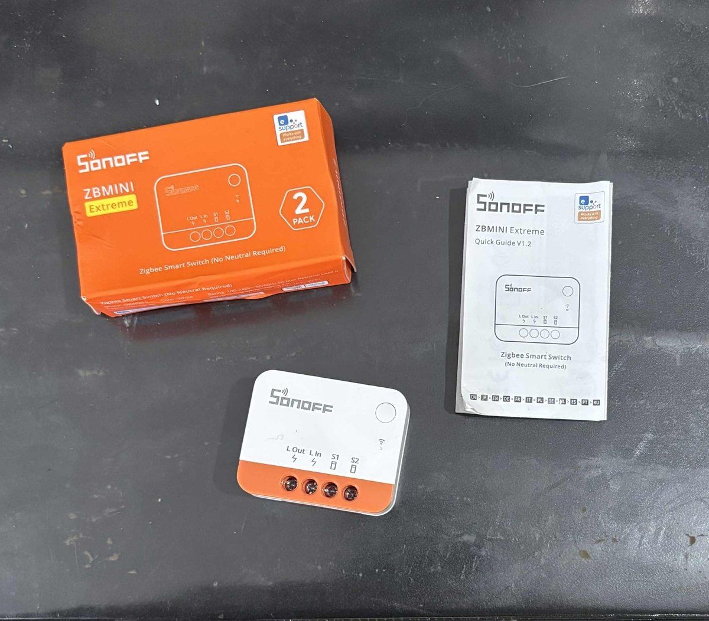
  </a>
</figure>
<figure class="photo-slide" data-slide>
  <a href="images/Ac-gamdg.jpeg" data-full="images/Ac-gamdg.jpeg" data-alt="Photo 15 — Installer et configurer le SONOFF ZBMINIL2 ZigBee sur Home Assistant : guide complet (poussoir, va-et-vient, interrupteur simple)" aria-label="Agrandir la photo 15 : Photo 15 — Installer et configurer le SONOFF ZBMINIL2 ZigBee sur Home Assistant : guide complet (poussoir, va-et-vient, interrupteur simple)">
    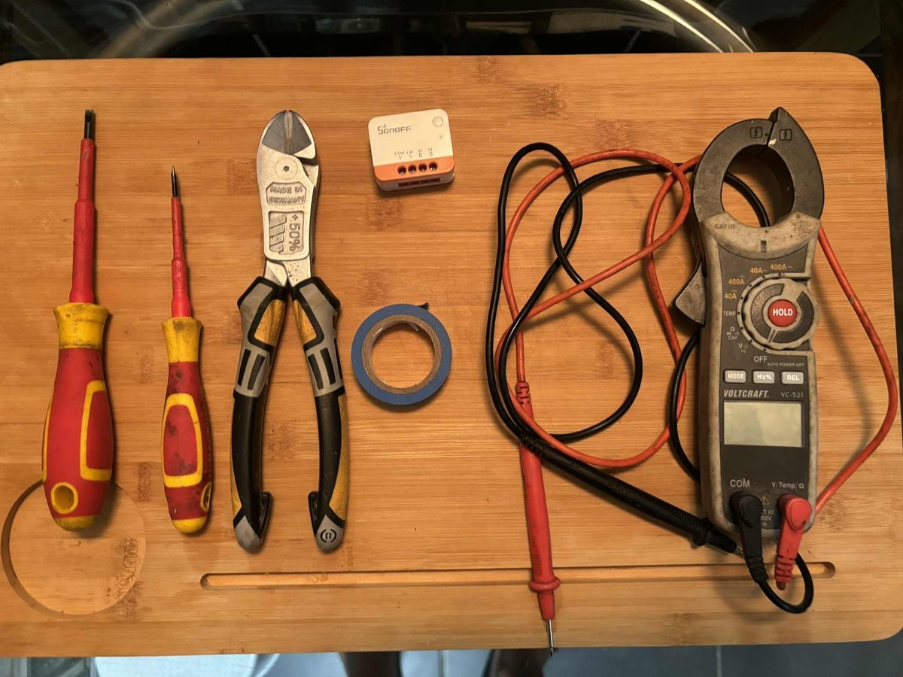
  </a>
</figure>
<figure class="photo-slide" data-slide>
  <a href="images/NmcddqLP.jpeg" data-full="images/NmcddqLP.jpeg" data-alt="Photo 16 — Installer et configurer le SONOFF ZBMINIL2 ZigBee sur Home Assistant : guide complet (poussoir, va-et-vient, interrupteur simple)" aria-label="Agrandir la photo 16 : Photo 16 — Installer et configurer le SONOFF ZBMINIL2 ZigBee sur Home Assistant : guide complet (poussoir, va-et-vient, interrupteur simple)">
    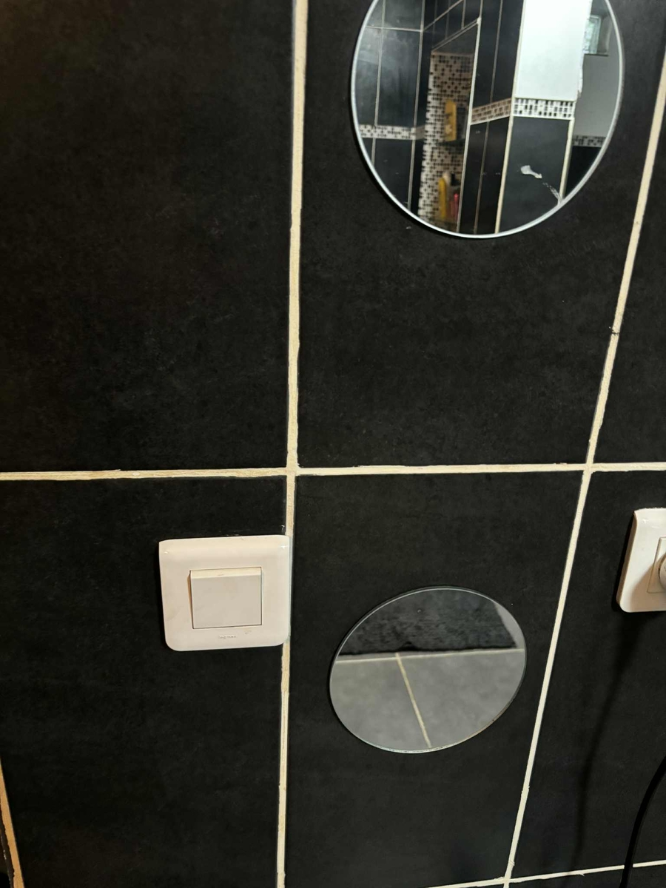
  </a>
</figure>
</div>
<button type="button" class="carousel-nav" data-prev aria-label="Photo précédente">‹</button>
<button type="button" class="carousel-nav" data-next aria-label="Photo suivante">›</button>
<div class="carousel-dots" data-dots></div>
<div class="carousel-live" data-live aria-live="polite"></div>
<p class="carousel-hint">Faites défiler les photos, ou ouvrez-les pour les agrandir (si JavaScript est activé).</p>
</section>

# Installer et configurer le SONOFF ZBMINIL2 ZigBee sur Home Assistant : guide complet (poussoir, va-et-vient, interrupteur simple)

- **Type :** Guide
- **Catégorie :** Guides & tutoriels domotique > Home Assistant
- **Lien :** https://forumdomotique.com/guides-tutoriels/home-assistant/installer-sonoff-zbminil2-home-assistant-zigbee-sans-neutre/
- **Date de publication :** 12 octobre 2025 à 15:05 (Europe/Paris)
- **Auteur :** XAV59213

---

Dans le monde de la domotique, les modules ZigBee comme le **SONOFF ZBMINIL2** offrent une flexibilité incroyable pour moderniser vos interrupteurs existants sans gros travaux. Ce petit module compact se glisse derrière un interrupteur mural standard ou directement dans votre tableau électrique et transforme n'importe quel bouton en commande intelligente : allumage ou extinction à distance, simulation de présence, ou intégration dans des scénarios complexes comme l’activation d’une lumière au lever du soleil.

Si vous utilisez **Home Assistant** comme hub pour piloter votre maison connectée, intégrer le **SONOFF ZBMINIL2** est un jeu d’enfant grâce aux protocoles **ZigBee 3.0** pris en charge par **ZHA** ou **Zigbee2MQTT**.

Pourquoi le choisir ? Il est **abordable** (autour de 10 à 20 €), **fiable** (alimentation secteur stable) et **compatible avec la plupart des hubs ZigBee**.

Surtout, le **SONOFF ZBMINIL2** fonctionne **sans neutre**, ce qui le rend parfait pour moderniser les interrupteurs existants sans travaux de câblage complexes. Compact et universel, il s’intègre aussi bien derrière un interrupteur mural que dans un coffret électrique.

Dans ce guide, nous allons tout voir : du **branchement physique** à la **configuration avancée** sous Home Assistant, avec des conseils concrets pour éviter les erreurs de câblage et des exemples d’automatisations.

Ce tutoriel s’adresse aussi bien aux **débutants** qu’aux **utilisateurs expérimentés**.

J’ai testé ce module sur **Home Assistant OS 2025.9.4** (installé sur **Raspberry Pi 5**) avec la **clé SONOFF ZigBee 3.0 USB Dongle Plus**, en utilisant **Zigbee2MQTT**.

Plan de l'article :

- **Pourquoi utiliser le SONOFF ZBMINIL2 avec Home Assistant et quelles sont ses spécifications ?**
- **Matériel nécessaire pour l'installation.**
- **Étapes préliminaires : identifier phase et neutre dans votre installation**
- **Mode poussoir : la fonction pour remplacer un télérupteur par un SONOFF ZBMINIL2**
- **Mode va-et-vient : la fonction du SONOFF ZBMINIL2 pour moderniser un éclairage double interrupteur**
- **Mode interrupteur simple : la fonction du SONOFF ZBMINIL2 pour rendre un circuit d’éclairage intelligent**
- **Illustration pratique : installation pas à pas d’un interrupteur simple avec le SONOFF ZBMINIL2**

  ***Prêt à booster votre setup domotique ? Allons-y !***

## **Pourquoi utiliser le SONOFF ZBMINIL2 avec Home Assistant et quelles sont ses spécifications ?**

Le SONOFF ZBMINIL2 est un module relais ZigBee compact (dimensions : 39 x 32 x 17 mm) conçu pour s'intégrer derrière un interrupteur mural monophasé. Il supporte une charge jusqu'à 10A/230V, parfait pour commander des lumières, ventilateurs ou petits appareils. Contrairement au précédent modèle **ZBMINI**, le **ZBMINIL2** ne nécessite pas de neutre pour fonctionner. Grâce à son **relais sec intégré**, il peut s’adapter à la majorité des installations domestiques, même celles dépourvues de neutre derrière les interrupteurs.

**Pourquoi l'associer à Home Assistant ?** Home Assistant excelle dans l'interopérabilité : ce module s'intègre nativement via ZHA (ZigBee Home Automation) ou Zigbee2MQTT, deux intégrations gratuites. Résultat ?

Vous contrôlez tout depuis un tableau de bord unifié, créez des automatisations (ex. : éteindre les lumières si personne dans la pièce), Dans nos tests, il a tenu une connexion stable sur 1 an, avec un temps de réponse < 200ms.


## **Matériel nécessaire pour l’installation du SONOFF ZBMINIL2**

Avant de plonger dans le branchement, assurez-vous d'avoir :

- **Le module SONOFF ZBMINIL2** .
- **Un hub ZigBee compatible** : ConBee II, Sonoff ZigBee Bridge, ou SkyConnect (pour Home Assistant)
- **Home Assistant installé** (version 2024 ou + recommandée).
- **Outils de base** : tournevis isolé, multimètre pour vérifier les tensions le neutre et phase.
- **Interrupteur mural existant** : interrupteur simple ,va et vient ou télérupteur.
- **Logiciel** : [Zigbee2MQTT](https://my.home-assistant.io/redirect/supervisor_add_addon_repository/?repository_url=https%3A%2F%2Fgithub.com%2Fzigbee2mqtt%2Fhassio-zigbee2mqtt) ou [ZHA](https://my.home-assistant.io/redirect/config_flow_start/?domain=zha) activé dans Home Assistant avec l’intégration [mqtt](https://my.home-assistant.io/redirect/config_flow_start/?domain=mqtt) et module complémentaire [mqttbroker](https://github.com/home-assistant/addons/tree/master/mosquitto)
- Attention : travaillez toujours sur circuit hors tension pour éviter les chocs électriques !

Un guide parfait pour les débutants… et même les utilisateurs plus avancés.

## **Étapes préliminaires : identifier phase et neutre dans votre installation**

Pour mesurer la tension avec un multimètre et différencier la phase du neutre, voici les étapes et explications en français, de manière claire et concise :

### 1. Mesurer la tension avec un multimètre

1. **Préparer le multimètre** :

   - Tournez le sélecteur du multimètre sur le mode **tension alternative (AC)**, souvent indiqué par un symbole en forme de vague (~) ou "V~". Choisissez une plage adaptée (par exemple, 200 V ou 600 V pour une prise domestique en 230 V).
   - Insérez la sonde **rouge** dans la borne marquée **V/Ω** et la sonde **noire** dans la borne **COM**.
2. **Mesurer la tension** :

   - Insérez les sondes dans les bornes de la prise ou du circuit à tester (par exemple, une borne pour la phase et une pour le neutre dans une prise électrique).
   - Lisez la valeur affichée sur l’écran du multimètre. Pour une prise domestique en France, vous devriez obtenir environ **230 V** en courant alternatif.
3. **Précautions de sécurité** :

   - Assurez-vous que les sondes sont bien isolées et en bon état.
   - Ne touchez pas les parties métalliques des sondes pendant la mesure.
   - Travaillez sur un circuit hors tension si possible, ou prenez des précautions si le circuit est sous tension.

### 2. Différencier la phase du neutre

Pour identifier la phase et le neutre dans une prise ou un circuit électrique :

1. **Utiliser le multimètre en mode tension AC** :

   - Placez la sonde **noire** dans une borne connue comme la **terre** (souvent la broche centrale d’une prise ou un point de terre identifiable).
   - Insérez la sonde **rouge** dans l’une des autres bornes de la prise (phase ou neutre).
   - **Résultat** :

     - Si vous mesurez environ **230 V**, la borne testée est la **phase**.
     - Si vous mesurez environ **0 V** (ou une valeur très faible), la borne testée est le **neutre**.
2. **Alternative : Utiliser un tournevis testeur** (option plus simple mais moins précise) :

   - Un tournevis testeur s’allume lorsqu’il est en contact avec la **phase**. Il reste éteint sur le **neutre**.
   - Cependant, un multimètre est plus fiable et sécurisé pour confirmer.
3. **Si vous n’avez pas de point de terre** :

   - Mesurez la tension entre les deux bornes (phase et neutre) avec le multimètre. Vous obtiendrez environ 230 V, mais cela ne distingue pas directement la phase du neutre.
   - Dans ce cas, utilisez un tournevis testeur pour identifier la phase, puis confirmez avec le multimètre si possible.

### 3. Conseils supplémentaires

Assurez-vous de respecter la norme électrique en vigueur en France, où les circuits comportent généralement une phase, identifiée par un fil marron ou noir, un neutre, de couleur bleue, et, dans certains cas, une terre, repérée par un fil vert-jaune. Travaillez avec la plus grande prudence sur les circuits électriques, même hors tension, et envisagez de faire appel à un électricien professionnel en cas de doute pour garantir la sécurité. Avant toute mesure, testez votre multimètre sur une source de tension connue afin de vérifier son bon fonctionnement et d’assurer des relevés fiables.

Si vous avez besoin d’un schéma ou d’une explication plus détaillée, faites-le-moi savoir !

Guide pratique

Pour une **application plus aisée sur les chantiers,** Legrand met à disposition un **guide pratique** comportant les points clés de cette série de normes NF C 15-100 et ses dernières évolutions applicables depuis la publication de la révision du **23/08/2024**

---

## **Mode poussoir : la fonction pour remplacer un télérupteur par un SONOFF ZBMINIL2**

La fonction poussoir du SONOFF ZBMINIL2 permet de contrôler une charge (comme une lampe ou un appareil < 6A) via un bouton momentané (poussoir). Une pression brève envoie une impulsion qui alterne l’état de la charge (ON/OFF). Cette configuration est idéale pour remplacer un circuit à télérupteur existant dans une installation domotique, permettant un contrôle via l’application Zigbee (eWeLink, Home Assistant, etc.) ou des assistants vocaux (Alexa, Google Home). Cependant, pour garantir un fonctionnement optimal, notamment les retours d’état (savoir si la lampe est allumée ou éteinte via l’app), il est nécessaire de modifier l’installation électrique existante, notamment en supprimant le télérupteur.

### Pourquoi supprimer le télérupteur ?

Dans une configuration classique, le télérupteur situé dans le tableau électrique maintient l’état de la charge, en alternant entre allumé et éteint à chaque impulsion des poussoirs. Bien qu’il soit techniquement possible de faire fonctionner le système en conservant le télérupteur et en connectant le ZBMINIL2, les retours d’état ne seront pas fiables, car le ZBMINIL2 ne peut pas détecter l’état mécanique du télérupteur qui contrôle l’alimentation de la charge. Cela provoque une désynchronisation dans l’application, par exemple en affichant la lampe comme éteinte alors qu’elle est allumée, rendant les automatisations et le contrôle à distance peu fiables. En supprimant le télérupteur, le ZBMINIL2 prend en charge la logique d’allumage et d’extinction ainsi que les retours d’état via le protocole Zigbee, garantissant une synchronisation parfaite entre l’application, les poussoirs et la charge.

### Où brancher le ZBMINIL2 ?

**Installation du ZBMINIL2 dans le coffret électrique**

Contrairement à une installation derrière un poussoir, comme dans un boîtier mural, il est recommandé de placer le ZBMINIL2 dans le coffret électrique, sur le même circuit 10A qui alimentait le télérupteur. Cette configuration garantit une alimentation stable directement depuis le disjoncteur, sans interférences causées par les impulsions des poussoirs, assurant ainsi une fiabilité électrique optimale. Les bornes S1 et S2 du ZBMINIL2 permettent de connecter plusieurs poussoirs, jusqu’à deux directement et davantage via le protocole Zigbee, facilitant le remplacement d’un circuit à télérupteur avec de multiples points de commande. Compact avec ses dimensions de 39 x 32 x 18 mm, le ZBMINIL2 s’intègre facilement dans un coffret électrique tout en respectant les normes de sécurité, notamment la protection contre les surcharges. Il est déconseillé de placer le ZBMINIL2 derrière un poussoir dans un boîtier mural lors du remplacement d’un télérupteur, car cela complique le câblage et limite l’accès à une alimentation stable, particulièrement dans des boîtiers étroits.

### Schéma de principe (maquette)

Voici une description textuelle du schéma pour une maquette de test ou une installation réelle :

- **Composants** :

  - SONOFF ZBMINIL2
  - Bouton poussoir momentané (non maintenu)
  - Lampe ou charge < 6A (ex. : LED 230V)
  - Disjoncteur 10A dans le coffret électrique
  - Fils électriques (phase, neutre si requis par la charge)
  - Hub Zigbee (ex. : SONOFF ZBBridge, Conbee II)
- **Connexions** :

  - **Disjoncteur 10A** : Fournit la phase (L) au circuit, remplaçant l’alimentation qui allait au télérupteur.
  - **Borne L in(ZBMINIL2)** : Connectée à la phase du disjoncteur 10A.
  - **Borne S1 (ZBMINIL2)** : Connectée au fil du poussoir.
  - **Borne L1 out (ZBMINIL2)** : Connectée à la lampe. L’autre borne de la lampe va au neutre (N) si nécessaire (le ZBMINIL2 n’a pas besoin de neutre pour fonctionner).
  - **Borne S2 (optionnel)** : Connectée au fil du poussoir.

**Schéma de principe avec le poussoir et sans télérupteur**


**Schéma de principe avec le poussoir et télérupteur (Attention pas de retour d’état)**


### Étapes d’installation

1. **Couper l’alimentation** : Désactivez le disjoncteur général pour des raisons de sécurité.
2. **Retirer le télérupteur** : Dans le coffret électrique, localisez le télérupteur et débranchez ses fils (phase, poussoirs, sortie vers la charge). Notez les connexions pour faciliter le remplacement.
3. **Installer le ZBMINIL2** :

   - Connectez la phase du disjoncteur 10A à la borne L du ZBMINIL2.
   - Connectez les poussoirs existants aux bornes S1 et S2 .
   - Connectez la borne L1 out à la charge (lampe), et reliez la lampe au neutre si requis.
   - Connectez la borne L1 in phase.
4. **Fixation** : Placez le ZBMINIL2 dans le coffret (ou sur un rail DIN ou fixé sécuritairement).
5. **Appairage Zigbee** : Rétablissez l’alimentation. Maintenez le bouton du ZBMINIL2 pendant 5 secondes (LED clignote). Ajoutez le module à votre hub Zigbee via l’app (eWeLink, Zigbee2MQTT, etc.).
6. **Configuration** : Dans l’app, sélectionnez le mode "poussoir" (parfois appelé "Edge Mode" ou "Pulse Mode"). Testez en appuyant sur le poussoir : une pression doit alterner ON/OFF, avec l’état mis à jour dans l’app.

### Test et vérification

- Vérifiez que chaque appui sur le poussoir change l’état de la lampe.
- Confirmez que l’app affiche correctement l’état (ON/OFF), prouvant que les retours d’état fonctionnent.
- Testez avec une charge faible (< 6A) pour éviter tout risque de surcharge.
- Si plusieurs poussoirs sont connectés (via S1/S2), assurez-vous qu’ils contrôlent tous la même charge.

### Paramétrage du SONOFF ZBMINIL2

Pour passer en mode impulsion appuie 3 fois rapidement sur le bouton du SONOFF ZBMINIL2, il basculera automatiquement en mode poussoir.

<https://cdn.forumdomotique.com/monthly_2025_10/MODEIMP.mp4.adce35cb6a1e59d330bfff19377a21be.mp4#t=0>

Une petite actualisation sur zigbee2mqtt permettra d’actualiser sa fonction poussoir.


### Exemple avec ma maquette de test

Dans cette maquette j'ai choisi la fonction ou on a supprimer le télérupteur pour avoir toute les remonter d’information sur Zigbee2MQTT


<https://cdn.forumdomotique.com/monthly_2025_10/MODEPOUSSOIR.mp4.af1b1f980a40d65b7fc5b9b7e92e050d.mp4#t=0>

### Exemple d’automatisation

Un scénario simple permet d’allumer la lampe d’une simple pression sur l’interrupteur, tandis qu’une double pression déclenche une scène domotique, telle que l’extinction de toutes les lumières via Home Assistant. Une automatisation peut également être configurée dans Home Assistant pour activer automatiquement la lampe après 20h, offrant une gestion intelligente de l’éclairage adaptée aux besoins horaires.

```yaml
alias: "Allumer lumière salle de bain après 20h00"
description: "Allume la lumière de la salle de bain après 20h00 si personne n'est à la maison"
triggers:
  - entity_id: sensor.nombre_famille_home
    below: 1
    trigger: numeric_state
conditions:
  - condition: time
    after: "20:00:00"
actions:
  - delay:
      hours: 0
      minutes: 0
      seconds: 20
      milliseconds: 0
  - type: turn_on
    device_id: d7e7ae98a8d9853f428e9d2dc8b42f01
    entity_id: 101e84ae96ff6d7639f265c53e62988d
    domain: light
  - data:
      message: lumière de la salle de bain allumée après 20h00 !
    target:
      entity_id:
        - notify.maman
        - notify.papa
        - notify.xavier
        - notify.naomie
        - notify.anais
    action: notify.send_message
mode: single
```

### Avantages

L’installation est simplifiée grâce au remplacement du télérupteur sans nécessiter de câblage complexe, tout en intégrant des fonctionnalités domotiques. La suppression du télérupteur garantit des retours d’état fiables, permettant à l’application de refléter systématiquement l’état réel de la charge. La flexibilité est assurée par la possibilité de contrôler une même lampe à partir de plusieurs poussoirs via le réseau Zigbee.

### Limites

La charge maximale supportée est de 6 A (~1380 W à 230 V), et il est recommandé d’installer un fusible pour les charges proches de cette limite afin d’assurer la sécurité. Un hub Zigbee est requis pour la configuration initiale et la gestion des automatisations. Une latence peut survenir si le réseau Zigbee est saturé ou si le hub est trop éloigné de l’appareil.

### Conclusion

En remplaçant le télérupteur par le ZBMINIL2 dans le coffret électrique, vous modernisez votre installation tout en garantissant des retours d’état précis pour une domotique fiable. Ce setup est parfait pour les couloirs, escaliers ou toute zone avec plusieurs points de commande.

---

## **Mode va-et-vient : la fonction du SONOFF ZBMINIL2 pour moderniser un éclairage double interrupteur**

La fonction va-et-vient du SONOFF ZBMINIL2 permet de contrôler une charge (comme une lampe ou un appareil < 6A) depuis deux points de commande différents, par exemple deux interrupteurs situés à chaque extrémité d’un couloir ou d’un escalier. Contrairement à un va-et-vient traditionnel qui nécessite un câblage complexe avec des fils "navettes", le ZBMINIL2 simplifie l’installation grâce à ses bornes S1 et S2, qui gèrent deux interrupteurs (ou poussoirs) via le protocole Zigbee. Cette configuration est idéale pour moderniser une installation existante tout en ajoutant des fonctionnalités domotiques, comme le contrôle via une application (eWeLink, Home Assistant) ou des assistants vocaux (Alexa, Google Home). Comme pour la fonction poussoir, il est recommandé de placer le ZBMINIL2 dans le coffret électrique sur le circuit 10A, en supprimant tout télérupteur existant pour garantir des retours d’état fiables.

### Pourquoi connaître le branchement actuel de vos va-et-vient ?

Pour intégrer le SONOFF ZBMINIL2 dans une installation va-et-vient, il est essentiel de comprendre le câblage actuel de votre système électrique, surtout dans une maison de plain-pied où les câbles, y compris les fils navettes, convergent souvent dans des boîtes de dérivation. Par exemple, dans une maison de plain-pied, il est courant d’avoir des boîtes de dérivation près des interrupteurs ou dans le plafond, où tous les câbles (phase, neutre, navettes, et sortie vers la lampe) sont regroupés. Les fils navettes sont utilisés dans un va-et-vient traditionnel pour relier les deux interrupteurs et permettre le contrôle alterné de la lampe.

### En quoi c’est important ?

Une identification précise des fils est essentielle pour reconnecter correctement le ZBMINIL2, en repérant les navettes reliant les interrupteurs, la phase et la connexion à la lampe. Une erreur d’identification peut provoquer un dysfonctionnement ou un court-circuit. Le ZBMINIL2 simplifie le câblage par rapport à un va-et-vient classique en éliminant les navettes, les bornes S1 et S2 remplaçant leur logique, ce qui ne nécessite que la phase et les connexions des interrupteurs ou poussoirs vers ces bornes. Si un télérupteur est présent dans le circuit, par exemple dans le coffret électrique, il doit être retiré, car il gère mécaniquement l’état de la charge, empêchant le ZBMINIL2 de fournir des retours d’état fiables, ce qui pourrait entraîner une désynchronisation entre l’application Zigbee et l’état réel de la lampe. En installant le ZBMINIL2 dans le coffret électrique et en supprimant le télérupteur, le contrôle est centralisé, garantissant une synchronisation parfaite avec l’application. Pour une maison de plain-pied avec des boîtes de dérivation contenant les navettes, il est crucial de localiser la boîte où arrivent la phase du disjoncteur 10A et la sortie vers la lampe. Installer le ZBMINIL2 dans le coffret électrique simplifie les connexions et évite de modifier les boîtes de dérivation, souvent encombrées ou difficiles d’accès.

En résumé, connaître le branchement actuel (phase, navettes, charge) permet de reconnecter le ZBMINIL2 correctement, d’éliminer les navettes inutiles, et de garantir une installation domotique fiable.

### Schéma de principe (maquette)

Voici une description textuelle du schéma pour une maquette ou une installation réelle en mode va-et-vient, adaptée à une maison avec boîtes de dérivation :

- **Composants** :

  - SONOFF ZBMINIL2
  - Deux interrupteurs classiques va-et-vient
  - Lampe ou charge < 6A (ex. : lampe LED 230V)
  - Disjoncteur 10A dans le coffret électrique
  - Fils électriques (phase, neutre si requis par la charge)
  - Hub Zigbee (ex. : SONOFF ZBBridge, Conbee II)
- **Connexions** :

  - **Disjoncteur 10A** : Fournit la phase (L) au circuit, remplaçant l’alimentation d’un éventuel télérupteur.
  - **Borne L in (ZBMINIL2)** : Connectée à la phase du disjoncteur 10A.
  - **Borne S1 (ZBMINIL2)** : Connectée à un fil du premier interrupteur/poussoir. L’autre fil de cet interrupteur retourne à la phase (L).
  - **Borne S2 (ZBMINIL2)** : Connectée à un fil du second interrupteur/poussoir. L’autre fil de cet interrupteur retourne à la phase (L).
  - **Borne L1 out (ZBMINIL2)** : Connectée à la lampe. L’autre borne de la lampe va au neutre (N) si nécessaire (le ZBMINIL2 n’a pas besoin de neutre pour fonctionner).

**Schéma de principe Va-et-Vient**


**Note sur les navettes**

Les fils navettes présents dans les boîtes de dérivations sont souvent orange ou violet .

### Étapes d’installation

1. **Couper l’alimentation** : Désactivez le disjoncteur général pour des raisons de sécurité.
2. **Identifier le câblage actuel** : Dans la boîte de dérivation ou le coffret, localisez la phase (venant du disjoncteur 10A), les fils navettes (reliant les deux interrupteurs), et la sortie vers la lampe. Utilisez un multimètre si nécessaire pour confirmer la phase.
3. **Retirer un éventuel télérupteur** : Si un télérupteur est présent dans le coffret, débranchez ses fils (phase, poussoirs, sortie vers la charge). Notez les connexions pour faciliter le remplacement.
4. **Installer le ZBMINIL2** :

   - Connectez la phase du disjoncteur 10A à la borne L in du ZBMINIL2.
   - Connectez le premier interrupteur/poussoir à la borne S1 et à la phase (ignorez les navettes).
   - Connectez le second interrupteur/poussoir à la borne S2 et à la phase.
   - Connectez la borne L1 à la charge (lampe), et reliez la lampe au neutre si requis.
5. **Fixation** : Placez le ZBMINIL2 dans le coffret électrique (sur un rail DIN ou fixé sécuritairement).
6. **Appairage Zigbee** : Rétablissez l’alimentation. Maintenez le bouton du ZBMINIL2 pendant 5 secondes (LED clignote). Ajoutez le module à votre hub Zigbee via l’app (eWeLink, Zigbee2MQTT, etc.).
7. **Configuration** : Dans l’app, sélectionnez le mode "va-et-vient" (souvent appelé "Two-Way Control" ou "Toggle Mode"). Configurez les bornes S1 et S2 pour qu’une pression sur l’un ou l’autre interrupteur alterne l’état de la lampe (ON/OFF).

### Test et vérification

Vérifiez que chaque interrupteur ou poussoir modifie correctement l’état de la lampe, en alternant entre allumé et éteint. Confirmez que l’application affiche précisément l’état de la lampe, prouvant ainsi le bon fonctionnement des retours d’état. Effectuez les tests avec une charge inférieure à 6 A pour éviter tout risque de surcharge. Assurez-vous que les deux interrupteurs contrôlent la même charge de manière synchronisée, garantissant une gestion cohérente et fiable.

### Paramétrage du SONOFF ZBMINIL2

Pour passer en mode on et off appuie 3 fois rapidement sur le bouton du SONOFF ZBMINIL2, il basculera automatiquement en mode poussoir.

<https://cdn.forumdomotique.com/monthly_2025_10/MODEIMP.mp4.adce35cb6a1e59d330bfff19377a21be.mp4#t=0>

Une petite actualisation sur zigbee2mqtt permettra d’actualiser ça fonction poussoir.


### Exemple avec ma maquette de test

Dans cette maquette j'ai choisi la fonction ou on a supprimer le télérupteur pour avoir toute les remonter d’information sur Zigbee2MQTT


<https://cdn.forumdomotique.com/monthly_2025_10/VAETVIENT.mp4.fac1ca124dc2d59a4b0c7030331ee42d.mp4#t=0>

### Exemple d’automatisation

Automatisation de l'interrupteur du couloir avec l’interrupteur de la salle de bain

Cette automatisation active automatiquement l’éclairage du couloir dès que la lumière de la salle de bain est allumée. Configurée dans Home Assistant, elle se déclenche lorsque l’interrupteur de la salle de bain, reconnu comme une entité de type lampe, passe à l’état allumé, commandant ainsi l’activation de l’éclairage du couloir. Aucune condition supplémentaire, comme une restriction horaire, n’est appliquée, garantissant une exécution immédiate à chaque allumage de la lumière. Conçue pour s’exécuter une seule fois par activation, l’automatisation évite les déclenchements répétés tant que l’état de la lampe reste inchangé.

Une utilisation de l’éclairage qui permet d'améliorer le confort et simplifier l’usage.

```yaml
description: ""
mode: single
triggers:
  - type: turned_on
    device_id: d7e7ae98a8d9853f428e9d2dc8b42f01
    entity_id: 101e84ae96ff6d7639f265c53e62988d
    domain: light
    trigger: device
conditions: []
actions:
  - type: turn_on
    device_id: 248aaae85decfd16116b4ecd95448c3a
    entity_id: c04a0cfbcda745400a1ff67c120c2880
    domain: light
```

### Exposer à votre assistant vocal


### Avantages

Le remplacement d’un va-et-vient traditionnel est simplifié en gardant les fils navettes, ce qui réduit considérablement la complexité du câblage. Des retours d’état fiables, permettant à l’application de refléter systématiquement l’état réel de la charge. La compatibilité avec les interrupteurs existants et l’intégration aisée dans des scénarios domotiques complexes offrent une grande flexibilité d’utilisation.

### Limites

La charge maximale supportée est de 6 A (~1380 W à 230 V), et l’utilisation d’un fusible est recommandée pour les charges approchant cette limite afin de garantir la sécurité. Un hub Zigbee est nécessaire pour la configuration initiale et la gestion des automatisations. Une latence peut survenir en cas de saturation du réseau Zigbee ou si le hub est trop éloigné de l’appareil.

### Conclusion

La fonction va-et-vient du ZBMINIL2, installée dans le coffret électrique, permet de moderniser un circuit existant avec des boîtes de dérivation et des navettes, tout en ajoutant la puissance de la domotique. En comprenant votre câblage actuel, vous simplifiez l’installation et garantissez des retours d’état fiables, rendant votre maison plus intelligente et pratique.

---

## **Mode interrupteur simple : la fonction du SONOFF ZBMINIL2 pour rendre un circuit d’éclairage intelligent**

La fonction interrupteur simple du SONOFF ZBMINIL2 permet de contrôler une charge (comme une lampe ou un appareil < 6A) depuis un seul point de commande, comme un interrupteur mural classique, tout en ajoutant les fonctionnalités domotiques via le protocole Zigbee. Cette configuration est la plus simple des trois modes (poussoir, va-et-vient, interrupteur simple) et est idéale pour moderniser une installation existante, comme une lampe de chevet ou un éclairage de pièce, sans modifier le câblage existant de manière significative. Le ZBMINIL2 peut être contrôlé via un interrupteur physique, une application (eWeLink, Home Assistant) ou des assistants vocaux (Alexa, Google Home). Comme pour les fonctions précédentes, il est recommandé de placer le module dans le coffret électrique sur le circuit 10A, en supprimant tout télérupteur éventuel, pour garantir des retours d’état fiables.

### Pourquoi connaître le branchement actuel de votre interrupteur ?

Dans une maison de plain-pied, comme dans mon cas, les câbles (phase, neutre, sortie vers la lampe) convergent souvent dans des boîtes de dérivation près des interrupteurs ou dans le plafond. Comprendre le câblage actuel est crucial pour intégrer le ZBMINIL2 correctement, surtout si l’installation initiale inclut un interrupteur simple ou un circuit plus complexe (comme un va-et-vient avec navettes, vu au chapitre précédent).

- **Pourquoi c’est important ?**

  - **Identification des fils** : Vous devez identifier la phase (venant du disjoncteur 10A) et la sortie vers la lampe dans la boîte de dérivation ou au niveau de l’interrupteur. Un multimètre peut aider à confirmer la phase.
  - **Simplification avec le ZBMINIL2** : Contrairement à un interrupteur simple classique, le ZBMINIL2 n’a pas besoin de neutre pour fonctionner, mais la lampe peut en nécessiter un. De plus, il remplace la logique de l’interrupteur en gérant l’état ON/OFF via Zigbee, ce qui permet des retours d’état précis.
  - **Suppression d’un télérupteur** : Si un télérupteur est présent dans le circuit (par exemple, pour un ancien contrôle multi-points), il doit être retiré. Un télérupteur empêche le ZBMINIL2 de détecter l’état réel de la charge, rendant les retours d’état dans l’application (ON/OFF) incohérents. En plaçant le ZBMINIL2 dans le coffret électrique, vous centralisez le contrôle et éliminez ce problème.
  - **Adaptation à ton installation** : Dans une maison de plain-pied avec des boîtes de dérivation, le ZBMINIL2 est installé dans le coffret électrique pour éviter de modifier les boîtes de dérivation, qui peuvent être encombrées ou difficiles d’accès. Cela simplifie également le câblage, car vous n’avez besoin que de la phase et d’un seul interrupteur connecté à la borne S1.

En résumé, connaître le câblage actuel permet de reconnecter le ZBMINIL2 de manière efficace, en éliminant tout composant superflu (comme un télérupteur) et en garantissant une intégration domotique fiable.

### Schéma de principe (maquette)

Voici une description textuelle du schéma pour une maquette ou une installation réelle en mode interrupteur simple :

- **Composants** :

  - SONOFF ZBMINIL2
  - Un interrupteur momentané (poussoir) ou interrupteur classique
  - Lampe ou charge < 6A (ex. : lampe LED 230V)
  - Disjoncteur 10A dans le coffret électrique
  - Fils électriques (phase, neutre si requis par la charge)
  - Hub Zigbee (ex. : SONOFF ZBBridge, Conbee II)
- **Connexions** :

  - **Disjoncteur 10A** : Fournit la phase (L) au circuit, remplaçant l’alimentation d’un éventuel télérupteur.
  - **Borne L in (ZBMINIL2)** : Connectée à la phase du disjoncteur 10A.
  - **Borne S1 (ZBMINIL2)** : Connectée à un fil de l’interrupteur. L’autre fil de l’interrupteur retourne à la phase (L).
  - **Borne L1 out(ZBMINIL2)** : Connectée à la lampe. L’autre borne de la lampe va au neutre (N) si nécessaire (le ZBMINIL2 n’a pas besoin de neutre pour fonctionner).
  - **Borne S2** : **(ZBMINIL2)** : Connectée à un fil de l’interrupteur/poussoir. L’autre fil de l’interrupteur retourne à (1 ou 2 de l'interupteur).

**Schéma de principe**


**Note sur les boîtes de dérivation** : Si l’interrupteur est connecté via une boîte de dérivation dans ta maison de plain-pied, identifie la phase et la sortie vers la lampe dans la boîte. Le ZBMINIL2 sera installé dans le coffret électrique, et l’interrupteur sera reconnecté à S1, sans utiliser d’éventuels fils supplémentaires (comme des navettes d’un ancien va-et-vient).

### Étapes d’installation

1. **Couper l’alimentation** : Désactivez le disjoncteur général pour des raisons de sécurité.
2. **Identifier le câblage actuel** : Dans la boîte de dérivation ou au niveau de l’interrupteur, localise la phase (venant du disjoncteur 10A) et la sortie vers la lampe. Si un va-et-vient ou un télérupteur était utilisé auparavant, note les fils pour éviter de réutiliser des navettes inutiles.
3. **Retirer un éventuel télérupteur** : Si un télérupteur est présent dans le coffret, débranchez ses fils (phase, poussoirs, sortie vers la charge). Notez les connexions pour faciliter le remplacement.
4. **Installer le ZBMINIL2** :

   - Connectez la phase du disjoncteur 10A à la borne L du ZBMINIL2.
   - Connectez l’interrupteur/poussoir à la borne S1 et à la phase.
   - Connectez la borne L1 à la charge (lampe), et reliez la lampe au neutre si requis.
5. **Fixation** : Placez le ZBMINIL2 dans le coffret électrique (sur un rail DIN ou fixé sécuritairement).
6. **Appairage Zigbee** : Rétablissez l’alimentation. Maintenez le bouton du ZBMINIL2 pendant 5 secondes (LED clignote). Ajoutez le module à votre hub Zigbee via l’app (eWeLink, Zigbee2MQTT, etc.).
7. **Configuration** : Dans l’app, sélectionnez le mode "interrupteur simple" (souvent appelé "Toggle Mode"). Configurez la borne S1 pour qu’une pression sur l’interrupteur alterne l’état de la lampe (ON/OFF).

### Test et vérification

- Vérifiez que l’interrupteur/poussoir change l’état de la lampe (ON/OFF).
- Confirmez que l’app affiche correctement l’état (ON/OFF), prouvant que les retours d’état fonctionnent.
- Testez avec une charge faible (< 6A) pour éviter tout risque de surcharge.

### Paramétrage du SONOFF ZBMINIL2

Pour passer en mode on et off appuie 3 fois rapidement sur le bouton du SONOFF ZBMINIL2, il basculera automatiquement en mode poussoir.

<https://cdn.forumdomotique.com/monthly_2025_10/MODEIMP.mp4.adce35cb6a1e59d330bfff19377a21be.mp4#t=0>

Une petite actualisation sur zigbee2mqtt permettra d’actualiser sa fonction poussoir.


### Exemple avec ma maquette de test


<https://cdn.forumdomotique.com/monthly_2025_10/INTERSIMPLE.mp4.87041794fd0acbca3015af2cf6f92b43.mp4#t=0>

### Exemple d’automatisation

**Scénario simple** : Une pression sur l’interrupteur allume/éteint la lampe, et l’état est mis à jour dans home assistant.

**Avec Home Assistant** : Créez une automation pour fermer la lampe si personne a la maison au bout de 20 secondes

```yaml
alias: "test salle de bain personne a la maison on ferme éclairage "
description: "ferme éclairage salle de bain "
triggers:
  - entity_id: sensor.nombre_famille_home
    below: 1
    trigger: numeric_state
conditions: []
actions:
  - delay:
      hours: 0
      minutes: 0
      seconds: 20
      milliseconds: 0
  - type: turn_off
    device_id: d7e7ae98a8d9853f428e9d2dc8b42f01
    entity_id: 101e84ae96ff6d7639f265c53e62988d
    domain: light
  - data:
      message: Il n’y a personne fermeture eclairage salle de bain!
    target:
      entity_id:
        - notify.maman
        - notify.papa
        - notify.xavier
        - notify.naomie
        - notify.anais
    action: notify.send_message
mode: single
```

---

## **Illustration pratique : installation pas à pas d’un interrupteur simple avec le SONOFF ZBMINIL2**

Cette section illustre, étape par étape, **l’installation du SONOFF ZBMINIL2** dans une configuration **interrupteur simple**, typique d’une salle de bain, d’un couloir ou d’une chambre.  
Bien que les photos et schémas soient issus d’un montage réel, le principe reste identique pour toute installation **sans neutre**, le grand avantage de ce modèle par rapport au ZBMINI classique.

### **Matériel nécessaire**

- Module **SONOFF ZBMINIL2**
- Interrupteur simple (par exemple, un modèle encastrable type Legrand ou Schneider).
- Boîte d’encastrement (si ce n’est pas déjà installé).
- Fils électriques (phase, neutre, retour lampe, généralement 1,5 mm²).
- Tournevis plat et cruciforme.
- Multimètre (pour tester la phase et le neutre).
- Pince coupante et dénudeuse.
- Gants isolants et lunettes de protection (sécurité).
- Boîtier de dérivation (si nécessaire pour connecter les fils).

### Précautions de sécurité

Avant toute intervention, coupez impérativement l’alimentation électrique au disjoncteur général pour éliminer tout risque d’électrocution. Confirmez l’absence de tension à l’aide d’un multimètre ou d’un tournevis testeur sur l’ensemble des circuits concernés. Utilisez des outils isolés et portez des gants isolants si nécessaire pour garantir une sécurité optimale lors des manipulations électriques.

### Étape 1 : Déballage du matériel

Déballez le **module SONOFF ZBMINIL2** et préparez vos outils.  
L’installation sera illustrée ici à partir d’un interrupteur de salle de bain existant.


**Matériel** : le multimètre, le tournevis, la pince coupante/dénudeuse.


**I**nterrupteur que nous allons modifier : celui de la salle de bain.


### Étape 2 : Vérification de l’absence de courant

Avant toute manipulation, coupez le disjoncteur général de la maison pour interrompre l’alimentation électrique. Utilisez un multimètre configuré en mode tension alternative, réglé sur une plage de 230 V, pour confirmer l’absence de tension. Insérez la sonde noire dans la borne COM et la sonde rouge dans la borne V/Ω, puis touchez les fils ou les bornes de la boîte d’encastrement avec les sondes. L’écran du multimètre doit afficher 0 V ou une valeur négligeable, garantissant qu’aucun courant ne circule avant de procéder aux étapes suivantes.

- 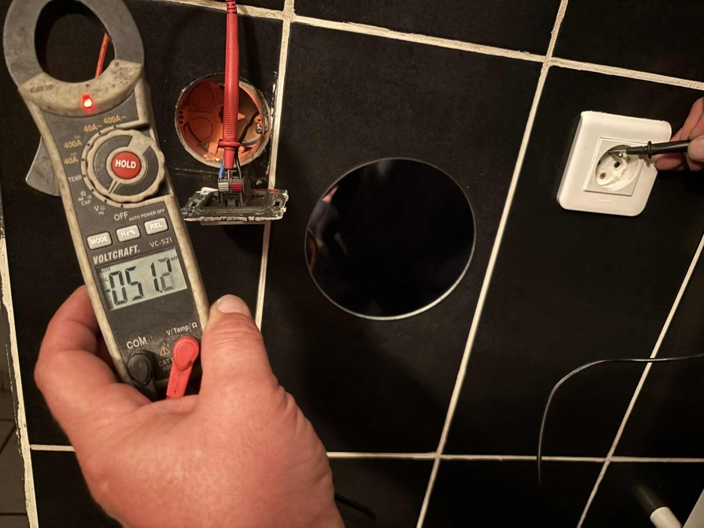

### Étape 3 : Identification de la phase et du neutre

Dans un circuit déjà câblé, identifiez les fils dans la boîte d’encastrement en repérant la phase, généralement un fil marron ou noir, le neutre, de couleur bleue, et la terre, en vert-jaune si présente. Si nécessaire, rétablissez temporairement l’alimentation avec la plus grande prudence pour effectuer un test à l’aide d’un multimètre. Placez la sonde noire sur la terre ou un point de référence connu, puis la sonde rouge sur chaque fil. Une mesure d’environ 230 V indique la phase, tandis qu’une valeur proche de 0 V correspond au neutre. Une fois le test terminé, coupez immédiatement l’alimentation pour garantir la sécurité avant de poursuivre.

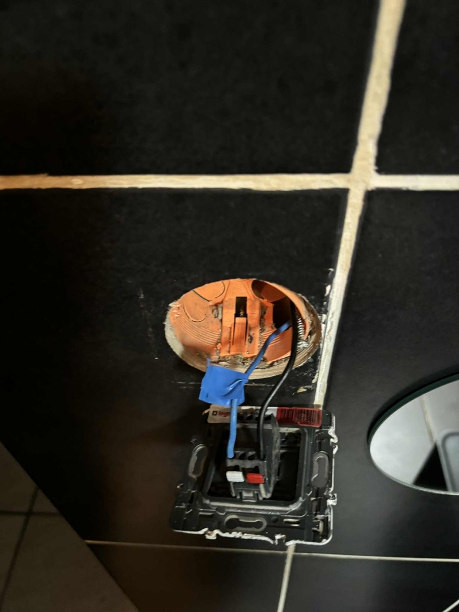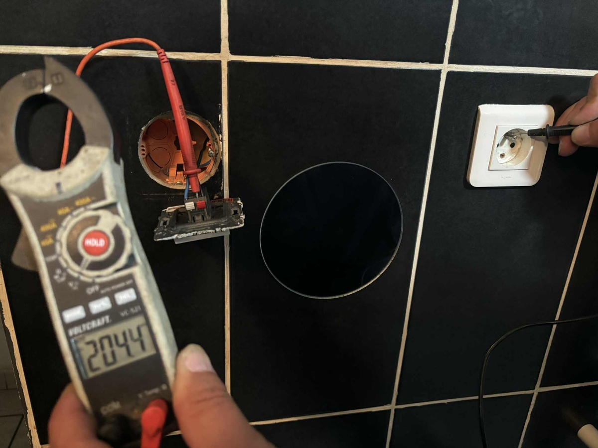

### Étape 4 : Préparation de la boîte d’encastrement

Si la boîte d’encastrement n’est pas encore en place, fixez-la solidement dans le mur en veillant à son alignement précis et à sa fixation par vis. Dénudez ensuite les extrémités des fils sur environ 1 cm à l’aide d’une pince dénudeuse afin de préparer les connexions électriques de manière propre et sécurisée pour le raccordement ultérieur.

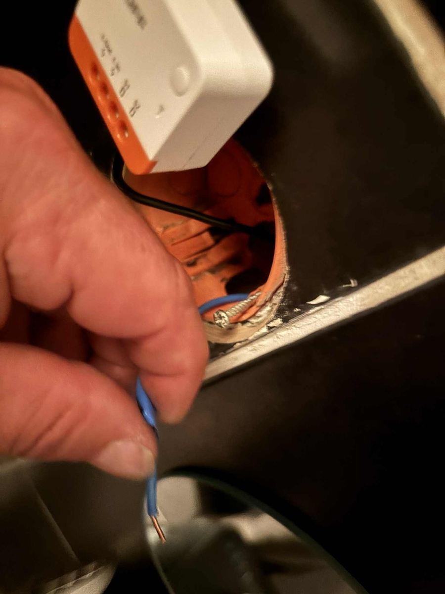

### **Étape 5 : Câblage de l’interrupteur simple**

- **Montage** :

  1. Un interrupteur simple coupe et rétablit le circuit de la phase vers la lampe. Le schéma typique est :

     - **Phase entrante** (fil marron/noir) → borne L in .
     - **Retour lampe** (fil allant à la lampe) → borne L out .
     - **interrupteur s1 s2 fil orange (L +1 OU 2 SUR L’INTERRUPTEUR)**
     - Le neutre et la terre ne passent pas par l’interrupteur ; ils sont connectés directement à la lampe via un boîtier de dérivation.
  2. Insérez les fils dénudés dans les bornes de l’interrupteur et vissez fermement.

     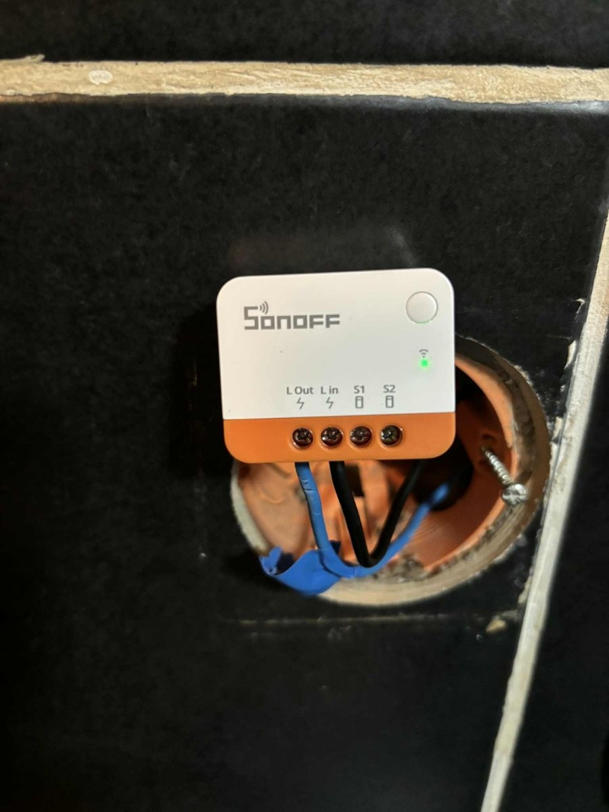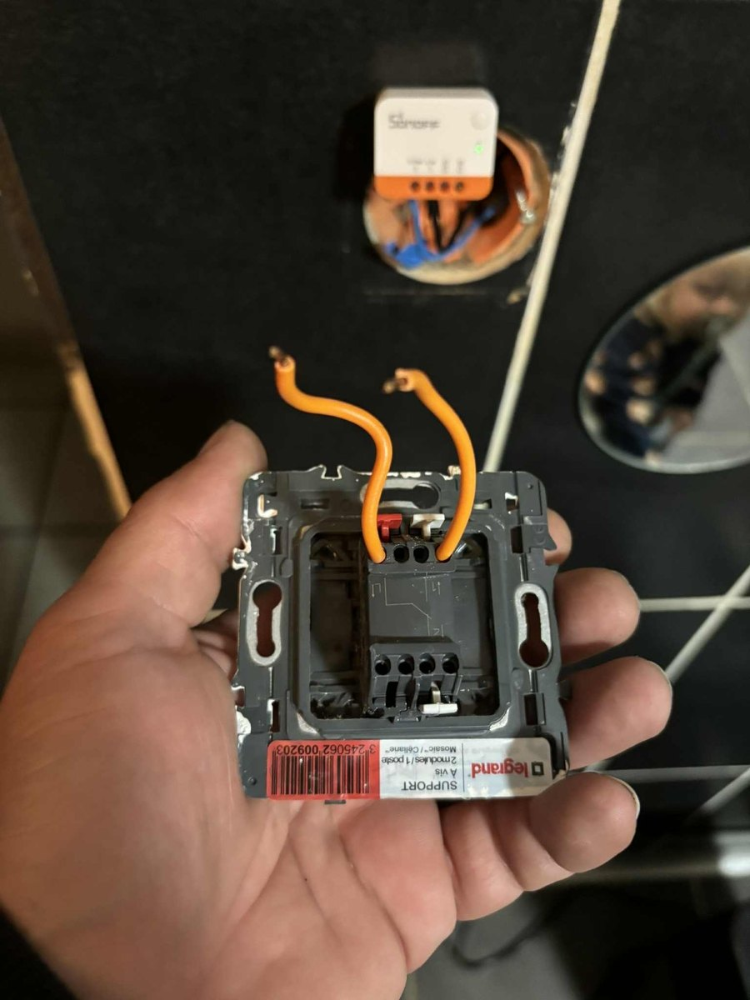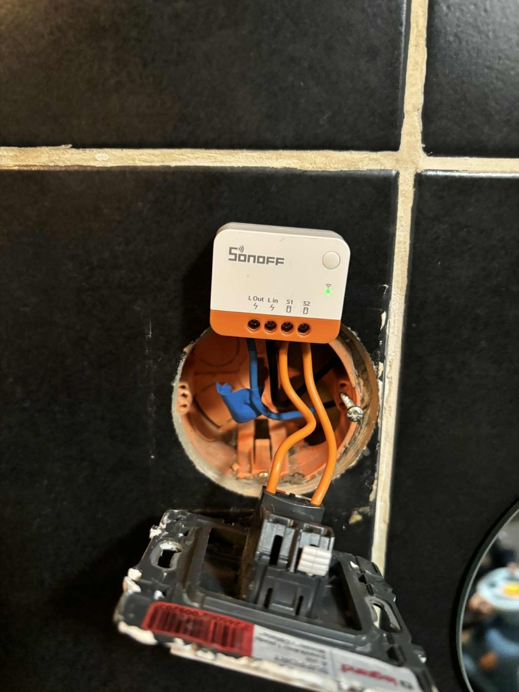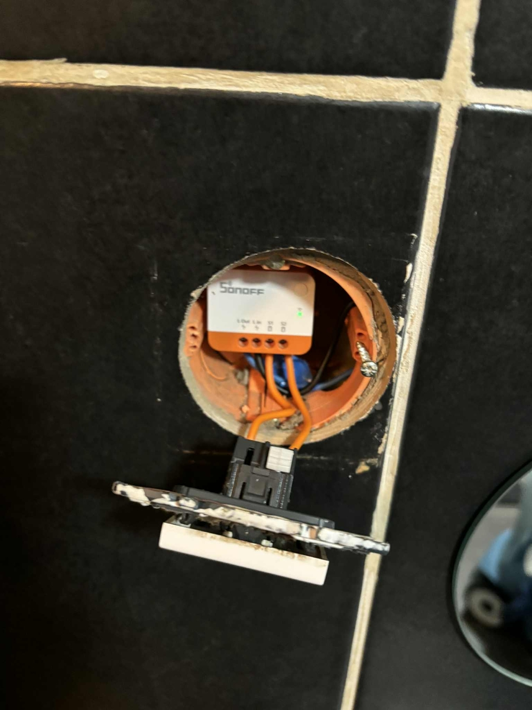

### Étape 6 : Fixation de l’interrupteur

Insérez l’interrupteur dans la boîte d’encastrement en veillant à son bon positionnement. Vissez l’interrupteur à la boîte à l’aide des vis fournies pour assurer une fixation solide. Clipsez ensuite le cadre décoratif, si inclus, pour finaliser l’installation et obtenir une finition esthétique.

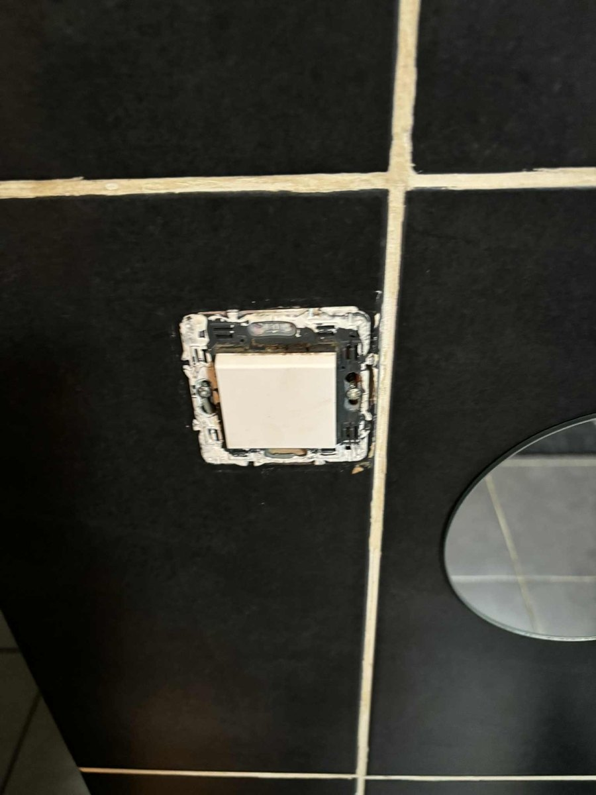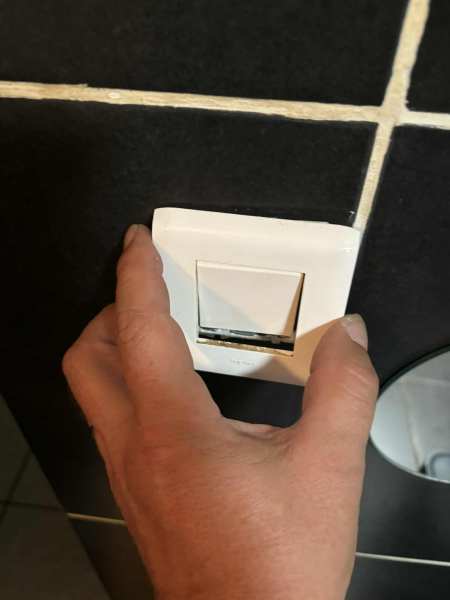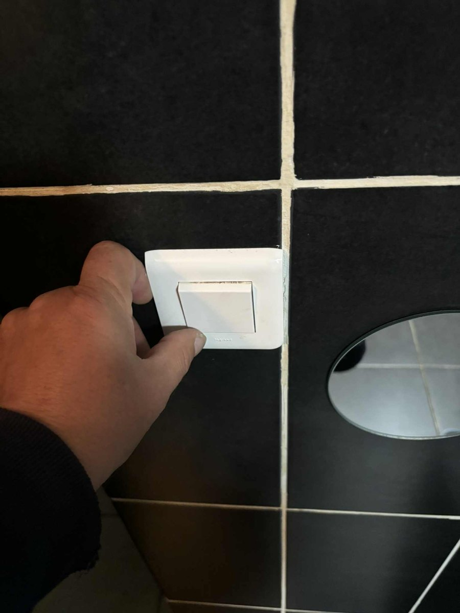

### Étape 7 : Test final

Rétablissez l’alimentation électrique en activant le disjoncteur général. Actionnez l’interrupteur pour vérifier que la lampe s’allume et s’éteint correctement, confirmant ainsi le bon fonctionnement du circuit. Passez ensuite en mode appairage sur Zigbee2MQTT pour connecter le dispositif au réseau Zigbee et finaliser l’intégration domotique.

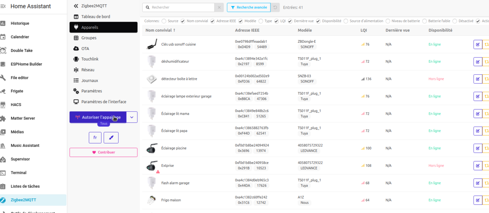

### Étape 8 : Exemple d’automatisation

Automatisation de la VMC avec l’interrupteur de la salle de bain

Cette automatisation active automatiquement la ventilation mécanique contrôlée en mode grande vitesse dès que la lumière de la salle de bain est allumée. Configurée dans Home Assistant, elle se déclenche lorsque l’interrupteur de la salle de bain, reconnu comme une entité de type lampe, passe à l’état allumé, commandant ainsi l’activation de la VMC, identifiée comme un ventilateur. Aucune condition supplémentaire, comme une restriction horaire, n’est appliquée, garantissant une exécution immédiate à chaque allumage de la lumière. Conçue pour s’exécuter une seule fois par activation, l’automatisation évite les déclenchements répétés tant que l’état de la lampe reste inchangé. Cette configuration assure une ventilation efficace de la salle de bain en lien avec l’utilisation de l’éclairage, améliorant le confort et simplifiant l’usage.

```yaml
alias: inter salle de bain vmc grande vitesse on
description: "Active la ventilation mécanique contrôlée (VMC) en mode grande vitesse lorsque la lumière de la salle de bain est allumée, assurant une ventilation efficace en lien avec l’utilisation de l’éclairage."
triggers:
  - type: turned_on
    device_id: d7e7ae98a8d9853f428e9d2dc8b42f01
    entity_id: 101e84ae96ff6d7639f265c53e62988d
    domain: light
    trigger: device
conditions: []
actions:
  - type: turn_on
    device_id: a978712fc472daf62b5b6e16a1a86a18
    entity_id: a097408519b42b9ec6798d5301339d7f
    domain: fan
mode: single
```

### **Étape 9 : Automatisation après exposition a Alexa**

**Assistant vocal** : Configurez avec Alexa pour dire "Alexa Éteins inter salle de bain" depuis un Echo Dot ou via l’app.

<https://cdn.forumdomotique.com/monthly_2025_10/alexaallume.mp4.1b4c4c16703313102e76527f5e61934a.mp4#t=0>

### Étape 10 : Finalisation

Rangez soigneusement les outils et nettoyez la zone de travail pour garantir un environnement ordonné. Vérifiez que le cadre de l’interrupteur est correctement clipsé et que l’ensemble présente une finition esthétique, assurant une installation soignée et professionnelle.

---

## Conclusion

En résumé, le **SONOFF ZBMINIL2** coche toutes les cases du module domotique idéal pour **Home Assistant**. Compact, fiable et **compatible Zigbee 3.0**, il transforme n’importe quel interrupteur classique en **interrupteur connecté sans neutre**, sans avoir à refaire tout votre câblage. Que vous soyez en mode **poussoir**, **va-et-vient** ou **interrupteur simple**, ce petit relais intelligent s’adapte à toutes les configurations tout en garantissant des **retours d’état précis** et une **intégration fluide avec Zigbee2MQTT**.

Dans un écosystème où chaque détail compte, le ZBMINIL2 brille par sa **simplicité d’installation** et sa **stabilité à long terme**. Associé à Home Assistant, il devient la brique de base idéale pour centraliser vos automatismes d’éclairage, simuler une présence ou encore déclencher des scénarios plus avancés. En quelques minutes, vous obtenez une **maison connectée réactive, locale et sans dépendance cloud**.

Si vous cherchez une solution **Zigbee fiable et sans neutre** pour moderniser votre installation électrique, le **SONOFF ZBMINIL2** s’impose clairement comme **l’un des meilleurs choix actuels pour Home Assistant**.

---

<section class="article-comments" id="commentaires">

## Commentaires de XAV59213 sur cet article (11)

### Commentaire 1 — 15 octobre 2025 à 08:22 (Europe/Paris)

- **Identifiant :** `24`
- **Lien :** https://forumdomotique.com/guides-tutoriels/home-assistant/installer-sonoff-zbminil2-home-assistant-zigbee-sans-neutre/?do=findComment&comment=24

> **Il y a 10 heures, Jeromesap a dit :**
> Bonjour dans le cas d’une l’installation électrique sans neutre ? Comment peut-on faire ?

Salut [@Jeromesap](https://forumdomotique.com/profile/532-jeromesap/) ,

Aucun neutre n’est requis pour le module lui-même, comme sur les différents schémas !

Exemple pour un interrupteur simple : il suffit de connecter la phase entrante à la borne L in, le retour de la lampe à L out (sans neutre direct au module), et l’interrupteur aux bornes S1/S2 ; dans une installation électrique en France, le neutre va toujours directement à la lampe pour boucler le circuit.

### Commentaire 2 — 15 octobre 2025 à 11:28 (Europe/Paris)

- **Identifiant :** `26`
- **Lien :** https://forumdomotique.com/guides-tutoriels/home-assistant/installer-sonoff-zbminil2-home-assistant-zigbee-sans-neutre/?do=findComment&comment=26

[@Jeromesap](https://forumdomotique.com/profile/532-jeromesap/)

Oui, il est préférable de retirer les télérupteurs Yokis MTR 500 pour utiliser le SONOFF ZBMINIL2 sur le premier schéma de principe (sans télérupteur), car sinon les états (ON/OFF) ne seront pas synchronisés correctement dans Home Assistant.

Un seul module suffit après le disjoncteur dans le coffret électrique, et tous les boutons poussoirs seront branchés en parallèle sur les bornes S1 et S2 du module.

### Commentaire 3 — 18 octobre 2025 à 12:43 (Europe/Paris)

- **Identifiant :** `29`
- **Lien :** https://forumdomotique.com/guides-tutoriels/home-assistant/installer-sonoff-zbminil2-home-assistant-zigbee-sans-neutre/?do=findComment&comment=29

Salut [@Jeromesap](https://forumdomotique.com/profile/532-jeromesap/)

Débranche le bouton de ton module et teste-le avec un multimètre (en mode continuité ou ohmmètre) : la continuité ne doit être présente que lorsque tu appuies sur le bouton, sans court-circuit permanent.

Si c'est un poussoir lumineux (avec une LED), cela peut provoquer une légère fuite de courant, ce qui pourrait faire disjoncter le circuit.

Prends une photo de tes trois interrupteurs poussoirs. Si des symboles sont présents, photographie-les également, car ils pourraient indiquer "NO" (normalement ouvert) ou "NC" (normalement fermé).

### Commentaire 4 — 18 octobre 2025 à 16:28 (Europe/Paris)

- **Identifiant :** `31`
- **Lien :** https://forumdomotique.com/guides-tutoriels/home-assistant/installer-sonoff-zbminil2-home-assistant-zigbee-sans-neutre/?do=findComment&comment=31

Les câbles bleu clair et blanc arrive bien a ton compteur ?

### Commentaire 5 — 20 octobre 2025 à 09:29 (Europe/Paris)

- **Identifiant :** `34`
- **Lien :** https://forumdomotique.com/guides-tutoriels/home-assistant/installer-sonoff-zbminil2-home-assistant-zigbee-sans-neutre/?do=findComment&comment=34

Salut [@Jeromesap](https://forumdomotique.com/profile/532-jeromesap/)

Il va falloir diagnostiquer ton réseau, savoir comment ils ont branché, et faire du repérage des câbles : les contrôler, les interpréter, si c’est bien 3 NO en mode et pas 1 NC et 2 NO.

J’ai déjà eu le cas sur une installation, par exemple avant : les poussoirs, c’était des commutateurs va-et-vient. Enfin bref, le tout c’est de savoir comment ça a été câblé.

Ce mode d’installation avec commutateurs, ça ne se fait plus en France, ou si tu en fais la demande, mais dans tous les cas, il y a bien une erreur dans l’installation électrique de ta maison.

Quelle est l’année de ta maison et de ton installation électrique ?

As-tu un Consuel ?

Connais-tu un électricien pour faire des tests ?

### Commentaire 6 — 21 octobre 2025 à 12:32 (Europe/Paris)

- **Identifiant :** `36`
- **Lien :** https://forumdomotique.com/guides-tutoriels/home-assistant/installer-sonoff-zbminil2-home-assistant-zigbee-sans-neutre/?do=findComment&comment=36

Salut [@Jeromesap](https://forumdomotique.com/profile/532-jeromesap/)

C’est une bonne idée de lancer un audit surtout avec un neutre commun pour évaluer l’état actuel de l’installation électrique et identifier d’éventuelles mises aux normes nécessaires.

N’hésitez pas à revenir vers le forum une fois l’audit terminé, afin que nous puissions discuter des résultats et des prochaines étapes si besoin.

Si tu a d’autres détails ou questions en attendant,

je suis à votre disposition ! ☺️

### Commentaire 7 — 13 décembre 2025 à 14:08 (Europe/Paris)

- **Identifiant :** `69`
- **Lien :** https://forumdomotique.com/guides-tutoriels/home-assistant/installer-sonoff-zbminil2-home-assistant-zigbee-sans-neutre/?do=findComment&comment=69

Salut [@oliv30](https://forumdomotique.com/profile/843-oliv30/)

Pour ta question : **oui, tu aurais absolument pu utiliser un module Sonoff à la place**, et c'est même souvent recommandé pour sa fiabilité supérieure (Sonoff est une marque plus établie, avec un meilleur support firmware et une stabilité reconnue en domotique, via Zigbee2MQTT ou eWeLink).

Le modèle idéal pour remplacer un télérupteur est le **Sonoff ZBMINIL2** (ou sa version récente ZBMINI-L2 Extreme) :

- Il est Zigbee 3.0, sans besoin de neutre (comme beaucoup de télérupteurs anciens).
- Il supporte un **mode "poussoir" (ou impulsion/momentary)** : en appuyant 3 fois rapidement sur son bouton interne (ou via config), il passe en mode où chaque impulsion sur les bornes S1/S2 bascule l'état de la sortie, exactement comme un télérupteur.
- Tu places le module à la place du télérupteur (dans le tableau ou en boîte de dérivation), tu câbles la phase permanente sur L, la sortie vers la lampe sur L1 (ou équivalent), et tous les retours des poussoirs en parallèle sur les entrées S.
- Puissance max : environ 6A/1400W, suffisant pour la plupart des éclairages.
- Il est très compact, fiable, et fonctionne parfaitement avec Home Assistant, Jeedom, etc.

Beaucoup d'utilisateurs l'utilisent précisément pour ça, et il est plus robuste que les modules Girier/Tuya génériques (qui sont souvent rebrandés Moes ou similaires, avec parfois des déconnexions ou une qualité inégale).

Si ton Girier fonctionne bien pour l'instant, pas besoin de changer tout de suite, mais si tu as d'autres télérupteurs à remplacer, opte pour le Sonoff – c'est un excellent choix pour la fiabilité que tu recherchais.

### Commentaire 8 — 21 décembre 2025 à 18:21 (Europe/Paris)

- **Identifiant :** `74`
- **Lien :** https://forumdomotique.com/guides-tutoriels/home-assistant/installer-sonoff-zbminil2-home-assistant-zigbee-sans-neutre/?do=findComment&comment=74

Je suis totalement d’accord avec toi, mais je pratique le contrôle comme ça à cause de ma génération.

Je suis bien d’avant 2000, et à l’époque le VAT n’était pas du tout d’actualité.

### Commentaire 9 — 27 décembre 2025 à 12:31 (Europe/Paris)

- **Identifiant :** `87`
- **Lien :** https://forumdomotique.com/guides-tutoriels/home-assistant/installer-sonoff-zbminil2-home-assistant-zigbee-sans-neutre/?do=findComment&comment=87

salut [@Chrichri01](https://forumdomotique.com/profile/958-chrichri01/)

Oui, tu peux très bien ajouter un interrupteur connecté Legrand ou n’importe quelle autre marque, tant que ça passe par Home Assistant, il n’y a aucun problème. Par exemple, moi j’utilise une prise connectée que je pilote via un interrupteur legrand en zigbee connecté pour allumer la lumière de ma piscine.

Bonjour [@Veya](https://forumdomotique.com/profile/952-veya/) ,

Non, le **Sonoff ZBMINIL2** (le module montré sur ton schéma) ne propose pas de mode découplé (« detached » ou « decoupled relay mode ») nativement.

Ce mode existe sur certains modules Sonoff avec neutre (comme le ZBMINIR2), mais pas sur les versions sans neutre comme le ZBMINIL2, car il a besoin d'un courant de fuite via la charge quand la lampe est éteinte, ce qui rend le découplage impossible sans modification.

Si tu places le ZBMINIL2 en série avec l'ampoule Hue, il coupera l'alimentation quand on éteint via l'interrupteur (ou via HA), et l'ampoule Hue perdra sa connexion Zigbee → elle ne sera plus controllable tant qu'elle n'est pas réalimentée.

### Solutions possibles pour ton cas (ampoule Hue toujours alimentée + interrupteur physique toujours alimenté, sans neutre, gestion via Home Assistant) :

1. **La meilleure option officielle et sans risque** : Utilise le **Philips Hue Wall Switch Module**. Il se place derrière ton interrupteur existant (le ZS-EUB_1gang ou n'importe quel inter classique), sans neutre nécessaire dans certains cas (vérifie la doc Hue). L'ampoule reste toujours alimentée, et l'interrupteur envoie juste un signal Zigbee pour allumer/éteindre via HA ou le bridge Hue. Parfait pour les ampoules Hue.
2. **Modification DIY du ZBMINIL2** (à tes risques et périls) : Certains utilisateurs ont modifié le ZBMINIL2 en coupant un pont de soudure (solder bridge) à l'intérieur pour le transformer en mode découplé. Ça permet de bypasser la sortie relais et d'utiliser le module comme un simple bouton Zigbee (l'interrupteur toggle un événement dans HA, sans couper l'alimentation). Il y a des tutos (ex : sur Reddit ou blogs comme Tronix), et ça marche avec des Hue. Mais :

   - Ça annule la garantie.
   - Risque de sécurité si mal fait.
   - Tu dois réalimenter en permanence la sortie L Out vers l'ampoule (shunt).
3. **Autres modules Zigbee sans neutre avec découplage ?** Malheureusement, il n'y en a quasiment pas de fiable et abordable. Les modules sans neutre ont presque tous besoin d'une charge minimale, donc pas de vrai découplage natif.
4. **Solution avec Friends of Hue** : Cherche des interrupteurs « Friends of Hue » (comme Busch-Jaeger ou autres marques compatibles) qui fonctionnent sans couper l'alimentation.

Pour ton interrupteur **ZS-EUB_1gang** (qui semble être un interrupteur Zigbee Moes/Zemismart sans neutre), il agit probablement comme un relais normal : il coupe l'alimentation. Pas adapté non plus pour garder l'ampoule Hue toujours on.

En résumé : pour un setup propre et sûr avec Hue + interrupteur physique + sans neutre → le Hue Wall Switch Module est la solution recommandée.

### Commentaire 10 — 30 décembre 2025 à 16:45 (Europe/Paris)

- **Identifiant :** `93`
- **Lien :** https://forumdomotique.com/guides-tutoriels/home-assistant/installer-sonoff-zbminil2-home-assistant-zigbee-sans-neutre/?do=findComment&comment=93

Salut !

Oui, tu as bien compris le principe.

Les deux dispositifs (**SONOFF SNZB-01M** et **Orb-ZBW1L**) sont compatibles Zigbee 3.0, donc ils peuvent communiquer via le même hub Zigbee (comme un SONOFF ZBDongle, iHost, NSPanel Pro, ou même Zigbee2MQTT/Home Assistant si tu utilises une plateforme open-source).

L'**Orb-ZBW1L** est un interrupteur mural intelligent Zigbee (basé sur un ZBMINIL2, sans neutre requis) qui contrôle directement l'allumage de ta lumière (il coupe/alimente le circuit).

Le **SNZB-01M** (Orb 4-in-1) est un bouton sans fil avec **4 boutons physiques**, chacun supportant plusieurs actions : appui simple, double, triple, appui long (jusqu'à 16 combinaisons au total).

Pour transformer ton allumage simple en **va-et-vient** (contrôle de la lumière depuis deux points) :

- Tu places l'**Orb-ZBW1L** à la place de ton interrupteur simple actuel (il gère le câblage physique).
- Tu fixes le **SNZB-01M** à l'autre endroit où tu veux un second point de commande (sans fil, aimanté ou collé, pas besoin de tirer des câbles).

Ensuite, tu crées un **scénario/automation** sur ton hub/plateforme :

- Quand tu appuies sur un bouton du SNZB-01M (par exemple, appui simple sur un des 4 boutons), cela envoie une commande pour **toggle** (inverser l'état) de l'Orb-ZBW1L : si la lumière est éteinte → allumée, et vice versa.
- Tu peux utiliser le même bouton pour ça, ou assigner différentes actions si tu veux plus de flexibilité (ex. : un bouton pour ON, un autre pour OFF, etc.).

Ça fonctionne parfaitement comme un va-et-vient classique, mais en version smart et sans fil pour le second point. L'avantage : tu gardes le contrôle manuel via l'interrupteur mural (Orb-ZBW1L) et tu ajoutes le bouton distant.

Si tu utilises l'app eWeLink (avec un bridge SONOFF), c'est direct dans les scènes. Si tu es sur Home Assistant/Zigbee2MQTT, tu peux même faire un binding direct pour une réponse ultra-rapide sans passer par le cloud.

Si tu as des questions exacte, dis-moi ! 😊

### Commentaire 11 — 24 septembre 2026 à 18:03 (Europe/Paris)

- **Identifiant :** `154`
- **Lien :** https://forumdomotique.com/guides-tutoriels/home-assistant/installer-sonoff-zbminil2-home-assistant-zigbee-sans-neutre/?do=findComment&comment=154

Bonjour JM,

Oui, tu as bien vu le point bloquant.

Le Legrand **491-19** en montage « boutons poussoirs au neutre », c’est le schéma 3 fils classique : la phase est en permanence sur une borne de la bobine, et chaque poussoir commutes le **neutre** sur l’autre borne. Ça fonctionne très bien avec ce télérupteur électromécanique.

En revanche, **tu ne peux pas conserver ce câblage tel quel** sur un ZBMINIL2. Les bornes **S1 / S2** ne sont pas prévues pour recevoir le neutre (Sonoff l’interdit d’ailleurs explicitement). Si tu branches les retours actuels des poussoirs directement dessus, le module ne détectera pas correctement les impulsions, et tu risques un fonctionnement erratique.

La solution propre, c’est celle décrite dans le guide : **retirer le 491-19** et laisser le ZBMINIL2 prendre sa place **dans le tableau**, sur le même circuit 10 A.

Principe :

•  **L in** : phase du disjoncteur

•  **L out** : départ vers les lampes (le neutre des lampes reste comme aujourd’hui, direct au tableau)

•  **S1 / S2** : les poussoirs, mais **plus au neutre**

Concrètement, il faut inverser la logique des poussoirs : le commun des boutons doit passer en **phase** (et plus en neutre), et le fil de retour qui allait à la bobine du 491-19 se raccorde sur **S2** (ou entre S1 et S2 selon ce que tu as dans les boîtiers). Tous les poussoirs restent en parallèle, comme aujourd’hui.

Ensuite :

1.  3 appuis rapides sur le bouton du ZBMINIL2 pour le passer en **mode poussoir**

2.  Appairage ZHA / Zigbee2MQTT

3.  Tu as alors le retour d’état fiable dans Home Assistant, ce que tu n’auras pas si tu laisses le télérupteur en place

Si tu ne touches pas au câblage des poussoirs et que tu laisses le 491-19, tu peux éventuellement piloter le circuit autrement, mais tu perds le retour d’état (désynchro HA / réalité), donc ce n’est pas le montage que je recommande.

Si tu as une photo des fils au tableau (bornes du 491-19) et d’un boîtier de poussoir, je pourrai te dire exactement quel fil va où.

Petit rappel sécurité : tout ça se fait **hors tension**, disjoncteur du circuit coupé, et si tu n’es pas à l’aise avec le recâblage des poussoirs, un électricien fera ça en 20 minutes.

Dis-moi ce que tu as comme fils au tableau et on affine le schéma.

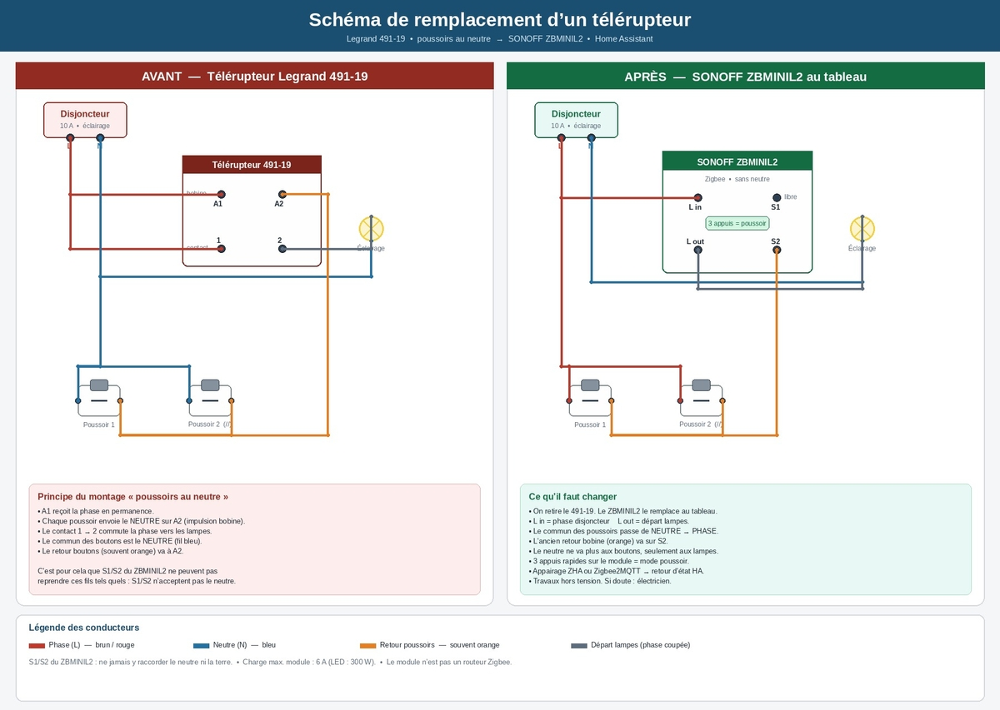
<!-- source : https://cdn.forumdomotique.com/monthly_2026_09/IMG_7382.jpeg.54df85e6181aa01307ce45110ad586ef.jpeg -->

</section>
