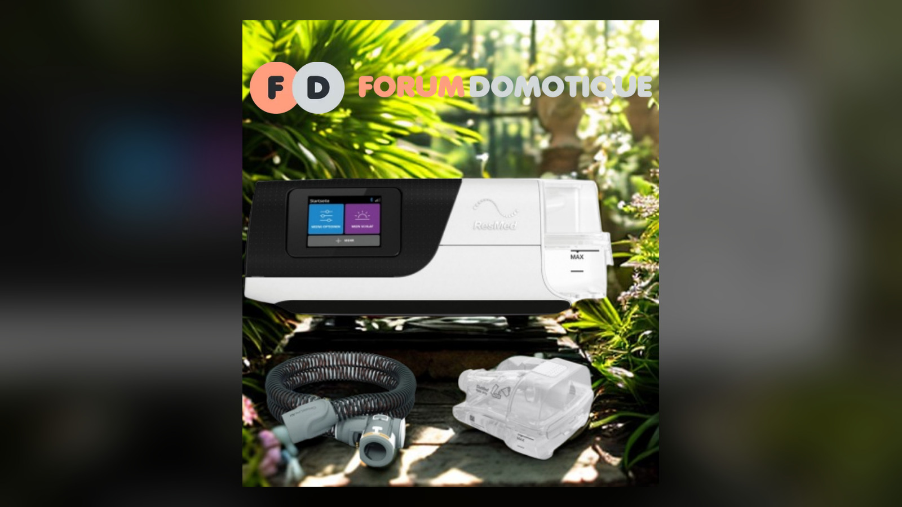
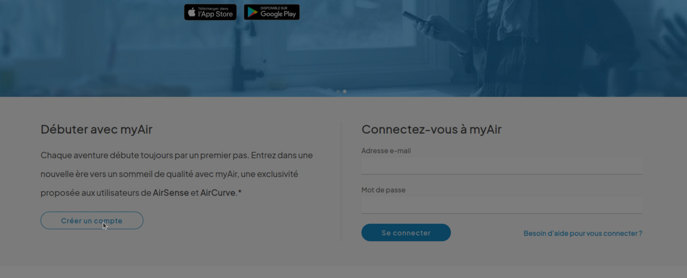
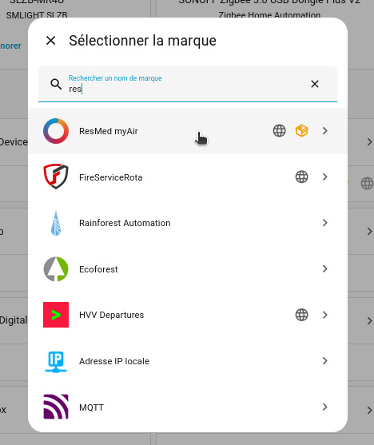
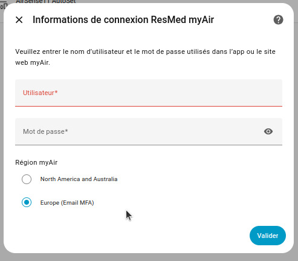
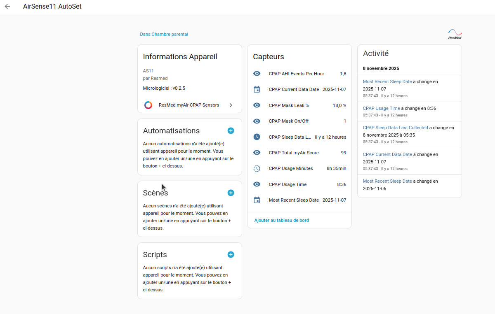
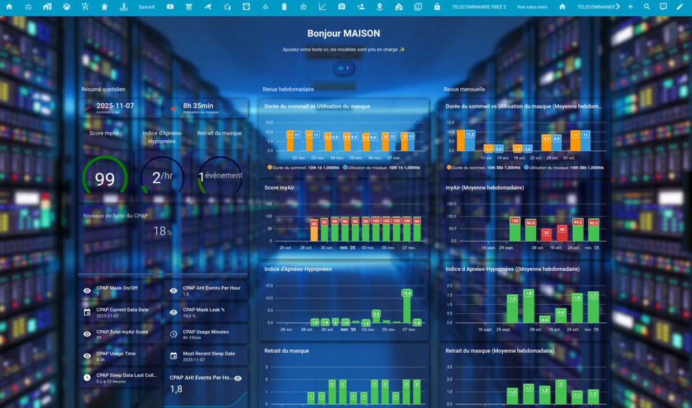

# Intégrer ResMed myAir CPAP dans Home Assistant



Ce contenu reprend le [sujet publié sur Forum Domotique le 8 novembre 2025](https://forumdomotique.com/forums/topic/489-int%C3%A9grer-resmed-myair-cpap-dans-home-assistant/).

<div class="ha-callout info" markdown="1">
Archive du sujet 489 sur ce site : [Intégrer ResMed myAir CPAP dans Home Assistant]({{ '/sujets/489-integrer-resmed-myair-cpap-dans-home-assistant/messages.html' | relative_url }}).
</div>

<p class="forum-cta"><a href="https://forumdomotique.com/forums/topic/489-int%C3%A9grer-resmed-myair-cpap-dans-home-assistant/">Lire et commenter sur Forum Domotique</a></p>

<div class="ha-callout" markdown="1">
Cette intégration s’appuie sur une API non officielle de myAir, inversée depuis le site. Elle peut cesser de fonctionner si ResMed change son service. Ce n’est pas un dispositif médical, et elle ne remplace pas le suivi de ton médecin ni l’application myAir. L’auteur de l’intégration le rappelle aussi : il ne faut pas s’appuyer dessus pour des décisions de santé.
</div>

## Sommaire

1. [Pourquoi intégrer son CPAP à Home Assistant ?](#pourquoi-integrer-son-cpap-a-home-assistant)
2. [Créer ton compte myAir (EU)](#creer-ton-compte-myair-eu)
3. [Installer l’intégration via le Marketplace](#installer-lintegration-via-le-marketplace)
4. [Les capteurs disponibles](#les-capteurs-disponibles)
5. [Dashboard Lovelace complet](#dashboard-lovelace-complet)
6. [Automatisations utiles](#automatisations-utiles)
7. [Dépannage et problèmes courants](#depannage-et-problemes-courants)
8. [Conclusion et perspectives](#conclusion-et-perspectives)

## 1. Pourquoi intégrer son CPAP à Home Assistant ? {#pourquoi-integrer-son-cpap-a-home-assistant}

L’**apnée du sommeil** touche **1 personne sur 5 après 50 ans**. Ton appareil **ResMed CPAP** (AirSense 10, 11, AirCurve…) envoie déjà ses données à **myAir**, l’application officielle. Mais **Home Assistant** va plus loin :

| Avantages | Exemples concrets |
| --- | --- |
| **Dashboard santé centralisé** | Score, AHI, fuites, usage en un coup d’œil |
| **Alertes intelligentes** | Notification si AHI > 5 ou usage < 4h |
| **Historiques longs** | Graphiques sur 1 mois, 3 mois, 1 an |
| **Intégration domotique** | Allume une lampe rouge si fuites élevées |
| **Motivation quotidienne** | Badges de streak, gamification |

## 2. Créer ton compte myAir (EU) {#creer-ton-compte-myair-eu}

> **Lien direct** : <https://myair.resmed.eu/>

### Étapes pas à pas

1. **Accède au site** → clique sur **« S’inscrire »**.
2. **Remplis le formulaire** :
   - **Email** → ce sera ton **identifiant Home Assistant**
   - **Mot de passe** : 8 caractères ou plus, 1 majuscule, 1 chiffre
   - **Pays** : France
3. **Valide ton email** (lien reçu en 2 min).
4. **Ajoute ton CPAP** :
   - **Numéro de série** (au dos de la machine)
   - **Modèle** (ex. : AirSense 11 AutoSet)
   - Active **Wi-Fi** ou **modem cellulaire**



*La page myAir : on crée un compte, ou on se connecte si on en a déjà un.*

> **Astuce** : télécharge l’**app mobile myAir** pour forcer la première synchro : [iOS](https://apps.apple.com/app/myair-by-resmed/id1061494144) | [Android](https://play.google.com/store/apps/details?id=com.resmed.myair)

### Vérification

Après une nuit de sommeil :

- Score myAir visible
- AHI affiché
- Temps d’utilisation > 0

## 3. Installer l’intégration via le Marketplace {#installer-lintegration-via-le-marketplace}

> **Dépôt officiel** : [github.com/prestomation/resmed_myair_sensors](https://github.com/prestomation/resmed_myair_sensors)

L’article d’origine, publié le 8 novembre 2025, indiquait la version **v0.1.18** (5 novembre 2025) et passait par **HACS**. Depuis **Home Assistant 2026.11**, HACS est intégré à Home Assistant sous le nom de **Marketplace**. Au 6 novembre 2026, la version courante de l’intégration est la **v0.2.8**.

<div class="ha-callout info" markdown="1">
Depuis Home Assistant 2026.11, le **Marketplace** remplace HACS. Il est intégré à Home Assistant : tu n’as rien à installer pour l’utiliser. Tu l’ouvres dans **Réglages → Marketplace**. C’est là que tu trouves et installes les créations de la communauté : intégrations, cartes de dashboard, thèmes et modèles. Si tu utilisais déjà HACS, tes installations sont migrées automatiquement au démarrage après la mise à jour. Le contenu du Marketplace est publié par la communauté, pas par le projet Home Assistant : tu l’utilises à tes propres risques, après avoir regardé l’auteur et les retours.
</div>

### Prérequis

- Home Assistant **2025.10+** (pour le Marketplace : **2026.11+**)
- Compte myAir actif

### Installation

1. Ouvre **Réglages → Marketplace**, puis recherche **ResMed myAir**.
2. Installe le dépôt **prestomation/resmed_myair_sensors**, puis **redémarre Home Assistant**.
3. Va dans **Réglages → Appareils et services → Ajouter une intégration**.
4. Tape **ResMed**, puis sélectionne **ResMed myAir CPAP Sensors**.



*On cherche « ResMed » pour ajouter l’intégration ResMed myAir.*

5. Remplis tes identifiants myAir :

```plaintext
Username: ton-email@exemple.fr
Password: ********
Region: EU (Europe)
Scan interval: 30 minutes
```



*Le formulaire de connexion : identifiant myAir, mot de passe, et région Europe.*

6. Si myAir envoie un code de vérification par e-mail, saisis ce **code à usage unique**, puis valide.

<div class="ha-callout info" markdown="1">
**Mise à jour par rapport à l’article d’origine.** En novembre 2025, le dépannage indiquait de désactiver le 2FA, alors non pris en charge. Ce n’est plus le cas : l’intégration propose une étape « Vérifier le MFA » et demande le code à usage unique reçu de ResMed. Tu n’as plus besoin de désactiver la vérification en deux étapes.
</div>

En cas de souci : rafraîchis la page, redémarre Home Assistant, ou vérifie les journaux (`resmed_myair`).

## 4. Les capteurs disponibles {#les-capteurs-disponibles}

Voici les capteurs tels qu’ils apparaissent dans l’article d’origine (v0.1.18) et sur les captures de novembre 2025.

| Entité | Nom | Unité | Description |
| --- | --- | --- | --- |
| `sensor.cpap_ahi_events_per_hour` | AHI | événements/h | Apnée + hypopnée |
| `sensor.cpap_usage_minutes` | Utilisation | min | Temps masque porté |
| `sensor.cpap_mask_on_off_count` | Retrait masque | count | Nombre d’enlèvements |
| `sensor.cpap_mask_leak_percentile` | Fuites | % | Percentile 95 |
| `sensor.cpap_myair_score` | Score myAir | /100 | Score global |
| `sensor.cpap_device_model` | Modèle | texte | AirSense 11, etc. |
| `sensor.cpap_current_data_date` | Date données | date | Dernière nuit |
| `sensor.cpap_sleep_data_last_collected` | Collecte | datetime | Dernier sync |

<div class="ha-callout info" markdown="1">
Sur les captures de novembre 2025, le capteur de fuites s’affiche encore en **%**. Dans les versions plus récentes de l’intégration (dont la v0.2.8), ce capteur est exprimé en **L/min**. La clé interne ne change pas, pour conserver l’historique.
</div>



*L’appareil dans Home Assistant : modèle, capteurs du jour et activité de collecte.*

## 5. Dashboard Lovelace complet {#dashboard-lovelace-complet}

> **Cartes requises** (via le Marketplace) :
>
> - [Mushroom Cards](https://github.com/piitaya/lovelace-mushroom)
> - [Flex Horseshoe Card](https://github.com/thomasloven/lovelace-flex-horseshoe-card)
> - [ApexCharts Card](https://github.com/RomRider/apexcharts-card)
> - [Mini Graph Card](https://github.com/kalkih/mini-graph-card)

### Code YAML complet de ma carte


```yaml
type: sections
max_columns: 6
title: Santé CPAP
path: sante
icon: mdi:heart-pulse
theme: transparentblue

sections:
  # === 1. RÉSUMÉ QUOTIDIEN ===
  - type: grid
    cards:
      - type: custom:mushroom-title-card
        title: ""
        subtitle: Résumé quotidien
      - type: grid
        square: false
        columns: 2
        cards:
          - type: custom:mushroom-entity-card
            entity: sensor.cpap_current_data_date
            name: Dernière nuit
            icon: mdi:calendar
            icon_color: blue
            primary_info: state
            secondary_info: last_changed
            layout: horizontal
          - type: custom:mushroom-entity-card
            entity: sensor.cpap_usage_minutes
            name: Utilisation masque
            icon: mdi:face-mask
            icon_color: green
            primary_info: state
            secondary_info: last_changed
            layout: horizontal

      - type: grid
        square: false
        columns: 3
        cards:
          - type: custom:mushroom-title-card
            title: ""
            subtitle: Score myAir
            alignment: center
          - type: custom:mushroom-title-card
            title: ""
            subtitle: AHI
            alignment: center
          - type: custom:mushroom-title-card
            title: ""
            subtitle: Retrait masque
            alignment: center

      - type: grid
        square: false
        columns: 3
        cards:
          - type: custom:flex-horseshoe-card
            entities:
              - entity: sensor.cpap_myair_score
                decimals: 0
                unit: ""
            show: { horseshoe_style: autominmax }
            layout:
              states:
                - id: 0
                  entity_index: 0
                  xpos: 50
                  ypos: 66
                  styles: { font-size: 6.5em; }
            horseshoe_scale: { min: 0, max: 100 }
            color_stops:
              "70": red
              "85": orange
              "90": green

          - type: custom:flex-horseshoe-card
            entities:
              - entity: sensor.cpap_ahi_events_per_hour
                decimals: 1
                unit: /h
            show: { horseshoe_style: autominmax }
            layout:
              states:
                - id: 0
                  entity_index: 0
                  xpos: 50
                  ypos: 60
                  styles: { font-size: 5.5em; }
            horseshoe_scale: { min: 0, max: 30 }
            color_stops:
              "5": green
              "15": orange
              "30": red

          - type: custom:flex-horseshoe-card
            entities:
              - entity: sensor.cpap_mask_on_off_count
                decimals: 0
                unit: fois
            show: { horseshoe_style: autominmax }
            layout:
              states:
                - id: 0
                  entity_index: 0
                  xpos: 50
                  ypos: 57
                  styles: { font-size: 4.5em; }
            horseshoe_scale: { min: 0, max: 7 }
            color_stops:
              "2": green
              "4": orange
              "7": red

      - type: custom:mini-graph-card
        entities:
          - entity: sensor.cpap_mask_leak_percentile
        name: Fuites masque (95e percentile)
        show: { name: true, icon: false, fill: true }
        color_thresholds:
          - { value: 0, color: "#43A047" }
          - { value: 24, color: "#FF9800" }
          - { value: 40, color: "#E53935" }
        hours_to_show: 168

  # === 2. REVUE HEBDOMADAIRE ===
  - type: grid
    cards:
      - type: custom:mushroom-title-card
        title: ""
        subtitle: Revue hebdomadaire
      - type: custom:apexcharts-card
        graph_span: 7d
        header: { show: true, title: Utilisation CPAP }
        series:
          - entity: sensor.cpap_usage_minutes
            type: column
            name: Minutes/jour
            group_by: { func: max, duration: 1d }
            show: { as_duration: minute, datalabels: true }
      - type: custom:apexcharts-card
        graph_span: 14d
        header: { show: true, title: Score myAir }
        series:
          - entity: sensor.cpap_myair_score
            type: column
            group_by: { func: max, duration: 1d }
            color_threshold:
              - { value: 0, color: "#E53935" }
              - { value: 85, color: "#FFB300" }
              - { value: 90, color: "#43A047" }
      - type: custom:apexcharts-card
        graph_span: 14d
        header: { show: true, title: AHI }
        series:
          - entity: sensor.cpap_ahi_events_per_hour
            type: column
            group_by: { func: max, duration: 1d }
            color_threshold:
              - { value: 5, color: "#43A047" }
              - { value: 15, color: "#FFB300" }
              - { value: 30, color: "#E53935" }

  # === 3. REVUE MENSUELLE ===
  - type: grid
    cards:
      - type: custom:mushroom-title-card
        title: ""
        subtitle: Revue mensuelle (moyenne hebdo)
      - type: custom:apexcharts-card
        graph_span: 1month
        series:
          - entity: sensor.cpap_myair_score
            type: column
            name: Score moyen
            group_by: { func: avg, duration: 1week }
            color_threshold:
              - { value: 85, color: "#43A047" }
              - { value: 70, color: "#FFB300" }
              - { value: 0, color: "#E53935" }

header:
  card:
    type: markdown
    content: |
      # Santé CPAP - {{ user }}
      Dernière mise à jour : {{ states('sensor.cpap_sleep_data_last_collected') | timestamp_custom('%H:%M') }}
```




*Le dashboard : résumé du jour, revue hebdomadaire et revue mensuelle.*

## 6. Automatisations utiles {#automatisations-utiles}

### 1. Alerte AHI élevé


```yaml
- alias: "Alerte AHI > 5"
  trigger:
    - platform: numeric_state
      entity_id: sensor.cpap_ahi_events_per_hour
      above: 5
  action:
    - service: notify.mobile_app_iphone
      data:
        title: "CPAP - AHI élevé"
        message: "AHI = {{ states('sensor.cpap_ahi_events_per_hour') }} /h"
```


### 2. Rappel usage faible


```yaml
- alias: "Rappel CPAP < 4h"
  trigger:
    - platform: time
      at: "08:00:00"
  condition:
    - condition: numeric_state
      entity_id: sensor.cpap_usage_minutes
      below: 240
  action:
    - service: notify.mobile_app_iphone
      data:
        title: "CPAP oublié"
        message: "Usage hier : {{ states('sensor.cpap_usage_minutes') }} min"
```


## 7. Dépannage et problèmes courants {#depannage-et-problemes-courants}

| Problème | Solution |
| --- | --- |
| `401 Unauthorized` | Vérifie le mot de passe et la région |
| `429 Too Many Requests` | `scan_interval: 3600` |
| Pas de données | Vérifie le modem du CPAP et l’app myAir |
| Intégration absente | Redémarre Home Assistant après l’installation depuis le Marketplace |
| Code MFA demandé | Saisis le code à usage unique reçu par e-mail (plus besoin de désactiver le 2FA) |

## 8. Conclusion et perspectives {#conclusion-et-perspectives}

Tu as maintenant un **suivi médical pro** dans Home Assistant :

- **Dashboard clair et motivant**
- **Données fiables et quotidiennes**
- **Alertes automatiques**

> **Limite** : API non officielle → risque de rupture (mais stable depuis 2021).

### À faire ensuite

- Partage ton dashboard sur le [forum HA](https://community.home-assistant.io/)
- Ajoute un capteur de **température chambre** pour corréler avec AHI
- Crée un **badge de streak** (7 nuits > 4h)
