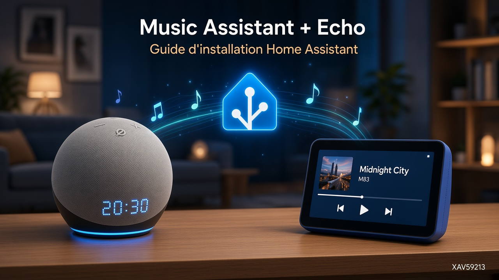
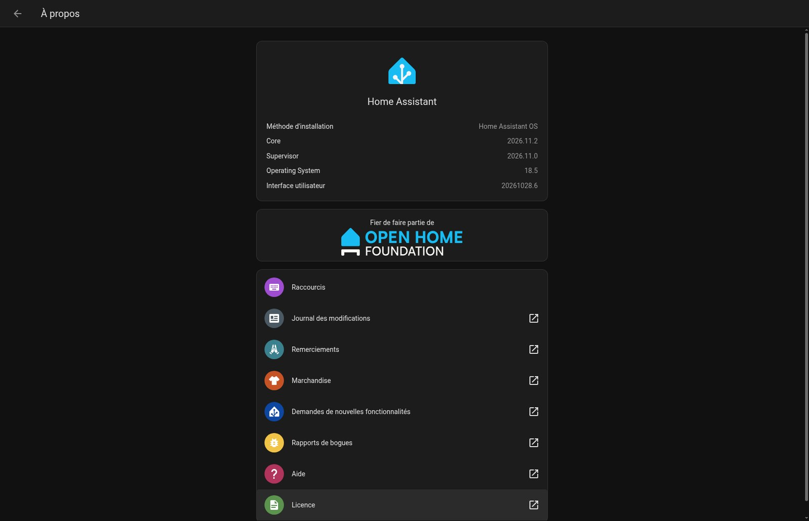
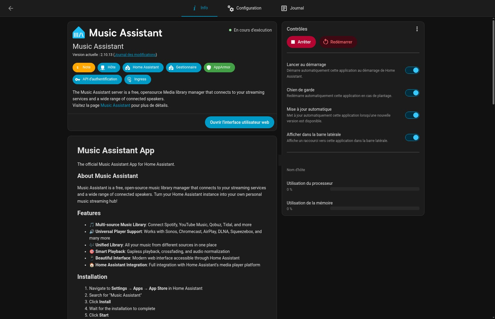
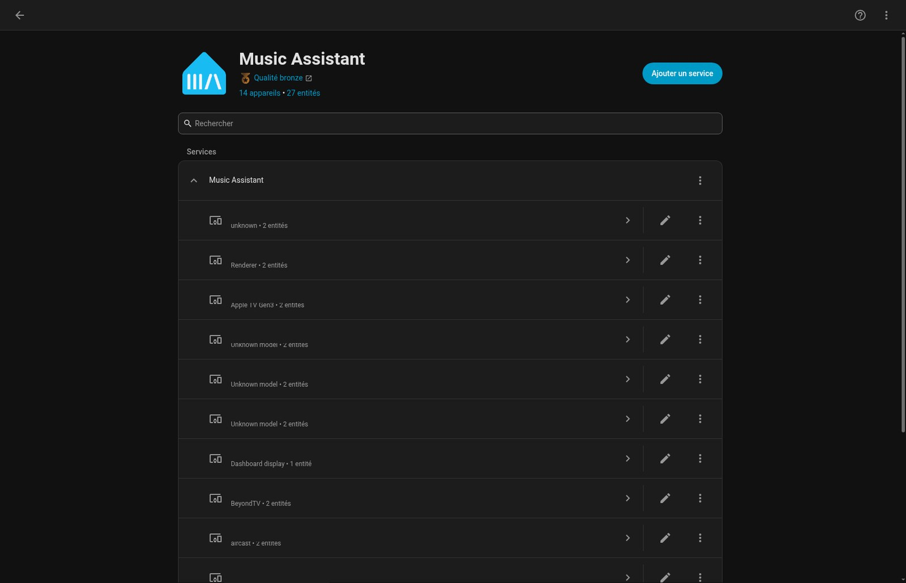
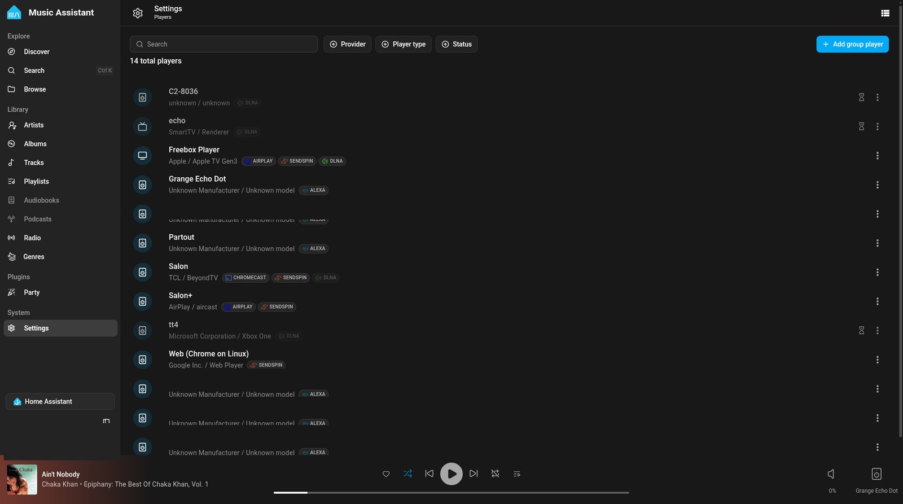
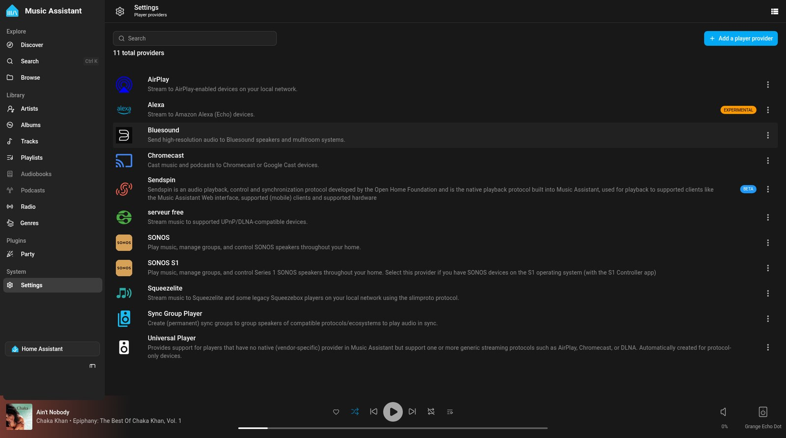
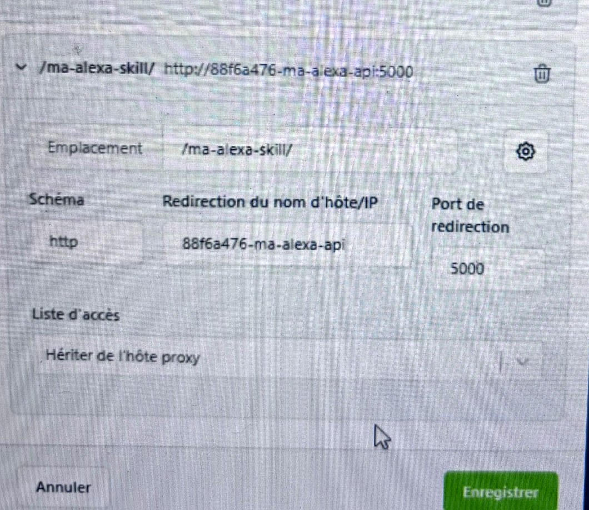
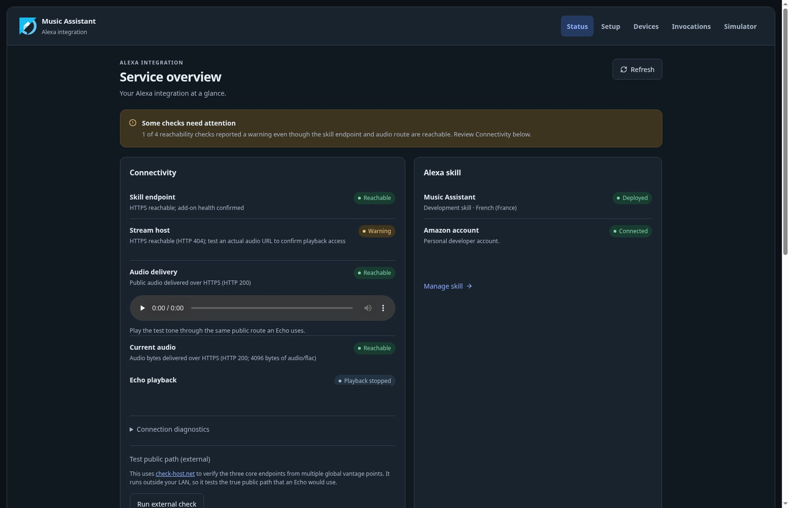
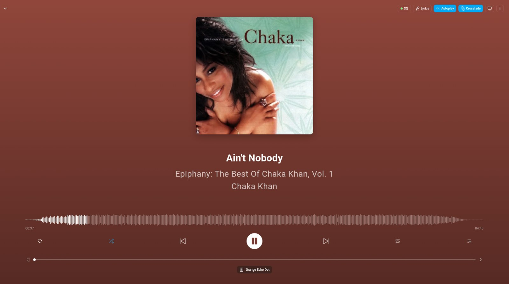

# Installer Music Assistant dans Home Assistant, et le faire jouer sur les Echo Dot et Echo Show



<div class="ha-callout info" markdown="1">
**Guide complémentaire.** Pour mettre votre musique de la Freebox dans Music Assistant, voir le guide [Comment ajouter la musique stockée sur le disque dur de votre Freebox à Music Assistant via partage SMB]({{ '/contenus/guides/freebox-smb-music-assistant/article.html' | relative_url }}).
</div>

## Pourquoi Music Assistant

J’aime bien avoir toute ma musique au même endroit, et pouvoir l’envoyer sur les enceintes de la maison depuis Home Assistant. **Music Assistant** est un serveur de musique conçu pour vivre à côté de Home Assistant : une bibliothèque unifiée, des lecteurs partout dans la maison, et, si on le souhaite, des automatisations.

Chez moi, le besoin concret était simple : faire jouer mes fichiers MP3, ceux de ma bibliothèque, sur les **Echo Dot** et l’**Echo Show**, pas seulement une radio Amazon ou une synthèse vocale.

Amazon ne laisse pas une Echo se comporter comme une Chromecast ou une Sonos. Pour y arriver, Music Assistant s’appuie sur un **skill Alexa personnel**, exposé en HTTPS sur une adresse que l’on contrôle, et sur un add-on qui sert de pont. Ce n’est pas un interrupteur à un clic, et on l’a bien vu.

## Prérequis

D’après la [documentation officielle de Music Assistant](https://www.music-assistant.io/installation/), le serveur doit tourner en permanence, sur le **même réseau local** que les lecteurs, sans VLAN entre les deux. Home Assistant OS est la méthode recommandée : on installe alors Music Assistant comme une application (l’ancien « add-on ») depuis la boutique.

Il faut aussi, pour les Echo :

- une adresse **HTTPS publique** avec un certificat de confiance, dont on maîtrise le routage (un reverse proxy, par exemple Nginx Proxy Manager) ;
- un compte **développeur Amazon**, le même que celui de ses Echo ;
- l’add-on **Music Assistant Alexa API**, qui parle au skill.

Un point important, confirmé à la fois par l’add-on et par notre essai : **Nabu Casa ne suffit pas**. Le lien distant de Home Assistant Cloud ouvre l’interface de Home Assistant, pas le skill Alexa ni les flux audio de Music Assistant (`/ma-alexa-skill/`, `/flow/`, `/imageproxy/`, etc.).

Sur les captures de ce guide, mon installation tourne sous **Home Assistant Core 2026.11.2** (Supervisor 2026.11.0, OS 18.5, Frontend 20261028.6), **Music Assistant Server 2.10.13**, l’add-on **Music Assistant Alexa API 1.3.11**, et **Alexa Media Player v5.21.0**.



*Les versions de mon Home Assistant, relevées sur la page À propos.*

## Installer Music Assistant, puis l’intégration Home Assistant

Je n’ai pas retracé les clics exacts de mon installation d’origine : le serveur tournait déjà le 18 novembre 2026. Voici la marche officielle, qui correspond à un Home Assistant OS.

### L’application Music Assistant

Sur Home Assistant OS, d’après la [documentation officielle](https://www.music-assistant.io/installation/) et celle de [Home Assistant](https://www.home-assistant.io/integrations/music_assistant/) :

1. Aller dans **Paramètres → Applications → Boutique d’applications** (App Store).
2. Chercher **Music Assistant** dans le dépôt officiel du projet, puis **Installer**.
3. **Démarrer** l’application, puis ouvrir l’**interface web**.
4. Suivre l’assistant de premier démarrage pour ajouter une première source de musique.

L’interface du serveur est aussi joignable, en local, sur le port **8095**. Les flux audio vers les lecteurs passent, eux, par un autre port, **8097** par défaut.



*L’application Music Assistant, une fois installée et en cours d’exécution, en version 2.10.13.*

### L’intégration dans Home Assistant

Le serveur et l’intégration sont deux choses distinctes. L’application fait tourner Music Assistant. L’intégration, elle, fait apparaître les lecteurs comme des `media_player` dans Home Assistant, pour les tableaux de bord et les automatisations.

Une fois le serveur lancé, Home Assistant le découvre en général tout seul, sur la page **Paramètres → Appareils et services**. On peut aussi l’ajouter manuellement en choisissant **Music Assistant**. Sur Home Assistant OS, l’assistant propose d’utiliser l’application officielle : on laisse cette option cochée, Home Assistant installe et démarre l’application si besoin, puis reprend une fois la configuration initiale terminée.



*L’intégration Music Assistant, une fois en place : 14 appareils et 27 entités. Les noms des appareils ont été masqués.*

Chez moi, cette partie était déjà en place le 18 novembre 2026 : les Echo de Music Assistant apparaissaient bien dans Home Assistant, et la bibliothèque répondait.

## Ajouter les sources musicales

Aucun fournisseur de musique n’est installé au départ. On les ajoute dans Music Assistant, **Paramètres → Music Providers** (Fournisseurs de musique).

### La musique déjà sur mon Home Assistant

Le 18 novembre 2026, mes MP3 étaient bien là, dans `/media/Music/`. C’est cette bibliothèque que l’on a utilisée pour les essais sur les Echo. Chez moi, ce dossier vient du partage Windows (SMB) de la Freebox, monté dans Home Assistant comme stockage réseau d’usage **Média**, sous le nom `Music`.

### Le disque de la Freebox, en SMB

J’ai raconté ce montage, mis à jour, dans le guide [Comment ajouter la musique stockée sur le disque dur de votre Freebox à Music Assistant via partage SMB]({{ '/contenus/guides/freebox-smb-music-assistant/article.html' | relative_url }}). Une première version, publiée en décembre 2025, reste lisible [sur le forum](https://forumdomotique.com/forums/topic/618-comment-ajouter-la-musique-stock%C3%A9e-sur-le-disque-dur-de-votre-freebox-%C3%A0-music-assistant-via-partage-smb/).

Je n’y reviens pas en détail ici. L’idée est d’activer le partage Windows (SMB) dans Freebox OS, de le monter dans **Paramètres → Système → Stockage** en usage **Média**, puis d’ajouter dans Music Assistant le fournisseur **Filesystem (local disk)** vers `/media`.

## Faire jouer la musique sur les Echo Dot et l’Echo Show

C’est cette partie qui nous a donné du fil à retordre, le 18 novembre 2026, avec le bot Home Assistant Production.

### Le constat de départ

Je n’arrivais pas à faire jouer mes MP3 sur les Echo Dot et l’Echo Show. L’application pouvait afficher « lecture en cours », et rien ne sortait de l’enceinte.

Premier enseignement, qui n’est pas un bug : **une Echo n’apparaît pas une seule fois dans Home Assistant**. Chez moi, chaque appareil se décline en trois lecteurs, et un seul sait jouer un fichier de la bibliothèque :

- les lecteurs dont le nom se termine par **`_3`**, venant de **Music Assistant** : ce sont **les seuls à utiliser pour les MP3** ;
- les versions en **`_2`**, venant d’**Alexa Devices** : elles ne savent pas lire de média ;
- les versions **sans numéro**, venant d’**Alexa Media Player** : elles jouent les services Amazon (Amazon Music, radios, synthèse vocale), pas un MP3 de la bibliothèque.

Sur l’Echo Show 5, on voyait même un morceau affiché depuis la veille au soir, figé au milieu du titre : la commande était partie, mais l’Echo n’avait jamais reçu le son.

> **Piège.** Pour lancer un morceau, choisir le lecteur Music Assistant, celui qui finit par `_3`. Les deux autres existent, ils ont le même nom d’appareil, et ils ne feront pas jouer vos fichiers.

Dans cette session, on a surtout travaillé avec l’Echo Dot de la grange et l’Echo Show 5 (2e génération).



*Les lecteurs vus depuis Music Assistant. Les noms qui identifient des personnes de la maison ont été masqués ; l’Echo Dot de la grange, celui du test, reste visible.*

### Ce qu’il faut vraiment, côté Amazon et proxy

Le schéma, une fois compris, est celui-ci :

1. Installer l’add-on **Music Assistant Alexa API** (dépôt [timlaing/music-assistant-alexa-api](https://github.com/timlaing/music-assistant-alexa-api)). Chez moi, il était en **v1.3.11**.
2. Dans Music Assistant, configurer le fournisseur de lecteurs **Alexa**, avec l’adresse locale de l’add-on et les identifiants API de l’add-on (pas ceux du compte Amazon).
3. Exposer en HTTPS public, sans page de connexion devant :
   - le skill, sous le chemin `/ma-alexa-skill/` vers l’add-on (port interne **5000**) ;
   - les flux et les pochettes de Music Assistant, notamment `/flow/` et `/imageproxy/`, vers le serveur de flux (port **8097**).
4. Créer le skill personnel depuis l’interface **Setup** de l’add-on, le lier au compte Amazon, et le déployer.
5. Dire à un Echo : **« Alexa, ouvre Music Assistant »**, puis lancer la musique depuis un lecteur `_3`.



*Le fournisseur Alexa, dans les réglages de Music Assistant. Le badge Experimental est bien visible ; je n’ai pas ouvert le détail pour cette capture.*

Chez moi, le reverse proxy, c’est l’add-on **Nginx Proxy Manager**. Les pochettes passaient déjà. En revanche, les chemins du skill renvoyaient une erreur **404** ou **502** : le proxy n’atteignait pas l’add-on Alexa API. Et la page Statut de l’add-on affichait clairement : *The personal skill has not been linked to Amazon yet*.

### Régler Nginx Proxy Manager

Dans Nginx Proxy Manager, on édite l’hôte public, onglet **Custom Locations** (Emplacements personnalisés).

Pour le skill, j’ai ajouté l’emplacement suivant, **sans liste d’accès** devant (pas de mot de passe npm qui bloquerait Amazon) :

- **Emplacement** : `/ma-alexa-skill/`
- **Schéma** : `http`
- **Nom d’hôte** : `88f6a476-ma-alexa-api` (c’est le nom interne de l’add-on, le même pour tous ceux qui l’installent depuis ce dépôt)
- **Port** : `5000`



Ce n’était pas encore suffisant. Le proxy atteignait bien l’add-on, mais il lui renvoyait l’adresse **avec** le préfixe `/ma-alexa-skill/` : l’endpoint du skill et le fichier audio de test répondaient encore **404**. Il faut **retirer ce préfixe** avant d’envoyer la requête à l’add-on.

Sous la roue ⚙ de cet emplacement, dans la configuration nginx personnalisée, la ligne exacte est :

```nginx
rewrite ^/ma-alexa-skill/?(.*)$ /$1 break;
```

Deux détails qui ont leur importance : le **point-virgule** à la fin (sans lui, nginx peut planter et tout le proxy tombe), et l’étoile dans `(.*)`. On n’ajoute **pas** un second `proxy_pass` : Nginx Proxy Manager en met déjà un.

J’ai aussi ajouté un emplacement `/test-audio.mp3`, vers le même hôte et le même port 5000, sans rewrite, pour le fichier audio de test de l’add-on. On peut faire de même pour `/health` si on le souhaite.

Les emplacements `/flow/` et `/imageproxy/` allaient déjà vers Music Assistant : je n’y ai pas touché. En revanche, `/ma/` et `/alexa/` renvoyaient une erreur **502**. Comme Music Assistant parlait déjà à l’add-on en local, je n’avais pas besoin de les exposer sur l’adresse publique : autant les supprimer, ou les pointer correctement vers `88f6a476-ma-alexa-api` sur le port 5000, selon la [table officielle de l’add-on](https://github.com/timlaing/music-assistant-alexa-api).

> **Piège.** Pointer `/ma-alexa-skill/` vers Music Assistant au lieu de l’add-on Alexa API, ou oublier le *rewrite* qui retire le préfixe, donne exactement le symptôme que j’avais : « lecture en cours » à l’écran, et pas un son sur l’Echo. Amazon n’arrive pas à joindre le skill.

### Créer le profil Login with Amazon et déployer le skill

Dans Home Assistant, on ouvre l’add-on **Music Assistant Alexa API**, puis l’interface web, puis **Setup**. Les identifiants demandés par l’add-on sont ceux de **sa** configuration, pas le mot de passe Amazon.

L’ordre des étapes compte.

**Étape 1 — Application.** Le champ **Public skill endpoint** doit être exactement :

`https://votre-domaine/ma-alexa-skill/`

Pas seulement la racine du domaine. On enregistre **sur cette étape** avant de passer à la suite, puis on redéploiera à l’étape 4. C’est le dernier vrai blocage que l’on a eu : l’add-on testait encore l’adresse sans le chemin, et l’Echo restait muet, alors que le proxy et l’audio de test étaient déjà bons.

**Étape 2 — Compte Amazon.** Il faut un profil de sécurité **Login with Amazon** :

1. Ouvrir la [console Login with Amazon](https://developer.amazon.com/loginwithamazon/console/site/lwa/overview.html), avec le compte Amazon de ses Echo.
2. Créer un **Security Profile**, par exemple nommé `Music Assistant`, avec une courte description et une URL d’avis de confidentialité (celle de son domaine public suffit).
3. Dans ⚙ → **Paramètres Web** (*Web Settings*), coller exactement, dans **URL de retour autorisées** :

`https://votre-domaine/ma-alexa-skill/setup/oauth/callback`

Sans espace, avec le `/` après `skill`, **sans** `/` à la fin. On laisse « Origines autorisées » vide. On enregistre, on attend une à deux minutes que Amazon prenne la modification, puis on copie le **Client ID** et le **Client Secret** dans l’add-on, on enregistre, et on clique sur **Connect**. On accepte l’autorisation Amazon.

Le secret reste chez soi : on ne le colle nulle part d’autre.

**Étape 3 — Skill personnel.** Une fois « Amazon connected » :

- cocher **Show artwork and controls on Echo Show**, pour l’Echo Show ;
- choisir son compte dans **Developer account** ;
- prendre le skill dans la liste, ou **Refresh skill list**, ou en créer un dans les réglages avancés ;
- langue du skill : **fr-FR** chez moi.

**Étape 4.** On clique sur **Deploy** (ou **Redéployer**). Amazon construit le skill en une à trois minutes. Quand le badge passe à **Deployed**, on dit à un Echo : **« Alexa, ouvre Music Assistant »**.

> **Piège.** Si l’on saute trop tôt à l’étape 3, un bandeau bleu rappelle : *Configure the Login with Amazon client ID and secret first*. Il faut revenir à l’étape 2, enregistrer l’identifiant et le secret, puis **Connect**.  
> Autre classique : une **erreur 400** juste après **Connect**. Le plus souvent, l’URL de retour n’est pas encore prise en compte par Amazon, ou elle n’est pas strictement identique à celle affichée par l’add-on. On vérifie le caractère près, on attend une ou deux minutes, on ferme les onglets d’erreur, et on réessaie, au besoin en navigation privée.



*La page Statut de l’add-on, telle qu’elle se présente quand rien ne joue : Skill endpoint, Audio delivery et Current audio sont au vert, Stream host reste en Warning (HTTP 404), et Echo playback affiche « Playback stopped ». Ces deux alertes apparaissent à l’arrêt et peuvent être ignorées, comme je l’explique juste après.*

### Le test qui a enfin sorti le son

Après ces corrections, le 18 novembre 2026 vers 9 h 52 (heure de Paris), un MP3 est bien sorti de l’Echo Dot de la grange. Toute la chaîne était en place : Echo, skill, flux.

Une coupure au bout d’une quarantaine de secondes, pendant ce test, n’était pas une panne : c’était l’arrêt volontaire de l’essai. Juste après, « Echo playback » est passé à **Playback confirmed**, vers 9 h 57.

Depuis, pour écouter, je lance la musique depuis Music Assistant, sur les Echo dont le nom finit par `_3`.

## Les autres galères, et ce qu’on peut ignorer

> **Piège.** Dans Home Assistant, la position du morceau peut rester bloquée à **0 seconde** alors que le son sort parfaitement. On ne s’y fie pas : on écoute l’enceinte.

> **Piège.** Après un arrêt, le contrôle « Current audio » peut passer en **404**. Le lien de flux expire dès que la lecture s’arrête, c’est normal. Il se met à jour au prochain vrai essai.

> **Piège.** Le contrôle « Stream host » peut rester orange ou en 404 s’il teste seulement la page d’accueil de votre domaine, qui n’existe pas forcément. Les Echo n’utilisent pas cette adresse : elles passent par les liens de flux. Inutile de servir quelque chose à la racine juste pour faire taire ce bandeau, au risque de casser les autres emplacements. On peut le laisser tel quel.

## Au quotidien

Une fois le skill lié, le plus simple reste l’interface de Music Assistant, ou le lecteur `_3` dans Home Assistant : on choisit le morceau, on choisit l’Echo, et ça part.

Sur l’Echo Show, l’option **Show artwork and controls on Echo Show** était bien cochée, et la carte « Echo Show display » de l’add-on affichait que les pochettes et les commandes étaient activées. Je n’ai pas, dans l’historique, de photo de l’écran de l’Echo Show pendant une lecture réussie.

Mon vécu, c’est que maintenant je peux lire les MP3 pour faire la fête. Plus besoin d’aller sur YouTube : tout est dans Music Assistant.

La documentation officielle du fournisseur Alexa précise aussi quelques limites, que je n’ai pas toutes mesurées moi-même : pas de vrai multiroom synchronisé façon groupe Alexa, et des fonctions avancées (aléatoire, répétition, fondu) pas encore au rendez-vous. L’affichage de l’état et du volume dans Music Assistant peut aussi mentir un peu. Ça rejoint ce que l’on a vu avec la position figée à 0 seconde dans Home Assistant.



*Une lecture relancée brièvement sur l’Echo Dot de la grange, pour la capture. C’est bien le lecteur Music Assistant, celui que l’on utilise au quotidien.*

<div class="ha-callout info" markdown="1">
**Guide complémentaire.** Pour mettre votre musique de la Freebox dans Music Assistant, voir le guide [Comment ajouter la musique stockée sur le disque dur de votre Freebox à Music Assistant via partage SMB]({{ '/contenus/guides/freebox-smb-music-assistant/article.html' | relative_url }}).
</div>

## En résumé

Music Assistant, sur Home Assistant OS, s’installe comme une application, puis se relie à Home Assistant par l’intégration officielle. On y ajoute sa musique — chez moi, les fichiers déjà présents dans `/media/Music/`, et, pour le disque de la Freebox, le partage SMB décrit dans [ce guide]({{ '/contenus/guides/freebox-smb-music-assistant/article.html' | relative_url }}).

Pour les Echo, le vrai travail est ailleurs : un skill personnel, l’add-on **Music Assistant Alexa API**, un proxy HTTPS public bien réglé, et le bon lecteur dans Home Assistant. Chez moi, le 18 novembre 2026, le son est sorti une fois le chemin `/ma-alexa-skill/` envoyé vers l’add-on, le *rewrite* en place, le skill lié à Amazon, et l’endpoint public enregistré **avec** son chemin. Depuis, je lance mes MP3 sur les lecteurs qui finissent par `_3`.

## Guides complémentaires

- [Comment ajouter la musique stockée sur le disque dur de votre Freebox à Music Assistant via partage SMB]({{ '/contenus/guides/freebox-smb-music-assistant/article.html' | relative_url }})

— XAV59213
