
<p class="forum-cta"><a href="https://forumdomotique.com/guides-tutoriels/home-assistant/sauvegarde-home-assistant-backup-cloud/">Lire et commenter sur Forum Domotique</a></p>


<section class="carousel photo-carousel" data-carousel data-lightbox aria-roledescription="carrousel" aria-label="Photos de l’article (16)" tabindex="0">
<div class="carousel-track" data-track>
<figure class="photo-slide" data-slide>
  <a href="images/Capturedcrandu2026-01-0616-56-27.png" data-full="images/Capturedcrandu2026-01-0616-56-27.png" data-alt="Photo 1 — Sauvegarde Home Assistant : backups locaux, Google Drive et cloud (guide complet)" aria-label="Agrandir la photo 1 : Photo 1 — Sauvegarde Home Assistant : backups locaux, Google Drive et cloud (guide complet)">
    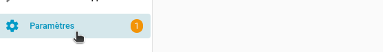
  </a>
</figure>
<figure class="photo-slide" data-slide>
  <a href="images/Capturedcrandu2026-01-0616-56-43.png" data-full="images/Capturedcrandu2026-01-0616-56-43.png" data-alt="Photo 2 — Sauvegarde Home Assistant : backups locaux, Google Drive et cloud (guide complet)" aria-label="Agrandir la photo 2 : Photo 2 — Sauvegarde Home Assistant : backups locaux, Google Drive et cloud (guide complet)">
    
  </a>
</figure>
<figure class="photo-slide" data-slide>
  <a href="images/Capturedcrandu2026-01-0617-00-00.png" data-full="images/Capturedcrandu2026-01-0617-00-00.png" data-alt="Photo 3 — Sauvegarde Home Assistant : backups locaux, Google Drive et cloud (guide complet)" aria-label="Agrandir la photo 3 : Photo 3 — Sauvegarde Home Assistant : backups locaux, Google Drive et cloud (guide complet)">
    
  </a>
</figure>
<figure class="photo-slide" data-slide>
  <a href="images/Capturedcrandu2026-01-0610-54-57.png" data-full="images/Capturedcrandu2026-01-0610-54-57.png" data-alt="Photo 4 — Sauvegarde Home Assistant : backups locaux, Google Drive et cloud (guide complet)" aria-label="Agrandir la photo 4 : Photo 4 — Sauvegarde Home Assistant : backups locaux, Google Drive et cloud (guide complet)">
    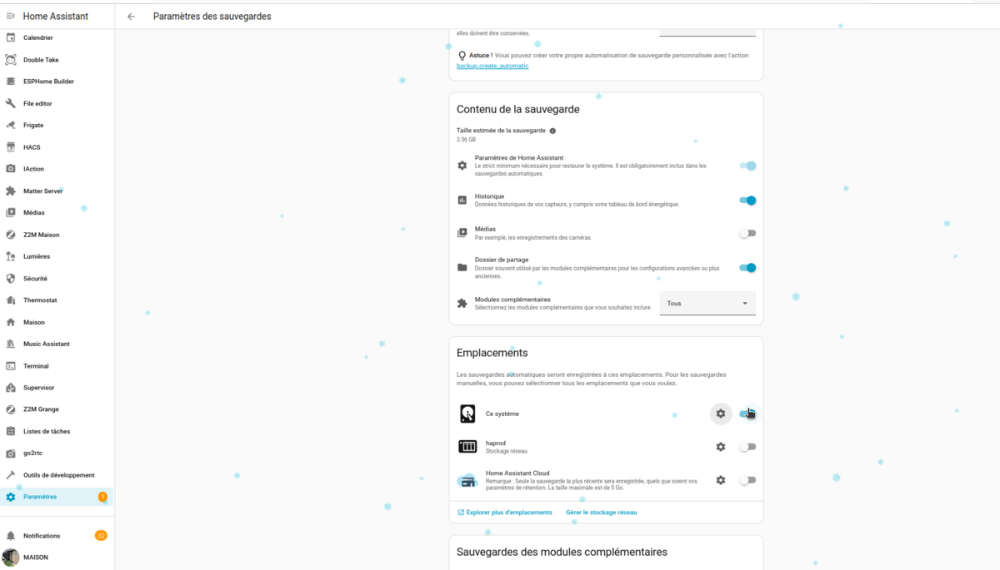
  </a>
</figure>
<figure class="photo-slide" data-slide>
  <a href="images/Capturedcrandu2026-01-0617-02-43.png" data-full="images/Capturedcrandu2026-01-0617-02-43.png" data-alt="Photo 5 — Sauvegarde Home Assistant : backups locaux, Google Drive et cloud (guide complet)" aria-label="Agrandir la photo 5 : Photo 5 — Sauvegarde Home Assistant : backups locaux, Google Drive et cloud (guide complet)">
    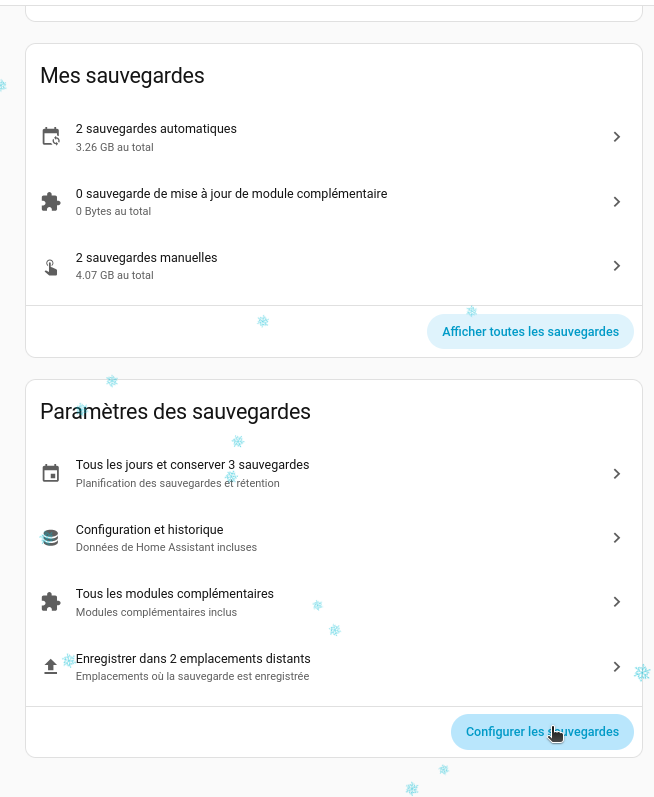
  </a>
</figure>
<figure class="photo-slide" data-slide>
  <a href="images/Capturedcrandu2026-01-0617-01-46.png" data-full="images/Capturedcrandu2026-01-0617-01-46.png" data-alt="Photo 6 — Sauvegarde Home Assistant : backups locaux, Google Drive et cloud (guide complet)" aria-label="Agrandir la photo 6 : Photo 6 — Sauvegarde Home Assistant : backups locaux, Google Drive et cloud (guide complet)">
    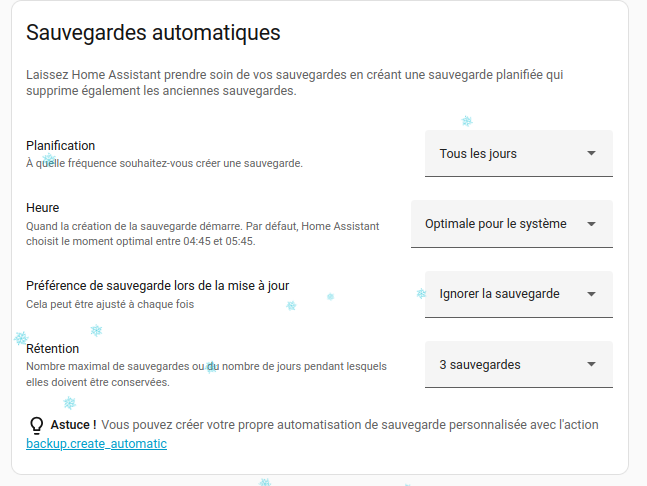
  </a>
</figure>
<figure class="photo-slide" data-slide>
  <a href="images/Capturedcrandu2026-01-0617-10-56.png" data-full="images/Capturedcrandu2026-01-0617-10-56.png" data-alt="Photo 7 — Sauvegarde Home Assistant : backups locaux, Google Drive et cloud (guide complet)" aria-label="Agrandir la photo 7 : Photo 7 — Sauvegarde Home Assistant : backups locaux, Google Drive et cloud (guide complet)">
    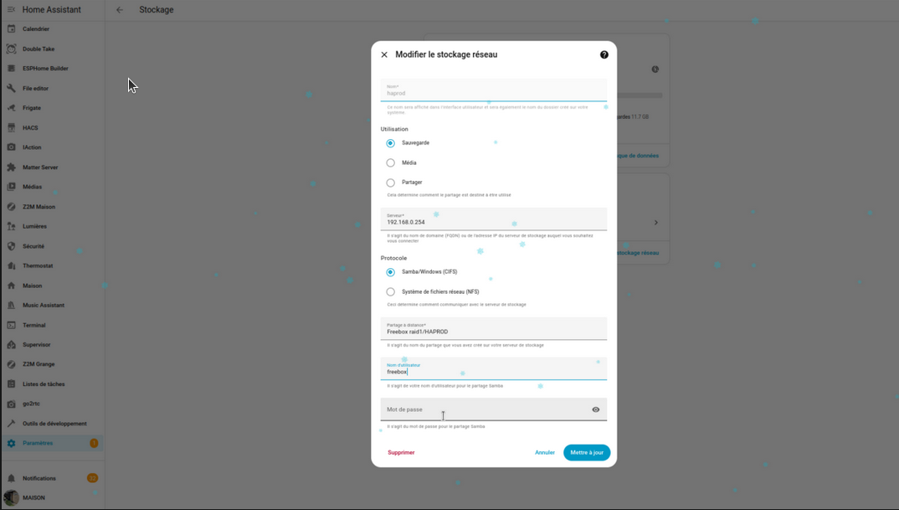
  </a>
</figure>
<figure class="photo-slide" data-slide>
  <a href="images/default-social.png" data-full="images/default-social.png" data-alt="Photo 8 — Sauvegarde Home Assistant : backups locaux, Google Drive et cloud (guide complet)" aria-label="Agrandir la photo 8 : Photo 8 — Sauvegarde Home Assistant : backups locaux, Google Drive et cloud (guide complet)">
    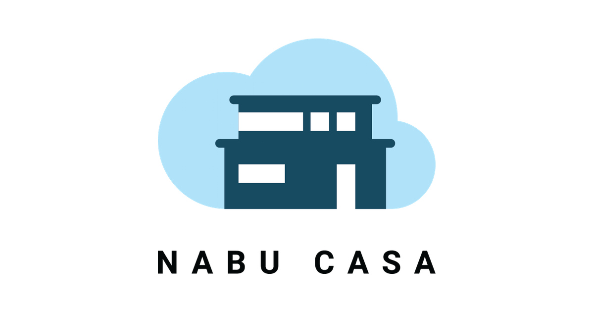
  </a>
</figure>
<figure class="photo-slide" data-slide>
  <a href="images/Capturedcrandu2026-01-0610-57-43.png" data-full="images/Capturedcrandu2026-01-0610-57-43.png" data-alt="Photo 9 — Sauvegarde Home Assistant : backups locaux, Google Drive et cloud (guide complet)" aria-label="Agrandir la photo 9 : Photo 9 — Sauvegarde Home Assistant : backups locaux, Google Drive et cloud (guide complet)">
    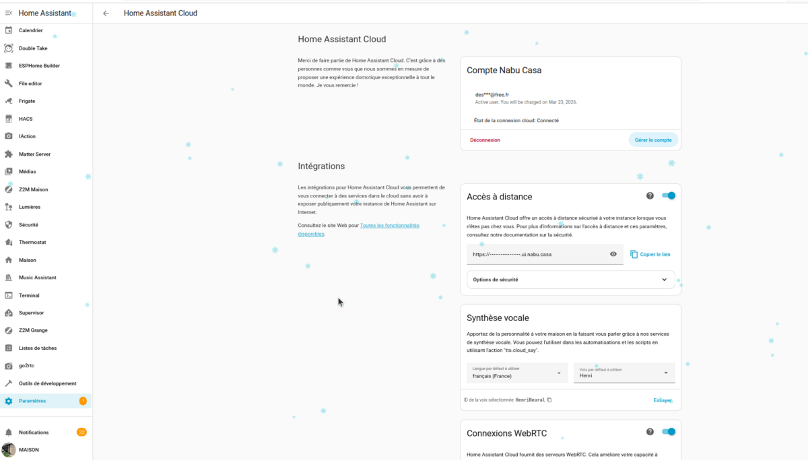
  </a>
</figure>
<figure class="photo-slide" data-slide>
  <a href="images/Capturedcrandu2026-01-0611-24-33.png" data-full="images/Capturedcrandu2026-01-0611-24-33.png" data-alt="Photo 10 — Sauvegarde Home Assistant : backups locaux, Google Drive et cloud (guide complet)" aria-label="Agrandir la photo 10 : Photo 10 — Sauvegarde Home Assistant : backups locaux, Google Drive et cloud (guide complet)">
    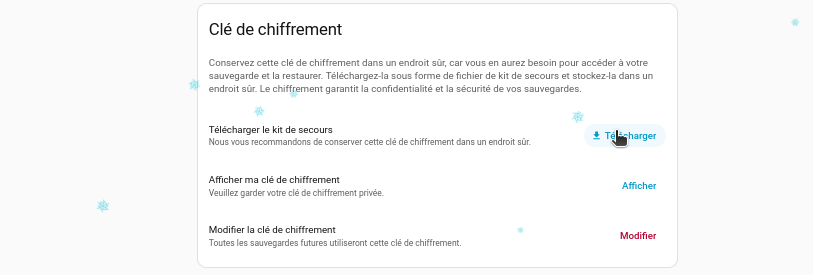
  </a>
</figure>
<figure class="photo-slide" data-slide>
  <a href="images/Capturedcrandu2026-01-0611-08-05.png" data-full="images/Capturedcrandu2026-01-0611-08-05.png" data-alt="Photo 11 — Sauvegarde Home Assistant : backups locaux, Google Drive et cloud (guide complet)" aria-label="Agrandir la photo 11 : Photo 11 — Sauvegarde Home Assistant : backups locaux, Google Drive et cloud (guide complet)">
    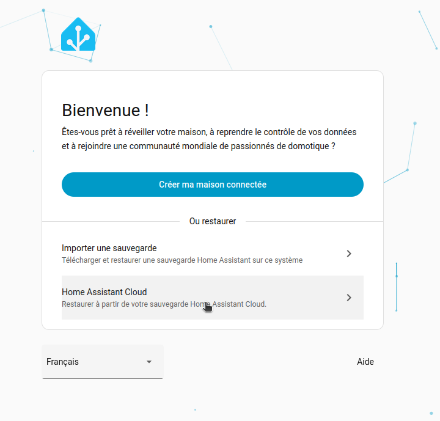
  </a>
</figure>
<figure class="photo-slide" data-slide>
  <a href="images/Capturedcrandu2026-01-0611-08-13.png" data-full="images/Capturedcrandu2026-01-0611-08-13.png" data-alt="Photo 12 — Sauvegarde Home Assistant : backups locaux, Google Drive et cloud (guide complet)" aria-label="Agrandir la photo 12 : Photo 12 — Sauvegarde Home Assistant : backups locaux, Google Drive et cloud (guide complet)">
    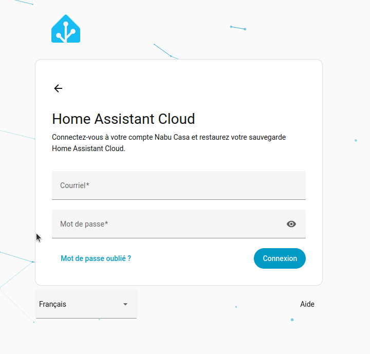
  </a>
</figure>
<figure class="photo-slide" data-slide>
  <a href="images/default-social-2.png" data-full="images/default-social-2.png" data-alt="Photo 13 — Sauvegarde Home Assistant : backups locaux, Google Drive et cloud (guide complet)" aria-label="Agrandir la photo 13 : Photo 13 — Sauvegarde Home Assistant : backups locaux, Google Drive et cloud (guide complet)">
    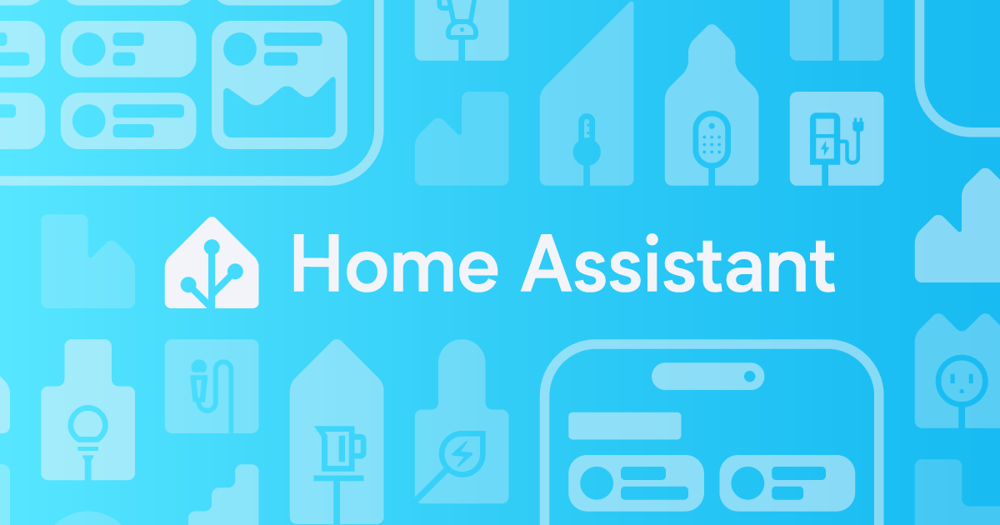
  </a>
</figure>
<figure class="photo-slide" data-slide>
  <a href="images/Capturedcrandu2026-01-0614-32-34.png" data-full="images/Capturedcrandu2026-01-0614-32-34.png" data-alt="Photo 14 — Sauvegarde Home Assistant : backups locaux, Google Drive et cloud (guide complet)" aria-label="Agrandir la photo 14 : Photo 14 — Sauvegarde Home Assistant : backups locaux, Google Drive et cloud (guide complet)">
    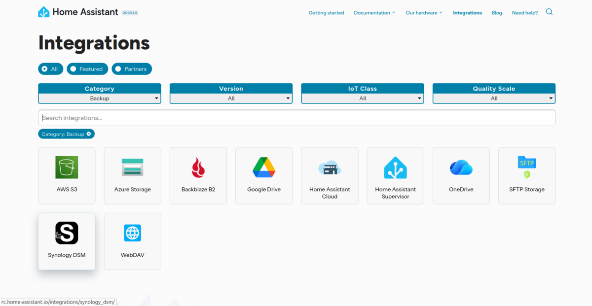
  </a>
</figure>
<figure class="photo-slide" data-slide>
  <a href="images/Capturedcrandu2026-01-1011-13-42.png" data-full="images/Capturedcrandu2026-01-1011-13-42.png" data-alt="Photo 15 — Sauvegarde Home Assistant : backups locaux, Google Drive et cloud (guide complet)" aria-label="Agrandir la photo 15 : Photo 15 — Sauvegarde Home Assistant : backups locaux, Google Drive et cloud (guide complet)">
    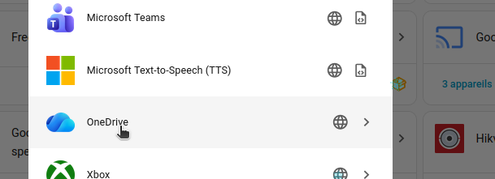
  </a>
</figure>
<figure class="photo-slide" data-slide>
  <a href="images/Capturedcrandu2026-01-1012-27-27.png" data-full="images/Capturedcrandu2026-01-1012-27-27.png" data-alt="Photo 16 — Sauvegarde Home Assistant : backups locaux, Google Drive et cloud (guide complet)" aria-label="Agrandir la photo 16 : Photo 16 — Sauvegarde Home Assistant : backups locaux, Google Drive et cloud (guide complet)">
    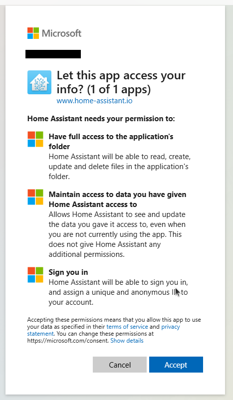
  </a>
</figure>
</div>
<button type="button" class="carousel-nav" data-prev aria-label="Photo précédente">‹</button>
<button type="button" class="carousel-nav" data-next aria-label="Photo suivante">›</button>
<div class="carousel-dots" data-dots></div>
<div class="carousel-live" data-live aria-live="polite"></div>
<p class="carousel-hint">Faites défiler les photos, ou ouvrez-les pour les agrandir (si JavaScript est activé).</p>
</section>

# Sauvegarde Home Assistant : backups locaux, Google Drive et cloud (guide complet)

- **Type :** Guide
- **Catégorie :** Guides & tutoriels domotique > Home Assistant
- **Lien :** https://forumdomotique.com/guides-tutoriels/home-assistant/sauvegarde-home-assistant-backup-cloud/
- **Date de publication :** 18 janvier 2026 à 12:43 (Europe/Paris)
- **Auteur :** XAV59213

---

### Les sauvegardes intégrées à Home Assistant, la base solide

Tout commence avec le système natif de Home Assistant, qui a vraiment pris un coup de jeune depuis la version 2025.1. Avant, c'était déjà pratique, mais maintenant c'est presque intuitif. Les sauvegardes capturent un instantané complet : vos configurations YAML ou UI, les add-ons, les automatisations, les scripts, les historiques et même les médias si vous en stockez. Chez moi, je les utilise pour le quotidien, parce que c'est rapide et intégré directement à l'interface.

Pour démarrer, il suffit d'aller dans **→** Paramètres **→** Système **→** Sauvegardes. La première fois, Home Assistant propose même un assistant pour configurer les backups automatiques, ce qui est une excellente idée pour les nouveaux utilisateurs. Vous choisissez si vous voulez une sauvegarde complète ou partielle, en sélectionnant seulement certains dossiers ou add-ons pour alléger le fichier. Personnellement, je privilégie les complètes, parce que la taille reste gérable tant qu'on gère bien la rétention. Les fichiers sont au format .tar, et depuis 2025, ils sont chiffrés par défaut, ce qui ajoute une couche de sécurité sans effort supplémentaire.


L'automatisation est ce qui change la donne. Je programme une sauvegarde quotidienne, généralement la nuit quand le système est peu sollicité, et Home Assistant gère automatiquement le nombre à conserver. Les plus anciennes sont supprimées sans que j'aie à intervenir.


C'est fluide, et je reçois même une notification si quelque chose cloche. Avant une grosse mise à jour, je lance souvent une manuelle pour être sûr, et depuis les dernières versions, il y a même une option pour en créer une automatiquement avant d'upgrader le système. Ça m'a sauvé plus d'une fois lors de tests un peu audacieux.

Mais le point faible, et je l'ai appris à mes dépens, c'est que ces sauvegardes restent stockées localement sur le disque de votre instance Home Assistant. Si le SSD ou la carte SD lâche, ou si une corruption touche tout, vous perdez aussi vos backups. C'est pour ça que je ne m'appuie jamais seulement là-dessus.

### Des sauvegardes locales indépendantes, avec la Freebox Delta par exemple

Pour pallier ça, j'ai toujours une copie sur un support séparé, et chez beaucoup d'entre nous, la Freebox Delta s'impose naturellement. Avec son disque dur intégré et ses partages réseau, elle fait un excellent réceptacle pour des backups indépendants. J'ai configuré ça il y a longtemps, et ça tourne sans faillir depuis.

D'abord, dans l'interface Freebox OS, on active le partage Samba ou NFS sur le disque dur. C'est rapide : on crée un dossier dédié aux sauvegardes Home Assistant, on note l'adresse IP de la Freebox et les identifiants (freebox). Ensuite, dans Home Assistant, on ajoute un emplacement de sauvegarde réseau via Paramètres > Système > Stockage> Ajouter un stockage réseau .

L'URL SMB ressemble à 192.168.0.254, et une fois validé, Home Assistant envoie automatiquement les nouvelles sauvegardes vers ce dossier selon le planning configuré.


L'avantage, c'est que c'est entièrement local, donc ultra-rapide, sans dépendre d'internet, et surtout indépendant : même si mon Raspberry Pi ou mon mini-PC qui héberge Home Assistant plante complètement, mes backups sont en sécurité sur la Freebox. Je teste régulièrement en restaurant une sauvegarde depuis cet emplacement, et ça fonctionne sans accroc. Si jamais vous rencontrez des soucis de connexion, un redémarrage de la Freebox ou une vérification des droits d'accès résout souvent le problème. Et avec les intégrations réseau natives renforcées en 2025, c'est encore plus stable qu'avant.

### Les sauvegardes cloud avec Nabu Casa, pour la copie hors site

Pour compléter le tableau et respecter le principe 3-2-1, j'utilise aussi le cloud Nabu Casa pour 7,50 € par mois, surtout depuis que j'ai l'abonnement pour l'accès distant. C'est la solution officielle, chiffrée de bout en bout, et ça envoie une copie sur leurs serveurs sans que je m'en occupe.


<!-- source : https://ec60fa24.nabucasa-com.pages.dev/favicon.ico -->

##### Nabu Casa


<!-- source : https://ec60fa24.nabucasa-com.pages.dev/img/default-social.png -->

### Nabu Casa

L'activation est enfantine : dans Paramètres > Home Assistant Cloud > Sauvegardes, on coche l'option, et Home Assistant pousse automatiquement la dernière sauvegarde complète, chiffrée en AES. La limite reste à 5 Go, ce qui suffit largement si on exclut les gros historiques ou médias, et seule la plus récente est conservée pour éviter l'accumulation.


En cas de catastrophe majeure, comme un incendie ou un vol, je peux restaurer directement depuis le cloud lors d'une nouvelle installation, juste en me connectant à mon compte Nabu Casa.

**À ne pas oublier : télécharger le kit de réparation ou la clé de chiffrement, et la garder précieusement en lieu sûr.**


Je combine toujours avec les locales, parce que le cloud n'est pas infaillible non plus, mais ça apporte cette tranquillité d'esprit pour la copie déportée. Et depuis les améliorations de 2025, avec les intégrations directes comme Google Drive ou OneDrive pour ceux qui préfèrent d'autres clouds, les options se multiplient sans add-ons tiers.

### Les intégrations cloud tierces officielles

Depuis 2025.2, Home Assistant a ajouté des intégrations natives pour Google Drive et Microsoft OneDrive, ce qui ouvre des options hors site sans abonnement spécifique. La configuration est guidée, presque magique : vous allez dans Paramètres > Appareils & services > Ajouter une intégration, vous cherchez OneDrive (ou Google Drive), vous suivez les instructions pour vous authentifier avec votre compte Microsoft personnel, et c'est tout.

##### Home Assistant


<!-- source : https://www.home-assistant.io/images/default-social.png -->

### Integrations

List of the built-in integrations of Home Assistant.


Pour Microsoft OneDrive, ça crée automatiquement un dossier dédié dans la partie App Folder de votre compte (souvent nommé Home Assistant ou parfois Graph à cause d'un petit quirk de l'API Microsoft). Les sauvegardes atterrissent dans un sous-dossier backups_ suivi d'un identifiant unique à votre instance. Ça permet d'avoir plusieurs setups Home Assistant sur le même compte sans mélange. Une fois l'intégration active, vous ajoutez simplement cet emplacement comme stockage réseau de type sauvegardes dans les paramètres système, et les backups automatiques partent là-bas en plus des autres destinations. La capacité est généreuse (surtout si vous avez déjà du stockage OneDrive via Microsoft 365 ou un abonnement), la rétention est gérable via les règles automatiques de Home Assistant, et ça diversifie les supports sans effort. Chez moi, je l'utilise en complément parce que l'upload est rapide, que je n'ai pas à installer d'add-on, et que je retrouve mes fichiers .tar directement dans l'interface web OneDrive si besoin. C'est discret au quotidien, et parfait pour ceux qui veulent éviter Nabu Casa tout en ayant une copie cloud fiable.

## Configuration

Pour ajouter le service **OneDrive** à votre instance Home Assistant, utilisez ce bouton Mon:


<!-- source : https://my.home-assistant.io/badges/config_flow_start.svg -->

Si le bouton Ci-dessus Mon bouton ne fonctionne pas, vous pouvez également effectuer les étapes suivantes manuellement:

- Parcourez votre instance Home Assistant.
- Allez à [**Paramètres > Appareils et services**](https://my.home-assistant.io/redirect/integrations).
- Dans le coin inférieur droit, sélectionnez le [**Ajouter l'intégration**](https://my.home-assistant.io/redirect/config_flow_start?domain=onedrive) bouton.
- Dans la liste, sélectionnez **OneDrive**.
- Suivez les instructions à l'écran pour terminer la configuration.


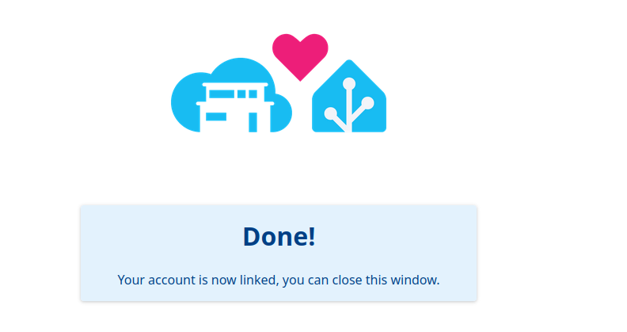

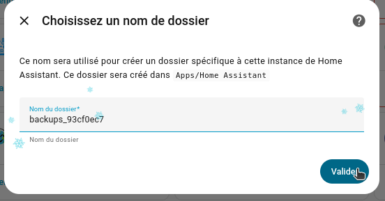

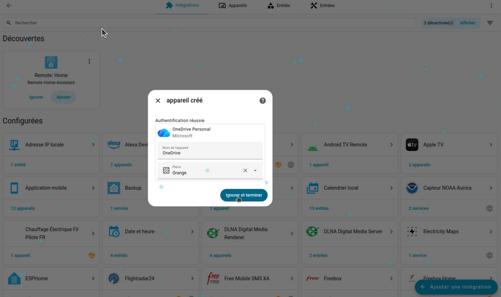

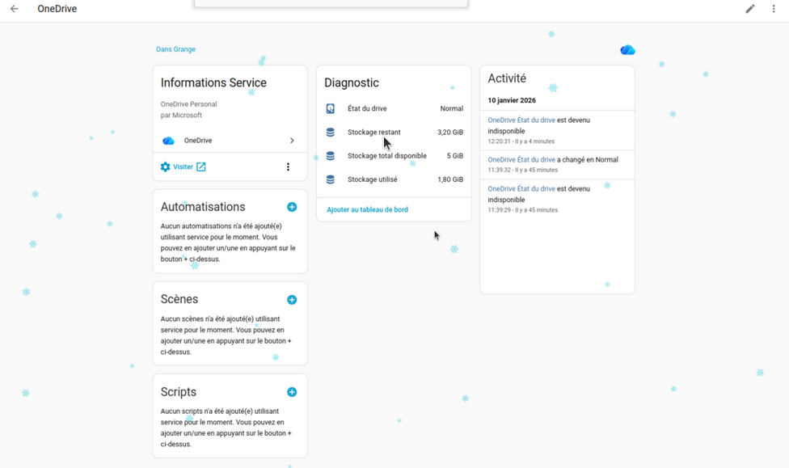

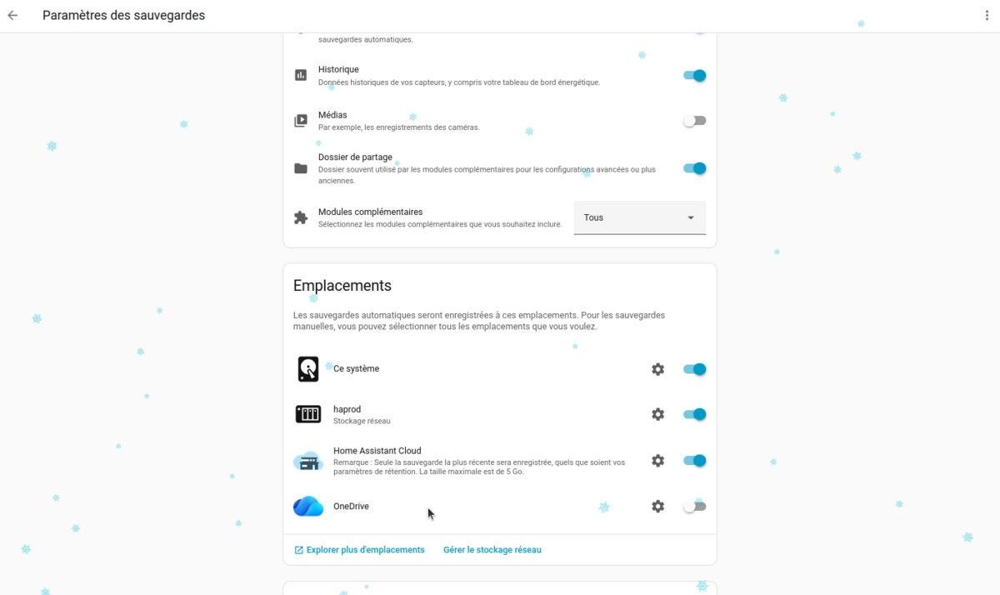

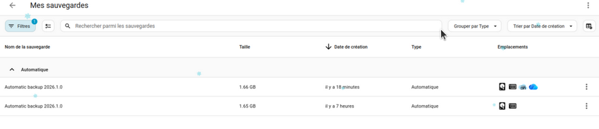

### Envoyer une alerte lorsque le lecteur est proche de la limite de stockage

```yaml
alias: Alerte quand OneDrive approche de la limite de stockagedescription: Envoie une notification quand le OneDrive a besoin d'un nettoyagetriggers:- trigger: state
    entity_id: sensor.onedrive_etat_du_drive
    from: normal
    to: nearing- trigger: state
    entity_id: sensor.onedrive_etat_du_drive
    from: nearing
    to: criticalconditions: []
actions:- variables:
      utilise: "{{ states('sensor.onedrive_stockage_utilise')|float|round(2) }}"
      total: "{{ states('sensor.onedrive_stockage_total_disponible')|float|round(2) }}"
      reste: "{{ states('sensor.onedrive_stockage_restant')|float|round(2) }}"- action: notify.persistent_notification
    data:
      title: OneDrive presque plein
      message: >-
        Onedrive a Utilisé : {{ utilise }} Go / {{ total }} Go  →  Il Reste : {{
        reste }} Go
mode: single
```

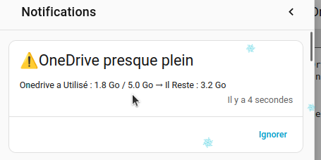

## Les intégrations cloud tierces non-officielles

#### 1. add-on **Home Assistant Google Drive Backup**

Même avec ces options natives, certaines solutions communautaires restent populaires pour leurs fonctionnalités plus avancées. Par exemple, l'add-on **Home Assistant Google Drive Backup** de sabeechen, disponible sur GitHub, est une référence depuis des années. Il automatise non seulement la création et l'upload vers Google Drive, mais gère aussi une rétention générationnelle fine : quotidiens, hebdomadaires, mensuels et annuels, avec des options pour marquer certains backups comme intouchables.


<!-- source : https://github.githubassets.com/favicons/favicon.svg -->

##### GitHub

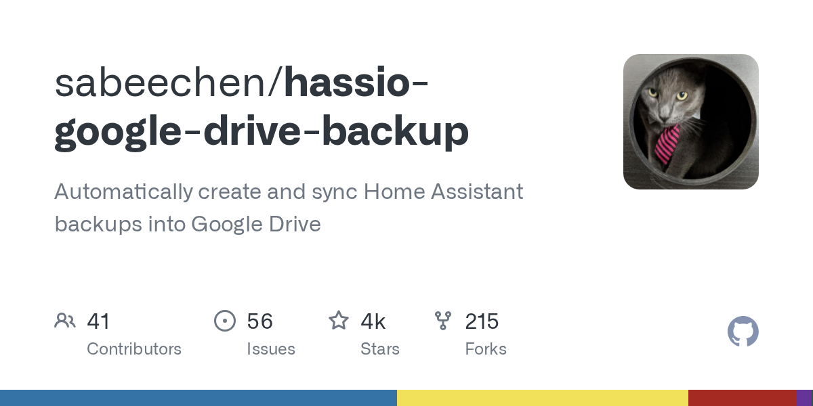
<!-- source : https://opengraph.githubassets.com/c530b94e582f580d032f9c559dea0980afe74a9bab05114d3e8b4d2ef5de1a48/sabeechen/hassio-google-drive-backup -->
<!-- source : https://opengraph.githubassets.com/c530b94e582f580d032f9c559dea0980afe74a9bab05114d3e8b4d2ef5de1a48/sabeechen/hassio-google-drive-backup -->

### GitHub - sabeechen/hassio-google-drive-backup: Automatica...

Automatically create and sync Home Assistant backups into Google Drive - sabeechen/hassio-google-drive-backup

L'installation se fait en ajoutant le dépôt dans le store des add-ons, puis une configuration via une interface web dédiée qui guide l'authentification Google. Il fournit des capteurs pour surveiller l'état des backups, envoie des notifications en cas de problème, et permet même un mode passif si on préfère utiliser le scheduler natif. Chez beaucoup d'utilisateurs, il a sauvé des setups entiers lors de pannes matérielles, avec une restauration directe depuis Drive.

### Instructions d'installation détaillées

#### Pour installer ajoute :


<!-- source : https://my.home-assistant.io/badges/config_flow_start.svg -->

**Ou Ajoute le repository communautaire** : [google-drive-backup](https://github.com/sabeechen/hassio-google-drive-backup)

Va dans **Home Assistant → Paramètres → Modules complémentaires → Boutique de modules complémentaires** (en bas à droite). Clique ensuite sur les **trois points** en haut à droite, puis sur **Dépôts** (ou « Repositories » selon ta langue).

Ajoute ce dépôt communautaire en collant l’URL suivante : <https://github.com/sabeechen/hassio-google-drive-backup> puis clique sur **Ajouter**.

Rafraîchis la page (Ctrl + F5 si nécessaire) pour faire apparaître le nouveau dépôt.

Une fois le dépôt chargé, il te suffit de chercher **Google-drive-Backup** dans la boutique (il se trouve généralement tout en bas, dans la section du dépôt que tu viens d’ajouter) et de l’installer. 😊

Naviguez dans votre Home Assistant frontend à Settings -> Add-ons -> Add-on Store (Bottom Right).


Cliquez sur le menu 3 points en haut à droite ... > > Repositories et ajouter l'URL de ce référentiel: <https://github.com/sabeechen/hassio-google-drive-backup>

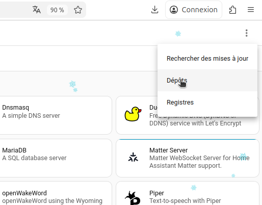

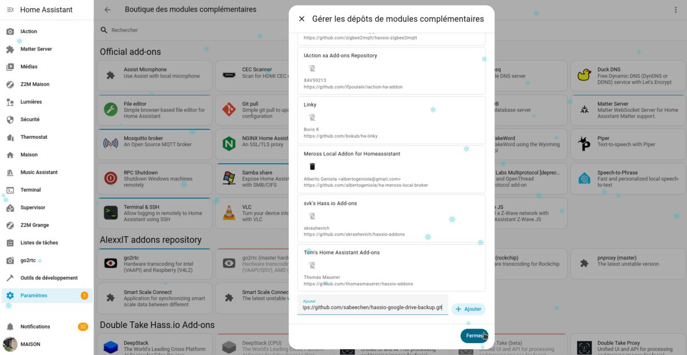

Rechargez la page ou redémarrer , faites défiler vers le bas pour trouver le nouveau dépôt.

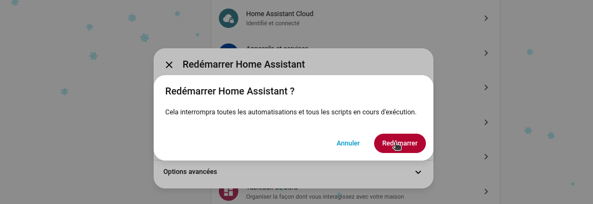

Cliquez sur le nouvel add-on nommé "Home Assistant Google Drive Backup":

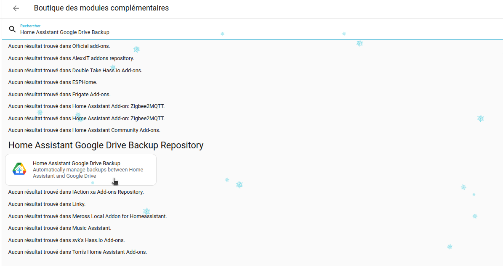

Remarque:

Home Assistant charge le dépôt en arrière-plan et le nouvel élément ne s'affiche pas toujours automatiquement. Vous devrez peut-être attendre quelques secondes, puis "rafraîchir" la page pour qu'elle se présente. Sur la plupart des navigateurs, le raccourci clavier pour cela est CTRL + F5. S'il n'apparaît toujours pas, videz le cache de votre navigateur et il devrait alors.

Cliquez sur Installer et donnez-lui quelques minutes pour finir le téléchargement.

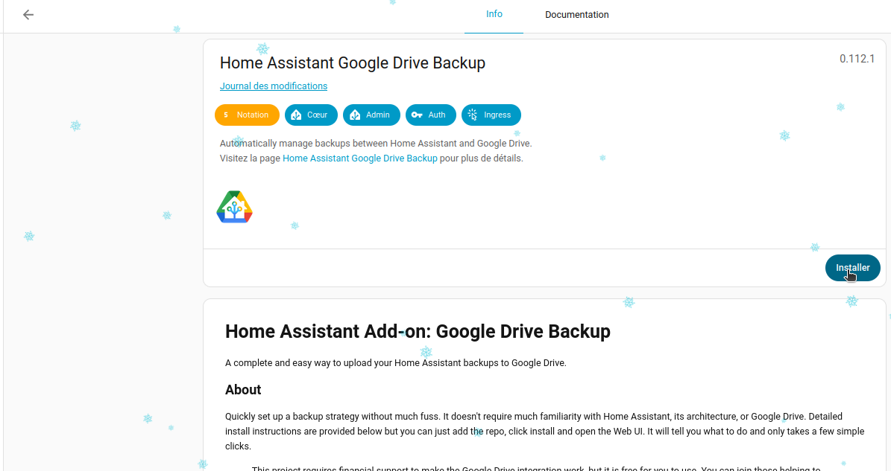

Cliquez sur Démarrer, donnez-lui quelques secondes pour tourner, puis cliquez sur le `Open Web UI` (Ouvrir l’interface utilisateur Web) bouton qui apparaît.

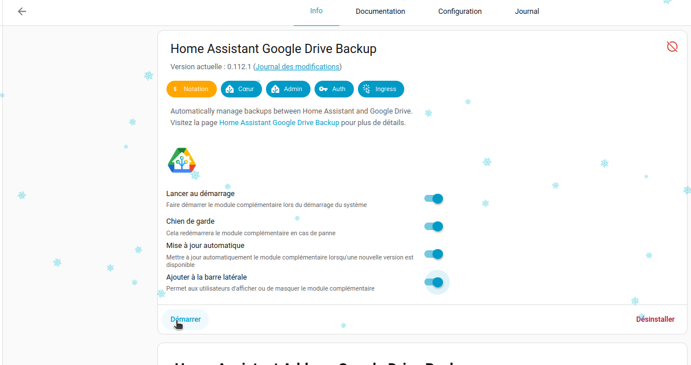

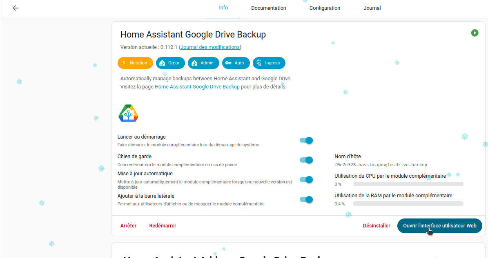

La page "Commencer" vous indiquera le nombre de sauvegardes que vous avez et ce qu'elle en fera une fois que vous l'aurez connectée à Google Drive. Vous pouvez cliquer `Configuration (Setting)`pour modifier ces options via l'add-on (ce qui est la façon recommandée, ils prennent effet immédiatement), ou les mettre à jour à partir de la page où vous avez installé le module complémentaire comme décrit ci-dessous (fonctionne également, redémarrez pour qu'ils prennent effet).

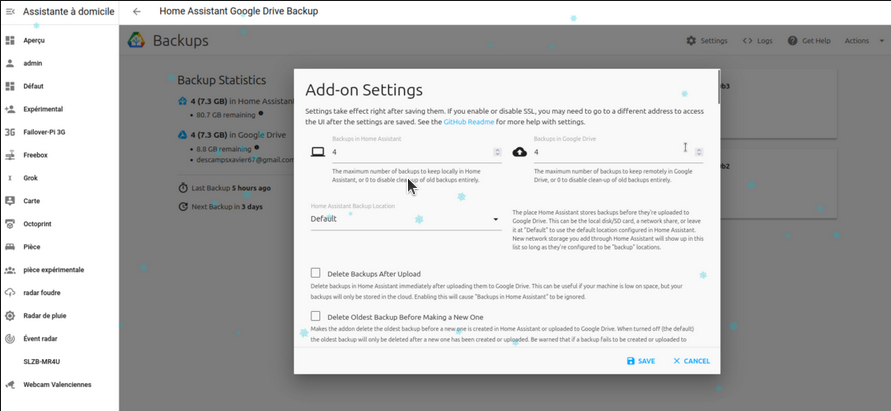

Cliquez sur le `Authenticate with Drive`bouton pour lier l'add-on avec votre compte Google Drive. Alternativement, vous pouvez générer vos [propres identifiants d'API Google](https://github.com/sabeechen/hassio-google-drive-backup#can-i-use-my-own-google-api-information-to-authenticate-instead-of-yours), bien que le processus ne soit pas simple.

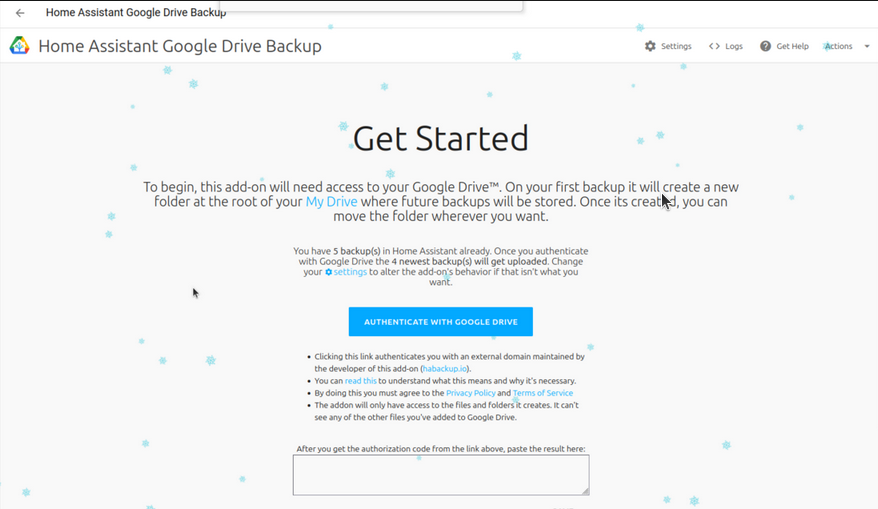

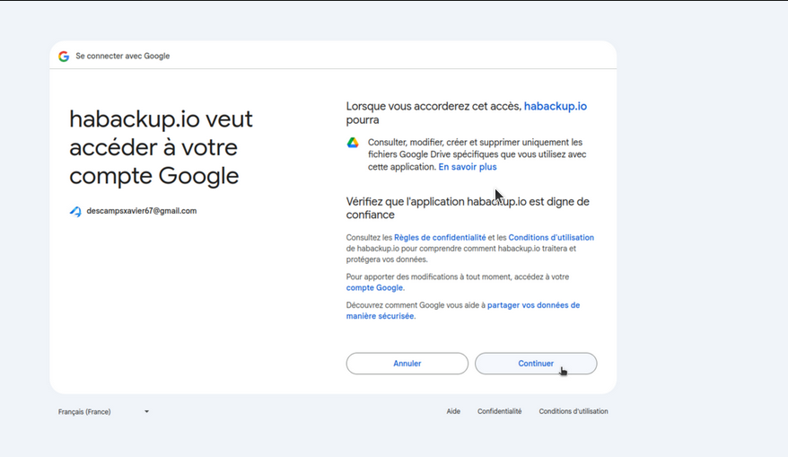

Vous devez être redirigé automatiquement vers la page d'état de sauvegarde. Ici, vous pouvez faire de nouvelles sauvegardes, voir la progression du téléchargement sur Google Drive, etc. Vous avez fini !

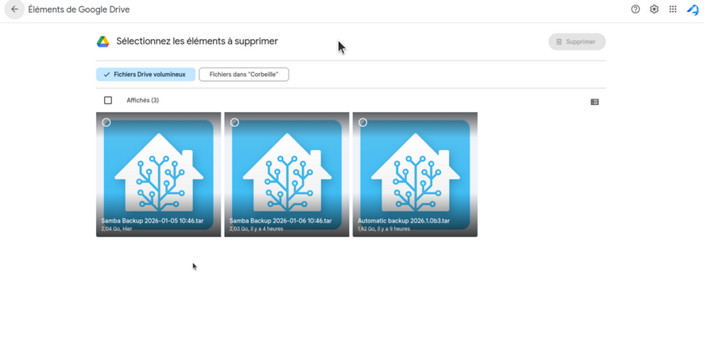

### Configuration

Après avoir démarré l'addon, vous avez la possibilité d'examiner vos paramètres dans l'interface Web de l'addon avant de le connecter à Google Drive. Il est recommandé de modifier le réglage de cette façon car l'interface utilisateur facilite la tâche et explique ce que chaque option fait.

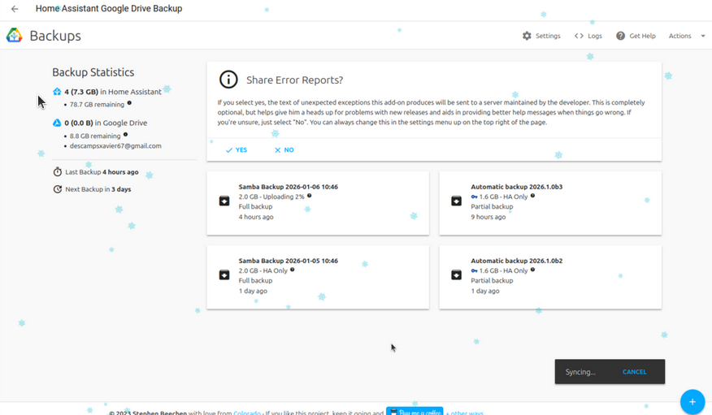

### 2. add-on **Home Assistant** USB-BACKUP (Test effectué sur un Raspberry Pi)

Voici les étapes détaillées pour installer et configurer l’add-on **USB-Backup** sur Home Assistant (sous Home Assistant OS sur ton Raspberry Pi). Cet add-on communautaire permet de copier facilement tes dossiers principaux (dont /backup avec les snapshots) vers un disque dur USB branché.

Ton disque dur externe doit être formaté en ext3, ext4 ou de préférence en btrfs (systèmes de fichiers recommandés sous Linux). Les formats NTFS et exFAT peuvent fonctionner, mais présentent des risques de corruption ou de problèmes de performance.

Assure-toi que le disque dispose de suffisamment d’espace libre : prévois au minimum 30 % de capacité supplémentaire par rapport à la taille actuelle de ton installation Home Assistant.

Enfin, si possible, utilise un disque dur alimenté par une source externe (alimentation dédiée). Certains Raspberry Pi ne fournissent pas assez de puissance par les ports USB pour alimenter correctement un disque dur 2,5" ou 3,5" classique.Étapes d’installation :

#### Pour installer ajoute :


<!-- source : https://my.home-assistant.io/badges/config_flow_start.svg -->

**Ou Ajoute le repository communautaire** : [gords-ha-addons](https://my.home-assistant.io/redirect/supervisor_add_addon_repository/?repository_url=https%3A%2F%2Fgithub.com%2Fgooganhiem%2Fgords-ha-addons)

Va dans **Home Assistant → Paramètres → Modules complémentaires → Boutique de modules complémentaires** (en bas à droite). Clique ensuite sur les **trois points** en haut à droite, puis sur **Dépôts** (ou « Repositories » selon ta langue).

Ajoute ce dépôt communautaire en collant l’URL suivante : https://github.com/googanhiem/gords-ha-addons puis clique sur **Ajouter**.

Rafraîchis la page (Ctrl + F5 si nécessaire) pour faire apparaître le nouveau dépôt.

Une fois le dépôt chargé, il te suffit de chercher **USB-Backup** dans la boutique (il se trouve généralement tout en bas, dans la section du dépôt que tu viens d’ajouter) et de l’installer. 😊

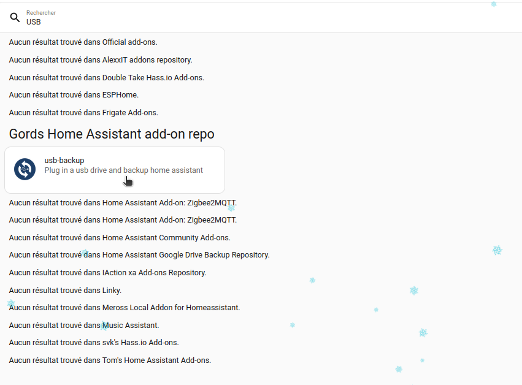

Clique dessus > **Installer**.

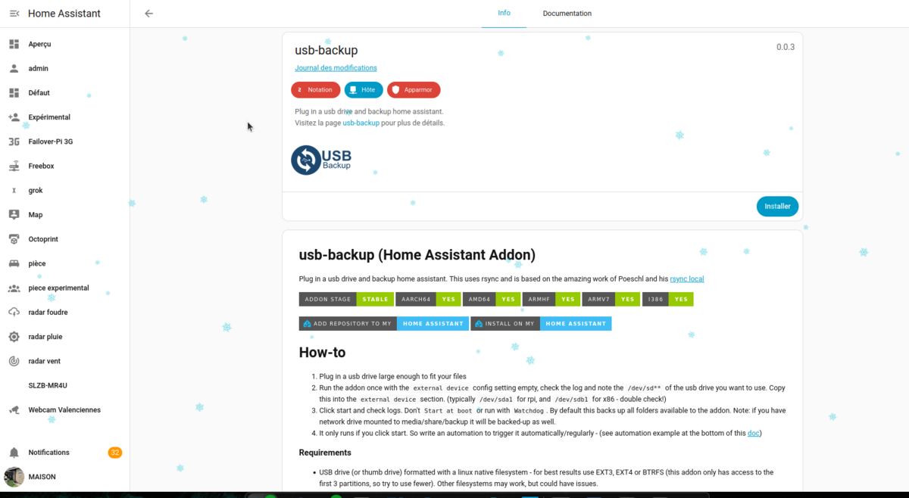

Voici une version plus fluide, naturelle et sans puces :

Attends tranquillement que l’installation de l’add-on se termine (cela prend généralement quelques minutes).

Une fois l’installation terminée, prépare et configure l’add-on de cette façon : branche ton disque dur externe sur un port USB du Raspberry Pi, puis démarre l’add-on une première fois sans toucher à la configuration (il suffit de cliquer sur Démarrer).

Rends-toi ensuite dans l’onglet **Journal** (Log) de l’add-on. Tu y verras la liste des dispositifs de stockage détectés par le système (par exemple /dev/sda1, /dev/sdb1, etc.). Repère très attentivement l’identifiant correspondant à ton disque dur USB — fais bien attention à ne surtout pas confondre avec la carte SD du Raspberry Pi !

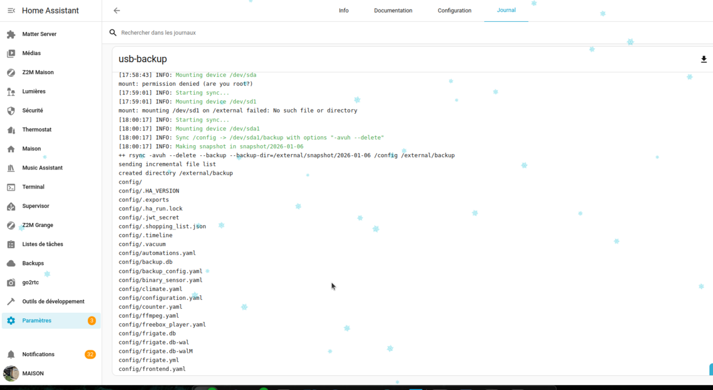

**Configurer l’add-on :**

Arrête l’add-on, puis rends-toi dans l’onglet Configuration. Dans le champ **external_device**, indique l’identifiant du disque que tu as noté (exemple : /dev/sda1 ou /dev/sdb1 — n’oublie pas d’inclure le numéro de la partition, le plus souvent c’est « 1 »).

Pour les autres paramètres, les valeurs par défaut fonctionnent très bien dans la plupart des cas (l’add-on copie typiquement les dossiers /backup, /config, etc.). Si tu souhaites conserver l’historique des fichiers modifiés ou supprimés, pense à activer l’option **snapshots**.

Enfin, n’oublie pas de sauvegarder la configuration. 😊

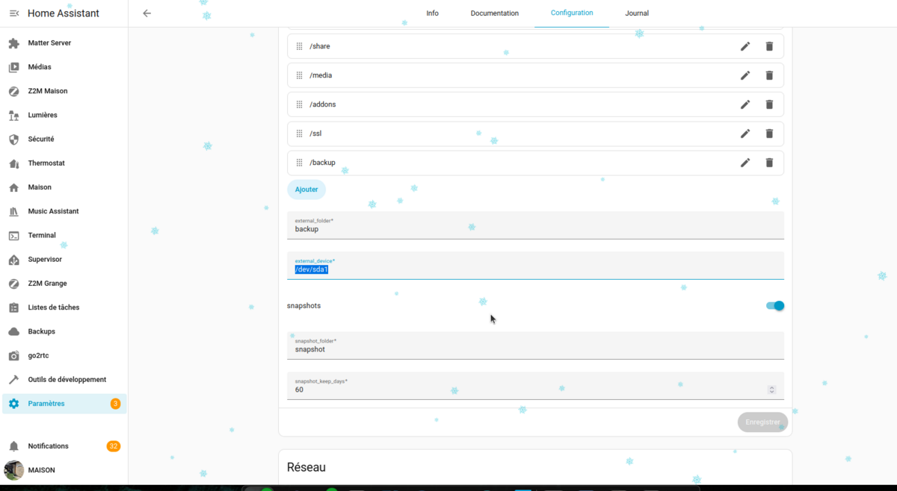

**Utilisation :** Branche simplement ton disque USB, puis démarre l'add-on (ou clique sur « Start » dans son interface). Il détecte automatiquement le disque et lance la copie des fichiers. Une fois terminé, jette un œil au journal pour confirmer que tout s’est bien passé.

Pour des sauvegardes régulières, tu peux le lancer manuellement à chaque branchement du disque, ou mieux encore, mettre en place une petite automation qui le déclenche automatiquement.

**Conseils pratiques :** Commence par tester avec une petite clé USB ou un disque de faible capacité, histoire de vérifier que tout fonctionne comme prévu. Cet add-on vient en complément des backups natifs de Home Assistant : il copie tes dossiers, mais pour une restauration complète et sans risque, continue d’utiliser les snapshots HA.

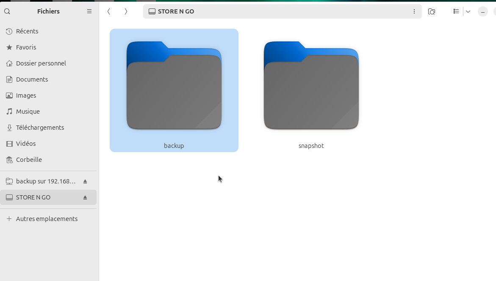

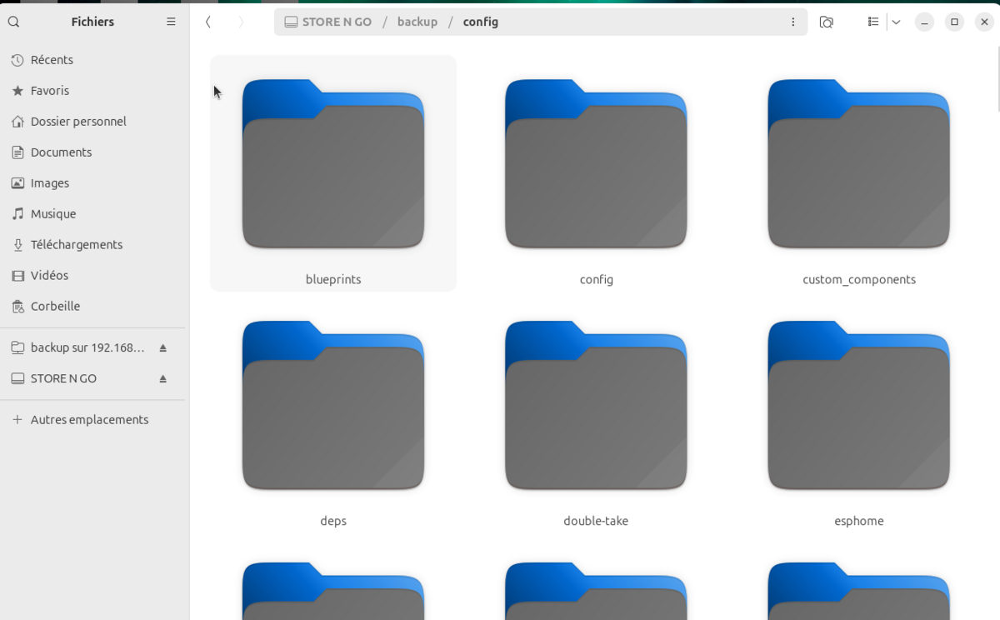

D'autres add-ons communautaires existent pour des clouds alternatifs, comme pour Dropbox ou d'autres services, mais ils sont moins maintenus aujourd'hui.

### Points forts et pistes d'amélioration dans la gestion des sauvegardes

Au quotidien, ce qui me plaît le plus dans le système actuel, c'est sa simplicité une fois configuré. Les backups automatiques avec rétention intelligente évitent l'encombrement, et la possibilité de multiples emplacements rend la stratégie 3-2-1 accessible à tous. La chiffrage systématique ajoute de la sécurité sans compliquer les choses, et les restaurations sont rapides, même partielles.

Cela dit, rien n'est parfait. Pour les installations très lourdes avec des historiques longs, la taille peut vite grimper, et il faut surveiller pour ne pas dépasser les limites cloud. J'aurais aussi aimé une gestion encore plus fine de la rétention par emplacement dès le départ, même si ça s'améliore version après version. Et pour les utilisateurs avancés, des add-ons comme Auto Backup restent utiles pour des scénarios très personnalisés.

### En conclusion, une résilience qui change tout

Après des années à bricoler ma domotique, je garde absolument ce système de sauvegardes multiples : les intégrées pour la réactivité quotidienne, la Freebox pour l'indépendance locale, et Nabu Casa pour le hors site. Ça me permet de tester de nouvelles intégrations ou de mettre à jour sans stress, sachant que je peux revenir en arrière en quelques clics.

Si votre setup commence à devenir conséquent, je vous conseille vivement de mettre ça en place dès maintenant, et de tester une restauration pour vérifier que tout fonctionne comme prévu.

C'est le genre de configuration qui s'adresse à tous, du débutant qui veut sécuriser ses premières automatisations à l'utilisateur expérimenté avec des dizaines d'appareils. L'impression globale, c'est que Home Assistant a vraiment mûri sur ce point, rendant la plateforme encore plus fiable et sereine à utiliser au quotidien. Si vous avez des questions sur votre configuration spécifique, que ce soit avec une Freebox ou autre, passez sur le forum, on en discute souvent et il y a toujours quelqu'un pour partager son expérience.

