<p class="forum-cta"><a href="https://forumdomotique.com/tests/securite-surveillance/test-avis-aqara-u200-serrure-connectee-matter-thread/">Lire et commenter sur Forum Domotique</a></p>




<section class="carousel photo-carousel" data-carousel data-lightbox aria-roledescription="carrousel" aria-label="Photos de l’article (16)" tabindex="0">
<div class="carousel-track" data-track>
<figure class="photo-slide" data-slide>
  <a href="images/Capturedcrandu2025-12-1311-21-29.png" data-full="images/Capturedcrandu2025-12-1311-21-29.png" data-alt="Photo 1 — Test et avis Aqara U200 : une serrure Matter et Thread vraiment taillée pour Home Assistant" aria-label="Agrandir la photo 1 : Photo 1 — Test et avis Aqara U200 : une serrure Matter et Thread vraiment taillée pour Home Assistant">
    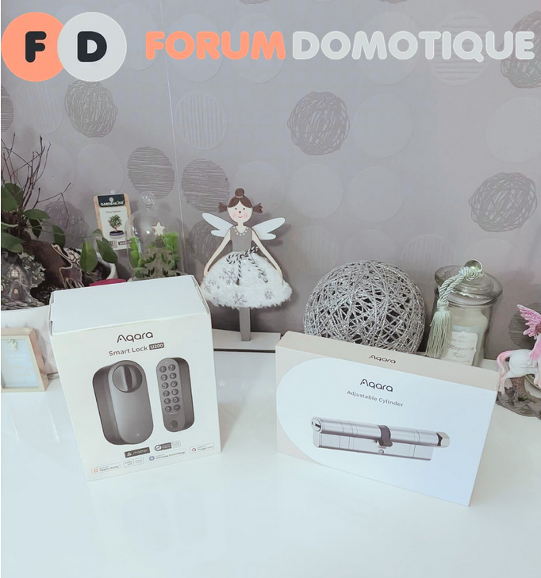
  </a>
</figure>
<figure class="photo-slide" data-slide>
  <a href="images/Capturedcrandu2025-12-1311-05-10.png" data-full="images/Capturedcrandu2025-12-1311-05-10.png" data-alt="Photo 2 — Test et avis Aqara U200 : une serrure Matter et Thread vraiment taillée pour Home Assistant" aria-label="Agrandir la photo 2 : Photo 2 — Test et avis Aqara U200 : une serrure Matter et Thread vraiment taillée pour Home Assistant">
    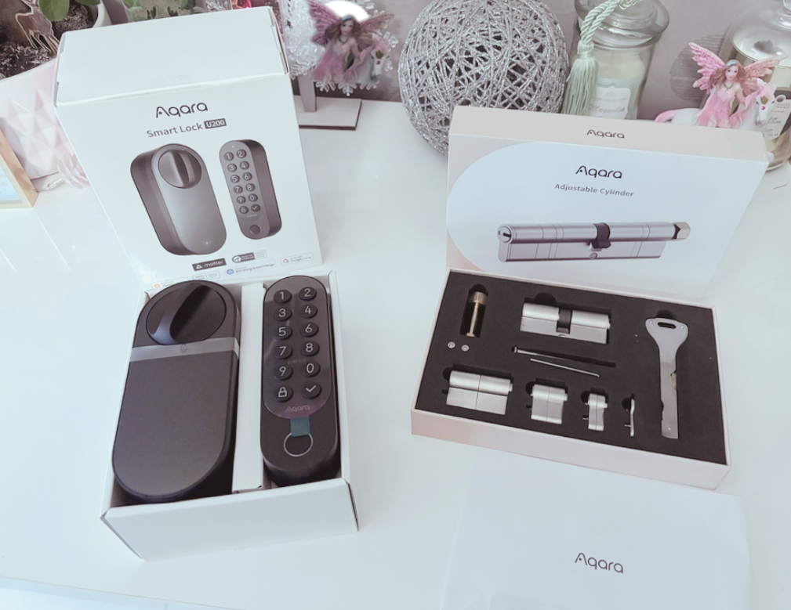
  </a>
</figure>
<figure class="photo-slide" data-slide>
  <a href="images/Capturedcrandu2025-12-1310-48-56.png" data-full="images/Capturedcrandu2025-12-1310-48-56.png" data-alt="Photo 3 — Test et avis Aqara U200 : une serrure Matter et Thread vraiment taillée pour Home Assistant" aria-label="Agrandir la photo 3 : Photo 3 — Test et avis Aqara U200 : une serrure Matter et Thread vraiment taillée pour Home Assistant">
    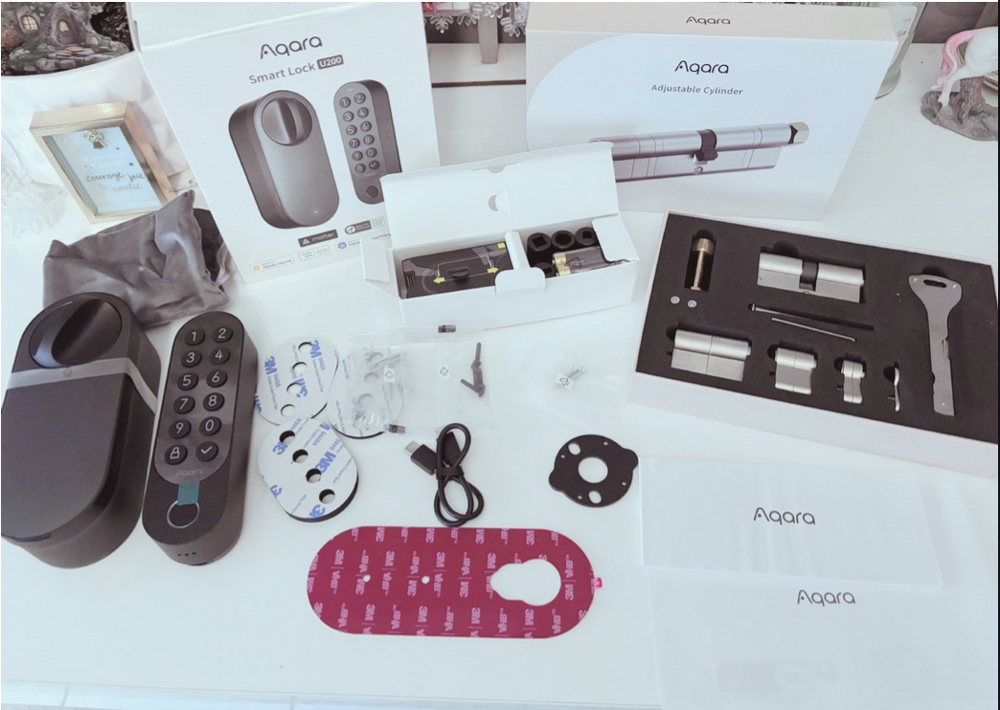
  </a>
</figure>
<figure class="photo-slide" data-slide>
  <a href="images/Capturedcrandu2025-12-1311-08-14.png" data-full="images/Capturedcrandu2025-12-1311-08-14.png" data-alt="Photo 4 — Test et avis Aqara U200 : une serrure Matter et Thread vraiment taillée pour Home Assistant" aria-label="Agrandir la photo 4 : Photo 4 — Test et avis Aqara U200 : une serrure Matter et Thread vraiment taillée pour Home Assistant">
    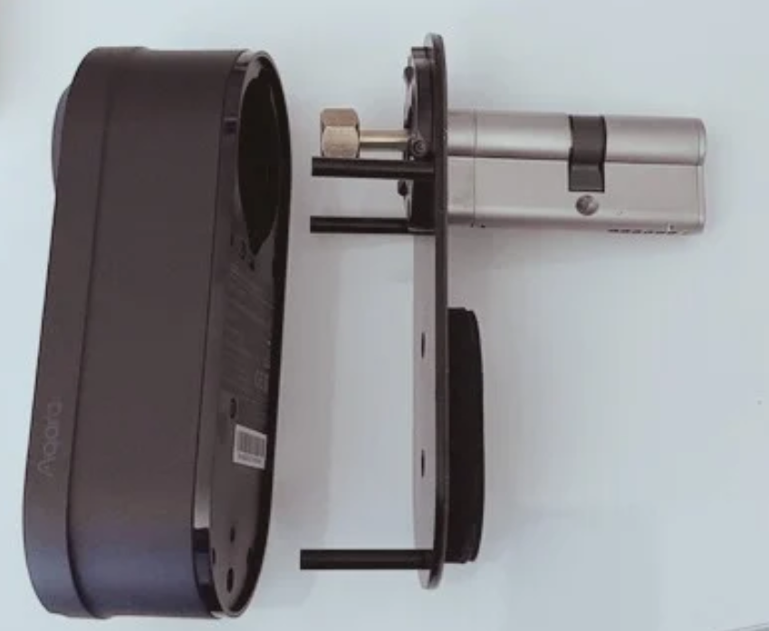
  </a>
</figure>
<figure class="photo-slide" data-slide>
  <a href="images/x-l6LUTj.jpeg" data-full="images/x-l6LUTj.jpeg" data-alt="Photo 5 — Test et avis Aqara U200 : une serrure Matter et Thread vraiment taillée pour Home Assistant" aria-label="Agrandir la photo 5 : Photo 5 — Test et avis Aqara U200 : une serrure Matter et Thread vraiment taillée pour Home Assistant">
    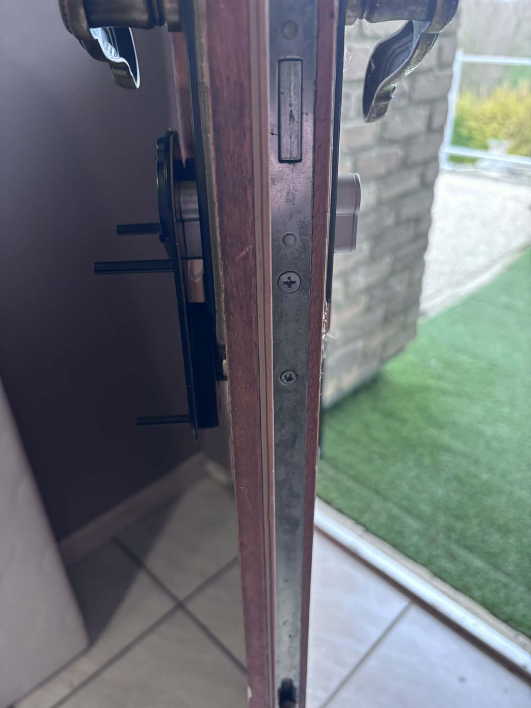
  </a>
</figure>
<figure class="photo-slide" data-slide>
  <a href="images/4frnqyFb.jpeg" data-full="images/4frnqyFb.jpeg" data-alt="Photo 6 — Test et avis Aqara U200 : une serrure Matter et Thread vraiment taillée pour Home Assistant" aria-label="Agrandir la photo 6 : Photo 6 — Test et avis Aqara U200 : une serrure Matter et Thread vraiment taillée pour Home Assistant">
    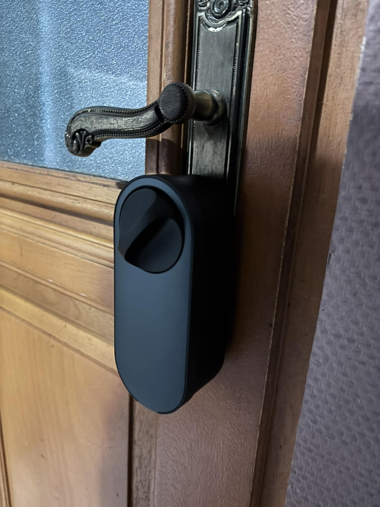
  </a>
</figure>
<figure class="photo-slide" data-slide>
  <a href="images/Capturedcrandu2025-12-1311-52-37.png" data-full="images/Capturedcrandu2025-12-1311-52-37.png" data-alt="Photo 7 — Test et avis Aqara U200 : une serrure Matter et Thread vraiment taillée pour Home Assistant" aria-label="Agrandir la photo 7 : Photo 7 — Test et avis Aqara U200 : une serrure Matter et Thread vraiment taillée pour Home Assistant">
    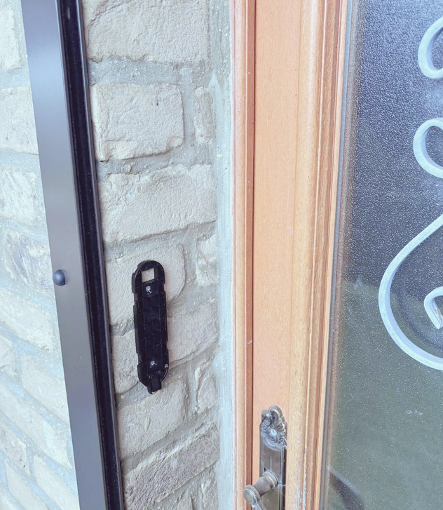
  </a>
</figure>
<figure class="photo-slide" data-slide>
  <a href="images/Capturedcrandu2025-12-1311-53-47.png" data-full="images/Capturedcrandu2025-12-1311-53-47.png" data-alt="Photo 8 — Test et avis Aqara U200 : une serrure Matter et Thread vraiment taillée pour Home Assistant" aria-label="Agrandir la photo 8 : Photo 8 — Test et avis Aqara U200 : une serrure Matter et Thread vraiment taillée pour Home Assistant">
    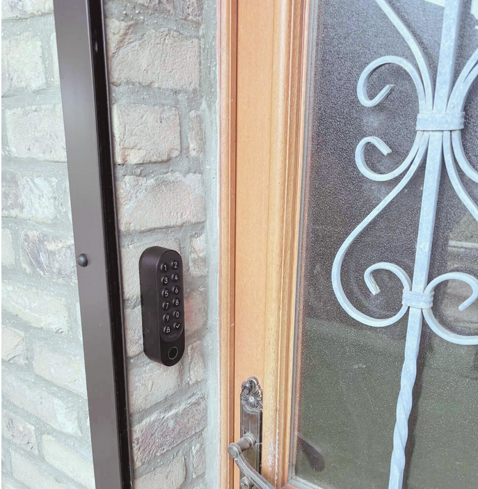
  </a>
</figure>
<figure class="photo-slide" data-slide>
  <a href="images/aqa0.jpeg" data-full="images/aqa0.jpeg" data-alt="Photo 9 — Test et avis Aqara U200 : une serrure Matter et Thread vraiment taillée pour Home Assistant" aria-label="Agrandir la photo 9 : Photo 9 — Test et avis Aqara U200 : une serrure Matter et Thread vraiment taillée pour Home Assistant">
    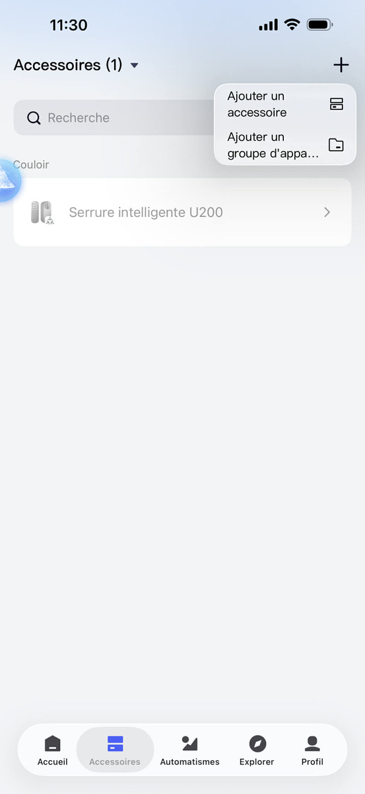
  </a>
</figure>
<figure class="photo-slide" data-slide>
  <a href="images/aqa2.jpeg" data-full="images/aqa2.jpeg" data-alt="Photo 10 — Test et avis Aqara U200 : une serrure Matter et Thread vraiment taillée pour Home Assistant" aria-label="Agrandir la photo 10 : Photo 10 — Test et avis Aqara U200 : une serrure Matter et Thread vraiment taillée pour Home Assistant">
    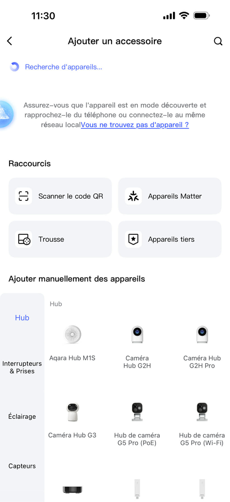
  </a>
</figure>
<figure class="photo-slide" data-slide>
  <a href="images/aqa4.jpeg" data-full="images/aqa4.jpeg" data-alt="Photo 11 — Test et avis Aqara U200 : une serrure Matter et Thread vraiment taillée pour Home Assistant" aria-label="Agrandir la photo 11 : Photo 11 — Test et avis Aqara U200 : une serrure Matter et Thread vraiment taillée pour Home Assistant">
    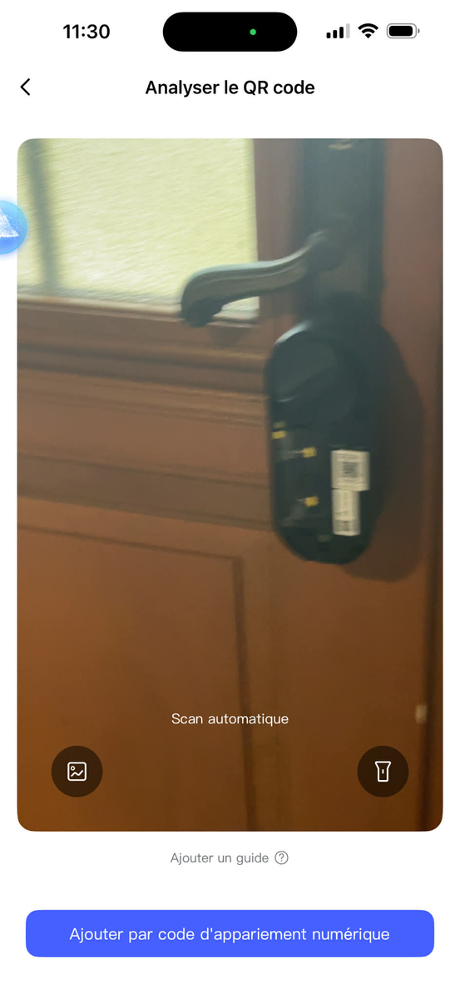
  </a>
</figure>
<figure class="photo-slide" data-slide>
  <a href="images/aqara8.jpeg" data-full="images/aqara8.jpeg" data-alt="Photo 12 — Test et avis Aqara U200 : une serrure Matter et Thread vraiment taillée pour Home Assistant" aria-label="Agrandir la photo 12 : Photo 12 — Test et avis Aqara U200 : une serrure Matter et Thread vraiment taillée pour Home Assistant">
    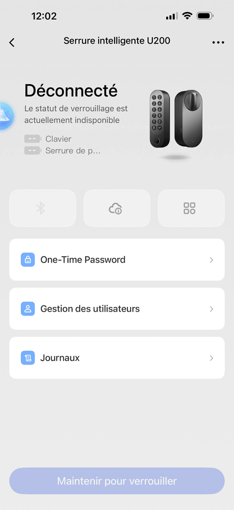
  </a>
</figure>
<figure class="photo-slide" data-slide>
  <a href="images/PG_8UuAv.jpeg" data-full="images/PG_8UuAv.jpeg" data-alt="Photo 13 — Test et avis Aqara U200 : une serrure Matter et Thread vraiment taillée pour Home Assistant" aria-label="Agrandir la photo 13 : Photo 13 — Test et avis Aqara U200 : une serrure Matter et Thread vraiment taillée pour Home Assistant">
    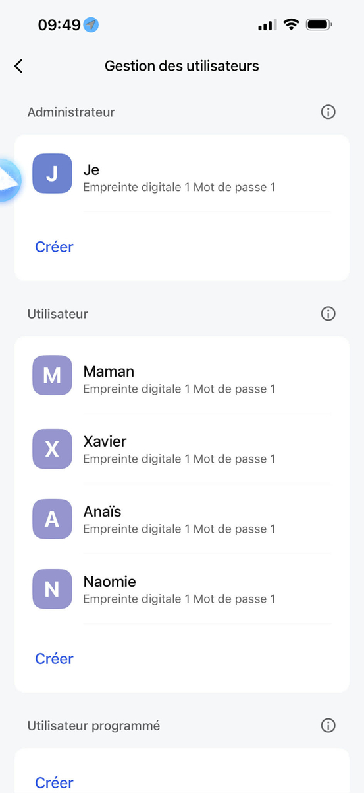
  </a>
</figure>
<figure class="photo-slide" data-slide>
  <a href="images/Capturedcrandu2025-12-1312-05-50.png" data-full="images/Capturedcrandu2025-12-1312-05-50.png" data-alt="Photo 14 — Test et avis Aqara U200 : une serrure Matter et Thread vraiment taillée pour Home Assistant" aria-label="Agrandir la photo 14 : Photo 14 — Test et avis Aqara U200 : une serrure Matter et Thread vraiment taillée pour Home Assistant">
    
  </a>
</figure>
<figure class="photo-slide" data-slide>
  <a href="images/Capturedcrandu2025-12-1312-06-03.png" data-full="images/Capturedcrandu2025-12-1312-06-03.png" data-alt="Photo 15 — Test et avis Aqara U200 : une serrure Matter et Thread vraiment taillée pour Home Assistant" aria-label="Agrandir la photo 15 : Photo 15 — Test et avis Aqara U200 : une serrure Matter et Thread vraiment taillée pour Home Assistant">
    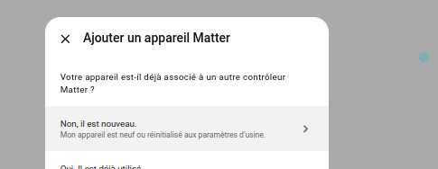
  </a>
</figure>
<figure class="photo-slide" data-slide>
  <a href="images/Capturedcrandu2025-12-1308-46-03.png" data-full="images/Capturedcrandu2025-12-1308-46-03.png" data-alt="Photo 16 — Test et avis Aqara U200 : une serrure Matter et Thread vraiment taillée pour Home Assistant" aria-label="Agrandir la photo 16 : Photo 16 — Test et avis Aqara U200 : une serrure Matter et Thread vraiment taillée pour Home Assistant">
    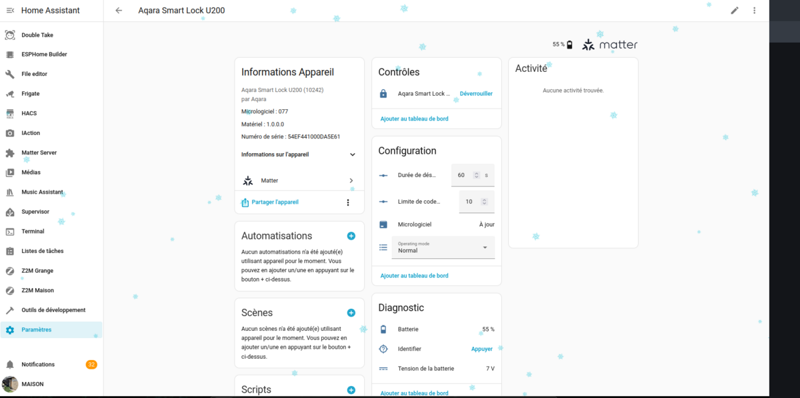
  </a>
</figure>
</div>
<button type="button" class="carousel-nav" data-prev aria-label="Photo précédente">‹</button>
<button type="button" class="carousel-nav" data-next aria-label="Photo suivante">›</button>
<div class="carousel-dots" data-dots></div>
<div class="carousel-live" data-live aria-live="polite"></div>
<p class="carousel-hint">Faites défiler les photos, ou ouvrez-les pour les agrandir (si JavaScript est activé).</p>
</section>

# Test et avis Aqara U200 : une serrure Matter et Thread vraiment taillée pour Home Assistant

- **Type :** Test
- **Catégorie :** Tests produits domotique & maison connectée > Sécurité et Surveillance
- **Lien :** https://forumdomotique.com/tests/securite-surveillance/test-avis-aqara-u200-serrure-connectee-matter-thread/
- **Date de publication :** 28 décembre 2025 à 15:13 (Europe/Paris)
- **Auteur :** XAV59213

---

Dans cet article, je vous partage mon retour d’expérience complet sur l’installation et l’utilisation de la **Aqara U200**, accompagnée de son cylindre vendu séparément.  
Il s’agit d’une serrure connectée **retrofit**, conçue pour s’installer sur une porte existante sans remplacer tout le mécanisme.

Sa promesse est claire : une compatibilité **Matter et Thread native**, et surtout une intégration directe dans **Home Assistant**, sans dépendre d’un écosystème fermé ou d’un hub propriétaire imposé.

C’était mon tout premier appareil Matter “pur”, et je dois le dire dès le départ : l’expérience a été étonnamment fluide.  
Fini les clés oubliées, place aux empreintes digitales, aux codes PIN et aux automatisations intelligentes. Mais au-delà de la fiche technique, ce que je voulais vraiment vérifier, c’était l’usage réel au quotidien, dans un contexte familial, sans contraintes ni bidouilles permanentes.

Voyons donc ce que vaut réellement la Aqara U200 **en conditions réelles**, une fois installée sur une porte d’entrée utilisée tous les jours.

### 🔗 Envie d'acheter ce produit ?

Vous pouvez soutenir le forum en passant par nos liens affiliés 👇  
**Cela ne vous coûte jamais plus cher !**  
*Le prix reste exactement le même pour vous, mais nous recevons une petite commission qui aide à faire vivre la communauté 💜*

[
<!-- source : https://forumdomotique.com/uploads/pages_media/logo_domadoo.png -->
Acheter sur Domadoo](https://www.domadoo.fr/fr/controle-d-acces-sans-fil/7203-aqara-kit-serrure-connectee-et-clavier-smart-lock-u200-noire-matter-over-thread-6970504219922.html?domid=101)
[
<!-- source : https://forumdomotique.com/uploads/pages_media/logo_amazon.png -->
Acheter sur Amazon](https://amzn.to/4qrRedN)

## Avant / après : ce que change réellement une serrure connectée au quotidien

Avant l’installation de la Aqara U200, l’accès à la maison reposait uniquement sur des clés physiques. Cela fonctionne, bien sûr, mais avec toutes les petites contraintes que l’on connaît : clés oubliées, doubles à gérer, enfants qui cherchent leur trousseau au fond du sac, ou cette incertitude persistante en quittant la maison en se demandant si la porte est bien verrouillée.

Depuis l’installation de la serrure, l’usage a radicalement changé. L’entrée devient un véritable point intelligent de la maison, capable de s’adapter aux habitudes de chacun.

Les enfants rentrent seuls grâce à leur empreinte digitale, sans stress ni manipulation compliquée.

Les invités disposent de codes temporaires que je peux créer ou désactiver à la volée. Et surtout, la porte se verrouille automatiquement sans que personne n’ait à y penser.

Sur le papier, cela peut sembler anecdotique. Dans la réalité, c’est probablement l’un des apports domotiques les plus visibles et les plus appréciés à la maison. La serrure ne devient pas un gadget que l’on manipule sans cesse. Elle s’efface derrière l’usage, et c’est précisément là qu’elle est réussie.

## Pourquoi cette serrure connectée m’a vraiment intéressé

Depuis que je bidouille en domotique, je cherchais une solution pour dire adieu aux clés physiques **sans avoir à remplacer entièrement la serrure de la porte d’entrée**.  
Je voulais quelque chose de simple mécaniquement, fiable dans le temps et surtout compatible avec une domotique locale et pérenne.

Quand Aqara a annoncé la U200 avec une compatibilité **Matter et Thread native** et la possibilité de l’intégrer **sans hub propriétaire obligatoire**, j’ai immédiatement été intrigué. C’était aussi l’occasion idéale de tester Matter sur un équipement critique du quotidien, bien plus parlant qu’une simple prise connectée.

Je l’utilise avec un coordinateur Thread dédié, en l’occurrence un [**SMLight SLZB-MR4U**](https://forumdomotique.com/tests/dongles-passerelles/test-slzb-mr4u-coordinateur-zigbee-thread-matter/), déjà en place pour d’autres projets domotiques. Ce point est essentiel : un bon réseau Thread change complètement l’expérience. La communication est locale, stable et extrêmement réactive, exactement ce que j’attends pour une serrure de porte d’entrée.


## Contenu de la boîte et premières impressions

Dès l’ouverture de la boîte de la [**Aqara U200**](https://www.domadoo.fr/fr/controle-d-acces-sans-fil/7203-aqara-kit-serrure-connectee-et-clavier-smart-lock-u200-noire-matter-over-thread-6970504219922.html?domid=101), on sent que le produit a été pensé pour les **portes européennes**.  
Le kit est complet, bien organisé, et évite les mauvaises surprises au moment de l’installation.

Le module intérieur est compact, avec une finition noire mate élégante qui s’intègre facilement sur la porte, même dans un espace réduit. Il n’est pas envahissant, ce qui est appréciable lorsque l’entrée n’est pas très large. Le clavier extérieur est discret mais robuste, avec une conception qui inspire confiance pour une utilisation quotidienne.

Concernant le [**cylindre vendu séparément**](https://www.domadoo.fr/fr/accessoires-electriques/8704-aqara-cylindre-ajustable-pour-smart-lock-u200.html?domid=101), tout est fourni : cylindre ajustable, extensions pour s’adapter à différentes épaisseurs de porte, adaptateurs selon la forme de la clé, cales, plaques de fixation, vis de plusieurs tailles et même la clé Allen nécessaire au montage.


Dans le cas d’un cylindre européen, ce qui est le plus courant en France, il est fortement recommandé d’opter pour un cylindre **débrayable**, permettant l’ouverture depuis l’extérieur même si une clé est engagée à l’intérieur.

La batterie rechargeable est prête à l’emploi, et la qualité des matériaux est immédiatement rassurante. Rien ne donne une impression fragile ou approximative, et tout semble pensé pour durer.


## Installation : simple, rapide et rassurante

Je m’attendais à passer une bonne partie de l’après-midi sur l’installation. En réalité, tout a été plié en **une quinzaine de minutes**.

Après avoir retiré l’ancien cylindre européen à l’aide d’un simple tournevis, j’ai ajusté la longueur du cylindre Aqara en ajoutant les extensions nécessaires. Bonne surprise : la bonne combinaison s’est trouvée dès le premier essai, sans avoir à mesurer précisément.


Les adaptateurs s’emboîtent parfaitement sur l’extrémité du cylindre, et les cales permettent un positionnement précis sur la porte.


Le support du module intérieur se fixe facilement, le moteur se clipse sans forcer, et l’ensemble est solidement maintenu par les vis fournies.

Le pouce tournant intérieur ne présente aucun jeu, et une fois le cylindre en place, tout est parfaitement aligné.  
Aucune vibration lorsque la porte claque, et une impression générale de solidité qui rassure immédiatement pour un usage quotidien.


Le clavier extérieur, de son côté, s’installe simplement selon la configuration de la porte ou du mur. Dans mon cas, tout tient parfaitement en place.


## Configuration dans l’application Aqara

Même si l’objectif est une utilisation poussée avec Home Assistant, l’application **Aqara Home** reste nécessaire pour certaines étapes.

L’appairage se fait rapidement via Bluetooth en scannant le QR code dédié. Après la création du compte et la mise à jour du firmware, la calibration automatique se lance.

  

La serrure détecte alors toute seule les fins de course, ajuste la force du moteur et se calibre sans intervention manuelle.  
J’ai ensuite ajouté les empreintes digitales pour toute la famille, configuré des codes PIN temporaires et permanents, et ajusté des paramètres comme le verrouillage automatique ou le mode silencieux.

 

La reconnaissance des empreintes est rapide et fiable, y compris avec les enfants, et l’interface reste suffisamment claire pour ne pas perdre de temps dans des réglages inutiles.

## Matter et Thread : pourquoi cela change vraiment l’expérience

L’un des grands atouts de la **Aqara U200**, c’est son fonctionnement en **Matter sur Thread**. Contrairement aux serrures Wi-Fi classiques, la communication est ici locale, rapide et indépendante du cloud pour les usages essentiels.

Thread repose sur un réseau maillé basse consommation. Chaque appareil compatible peut relayer l’information, ce qui renforce la stabilité globale du réseau. Résultat : une latence quasi inexistante et une fiabilité remarquable au quotidien.

Avec un bon coordinateur Thread, l’expérience est radicalement différente de ce que l’on peut connaître avec du Bluetooth ou un Wi-Fi surchargé. La serrure répond instantanément, et son état est toujours parfaitement synchronisé.

C’est exactement ce que j’attends d’un équipement aussi critique qu’une serrure de porte d’entrée.

## Intégration Matter dans Home Assistant

C’est ici que la Aqara U200 prend toute sa dimension. Une fois le coordinateur Thread en place, l’intégration Matter dans Home Assistant se fait en quelques secondes. Depuis l’interface, il suffit d’ajouter un nouvel appareil Matter, de scanner le QR code présent sur la serrure, et la connexion est immédiate.

La serrure apparaît comme une entité **lock** standard, avec un état toujours fiable et des commandes instantanées.  
Tout fonctionne en local, sans dépendance permanente à un service externe, et avec une réactivité exemplaire.


## Automatisations concrètes avec Home Assistant

C’est probablement la partie la plus intéressante à l’usage.

J’ai par exemple mis en place un verrouillage automatique lorsque la porte est fermée et que la maison passe en mode absence. Plus besoin de se demander si tout est bien verrouillé en partant.

La nuit, la porte se verrouille automatiquement à heure fixe. Si quelqu’un rentre tard, l’empreinte digitale permet de déverrouiller sans bruit ni manipulation complexe.

J’ai également configuré des notifications intelligentes. Si la porte reste déverrouillée trop longtemps, une alerte est envoyée. En cas de tentative d’ouverture à un horaire inhabituel, je suis immédiatement informé.

La serrure devient aussi un véritable déclencheur domotique. Lorsqu’elle passe de l’état verrouillé à déverrouillé, cela peut activer l’éclairage de l’entrée, désactiver l’alarme ou ajuster le chauffage si la maison était en mode absence.

Ce n’est plus un simple accessoire, mais un élément central de la logique domotique de la maison.

```yaml
alias: Fermeture automatique de la porte quand la maison est vide
description: >
  Verrouille automatiquement la porte d'entrée dès que plus personne n'est
  détecté à la maison  (capteur nombre_famille_home passe en dessous de 1). 
  Idéal pour la sécurité quand tout le monde est sorti.
triggers:
  - entity_id: sensor.nombre_famille_home
    below: 1
    trigger: numeric_state
conditions:
  - condition: state
    entity_id: lock.aqara_smart_lock_u200
    state:
      - unlocked
actions:
  - device_id: 3d3f637fc7dd48ec92497f3cd376457f
    domain: lock
    entity_id: 7db1d537bc178277620290c67b15680e
    type: lock
mode: single
```

## Commande vocale avec Amazon Alexa

La serrure peut également être exposée à Alexa sans difficulté.  
Lors du déverrouillage, un code PIN est systématiquement demandé, ce qui est rassurant côté sécurité. En revanche, la fermeture ne nécessite pas de code, ce qui rend l’usage quotidien très fluide.

L’intégration dans les routines fonctionne parfaitement, que ce soit directement ou via Home Assistant.

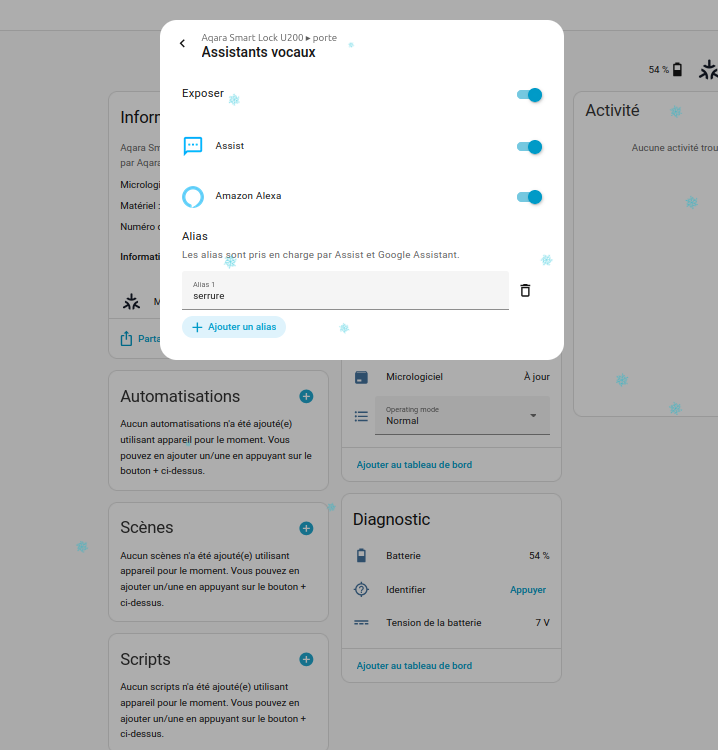

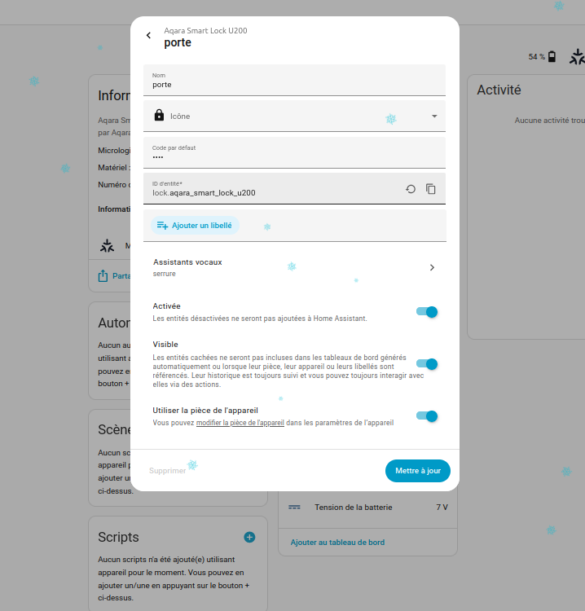

## Sécurité et situations exceptionnelles

La question de la sécurité est centrale lorsqu’on parle de serrure connectée. Sur ce point, la Aqara U200 se montre rassurante.

Le verrouillage automatique fonctionne de manière fiable, le gyroscope détecte correctement la fermeture de la porte, et l’accès par empreinte ou code est bien maîtrisé. Même en cas de coupure Internet, la serrure continue de fonctionner normalement. Les empreintes, les codes PIN et les interactions locales restent opérationnels.

L’autonomie de la batterie se compte en mois, et des alertes préviennent largement à l’avance en cas de niveau faible. En cas de situation exceptionnelle, le cylindre mécanique reste utilisable, ce qui constitue un filet de sécurité indispensable.

Après plusieurs semaines d’utilisation, je n’ai rencontré aucun comportement erratique. La serrure se fait oublier, et c’est sans doute le meilleur indicateur de fiabilité.

## Un usage parfaitement adapté à la vie de famille

L’usage familial était un point clé de ce test.  
L’empreinte digitale est rapidement devenue le mode d’accès préféré, notamment pour les enfants. Elle est rapide, intuitive et évite toute gestion de clés ou de codes complexes.

Les codes PIN temporaires sont également très pratiques pour les proches ou les intervenants ponctuels. Il est possible de définir des plages horaires précises, puis de les désactiver sans y penser.

Au quotidien, la serrure s’intègre naturellement dans la routine familiale, sans friction ni apprentissage compliqué. C’est un point essentiel pour qu’un produit domotique soit réellement adopté sur le long terme.

## Verdict

Après plusieurs semaines d’utilisation, la Aqara U200 a trouvé sa place définitive sur ma porte d’entrée. Elle s’adresse à ceux qui recherchent une serrure retrofit fiable, Matter-native, et réellement pensée pour une intégration avancée dans Home Assistant avec un réseau Thread solide.

L’ensemble prend tout son sens lorsqu’on l’associe au [**cylindre Aqara**](https://www.domadoo.fr/fr/accessoires-electriques/8704-aqara-cylindre-ajustable-pour-smart-lock-u200.html?domid=101), présenté plus haut dans l’article, et proposé séparément.

Côté usages, Aqara laisse le choix entre deux approches.  
La **version** [**U200 avec clavier**](https://amzn.to/3Yfg0ls) **(** [**Amazon**](https://amzn.to/3Yfg0ls) **/**  [**Domadoo**](https://www.domadoo.fr/fr/controle-d-acces-sans-fil/7203-aqara-kit-serrure-connectee-et-clavier-smart-lock-u200-noire-matter-over-thread-6970504219922.html?domid=101)**)** conviendra parfaitement à ceux qui souhaitent un accès par code directement depuis l’extérieur. À l’inverse, la **version** [**U200 Light**](https://amzn.to/4jdlGWu) **(** [**Amazon**](https://amzn.to/4jdlGWu) **/** [**Domadoo**](https://www.domadoo.fr/fr/controle-d-acces-sans-fil/8048-aqara-serrure-connectee-smart-lock-u200-lite-noire-matter-over-thread-6975833359059.html?domid=101)**)** s’adresse à ceux qui privilégient une installation plus discrète et une utilisation centrée sur les automatisations et les accès domotiques.

Quelle que soit la version choisie, on retrouve la même base technique solide, la même réactivité grâce à Thread, et une intégration Home Assistant exemplaire. L’ensemble forme aujourd’hui une solution mature, pratique et cohérente, qui améliore réellement le quotidien sans complexité inutile.

Et vous, avez-vous déjà franchi le pas avec la Aqara U200 ou une autre serrure connectée Thread ?  
Quelles automatisations avez-vous mises en place chez vous ? Les retours de la communauté sont toujours précieux, alors n’hésitez pas à partager votre expérience en commentaires.

