# Test Nuki Smart Lock Pro 5e génération : l’installation et les usages au quotidien

<figure class="bistrot-cover">
  <picture>
    <source type="image/webp" srcset="{{ '/contenus/tests/test-nuki-smart-lock-pro-5-installation-usages/images/cover-nuki-smart-lock-pro-5-hero.webp' | relative_url }}">
    
  </picture>
  <figcaption>La Smart Lock Pro en place, anneau allumé : le point de départ de ce premier volet.</figcaption>
</figure>



<section class="carousel photo-carousel" data-carousel data-lightbox aria-roledescription="carrousel" aria-label="Photos du matériel Nuki" tabindex="0">

<figure class="photo-slide" data-slide>
  <a href="images/3-boites-fermees.jpg" data-full="images/3-boites-fermees.jpg" data-alt="Quatre boîtes Nuki fermées posées sur une table : Keypad 2 NFC blanc, Smart Lock Pro, Door Sensor et Fob." aria-label="Agrandir : les quatre boîtes à la réception">
    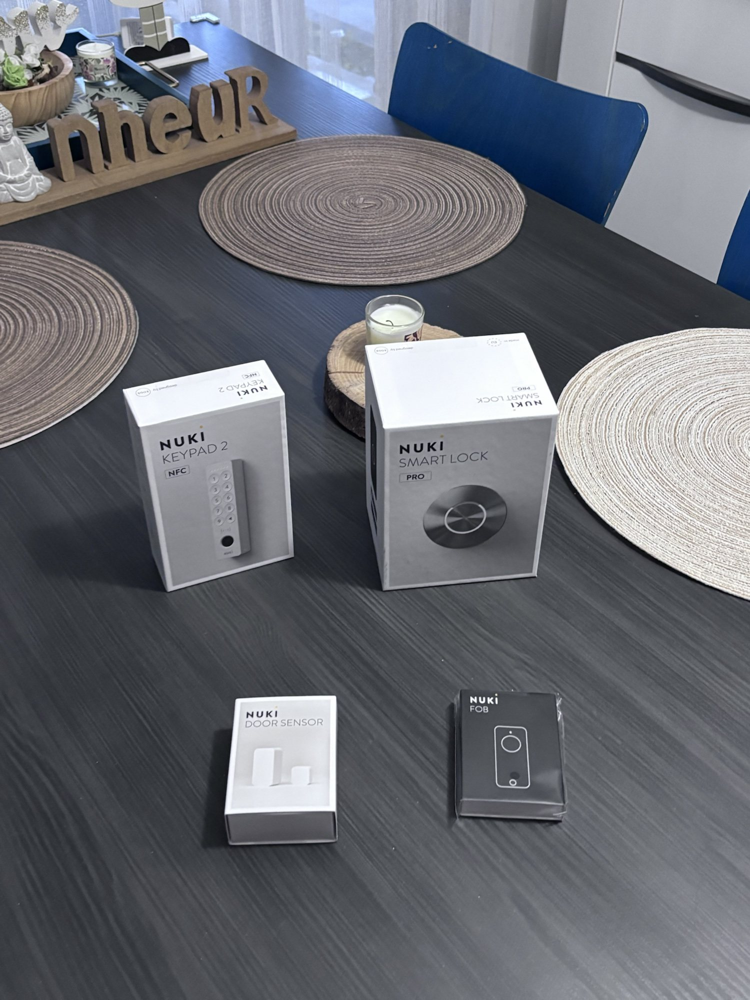
  </a>
  <figcaption>Les quatre boîtes à la réception.</figcaption>
</figure>
<figure class="photo-slide" data-slide>
  <a href="images/1-tout-deballe.jpg" data-full="images/1-tout-deballe.jpg" data-alt="Matériel Nuki déballé sur une table : Keypad 2 NFC blanc, Door Sensor, Fob et Smart Lock Pro, chacun avec son mode d’emploi." aria-label="Agrandir : le matériel déballé">
    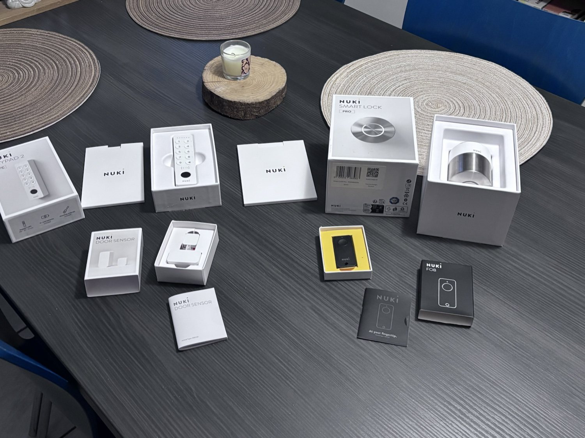
  </a>
  <figcaption>Le matériel une fois sorti des boîtes.</figcaption>
</figure>
<figure class="photo-slide" data-slide>
  <a href="images/4-contenu-smart-lock-pro.jpg" data-full="images/4-contenu-smart-lock-pro.jpg" data-alt="Contenu de la boîte Nuki Smart Lock Pro : la serrure, les pièces d’assemblage, le câble de charge tressé et le mode d’emploi." aria-label="Agrandir : le contenu de la boîte Smart Lock Pro">
    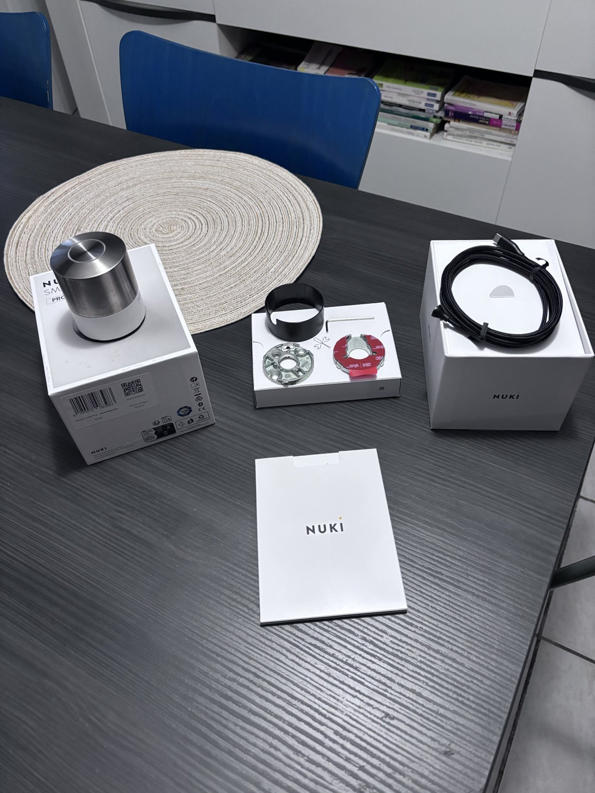
  </a>
  <figcaption>Le contenu de la boîte Smart Lock Pro.</figcaption>
</figure>
<figure class="photo-slide" data-slide>
  <a href="images/17-smart-lock-installee.jpg" data-full="images/17-smart-lock-installee.jpg" data-alt="Nuki Smart Lock Pro installée à l’intérieur de la porte, anneau allumé d’un halo bleu." aria-label="Agrandir : la Smart Lock Pro installée">
    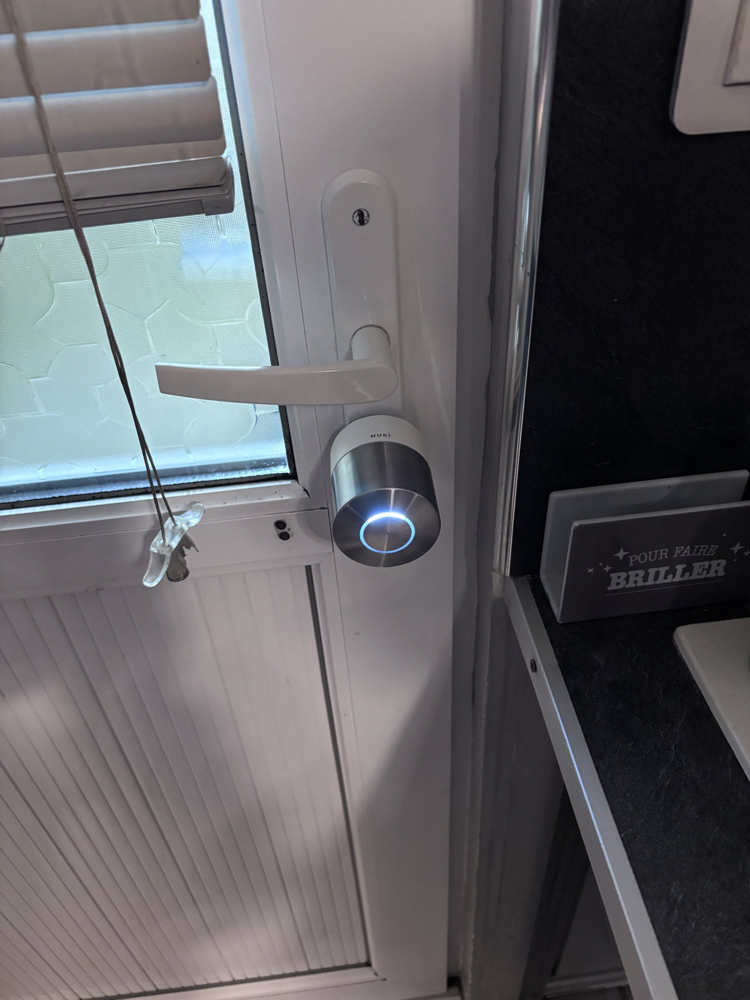
  </a>
  <figcaption>La Smart Lock Pro en place, anneau allumé.</figcaption>
</figure>
<figure class="photo-slide" data-slide>
  <a href="images/24-keypad-allume.jpg" data-full="images/24-keypad-allume.jpg" data-alt="Keypad 2 NFC blanc allumé, vu de face, posé sur une table, avec trois voyants bleus allumés en haut." aria-label="Agrandir : le Keypad 2 NFC allumé">
    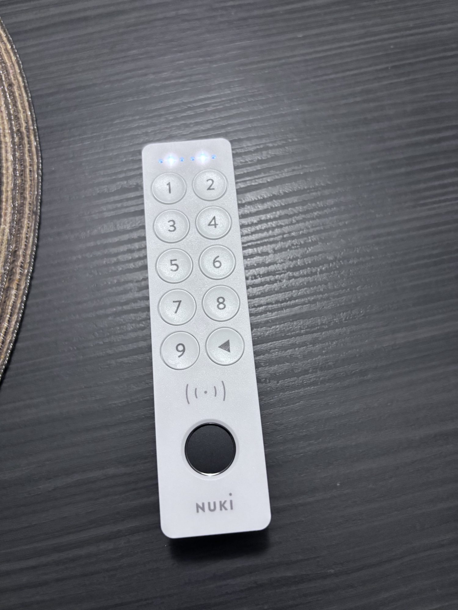
  </a>
  <figcaption>Le Keypad 2 NFC blanc, allumé.</figcaption>
</figure>
<figure class="photo-slide" data-slide>
  <a href="images/26-keypad-exterieur.jpg" data-full="images/26-keypad-exterieur.jpg" data-alt="Keypad 2 NFC blanc collé à l’extérieur, sur le dormant de la porte." aria-label="Agrandir : le Keypad collé à l’extérieur">
    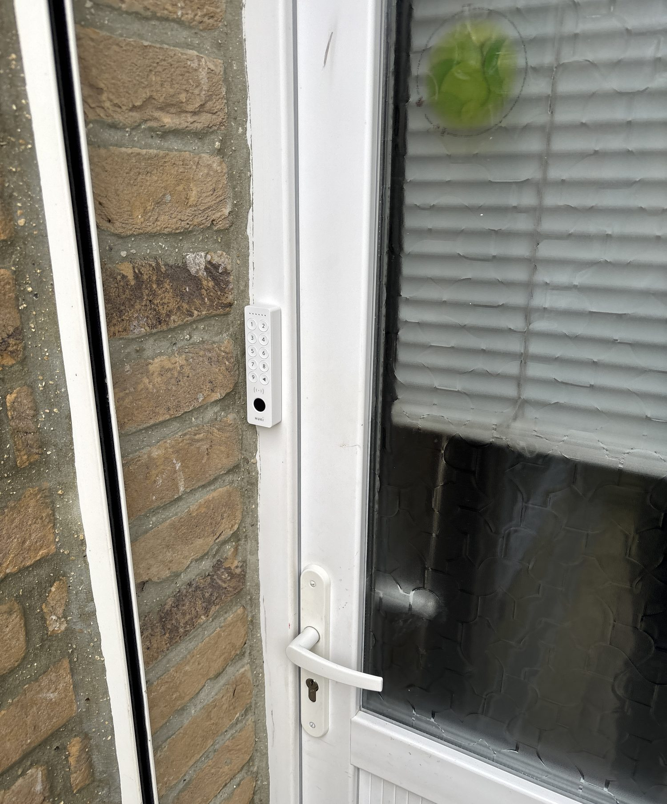
  </a>
  <figcaption>Le Keypad collé à l’extérieur, sur le dormant.</figcaption>
</figure>
<figure class="photo-slide" data-slide>
  <a href="images/54-door-sensor-deballage.jpg" data-full="images/54-door-sensor-deballage.jpg" data-alt="Door Sensor Nuki déballé sur une table : boîte, notice, capteur et aimant blancs." aria-label="Agrandir : le Door Sensor déballé">
    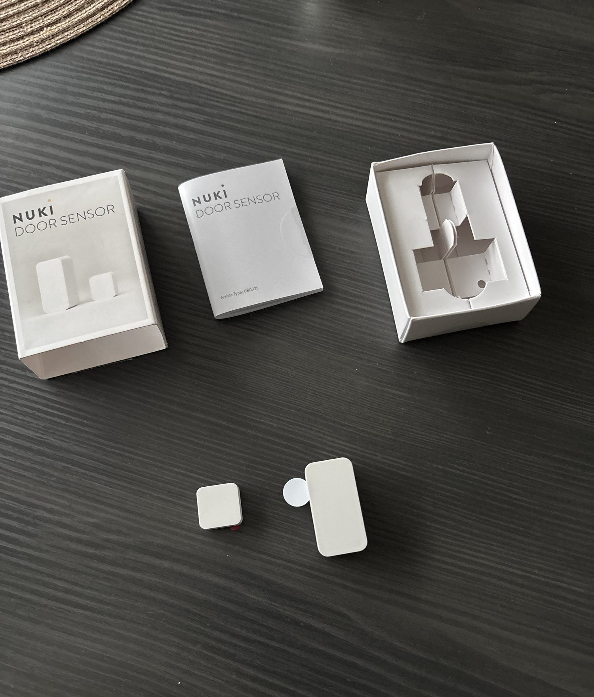
  </a>
  <figcaption>Le Door Sensor, avec le capteur et l’aimant.</figcaption>
</figure>
<figure class="photo-slide" data-slide>
  <a href="images/64-door-sensor-pose.jpg" data-full="images/64-door-sensor-pose.jpg" data-alt="Capteur et aimant blancs Nuki posés en haut du cadre, et deux éléments blancs face à face sur le bandeau, en bas." aria-label="Agrandir : la pose du Door Sensor">
    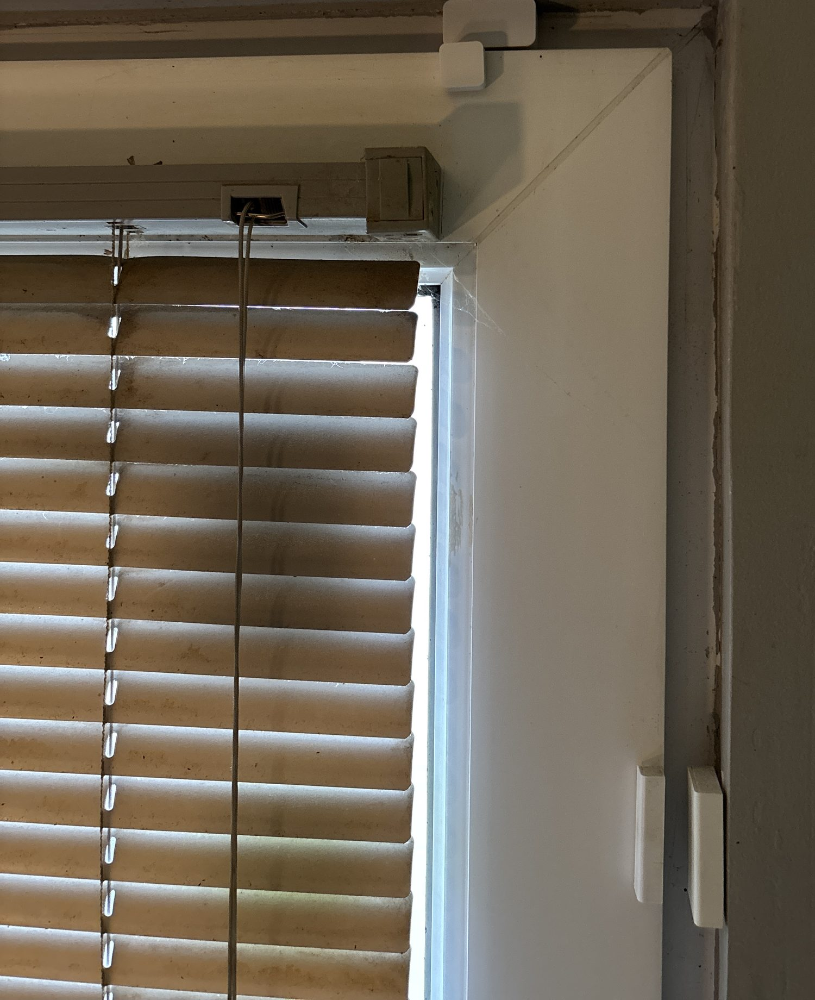
  </a>
  <figcaption>La pose du Door Sensor.</figcaption>
</figure>
<figure class="photo-slide" data-slide>
  <a href="images/27-fob-en-main.jpg" data-full="images/27-fob-en-main.jpg" data-alt="Fob Nuki noir tenu dans la main, bouton visible, serrure installée en arrière-plan." aria-label="Agrandir : le Fob dans la main">
    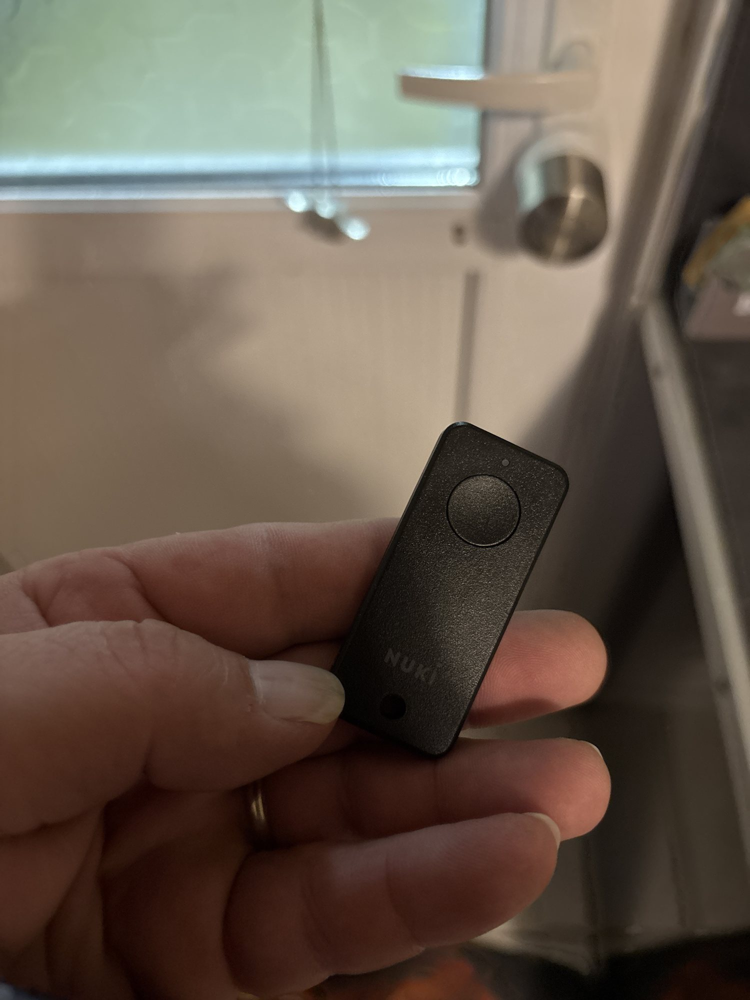
  </a>
  <figcaption>Le Fob dans la main, bouton visible.</figcaption>
</figure>
<figure class="photo-slide" data-slide>
  <a href="images/38-boite-made-in-eu.jpg" data-full="images/38-boite-made-in-eu.jpg" data-alt="Dessus de la boîte Nuki Smart Lock Pro : mention made in EU avec les étoiles de l’Union européenne, et designed by." aria-label="Agrandir : le dessus de la boîte, made in EU">
    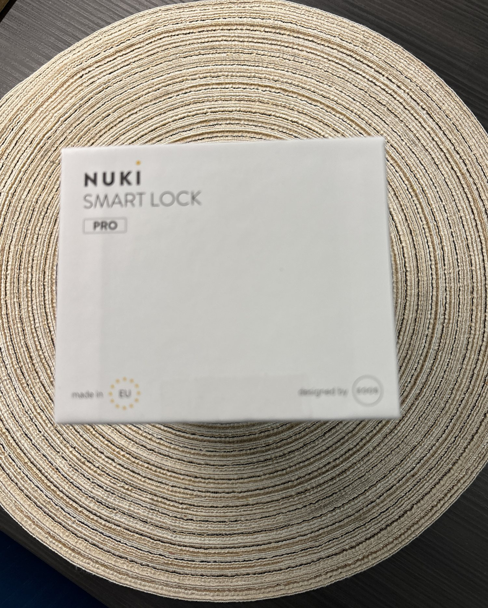
  </a>
  <figcaption>Le dessus de la boîte : « made in EU ».</figcaption>
</figure>

</section>

En moins de cinq minutes, la **Nuki Smart Lock Pro de 5e génération** était en place, sans perçage, sur mon cylindre débrayable.

J’ouvre ici un essai en deux volets de cette serrure connectée, accompagnée du **Keypad 2 NFC blanc** avec détection de vol, du **Door Sensor** et du **Fob**. Ce premier volet se concentre sur l’installation et la vie de tous les jours : poser la serrure, configurer l’application, utiliser le clavier, le capteur de porte et la télécommande, et voir ce que cela change à l’entrée de la maison. Le second volet sera consacré à l’intégration dans **Home Assistant**, en Matter via Thread, en m’appuyant sur ce que j’ai déjà appris avec l’[Aqara U200]({{ '/contenus/tests/test-avis-aqara-u200-serrure-connectee-matter-thread/article.html' | relative_url }}).

<aside class="ha-callout info" aria-label="Points forts de ce premier volet">

<strong>À retenir, à ce stade.</strong>

<ul>
<li>Le montage est rapide et facile : moins de cinq minutes.</li>
<li>La Nuki est beaucoup plus petite que l’Aqara U200, sans le bloc batterie en bas.</li>
<li>Le calibrage s’est fait à une vitesse incroyable, sans problème, en environ une minute.</li>
<li>Sans compte : j’ai juste installé l’application, tout se fait de là.</li>
<li>Keypad : déjà une semaine d’utilisation, confiance absolue dans le matériel.</li>
<li>Door Sensor : mon fils de 15 ans l’a posé, et il a réussi ; si la porte est mal fermée, j’ai une alerte au bout de 2 minutes.</li>
<li>Auto Unlock : je n’y prête même plus attention, c’est mon téléphone qui s’en charge.</li>
<li>Mode Nuit, vitesse Gentle : assez silencieux, j’ai dû refaire le test pour l’entendre.</li>
<li>Fob : à plus de 10 mètres, ça fonctionne.</li>
<li>Détection de vol : mon téléphone m’a envoyé l’alerte dans les 5 secondes ; pour le réactiver, j’ai mis mon pouce.</li>
</ul>
</aside>

## Le matériel de cet essai

Voici le matériel que j’ai installé et que je vais suivre dans la durée :

- la **Nuki Smart Lock Pro** de 5e génération, une serrure rétrofit qui se pose à l’intérieur de la porte, sur le cylindre existant ;
- le **Keypad 2 NFC blanc**, avec empreintes, codes, ouverture sans contact et **détection de vol** ;
- le **Door Sensor**, pour savoir si la porte est ouverte ou fermée, en plus de l’état verrouillé ou déverrouillé ;
- le **Fob**, la petite télécommande porte-clés, pour ouvrir sans smartphone.

## Ce qui a bougé chez Nuki juste avant cet essai

Deux annonces officielles méritent d’être rappelées, parce qu’elles concernent directement le matériel de cet essai.

Le **5 novembre 2026**, Nuki a lancé le **Smart Module** (une solution intégrée dans la porte, que je n’ai pas dans cet essai) et la version **blanche** du Keypad 2 NFC, en y associant la **détection de vol** sur les Keypad 2 NFC. Selon le communiqué, un capteur placé dans le compartiment à piles détecte un mouvement ou le démontage : une alerte peut arriver sur le téléphone, l’incident est inscrit dans le journal d’activité, et le clavier ne peut plus ouvrir la porte, être réinitialisé ou associé à un autre appareil tant qu’on ne l’a pas réactivé avec une empreinte ou un code.

Le **12 novembre 2026**, Nuki a annoncé les **Google Wallet Home Keys** sur ce même Keypad 2 NFC. Au moment où j’écris ces lignes, Nuki indique que la fonction est d’abord proposée en aperçu via la version bêta de Google Home, avant une disponibilité plus large. Je n’utilise pas Google Wallet pour l’instant.

## Ce que Nuki annonce sur le papier

Avant de poser quoi que ce soit, je rassemble ici les caractéristiques officielles. Ce n’est pas encore mon avis. Les liens pointent vers les fiches Nuki.

D’après la [fiche de la Smart Lock Pro](https://nuki.io/fr/produits/smart-lock-pro-5eme-gen), la serrure se monte en quelques minutes à l’intérieur de la porte, **sans perçage**, sur un cylindre existant (profil européen, et certains cylindres suisses ronds). Le corps est en acier inoxydable, livré avec un anneau de base noir et un anneau blanc. Le moteur est **sans balais**, avec trois vitesses de verrouillage. Nuki indique, pour un double tour : moins de 1,5 seconde en mode Insane, 2 secondes en Standard, et moins de 3,3 secondes en Gentle, ce dernier étant présenté comme plus silencieux. L’accu lithium-ion se recharge en **deux heures**, y compris sur la porte grâce à un connecteur magnétique, et Nuki annonce une autonomie de plusieurs mois selon l’usage. Le Wi-Fi est intégré, l’accès à distance est inclus, et la serrure parle **Matter via Thread**. Jusqu’à **200 autorisations** d’accès peuvent être gérées dans l’application, avec des fonctions comme Auto Unlock, Auto Lock, Lock ’n’ Go et le mode nuit.

Le [Keypad 2 NFC](https://nuki.io/fr/produits/keypad-2-nfc) permet, selon Nuki, jusqu’à **20 empreintes**, **200 codes** (dont des accès temporaires) et jusqu’à **35 clés Tap to Unlock**. Il est annoncé avec une certification **IP54**, une autonomie allant jusqu’à 12 mois, et six façons d’entrer : Google Wallet Home Keys, Apple Home Key, Samsung Digital Home Key, Tap to Unlock dans le mode de l’app Nuki, empreinte ou code.

Le [Door Sensor](https://nuki.io/fr/produits/door-sensor) se colle à l’intérieur, sans perçage ni vissage. Il ajoute les états ouvert et fermé, peut prévenir si la porte reste ouverte trop longtemps, et intègre une détection de sabotage. Nuki annonce une pile lithium 3,6 V (½ AA ER14250) d’environ deux ans, et une compatibilité avec les Smart Lock à partir de la 3e génération.

Le [Fob](https://nuki.io/fr/produits/fob) est une télécommande Bluetooth, présentée comme résistante aux chocs et à l’eau, avec une pile CR1632 (plusieurs mois à deux ans selon l’usage) et une portée typique de **5 à 15 mètres**. Un même Fob peut piloter plusieurs appareils. En cas de perte, l’autorisation se retire dans l’application.

## Conçu en Autriche, fabriqué en Europe

Nuki le met en avant sur la fiche de la Pro : la serrure est **conçue en Autriche et fabriquée en Europe**, avec un accent annoncé sur la sécurité, la fiabilité et la protection des données. L’entreprise est basée à Graz.

Sur le dessus de la boîte, on lit **made in EU**, avec le cercle d’étoiles de l’Union européenne, et **designed by**, suivi d’un logo trop petit pour être lu clairement ici. La mention « conçue en Autriche » reste celle de la [fiche officielle](https://nuki.io/fr/produits/smart-lock-pro-5eme-gen), elle n’apparaît pas de façon lisible sur cette face de la boîte.

<figure>

<figcaption>Le dessus de la boîte : « made in EU » à gauche, « designed by » à droite. Le logo qui suit « designed by » est trop petit pour être lu clairement.</figcaption>
</figure>

## Réception et déballage

<figure>
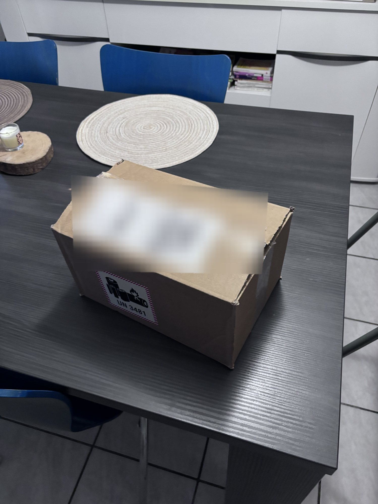
<figcaption>Le colis à la réception. L’étiquette d’expédition a été floutée ; le marquage lithium UN 3481 reste visible.</figcaption>
</figure>

<figure>

<figcaption>Le matériel une fois sorti des boîtes : Keypad 2 NFC blanc, Door Sensor, Fob et Smart Lock Pro, chacun avec son mode d’emploi.</figcaption>
</figure>

## Contenu des boîtes et premières impressions

<figure>

<figcaption>Contenu de la boîte Smart Lock Pro : la serrure, les pièces d’assemblage, le câble de charge tressé et le mode d’emploi.</figcaption>
</figure>

Le verrou est élégant. Il n’y a pas de cylindre (cassette) à changer. Dans la boîte, je trouve une clé BTR (Allen) et cinq pièces d’assemblage. Chaque produit a son mode d’emploi. J’avais l’impression que le montage irait très vite.

## Installation de la Smart Lock Pro

Selon Nuki, le montage se fait à l’intérieur, sur le cylindre existant, sans perçage, et conviendrait aussi à une location puisqu’on peut tout retirer. La Pro ne change pas, toujours selon Nuki, la classe de sécurité de la porte : c’est une solution rapportée.

Il n’y a pas de cylindre (cassette) à changer : la serrure se pose sur le cylindre déjà en place, vue de l’intérieur. Sur les photos, on voit d’abord la porte avant le montage, puis la Smart Lock Pro installée, avec l’anneau allumé.

Ce que j’ai apprécié, c’est le montage rapide et la facilité : moins de cinq minutes.

<aside class="ha-callout" aria-label="Avant d’acheter : vérifiez votre cylindre">

<strong>Avant d’acheter : vérifiez votre cylindre</strong>

<strong>À vérifier : votre barillet est-il bien débrayable ?</strong> Le test proposé par Nuki se trouve plus bas dans cet encadré.

J’ai remarqué une chose importante : s’il n’y a pas de cylindre débrayable, impossible d’ouvrir de l’extérieur. La serrure se monte sur la clé laissée côté intérieur ; sans fonction débrayable (on parle aussi de fonction danger ou urgence), cette clé bloque l’ouverture avec une autre clé depuis l’extérieur. Je recommande donc un cylindre débrayable, pour être sûr de toujours pouvoir accéder de l’extérieur. Moi, c’est un cylindre débrayable : de mon côté, l’ouverture de l’extérieur avec la clé reste donc possible, Nuki montée.

Nuki le dit aussi dans son guide de compatibilité : avec la fonction urgence, on peut déverrouiller la porte de l’extérieur même si une clé est insérée à l’intérieur, et les deux clés tournent de façon synchrone. Pour savoir si votre cylindre l’a, Nuki propose un test simple : glisser une clé côté intérieur en la laissant de biais, insérer une seconde clé côté extérieur, puis essayer de verrouiller. Si ça verrouille, le cylindre a la fonction urgence. Sinon, Nuki conseille de changer le cylindre ou de faire ajouter la fonction par un serrurier, et oriente vers la Smart Lock Ultra.

<strong>Mesurer un cylindre européen.</strong> On mesure de la vis de fixation centrale jusqu’à chaque extrémité : côté extérieur × côté intérieur, en millimètres. Les cylindres se vendent ainsi en 30×30, 30×40, 40×40, 35×45, etc. Pour la Smart Lock Pro, Nuki demande surtout de vérifier la clé côté intérieur : épaisseur de 4 mm maximum, et pas plus de 37 mm qui dépassent du cylindre. Le cylindre peut dépasser de moins de 6 mm avec la plaque de montage adhésive. Nuki fixe aussi plus de 30 mm entre le centre du trou de serrure et le cadre comme la poignée (plus de 40 mm vers le cadre si la porte s’ouvre vers l’extérieur).

<strong>Serrure multipoint à crémaillère à verrouillage automatique.</strong> Chez moi, ça ne pose pas de problème, tant qu’on remonte correctement la poignée vers le haut pour le verrouillage automatique. Rien n’empêche le bon fonctionnement.

</aside>

<figure style="margin:0;">
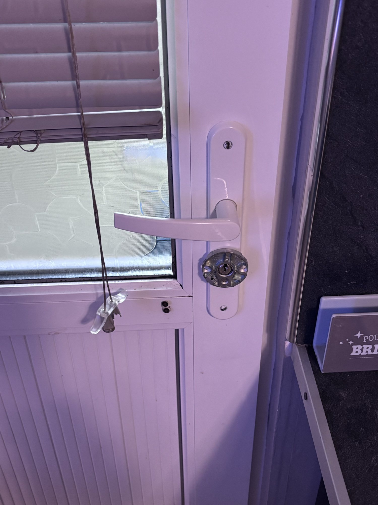
<figcaption>La porte avant le montage, avec le cylindre déjà en place.</figcaption>
</figure>
<figure style="margin:0;">

<figcaption>La Smart Lock Pro en place, anneau allumé.</figcaption>
</figure>

## Et par rapport à l’Aqara U200 ?

J’ai déjà une [Aqara U200]({{ '/contenus/tests/test-avis-aqara-u200-serrure-connectee-matter-thread/article.html' | relative_url }}) à la maison, testée ici même. Pour l’instant, je compare seulement le design et l’encombrement : rien d’autre n’est tranché ici.

Le design et l’encombrement n’ont rien à voir. La Nuki est beaucoup plus petite, sans l’extension batterie — le bloc batterie — en bas de l’Aqara.

## Configuration dans l’application Nuki

Même si l’objectif, dans le second volet, est une utilisation poussée avec Home Assistant, l’application Nuki reste le point de départ pour installer la serrure, le clavier, le capteur et le Fob, et pour activer Matter.

Le Quick Start Guide fourni dans la boîte renvoie vers [nuki.io/start](https://nuki.io/start), pour télécharger l’application et suivre les étapes.

<figure>
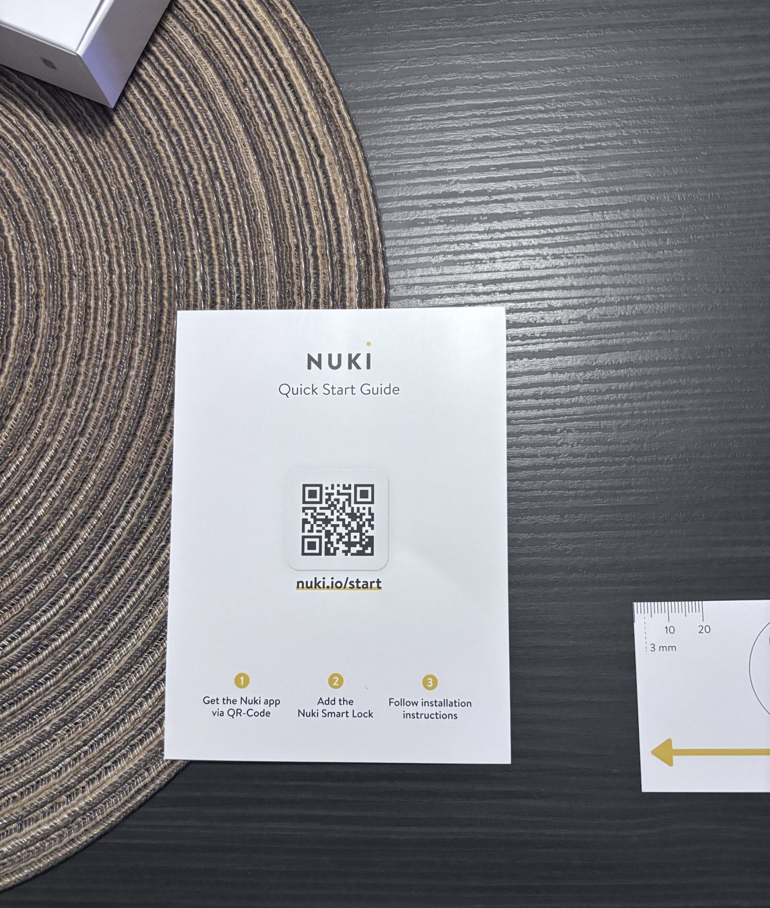
<figcaption>Le Quick Start Guide fourni avec la serrure, et le QR code vers nuki.io/start.</figcaption>
</figure>

<figure style="margin:0;">
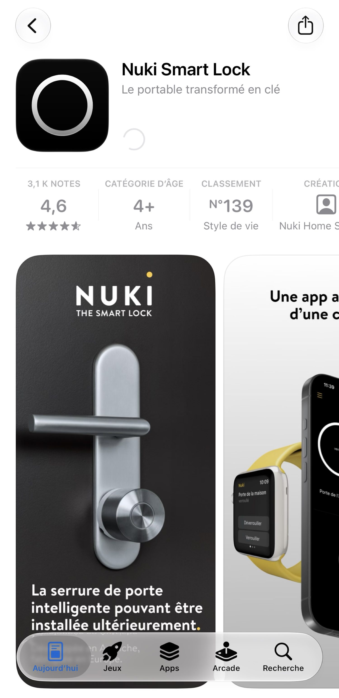
<figcaption>La fiche de l’application Nuki Smart Lock, dans l’App Store.</figcaption>
</figure>
<figure style="margin:0;">
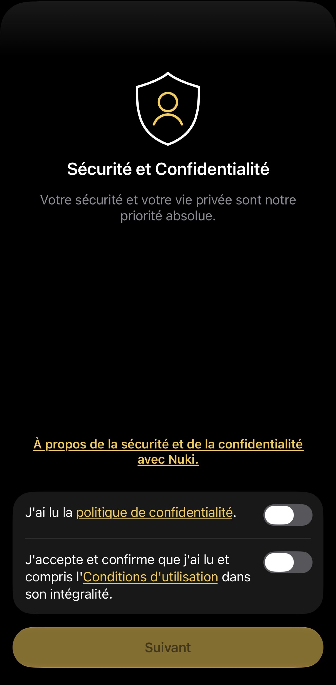
<figcaption>L’écran « Sécurité et Confidentialité », avant l’acceptation des conditions.</figcaption>
</figure>
<figure style="margin:0;">
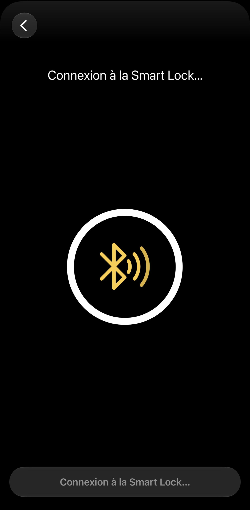
<figcaption>La connexion Bluetooth à la Smart Lock, en cours dans l’application.</figcaption>
</figure>

Dans l’application, le micrologiciel de la Smart Lock s’affiche en **5.10.5**.

Je n’ai eu aucun souci à installer l’application, ça s’est passé avec fluidité, et pour installer les appareils, idem : il y a juste à choisir ce qu’on veut intégrer, et hop.

<figure>
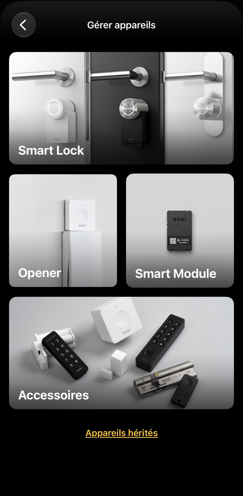
<figcaption>L’écran « Gérer appareils » de l’application : Smart Lock, Opener, Smart Module et Accessoires.</figcaption>
</figure>

<strong>Sans compte :</strong> j’ai juste installé l’application, tout se fait de là.

### Le calibrage

Le calibrage est fait. Dans l’application, il se trouve dans le menu **Général**, à l’action **Calibrer la Smart Lock**. L’écran demande d’avoir la porte fermée et déverrouillée, et de tourner la Smart Lock complètement en position déverrouillée jusqu’à sentir une résistance. Un avertissement s’affiche ensuite : « Gardez votre porte fermée », parce que certaines portes s’ouvrent pendant le calibrage. Le calibrage se lance, puis l’app indique « Calibrage terminé ! », avec un bouton « Tester le calibrage ». Le calibrage s’est fait à une vitesse incroyable, sans problème. Cela a pris environ une minute. Dans le même menu Général, on voit aussi les réglages poignée **Béquille**, durée de déblocage **3 s**, et rotation de la clé **360° (1x)**.

<figure style="margin:0;">
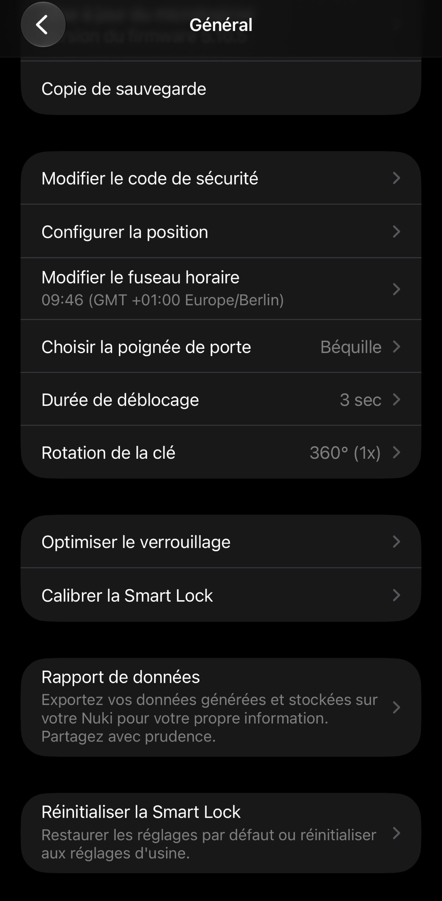
<figcaption>Le menu Général, avec l’action Calibrer la Smart Lock.</figcaption>
</figure>
<figure style="margin:0;">
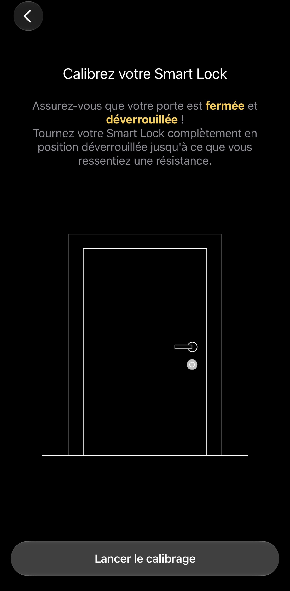
<figcaption>« Calibrez votre Smart Lock » : porte fermée et déverrouillée.</figcaption>
</figure>
<figure style="margin:0;">
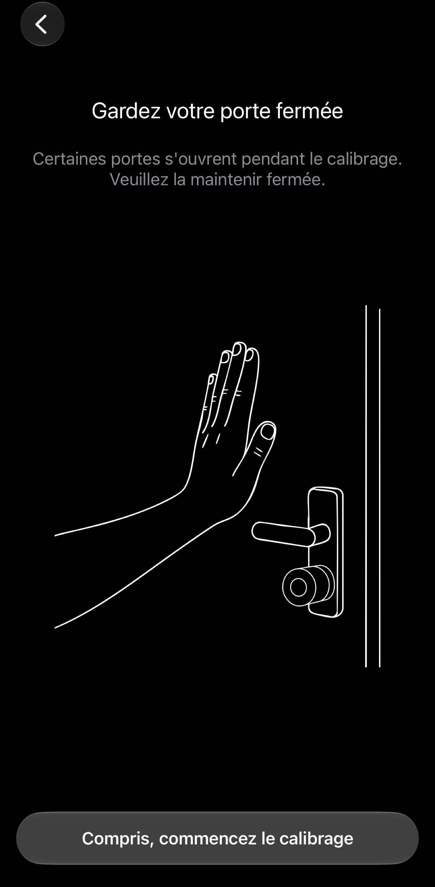
<figcaption>« Gardez votre porte fermée » : certaines portes s’ouvrent pendant le calibrage.</figcaption>
</figure>
<figure style="margin:0;">
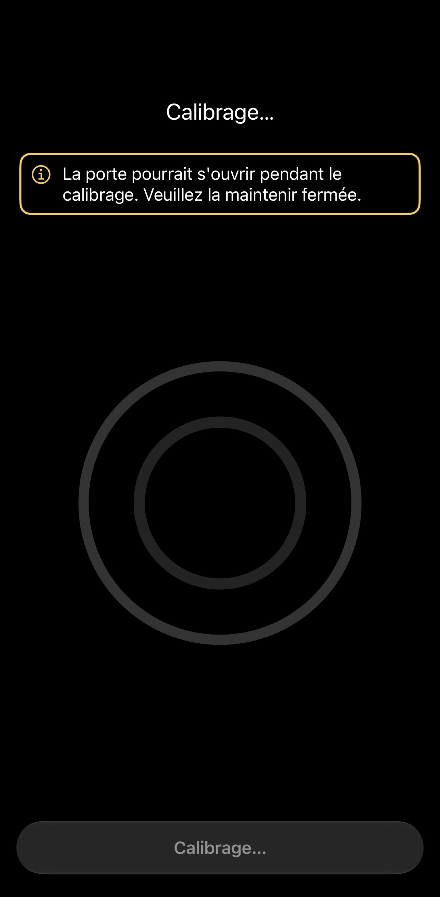
<figcaption>Le calibrage en cours.</figcaption>
</figure>
<figure style="margin:0;">
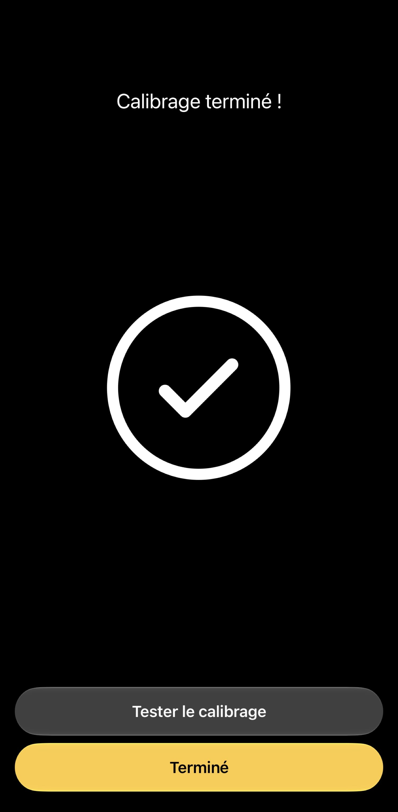
<figcaption>« Calibrage terminé ! », avec le bouton « Tester le calibrage ».</figcaption>
</figure>

### Utilisateurs, codes et empreintes

Tout est fini : toutes les empreintes, les codes, la création des utilisateurs, l’intégration dans Home Assistant via Matter, ça a été un jeu d’enfant. Pour les empreintes et l’ajout sur leur téléphone, tout le monde a joué le jeu, même le dernier de 3 ans s’est amusé. Un peu compliqué pour ajouter ses empreintes, mais on a réussi.

### Auto Unlock

Dans la page de la serrure « Serrure connecter cuisine », on trouve **Fonctions & Configuration**, le **Journal d’activité**, les **Services Nuki**, et les autorisations **Utilisateur**, **Keypad** et **Fob**. Dans « Vos actions », **Auto Unlock** s’affiche sur **Actif**. L’application indique : « Nuki déverrouille automatiquement votre porte lorsque vous rentrez chez vous. » On y voit aussi **Smart Notifications** et **Actions Glisser**.

<figure>
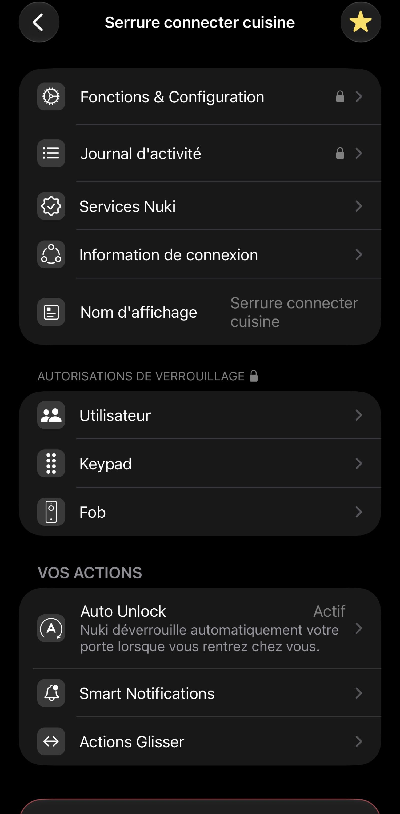
<figcaption>La page de la serrure « Serrure connecter cuisine » : Auto Unlock est actif.</figcaption>
</figure>

Dans l’écran Auto Unlock, la fonction est activée. L’option « Tenir compte des appareils à proximité » l’est aussi : « Déverrouiller cet appareil avec Auto Unlock l’annule pour les autres à proximité. Activez cette fonction sur tous les appareils. » « Retarder Auto Unlock » est réglé sur **Aucun délai**. On trouve également **État** et **Dépannage**.

En tête d’écran, l’application précise : « Grâce à la fonction de déverrouillage automatique, Nuki déverrouille d’elle-même votre porte quand vous approchez de votre appareil Nuki. » Plus bas, le schéma « Comment ça marche » illustre une clôture virtuelle (geofence) générique, sans adresse réelle. Le principe, d’après l’application : Nuki déverrouille la porte quand on revient, en s’appuyant sur une clôture virtuelle (geofence) et sur la localisation du smartphone.

<figure>
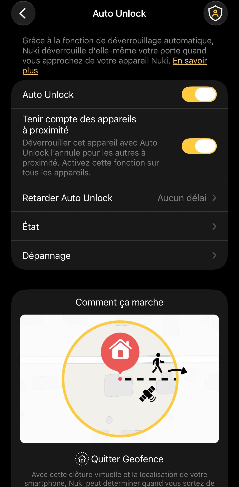
<figcaption>L’écran Auto Unlock, avec le schéma « Comment ça marche ».</figcaption>
</figure>

<aside class="ha-callout info">

<strong>À retenir.</strong> Je n’y prête même plus attention, c’est mon téléphone qui s’en charge.

</aside>

### Mode Nuit

Le mode Nuit est activé, de **23:00** à **06:00**. L’application indique : « En mode Nuit, Nuki verrouille votre porte automatiquement pendant la nuit. Pendant la période sélectionnée, l’appareil Nuki active son mode économie d’énergie et verrouille la porte à double tour (720°). »

<figure>
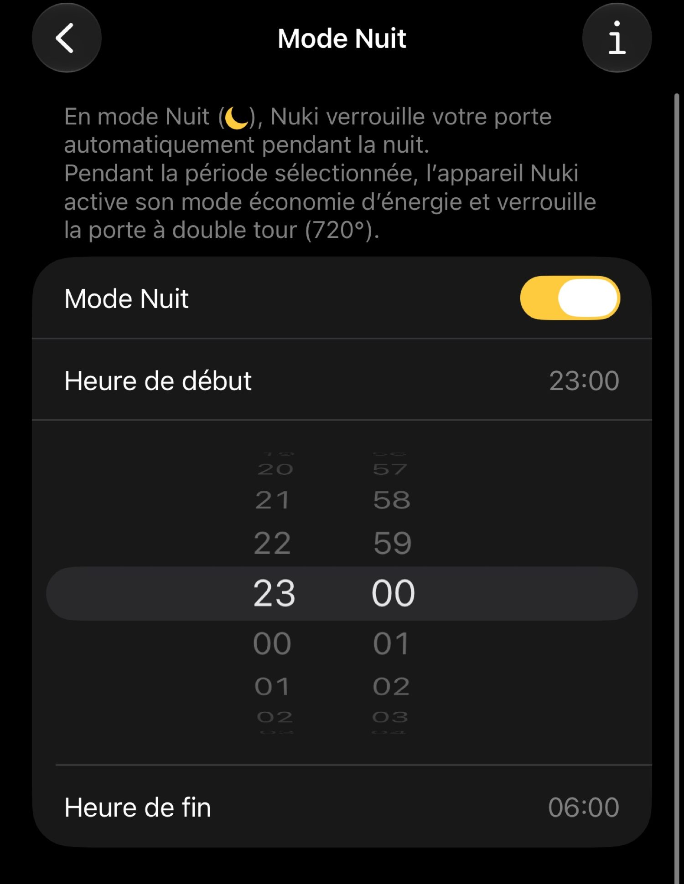
<figcaption>Le mode Nuit, activé de 23:00 à 06:00.</figcaption>
</figure>

Toutes les options sont activées : **Verrouiller à l’heure de début** (« Verrouille la porte automatiquement à l’heure de début. ») ; **Vitesse de verrouillage Gentle** (« La porte est verrouillée plus lentement en faisant moins de bruit. ») ; **Refuser Auto Unlock** (« Rejeter toutes les commandes Auto Unlock pendant le mode Nuit. ») ; **Activer l’Auto Lock** (« Verrouille la porte automatiquement après le déverrouillage. »).

En bas d’écran, « Créer une plage horaire » précise : « À la fin du mode Nuit, la porte ne se déverrouille pas automatiquement. Appuyez ici pour programmer une action automatique. »

<figure>
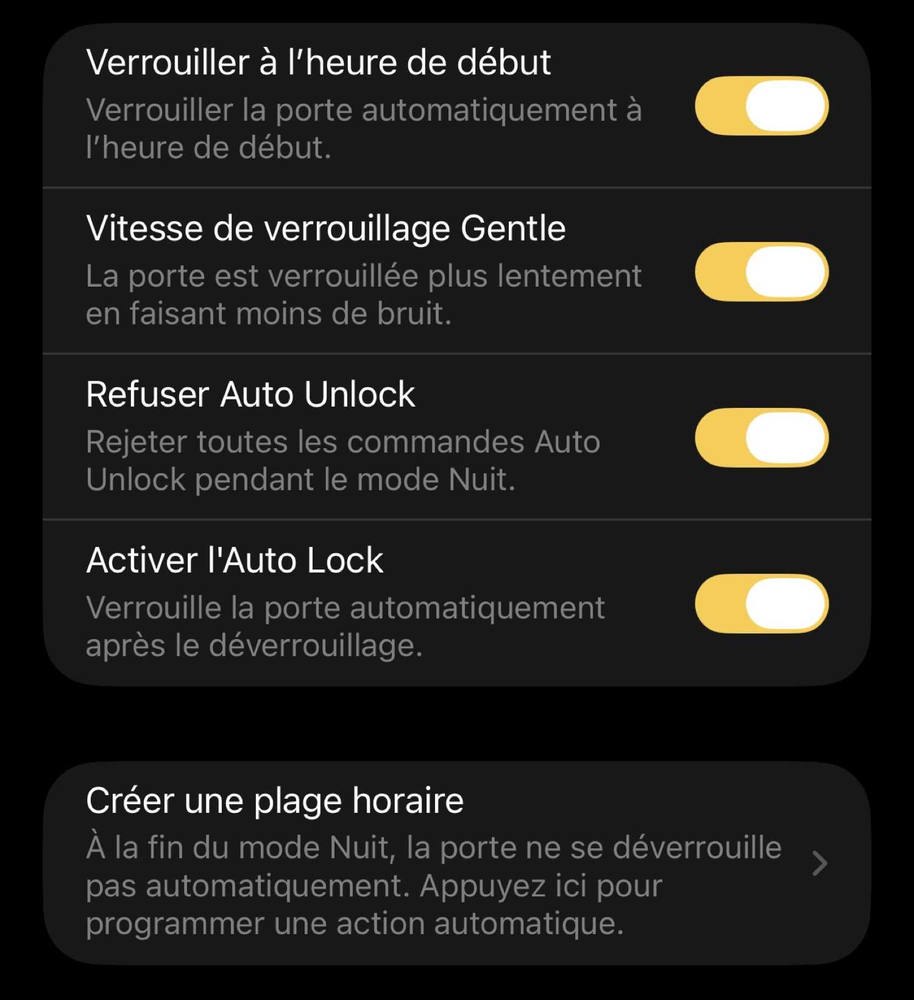
<figcaption>Les options du mode Nuit, toutes activées, et « Créer une plage horaire ».</figcaption>
</figure>

<aside class="ha-callout info">

<strong>À retenir.</strong> Assez silencieux : je n’y ai pas prêté attention pendant le test, j’ai dû refaire le test pour l’entendre.

</aside>

## Le Keypad 2 NFC blanc au quotidien

C’est l’accessoire que l’on voit depuis l’extérieur.

Dans l’application, le micrologiciel du Keypad 2 NFC s’affiche en **1.12.0**. Sur la capture, la mise à jour du firmware à la version 1.12.0 est en cours ; l’app indique que cela peut prendre jusqu’à deux minutes.

<figure>
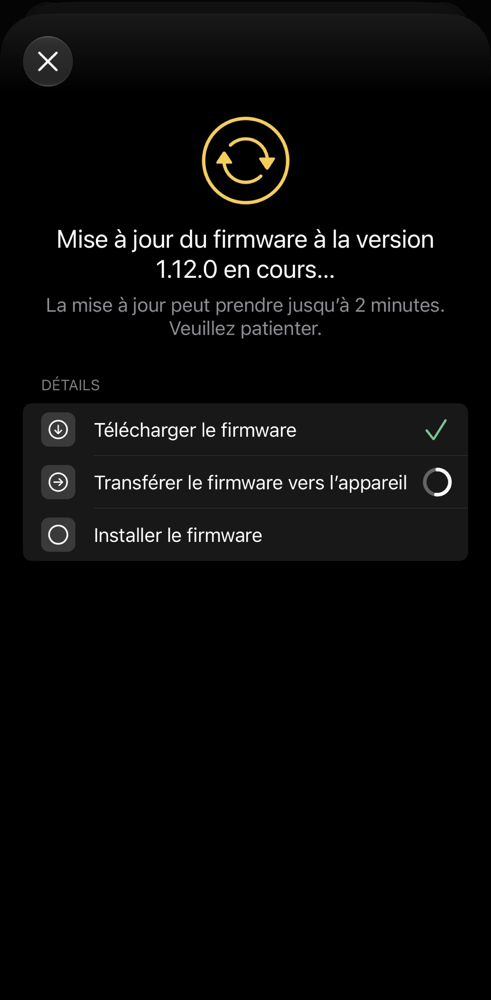
<figcaption>La mise à jour du firmware du Keypad à la version 1.12.0, en cours dans l’application.</figcaption>
</figure>

Je l’ai juste collé pour l’instant, mais le double face est très efficace, il colle très bien. L’appairage : il y a juste à suivre, comme pour la serrure. Déjà une semaine d’utilisation, rien à dire : confiance absolue dans le matériel.

<figure style="margin:0;">

<figcaption>Le Keypad 2 NFC blanc, allumé, posé sur la table.</figcaption>
</figure>
<figure style="margin:0;">

<figcaption>Le Keypad collé à l’extérieur, sur le dormant de la porte.</figcaption>
</figure>

J’ai enregistré toute la famille : 7 utilisateurs.

Pour ajouter une empreinte, l’application passe par la fiche de l’utilisateur, puis « Ajouter une empreinte digitale ». Il faut d’abord se connecter au Keypad en appuyant au moins cinq secondes sur la touche retour, jusqu’au clignotement des voyants. On pose et on lève ensuite le doigt plusieurs fois sur le capteur. L’application affiche « Empreinte digitale reconnue avec succès » ; on nomme l’empreinte, par exemple « pouce gauche », puis « Empreinte digitale ajoutée avec succès », avec la possibilité d’en ajouter une autre. Plusieurs empreintes peuvent être associées à un même utilisateur. La connexion au clavier et l’ajout de l’empreinte ont pris environ deux minutes.

<figure style="margin:0;">
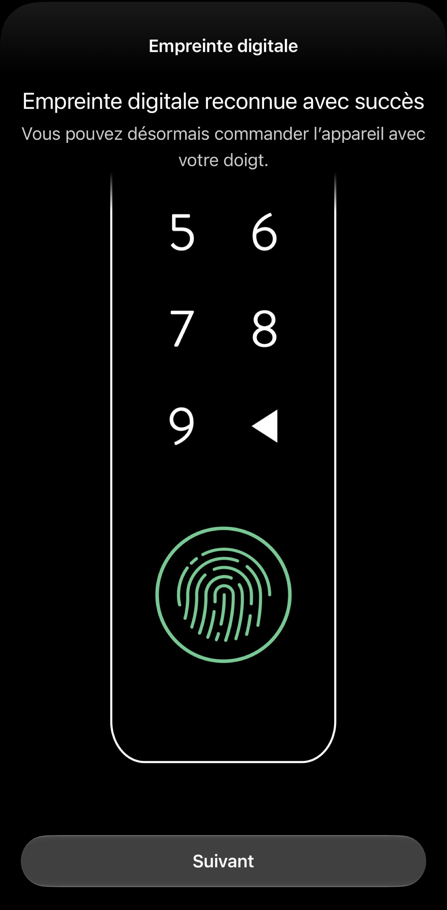
<figcaption>« Empreinte digitale reconnue avec succès. »</figcaption>
</figure>
<figure style="margin:0;">
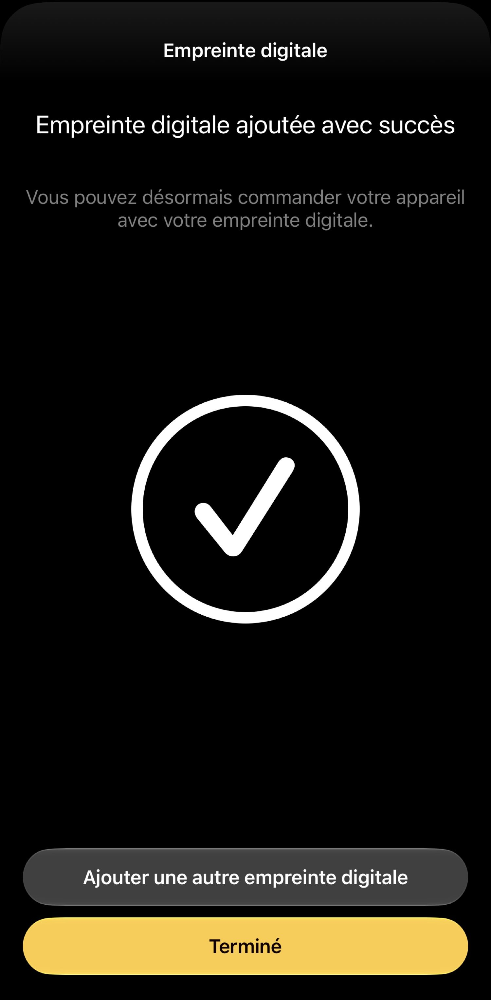
<figcaption>« Empreinte digitale ajoutée avec succès. »</figcaption>
</figure>

<figure style="margin:0;">
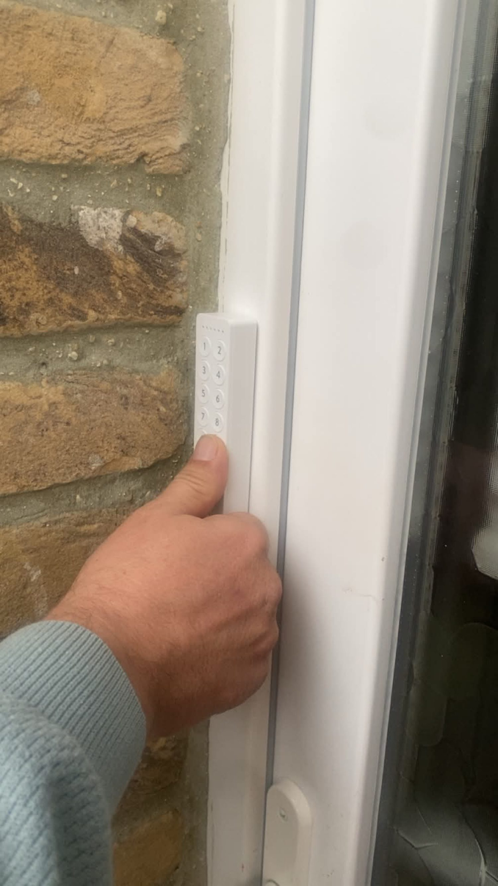
<figcaption>Pouce posé sur le capteur d’empreinte du clavier.</figcaption>
</figure>
<figure style="margin:0;">
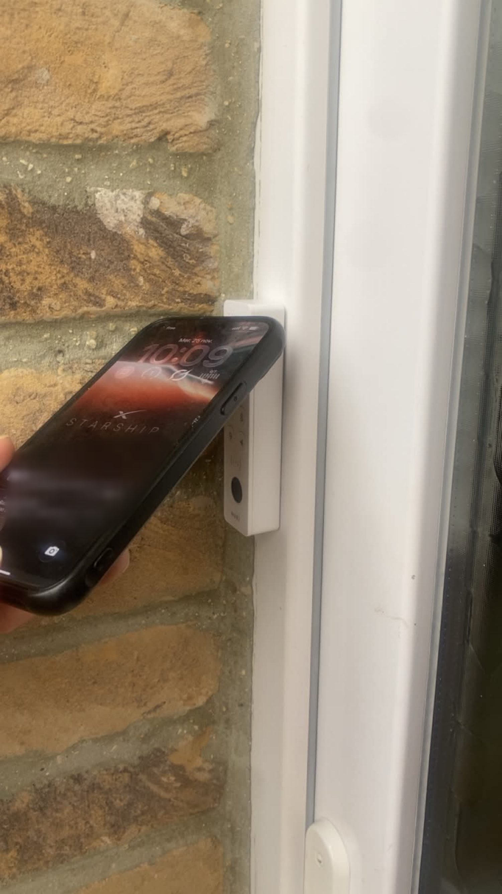
<figcaption>Essai Tap to Unlock : téléphone approché du clavier.</figcaption>
</figure>

Tap to Unlock : téléphone approché du clavier, la porte s’est bien déverrouillée.

<figure>
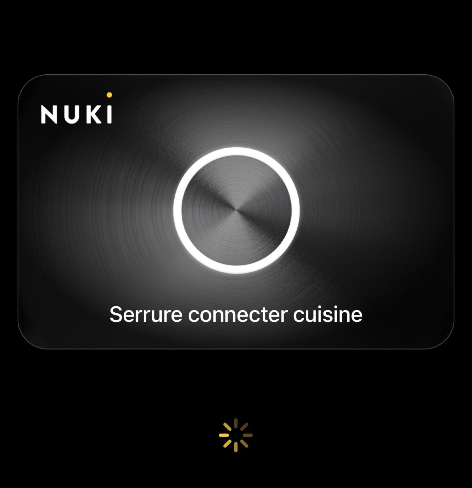
<figcaption>L’application Nuki pendant Tap to Unlock, sur la carte « Serrure connecter cuisine ».</figcaption>
</figure>

### La détection de vol

C’est l’un des points que je tiens à documenter clairement. D’après le [centre d’aide Nuki](https://help.nuki.io/hc/en-001/articles/360019158057-Keypad-Protection-against-unauthorized-access), dès que le Keypad 2 NFC est déplacé, l’événement apparaît dans le **journal d’activité**, et une **notification** peut arriver sur le téléphone si elle est activée. Une personne non autorisée ne peut alors ni ouvrir la porte avec le clavier, ni le réinitialiser, ni l’associer à un autre appareil Nuki. Après un déplacement, **une authentification unique par empreinte ou par code** réactive le clavier ; l’empreinte, le code et Tap to Unlock redeviennent ensuite disponibles.

Dans les paramètres du Keypad, le type d’appareil s’affiche en **Keypad 2 NFC**, la pile en « suffisamment chargée », et le firmware en **2.6.4**. La détection de vol est **active**. L’application indique : « Détecte lorsque le Keypad est déplacé et le désactive pour les utilisateurs non autorisés. »

<figure>
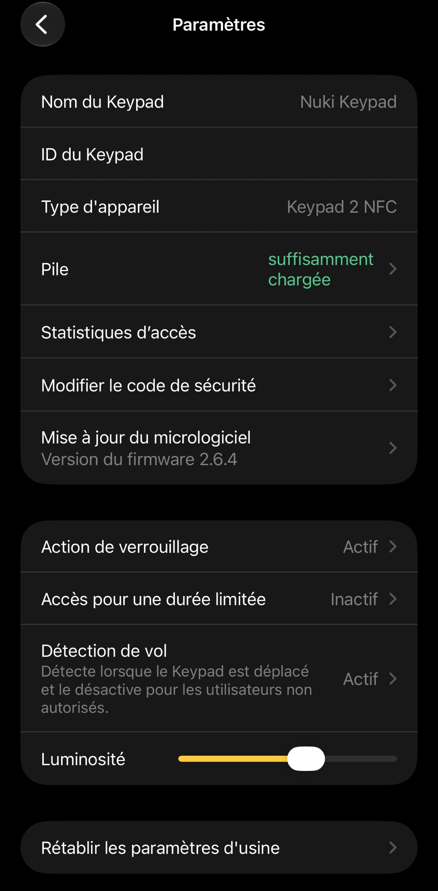
<figcaption>Les paramètres du Keypad : Keypad 2 NFC, pile suffisamment chargée, firmware 2.6.4, détection de vol active.</figcaption>
</figure>

Dans le journal d’activité, les options « Journal d’activité » et « Enregistrer l’état du capteur de porte » sont activées. Le journal enregistre, en rouge, « Nuki Keypad — Le Keypad déplacé ». On y voit aussi les alternances « Porte ouverte » et « Porte fermée » du capteur de porte, « Papa (Empreinte digitale) — Déverrouillé », et « Manuellement (bouton) — Verrouillé ».

<figure>
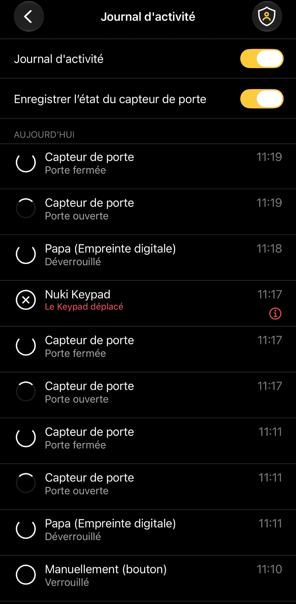
<figcaption>Le journal d’activité : « Le Keypad déplacé », en rouge, et les états du capteur de porte.</figcaption>
</figure>

<aside class="ha-callout info">

<strong>À retenir.</strong> Mon téléphone m’a bien envoyé l’alerte dans les 5 secondes. Pour le réactiver, j’ai mis mon pouce.

</aside>

<figure>
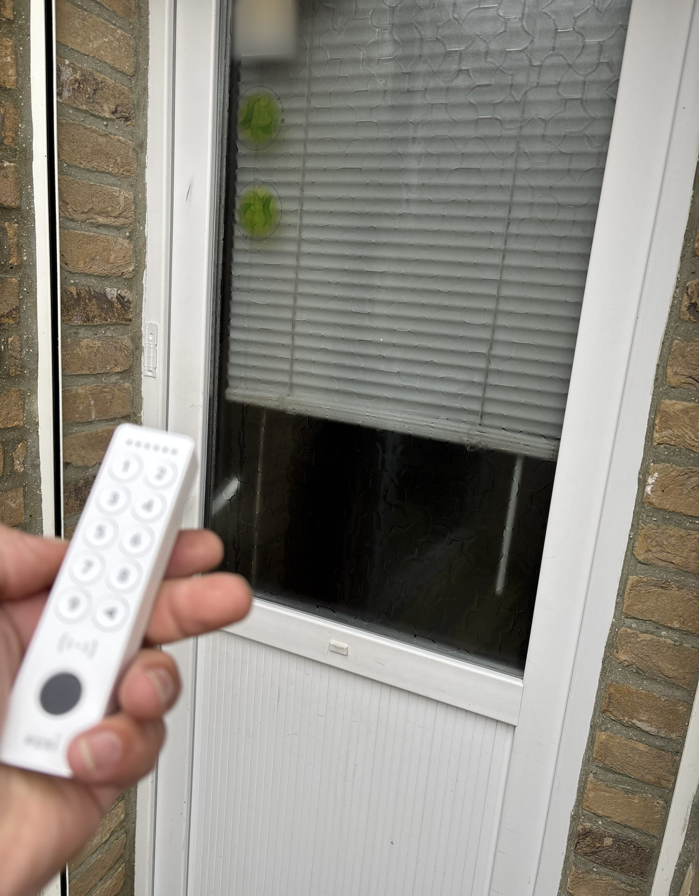
<figcaption>Le Keypad retiré de son support, tenu en main devant la porte d’entrée.</figcaption>
</figure>

## Le Door Sensor

L’idée, sur le papier, est simple et utile : savoir non seulement si la serrure est verrouillée, mais si la porte est bien close. Nuki ajoute une alerte si la porte reste ouverte plus longtemps que d’habitude, et une détection de sabotage.

<figure>

<figcaption>Le Door Sensor une fois sorti de sa boîte, avec sa notice, le capteur et l’aimant.</figcaption>
</figure>

Dans l’application, j’ajoute le Door Sensor (écran « Ajouter Door Sensor »). L’application indique aussi que l’on ne peut activer qu’un seul Door Sensor par Smart Lock.

<figure>
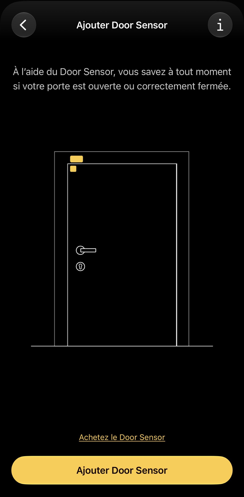
<figcaption>L’ajout du Door Sensor dans l’application.</figcaption>
</figure>

La mise à jour du micrologiciel vers la version **1.3.1** demande de maintenir le bouton appuyé pendant 10 secondes, puis de le relâcher dès que la lumière brille. Sur les captures, on voit le transfert à 0 %, puis à 42 %, puis le firmware du capteur de porte à jour.

<figure style="margin:0;">
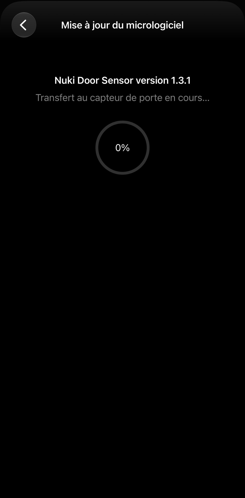
<figcaption>Mise à jour du micrologiciel, à 0 %.</figcaption>
</figure>
<figure style="margin:0;">
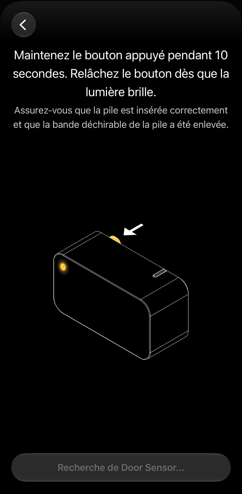
<figcaption>L’appui de 10 secondes sur le bouton, demandé par l’application.</figcaption>
</figure>
<figure style="margin:0;">
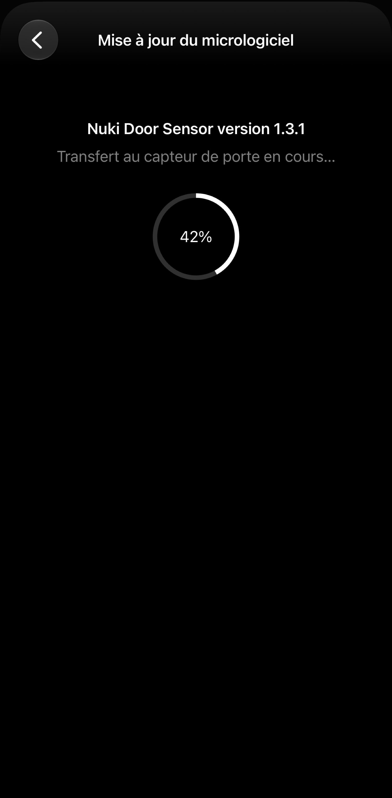
<figcaption>Le transfert en cours, à 42 %.</figcaption>
</figure>
<figure style="margin:0;">
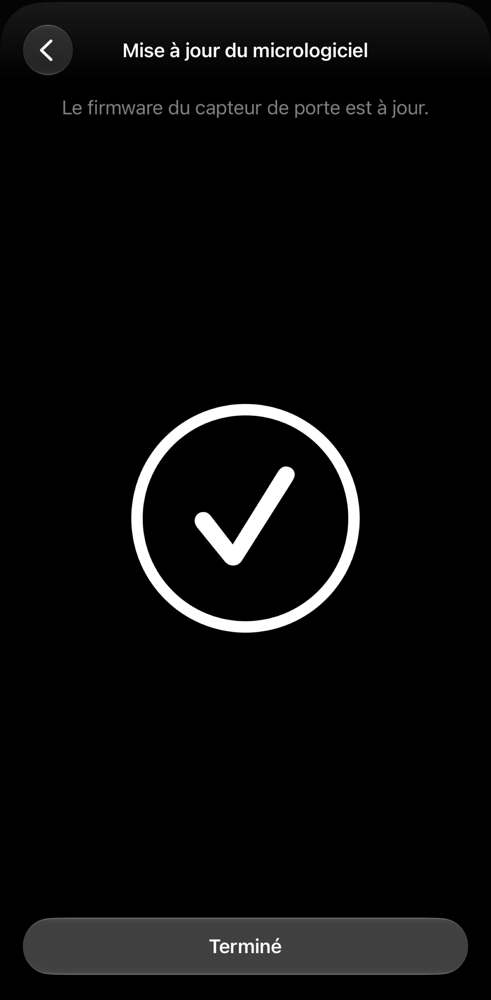
<figcaption>Le firmware du capteur de porte est à jour.</figcaption>
</figure>

L’application demande ensuite d’enlever l’opercule de protection du capteur. Elle affiche ensuite « Nuki Door Sensor connectée ! ».

<figure style="margin:0;">
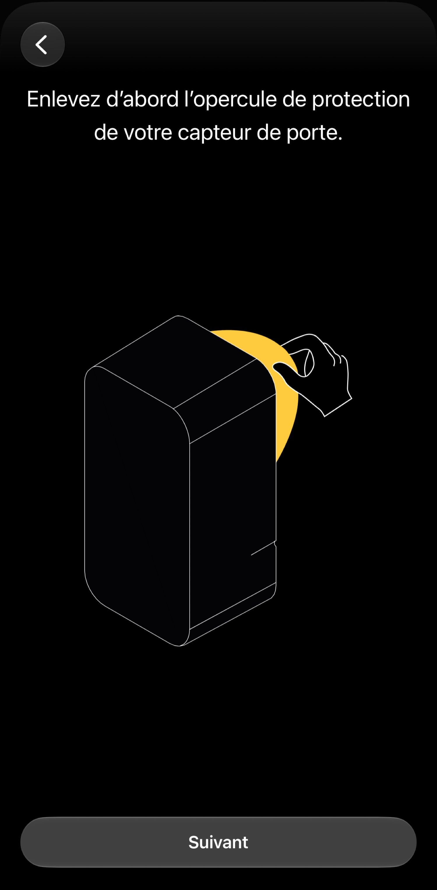
<figcaption>Le retrait de l’opercule de protection, demandé par l’application.</figcaption>
</figure>
<figure style="margin:0;">
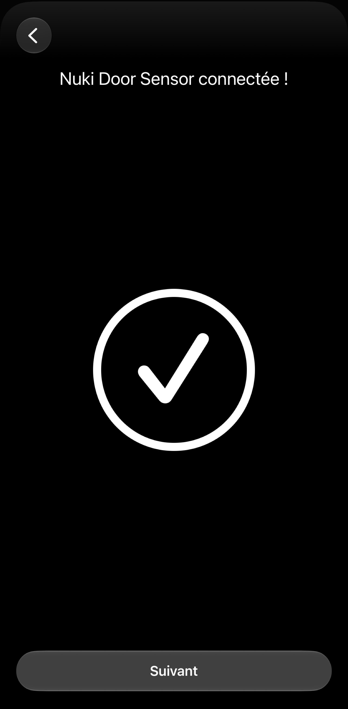
<figcaption>« Nuki Door Sensor connectée ! »</figcaption>
</figure>

Pour la pose, l’application indique de coller le Nuki Door Sensor sur l’encadrement et l’aimant sur la porte, en veillant à ce que le repère du capteur soit face à l’aimant, avec un écart de 0,5 à 3 cm.

<figure>
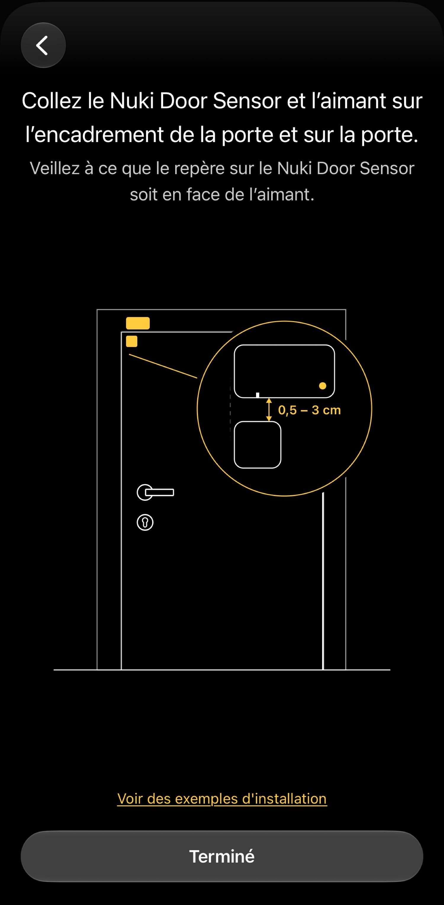
<figcaption>Les consignes de pose dans l’application : capteur sur le cadre, aimant sur l’ouvrant, repère face à l’aimant, 0,5 à 3 cm d’écart.</figcaption>
</figure>

Mon ressenti, comme pour la pose du keypad et de la poignée : d’une rapidité extraordinaire, en gros très simple, adapté à n’importe quel type d’utilisateur, du débutant au professionnel. Pour info, j’ai laissé mon fils de 15 ans le faire et il a réussi.

Le Door Sensor fonctionne très bien : il remonte l’ouverture et la fermeture, et si c’est mal fermé, j’ai une alerte au bout de 2 minutes.

L’application affiche la serrure déverrouillée, une fois avec « Porte fermée », une fois avec « Porte ouverte ».

<figure style="margin:0;">
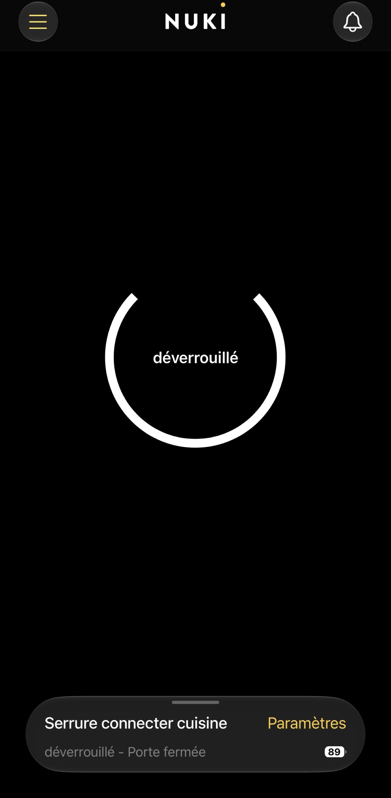
<figcaption>Déverrouillé, porte fermée.</figcaption>
</figure>
<figure style="margin:0;">
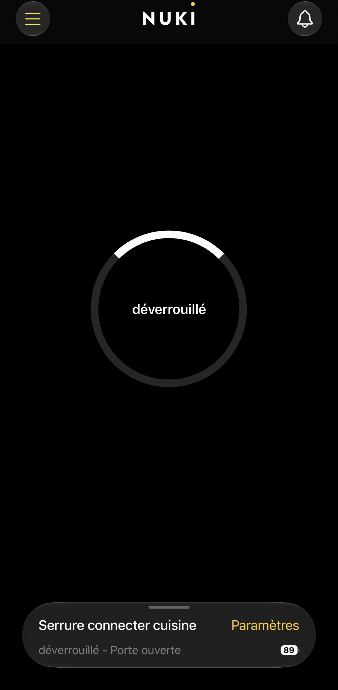
<figcaption>Déverrouillé, porte ouverte.</figcaption>
</figure>

Ces mêmes états « Porte ouverte » et « Porte fermée » apparaissent aussi dans le journal d’activité (voir la capture dans la section sur la détection de vol).

<figure>

<figcaption>La pose sur la fenêtre : le capteur et l’aimant en haut du cadre, et le bandeau en bas, près de la poignée.</figcaption>
</figure>

<figure style="margin:0;">
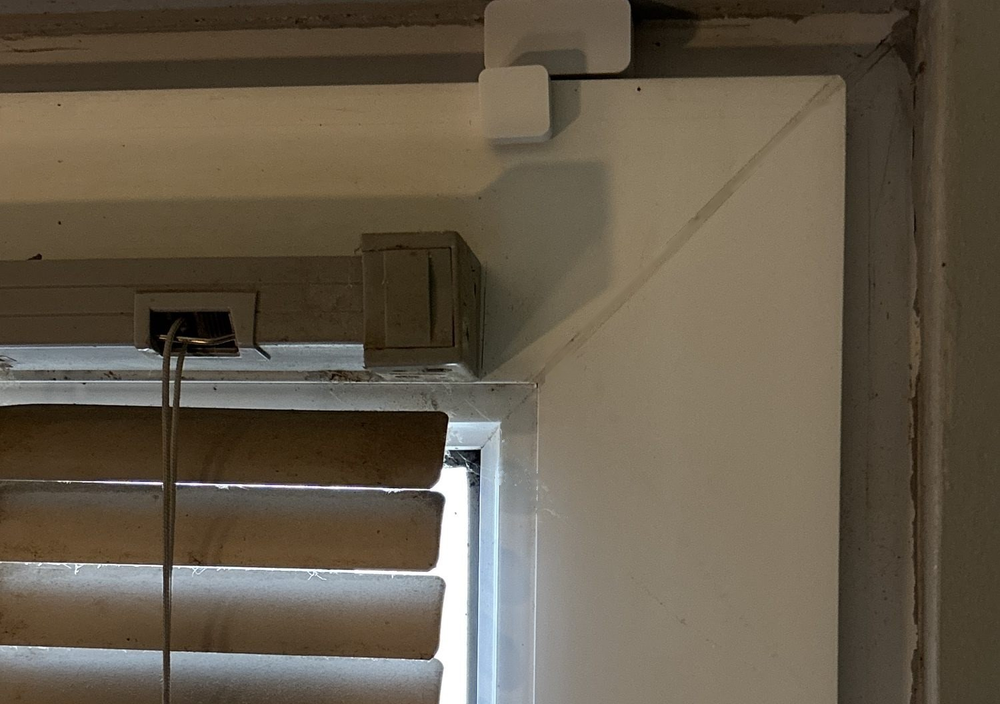
<figcaption>Le capteur sur le cadre et l’aimant sur l’ouvrant, en haut de la fenêtre.</figcaption>
</figure>
<figure style="margin:0;">
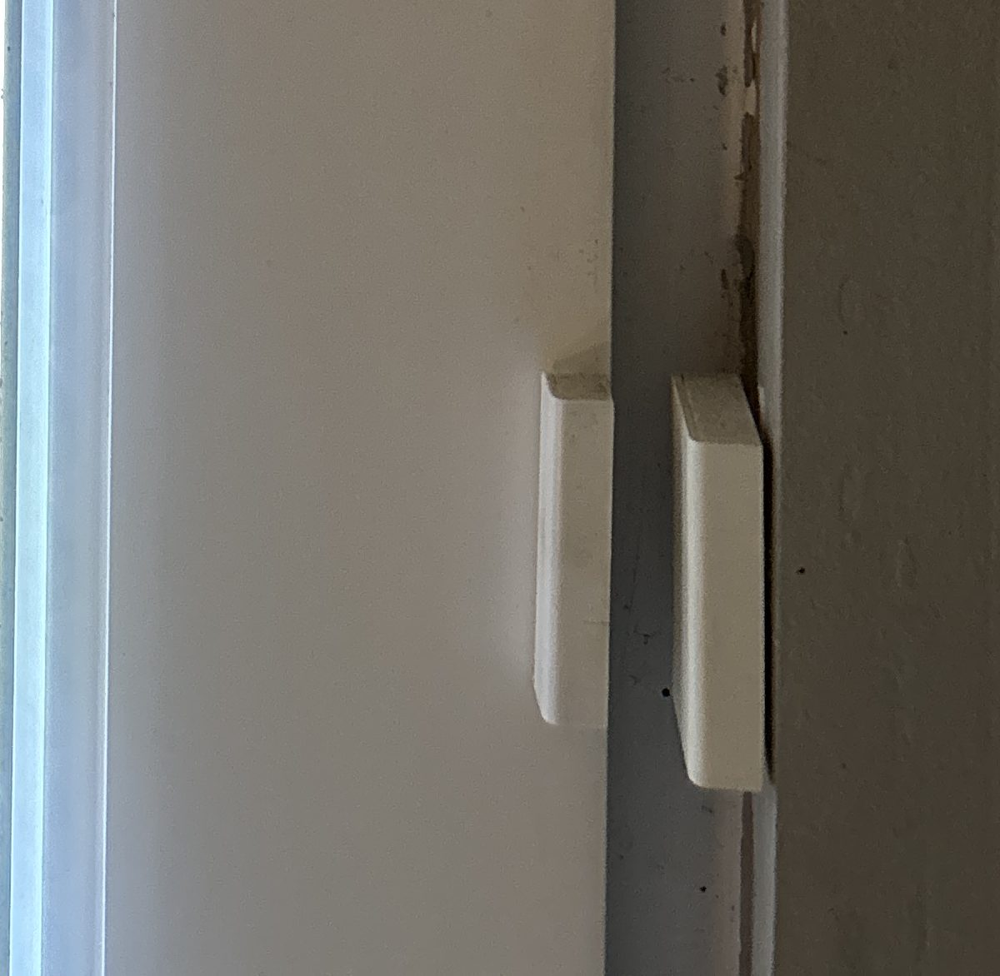
<figcaption>Le bandeau en bas, près de la poignée.</figcaption>
</figure>

Dans l’écran « Gérer le Nuki Door Sensor », le niveau de la batterie s’affiche sur **OK**, et la version du firmware sur **1.3.1**.

<figure>
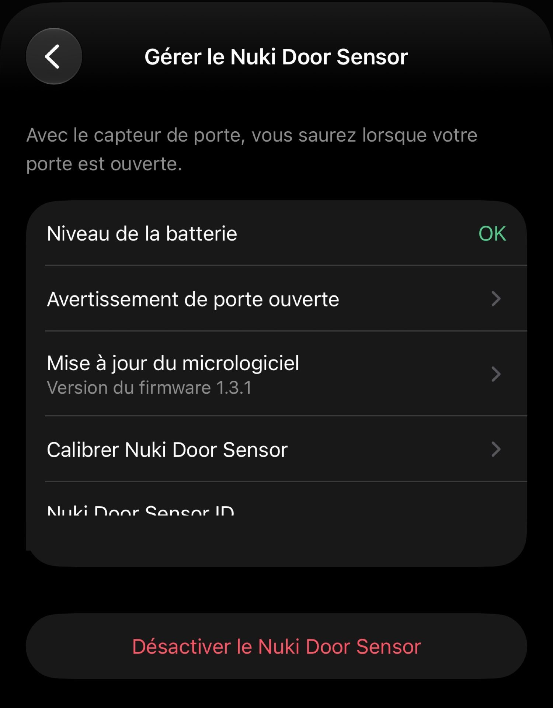
<figcaption>L’écran de gestion du Door Sensor : batterie OK, firmware 1.3.1.</figcaption>
</figure>

## Le Fob

Pour ceux qui n’ont pas de smartphone sous la main, ou qui préfèrent un simple bouton sur un porte-clés, le Fob est l’accessoire le plus évident. Nuki le présente aussi comme un bon recours pour un enfant, un proche, ou un prestataire dont on peut retirer l’accès à distance en cas de perte.

<figure>

<figcaption>Le Fob dans la main, bouton visible.</figcaption>
</figure>

Dans l’écran « Les actions du bouton Fob », l’application indique : « Définissez les actions du Fob ici. Votre appareil Nuki effectuera cette action lorsque vous appuierez sur le bouton du Fob. » Les actions sont réglées ainsi : **Pression simple** sur **Intelligent**, **Pression double** sur **Déverrouiller**, **Pression triple** sur **Verrouiller**. L’app précise : « Ces paramètres s’appliquent à tous les Fobs connectés. »

<figure>
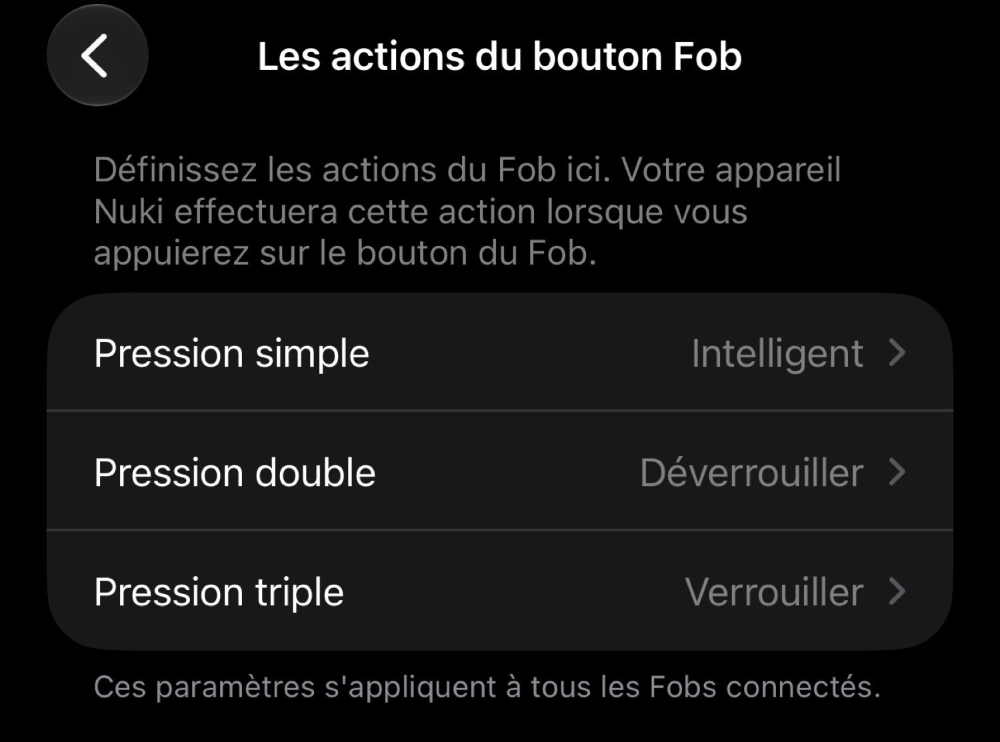
<figcaption>Les actions du bouton Fob : Intelligent, Déverrouiller, Verrouiller.</figcaption>
</figure>

La fiche « Nuki Fob maman » affiche les **Statistiques d’accès**, le **Verrouillage activé**, l’**Accès pour une durée limitée** sur **Inactif**, et les **Paramètres avancés de l’appareil**. Un bouton « Supprimer le Fob » permet de révoquer un Fob perdu.

<figure>
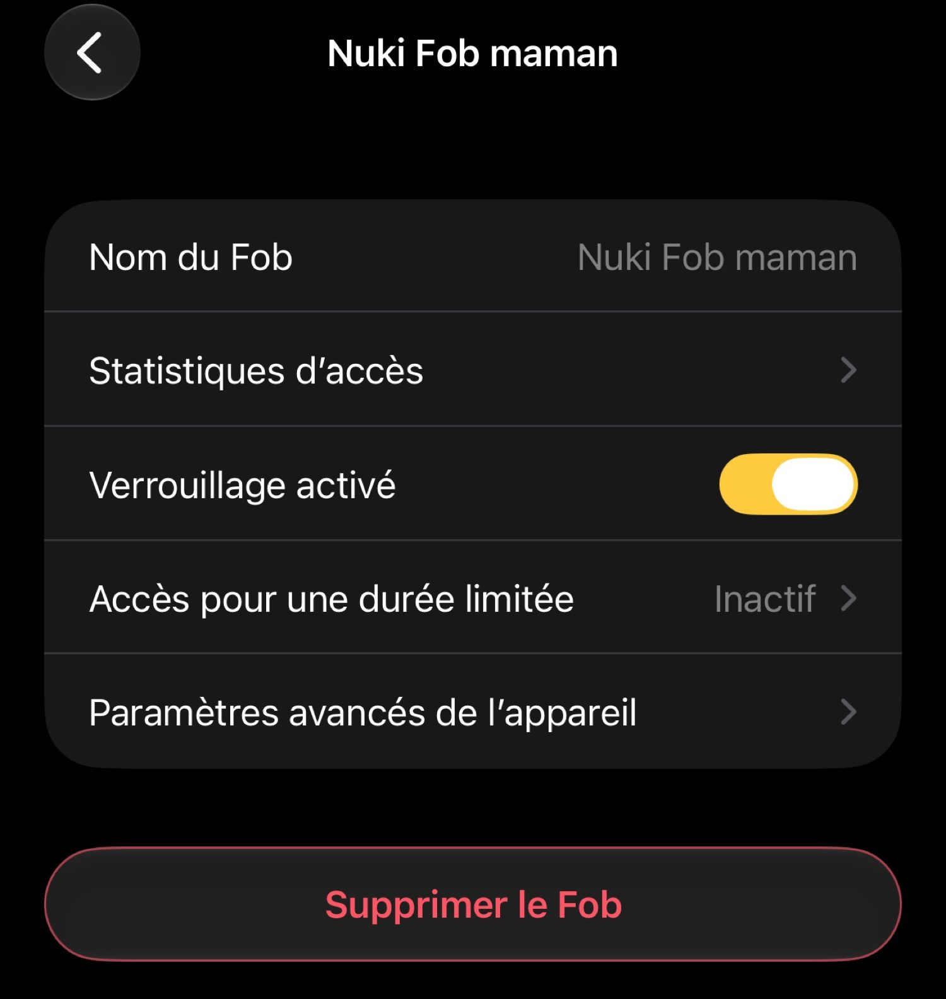
<figcaption>La fiche « Nuki Fob maman », avec le bouton « Supprimer le Fob ».</figcaption>
</figure>

<aside class="ha-callout info">

<strong>À retenir.</strong> À plus de 10 mètres, ça fonctionne.

</aside>

Je l’associe comme les autres appareils, en suivant les instructions. Dans l’écran « Gérer appareils », déjà montré plus haut, on trouve les catégories **Smart Lock**, **Opener**, **Smart Module** et **Accessoires**, ainsi que le lien **Appareils hérités**. C’est par **Accessoires** qu’on ajoute le Fob.

## La vie de tous les jours, une fois tout en place

C’est souvent là qu’une serrure connectée se juge vraiment, davantage que sur la fiche technique.

Auto Unlock est décrit plus haut : je n’y prête même plus attention, c’est mon téléphone qui s’en charge.

Le mode Nuit et le verrouillage Gentle sont décrits plus haut : assez silencieux, je n’y ai pas prêté attention pendant le test, j’ai dû refaire le test pour l’entendre.

## Cybersécurité et Cyber Resilience Act

Une serrure de porte d’entrée, ce n’est pas une ampoule connectée. Je veux donc poser clairement ce que Nuki avance, puis ce que je peux constater comme utilisateur, sans prétendre à un audit de sécurité.

Sur le papier, Nuki indique un **chiffrement de bout en bout**, des mises à jour de sécurité, et des certifications indépendantes : la fiche de la Pro rappelle un certificat AV-TEST « Secure Smart Home Product » en 2025. L’entreprise affirme aussi qu’**aucun compte n’est obligatoire** pour se servir des appareils (à l’exception de la Nuki Box, que je n’utilise pas ici), et que les données personnelles restent sur les téléphones et les appareils. **Nuki Web**, le service en nuage, est présenté comme **facultatif**. Le centre d’aide Nuki précise que le serveur Nuki Web se trouve **en Allemagne**.

Du côté réglementaire, le **Cyber Resilience Act** européen rend la cybersécurité obligatoire pour les produits connectés vendus dans l’UE, avec une application complète au **11 décembre 2027**. Dans un communiqué du 8 septembre 2026, Nuki présente cette règle comme la suite logique de sa démarche « security-by-design », déjà en place selon elle depuis les premières générations, plutôt que comme une course de dernière minute. Ce sont les mots de Nuki, pas encore mon retour d’usage.

Sans compte : j’ai juste installé l’application, tout se fait de là.

## Premier bilan

Je peux laisser Nuki gérer la maison en toute sécurité. On sent le professionnalisme de Nuki, aussi bien dans le développement de l’application que dans les appareils. Ils se sont vraiment concentrés sur le point d’accès global, en réunissant le Keypad, le détecteur d’ouverture et le cylindre connecté.

Ils ont aussi pensé au barillet débrayable, à une installation classique européenne, aux serrures à crémone autoverrouillantes, et aussi aux adaptations.

J’ai adoré l’installer.

Le volet 2 (Home Assistant) et un bilan après plusieurs semaines suivront.

— XAV59213

