
<a href="https://forumdomotique.com/tests/accessoires/test-segway-navimow-i108e-avis-tondeuse-robot-sans-fil/">Lire et commenter sur Forum Domotique</a>



<section class="carousel photo-carousel" data-carousel data-lightbox aria-roledescription="carrousel" aria-label="Photos de l’article (16)" tabindex="0">

<figure class="photo-slide" data-slide>
  <a href="images/JcKvBabX.jpeg" data-full="images/JcKvBabX.jpeg" data-alt="Photo 1 — Test Segway Navimow i108E : un mois avec la tondeuse robot sans câble périmétrique" aria-label="Agrandir la photo 1 : Photo 1 — Test Segway Navimow i108E : un mois avec la tondeuse robot sans câble périmétrique">
    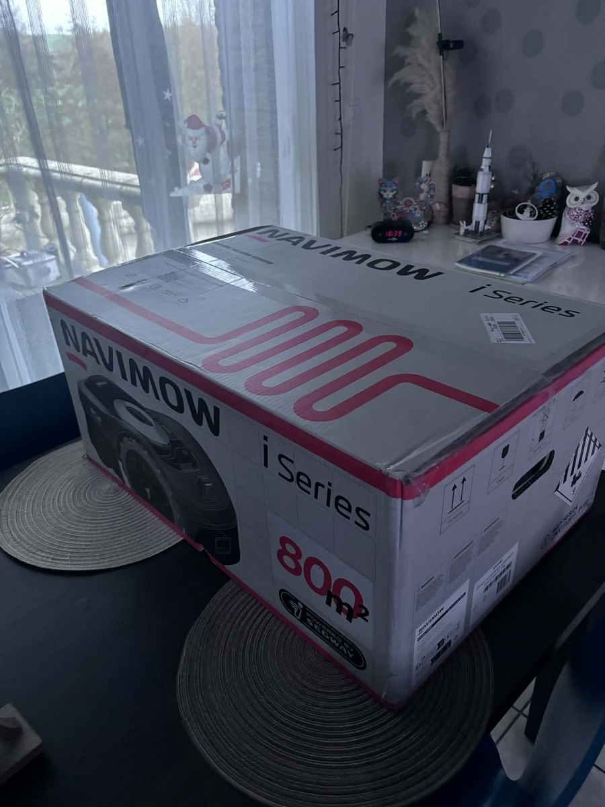
  </a>
</figure>
<figure class="photo-slide" data-slide>
  <a href="images/lLQN1Drx.jpeg" data-full="images/lLQN1Drx.jpeg" data-alt="Photo 2 — Test Segway Navimow i108E : un mois avec la tondeuse robot sans câble périmétrique" aria-label="Agrandir la photo 2 : Photo 2 — Test Segway Navimow i108E : un mois avec la tondeuse robot sans câble périmétrique">
    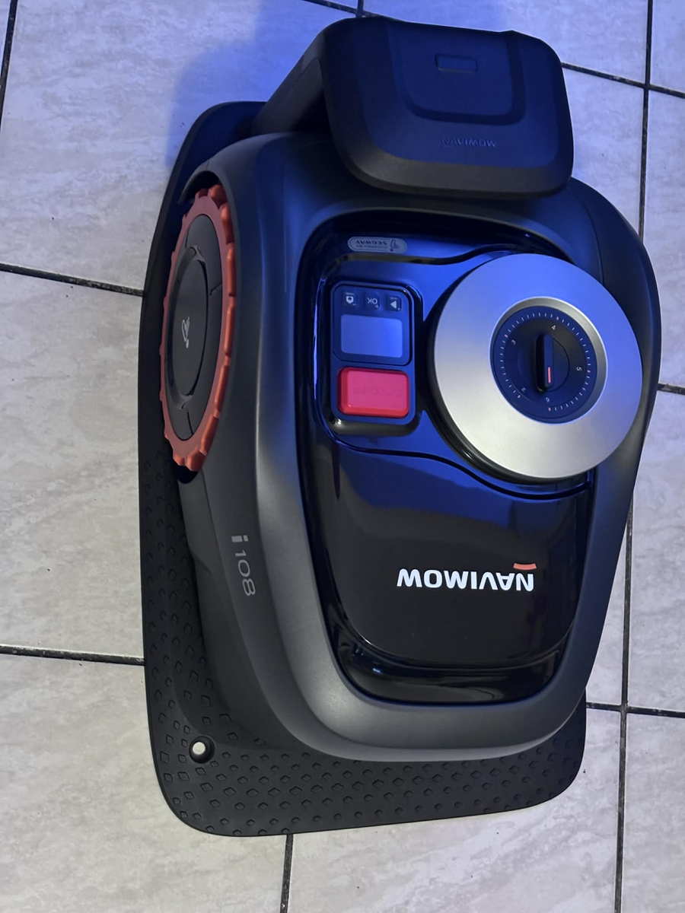
  </a>
</figure>
<figure class="photo-slide" data-slide>
  <a href="images/mxHefEXr.jpeg" data-full="images/mxHefEXr.jpeg" data-alt="Photo 3 — Test Segway Navimow i108E : un mois avec la tondeuse robot sans câble périmétrique" aria-label="Agrandir la photo 3 : Photo 3 — Test Segway Navimow i108E : un mois avec la tondeuse robot sans câble périmétrique">
    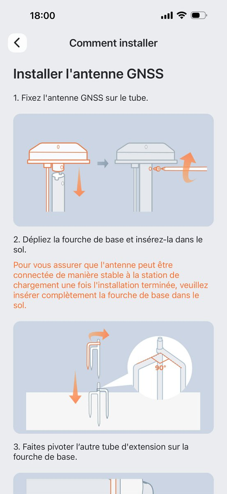
  </a>
</figure>
<figure class="photo-slide" data-slide>
  <a href="images/zQXISwvA.jpeg" data-full="images/zQXISwvA.jpeg" data-alt="Photo 4 — Test Segway Navimow i108E : un mois avec la tondeuse robot sans câble périmétrique" aria-label="Agrandir la photo 4 : Photo 4 — Test Segway Navimow i108E : un mois avec la tondeuse robot sans câble périmétrique">
    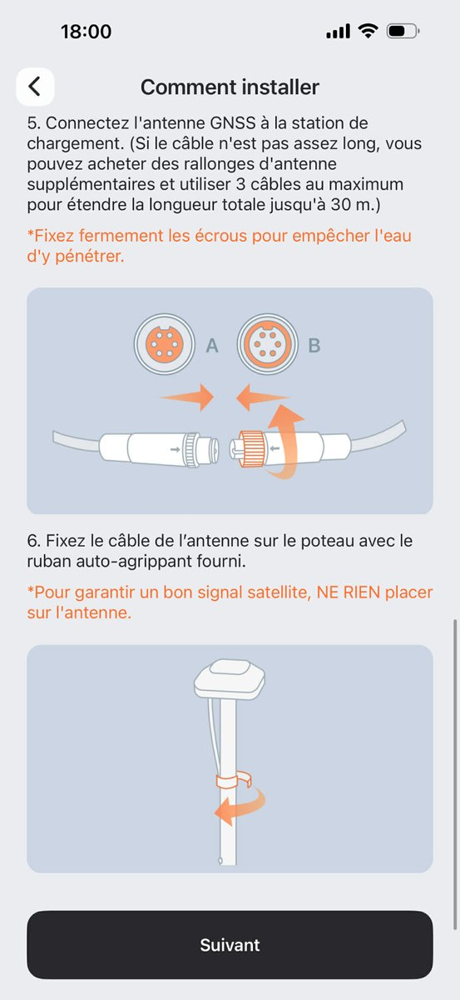
  </a>
</figure>
<figure class="photo-slide" data-slide>
  <a href="images/qOCWB7l4.jpeg" data-full="images/qOCWB7l4.jpeg" data-alt="Photo 5 — Test Segway Navimow i108E : un mois avec la tondeuse robot sans câble périmétrique" aria-label="Agrandir la photo 5 : Photo 5 — Test Segway Navimow i108E : un mois avec la tondeuse robot sans câble périmétrique">
    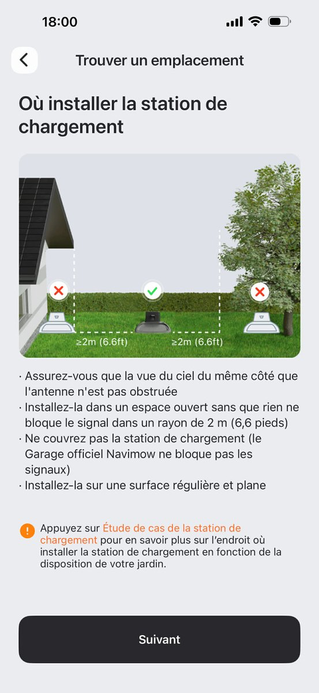
  </a>
</figure>
<figure class="photo-slide" data-slide>
  <a href="images/VfCFQ2kG.jpeg" data-full="images/VfCFQ2kG.jpeg" data-alt="Photo 6 — Test Segway Navimow i108E : un mois avec la tondeuse robot sans câble périmétrique" aria-label="Agrandir la photo 6 : Photo 6 — Test Segway Navimow i108E : un mois avec la tondeuse robot sans câble périmétrique">
    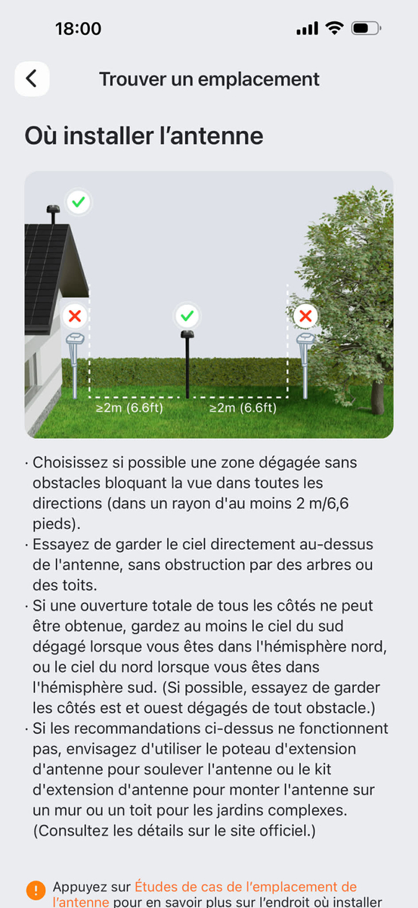
  </a>
</figure>
<figure class="photo-slide" data-slide>
  <a href="images/9HwVGtZ8.jpeg" data-full="images/9HwVGtZ8.jpeg" data-alt="Photo 7 — Test Segway Navimow i108E : un mois avec la tondeuse robot sans câble périmétrique" aria-label="Agrandir la photo 7 : Photo 7 — Test Segway Navimow i108E : un mois avec la tondeuse robot sans câble périmétrique">
    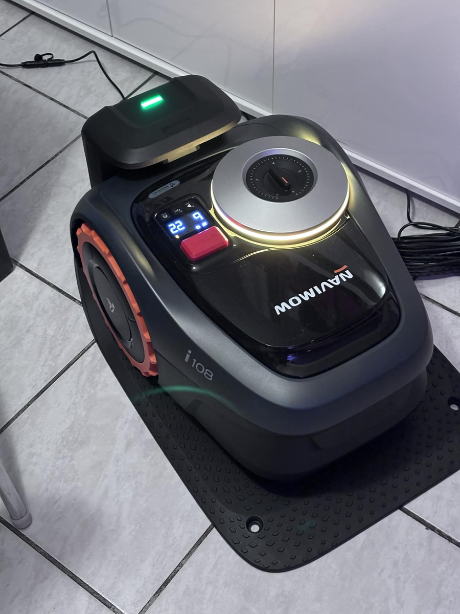
  </a>
</figure>
<figure class="photo-slide" data-slide>
  <a href="images/jDkqkpX8.jpeg" data-full="images/jDkqkpX8.jpeg" data-alt="Photo 8 — Test Segway Navimow i108E : un mois avec la tondeuse robot sans câble périmétrique" aria-label="Agrandir la photo 8 : Photo 8 — Test Segway Navimow i108E : un mois avec la tondeuse robot sans câble périmétrique">
    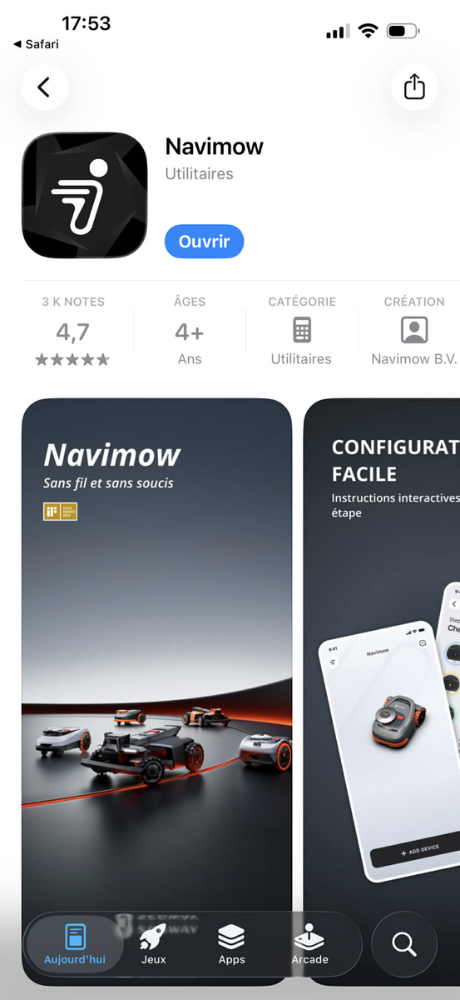
  </a>
</figure>
<figure class="photo-slide" data-slide>
  
</figure>
<figure class="photo-slide" data-slide>
  <a href="images/8y0FMr9X.jpeg" data-full="images/8y0FMr9X.jpeg" data-alt="Photo 10 — Test Segway Navimow i108E : un mois avec la tondeuse robot sans câble périmétrique" aria-label="Agrandir la photo 10 : Photo 10 — Test Segway Navimow i108E : un mois avec la tondeuse robot sans câble périmétrique">
    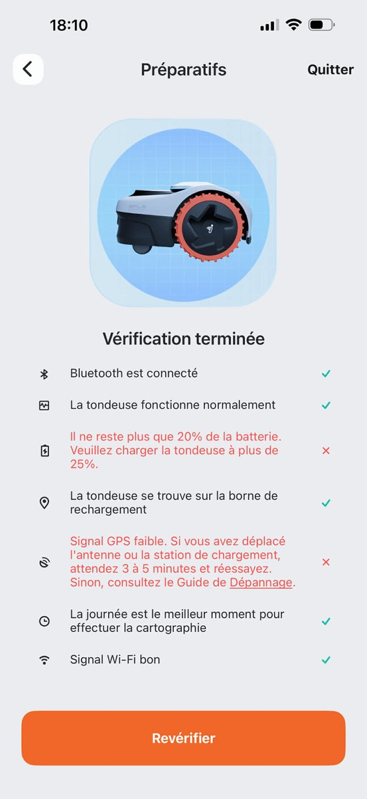
  </a>
</figure>
<figure class="photo-slide" data-slide>
  <a href="images/PfnyhO2e.jpeg" data-full="images/PfnyhO2e.jpeg" data-alt="Photo 11 — Test Segway Navimow i108E : un mois avec la tondeuse robot sans câble périmétrique" aria-label="Agrandir la photo 11 : Photo 11 — Test Segway Navimow i108E : un mois avec la tondeuse robot sans câble périmétrique">
    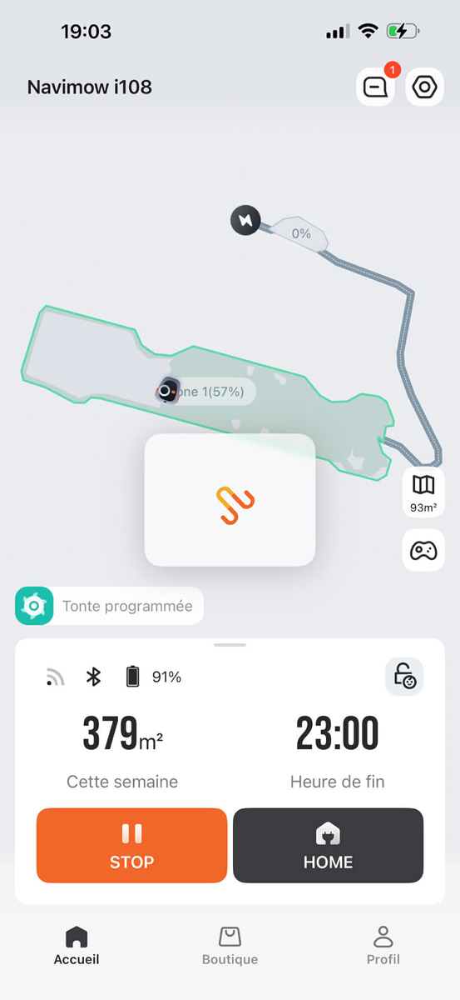
  </a>
</figure>
<figure class="photo-slide" data-slide>
  <a href="images/oqUIjLzg.jpeg" data-full="images/oqUIjLzg.jpeg" data-alt="Photo 12 — Test Segway Navimow i108E : un mois avec la tondeuse robot sans câble périmétrique" aria-label="Agrandir la photo 12 : Photo 12 — Test Segway Navimow i108E : un mois avec la tondeuse robot sans câble périmétrique">
    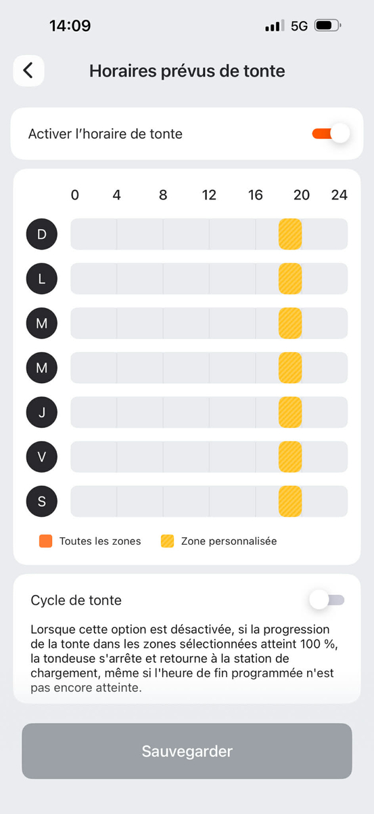
  </a>
</figure>
<figure class="photo-slide" data-slide>
  <a href="images/IMG_6751.jpeg" data-full="images/IMG_6751.jpeg" data-alt="Photo 13 — Test Segway Navimow i108E : un mois avec la tondeuse robot sans câble périmétrique" aria-label="Agrandir la photo 13 : Photo 13 — Test Segway Navimow i108E : un mois avec la tondeuse robot sans câble périmétrique">
    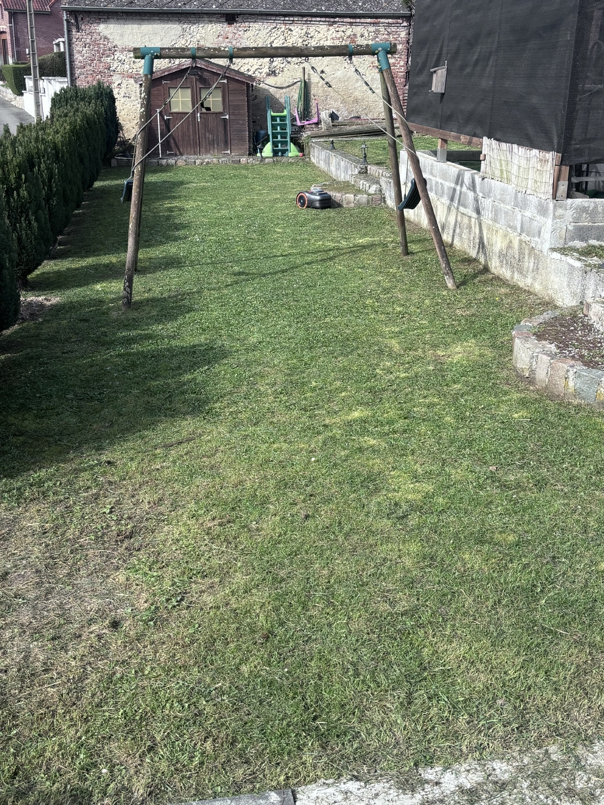
  </a>
</figure>
<figure class="photo-slide" data-slide>
  <a href="images/IMG_6753.jpeg" data-full="images/IMG_6753.jpeg" data-alt="Photo 14 — Test Segway Navimow i108E : un mois avec la tondeuse robot sans câble périmétrique" aria-label="Agrandir la photo 14 : Photo 14 — Test Segway Navimow i108E : un mois avec la tondeuse robot sans câble périmétrique">
    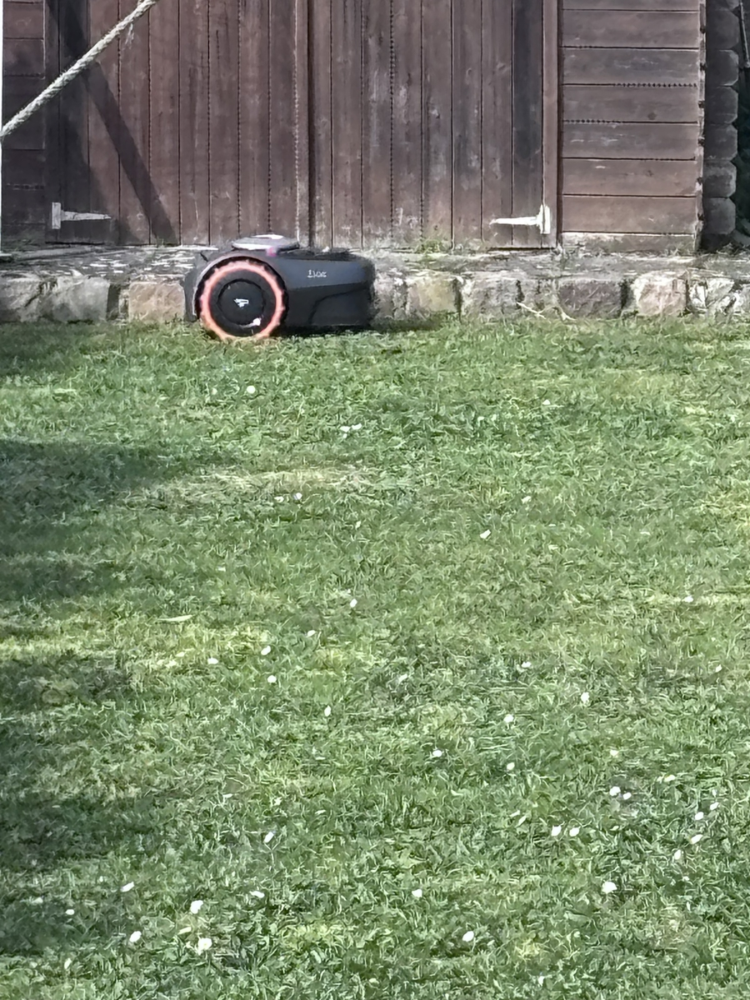
  </a>
</figure>
<figure class="photo-slide" data-slide>
  <a href="images/IMG_6749.jpeg" data-full="images/IMG_6749.jpeg" data-alt="Photo 15 — Test Segway Navimow i108E : un mois avec la tondeuse robot sans câble périmétrique" aria-label="Agrandir la photo 15 : Photo 15 — Test Segway Navimow i108E : un mois avec la tondeuse robot sans câble périmétrique">
    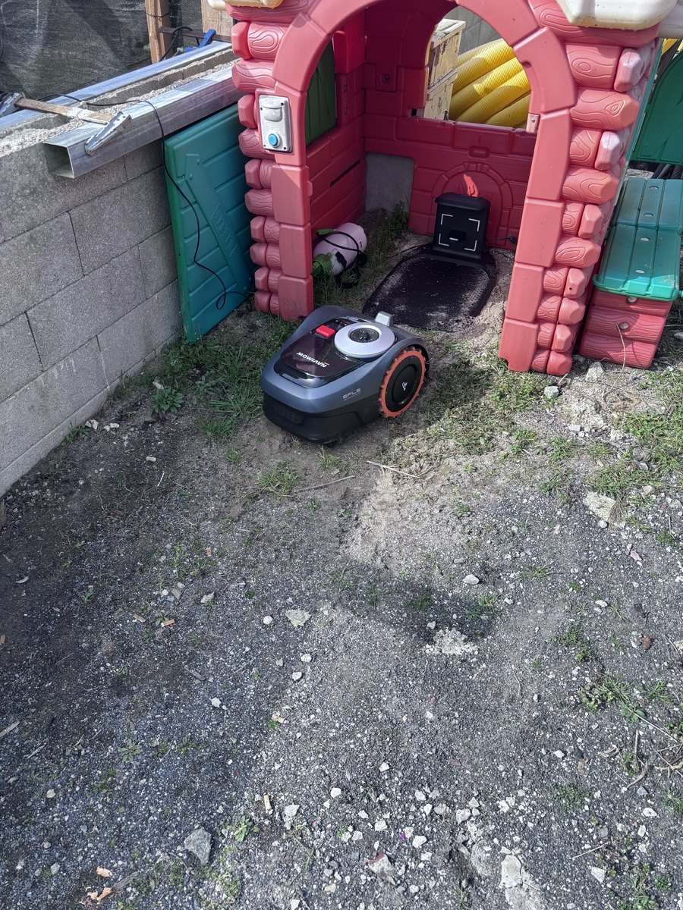
  </a>
</figure>
<figure class="photo-slide" data-slide>
  
</figure>

<button type="button" class="carousel-nav" data-prev aria-label="Photo précédente">‹</button>
<button type="button" class="carousel-nav" data-next aria-label="Photo suivante">›</button>

Faites défiler les photos, ou ouvrez-les pour les agrandir (si JavaScript est activé).

</section>

# Test Segway Navimow i108E : un mois avec la tondeuse robot sans câble périmétrique

- **Type :** Test
- **Catégorie :** Tests produits domotique & maison connectée > Accessoires
- **Lien :** https://forumdomotique.com/tests/accessoires/test-segway-navimow-i108e-avis-tondeuse-robot-sans-fil/
- **Date de publication :** 29 mars 2026 à 10:48 (Europe/Paris)
- **Auteur :** XAV59213

---

La tondeuse robot sans fil périmétrique est l'une des évolutions les plus intéressantes de ces dernières années pour qui veut automatiser l'entretien du jardin. Fini le câble enterré qu'il faut reposer tous les ans parce qu'une taupe, un coup de bêche ou un simple gel hivernal l'a endommagé. Fini la cartographie par tâtonnement sur des semaines. La promesse du sans-fil est simple : on pose, on cartographie via l'application, et on laisse travailler.

Après avoir remporté ce robot via un concours, j'avais envie de voir ce que donnait concrètement le **Segway Navimow i108E** sur un terrain réel, sur la durée, et surtout si l'intégration domotique tenait la route pour ceux qui utilisent Home Assistant au quotidien. Verdict après un mois d'utilisation sur mon jardin de 750 m² avec quelques arbres, un massif de fleurs et une petite terrasse qui sépare la pelouse en deux parties.

### 🔗 Envie d'acheter ce produit ?

Vous pouvez soutenir le forum en passant par nos liens affiliés 👇  
**Cela ne vous coûte jamais plus cher !**  
*Le prix reste exactement le même pour vous, mais nous recevons une petite commission qui aide à faire vivre la communauté 💜*

[
<!-- source : https://forumdomotique.com/uploads/pages_media/logo_amazon.png -->
Acheter sur Amazon](https://amzn.to/4clOg6z)

### Déballage et qualité de fabrication

Première impression en ouvrant le carton, c'est du sérieux. Le robot est bien calé, les accessoires rangés proprement, chaque pièce protégée individuellement. On trouve dans la boîte la tondeuse, la station de recharge, son câble d'alimentation, les piquets de fixation au sol, l'antenne GNSS avec son propre piquet et son câble de 10 mètres, les bandes velcro pour fixer le câble, des lames de rechange, l'outil Allen et deux guides rapides multilingues.

Le robot lui-même affiche des dimensions raisonnables pour ce type d'appareil, **545 × 385 × 285 mm pour 11 kg**. Le design reste sobre, gris mat dans l'ensemble avec des roues crantées oranges qui annoncent d'emblée la couleur. On sent que le constructeur a pensé à l'usage réel.

Sur le dessus, une grande roue numérotée fait office de réglage manuel de la hauteur de coupe, de **20 à 60 mm**. C'est un réglage qu'on touche rarement en vrai, l'absence d'automatisation n'est donc pas un vrai manque. Autour de cette molette, un bandeau lumineux change de couleur selon l'état du robot : en charge, en tonte, en erreur. Pratique pour un diagnostic rapide d'un coup d'œil depuis la terrasse.

À côté, le gros bouton STOP rouge obligatoire sur ce type d'appareil, et juste en dessous un petit écran avec trois boutons de navigation pour les réglages en local. En pratique, une fois l'application installée, on ne s'en sert quasiment jamais.

À l'avant, la caméra protégée par une vitre est bien visible. Son champ de vision de **140°** est utilisé à la fois pour la cartographie assistée et pour la détection d'obstacles en temps réel pendant les cycles de tonte. Petit détail que j'apprécie, une poignée de transport est intégrée et dissimulée derrière la carrosserie avant. Utile quand il faut déplacer le robot pour un entretien ou en fin de saison.

En dessous, le plateau de coupe fait **18 cm** avec trois lames qui se changent en deux minutes avec les vis fournies.

### Roues crantées et franchissement : le bon choix technique

C'est le genre de détail qu'on ne voit pas sur une fiche produit mais qui change tout à l'usage. Segway a équipé le Navimow i108E de grandes roues crantées de **24 cm à l'avant** et de deux petites roues pivotantes à l'arrière. C'est l'inverse de la plupart des tondeuses robots du marché, qui collent les petites roues à l'avant.

Cette configuration paraît anodine mais elle change vraiment les choses sur un terrain qui n'est pas parfaitement lisse. Une taupinière, un léger creux creusé par un chien, une racine qui affleure, et les robots à petites roues avant finissent bloqués. Ici, les grandes roues crantées passent sans broncher, et les petites roues arrière servent uniquement à la manœuvre. Segway annonce une capacité de franchissement de pente jusqu'à **45 %**, et dans mon cas les quelques dénivelés du terrain n'ont jamais posé de problème.

### Installation : plus simple que prévu grâce à l'EFLS 2.0

L'installation est le moment que j'appréhendais le plus, parce que le positionnement de l'antenne GNSS conditionne toute la qualité du signal RTK sur lequel repose la navigation sans câble périmétrique. J'avais lu pas mal de retours à ce sujet avant de commencer.

Le principe du système **EFLS 2.0** (Exact Fusion Localization System) est simple à expliquer. Plutôt qu'un câble enterré à la périphérie du terrain, le robot se localise via une antenne GNSS déportée qui reçoit les signaux satellites, combinés à des corrections RTK pour une précision annoncée au centimètre. Les données de localisation sont ensuite croisées avec ce que voit la caméra et avec les capteurs internes du robot, d'où l'appellation "Exact Fusion".

 

Concrètement, il faut positionner la station de charge sur une surface plane, près d'une prise extérieure, et placer l'antenne GNSS à au moins deux mètres d'un bâtiment avec une vue bien dégagée sur le ciel. L'application Navimow propose un test de signal satellite avant même qu'on visse quoi que ce soit, ce qui évite les mauvaises surprises.

 

Dans mon cas, j'ai dû décaler l'antenne de 80 cm par rapport à mon premier emplacement à cause d'un grand conifère qui perturbait le signal. Le câble d'antenne fourni permet de déporter celle-ci à quatre ou cinq mètres de la station sans problème, ce qui offre une vraie marge de manœuvre pour trouver le bon emplacement.

Une fois l'antenne bien placée, j'ai fixé la base avec les piquets fournis, monté l'antenne sur son piquet, assemblé les tiges d'extension et passé le câble avec les bandes velcro. Un petit bémol sur ce point, le câble se fixe à l'extérieur du piquet avec les velcro plutôt que d'être intégré proprement à l'intérieur. Ce n'est pas gênant fonctionnellement mais ce serait plus propre visuellement et mieux protégé.

L'ensemble de l'installation physique prend une petite heure en prenant son temps, le positionnement de l'antenne étant la partie la plus longue. Aucun câble à enterrer, aucune tranchée à creuser, aucun piquet à planter tous les mètres le long du jardin.

### Configuration et cartographie assistée par IA

L'application Navimow est disponible sur iOS et Android. La configuration se fait d'abord en Bluetooth pour l'appairage, puis en Wi-Fi 2,4 GHz pour la liaison permanente. Petite attention pour ceux qui ont un réseau mesh, il faut s'assurer que le téléphone et le robot voient bien le même SSID pendant la configuration, sinon la procédure peut bloquer.

  

Une mise à jour firmware est arrivée immédiatement, affichée sur l'écran du robot en OTA. Elle prend une dizaine de minutes, il faut la laisser se dérouler avant d'aller plus loin.

La cartographie est clairement la partie la plus intéressante de ce produit. On lance la fonction "Créer une carte", le robot sort de la station, effectue une courte calibration en tournant sur lui-même, puis on le pilote depuis l'application avec deux joysticks virtuels pour tracer la limite du terrain.

Là où le i108E change vraiment la donne, c'est le mode **Assist Mapping**. Dès que le robot détecte une bordure exploitable (mur, grillage, allée, parterre de fleurs), la caméra prend le relais et il peut suivre automatiquement la limite sans qu'on ait besoin de le piloter manuellement. Si la situation devient ambiguë, il s'arrête et demande une validation. Le résultat est que la cartographie n'est plus un exercice de patience chronométrée à surveiller chaque mètre, elle devient quasi automatique sur les zones les plus simples.

Deux types de délimitation sont proposés. La limite standard, où le robot tond à l'intérieur de la zone délimitée en laissant une petite bordure à finir de temps en temps au rotofil. Et la limite de chevauchement, utile quand une allée se trouve au même niveau que la pelouse. Dans ce cas, le robot tond à cheval sur les deux, sans laisser de bordure à finir. Fonctionne très bien chez moi sur la transition pelouse / dalles de terrasse parfaitement au niveau, à condition que les deux soient vraiment à la même hauteur pour ne pas abîmer les lames.

La première carte complète a pris environ 45 minutes pour mes 750 m² effectifs, avec deux zones de tonte distinctes (pelouse avant et arrière) reliées par un passage étroit le long de la maison, plus quelques zones no-mow autour du trampoline des enfants et du massif. Les zones interdites se créent en quelques touches depuis l'application, et les passages entre zones se tracent exactement comme une délimitation, en pilotant le robot d'une zone à l'autre.

### À l'usage : une fiabilité rassurante

Je l'ai programmé pour tondre en fin de journée quand le jardin est vide. Il sort de sa station, suit des motifs parallèles dont on peut choisir la direction pour éviter les traces toujours dans le même sens, et rentre automatiquement quand la batterie passe sous un certain seuil.

La détection d'obstacles via la caméra fonctionne bien sur l'essentiel du quotidien. Jouets d'enfants oubliés, ballons, outils, petits tas de feuilles, tout est bien contourné sans arrêt d'urgence intempestif. Quand le robot détecte un obstacle, il ralentit, analyse, et contourne si la situation le permet, ou s'arrête et notifie via l'application si c'est ambigu. En revanche, sur les petites branches fines tombées après un coup de vent, il peut avoir du mal à les identifier. Un coup de souffleur ou de balai rapide avant la tonte reste une bonne habitude.

La coupe est nette et homogène, sans ces arrachements qu'on voit parfois sur les modèles moins bien réglés. J'ai fixé la hauteur à 40 mm, un compromis correct pour garder une pelouse dense sans laisser monter les mauvaises herbes. L'autonomie de la batterie permet de couvrir mes 750 m² en un seul cycle la plupart du temps, sans retour intermédiaire à la station.

Le bruit reste contenu, on l'entend depuis la terrasse mais sans gêne particulière pour une conversation ou une série en arrière-plan. Comme toute tondeuse robot, il est néanmoins plus logique de programmer les cycles sur des créneaux où personne n'utilise le jardin.

 

### L'intégration officielle Home Assistant : l'arrivée qu'on attendait

C'est ici qu'un vrai tournant s'est opéré ces derniers mois pour les utilisateurs domotiques. Après des années de bricolage via des workarounds Google Assistant, des scripts MQTT maison ou des intégrations tierces plus ou moins stables, Segway a enfin publié une intégration officielle [**NavimowHA**](https://github.com/segwaynavimow/NavimowHA) pour Home Assistant. Le dépôt est hébergé directement par les équipes Segway sur GitHub, et les mises à jour sont désormais régulières.

Ce qu'apporte cette intégration concrètement : une entité native `lawn_mower` dans Home Assistant, au même titre que les Mammotion Luba ou les Husqvarna Automower. Les commandes de base sont exposées (démarrer, mettre en pause, reprendre, retour à la station) avec un suivi en temps réel de l'état du robot, du niveau de batterie et de la progression du cycle. Le passage par MQTT plutôt que par un simple polling cloud rend les remontées d'état bien plus réactives qu'avec les bricolages précédents.

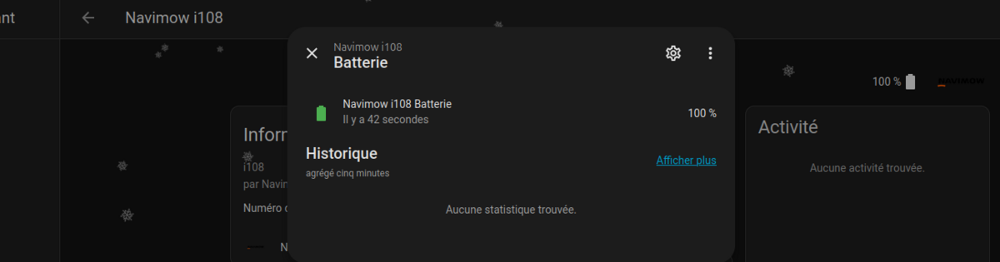

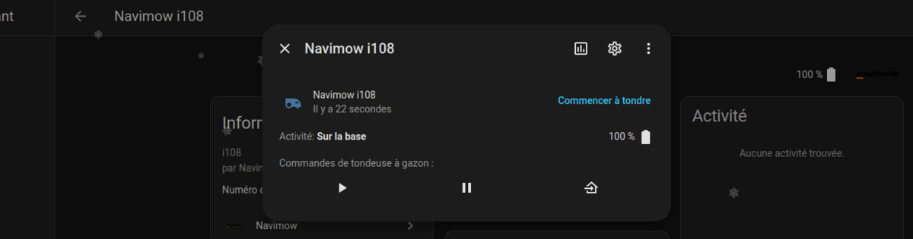

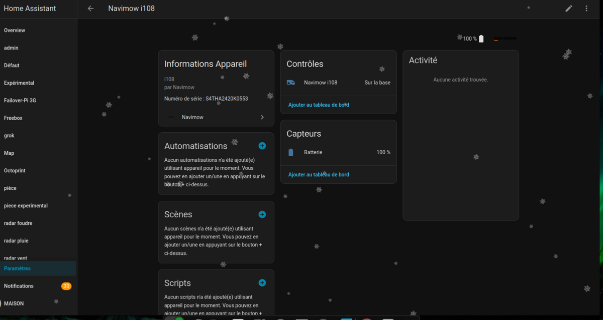

L'installation se fait via HACS en quelques étapes, en ajoutant le dépôt officiel comme "custom repository" puis en recherchant Navimow dans la liste des intégrations. Après redémarrage de Home Assistant, il suffit de connecter le robot avec les identifiants du compte Navimow pour que les entités remontent automatiquement. Compatible avec la plupart des modèles i-series et H-series de la marque.

Ce que cela permet chez moi au quotidien, c'est d'intégrer la tondeuse à des routines qui ont du sens. Lancement automatique de la tonte si aucune pluie n'est prévue dans les deux heures qui suivent, selon ce que remonte ma station météo locale. Retour forcé à la base si la batterie descend sous un seuil. Notification mobile quand un cycle est terminé. Mise en pause automatique si un membre de la famille est détecté dans le jardin via ses capteurs de présence. Rien de révolutionnaire individuellement, mais la somme de ces petites automatisations supprime complètement la charge mentale liée à l'entretien de la pelouse.

Le projet reste jeune et évolue vite, il faut donc prévoir des mises à jour fréquentes côté HACS. Mais le fait que l'intégration soit désormais officielle et maintenue par Segway change la donne pour quiconque construit une installation Home Assistant sérieuse.

### Après un mois : ce qui fonctionne et ce qui coince

Ce qui me plaît le plus après un mois d'utilisation quotidienne, c'est la simplicité globale une fois la cartographie terminée. Plus besoin de recreuser tous les ans pour remettre un câble qui a cédé. L'application est fluide, les mises à jour firmware arrivent régulièrement, le support Segway répond rapidement via le chat intégré. Les lames se changent en quelques minutes, la station résiste bien aux intempéries et le robot rentre de lui-même à la moindre pluie détectée par ses capteurs.

Plusieurs points d'attention méritent d'être signalés. Sur un jardin très ombragé ou très encombré en hauteur (grands arbres, toitures débordantes, dépendances), le signal RTK peut faiblir et demander à repositionner l'antenne, parfois en hauteur sur un mur ou une gouttière. La détection d'obstacles, bien qu'efficace sur l'essentiel, n'atteint pas encore le niveau des modèles équipés de LiDAR 360° sur les terrains très complexes ou très encombrés. Et l'intégration Home Assistant, bien qu'officielle désormais, reste en évolution active, avec des fonctions qui s'ajoutent au fil des versions.

Le bandeau périphérique reste par ailleurs à finir au rotofil tous les deux ou trois cycles, comme sur la plupart des robots de ce type, sauf si vous avez des transitions parfaites en limite de chevauchement. Rien de rédhibitoire mais à anticiper dans l'entretien global.

### Verdict : pour qui et dans quels cas

Le **Segway Navimow i108E** est une bonne tondeuse robot sans fil périmétrique pour un jardin de taille moyenne, idéalement entre 500 et 900 m², avec une bonne visibilité du ciel pour le signal GNSS. Le système EFLS 2.0 tient ses promesses, la cartographie assistée par IA change vraiment la donne sur la phase d'installation, et la qualité de coupe est au rendez-vous sur un usage quotidien.

L'arrivée de l'intégration officielle Home Assistant via le dépôt NavimowHA maintenu par Segway est un vrai argument pour les utilisateurs qui construisent une installation domotique locale cohérente. Fini les workarounds, on retrouve une entité native `lawn_mower` qui s'intègre proprement aux automatisations, au même niveau que d'autres marques établies de longue date sur le créneau.

Je le recommande à ceux qui veulent se débarrasser définitivement du câble périmétrique, qui ont un terrain dégagé en hauteur et pas trop complexe, et qui apprécient une vraie intégration dans leur écosystème domotique. Les propriétaires de très grands terrains au-delà de 1500 m², de jardins très accidentés avec de multiples obstacles fixes, ou ceux qui vivent sous une canopée dense limitant le signal satellite iront probablement regarder du côté des modèles LiDAR ou des solutions filaires plus éprouvées.

Pour tous les autres, [**avec un budget autour de 800 euros en promotion contre près de 1 000 euros au lancement**](https://amzn.to/4clOg6z), le Navimow i108E coche beaucoup de cases sans compromis majeur. Et son intégration officielle dans Home Assistant le rend particulièrement pertinent pour la communauté ForumDomotique.
