<p class="forum-cta"><a href="https://forumdomotique.com/tests/dongles-passerelles/test-slzb-mr4u-coordinateur-zigbee-thread-matter/">Lire et commenter sur Forum Domotique</a></p>




<section class="carousel photo-carousel" data-carousel data-lightbox aria-roledescription="carrousel" aria-label="Photos de l’article (16)" tabindex="0">
<div class="carousel-track" data-track>
<figure class="photo-slide" data-slide>
  <a href="images/Designsanstitre_3_.png" data-full="images/Designsanstitre_3_.png" data-alt="Photo 1 — Test du SMLight SLZB-MR4U : un coordinateur Zigbee + Thread/Matter qui simplifie vraiment la vie" aria-label="Agrandir la photo 1 : Photo 1 — Test du SMLight SLZB-MR4U : un coordinateur Zigbee + Thread/Matter qui simplifie vraiment la vie">
    
  </a>
</figure>
<figure class="photo-slide" data-slide>
  <a href="images/MatterServer.png" data-full="images/MatterServer.png" data-alt="Photo 2 — Test du SMLight SLZB-MR4U : un coordinateur Zigbee + Thread/Matter qui simplifie vraiment la vie" aria-label="Agrandir la photo 2 : Photo 2 — Test du SMLight SLZB-MR4U : un coordinateur Zigbee + Thread/Matter qui simplifie vraiment la vie">
    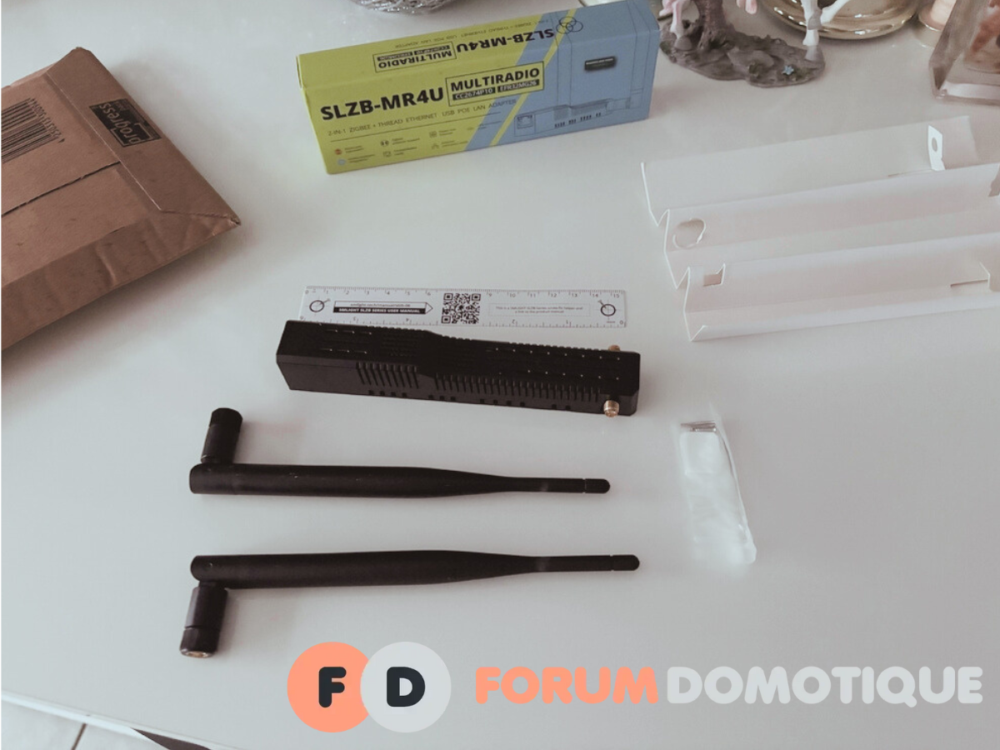
  </a>
</figure>
<figure class="photo-slide" data-slide>
  <a href="images/MatterServer_2_.png" data-full="images/MatterServer_2_.png" data-alt="Photo 3 — Test du SMLight SLZB-MR4U : un coordinateur Zigbee + Thread/Matter qui simplifie vraiment la vie" aria-label="Agrandir la photo 3 : Photo 3 — Test du SMLight SLZB-MR4U : un coordinateur Zigbee + Thread/Matter qui simplifie vraiment la vie">
    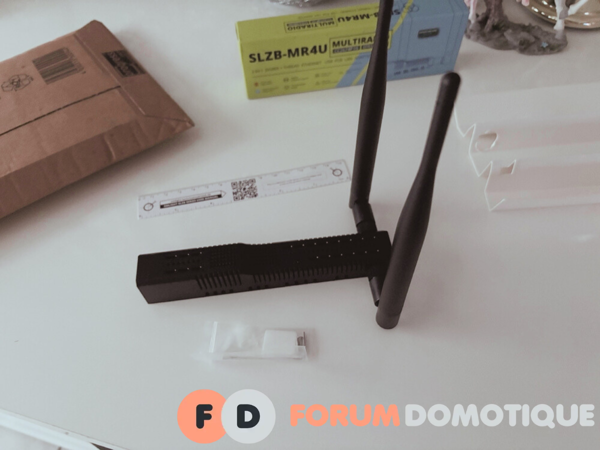
  </a>
</figure>
<figure class="photo-slide" data-slide>
  <a href="images/Capturedcrandu2025-10-3116-08-22.png" data-full="images/Capturedcrandu2025-10-3116-08-22.png" data-alt="Photo 4 — Test du SMLight SLZB-MR4U : un coordinateur Zigbee + Thread/Matter qui simplifie vraiment la vie" aria-label="Agrandir la photo 4 : Photo 4 — Test du SMLight SLZB-MR4U : un coordinateur Zigbee + Thread/Matter qui simplifie vraiment la vie">
    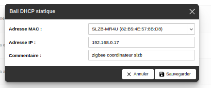
  </a>
</figure>
<figure class="photo-slide" data-slide>
  <a href="images/Capturedcrandu2025-10-3117-32-38.png" data-full="images/Capturedcrandu2025-10-3117-32-38.png" data-alt="Photo 5 — Test du SMLight SLZB-MR4U : un coordinateur Zigbee + Thread/Matter qui simplifie vraiment la vie" aria-label="Agrandir la photo 5 : Photo 5 — Test du SMLight SLZB-MR4U : un coordinateur Zigbee + Thread/Matter qui simplifie vraiment la vie">
    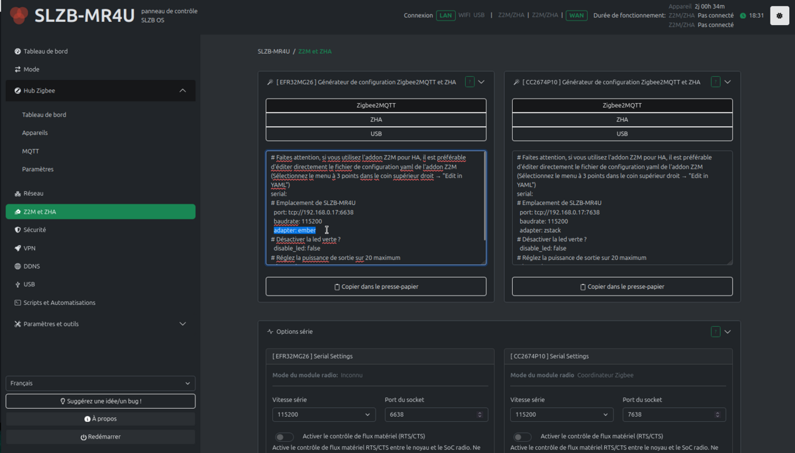
  </a>
</figure>
<figure class="photo-slide" data-slide>
  <a href="images/Capturedcrandu2025-10-3117-32-28.png" data-full="images/Capturedcrandu2025-10-3117-32-28.png" data-alt="Photo 6 — Test du SMLight SLZB-MR4U : un coordinateur Zigbee + Thread/Matter qui simplifie vraiment la vie" aria-label="Agrandir la photo 6 : Photo 6 — Test du SMLight SLZB-MR4U : un coordinateur Zigbee + Thread/Matter qui simplifie vraiment la vie">
    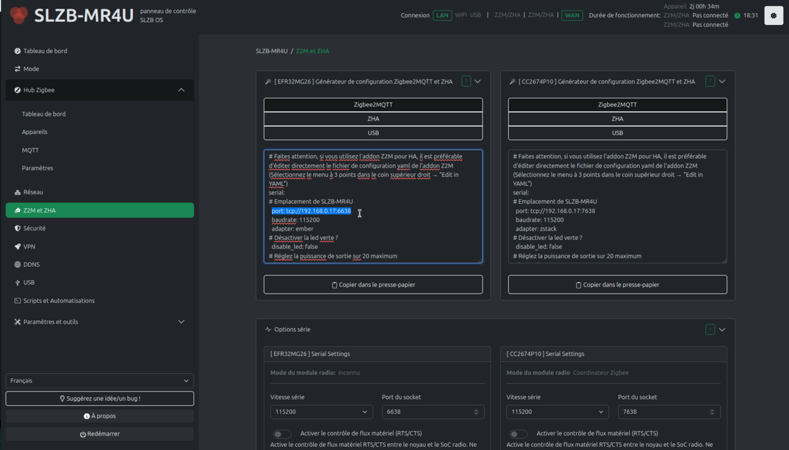
  </a>
</figure>
<figure class="photo-slide" data-slide>
  <a href="images/Capturedcrandu2025-10-3115-52-43.png" data-full="images/Capturedcrandu2025-10-3115-52-43.png" data-alt="Photo 7 — Test du SMLight SLZB-MR4U : un coordinateur Zigbee + Thread/Matter qui simplifie vraiment la vie" aria-label="Agrandir la photo 7 : Photo 7 — Test du SMLight SLZB-MR4U : un coordinateur Zigbee + Thread/Matter qui simplifie vraiment la vie">
    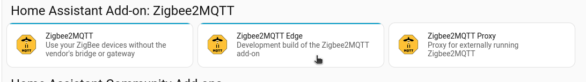
  </a>
</figure>
<figure class="photo-slide" data-slide>
  <a href="images/Capturedcrandu2025-10-3117-20-32.png" data-full="images/Capturedcrandu2025-10-3117-20-32.png" data-alt="Photo 8 — Test du SMLight SLZB-MR4U : un coordinateur Zigbee + Thread/Matter qui simplifie vraiment la vie" aria-label="Agrandir la photo 8 : Photo 8 — Test du SMLight SLZB-MR4U : un coordinateur Zigbee + Thread/Matter qui simplifie vraiment la vie">
    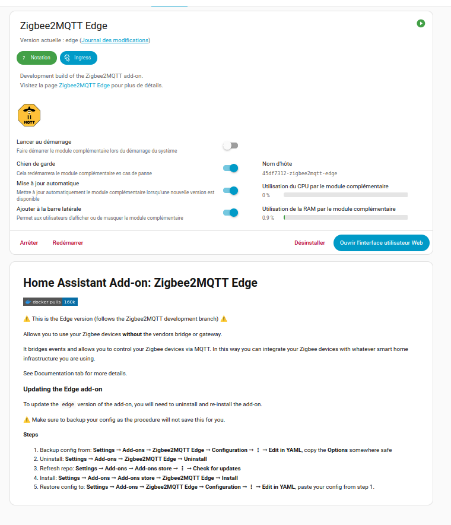
  </a>
</figure>
<figure class="photo-slide" data-slide>
  <a href="images/Capturedcrandu2025-10-3117-23-46.png" data-full="images/Capturedcrandu2025-10-3117-23-46.png" data-alt="Photo 9 — Test du SMLight SLZB-MR4U : un coordinateur Zigbee + Thread/Matter qui simplifie vraiment la vie" aria-label="Agrandir la photo 9 : Photo 9 — Test du SMLight SLZB-MR4U : un coordinateur Zigbee + Thread/Matter qui simplifie vraiment la vie">
    
  </a>
</figure>
<figure class="photo-slide" data-slide>
  <a href="images/Capturedcrandu2025-10-3117-26-10.png" data-full="images/Capturedcrandu2025-10-3117-26-10.png" data-alt="Photo 10 — Test du SMLight SLZB-MR4U : un coordinateur Zigbee + Thread/Matter qui simplifie vraiment la vie" aria-label="Agrandir la photo 10 : Photo 10 — Test du SMLight SLZB-MR4U : un coordinateur Zigbee + Thread/Matter qui simplifie vraiment la vie">
    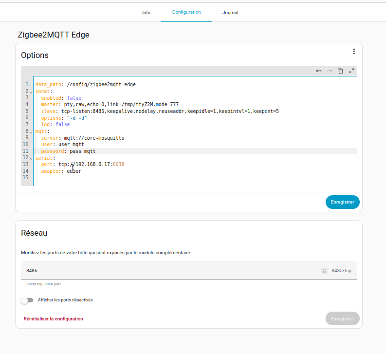
  </a>
</figure>
<figure class="photo-slide" data-slide>
  <a href="images/Capturedcrandu2025-10-3117-42-35.png" data-full="images/Capturedcrandu2025-10-3117-42-35.png" data-alt="Photo 11 — Test du SMLight SLZB-MR4U : un coordinateur Zigbee + Thread/Matter qui simplifie vraiment la vie" aria-label="Agrandir la photo 11 : Photo 11 — Test du SMLight SLZB-MR4U : un coordinateur Zigbee + Thread/Matter qui simplifie vraiment la vie">
    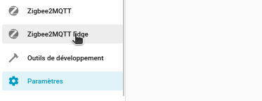
  </a>
</figure>
<figure class="photo-slide" data-slide>
  <a href="images/Capturedcrandu2025-10-3117-43-39.png" data-full="images/Capturedcrandu2025-10-3117-43-39.png" data-alt="Photo 12 — Test du SMLight SLZB-MR4U : un coordinateur Zigbee + Thread/Matter qui simplifie vraiment la vie" aria-label="Agrandir la photo 12 : Photo 12 — Test du SMLight SLZB-MR4U : un coordinateur Zigbee + Thread/Matter qui simplifie vraiment la vie">
    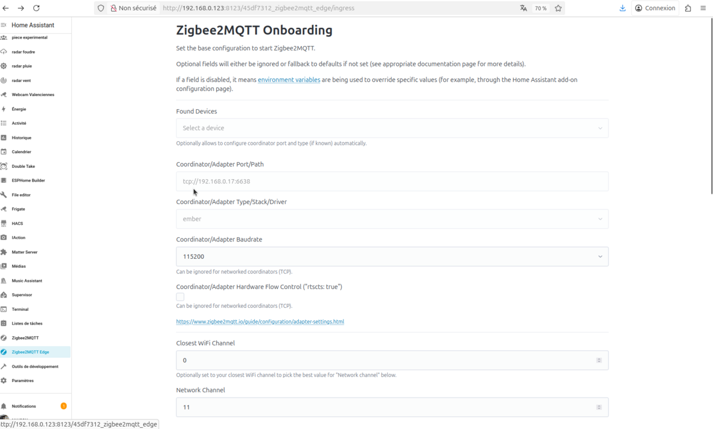
  </a>
</figure>
<figure class="photo-slide" data-slide>
  <a href="images/Capturedcrandu2025-10-3118-04-50.png" data-full="images/Capturedcrandu2025-10-3118-04-50.png" data-alt="Photo 13 — Test du SMLight SLZB-MR4U : un coordinateur Zigbee + Thread/Matter qui simplifie vraiment la vie" aria-label="Agrandir la photo 13 : Photo 13 — Test du SMLight SLZB-MR4U : un coordinateur Zigbee + Thread/Matter qui simplifie vraiment la vie">
    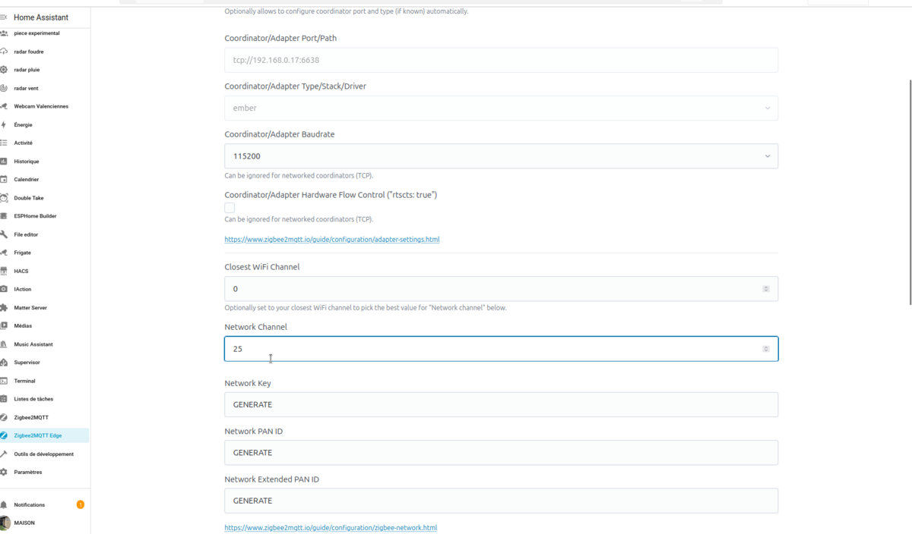
  </a>
</figure>
<figure class="photo-slide" data-slide>
  <a href="images/Capturedcrandu2025-10-3118-10-32.png" data-full="images/Capturedcrandu2025-10-3118-10-32.png" data-alt="Photo 14 — Test du SMLight SLZB-MR4U : un coordinateur Zigbee + Thread/Matter qui simplifie vraiment la vie" aria-label="Agrandir la photo 14 : Photo 14 — Test du SMLight SLZB-MR4U : un coordinateur Zigbee + Thread/Matter qui simplifie vraiment la vie">
    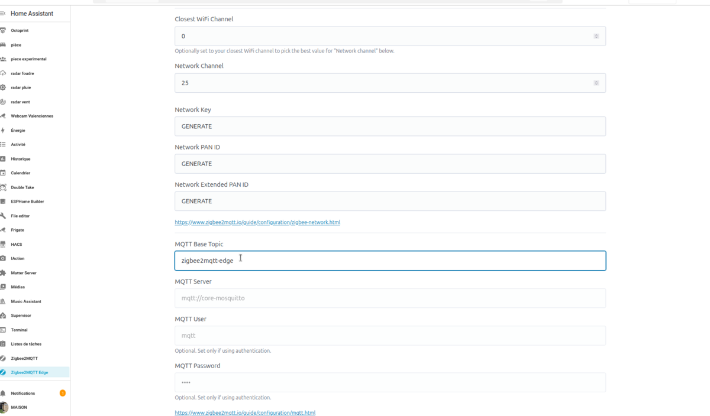
  </a>
</figure>
<figure class="photo-slide" data-slide>
  <a href="images/Capturedcrandu2025-10-3118-12-52.png" data-full="images/Capturedcrandu2025-10-3118-12-52.png" data-alt="Photo 15 — Test du SMLight SLZB-MR4U : un coordinateur Zigbee + Thread/Matter qui simplifie vraiment la vie" aria-label="Agrandir la photo 15 : Photo 15 — Test du SMLight SLZB-MR4U : un coordinateur Zigbee + Thread/Matter qui simplifie vraiment la vie">
    
  </a>
</figure>
<figure class="photo-slide" data-slide>
  <a href="images/Capturedcrandu2025-10-3118-13-53.png" data-full="images/Capturedcrandu2025-10-3118-13-53.png" data-alt="Photo 16 — Test du SMLight SLZB-MR4U : un coordinateur Zigbee + Thread/Matter qui simplifie vraiment la vie" aria-label="Agrandir la photo 16 : Photo 16 — Test du SMLight SLZB-MR4U : un coordinateur Zigbee + Thread/Matter qui simplifie vraiment la vie">
    
  </a>
</figure>
</div>
<button type="button" class="carousel-nav" data-prev aria-label="Photo précédente">‹</button>
<button type="button" class="carousel-nav" data-next aria-label="Photo suivante">›</button>
<div class="carousel-dots" data-dots></div>
<div class="carousel-live" data-live aria-live="polite"></div>
<p class="carousel-hint">Faites défiler les photos, ou ouvrez-les pour les agrandir (si JavaScript est activé).</p>
</section>

# Test du SMLight SLZB-MR4U : un coordinateur Zigbee + Thread/Matter qui simplifie vraiment la vie

- **Type :** Test
- **Catégorie :** Tests produits domotique & maison connectée > Dongles et Passerelles
- **Lien :** https://forumdomotique.com/tests/dongles-passerelles/test-slzb-mr4u-coordinateur-zigbee-thread-matter/
- **Date de publication :** 17 novembre 2025 à 21:26 (Europe/Paris)
- **Auteur :** XAV59213

---

J’ai installé pas mal de dongles Zigbee au fil des années, souvent en jonglant entre les limites de portée, les conflits radio et les essais plus ou moins réussis avec Thread ou Matter. Quand SMLight a annoncé le SLZB-MR4U en août 2025, l’idée d’un vrai coordinateur multi-protocoles piloté directement par Home Assistant m’a tout de suite intrigué.

Depuis deux semaines, il tourne chez moi en complément de mon coordinateur principal sous Zigbee2MQTT. L’objectif était simple : gagner en portée dans la maison et tester la partie Thread/Matter sans ajouter un énième dongle USB bancal. Voici ce que j’en retiens.

### 🔗 Envie d'acheter ce produit ?

Vous pouvez soutenir le forum en passant par nos liens affiliés 👇  
**Cela ne vous coûte jamais plus cher !**  
*Le prix reste exactement le même pour vous, mais nous recevons une petite commission qui aide à faire vivre la communauté 💜*

[
<!-- source : https://forumdomotique.com/uploads/pages_media/logo_domadoo.png -->
Acheter sur Domadoo](https://www.domadoo.fr/fr/produits-de-domotique/8369-smlight-adaptateur-usb-ethernet-poe-zigbee-et-thread-cc2674p10-efr32mg26-slzb-mr4.html?domid=101)

## **Pourquoi ce coordinateur m’a intéressé**

Le MR4U est l’un des rares coordinateurs grand public à embarquer deux radios totalement indépendantes capables de travailler en parallèle. La première radio, une CC2674P10, se concentre sur Zigbee avec une puissance d’émission de +20 dBm. La seconde, une EFR32MG26, gère Thread et Matter, elle aussi à +20 dBm. Ce détail m’a tout de suite attiré, car la plupart des coordinateurs multi-protocoles réunissent tout sur une seule puce, ce qui crée des contraintes et un partage de ressources. Ici, les deux radios fonctionnent sans jamais entrer en compétition.

La gestion du réseau s’en ressent directement. Les paquets Zigbee ne viennent pas étouffer le trafic Thread, et inversement. Cela permet de construire un réseau plus prévisible, surtout quand on multiplie les capteurs, actionneurs ou petites automatisations à forte fréquence. Je le constate clairement chez moi où certaines zones étaient traditionnellement plus sensibles aux micro-coupures Zigbee.

Autre point important, la connectique. Le MR4U peut fonctionner en USB-C, mais c’est surtout la partie **Ethernet + PoE** qui change la donne. Alimenter et connecter un coordinateur via un unique câble réseau facilite énormément l’intégration dans un rack ou dans un coffret technique. Et surtout, on s’affranchit totalement des problèmes récurrents des sticks USB : perturbations des ports USB, drivers capricieux, interférences avec les cartes mères, allonges nécessaires… Ici, on place le coordinateur exactement où il doit être pour obtenir la meilleure couverture.

## **Contenu et premières impressions**

Le MR4U arrive dans une boîte compacte, mais on sent immédiatement que le produit a été pensé pour durer. Le boîtier est en plastique noir mat, robuste, bien assemblé et suffisamment ventilé pour assurer la dissipation. À l’intérieur, deux antennes SMA pivotables fournissent un gain réel en portée. Le ressenti est très différent d’un simple dongle USB, on est beaucoup plus proche d’un petit équipement réseau professionnel.

Les LEDs sont discrètes mais utiles. Chaque radio possède son propre témoin lumineux, ce qui permet de voir d’un coup d’œil si un appairage a démarré ou si une communication est en cours. Le bouton multifonction répond bien et les pas de vis pour le montage mural sont plutôt pratiques quand on veut intégrer la clé dans un tableau domotique.

Ce qui m’a le plus frappé, c’est la sensation de stabilité dès les premières minutes. Là où un dongle USB nécessite souvent de réfléchir à son positionnement ou à la longueur de l’extension USB, ici tout paraît simple. Je l’ai branché dans mon rack, là où j’avais envie qu’il soit, sans me poser de questions.

.png")


.png")

## **Pourquoi j’ai choisi de le laisser entièrement géré par Home Assistant (et pas SLZB-OS)**

Le MR4U arrive pré-flashé avec un OS maison, SLZB-OS, qui permet d’utiliser la clé en mode standalone. L’interface web est propre, les firmwares sont faciles à mettre à jour et la gestion locale est bien pensée. Pourtant, j’ai choisi de ne pas m’en servir, et ce n’est pas un défaut de la solution.

Depuis longtemps, je centralise tout mon écosystème radio dans Home Assistant. Zigbee, Thread, Z-Wave ou Bluetooth, tout passe par mon serveur principal qui effectue des snapshots complets chaque nuit. Cette approche me permet d’avoir un point unique de sauvegarde et de restauration. Si un coordinateur tombe en panne ou si un firmware dérive, je rebranche simplement une nouvelle unité, je restaure le snapshot et je repars exactement dans l’état précédent.

SLZB-OS, en revanche, stocke sa configuration directement dans le boîtier. Si le matériel lâche, la configuration est perdue. Pour quelques appareils, ce n’est pas dramatique, mais sur un réseau dense, ré-appairer cinquante capteurs Zigbee devient une punition. En laissant Home Assistant piloter entièrement le coordinateur, je gagne en flexibilité, en sécurité et en réversibilité.

## **Installation : mon second coordinateur Zigbee sous Home Assistant**

Mon setup au moment du test :

| Prérequis | Détails |
| --- | --- |
| **HA OS** | **2025.10.3** installé via **Raspberry Pi Imager** (boot SSD NVMe activé). |
| [**Mosquitto Broker**](https://github.com/home-assistant/addons/tree/master/mosquitto) | Add-on officiel actif (nécessaire pour Zigbee2MQTT). |
| [**Add-on Zigbee2MQTT Edge**](https://github.com/zigbee2mqtt/hassio-zigbee2mqtt/tree/master/zigbee2mqtt-edge) | Module complémentaire (deuxième instance pour le 2e coordinateur). |
| **Alimentation PoE** | Injecteur PoE ou switch/routeur avec PoE (802.3at recommandé). |
| **IP fixe pour SLZB-MR4U** | **192.168.0.17**(réservée dans le routeur pour éviter les changements au redémarrage). |
| **Firmware SLZB-OS** | **v3.0.8** (mise à jour OTA via web UI du device). |
| **Sonoff Dongle-P** | [mode coordinateur (premier réseau)](https://www.zigbee2mqtt.io/devices/ZBDongle-E.html#sonoff-zbdongle-e) |

L’installation complète m’a pris une vingtaine de minutes.

### **1. Préparation du MR4U**

Je l’alimente via PoE, je vérifie le firmware dans l’interface web et je fixe une IP statique dans le routeur. Dès que la LED PoE reste au vert, le coordinateur est prêt.


Je me connecte sur mon SLZB-06M via l’adresse <http://192.168.0.17> (dans mon cas, j’ai fixé l’IP à cette adresse) pour récupérer les informations nécessaires au paramétrage.


### **2. Ajout du dépôt Zigbee2MQTT Edge**

Dans Home Assistant, je déclare le dépôt GitHub, je rafraîchis et Zigbee2MQTT Edge apparaît immédiatement.

```plaintext
https://github.com/zigbee2mqtt/hassio-zigbee2mqtt
```


### **3. Installation d’une seconde instance**

J’installe Zigbee2MQTT Edge sans le lancer.  
Je passe en mode YAML et j’adapte les chemins, le port MQTT et surtout la partie “serial” pour pointer vers l’adresse TCP de la clé.


### **4. Configuration spécifique à la radio**

Le MR4U expose son port Zigbee via TCP. Il suffit de renseigner :

```yaml
data_path: /config/zigbee2mqtt-edge  # A MODIFIER /config/zigbee2mqtt PAR /config/zigbee2mqtt-edge
socat:
  enabled: false
  master: pty,raw,echo=0,link=/tmp/ttyZ2M,mode=777
  slave: tcp-listen:8485,keepalive,nodelay,reuseaddr,keepidle=1,keepintvl=1,keepcnt=5
  options: "-d -d"
  log: false
mqtt:
  server: mqtt://core-mosquitto   # RESTE IDENTIQUE A VOTRE PREMIERE INSTANCE 
  user: mqtt-user                 # RESTE IDENTIQUE A VOTRE PREMIERE INSTANCE
  password: mqtt-pass             # RESTE IDENTIQUE A VOTRE PREMIERE INSTANCE
serial:
  port: tcp://192.168.0.17:6638   # info A RECUPERER 
  adapter: ember                  # info A RECUPERER 
```

Je fais attention à ne pas utiliser le même port que ma première instance.


### **5. Lancement et vérification**

Les logs me confirment que Zigbee2MQTT démarre correctement. L’UI est accessible, tout répond normalement.

```plaintext
[16:13:19] INFO: Preparing to start...
[16:13:19] INFO: Socat not enabled
[16:13:19] INFO: Starting Zigbee2MQTT...
Starting Zigbee2MQTT without watchdog.
Onboarding page is available at http://0.0.0.0:8099/
```

### **6. Changement de canal et finalisation**

Je règle le canal Zigbee sur 25 et je renomme le topic MQTT. Une fois sauvegardé, le coordinateur est opérationnel.

L’ensemble est stable, aucun plantage, aucun timeout. Le réseau démarre immédiatement.


## **Appairage d’un appareil**

Dans Zigbee2MQTT Edge :  
• j’active “Permit Join”  
• la LED Zigbee du MR4U s’active  
• j’appuie 5 secondes sur le bouton d’un Aqara par exemple

L’appareil apparaît dans le topic MQTT avec son IEEE. C’est exactement comme un réseau Zigbee normal, sauf que le coordinateur est Ethernet et PoE, ce qui élimine les contraintes habituelles des sticks USB.


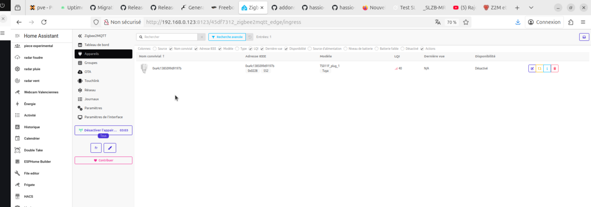

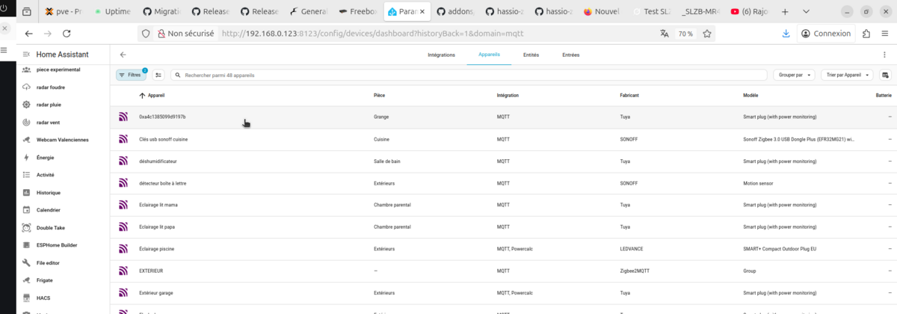

## **Conclusion : un coordinateur qui va clairement rester dans mon installation**

Après deux semaines d’utilisation quotidienne, le SMLight SLZB-MR4U s’est intégré de manière transparente dans mon installation. Sa double radio, son alimentation PoE, sa connectique Ethernet et sa compatibilité parfaite avec Zigbee2MQTT en font un coordinateur particulièrement fiable. La possibilité de séparer physiquement le coordinateur du serveur Home Assistant apporte un gain réel en stabilité.

Le fait d’éviter le logiciel embarqué pour le laisser piloté par Home Assistant est à mes yeux le meilleur compromis. On obtient la flexibilité d’une plateforme centralisée, la fiabilité d’un coordinateur matériel, et une vraie résilience en cas de panne.

Ce coordinateur ne cherche pas à réinventer la domotique. Il propose simplement une plateforme solide, bien pensée et durable pour celles et ceux qui veulent stabiliser ou étendre leur réseau Zigbee et commencer à explorer Matter sans multiplier les dongles.

Pour mon installation, c’est un choix qui a du sens, et qui restera en place.

