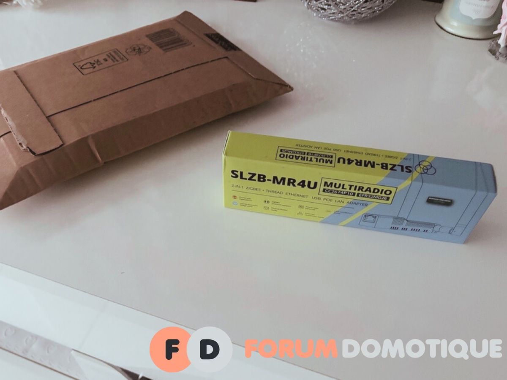
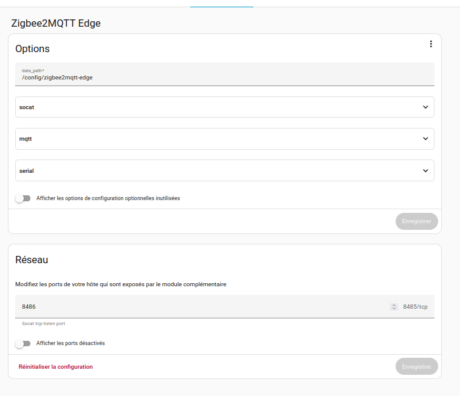
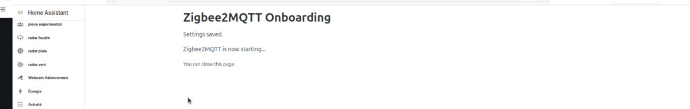
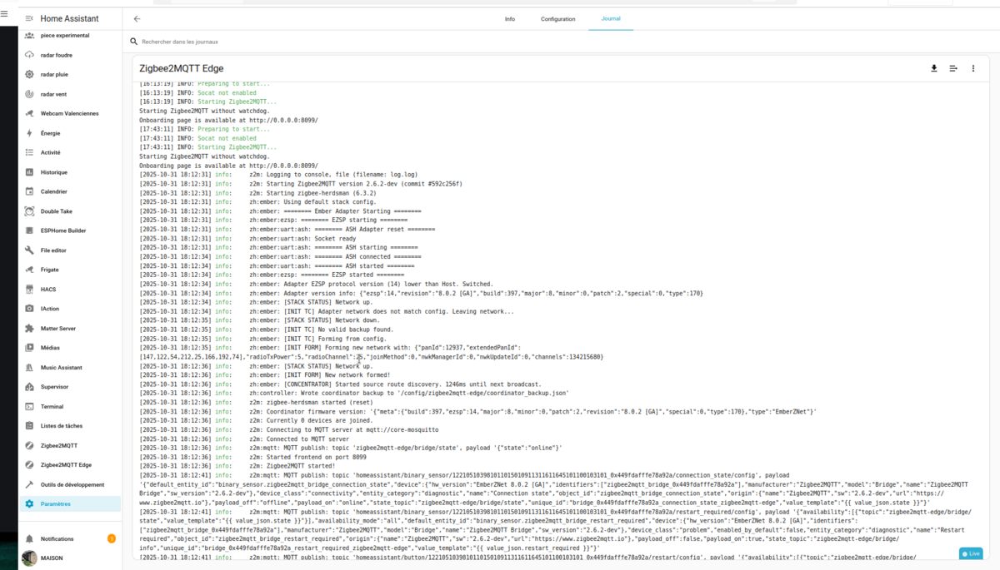
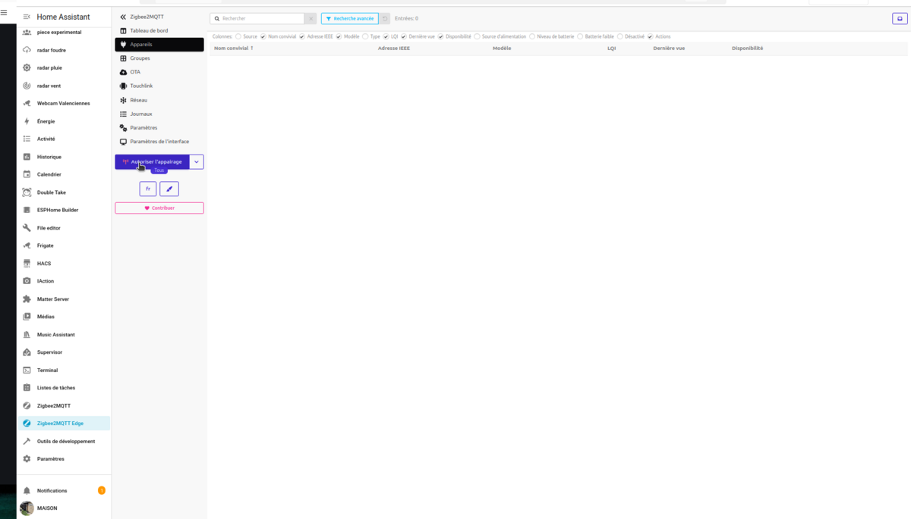

<p class="forum-cta"><a href="https://forumdomotique.com/tests/dongles-passerelles/test-slzb-mr4u-coordinateur-zigbee-thread-matter/">Lire et commenter sur Forum Domotique</a></p>




<section class="carousel photo-carousel" data-carousel data-lightbox aria-roledescription="carrousel" aria-label="Photos de l’article (16)" tabindex="0">
<div class="carousel-track" data-track>
<figure class="photo-slide" data-slide>
  <a href="images/Designsanstitre_3_.png" data-full="images/Designsanstitre_3_.png" data-alt="Photo 1 — Test du SMLight SLZB-MR4U : un coordinateur Zigbee + Thread/Matter qui simplifie vraiment la vie" aria-label="Agrandir la photo 1 : Photo 1 — Test du SMLight SLZB-MR4U : un coordinateur Zigbee + Thread/Matter qui simplifie vraiment la vie">
    
  </a>
</figure>
<figure class="photo-slide" data-slide>
  <a href="images/MatterServer.png" data-full="images/MatterServer.png" data-alt="Photo 2 — Test du SMLight SLZB-MR4U : un coordinateur Zigbee + Thread/Matter qui simplifie vraiment la vie" aria-label="Agrandir la photo 2 : Photo 2 — Test du SMLight SLZB-MR4U : un coordinateur Zigbee + Thread/Matter qui simplifie vraiment la vie">
    
  </a>
</figure>
<figure class="photo-slide" data-slide>
  <a href="images/MatterServer_2_.png" data-full="images/MatterServer_2_.png" data-alt="Photo 3 — Test du SMLight SLZB-MR4U : un coordinateur Zigbee + Thread/Matter qui simplifie vraiment la vie" aria-label="Agrandir la photo 3 : Photo 3 — Test du SMLight SLZB-MR4U : un coordinateur Zigbee + Thread/Matter qui simplifie vraiment la vie">
    
  </a>
</figure>
<figure class="photo-slide" data-slide>
  <a href="images/Capturedcrandu2025-10-3116-08-22.png" data-full="images/Capturedcrandu2025-10-3116-08-22.png" data-alt="Photo 4 — Test du SMLight SLZB-MR4U : un coordinateur Zigbee + Thread/Matter qui simplifie vraiment la vie" aria-label="Agrandir la photo 4 : Photo 4 — Test du SMLight SLZB-MR4U : un coordinateur Zigbee + Thread/Matter qui simplifie vraiment la vie">
    
  </a>
</figure>
<figure class="photo-slide" data-slide>
  <a href="images/Capturedcrandu2025-10-3117-32-38.png" data-full="images/Capturedcrandu2025-10-3117-32-38.png" data-alt="Photo 5 — Test du SMLight SLZB-MR4U : un coordinateur Zigbee + Thread/Matter qui simplifie vraiment la vie" aria-label="Agrandir la photo 5 : Photo 5 — Test du SMLight SLZB-MR4U : un coordinateur Zigbee + Thread/Matter qui simplifie vraiment la vie">
    
  </a>
</figure>
<figure class="photo-slide" data-slide>
  <a href="images/Capturedcrandu2025-10-3117-32-28.png" data-full="images/Capturedcrandu2025-10-3117-32-28.png" data-alt="Photo 6 — Test du SMLight SLZB-MR4U : un coordinateur Zigbee + Thread/Matter qui simplifie vraiment la vie" aria-label="Agrandir la photo 6 : Photo 6 — Test du SMLight SLZB-MR4U : un coordinateur Zigbee + Thread/Matter qui simplifie vraiment la vie">
    
  </a>
</figure>
<figure class="photo-slide" data-slide>
  <a href="images/Capturedcrandu2025-10-3115-52-43.png" data-full="images/Capturedcrandu2025-10-3115-52-43.png" data-alt="Photo 7 — Test du SMLight SLZB-MR4U : un coordinateur Zigbee + Thread/Matter qui simplifie vraiment la vie" aria-label="Agrandir la photo 7 : Photo 7 — Test du SMLight SLZB-MR4U : un coordinateur Zigbee + Thread/Matter qui simplifie vraiment la vie">
    
  </a>
</figure>
<figure class="photo-slide" data-slide>
  <a href="images/Capturedcrandu2025-10-3117-20-32.png" data-full="images/Capturedcrandu2025-10-3117-20-32.png" data-alt="Photo 8 — Test du SMLight SLZB-MR4U : un coordinateur Zigbee + Thread/Matter qui simplifie vraiment la vie" aria-label="Agrandir la photo 8 : Photo 8 — Test du SMLight SLZB-MR4U : un coordinateur Zigbee + Thread/Matter qui simplifie vraiment la vie">
    
  </a>
</figure>
<figure class="photo-slide" data-slide>
  <a href="images/Capturedcrandu2025-10-3117-23-46.png" data-full="images/Capturedcrandu2025-10-3117-23-46.png" data-alt="Photo 9 — Test du SMLight SLZB-MR4U : un coordinateur Zigbee + Thread/Matter qui simplifie vraiment la vie" aria-label="Agrandir la photo 9 : Photo 9 — Test du SMLight SLZB-MR4U : un coordinateur Zigbee + Thread/Matter qui simplifie vraiment la vie">
    
  </a>
</figure>
<figure class="photo-slide" data-slide>
  <a href="images/Capturedcrandu2025-10-3117-26-10.png" data-full="images/Capturedcrandu2025-10-3117-26-10.png" data-alt="Photo 10 — Test du SMLight SLZB-MR4U : un coordinateur Zigbee + Thread/Matter qui simplifie vraiment la vie" aria-label="Agrandir la photo 10 : Photo 10 — Test du SMLight SLZB-MR4U : un coordinateur Zigbee + Thread/Matter qui simplifie vraiment la vie">
    
  </a>
</figure>
<figure class="photo-slide" data-slide>
  <a href="images/Capturedcrandu2025-10-3117-42-35.png" data-full="images/Capturedcrandu2025-10-3117-42-35.png" data-alt="Photo 11 — Test du SMLight SLZB-MR4U : un coordinateur Zigbee + Thread/Matter qui simplifie vraiment la vie" aria-label="Agrandir la photo 11 : Photo 11 — Test du SMLight SLZB-MR4U : un coordinateur Zigbee + Thread/Matter qui simplifie vraiment la vie">
    
  </a>
</figure>
<figure class="photo-slide" data-slide>
  <a href="images/Capturedcrandu2025-10-3117-43-39.png" data-full="images/Capturedcrandu2025-10-3117-43-39.png" data-alt="Photo 12 — Test du SMLight SLZB-MR4U : un coordinateur Zigbee + Thread/Matter qui simplifie vraiment la vie" aria-label="Agrandir la photo 12 : Photo 12 — Test du SMLight SLZB-MR4U : un coordinateur Zigbee + Thread/Matter qui simplifie vraiment la vie">
    
  </a>
</figure>
<figure class="photo-slide" data-slide>
  <a href="images/Capturedcrandu2025-10-3118-04-50.png" data-full="images/Capturedcrandu2025-10-3118-04-50.png" data-alt="Photo 13 — Test du SMLight SLZB-MR4U : un coordinateur Zigbee + Thread/Matter qui simplifie vraiment la vie" aria-label="Agrandir la photo 13 : Photo 13 — Test du SMLight SLZB-MR4U : un coordinateur Zigbee + Thread/Matter qui simplifie vraiment la vie">
    
  </a>
</figure>
<figure class="photo-slide" data-slide>
  <a href="images/Capturedcrandu2025-10-3118-10-32.png" data-full="images/Capturedcrandu2025-10-3118-10-32.png" data-alt="Photo 14 — Test du SMLight SLZB-MR4U : un coordinateur Zigbee + Thread/Matter qui simplifie vraiment la vie" aria-label="Agrandir la photo 14 : Photo 14 — Test du SMLight SLZB-MR4U : un coordinateur Zigbee + Thread/Matter qui simplifie vraiment la vie">
    
  </a>
</figure>
<figure class="photo-slide" data-slide>
  <a href="images/Capturedcrandu2025-10-3118-12-52.png" data-full="images/Capturedcrandu2025-10-3118-12-52.png" data-alt="Photo 15 — Test du SMLight SLZB-MR4U : un coordinateur Zigbee + Thread/Matter qui simplifie vraiment la vie" aria-label="Agrandir la photo 15 : Photo 15 — Test du SMLight SLZB-MR4U : un coordinateur Zigbee + Thread/Matter qui simplifie vraiment la vie">
    
  </a>
</figure>
<figure class="photo-slide" data-slide>
  <a href="images/Capturedcrandu2025-10-3118-13-53.png" data-full="images/Capturedcrandu2025-10-3118-13-53.png" data-alt="Photo 16 — Test du SMLight SLZB-MR4U : un coordinateur Zigbee + Thread/Matter qui simplifie vraiment la vie" aria-label="Agrandir la photo 16 : Photo 16 — Test du SMLight SLZB-MR4U : un coordinateur Zigbee + Thread/Matter qui simplifie vraiment la vie">
    
  </a>
</figure>
</div>
<button type="button" class="carousel-nav" data-prev aria-label="Photo précédente">‹</button>
<button type="button" class="carousel-nav" data-next aria-label="Photo suivante">›</button>
<div class="carousel-dots" data-dots></div>
<div class="carousel-live" data-live aria-live="polite"></div>
<p class="carousel-hint">Faites défiler les photos, ou ouvrez-les pour les agrandir (si JavaScript est activé).</p>
</section>

# Test du SMLight SLZB-MR4U : un coordinateur Zigbee + Thread/Matter qui simplifie vraiment la vie

- **Type :** Test
- **Catégorie :** Tests produits domotique & maison connectée > Dongles et Passerelles
- **Lien :** https://forumdomotique.com/tests/dongles-passerelles/test-slzb-mr4u-coordinateur-zigbee-thread-matter/
- **Date de publication :** 17 novembre 2025 à 21:26 (Europe/Paris)
- **Auteur :** XAV59213

---

J’ai installé pas mal de dongles Zigbee au fil des années, souvent en jonglant entre les limites de portée, les conflits radio et les essais plus ou moins réussis avec Thread ou Matter. Quand SMLight a annoncé le SLZB-MR4U en août 2025, l’idée d’un vrai coordinateur multi-protocoles piloté directement par Home Assistant m’a tout de suite intrigué.

Depuis deux semaines, il tourne chez moi en complément de mon coordinateur principal sous Zigbee2MQTT. L’objectif était simple : gagner en portée dans la maison et tester la partie Thread/Matter sans ajouter un énième dongle USB bancal. Voici ce que j’en retiens.

### 🔗 Envie d'acheter ce produit ?

Vous pouvez soutenir le forum en passant par nos liens affiliés 👇  
**Cela ne vous coûte jamais plus cher !**  
*Le prix reste exactement le même pour vous, mais nous recevons une petite commission qui aide à faire vivre la communauté 💜*

[
<!-- source : https://forumdomotique.com/uploads/pages_media/logo_domadoo.png -->
Acheter sur Domadoo](https://www.domadoo.fr/fr/produits-de-domotique/8369-smlight-adaptateur-usb-ethernet-poe-zigbee-et-thread-cc2674p10-efr32mg26-slzb-mr4.html?domid=101)

## **Pourquoi ce coordinateur m’a intéressé**

Le MR4U est l’un des rares coordinateurs grand public à embarquer deux radios totalement indépendantes capables de travailler en parallèle. La première radio, une CC2674P10, se concentre sur Zigbee avec une puissance d’émission de +20 dBm. La seconde, une EFR32MG26, gère Thread et Matter, elle aussi à +20 dBm. Ce détail m’a tout de suite attiré, car la plupart des coordinateurs multi-protocoles réunissent tout sur une seule puce, ce qui crée des contraintes et un partage de ressources. Ici, les deux radios fonctionnent sans jamais entrer en compétition.

La gestion du réseau s’en ressent directement. Les paquets Zigbee ne viennent pas étouffer le trafic Thread, et inversement. Cela permet de construire un réseau plus prévisible, surtout quand on multiplie les capteurs, actionneurs ou petites automatisations à forte fréquence. Je le constate clairement chez moi où certaines zones étaient traditionnellement plus sensibles aux micro-coupures Zigbee.

Autre point important, la connectique. Le MR4U peut fonctionner en USB-C, mais c’est surtout la partie **Ethernet + PoE** qui change la donne. Alimenter et connecter un coordinateur via un unique câble réseau facilite énormément l’intégration dans un rack ou dans un coffret technique. Et surtout, on s’affranchit totalement des problèmes récurrents des sticks USB : perturbations des ports USB, drivers capricieux, interférences avec les cartes mères, allonges nécessaires… Ici, on place le coordinateur exactement où il doit être pour obtenir la meilleure couverture.

## **Contenu et premières impressions**

Le MR4U arrive dans une boîte compacte, mais on sent immédiatement que le produit a été pensé pour durer. Le boîtier est en plastique noir mat, robuste, bien assemblé et suffisamment ventilé pour assurer la dissipation. À l’intérieur, deux antennes SMA pivotables fournissent un gain réel en portée. Le ressenti est très différent d’un simple dongle USB, on est beaucoup plus proche d’un petit équipement réseau professionnel.

Les LEDs sont discrètes mais utiles. Chaque radio possède son propre témoin lumineux, ce qui permet de voir d’un coup d’œil si un appairage a démarré ou si une communication est en cours. Le bouton multifonction répond bien et les pas de vis pour le montage mural sont plutôt pratiques quand on veut intégrer la clé dans un tableau domotique.

Ce qui m’a le plus frappé, c’est la sensation de stabilité dès les premières minutes. Là où un dongle USB nécessite souvent de réfléchir à son positionnement ou à la longueur de l’extension USB, ici tout paraît simple. Je l’ai branché dans mon rack, là où j’avais envie qu’il soit, sans me poser de questions.

.png")


.png")

## **Pourquoi j’ai choisi de le laisser entièrement géré par Home Assistant (et pas SLZB-OS)**

Le MR4U arrive pré-flashé avec un OS maison, SLZB-OS, qui permet d’utiliser la clé en mode standalone. L’interface web est propre, les firmwares sont faciles à mettre à jour et la gestion locale est bien pensée. Pourtant, j’ai choisi de ne pas m’en servir, et ce n’est pas un défaut de la solution.

Depuis longtemps, je centralise tout mon écosystème radio dans Home Assistant. Zigbee, Thread, Z-Wave ou Bluetooth, tout passe par mon serveur principal qui effectue des snapshots complets chaque nuit. Cette approche me permet d’avoir un point unique de sauvegarde et de restauration. Si un coordinateur tombe en panne ou si un firmware dérive, je rebranche simplement une nouvelle unité, je restaure le snapshot et je repars exactement dans l’état précédent.

SLZB-OS, en revanche, stocke sa configuration directement dans le boîtier. Si le matériel lâche, la configuration est perdue. Pour quelques appareils, ce n’est pas dramatique, mais sur un réseau dense, ré-appairer cinquante capteurs Zigbee devient une punition. En laissant Home Assistant piloter entièrement le coordinateur, je gagne en flexibilité, en sécurité et en réversibilité.

## **Installation : mon second coordinateur Zigbee sous Home Assistant**

Mon setup au moment du test :

| Prérequis | Détails |
| --- | --- |
| **HA OS** | **2025.10.3** installé via **Raspberry Pi Imager** (boot SSD NVMe activé). |
| [**Mosquitto Broker**](https://github.com/home-assistant/addons/tree/master/mosquitto) | Add-on officiel actif (nécessaire pour Zigbee2MQTT). |
| [**Add-on Zigbee2MQTT Edge**](https://github.com/zigbee2mqtt/hassio-zigbee2mqtt/tree/master/zigbee2mqtt-edge) | Module complémentaire (deuxième instance pour le 2e coordinateur). |
| **Alimentation PoE** | Injecteur PoE ou switch/routeur avec PoE (802.3at recommandé). |
| **IP fixe pour SLZB-MR4U** | **192.168.0.17**(réservée dans le routeur pour éviter les changements au redémarrage). |
| **Firmware SLZB-OS** | **v3.0.8** (mise à jour OTA via web UI du device). |
| **Sonoff Dongle-P** | [mode coordinateur (premier réseau)](https://www.zigbee2mqtt.io/devices/ZBDongle-E.html#sonoff-zbdongle-e) |

L’installation complète m’a pris une vingtaine de minutes.

### **1. Préparation du MR4U**

Je l’alimente via PoE, je vérifie le firmware dans l’interface web et je fixe une IP statique dans le routeur. Dès que la LED PoE reste au vert, le coordinateur est prêt.


Je me connecte sur mon SLZB-06M via l’adresse <http://192.168.0.17> (dans mon cas, j’ai fixé l’IP à cette adresse) pour récupérer les informations nécessaires au paramétrage.


### **2. Ajout du dépôt Zigbee2MQTT Edge**

Dans Home Assistant, je déclare le dépôt GitHub, je rafraîchis et Zigbee2MQTT Edge apparaît immédiatement.

```plaintext
https://github.com/zigbee2mqtt/hassio-zigbee2mqtt
```


### **3. Installation d’une seconde instance**

J’installe Zigbee2MQTT Edge sans le lancer.  
Je passe en mode YAML et j’adapte les chemins, le port MQTT et surtout la partie “serial” pour pointer vers l’adresse TCP de la clé.


### **4. Configuration spécifique à la radio**

Le MR4U expose son port Zigbee via TCP. Il suffit de renseigner :

```yaml
data_path: /config/zigbee2mqtt-edge  # A MODIFIER /config/zigbee2mqtt PAR /config/zigbee2mqtt-edge
socat:
  enabled: false
  master: pty,raw,echo=0,link=/tmp/ttyZ2M,mode=777
  slave: tcp-listen:8485,keepalive,nodelay,reuseaddr,keepidle=1,keepintvl=1,keepcnt=5
  options: "-d -d"
  log: false
mqtt:
  server: mqtt://core-mosquitto   # RESTE IDENTIQUE A VOTRE PREMIERE INSTANCE 
  user: mqtt-user                 # RESTE IDENTIQUE A VOTRE PREMIERE INSTANCE
  password: mqtt-pass             # RESTE IDENTIQUE A VOTRE PREMIERE INSTANCE
serial:
  port: tcp://192.168.0.17:6638   # info A RECUPERER 
  adapter: ember                  # info A RECUPERER 
```

Je fais attention à ne pas utiliser le même port que ma première instance.


### **5. Lancement et vérification**

Les logs me confirment que Zigbee2MQTT démarre correctement. L’UI est accessible, tout répond normalement.

```plaintext
[16:13:19] INFO: Preparing to start...
[16:13:19] INFO: Socat not enabled
[16:13:19] INFO: Starting Zigbee2MQTT...
Starting Zigbee2MQTT without watchdog.
Onboarding page is available at http://0.0.0.0:8099/
```

### **6. Changement de canal et finalisation**

Je règle le canal Zigbee sur 25 et je renomme le topic MQTT. Une fois sauvegardé, le coordinateur est opérationnel.

L’ensemble est stable, aucun plantage, aucun timeout. Le réseau démarre immédiatement.


## **Appairage d’un appareil**

Dans Zigbee2MQTT Edge :  
• j’active “Permit Join”  
• la LED Zigbee du MR4U s’active  
• j’appuie 5 secondes sur le bouton d’un Aqara par exemple

L’appareil apparaît dans le topic MQTT avec son IEEE. C’est exactement comme un réseau Zigbee normal, sauf que le coordinateur est Ethernet et PoE, ce qui élimine les contraintes habituelles des sticks USB.




## **Conclusion : un coordinateur qui va clairement rester dans mon installation**

Après deux semaines d’utilisation quotidienne, le SMLight SLZB-MR4U s’est intégré de manière transparente dans mon installation. Sa double radio, son alimentation PoE, sa connectique Ethernet et sa compatibilité parfaite avec Zigbee2MQTT en font un coordinateur particulièrement fiable. La possibilité de séparer physiquement le coordinateur du serveur Home Assistant apporte un gain réel en stabilité.

Le fait d’éviter le logiciel embarqué pour le laisser piloté par Home Assistant est à mes yeux le meilleur compromis. On obtient la flexibilité d’une plateforme centralisée, la fiabilité d’un coordinateur matériel, et une vraie résilience en cas de panne.

Ce coordinateur ne cherche pas à réinventer la domotique. Il propose simplement une plateforme solide, bien pensée et durable pour celles et ceux qui veulent stabiliser ou étendre leur réseau Zigbee et commencer à explorer Matter sans multiplier les dongles.

Pour mon installation, c’est un choix qui a du sens, et qui restera en place.

---

<section class="article-comments" id="commentaires">

## Commentaires de XAV59213 sur cet article (16)

### Commentaire 1 — 18 novembre 2025 à 11:33 (Europe/Paris)

- **Identifiant :** `41`
- **Lien :** https://forumdomotique.com/tests/dongles-passerelles/test-slzb-mr4u-coordinateur-zigbee-thread-matter/?do=findComment&comment=41

Salut [@CedricMD](https://forumdomotique.com/profile/7-cedricmd/),

Oui la migration d’un dongle Smlight à un nouveau et possible (surtout s’il supporte deux protocoles comme Zigbee et Thread/Matter, par exemple le SLZB-06M ou SLZB-06p7) est possible sans tout réappairer, à condition de cloner l’adresse IEEE du coordinateur et de mettre à jour la config correctement.

Logiquement, dans Zigbee2MQTT (Z2M), ça se fait sans gros soucis si les dongles sont compatibles (même puce TI comme CC2652).

1.  **Prépare la nouvelle clé avant** : Connecte-la via Wi-Fi/Ethernet, accède à son interface web (généralement via son hotspot initial), mets-la en mode Coordinator Zigbee, et surtout, copie l’adresse IEEE de l’ancien coordinateur (trouve-la dans Z2M > Settings > About, sans le ‘0x’) et flashe-la sur la nouvelle (dans l’onglet Z2M/ZHA de l’interface Smlight). Mets à jour le firmware si besoin.

2.  **Fais un backup** : Dans Z2M, utilise le bouton ‘Coordinator backup’ pour sauvegarder l’état du réseau (fichier JSON avec PAN ID, clé réseau, etc.).

3.  **Débranche l’ancien Smlight** : Arrête Z2M, déconnecte l’ancien dongle.

4.  **Modifie la config de ton instance Z2M** : Dans configuration.yaml (ou via l’add-on HA), change le port serial pour celui de la nouvelle clé (trouve le code port dans l’interface Smlight). Restaure le backup si nécessaire (place le fichier et redémarre).

5.  **Redémarre Z2M** : Vérifie les logs pour confirmer que tout se connecte. Si des devices sont offline, éteins/allume-les physiquement pour qu’ils se reconnectent.

C’est précisément pour cette raison que je préfère utiliser Zigbee2MQTT plutôt que de gérer Zigbee directement sur la clé : la facilité de migration est un atout majeur le jour où un problème survient !🤓

### Commentaire 2 — 18 novembre 2025 à 15:49 (Europe/Paris)

- **Identifiant :** `43`
- **Lien :** https://forumdomotique.com/tests/dongles-passerelles/test-slzb-mr4u-coordinateur-zigbee-thread-matter/?do=findComment&comment=43

Toi aussi t’a eu la panne cloudfare depuis 11h00 ?

### Commentaire 3 — 18 novembre 2025 à 16:17 (Europe/Paris)

- **Identifiant :** `45`
- **Lien :** https://forumdomotique.com/tests/dongles-passerelles/test-slzb-mr4u-coordinateur-zigbee-thread-matter/?do=findComment&comment=45

Ça va je suis pas seul 😭

### Commentaire 4 — 23 novembre 2025 à 12:00 (Europe/Paris)

- **Identifiant :** `49`
- **Lien :** https://forumdomotique.com/tests/dongles-passerelles/test-slzb-mr4u-coordinateur-zigbee-thread-matter/?do=findComment&comment=49

> **il y a 47 minutes, Freyermuth a dit :**
> La version ...U (du moins pour le MR1U que je possède) permet de brancher un Dongle additionnel sur le port USB C.
>
> En théorie ça permet d'utiliser un Dongle Zwave ou un rfxcom avec un port réseau comme pour les 2 puces de l'appareil (via le port tcp://IP-ADDRESS:8638). Smlight promet même la possibilité de mettre plusieurs dongles en même temps via un hub usb ...
>
> Malheureusement, selon mes tests, ça ne fonctionne qu'avec le dongle ZWA2 (qui doit être super comme support de papier essuie-tout dans la cuisine, mais trop imposant pour être caché comme les Dongles Zstick gen 5 par exemple)
>
> Bref, je voulais savoir si quelqu'un d'autre a testé et réussi à utiliser un zstick ou un RFXCOM sur ce port ...

Salut [@Freyermuth](https://forumdomotique.com/profile/695-freyermuth/) et merci pour ton retour ! 😊

En fait, tu n’as pas idée du timing : littéralement au moment où je postais mon tuto, Makernix a publié LA solution que j’attendais depuis des mois ! Il a réussi à faire tourner plusieurs instances Zigbee2MQTT classiques (donc la version stable, pas Edge) dans un seul et même Home Assistant, sans aucun add-on supplémentaire et sans multiplier les containers/LXC.

Je viens de tester hier soir sur mon Proxmox : je peux enfin virer mon deuxième LXC Zigbee2MQTT et tout faire tourner dans une seule instance Home Assistant + un seul container Z2M qui gère plusieurs coordinators en même temps. C’est propre, stable, et ça consomme bien moins de ressources.

La vidéo que tu as linkée est exactement celle de Makernix dont je parle, c’est du pur génie ! Franchement, depuis que j’ai appliqué sa méthode, je me dis que tout ce que j’ai bricolé avant (multi-LXC, Edge, passthrough USB compliqué…) c’était de la souffrance pour rien 😂

Bref, si tu es sur Proxmox comme moi, je te conseille à 3000 % de tester ça avant de repartir sur un coordinateur Ethernet ou autre. Tu vas gagner en simplicité et en stabilité.

Encore merci pour ton message, et désolé si mon tuto est déjà un peu « dépassé » 48h après sa publication 😅 La communauté Zigbee2MQTT va trop vite !

---

Ça reste friendly, ça crédite Makernix comme il mérite, et ça évite à d’autres de repartir dans des solutions compliquées. Parfait timing en plus, ça fait toujours sourire sur les forums quand deux solutions sortent en même temps ! 🚀

<https://www.youtube-nocookie.com/embed/lnBj-O_bzTI?feature=oembed>

### Commentaire 5 — 28 novembre 2025 à 19:13 (Europe/Paris)

- **Identifiant :** `53`
- **Lien :** https://forumdomotique.com/tests/dongles-passerelles/test-slzb-mr4u-coordinateur-zigbee-thread-matter/?do=findComment&comment=53

Salut [@Malky](https://forumdomotique.com/profile/753-malky/)

Pour le moment, il n’est pas encore référencé sur Domadoo, mais ça devrait arriver bientôt.

D’où le test😎

Pour rappel, la principale différence avec le SLZB-MR4 est la fonctionnalité de passthrough USB, qui permet de connecter un périphérique USB (comme un dongle Z-Wave) à la passerelle et d’y accéder à distance via le réseau Ethernet.

### Commentaire 6 — 28 novembre 2025 à 19:34 (Europe/Paris)

- **Identifiant :** `55`
- **Lien :** https://forumdomotique.com/tests/dongles-passerelles/test-slzb-mr4u-coordinateur-zigbee-thread-matter/?do=findComment&comment=55

Oui si tu veux ajouter à la passerelle ton zwave

### Commentaire 7 — 28 novembre 2025 à 19:38 (Europe/Paris)

- **Identifiant :** `57`
- **Lien :** https://forumdomotique.com/tests/dongles-passerelles/test-slzb-mr4u-coordinateur-zigbee-thread-matter/?do=findComment&comment=57

Si c’est le même sauf pour le passthrough USB

### Commentaire 8 — 28 novembre 2025 à 19:39 (Europe/Paris)

- **Identifiant :** `59`
- **Lien :** https://forumdomotique.com/tests/dongles-passerelles/test-slzb-mr4u-coordinateur-zigbee-thread-matter/?do=findComment&comment=59

Oui la mr4u est top tu verras ✌️😎

### Commentaire 9 — 28 novembre 2025 à 20:05 (Europe/Paris)

- **Identifiant :** `61`
- **Lien :** https://forumdomotique.com/tests/dongles-passerelles/test-slzb-mr4u-coordinateur-zigbee-thread-matter/?do=findComment&comment=61

Étant donné que l’annonce de Zigbee 4.0 est très récente et que la commercialisation du SLZB-MR4U est imminente, il est probable que SMLIGHT annonce un support via firmware bientôt

### Commentaire 10 — 28 novembre 2025 à 20:16 (Europe/Paris)

- **Identifiant :** `63`
- **Lien :** https://forumdomotique.com/tests/dongles-passerelles/test-slzb-mr4u-coordinateur-zigbee-thread-matter/?do=findComment&comment=63

Oui ça va plus tardé 😜

### Commentaire 11 — 17 décembre 2025 à 08:32 (Europe/Paris)

- **Identifiant :** `71`
- **Lien :** https://forumdomotique.com/tests/dongles-passerelles/test-slzb-mr4u-coordinateur-zigbee-thread-matter/?do=findComment&comment=71

Salut [@benet](https://forumdomotique.com/profile/883-benet/)

Non, je n’ai pas testé personnellement le mode **Bluetooth Proxy** sur le **SLZB-MR4U**, car mon focus était vraiment sur la partie Open Border Router pour Matter over Thread, avec le Zigbee en parallèle. J’ai préféré éviter de toucher à ça pour ne pas risquer de perdre l’accès à l’interface SLZB-OS en pleine phase de tests.

D’après ce que je vois dans la doc officielle SMLight et les retours de la communauté, le mode BT Proxy est bien disponible sur la série MR (dont le MR4U). Il repose sur un firmware **ESPHome** dédié que l’on flashe sur la puce ESP32 du module. Ça permet d’étendre la couverture Bluetooth pour Home Assistant (idéal pour des capteurs BLE éloignés, comme des thermomètres ou des présence). Le flash se fait directement depuis l’interface web SLZB-OS, et il existe même des variantes pour combiner BT Proxy + Thread ou + Zigbee router.

Par contre, il y a quelques points importants qui expliquent pourquoi beaucoup (dont moi) hésitent à l’activer :

•  Une fois en mode ESPHome BT Proxy, l’interface web SLZB-OS disparaît complètement (remplacée par l’interface ESPHome classique). Tu perds l’accès aux configs Zigbee/Thread via le dashboard, et les mises à jour se font autrement.

•  Si tu veux revenir en arrière, il faut reflasher le firmware SLZB-OS original, généralement via USB avec l’outil en ligne de SMLight (<https://smlight.tech/flasher/>).

•  Certains signalent des interférences potentielles entre BLE et Zigbee/Thread quand tout est actif sur le même module, et la portée BT n’est pas toujours folle (mieux vaut un ESP32 dédié pour ça, bien moins cher).

Pour ton problème de flash YAML qui a brické le boot (“invalid header: 0xf…”, avec le message ESP-ROM:esp32s3), ça ressemble à un flash corrompu ou incompatible sur la puce ESP32-S3 du module. C’est un souci classique sur les ESP32-S3 quand le firmware n’est pas le bon (mauvais offset, mauvaise version, ou flash interrompu). Ton rollback a été une bonne idée pour récupérer le module !

### Commentaire 12 — 11 janvier 2026 à 09:57 (Europe/Paris)

- **Identifiant :** `97`
- **Lien :** https://forumdomotique.com/tests/dongles-passerelles/test-slzb-mr4u-coordinateur-zigbee-thread-matter/?do=findComment&comment=97

> **il y a 57 minutes, Julien a dit :**
> Bonjour,
>
> je viens de configurer cette appareil (slzb-MR4U) sur un lxc zigbee2mqtt en mettant la puce cc pour le zigbee et l'efr32 pour thread.
>
> Les lqi sont vraiment pas terrible et étaient mieux avec mon dongle sonoff en usb !!!
>
> J'ai du mal de comprendre
>
> Avez-vous ce problème ?
>
> Merci
>
> Julien

Salut [@Julien](https://forumdomotique.com/profile/315-julien/) ,

Regarde la charge de tes canaux pour adapter au mieux ton réseau. Si les canaux sont trop proches de ceux de ton réseau Wi-Fi, cela peut entraîner des pertes de signal et une instabilité du réseau sur ton SLZB

Je viens de mettre un petit explicatif sur le Wi-Fi et Zigbee pour bien comprendre:

<https://forumdomotique.com/forums/topic/676-le-drame-invisible-quand-ton-wi-fi-tue-ton-zigbee-en-silence/?do=embed>

### Commentaire 13 — 11 janvier 2026 à 10:03 (Europe/Paris)

- **Identifiant :** `98`
- **Lien :** https://forumdomotique.com/tests/dongles-passerelles/test-slzb-mr4u-coordinateur-zigbee-thread-matter/?do=findComment&comment=98

> **Le 16/12/2025 à 23:03, benet a dit :**
> Merci pour tes tests et diverses infos....  
> As-tu testé également le mode BT proxy ?  
> J'ai testé le switch en BT proxy mais après le flash yaml ça boot plus :( donc roolback !
>
> invalid header: 0xfESP-ROM:esp32s3-20210327  
> Build:Mar 27 2021  
> rst:0x7 (TG0WDT_SYS_RST),boot:0x2b (SPI_FAST_FLASH_BOOT)  
> Saved PC:0x40048839

Salut [@benet](https://forumdomotique.com/profile/883-benet/)

Non pas encore testé, je vais sûrement le faire la semaine prochaine.

### Commentaire 14 — 11 janvier 2026 à 10:25 (Europe/Paris)

- **Identifiant :** `99`
- **Lien :** https://forumdomotique.com/tests/dongles-passerelles/test-slzb-mr4u-coordinateur-zigbee-thread-matter/?do=findComment&comment=99

> **Le 16/12/2025 à 23:03, benet a dit :**
> Merci pour tes tests et diverses infos....  
> As-tu testé également le mode BT proxy ?  
> J'ai testé le switch en BT proxy mais après le flash yaml ça boot plus :( donc roolback !
>
> invalid header: 0xfESP-ROM:esp32s3-20210327  
> Build:Mar 27 2021  
> rst:0x7 (TG0WDT_SYS_RST),boot:0x2b (SPI_FAST_FLASH_BOOT)  
> Saved PC:0x40048839

### Pourquoi ça brick probablement quand tu flashes un YAML ESPHome ?

Tu as sûrement utilisé un YAML pour ESP32 / ESP32-S3 générique (ou pour SLZB-06) → l'en-tête du firmware est incompatible avec le bootloader/bootmode du MR4U.

Le message que tu vois :

```plaintext
invalid header: 0xfE
ESP-ROM:esp32s3-20210327
Build:Mar 27 2021
rst:0x7 (TG0WDT_SYS_RST),boot:0x2b (SPI_FAST_FLASH_BOOT)
```

→ C'est typique quand on flash un firmware qui n'est pas fait pour la puce réelle (ou mauvais mode flash, mauvais variant, mauvaise taille de flash, etc.). Le bootloader essaie de démarrer mais détecte un header invalide → watchdog reset en boucle.

### Commentaire 15 — 24 janvier 2026 à 12:39 (Europe/Paris)

- **Identifiant :** `111`
- **Lien :** https://forumdomotique.com/tests/dongles-passerelles/test-slzb-mr4u-coordinateur-zigbee-thread-matter/?do=findComment&comment=111

> **Le 28/11/2025 à 17:35, Malky a dit :**
> Bonjour a tous,
>
> je vois sur le site de domadoo que la version MR4 et non la version MR4U.
>
> Si je commande cette version j'aurai directement la MR4U?
>
> merci pour vos retours

Salut [@Malky](https://forumdomotique.com/profile/753-malky/) ,

Voici le lien <https://www.domadoo.fr/fr/produits-de-domotique/8369-smlight-adaptateur-usb-ethernet-poe-zigbee-et-thread-cc2674p10-efr32mg26-slzb-mr4u.html?domid=4&id_campaign=33>

### Commentaire 16 — 3 mars 2026 à 17:30 (Europe/Paris)

- **Identifiant :** `121`
- **Lien :** https://forumdomotique.com/tests/dongles-passerelles/test-slzb-mr4u-coordinateur-zigbee-thread-matter/?do=findComment&comment=121

Oui tu peux crée plusieurs instance zigbee

</section>
