# Mon portail coulissant Ditec sur Home Assistant : carte universelle, cellules et Sonoff Zigbee

<p class="az-kicker"><span class="az-badge">A à Z</span> Une création de XAV59213 — fabrication du portail, motorisation et Home Assistant.</p>

J’ai enfin concrétisé un projet qui était là depuis 2012 : motoriser le portail que j’avais fabriqué moi-même, et le piloter depuis Home Assistant. Merci à Sam, qui m’a donné le moteur Ditec CS122E cet été.

### J’ai fabriqué le portail moi-même en 2012

En 2012, j’ai fabriqué mon portail coulissant moi-même. J’ai coulé la longrine et posé le rail en béton, soudé le cadre dans le garage, puis posé le portail en septembre 2012, avec ses tôles.

En 2026, j’ai pu aller au bout : le moteur que Sam m’a donné n’avait plus sa carte de commande d’origine. J’ai ajouté une carte universelle, des photocellules, et un module Zigbee pour le piloter depuis Home Assistant. C’est cette suite que je raconte ici.

<section class="carousel photo-carousel ha-gallery" data-carousel data-lightbox aria-roledescription="carrousel" aria-label="Fabrication du portail en 2012" tabindex="0">
<div class="carousel-track" data-track>
<figure class="photo-slide" data-slide>
  <a href="images/2012-23aout-longrine-rail.jpg" data-full="images/2012-23aout-longrine-rail.jpg" data-alt="23 août 2012 : longrine en béton et rail, le long de la chaussée" aria-label="Agrandir la photo 1 : 23 août 2012 : coulage de la longrine et du rail en béton">
    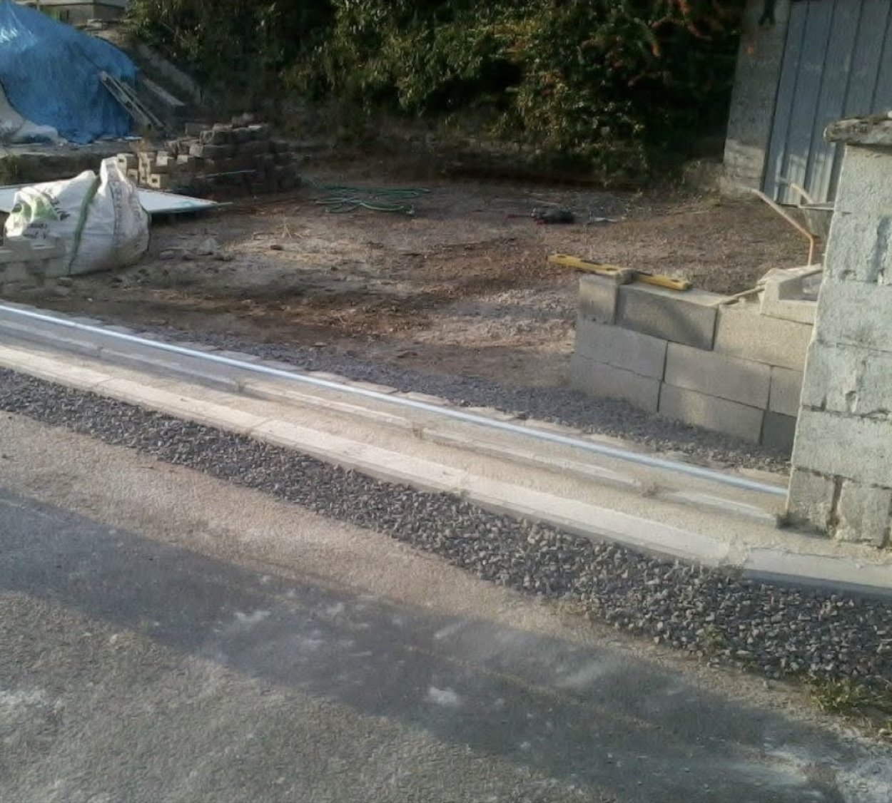
  </a>
  <figcaption>23 août 2012 : coulage de la longrine et du rail en béton</figcaption>
</figure>
<figure class="photo-slide" data-slide>
  <a href="images/2012-29aout-rail-sur-longrine.jpg" data-full="images/2012-29aout-rail-sur-longrine.jpg" data-alt="29 août 2012 : le rail posé sur la longrine en béton, gravillons et chaîne de protection" aria-label="Agrandir la photo 2 : 29 août 2012 : le rail posé sur la longrine">
    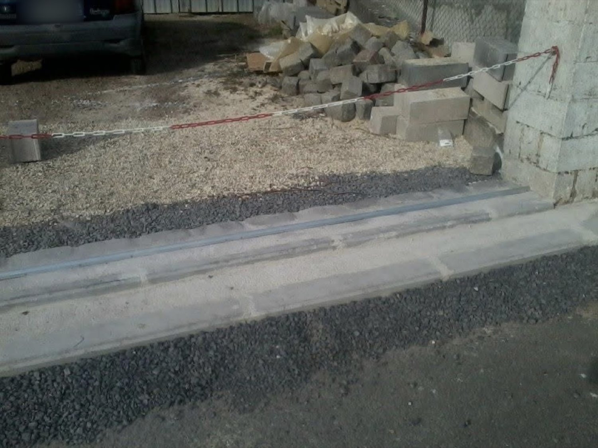
  </a>
  <figcaption>29 août 2012 : le rail posé sur la longrine</figcaption>
</figure>
<figure class="photo-slide" data-slide>
  <a href="images/2012-30aout-soudure-cadre-garage.jpg" data-full="images/2012-30aout-soudure-cadre-garage.jpg" data-alt="30 août 2012 : cadre du portail en cours de soudure dans le garage, poste à souder au premier plan" aria-label="Agrandir la photo 3 : 30 août 2012 : soudure du cadre du portail dans le garage">
    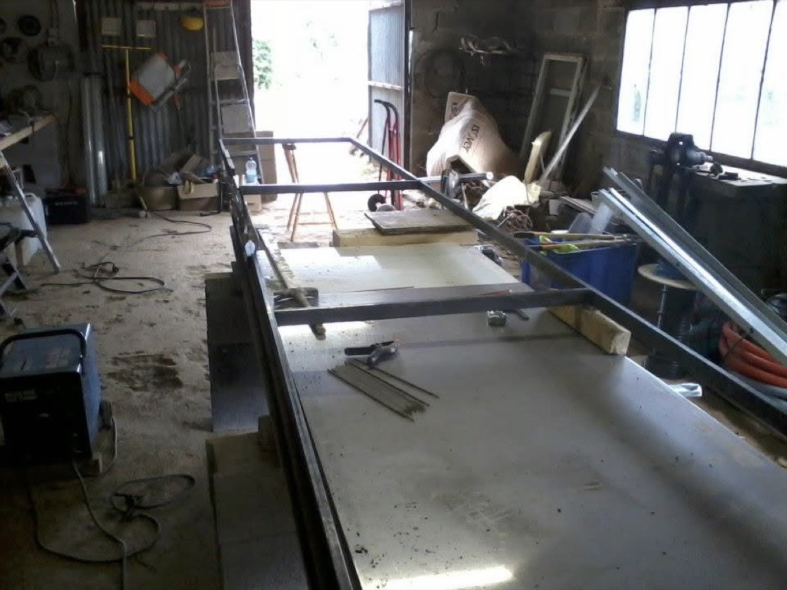
  </a>
  <figcaption>30 août 2012 : soudure du cadre du portail dans le garage</figcaption>
</figure>
<figure class="photo-slide" data-slide>
  <a href="images/2012-6sept-portail-pose-toles.jpg" data-full="images/2012-6sept-portail-pose-toles.jpg" data-alt="6 septembre 2012 : le portail posé sur son rail, avec les premières tôles" aria-label="Agrandir la photo 4 : 6 septembre 2012 : le portail posé, avec les premières tôles">
    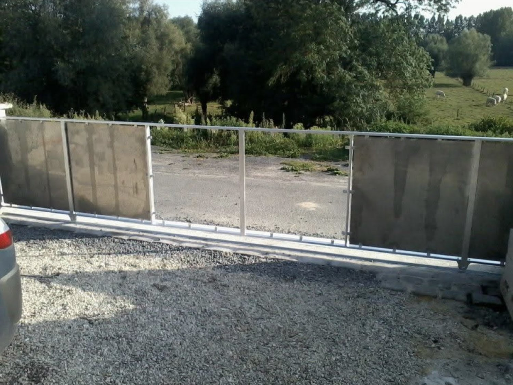
  </a>
  <figcaption>6 septembre 2012 : le portail posé, avec les premières tôles</figcaption>
</figure>
<figure class="photo-slide" data-slide>
  <a href="images/2012-7sept-vue-chantier.jpg" data-full="images/2012-7sept-vue-chantier.jpg" data-alt="7 septembre 2012 : vue d’ensemble du chantier, portail déjà en place" aria-label="Agrandir la photo 5 : 7 septembre 2012 : vue d’ensemble du chantier">
    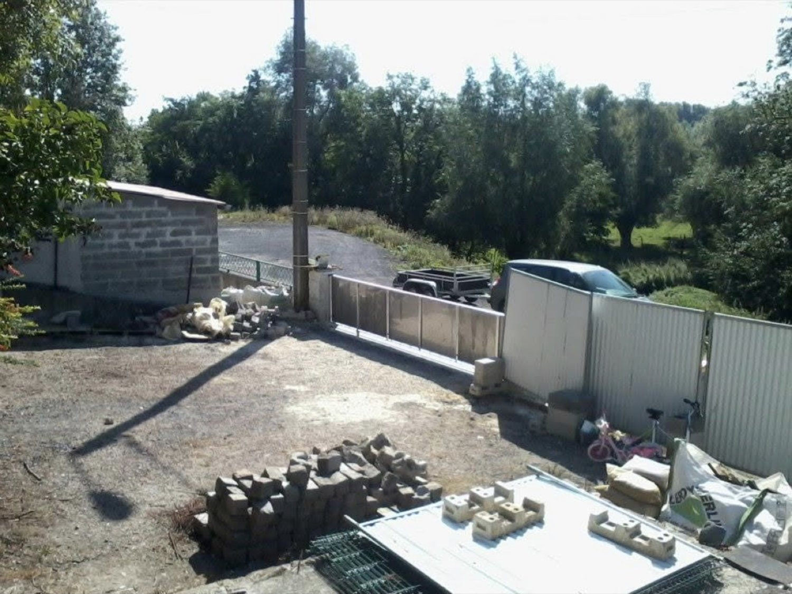
  </a>
  <figcaption>7 septembre 2012 : vue d’ensemble du chantier</figcaption>
</figure>
<figure class="photo-slide" data-slide>
  <a href="images/2012-7sept-portail-fini-toles.jpg" data-full="images/2012-7sept-portail-fini-toles.jpg" data-alt="7 septembre 2012 : le portail terminé, avec ses tôles, vu depuis la chaussée" aria-label="Agrandir la photo 6 : 7 septembre 2012 : le portail terminé, avec ses tôles">
    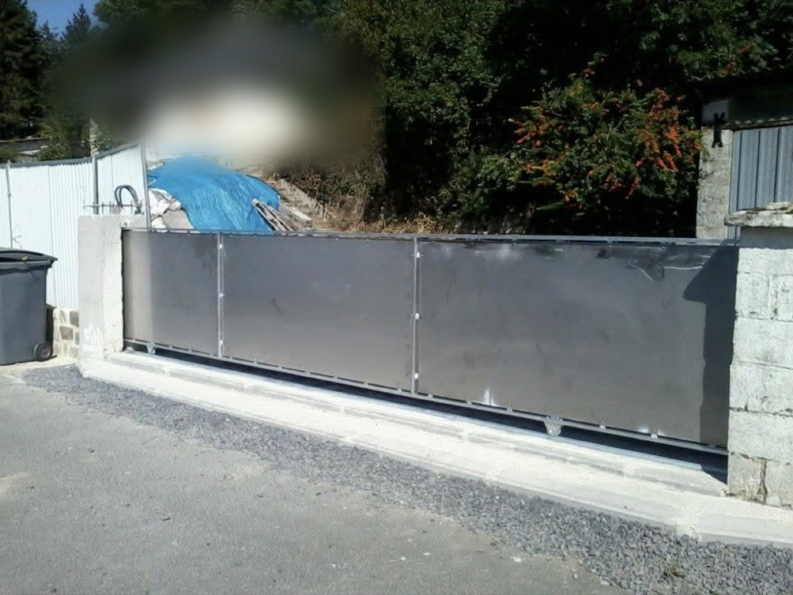
  </a>
  <figcaption>7 septembre 2012 : le portail terminé, avec ses tôles</figcaption>
</figure>
</div>
<button type="button" class="carousel-nav" data-prev aria-label="Faire défiler vers la gauche">‹</button>
<button type="button" class="carousel-nav" data-next aria-label="Faire défiler vers la droite">›</button>
<p class="carousel-hint">Faites défiler horizontalement pour voir les photos de la fabrication, en 2012.</p>
</section>

### J’ai mis le moteur en service en 2026

Cet été, Sam m’a donné le moteur Ditec CS122E. Il n’avait plus sa carte de commande d’origine. Les fils étaient là, le réducteur et le pignon aussi, mais rien pour le piloter proprement. Je voulais une solution locale, avec des photocellules de sécurité, et surtout pouvoir l’ouvrir depuis Home Assistant.

Le projet s’est déroulé de juin à août 2026 : j’ai identifié le moteur, choisi une carte universelle, câblé le tout, installé les cellules, puis ajouté un module Zigbee à contact sec. Aujourd’hui, ça fonctionne au quotidien : la carte referme le portail toute seule, et Home Assistant s’occupe de l’ouverture à l’arrivée et de l’éclairage.

### L’état de départ

Le moteur était là, avec son capot d’origine et son pignon. Sans la carte, les fils attendaient dans le boîtier blanc.

<figure class="ha-figure">
  <a href="images/moteur-depose-capot.jpg" data-full="images/moteur-depose-capot.jpg" data-alt="Moteur Ditec déposé, avec son capot vert d’origine et le pignon, vu depuis le dessous" aria-label="Agrandir : Le moteur déposé, avec son capot d’origine et le pignon.">
    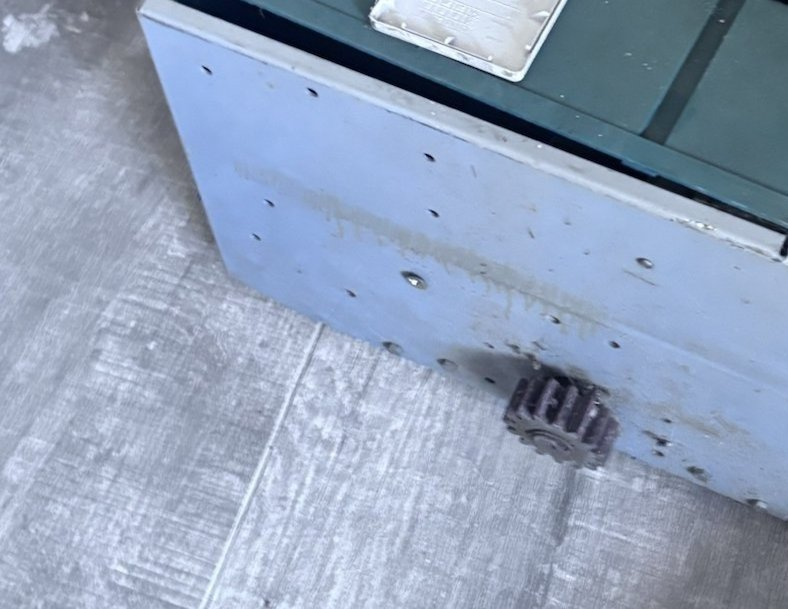
  </a>
  <figcaption>Le moteur déposé, avec son capot d’origine et le pignon.</figcaption>
</figure>
<figure class="ha-figure">
  <a href="images/moteur-sans-carte-boitier.jpg" data-full="images/moteur-sans-carte-boitier.jpg" data-alt="Moteur sans carte de commande : les fils attendent dans le boîtier blanc de raccordement" aria-label="Agrandir : Sans la carte d’origine : les fils attendent dans le boîtier blanc.">
    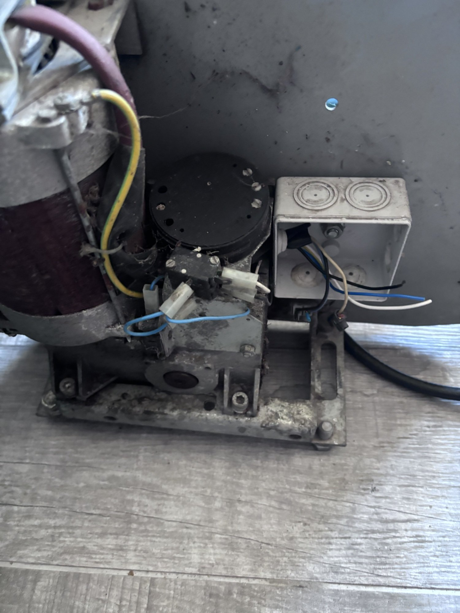
  </a>
  <figcaption>Sans la carte d’origine : les fils attendent dans le boîtier blanc.</figcaption>
</figure>

### Le moteur : un Ditec CS122E

Sur la plaque du moteur, on lit clairement **CS122E**, marque **Ditec**, alimentation **230 V ~ 50 Hz – 3 A**, service intermittent (S2 = 15 min / S3 = 25 %), vitesse **0,2 m/s**, force **1200 N**, indice **IPX5**, fabrication en Italie. C’est une unité d’entraînement complète (moteur + réducteur + pignon) pour un portail coulissant à crémaillère.

Sur le moteur lui-même, voici les couleurs que j’ai relevées :

- partie haute, isolant rouge : **deux fils bleus** (un relais qui autorise le mouvement du moteur ; ça claque, probablement une bobine) ;
- partie moteur, isolant orange : **un noir, un vert, un blanc**, et **jaune-vert pour la terre** ;
- fins de course mécaniques : **un blanc et un noir** ;
- le **vert** du câblage moteur est déjà relié à **un des deux bleus** du relais.

J’ai considéré le noir et le blanc comme les deux phases du moteur.

<section class="carousel photo-carousel ha-gallery" data-carousel data-lightbox aria-roledescription="carrousel" aria-label="Le moteur Ditec CS122E" tabindex="0">
<div class="carousel-track" data-track>
<figure class="photo-slide" data-slide>
  <a href="images/plaque-moteur-ditec-cs122e.jpg" data-full="images/plaque-moteur-ditec-cs122e.jpg" data-alt="Plaque signalétique du moteur Ditec CS122E : 230 V, 50 Hz, 3 A, 0,2 m/s, 1200 N" aria-label="Agrandir la photo 1 : La plaque du moteur Ditec CS122E">
    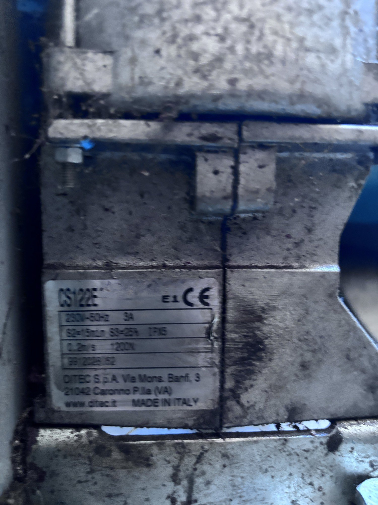
  </a>
  <figcaption>La plaque du moteur Ditec CS122E</figcaption>
</figure>
<figure class="photo-slide" data-slide>
  <a href="images/moteur-ditec-vue-generale.jpg" data-full="images/moteur-ditec-vue-generale.jpg" data-alt="Vue d’ensemble du moteur-réducteur Ditec, capot ouvert, boîtier de raccordement et fils" aria-label="Agrandir la photo 2 : Vue d’ensemble du moteur, capot ouvert">
    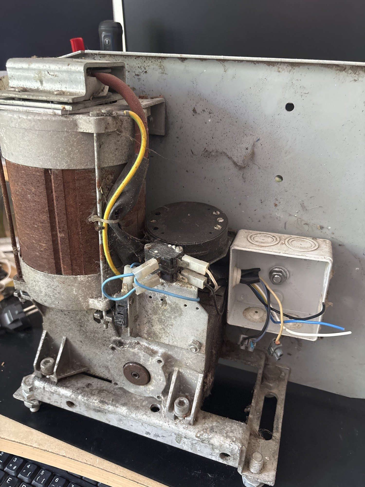
  </a>
  <figcaption>Vue d’ensemble du moteur, capot ouvert</figcaption>
</figure>
<figure class="photo-slide" data-slide>
  <a href="images/cables-moteur-couleurs.jpg" data-full="images/cables-moteur-couleurs.jpg" data-alt="Câbles du moteur : gaine rouge avec deux fils bleus, gaine orange avec noir, vert, blanc et terre jaune-vert" aria-label="Agrandir la photo 3 : Les couleurs des câbles du moteur">
    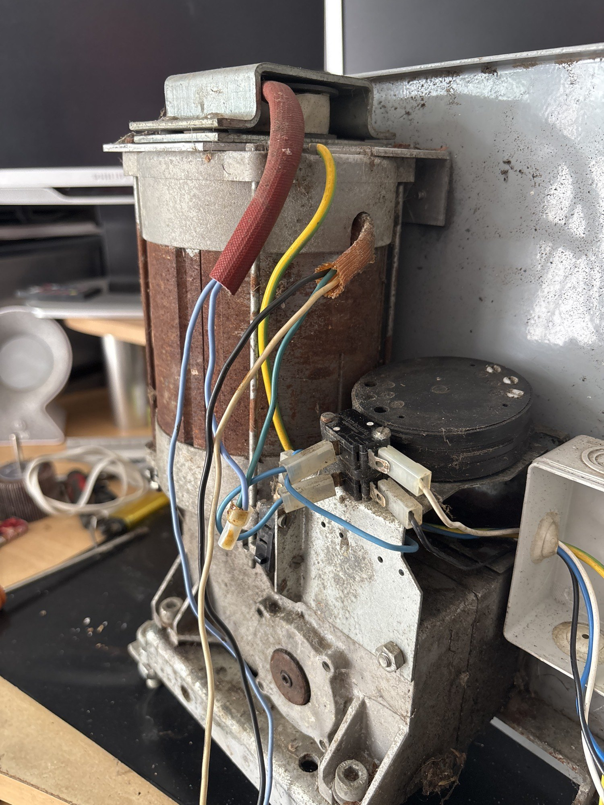
  </a>
  <figcaption>Les couleurs des câbles du moteur</figcaption>
</figure>
<figure class="photo-slide" data-slide>
  <a href="images/fins-de-course-mecaniques.jpg" data-full="images/fins-de-course-mecaniques.jpg" data-alt="Fins de course mécaniques du moteur, fils blanc et noir, capot noir rond" aria-label="Agrandir la photo 4 : Les fins de course mécaniques">
    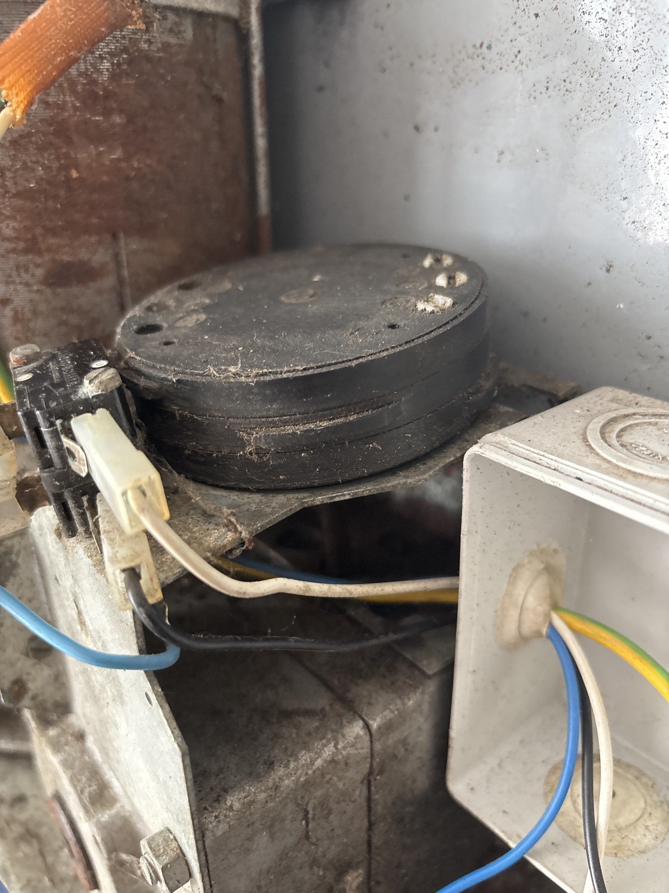
  </a>
  <figcaption>Les fins de course mécaniques</figcaption>
</figure>
<figure class="photo-slide" data-slide>
  <a href="images/microrupteur-fin-de-course.jpg" data-full="images/microrupteur-fin-de-course.jpg" data-alt="Gros plan d’un microrupteur de fin de course sur le carter du moteur" aria-label="Agrandir la photo 5 : Un microrupteur de fin de course">
    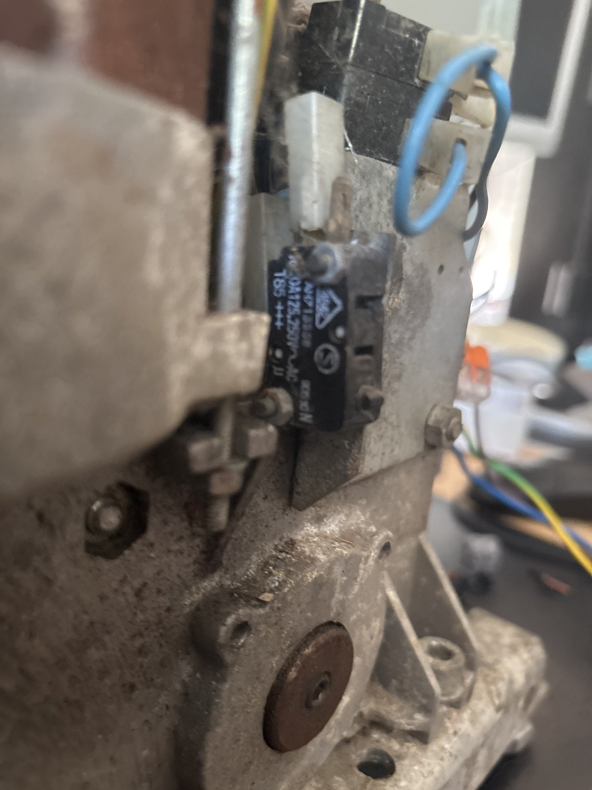
  </a>
  <figcaption>Un microrupteur de fin de course</figcaption>
</figure>
</div>
<button type="button" class="carousel-nav" data-prev aria-label="Faire défiler vers la gauche">‹</button>
<button type="button" class="carousel-nav" data-next aria-label="Faire défiler vers la droite">›</button>
<p class="carousel-hint">Faites défiler horizontalement pour voir les photos du moteur.</p>
</section>

### La carte : une universelle BLX-2 / FY-ODM-08C

J’ai d’abord regardé une carte FAAC 740D, puis j’ai choisi une carte universelle 220 V pour portail coulissant, vendue autour de **28,79 €**, référence **BLX-2** / **FY-ODM-08C** (parfois aussi FY-ODM-08WF sur l’annonce). Je l’ai reçue le 8 juillet 2026, avec sa notice.

Le bornier vert des commandes est clairement étiqueté :

`+12V | GND | IR_IN | ONE | GND | OPEN | STOP | CLS | GND`

Puis les fins de course **LMT1 / GND / LMT2**, le moteur **MOTO1 / COM / MOTO2**, et l’alimentation **PE / N / L**.

<section class="carousel photo-carousel ha-gallery" data-carousel data-lightbox aria-roledescription="carrousel" aria-label="La carte universelle BLX-2" tabindex="0">
<div class="carousel-track" data-track>
<figure class="photo-slide" data-slide>
  <a href="images/carte-blx2-recue.jpg" data-full="images/carte-blx2-recue.jpg" data-alt="Carte de commande universelle BLX-2 / FY-ODM-08C reçue, avec ses borniers" aria-label="Agrandir la photo 1 : La carte BLX-2 / FY-ODM-08C, telle que je l’ai reçue">
    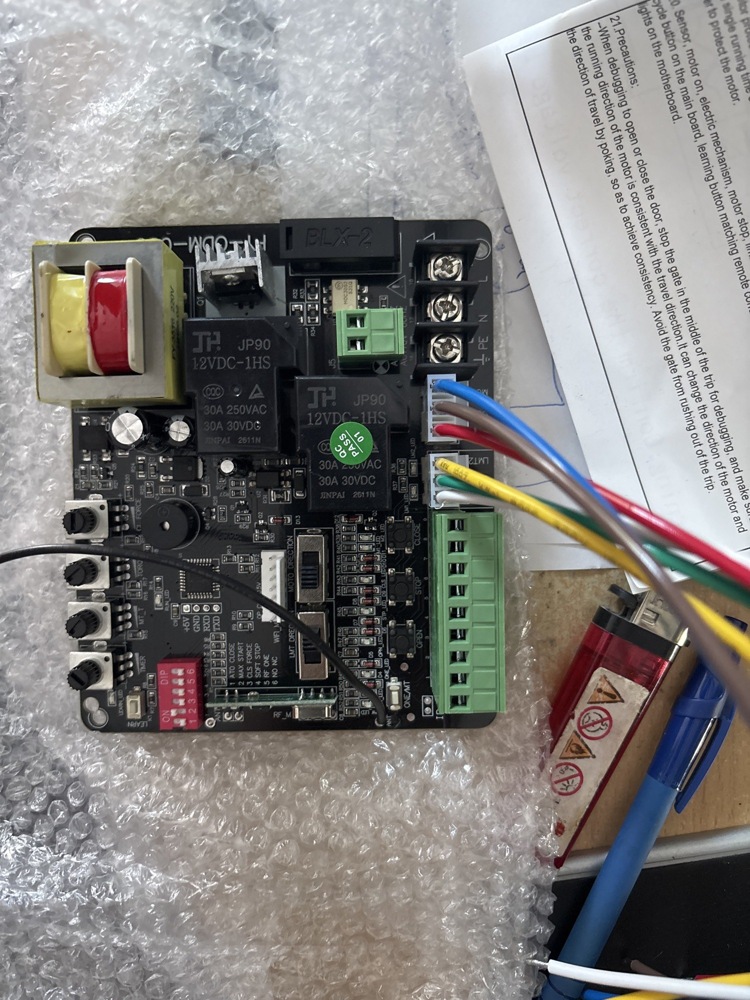
  </a>
  <figcaption>La carte BLX-2 / FY-ODM-08C, telle que je l’ai reçue</figcaption>
</figure>
<figure class="photo-slide" data-slide>
  <a href="images/carte-blx2-borniers.jpg" data-full="images/carte-blx2-borniers.jpg" data-alt="Borniers de la carte BLX-2 : +12V, IR_IN, ONE, OPEN, STOP, CLS, LMT1, LMT2, MOTO1, COM, MOTO2, PE, N, L" aria-label="Agrandir la photo 2 : Les borniers de la carte">
    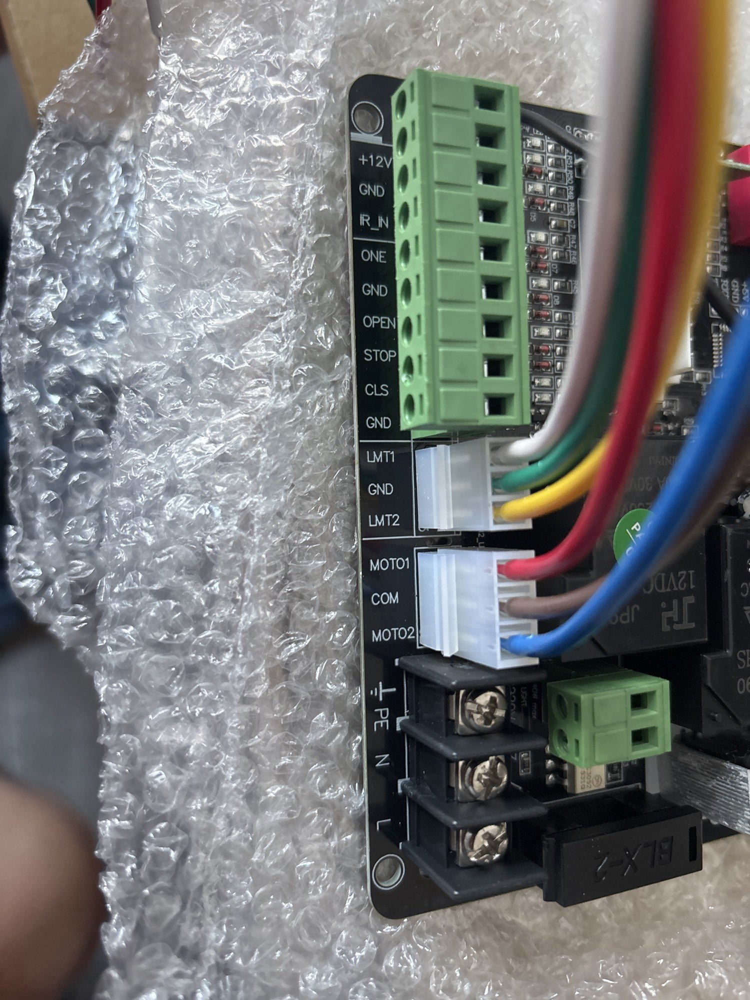
  </a>
  <figcaption>Les borniers de la carte</figcaption>
</figure>
<figure class="photo-slide" data-slide>
  <a href="images/notice-schema-fy-odm-08c.jpg" data-full="images/notice-schema-fy-odm-08c.jpg" data-alt="Schéma de la notice fournie avec la carte FY-ODM-08C" aria-label="Agrandir la photo 3 : Le schéma de la notice fournie avec la carte">
    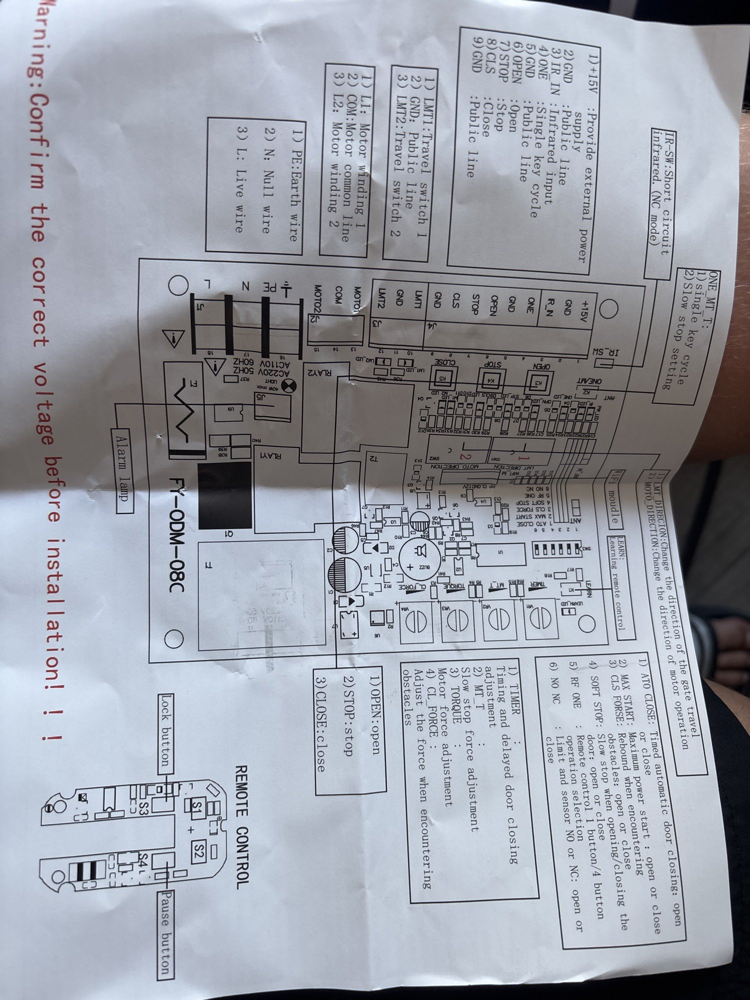
  </a>
  <figcaption>Le schéma de la notice fournie avec la carte</figcaption>
</figure>
</div>
<button type="button" class="carousel-nav" data-prev aria-label="Faire défiler vers la gauche">‹</button>
<button type="button" class="carousel-nav" data-next aria-label="Faire défiler vers la droite">›</button>
<p class="carousel-hint">Faites défiler horizontalement pour voir les photos de la carte.</p>
</section>

### Câblage du moteur sur la carte

C’est le branchement que j’ai suivi, à partir des couleurs que j’avais relevées :

| Élément | Fil | Borne sur la carte BLX-2 |
| --- | --- | --- |
| Alimentation 230 V | Phase | **L** |
| | Neutre | **N** |
| | Terre (jaune-vert) | **PE** |
| Moteur | Noir | **MOTO1** |
| | Blanc | **MOTO2** |
| | Vert (déjà relié à un bleu du relais) | **COM** |
| Condensateur | **12 µF 450 V** (à la place du 10 µF d’origine) | entre **MOTO1** et **MOTO2** |
| Fins de course | Blanc | **LMT1** |
| | Noir | **LMT2** |
| | Vert + un bleu (déjà ensemble) | **GND** |

### Tests à l’atelier

Avant de tout remettre en place, j’ai raccordé la carte au moteur sur l’établi : bornes Wago pour les fils, condensateur, puis la carte fixée sur le châssis. Premier test à la télécommande : le moteur tourne, puis s’arrête.

<section class="carousel photo-carousel ha-gallery" data-carousel data-lightbox aria-roledescription="carrousel" aria-label="Tests à l’atelier : implantation de la carte" tabindex="0">
<div class="carousel-track" data-track>
<figure class="photo-slide" data-slide>
  <a href="images/carte-fixee-sur-chassis.jpg" data-full="images/carte-fixee-sur-chassis.jpg" data-alt="Carte BLX-2 fixée sur le châssis du moteur, gaine rouge, condensateur attaché, montage d’atelier avant remise en place" aria-label="Agrandir la photo 1 : La carte fixée sur le châssis, avec le condensateur — le montage d’atelier, avant la pose">
    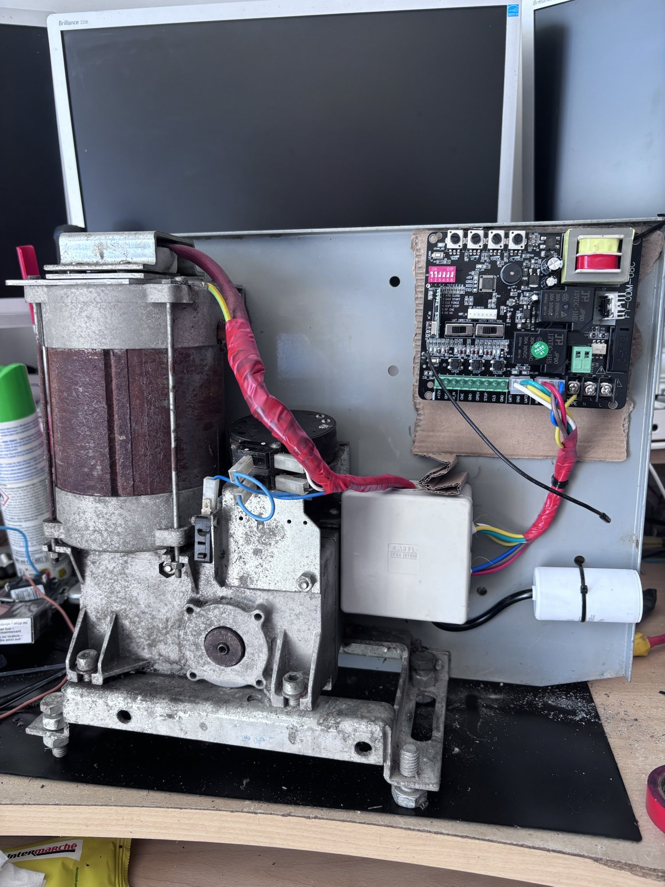
  </a>
  <figcaption>La carte fixée sur le châssis, avec le condensateur — le montage d’atelier, avant la pose</figcaption>
</figure>
<figure class="photo-slide" data-slide>
  <a href="images/carte-raccordement-moteur.jpg" data-full="images/carte-raccordement-moteur.jpg" data-alt="Carte BLX-2 sur l’établi, raccordée au moteur, boîtier de dérivation, condensateur blanc et bornes Wago" aria-label="Agrandir la photo 2 : La carte raccordée au moteur sur l’établi, avec le condensateur et les Wago">
    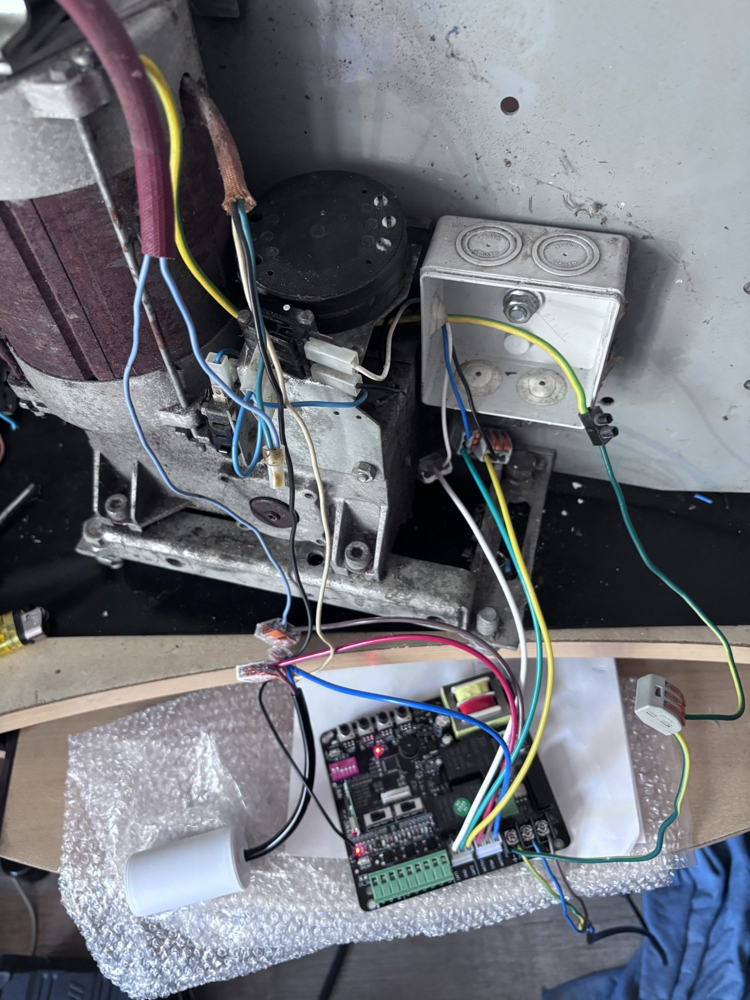
  </a>
  <figcaption>La carte raccordée au moteur sur l’établi, avec le condensateur et les Wago</figcaption>
</figure>
<figure class="photo-slide" data-slide>
  <a href="images/dominos-wago-fils-moteur.jpg" data-full="images/dominos-wago-fils-moteur.jpg" data-alt="Raccords Wago des fils moteur noir, blanc et bleu vers la carte, condensateur au premier plan" aria-label="Agrandir la photo 3 : Les raccords Wago des fils moteur vers la carte">
    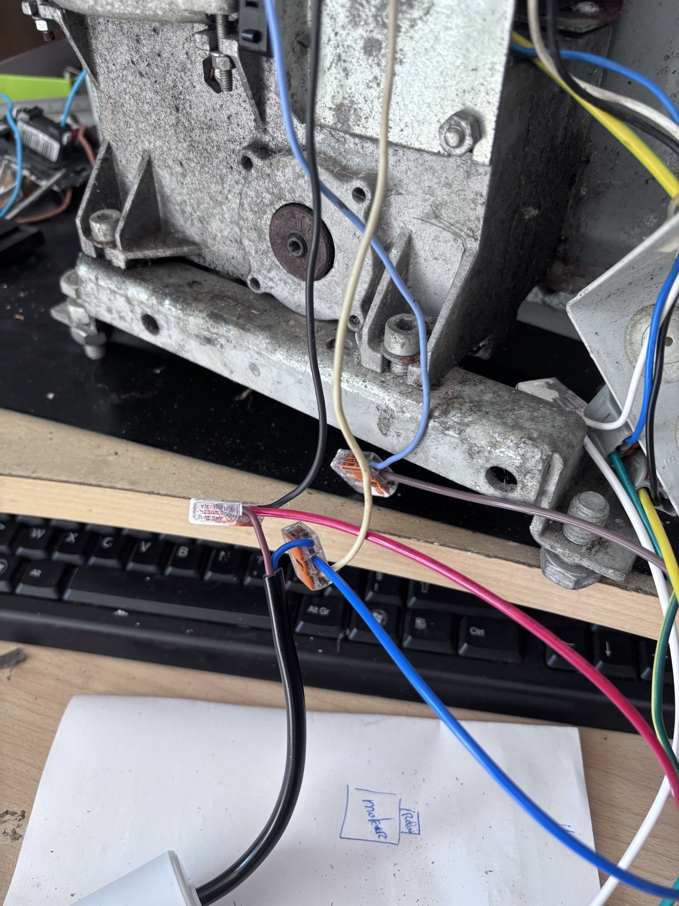
  </a>
  <figcaption>Les raccords Wago des fils moteur vers la carte</figcaption>
</figure>
</div>
<button type="button" class="carousel-nav" data-prev aria-label="Faire défiler vers la gauche">‹</button>
<button type="button" class="carousel-nav" data-next aria-label="Faire défiler vers la droite">›</button>
<p class="carousel-hint">Faites défiler horizontalement pour voir le montage sur l’établi.</p>
</section>
<figure class="creation-video-figure" id="test-etabli">
  <video class="creation-video" controls preload="none" playsinline poster="images/video-portail-poster.jpg">
    <source src="images/video-portail.mp4" type="video/mp4">
    Votre navigateur ne permet pas la lecture de la vidéo.
  </video>
  <figcaption>Premier test sur l’établi : la carte universelle pilote le moteur Ditec à la télécommande</figcaption>
</figure>


### Les photocellules : le branchement qui fonctionne vraiment

Le 18 juillet 2026, j’ai installé les cellules. Voici les couleurs que j’ai relevées :

- **Récepteur (RX)** : marron, marron blanc, bleu, bleu blanc, vert. En détail : **marron blanc = +**, **marron = −**, **bleu blanc = COM**, **bleu = NC**, **vert = NO**.
- **Émetteur (TX)** : **orange = +**, **blanc orange = −**.

Premier essai en branchant le **NC (bleu)** sur **IR_IN** : le portail est resté bloqué à l’ouverture. Les deux LED des cellules étaient allumées (donc alimentées et alignées), j’entendais bien le clic du relais en passant devant, mais la carte ne réagissait pas. En débranchant le fil sur **GND**, j’arrivais à ouvrir.

Le changement qui a débloqué le problème : passer le **vert (NO)** sur **IR_IN**, et laisser le **bleu (NC)** débranché. Ensuite, **ça fonctionne**.

**Branchement des cellules tel que validé :**

| Fil | Fonction | Branchement |
| --- | --- | --- |
| Marron blanc (RX) + orange (TX) | Alimentation + | **+12V** (bornier vert) |
| Marron (RX) + blanc orange (TX) | Alimentation − | **GND** |
| Bleu blanc (RX) | COM | **GND** |
| Vert (RX) | NO | **IR_IN** |
| Bleu (RX) | NC | **non branché** |

### Fermeture automatique et condensateur

Au début, le portail avait du mal à s’ouvrir quand le moteur était froid. J’ai commandé et posé un condensateur **12 µF 450 V** (à la place du 10 µF d’origine) : le démarrage à froid est réglé.

La **fermeture automatique est activée sur la carte** : c’est elle qui referme le portail, pas une automatisation Home Assistant.

### Pose sur place

Une fois le fonctionnement validé à l’atelier, j’ai posé le moteur dans son logement sous le muret, et la photocellule sur le poteau.

<figure class="ha-figure">
  <a href="images/moteur-dans-le-muret.jpg" data-full="images/moteur-dans-le-muret.jpg" data-alt="Moteur installé dans son logement sous le muret en parpaings, capot noir, côté extérieur" aria-label="Agrandir : Le moteur posé dans son logement, sous le muret.">
    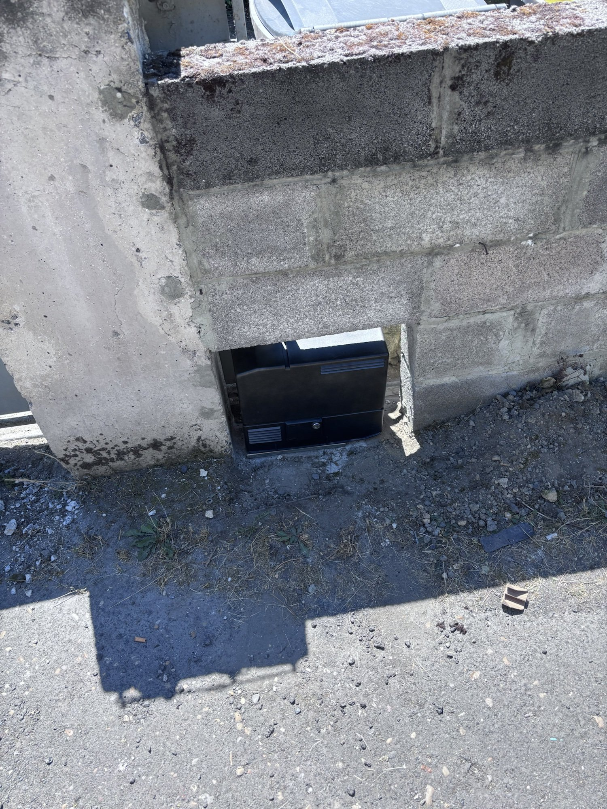
  </a>
  <figcaption>Le moteur posé dans son logement, sous le muret.</figcaption>
</figure>
<figure class="ha-figure">
  <a href="images/photocellule-poteau-moteur.jpg" data-full="images/photocellule-poteau-moteur.jpg" data-alt="Photocellule noire fixée sur le poteau, moteur en place derrière" aria-label="Agrandir : La photocellule sur le poteau, avec le moteur juste derrière.">
    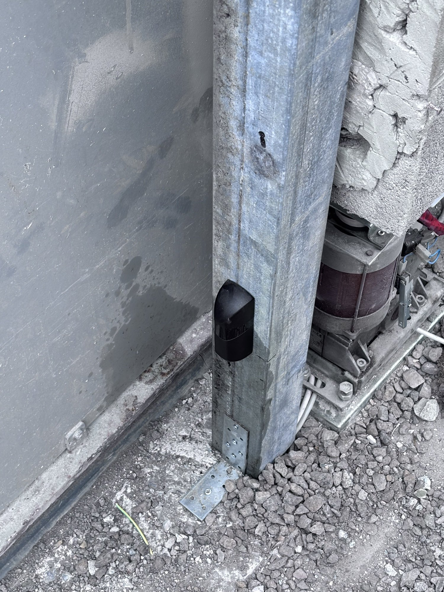
  </a>
  <figcaption>La photocellule sur le poteau, avec le moteur juste derrière.</figcaption>
</figure>

Voici le montage final : la carte BLX-2 dans un coffret étanche, à côté du moteur, en place.

<figure class="ha-figure ha-figure-result">
  <a href="images/coffret-etanche-carte-installee.jpg" data-full="images/coffret-etanche-carte-installee.jpg" data-alt="Montage final : carte BLX-2 installée dans un coffret étanche, à côté du moteur, en place sous le muret" aria-label="Agrandir : Le montage final : la carte dans son coffret étanche, à côté du moteur.">
    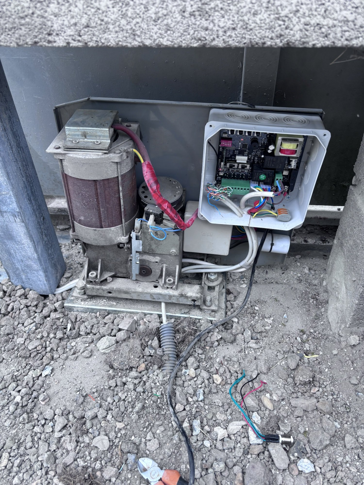
  </a>
  <figcaption>Le montage final : la carte dans son coffret étanche, à côté du moteur.</figcaption>
</figure>

### Le portail en place

<figure class="ha-figure">
  <a href="images/portail-installe-gyrophare.jpg" data-full="images/portail-installe-gyrophare.jpg" data-alt="Portail coulissant gris en place, poteau avec gyrophare orange, photocellule, muret, et moteur à la base" aria-label="Agrandir : Le portail en place, avec le gyrophare, la photocellule et le moteur à la base du muret.">
    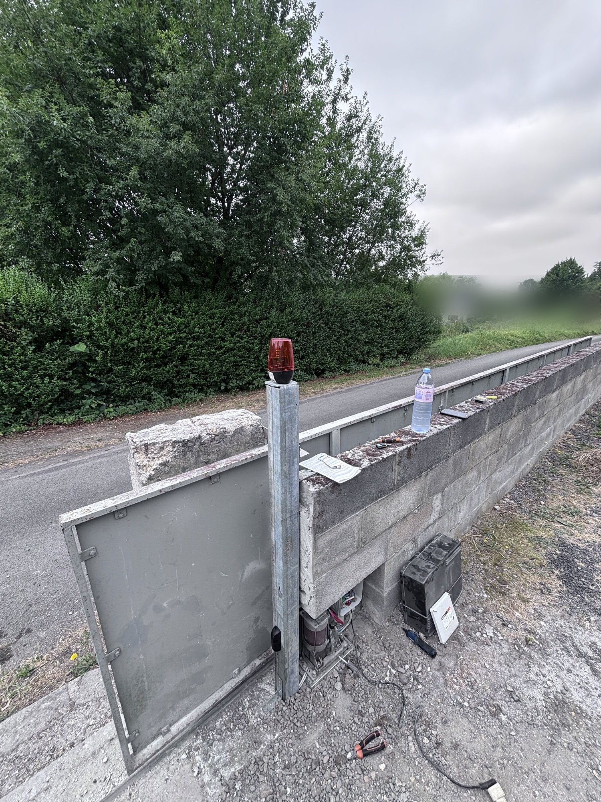
  </a>
  <figcaption>Le portail en place, avec le gyrophare, la photocellule et le moteur à la base du muret.</figcaption>
</figure>

### Le piloter en Zigbee avec un Sonoff MINI-ZBD

Début août, j’ai voulu aussi commander le portail en Zigbee, et allumer automatiquement l’éclairage à l’ouverture. J’ai acheté un **Sonoff MINI-ZBD**, module à **contact sec** (bornes **NO / COM / NC**, alimentation possible en **DC+ / DC−**). Je suis sur **Zigbee2MQTT** et **Home Assistant**. Dans Zigbee2MQTT, l’appareil apparaît comme **MINI-ZBD**, sous le nom **Portail voiture**. Dans Home Assistant, son entité est **`switch.portail_voiture`**.

Le Sonoff est câblé ainsi, alimenté en **12 V** depuis la carte :

| Sonoff MINI-ZBD | Carte BLX-2 |
| --- | --- |
| DC+ | +12V |
| DC− | GND |
| COM | GND |
| NO | **ONE** (cycle ouverture / arrêt / fermeture) |

Pas d’alimentation 230 V (N / L) en même temps que le 12 V, et rien de branché sur **S1** / **S2**.

Pendant les premiers essais, le portail **restait ouvert** : le Sonoff était sur **ON** et **revenait tout seul sur ON**. Sur les captures Zigbee2MQTT de ce moment-là (le 15 août 2026), **Inching control** était encore sur **DISABLE**, et le **Power-on behavior** sur **previous**. Pour un portail, le contact doit faire une **impulsion courte**, pas rester fermé.

Aujourd’hui, l’**inching** est bien à **0,5 s**, et le module **ne repasse plus tout seul sur ON**. Les réglages actuellement reportés dans Zigbee2MQTT sont :

- **Inching control** : `ENABLE`
- **Inching time** : `0,5` s
- **External trigger mode** : `edge`
- **Power-on behavior** : `toggle`
- **Detach relay** : `off`

<section class="carousel photo-carousel ha-gallery" data-carousel data-lightbox aria-roledescription="carrousel" aria-label="Le Sonoff MINI-ZBD et Zigbee2MQTT" tabindex="0">
<div class="carousel-track" data-track>
<figure class="photo-slide" data-slide>
  <a href="images/sonoff-mini-zbd.jpg" data-full="images/sonoff-mini-zbd.jpg" data-alt="Module Sonoff MINI-ZBD à contact sec : bornes NO, COM, NC, et alimentation N, L, DC+, DC-" aria-label="Agrandir la photo 1 : Le Sonoff MINI-ZBD, module à contact sec">
    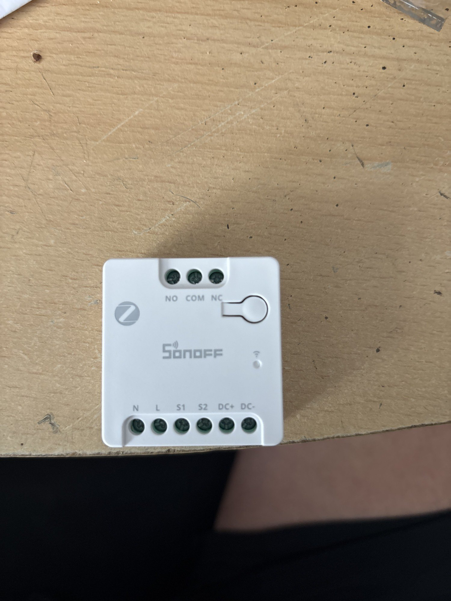
  </a>
  <figcaption>Le Sonoff MINI-ZBD, module à contact sec</figcaption>
</figure>
<figure class="photo-slide" data-slide>
  <a href="images/z2m-appareil-portail-voiture.jpg" data-full="images/z2m-appareil-portail-voiture.jpg" data-alt="L’appareil Portail voiture dans Zigbee2MQTT : modèle SONOFF MINI-ZBD, support natif (adresses masquées)" aria-label="Agrandir la photo 2 : L’appareil Portail voiture dans Zigbee2MQTT">
    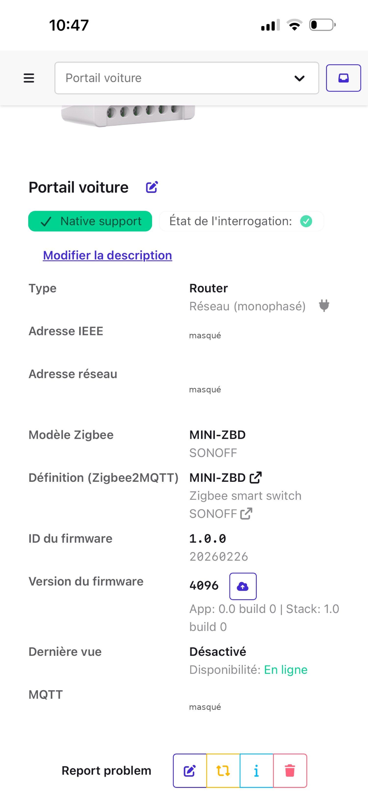
  </a>
  <figcaption>L’appareil Portail voiture dans Zigbee2MQTT</figcaption>
</figure>
<figure class="photo-slide" data-slide>
  <a href="images/z2m-inching-desactive.jpg" data-full="images/z2m-inching-desactive.jpg" data-alt="Capture des premiers essais, le 15 août 2026 : Inching control encore sur DISABLE dans Zigbee2MQTT (réglage depuis modifié)" aria-label="Agrandir la photo 3 : Premiers essais, le 15 août 2026 : l’inching était encore désactivé (réglage depuis modifié)">
    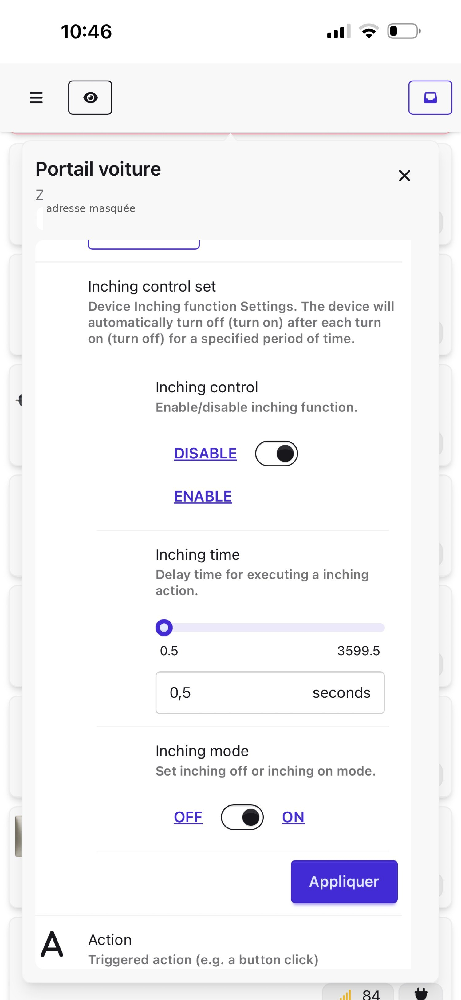
  </a>
  <figcaption>Premiers essais, le 15 août 2026 : l’inching était encore désactivé (réglage depuis modifié)</figcaption>
</figure>
</div>
<button type="button" class="carousel-nav" data-prev aria-label="Faire défiler vers la gauche">‹</button>
<button type="button" class="carousel-nav" data-next aria-label="Faire défiler vers la droite">›</button>
<p class="carousel-hint">Faites défiler horizontalement pour voir le module et les captures Zigbee2MQTT.</p>
</section>

### Comment on ouvre le portail au quotidien

Les télécommandes servent à mes enfants, pour sortir. Ma femme et moi, on ouvre le portail avec la fonction du téléphone connecté à la voiture, et aussi grâce à l’ouverture automatique à l’arrivée dans Home Assistant.

<h3 id="automatisations">Les automatisations Home Assistant</h3>

Elles sont en place et actives. Le YAML ci-dessous est une version nettoyée pour la lecture : j’ai retiré les identifiants d’appareil, et j’ai remplacé les « actions d’appareil » par l’équivalent `switch.turn_on` / `switch.turn_off`. Les personnes et les notifications sont généralisées (`person.membre_famille`, `notify.mobile_app_telephone`) : dans mon installation, j’ai la même logique pour chaque membre de la famille concerné.

#### Allumer l’éclairage à l’ouverture

`switch.exterieur_garage` est une **prise Tuya Zigbee** (avec mesure de consommation). Quand le Sonoff passe à `on`, cette prise s’allume en même temps que `switch.flash_alarm`, puis tout s’éteint après **2 minutes** (mode `restart` : si on rouvre pendant le délai, le compte à rebours repart).

```yaml
alias: "Lampe portail - Allumage automatique"
description: "Allume la prise et switch.flash_alarm quand on ouvre le portail, puis les éteint après 2 minutes"
trigger:
  - platform: state
    entity_id: switch.portail_voiture
    to: "on"
action:
  - service: switch.turn_on
    target:
      entity_id:
        - switch.exterieur_garage
        - switch.flash_alarm
  - delay: "00:02:00"
  - service: switch.turn_off
    target:
      entity_id:
        - switch.exterieur_garage
        - switch.flash_alarm
mode: restart
```

#### Ouvrir le portail à l’arrivée

Quand un membre de la famille arrive à la maison, Home Assistant allume la prise, envoie une notification, puis active `switch.portail_voiture` (donc une impulsion sur **ONE**). Il n’y a **pas** d’automatisation de fermeture : la fermeture automatique est activée sur la carte.

```yaml
alias: "Ouverture du portail à l’arrivée"
description: "À l’arrivée d’un membre de la famille : allume la prise, envoie une notification et ouvre le portail"
trigger:
  - platform: state
    entity_id: person.membre_famille
    from: not_home
    to: home
action:
  - service: switch.turn_on
    target:
      entity_id: switch.exterieur_garage
  - service: notify.mobile_app_telephone
    data:
      message: "Ouverture portail en cours !"
  - service: switch.turn_on
    target:
      entity_id: switch.portail_voiture
mode: single
```

<h4 id="detection-de-larrivee">Détection de l’arrivée</h4>

L’arrivée est détectée uniquement par le GPS de l’application **Home Assistant Companion**, sur iPhone. Chaque personne a un seul `device_tracker` (intégration `mobile_app`, source GPS). La zone utilisée est la zone `home` par défaut de Home Assistant, avec son rayon standard.

Il n’y a pas de détection par Wi-Fi, ni par Bluetooth, ni par CarPlay. Le déclencheur, tel qu’il est en place, est le passage de la personne de `not_home` à `home`, sans autre condition.

Une piste d’amélioration, qui n’est pas ce qui est en place aujourd’hui : comme le déclencheur exige `from: not_home`, une arrivée directe depuis une autre zone nommée (Travail, École…) ne déclenche pas l’ouverture. Une variante plus robuste consisterait à n’utiliser que `to: home`, éventuellement avec une condition (heure, vitesse).

### Matériel

- Portail coulissant fabriqué en 2012 (longrine et rail en béton, cadre soudé, tôles)
- Moteur de portail coulissant **Ditec CS122E** (230 V, déjà en ma possession, sans carte d’origine en 2026)
- Carte de commande universelle **BLX-2 / FY-ODM-08C**, 220 V, avec fins de course mécaniques
- Coffret étanche pour la carte, posé à côté du moteur
- Photocellules de sécurité (RX 5 fils + TX 2 fils, contact relais COM / NC / NO)
- Condensateur moteur **12 µF 450 V** (à la place du 10 µF d’origine)
- Module **Sonoff MINI-ZBD** (contact sec Zigbee), intégré via **Zigbee2MQTT** (`switch.portail_voiture`)
- Prise Tuya Zigbee avec mesure : `switch.exterieur_garage`
- Interrupteur `switch.flash_alarm`
- Home Assistant (ouverture à l’arrivée et éclairage automatique)
- Application Home Assistant Companion (iOS), détection d’arrivée par GPS
