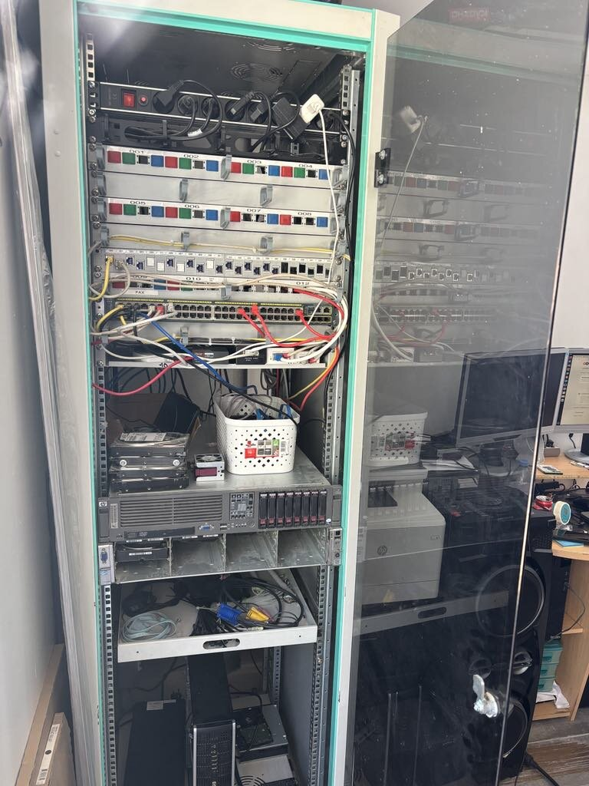
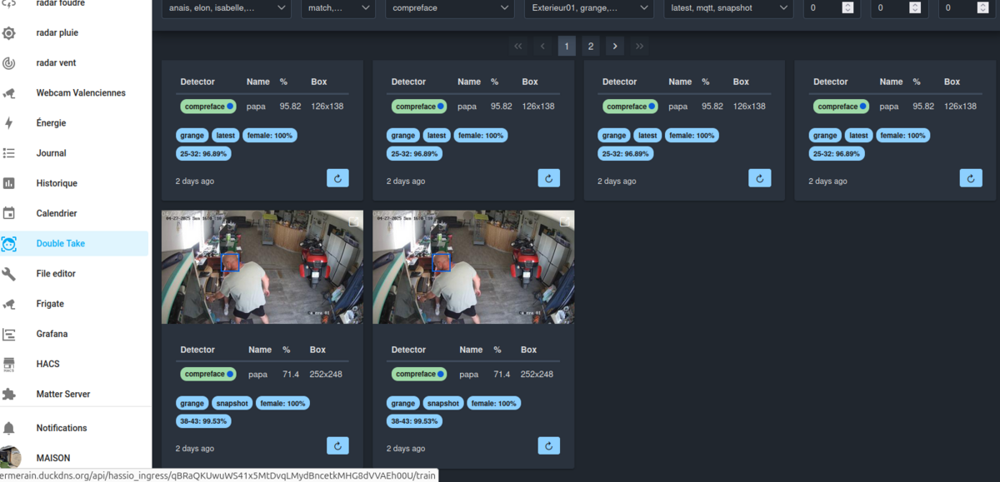

<p class="forum-cta"><a href="https://forumdomotique.com/forums/topic/100-mon-homelab-configuration-et-setup/">Lire et commenter sur Forum Domotique</a></p>

# Mon Homelab - Configuration et Setup

- **Catégorie :** [Présentation des Homelabs](https://forumdomotique.com/forums/78-pr%C3%A9sentation-des-homelabs/)
- **Sujet :** https://forumdomotique.com/forums/topic/100-mon-homelab-configuration-et-setup/
- **Auteur du premier message du sujet :** XAV59213
- **Messages de XAV59213 dans ce sujet :** 2
- **Premier message de XAV59213 :** 28 avril 2025 à 15:29 (Europe/Paris)
- **Dernier message de XAV59213 :** 29 avril 2025 à 17:06 (Europe/Paris)

---

## Message 1 — 28 avril 2025 à 15:29 (Europe/Paris)

- **Identifiant :** `173`
- **Lien :** https://forumdomotique.com/forums/topic/100-mon-homelab-configuration-et-setup/#findComment-173

## Serveur

- **Modèle** : HP ProLiant DL380e Gen8
- **CPU** : 32 cœurs modèle, 2x Intel Xeon E5-2690v2,
- **Mémoire** : 64 Gio
- **Stockage** : 10 To RAID avec contrôleur HP Smart Array
- **Système d’exploitation** : Proxmox VE (version 8.4.1)
- **UPS** (onduleur)

## Réseau

- **Switch** : Cisco Catalyst 2960S
- **Routeur/FAI** : Freebox Delta
- **Stockage réseau** : 2x 2 To en RAID pour les sauvegardes
- **Caméras** : 5 caméras Hikvision PoE

## Virtualisation (Proxmox)

### Machines virtuelles (VMs) :

- **Home Assistant (Production)** : Automatisation domestique
- **Home Assistant (Test)** : Environnement de test pour les mises à jour et intégrations

### Conteneurs LXC :

- **Frigate** : Détection d’objets pour les caméras, accéléré par 1 clés Coral USB (TPU) en l’absence de GPU
- **Compreface** : Reconnaissance faciale
- **Double Take** : Sauvegarde et synchronisation
- **Homebridge** : Intégration
- **ESPHome** : Gestion des dispositifs ESP
- **Migration prévue** : Zigbee2MQTT et MQTT (à migrer vers Proxmox)

### Configuration Zigbee :

- **Clés Zigbee** : 2x Sonoff Zigbee 3.0 USB Dongle

  - **Coordinatrice** : Sonoff Zigbee 3.0 USB Dongle configurée comme coordinatrice pour le réseau Zigbee via Zigbee2MQTT
  - **Routeur** : Sonoff Zigbee 3.0 USB Dongle configurée comme routeur pour étendre la couverture et la stabilité du réseau Zigbee.

## Configuration réseau

- **Réseau principal** : Géré par la Freebox Delta
- **Réseau secondaire** : Géré par le switch Cisco Catalyst 2960S
- **Caméras** : Alimentées via PoE, connectées au switch Cisco Catalyst 2960S
- **Serveur** : Connectées au switch Cisco Catalyst 2960S

  
<!-- source : https://cdn.forumdomotique.com/monthly_2025_04/HOMELAB.jpeg.31e990706533a872c08fa20a9dfdc63e.jpeg -->

---

---

## Message 2 — 29 avril 2025 à 17:06 (Europe/Paris)

- **Identifiant :** `189`
- **Lien :** https://forumdomotique.com/forums/topic/100-mon-homelab-configuration-et-setup/#findComment-189

> **Il y a 17 heures, Ellywick a dit :**
> Bonjour,
>
> Belle bête ce HP DL380e. Par contre, sa consommation doit faire mal sur le facture EDF 🙂
>
> Merci pour **Compreface,** je ne connaissais pas. Je vais regarder si je peux l’intégrer dans mon système de surveillance

"Je confirme, l'ensemble consomme 230 W. Le matériel commence à dater mais fonctionne au top.

Pour info, j'ai installé le module **Double Take** (<https://github.com/skrashevich/double-take/>) sur Home Assistant, ainsi que **CompreFace** (<https://github.com/exadel-inc/CompreFace>) via Docker sur Proxmox.

Si quelqu'un veut que je teste un serveur, je suis dispo, n'hésitez pas ! 😄"

"Tu fais bien de le souligner ! Il est temps d'investir dans les panneaux solaires ! Si des fabricants passent par le Forum, n'hésitez pas à me contacter. Je me ferai un plaisir de partager toute la configuration, et détailler l'installation et de répondre à vos questions ! 😊"

Ci-dessous ma config de double take:

```yaml
# Double Take
# Learn more at https://github.com/skrashevich/double-take/#configuration
mqtt:
  host: 192.168.0.123
  user: usermqtt
  password: passemqtt

recorder:
  topics:
    frigate: frigate/events
    homeassistant: homeassistant
    matches: double-take/matches
    cameras: double-take/cameras

frigate:
  url: http://frigate:5000
  update_sub_labels: false
  stop_on_match: true
  labels:
    - person
  attempts:
    latest: 10
    snapshot: 10
  mqtt: true
  cameras:
    - Exterieur03
    - Exterieur02
    - Exterieur01
    - grange
    - salon

cameras:
  Exterieur03:
    detect:
      match:
        save: true
        base64: false
      unknown:
        save: true
        base64: false
  Exterieur01:
    detect:
      match:
        save: true
        base64: false
      unknown:
        save: true
        base64: false
  Exterieur02:
    detect:
      match:
        save: true
        base64: false
      unknown:
        save: true
        base64: false
  grange:
    detect:
      match:
        save: true
        base64: false
      unknown:
        save: true
        base64: false
  salon:
    detect:
      match:
        save: true
        base64: false
      unknown:
        save: true
        base64: false

detect:
  match:
    save: true
    base64: false
    confidence: 70  # Augmenté pour réduire les faux positifs
    purge: 72       # Réduit à 3 jours pour optimiser le stockage
    min_area: 15000 # Filtre les petites détections

  unknown:
    save: true
    base64: false
    confidence: 50  # Augmenté pour limiter les inconnus non pertinents
    purge: 24       # Étendu à 24h pour une analyse plus approfondie
    min_area: 5000  # Ajouté pour filtrer les petites détections

detectors:
  compreface:
    url: http://192.168.0.180:8020    # ton ip compreface et ton port
    key: 5hjk-afec-4240-843uuc-dd2e5  # ta key compreface
    timeout: 15
    det_prob_threshold: 0.85  # Augmenté pour plus de précision
    opencv_face_required: True
    face_plugins: gender,age  # Plugins activés pour genre et âge
    cameras:
      - Exterieur03  # Limité aux caméras critiques
      - Exterieur01
      - Exterieur02
      - grange
      - salon
      # CA FONCTIONNE QUE SI TU ACTIVE DETECT ET SNAP SUR FIGATE ET QUE COMPREFACE EST INSTALLER 
```


<!-- source : https://cdn.forumdomotique.com/monthly_2025_04/Capturedcrandu2025-04-2917-11-24.png.2cf19060e017fcb35b32400547cbf99d.png -->

---
