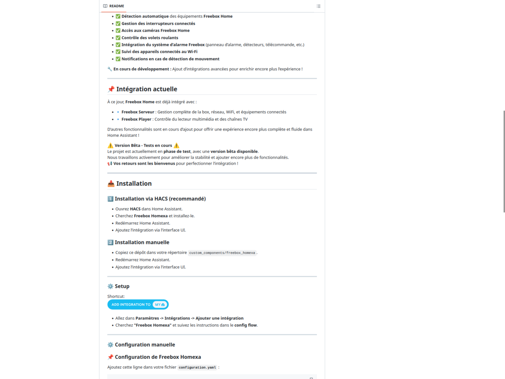

<a href="https://forumdomotique.com/forums/topic/101-pr%C3%A9sentation-du-projet-freebox_homexa/">Lire et commenter sur Forum Domotique</a> · <a href="https://github.com/XAV59213/freebox_homexa">Dépôt HACS : Freebox Homexa</a>

# Présentation du projet freebox_homexa

- **Catégorie :** [Projets et Personnalisations](https://forumdomotique.com/forums/12-projets-et-personnalisations/)
- **Sujet :** https://forumdomotique.com/forums/topic/101-pr%C3%A9sentation-du-projet-freebox_homexa/
- **Auteur du premier message du sujet :** XAV59213
- **Messages de XAV59213 dans ce sujet :** 1
- **Premier message de XAV59213 :** 28 avril 2025 à 16:08 (Europe/Paris)

---

## Message 1 — 28 avril 2025 à 16:08 (Europe/Paris)

- **Identifiant :** `175`
- **Lien :** https://forumdomotique.com/forums/topic/101-pr%C3%A9sentation-du-projet-freebox_homexa/#findComment-175

Bonjour à tous,

Je suis ravi de vous présenter **freebox_homexa**, un projet open-source disponible sur [GitHub](https://github.com/XAV59213/freebox_homexa).

L'objectif principal de ce projet est de **réunifier et centraliser les différents codes et scripts existants pour la Freebox** trouvés sur GitHub,

afin de proposer une solution cohérente et accessible pour interagir avec cette box.

### Contexte et motivation

La Freebox est un outil puissant, mais les solutions pour l'automatisation ou l'intégration (notamment avec des systèmes comme Home Assistant) sont souvent dispersées, fragmentées ou difficiles à mettre en œuvre. Ce projet vise à **simplifier l'expérience utilisateur** en regroupant ces ressources, en les optimisant et en les rendant plus faciles à utiliser volet capteur système d'alarme ect....

### Fonctionnalités principales

- **Centralisation** : Unification des scripts et codes pour contrôler la Freebox (API, automatisation, etc.).
- **Compatibilité** : Intégration facilitée avec des plateformes comme Home Assistant.
- **Documentation claire** : Pour aider les utilisateurs à prendre en main le projet rapidement.

### Remerciements

Ce projet n'aurait pas vu le jour sans les contributions et inspirations de la communauté. Je tiens à adresser un **grand merci** à :

- **Steph73HB**
- **gvigroux**

### Prochaines étapes

- Améliorer la documentation et les tutoriels.
- Ajouter de nouvelles fonctionnalités .
- Recueillir vos retours pour faire évoluer le projet !

N'hésitez pas à explorer le dépôt GitHub, tester le projet et partager vos idées ou suggestions. Vos retours sont précieux pour faire avancer **freebox_homexa** !

Merci à tous pour votre attention, et à bientôt sur le forum ou sur GitHub !

<!-- source : https://cdn.forumdomotique.com/monthly_2025_04/Capturedcrandu2025-04-2816-05-26.png.1b8c82f6242ca5e5d4b556664f578b07.png -->

---
