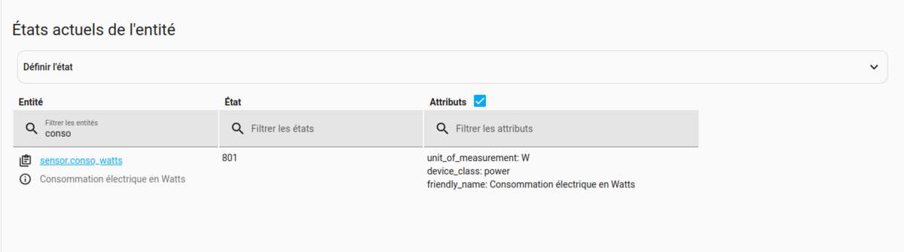


<p class="forum-cta"><a href="https://forumdomotique.com/forums/topic/102-lixee-ne-remonte-pas-linjection-des-panneaux-solaire/">Lire et commenter sur Forum Domotique</a></p>

# Lixee ne remonte pas l’injection des panneaux solaire

- **Catégorie :** [Autres marques de matériel domotique](https://forumdomotique.com/forums/59-autres-marques-de-mat%C3%A9riel-domotique/)
- **Sujet :** https://forumdomotique.com/forums/topic/102-lixee-ne-remonte-pas-linjection-des-panneaux-solaire/
- **Auteur du premier message du sujet :** un autre membre (XAV59213 a répondu dans ce sujet)
- **Messages de XAV59213 dans ce sujet :** 1
- **Premier message de XAV59213 :** 29 avril 2025 à 18:27 (Europe/Paris)

---

## Message 1 — 29 avril 2025 à 18:27 (Europe/Paris)

- **Identifiant :** `190`
- **Lien :** https://forumdomotique.com/forums/topic/102-lixee-ne-remonte-pas-linjection-des-panneaux-solaire/#findComment-190

Salut dan,

La conversion de la puissance apparente (VA) en watts (W) avec LiXee ZLinky dans Homeassitant

il faut créer un capteur sensor template dans Home Assistant pour convertir les VA en W et l'afficher dans un tableau de bord ou le tableau de bord Énergie.

Moi je passe par des feuille séparer :

Exemple feuille sensor.yaml

```yaml
      conso_watts:
        friendly_name: "Consommation électrique en Watts"
        unit_of_measurement: "W"
        value_template: >-
          {{ (states('sensor.linky_papp') | float * 0.9) | round(0) }}
        device_class: power
```

Si tu passe par configuration.yaml exemple:

```yaml
sensor:
  - platform: template
    sensors:
      conso_watts:
        friendly_name: "Consommation électrique en Watts"
        unit_of_measurement: "W"
        value_template: >-
          {{ (states('sensor.linky_papp') | float * 0.9) | round(0) }}
        device_class: power
```

Attention si ta a déjà :

```yaml
- platform: template
    sensors:
```

Tu mais a la suite exemple:

```yaml
  - platform: template
    sensors:
      windows_open_count:
        friendly_name: Number of windows open
        icon_template: mdi:window-open
        value_template: >-
          {{ states.binary_sensor 
          | selectattr('attributes.device_class', 'eq', 'window')
          | selectattr('state', 'eq', 'on')
          | list | length }}
      doors_open_count:
        friendly_name: Number of doors open
        icon_template: mdi:door-open
        value_template: >-
          {{ states.binary_sensor 
          | selectattr('attributes.device_class', 'eq', 'door')
          | selectattr('state', 'eq', 'on')
          | list | length }}
      lights_on_count:
        friendly_name: Number of lights on
        icon_template: mdi:lightbulb-on-outline
        value_template: >-
          {{ states.light | selectattr('state', 'eq', 'on') | list | length }}
      people_home_count:
        friendly_name: Number of people at home
        icon_template: mdi:account-multiple
        value_template: >-
          {{ states.person | selectattr('state', 'eq', 'home') | list | length }}
      cover_open_count:
        friendly_name: Number of cover open
        icon_template: mdi:window-shutter-open
        value_template: >-
          {{ states.cover | selectattr('state', 'eq', 'open') | list | length }}
          
      spacex_dynamic_countdown:
        friendly_name: "Compte à rebours dynamique du lancement"
        value_template: >
          
          
           
          
          
            {{ (launch_time - now).days }} jours, 
            {{ ((launch_time - now).seconds // 3600) % 24 }} heures, 
            {{ ((launch_time - now).seconds // 60) % 60 }} minutes, 
            {{ ((launch_time - now).seconds) % 60 }} secondes
          
            Lancement terminé !
          
          
            lancement programmé
          
        availability_template: >
          {{ state_attr('calendar.starship', 'start_time') is not none }}

###### Enedis conversion va en w
      
      conso_watts:
        friendly_name: "Consommation électrique en Watts"
        unit_of_measurement: "W"
        value_template: >-
          {{ (states('sensor.linky_papp') | float * 0.9) | round(0) }}
        device_class: power
   
```

**1. Contrôle ton yaml dans Outils de développement / YAML / vérifier la configuration si c'est ok tu redémarre**

**2.Après tu va dans Outils de développement / états tu tape Consommation électrique en Watts et tu doit voir ton sensor**


<!-- source : https://cdn.forumdomotique.com/monthly_2025_04/Capturedcrandu2025-04-2918-42-07.png.e4f951c17f9b3903b43c5200cc9b831a.png -->

**3.Pour enregistrer les stats**

édite configuration.yaml vérifie ton code et redémarre

```yaml
recorder:
  include:
    entities:
      - sensor.conso_watts
```

Et hop un petit plus c'est gratuit :)

Exemple de configuration YAML pour une carte **History Graph** dans un tableau de bord :

```yaml
type: history-graph
entities:
  - entity: sensor.conso_watts
hours_to_show: 24
refresh_interval: 60
```

---

