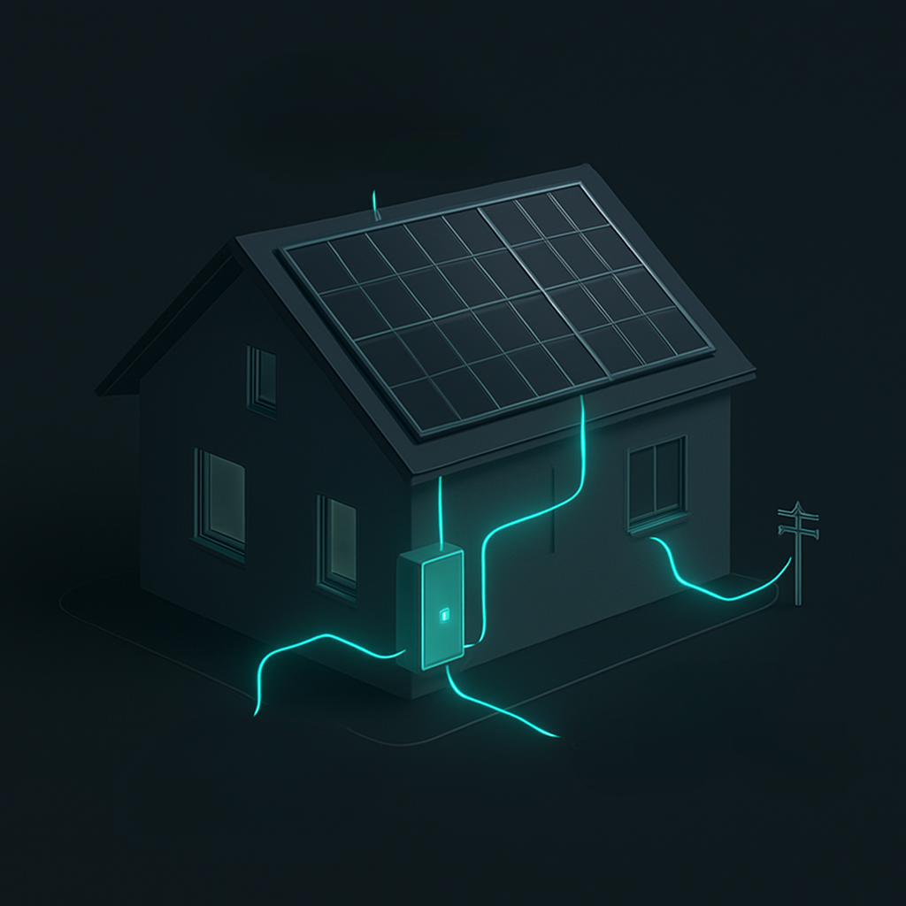

<p class="forum-cta"><a href="https://forumdomotique.com/forums/topic/103-custom-card-solaire-home-assistant/">Lire et commenter sur Forum Domotique</a></p>

# Custom card Solaire home assistant

- **Catégorie :** [Projets et Personnalisations](https://forumdomotique.com/forums/12-projets-et-personnalisations/)
- **Sujet :** https://forumdomotique.com/forums/topic/103-custom-card-solaire-home-assistant/
- **Auteur du premier message du sujet :** un autre membre (XAV59213 a répondu dans ce sujet)
- **Messages de XAV59213 dans ce sujet :** 1
- **Premier message de XAV59213 :** 29 avril 2025 à 19:05 (Europe/Paris)

---

## Message 1 — 29 avril 2025 à 19:05 (Europe/Paris)

- **Identifiant :** `191`
- **Lien :** https://forumdomotique.com/forums/topic/103-custom-card-solaire-home-assistant/#findComment-191

Salut dan,

Petite correction du code :

```yaml
type: picture-elements
image: /local/images/solar_dashboard.png  # Ajoutez le chemin de votre image ici
elements:
  # Puissance solaire
  - type: state-label
    entity: sensor.solaire_puissance
    style:
      top: 15%
      left: 40%
      color: white
      font-size: 18px
  # Label panneaux solaires
  - type: state-label
    entity: sensor.panneaux_solaires_label
    style:
      top: 19%
      left: 40%
      color: grey
      font-size: 14px
  # Label none (vérifiez si sensor.label_none est correct)
  - type: state-label
    entity: sensor.label_none  # Vérifiez cette entité
    style:
      top: 85%
      left: 65%
      color: white
      font-size: 18px
  # Label consommation
  - type: state-label
    entity: sensor.conso_label
    style:
      top: 89%
      left: 65%
      color: grey
      font-size: 14px
  # Label none (vérifiez si sensor.label_none est correct)
  - type: state-label
    entity: sensor.label_none  # Vérifiez cette entité
    style:
      top: 82%
      left: 30%
      color: white
      font-size: 18px
  # Label batterie
  - type: state-label
    entity: sensor.battery_label
    style:
      top: 86%
      left: 30%
      color: grey
      font-size: 14px
  # Puissance réseau (LiXee)
  - type: state-label
    entity: sensor.lixee_key_sinsts
    style:
      top: 70%
      left: 83%
      color: white
      font-size: 18px
  # Label réseau
  - type: state-label
    entity: sensor.reseau_label
    style:
      top: 74%
      left: 83%
      color: grey
      font-size: 14px
```

Et l'image a télécharger:


<!-- source : https://cdn.forumdomotique.com/monthly_2025_04/Chat-GPT-Image-12-avr-2025-14-00-29-1.png.6f9553dc51a31313bbb6b4f0357205f2.png -->

---
