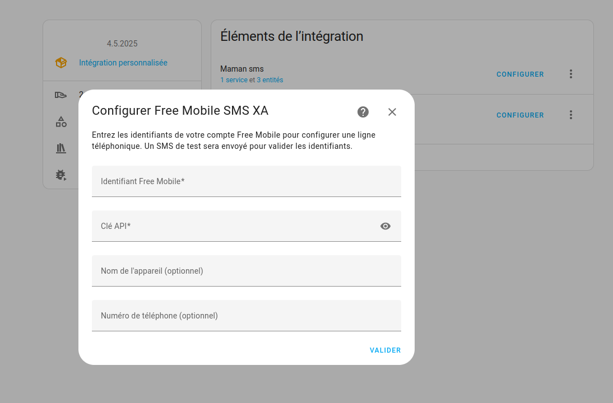
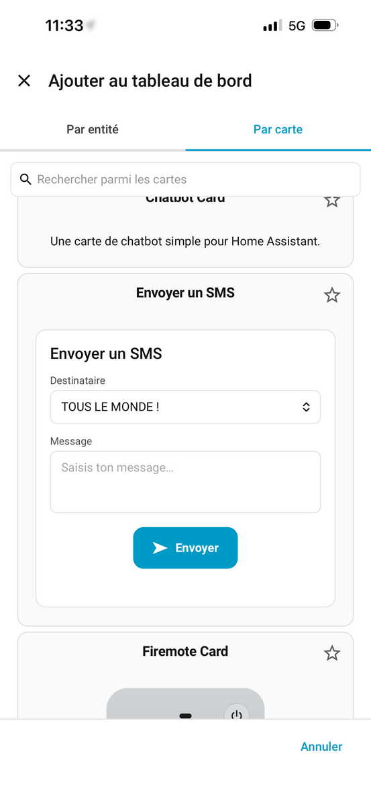
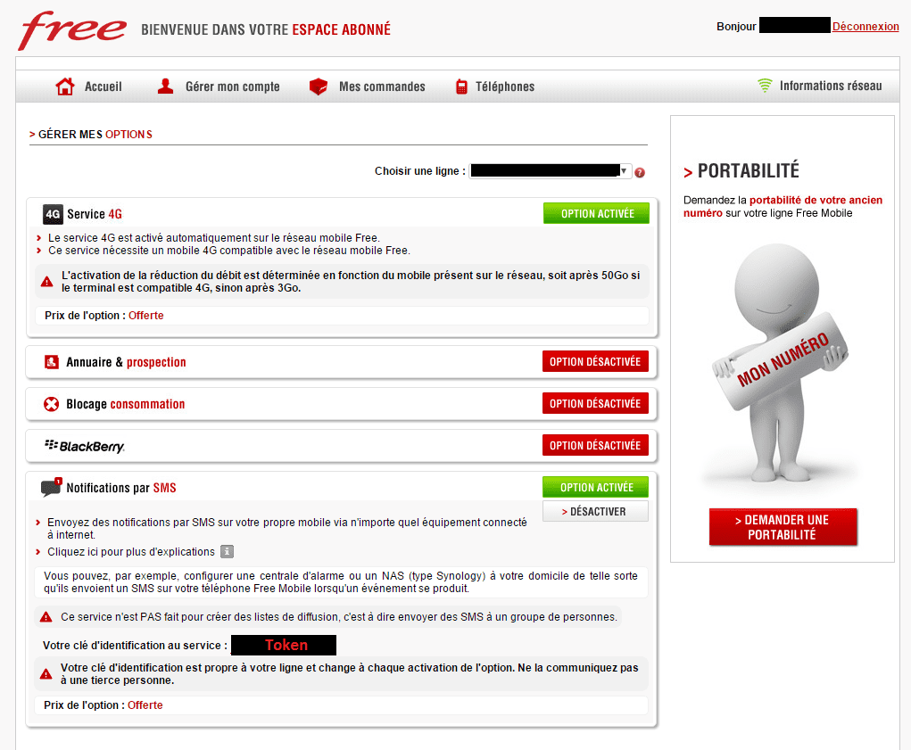
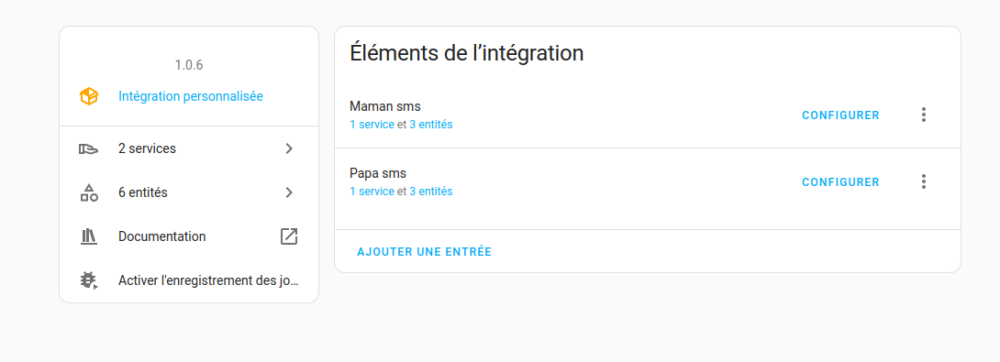
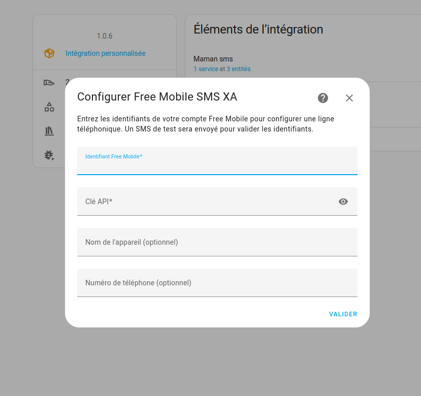

<p class="forum-cta"><a href="https://forumdomotique.com/forums/topic/110-%F0%9F%93%A8-free-mobile-sms-xa-int%C3%A9gration-home-assistant/">Lire et commenter sur Forum Domotique</a> · <a href="https://github.com/XAV59213/freesmsxa">Dépôt HACS : Free Mobile SMS XA</a></p>

# 📨 Free Mobile SMS XA – Intégration Home Assistant

- **Catégorie :** [Projets et Personnalisations](https://forumdomotique.com/forums/12-projets-et-personnalisations/)
- **Sujet :** https://forumdomotique.com/forums/topic/110-%F0%9F%93%A8-free-mobile-sms-xa-int%C3%A9gration-home-assistant/
- **Auteur du premier message du sujet :** XAV59213
- **Messages de XAV59213 dans ce sujet :** 5
- **Premier message de XAV59213 :** 3 mai 2025 à 08:32 (Europe/Paris)
- **Dernier message de XAV59213 :** 20 novembre 2026 à 10:12 (Europe/Paris)

---

## Message 1 — 3 mai 2025 à 08:32 (Europe/Paris)

- **Identifiant :** `210`
- **Lien :** https://forumdomotique.com/forums/topic/110-%F0%9F%93%A8-free-mobile-sms-xa-int%C3%A9gration-home-assistant/#findComment-210

## 🌟 Vue d'ensemble

**Free Mobile SMS XA** simplifie l'envoi de notifications SMS via l'API Free Mobile dans Home Assistant.  
**Objectif** : Rendre l'intégration **facile**, **intuitive**, et **sans code YAML manuel**.


<!-- source : https://cdn.forumdomotique.com/monthly_2025_05/icon.png.47e28a3f9879b0481b9652d3c93b7831.png -->

---

## 🎯 Fonctionnalités clés

- 🔔 **Envoi de SMS** : Utilisez `notify.nom_du_service` pour des alertes instantanées.
- 👥 **Multi-utilisateurs** : Gérez plusieurs lignes (ex. : `Papa`, `Maman`).
- 📊 **Capteur de statut** : Suivez le nombre de SMS, la date du dernier envoi, et un journal des 10 derniers messages.
- 🔘 **Bouton de test** : Envoyez des SMS tests en un clic.
- 🎨 **Carte Lovelace** : Interface visuelle prête à l’emploi.
- 🧩 **Configuration UI** : Ajoutez des lignes via l’interface graphique, sans YAML.

---

## 🛠 Installation simplifiée

1. **HACS** :

   - Ajoutez le dépôt : `https://github.com/XAV59213/freesmsxa`.
   - Installez **Free Mobile SMS XA** et redémarrez Home Assistant.
2. **Config flow** :

   - Allez dans **Paramètres > Intégrations > Ajouter**.
   - Recherchez `Free Mobile SMS XA` et suivez les étapes.
3. **Identifiants Free Mobile** :

   - Activez les notifications SMS dans votre espace abonné.
   - Copiez **Identifiant utilisateur** et **Clé API**.


<!-- source : https://cdn.forumdomotique.com/monthly_2025_05/Capturedcrandu2025-05-0308-33-31.png.556cd5945452337aa3f8a25ac16f419f.png -->

---

## 🔍 Exemple visuel

### Automatisation

```yaml
alias: Alerte Piscine
trigger:
  platform: numeric_state
  entity_id: sensor.temperature_eau
  above: 30
action:
  service: notify.papa_sms
  data:
    message: " Piscine trop chaude !"
```

### Carte Lovelace

- Affiche : Statut SMS, bouton de test, historique des messages.
- Prête à être intégrée dans votre tableau de bord.

---

## 🛡️ Sécurité & fiabilité

- ✅ **100 % local** : Aucune donnée externe.
- ✅ **Clé API masquée** : Invisible après validation.
- ✅ **Aucune collecte** : Vos messages restent privés.

---

## 📈 Pourquoi cette intégration ?

- **Simplicité** : Configuration via UI, pas de YAML complexe.
- **Polyvalence** : Multi-lignes, capteurs, boutons, historique.
- **Design utilisateur** : Intégration fluide dans Home Assistant.

---

## 📜 Licence

- **GNU LGPL v2.1**

## 🔗 Ressources

- **GitHub** : [XAV59213/freesmsxa](https://github.com/XAV59213/freesmsxa)
- **Support** : [Ouvrir une issue](https://github.com/XAV59213/freesmsxa/issues)

---

## Message 2 — 7 juin 2026 à 17:31 (Europe/Paris)

- **Identifiant :** `2320`
- **Lien :** https://forumdomotique.com/forums/topic/110-%F0%9F%93%A8-free-mobile-sms-xa-int%C3%A9gration-home-assistant/#findComment-2320

que veux tu exactement ?

---

## Message 3 — 24 septembre 2026 à 11:36 (Europe/Paris)

- **Identifiant :** `5441`
- **Lien :** https://forumdomotique.com/forums/topic/110-%F0%9F%93%A8-free-mobile-sms-xa-int%C3%A9gration-home-assistant/#findComment-5441

Salut mais à jour je viens d’apporter une modification en ajoutant la carte et corriger le bug


<!-- source : https://cdn.forumdomotique.com/monthly_2026_09/IMG_7381.png.4988c0c674a190761bc2d2288defc192.png -->

---

## Message 4 — 25 septembre 2026 à 14:18 (Europe/Paris)

- **Identifiant :** `5445`
- **Lien :** https://forumdomotique.com/forums/topic/110-%F0%9F%93%A8-free-mobile-sms-xa-int%C3%A9gration-home-assistant/#findComment-5445

Salut,

J’ai bien avancé sur mon intégration **Free Mobile SMS XA**. Je vous fais un point simple de ce qui a changé.

**Ce qui cassait**

Chez certains, l’envoi de SMS plantait avec une erreur du type « event loop ».

Chez moi, le service appelait Home Assistant d’une façon interdite. Du coup plus rien ne partait.

C’est corrigé. Les SMS s’envoient à nouveau.

**La carte sur le tableau de bord**

J’ai ajouté une carte toute prête : **Envoyer un SMS**.

Vous allez dans Modifier le tableau de bord → Ajouter une carte → Envoyer un SMS.

Dessus vous avez :

•  le destinataire (détecté tout seul)

•  « TOUS LE MONDE ! »

•  le message avec un compteur 160 caractères

•  le bouton Envoyer

Au début, sur le téléphone, la carte ne se chargeait pas. Il fallait ajouter un fichier à la main dans les ressources Lovelace. Ce n’était vraiment pas pratique.

Maintenant, au démarrage, l’intégration le fait toute seule. Après la mise à jour : redémarrer Home Assistant, fermer l’appli et la rouvrir.

**Les erreurs Free**

Quand Free refuse un SMS, je l’affiche clairement :

•  mauvais identifiant ou option SMS désactivée

•  trop de SMS envoyés trop vite

•  message vide ou invalide

•  Free en panne (j’essaie une deuxième fois)

**L’historique**

Chaque ligne a maintenant :

•  un état (dernier envoi, dernière erreur)

•  le nombre total de SMS

•  le nombre de SMS du jour

•  les 50 derniers messages, même après un redémarrage

**Le debug**

Dans les options, vous pouvez activer les logs.

Sur l’appareil, vous pouvez aussi télécharger un diagnostic : la clé API n’apparaît pas dedans.

**Pour mettre à jour**

HACS → Free Mobile SMS XA → prenez au moins la **6.12.2** → redémarrez HA.

Pour envoyer un SMS dans une automation, j’utilise :

```yaml
action: notify.send_message
target:
  entity_id: notify.papa
data:
  message: Alarme activée
```

Le dépôt est ici : <https://github.com/XAV59213/freesmsxa>

Si ça coince encore, dites-moi votre version de HA et celle de l’intégration.

---

## Message 5 — 20 novembre 2026 à 10:12 (Europe/Paris)

- **Identifiant :** `5580`
- **Lien :** https://forumdomotique.com/forums/topic/110-%F0%9F%93%A8-free-mobile-sms-xa-int%C3%A9gration-home-assistant/#findComment-5580

Bonjour à tous 👋

Grosse mise à jour pour ce sujet : voici une présentation complète et à jour de **Free Mobile SMS XA** 📨, mon intégration Home Assistant pour recevoir des **SMS** de votre maison, gratuitement, grâce à l’option « Notifications par SMS » de Free Mobile.

Grande nouvelle : depuis le 3 novembre 2026, elle fait partie de la **bibliothèque officielle de HACS** (ceux qui l’avaient en dépôt personnalisé n’ont rien à faire), et la version actuelle est la [**6.12.13**](https://github.com/XAV59213/freesmsxa/releases/tag/6.12.13).

👉 **Le plus simple :** cliquez sur ce bouton. Un clic ouvre directement l’intégration dans votre HACS, et le dépôt est ajouté automatiquement :


<!-- source : https://my.home-assistant.io/badges/hacs_repository.svg -->


<!-- source : https://raw.githubusercontent.com/XAV59213/freesmsxa/main/images/logo.png -->

### 🤔 À quoi ça sert, concrètement ?

Les notifications de l’application Home Assistant, c’est bien… tant que le téléphone a du réseau data, que l’appli est à jour et que la notif n’est pas noyée au milieu des autres. Pour les alertes qui comptent vraiment (alarme déclenchée, fuite d’eau, congélateur en panne, piscine trop chaude), rien ne vaut un bon vieux **SMS**.

Si vous êtes abonné **Free Mobile**, Free propose gratuitement une option qui permet d’envoyer des SMS **à votre propre numéro** depuis une adresse internet. Free Mobile SMS XA fait le lien avec Home Assistant :

- 🔔 vous envoyez un SMS depuis une automatisation, comme n’importe quelle notification
- 👥 vous pouvez déclarer **plusieurs lignes** (Papa, Maman…), chacune avec ses propres identifiants
- 📱 une **carte « Envoyer un SMS »** permet d’écrire un message depuis le tableau de bord
- 📊 vous suivez le nombre de SMS envoyés, ceux du jour et les éventuelles erreurs

⚠️ Petite limite côté Free : l’option n’envoie des SMS **qu’au numéro de la ligne** qui a fourni la clé. Pour prévenir toute la famille, chacun ajoute sa propre ligne.

### ✨ Ce qui a changé depuis la première version

Depuis la présentation de mai 2025, l’intégration a beaucoup évolué :

- ✅ **Dans la bibliothèque HACS par défaut**
- 📱 **Carte native « Envoyer un SMS »**, chargée automatiquement : choix du destinataire (détecté tout seul), option « TOUS LE MONDE ! » et compteur de **160 caractères**
- 🔔 Envoi moderne via `notify.send_message`, comme le recommande Home Assistant
- 📜 **Historique des 50 derniers envois** (réussis ou non), conservé après un redémarrage. Par respect de la vie privée, le texte des SMS n’est plus stocké
- 🚦 **Gestion du quota Free** : si vous envoyez trop de SMS trop vite, le capteur l’indique clairement
- 📈 Deux capteurs à mettre en graphique : **SMS envoyés** et **SMS aujourd’hui**
- 🔁 **Changer la clé API sans tout supprimer** (menu « Reconfigurer »), et une demande de réauthentification automatique si Free refuse la clé
- 🩺 **Diagnostics téléchargeables**, avec la clé API masquée
- 🐛 La fameuse erreur « event loop » qui bloquait les envois chez certains est corrigée depuis septembre
- 🔐 **Nouveau dans la 6.12.13** : plus de confidentialité (le texte des SMS et la clé n’apparaissent plus dans les journaux ni dans les diagnostics) et des noms d’entités plus propres, sans casser vos automatisations

⚠️ Il faut maintenant Home Assistant **2025.12** au minimum.

@cc2i, si la carte « Envoyer un SMS » n’apparaît toujours pas chez toi avec cette version, dis-moi ta version de HA et je regarde.

### 🔐 Étape 0 : récupérer vos identifiants Free Mobile

1. Connectez-vous à votre **espace abonné Free Mobile** : <https://mobile.free.fr/moncompte>
2. Allez dans **Mes options** (« Gérer mes options »)
3. Activez **Notifications par SMS**
4. Notez votre **identifiant utilisateur** et la **clé API** affichée


<!-- source : https://raw.githubusercontent.com/XAV59213/freesmsxa/main/images/token.png -->

### 🛠️ Installation pas à pas (bibliothèque officielle HACS)

*Pour ceux qui débutent : HACS, c’est un peu le « magasin d’applications » communautaire de Home Assistant. Il permet d’installer et de mettre à jour en quelques clics des intégrations qui ne sont pas fournies d’origine. S’il n’est pas encore installé chez vous, le guide officiel est ici :* [*https://hacs.xyz/docs/use/*](https://hacs.xyz/docs/use/)

L’intégration fait partie de la **bibliothèque HACS par défaut** : plus besoin d’ajouter un dépôt personnalisé.

**Le plus rapide :** un clic sur ce bouton ouvre directement l’intégration dans votre HACS, et le dépôt est ajouté automatiquement :


<!-- source : https://my.home-assistant.io/badges/hacs_repository.svg -->

**Ou à la main :**

1. Dans Home Assistant, ouvrez **HACS** dans le menu de gauche
2. Tapez **Free Mobile SMS XA** dans la barre de recherche
3. Ouvrez la fiche, puis cliquez sur **Télécharger**
4. Redémarrez Home Assistant (**Paramètres > Système > bouton ⏻ en haut à droite > Redémarrer**)
5. Allez dans **Paramètres > Appareils et services > + Ajouter une intégration**, et cherchez **Free Mobile SMS XA**

⚠️ Petite subtilité qui piège souvent au début : HACS ne fait que **télécharger les fichiers**. Ce sont les étapes 4 et 5 qui créent réellement l’intégration et ses entités. Si vous ne voyez qu’une entité `update.…` après l’installation, c’est normal : c’est HACS qui surveille les mises à jour, il reste juste l’étape 5.

À l’étape 5, l’assistant vous demande l’identifiant, la clé API et un nom pour la ligne (par exemple « Papa »). Un SMS de test est envoyé pour vérifier que tout fonctionne. Répétez l’opération pour chaque ligne.

⚠️ Version de Home Assistant : il faut au minimum la **2025.12**.

Raccourci pour l’étape 5 : <https://my.home-assistant.io/redirect/config_flow_start/?domain=freesmsxa>


<!-- source : https://raw.githubusercontent.com/XAV59213/freesmsxa/main/images/Capture%20d%E2%80%99%C3%A9cran%20du%202025-05-02%2011-11-45.png -->


<!-- source : https://raw.githubusercontent.com/XAV59213/freesmsxa/main/images/Capture%20d%E2%80%99%C3%A9cran%20du%202025-05-02%2011-12-06.png -->

### 📲 Envoyer un SMS depuis une automatisation

Dans l’éditeur d’automatisations, choisissez l’action **Notifications > Envoyer un message de notification** (`notify.send_message`), puis la ou les lignes à prévenir. En YAML, ça donne :

```plaintext
alias: Alarme activée
triggers:
  - trigger: state
    entity_id: alarm_control_panel.maison
    to: armed_away
actions:
  - action: notify.send_message
    target:
      entity_id:
        - notify.maman
        - notify.papa
    data:
      message: Alarme activée
```

Les noms `notify.papa` / `notify.maman` dépendent du nom donné à chaque ligne.

### 📱 La carte « Envoyer un SMS »

**Modifier le tableau de bord > Ajouter une carte > Envoyer un SMS.** En YAML : `type: custom:freesmsxa-send-card`.

Si elle n’apparaît pas tout de suite, redémarrez Home Assistant, puis fermez et rouvrez l’application (ou videz le cache du navigateur).

### 📚 Pour aller plus loin

- [Envoyer des SMS depuis le dashboard Home Assistant](https://forumdomotique.com/forums/topic/353-envoyer-des-sms-depuis-le-dashboard-home-assistant-avec-lint%C3%A9gration-free-mobile-sms-xa/)
- [Configurer l’envoi de notifications SMS dans vos automatisations](https://forumdomotique.com/forums/topic/354-configurer-lenvoi-de-notifications-sms-dans-vos-automatisations-home-assistant-via-free-mobile-sms-xa/)

### 🔗 Liens

- Dépôt GitHub : <https://github.com/XAV59213/freesmsxa>
- Dernière version (6.12.13) : <https://github.com/XAV59213/freesmsxa/releases/tag/6.12.13>
- Signaler un bug ou proposer une idée : <https://github.com/XAV59213/freesmsxa/issues>

Vos retours, idées et remontées de bugs sont les bienvenus, ici ou sur GitHub 😉

Bonne domotique ! 🏠  
Xavier (XAV59213)

---
