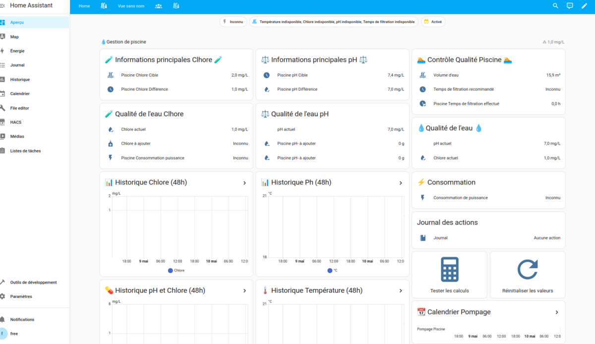
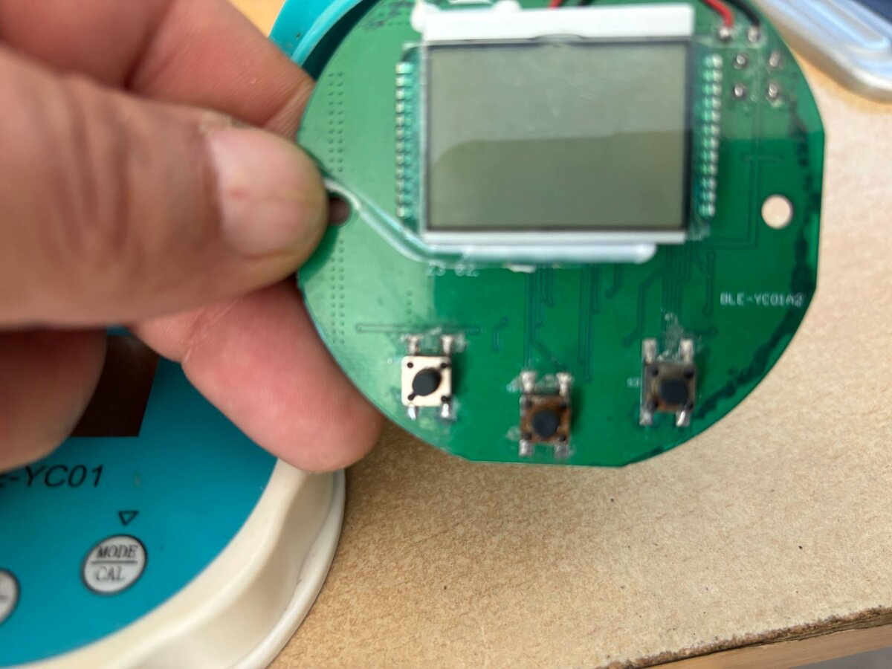
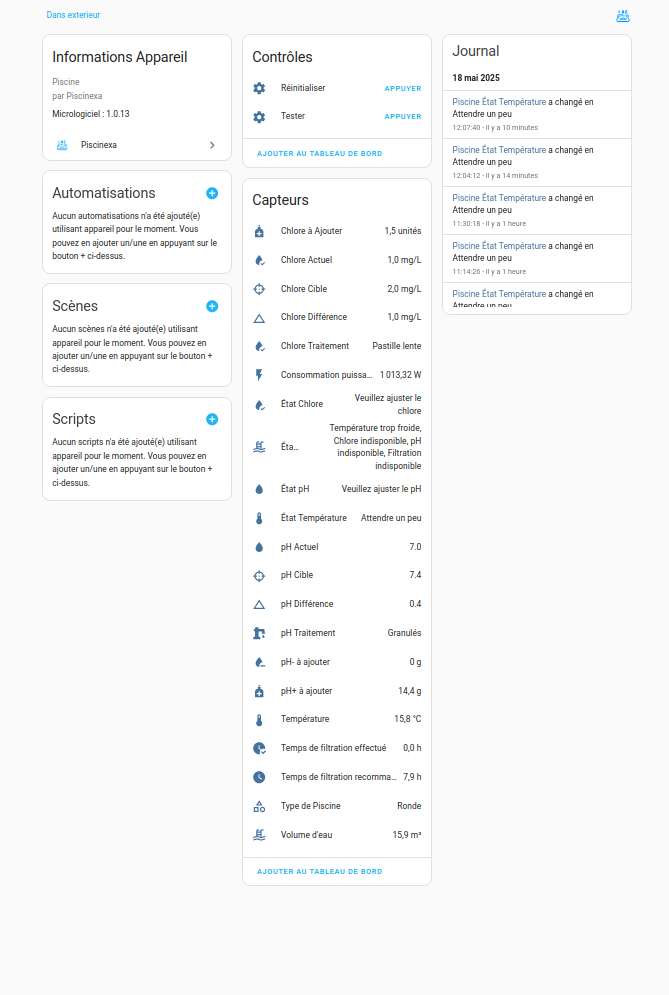
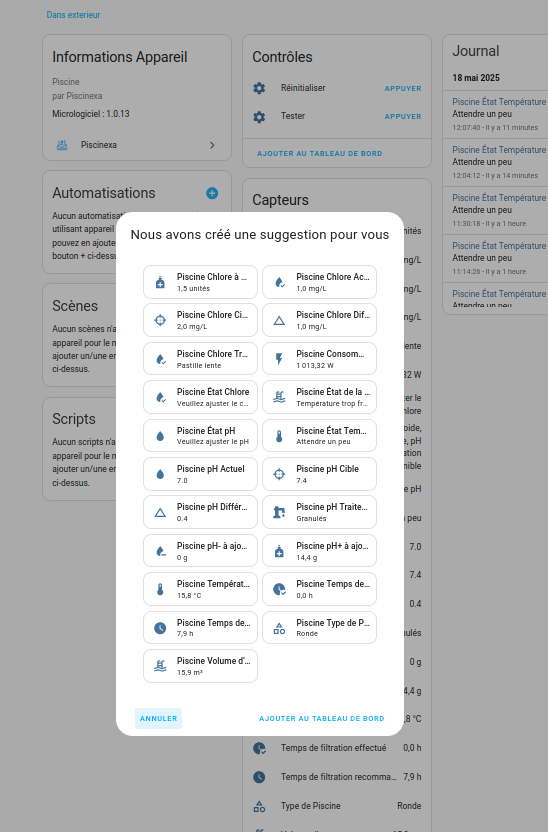

<p class="forum-cta"><a href="https://forumdomotique.com/forums/topic/133-projet-piscine-besoin-de-testeur/">Lire et commenter sur Forum Domotique</a> · <a href="https://github.com/XAV59213/piscinexa">Dépôt HACS : Piscinexa</a></p>


<section class="carousel photo-carousel" data-carousel data-lightbox aria-roledescription="carrousel" aria-label="Photos de l’article (8)" tabindex="0">
<div class="carousel-track" data-track>
<figure class="photo-slide" data-slide>
  <a href="images/piscinexa.png" data-full="images/piscinexa.png" data-alt="Photo 1 — Projet Piscine BESOIN DE TESTEUR" aria-label="Agrandir la photo 1 : Photo 1 — Projet Piscine BESOIN DE TESTEUR">
    
  </a>
</figure>
<figure class="photo-slide" data-slide>
  <a href="images/Capturedcrandu2025-05-1012-52-38.png" data-full="images/Capturedcrandu2025-05-1012-52-38.png" data-alt="Photo 2 — Projet Piscine BESOIN DE TESTEUR" aria-label="Agrandir la photo 2 : Photo 2 — Projet Piscine BESOIN DE TESTEUR">
    
  </a>
</figure>
<figure class="photo-slide" data-slide>
  <a href="images/Sanstitre.jpeg" data-full="images/Sanstitre.jpeg" data-alt="Photo 3 — Projet Piscine BESOIN DE TESTEUR" aria-label="Agrandir la photo 3 : Photo 3 — Projet Piscine BESOIN DE TESTEUR">
    
  </a>
</figure>
<figure class="photo-slide" data-slide>
  <a href="images/Sanstitre1.jpeg" data-full="images/Sanstitre1.jpeg" data-alt="Photo 4 — Projet Piscine BESOIN DE TESTEUR" aria-label="Agrandir la photo 4 : Photo 4 — Projet Piscine BESOIN DE TESTEUR">
    
  </a>
</figure>
<figure class="photo-slide" data-slide>
  <a href="images/Capturedcrandu2025-05-1812-17-32.png" data-full="images/Capturedcrandu2025-05-1812-17-32.png" data-alt="Photo 5 — Projet Piscine BESOIN DE TESTEUR" aria-label="Agrandir la photo 5 : Photo 5 — Projet Piscine BESOIN DE TESTEUR">
    
  </a>
</figure>
<figure class="photo-slide" data-slide>
  <a href="images/Capture_d_ecran_du_2025-05-18_12-17-32.png" data-full="images/Capture_d_ecran_du_2025-05-18_12-17-32.png" data-alt="Photo 6 — Projet Piscine BESOIN DE TESTEUR" aria-label="Agrandir la photo 6 : Photo 6 — Projet Piscine BESOIN DE TESTEUR">
    
  </a>
</figure>
<figure class="photo-slide" data-slide>
  <a href="images/Capture_d_ecran_du_2025-05-18_12-18-23.png" data-full="images/Capture_d_ecran_du_2025-05-18_12-18-23.png" data-alt="Photo 7 — Projet Piscine BESOIN DE TESTEUR" aria-label="Agrandir la photo 7 : Photo 7 — Projet Piscine BESOIN DE TESTEUR">
    
  </a>
</figure>
<figure class="photo-slide" data-slide>
  <a href="images/Capture_d_ecran_du_2025-05-18_12-18-55.png" data-full="images/Capture_d_ecran_du_2025-05-18_12-18-55.png" data-alt="Photo 8 — Projet Piscine BESOIN DE TESTEUR" aria-label="Agrandir la photo 8 : Photo 8 — Projet Piscine BESOIN DE TESTEUR">
    
  </a>
</figure>
</div>
<button type="button" class="carousel-nav" data-prev aria-label="Photo précédente">‹</button>
<button type="button" class="carousel-nav" data-next aria-label="Photo suivante">›</button>
<div class="carousel-dots" data-dots></div>
<div class="carousel-live" data-live aria-live="polite"></div>
<p class="carousel-hint">Faites défiler les photos, ou ouvrez-les pour les agrandir (si JavaScript est activé).</p>
</section>

# Projet Piscine BESOIN DE TESTEUR

- **Catégorie :** [Projets et Personnalisations](https://forumdomotique.com/forums/12-projets-et-personnalisations/)
- **Sujet :** https://forumdomotique.com/forums/topic/133-projet-piscine-besoin-de-testeur/
- **Auteur du premier message du sujet :** XAV59213
- **Messages de XAV59213 dans ce sujet :** 6
- **Premier message de XAV59213 :** 8 mai 2025 à 20:11 (Europe/Paris)
- **Dernier message de XAV59213 :** 20 novembre 2026 à 10:36 (Europe/Paris)

---

## Message 1 — 8 mai 2025 à 20:11 (Europe/Paris)

- **Identifiant :** `260`
- **Lien :** https://forumdomotique.com/forums/topic/133-projet-piscine-besoin-de-testeur/#findComment-260

### Description du projet Piscinexa


<!-- source : https://github.githubassets.com/favicons/favicon.svg -->

##### GitHub


<!-- source : https://opengraph.githubassets.com/10835e48ae1c8ad73ad287fc261d3bcba7001d54cb82c1626acf597643140fcd/XAV59213/piscinexa -->

### GitHub - XAV59213/piscinexa: gestion de piscine

gestion de piscine. Contribute to XAV59213/piscinexa development by creating an account on GitHub.

**GitHub** : [XAV59213/piscinexa](https://github.com/XAV59213/piscinexa)

**Nom de l'intégration** : Piscinexa  
**Plateforme** : Home Assistant  
**Langage** : Python  
**Objectif** : L'intégration Piscinexa est une solution personnalisée pour la gestion et la surveillance des piscines via Home Assistant. Elle permet de suivre et de gérer les paramètres clés d'une piscine, tels que le volume d'eau, la température, le pH, le niveau de chlore, le temps de filtration, et la consommation de puissance. L'intégration fournit également des recommandations pour ajuster les niveaux de pH et de chlore, ainsi qu'un tableau de bord personnalisé pour visualiser et contrôler ces paramètres.

**Fonctionnalités principales** :

1. **Surveillance des capteurs** :

   - Capteurs pour le volume d'eau (calculé en fonction des dimensions de la piscine).
   - Capteur de température (via un capteur externe ou une saisie manuelle).
   - Capteur de pH (via un capteur externe ou une saisie manuelle).
   - Capteur de chlore (via un capteur externe ou une saisie manuelle).
   - Capteur de temps de filtration (calculé en fonction de la température).
   - Capteur de consommation de puissance (via un capteur externe).
   - Capteur d'état global de la piscine (indique si la baignade est autorisée en fonction des paramètres).
2. **Recommandations d'ajustement** :

   - Calcul de la quantité de pH+ ou pH- à ajouter pour atteindre une valeur cible.
   - Calcul de la quantité de chlore à ajouter (en fonction du type de traitement : liquide, granulés, ou pastilles).
3. **Contrôles et saisie manuelle** :

   - Boutons pour tester les calculs ou réinitialiser les valeurs.
   - Entrées manuelles pour le pH et le chlore actuels via des input_number.
   - Sélection du type de traitement chimique via des input_select (par exemple, liquide, granulés, pastilles).
4. **Tableau de bord personnalisé** :

   - Fichiers YAML (piscine_dashboard_custom_component.yaml et piscine_dashboard_multi.yaml) pour afficher les capteurs, les recommandations, et les contrôles dans une interface utilisateur claire.
   - Support pour une ou plusieurs piscines (par exemple, piscine et spa).
5. **Traduction** :

   - Support multilingue via un fichier de traduction (translations/fr.json) pour afficher les noms des entités et les messages en français (par exemple, "Température Eau", "Chlore", "pH").

## Configuration de la vue Piscine :

```yaml
type: sections
max_columns: 4
title: Piscine
path: pisine
sections:
  - type: grid
    cards:
      - type: heading
        heading: Gestion de piscine
        heading_style: title
        badges:
          - type: entity
            entity: sensor.piscine_chlore_difference
      - type: vertical-stack
        cards:
          - type: entities
            title:  Informations principales Clhore 
            show_header_toggle: false
            entities:
              - entity: sensor.piscine_chlore_cible
                icon: mdi:pool
              - entity: sensor.piscine_chlore_difference
                icon: mdi:clock
            state_color: true
          - type: entities
            title:  Qualité de l'eau Clhore
            show_header_toggle: false
            entities:
              - entity: sensor.piscine_chlore_actuel
                name: Chlore actuel
                icon: mdi:water-check
              - entity: sensor.piscine_chlore_a_ajouter
                name: Chlore à ajouter
                icon: mdi:bottle-tonic-plus
              - entity: sensor.piscine_consommation_puissance
          - type: history-graph
            title:  Historique Chlore (48h)
            hours_to_show: 48
            refresh_interval: 300
            entities:
              - entity: sensor.piscine_chlore_actuel
                name: Chlore
            logarithmic_scale: true
          - type: history-graph
            title: "  Historique pH et Chlore (48h)"
            hours_to_show: 48
            refresh_interval: 300
            entities:
              - entity: sensor.piscine_ph_actuel
              - entity: sensor.piscine_chlore_actuel
            logarithmic_scale: true
      - type: vertical-stack
        cards:
          - type: entities
            title:  Informations principales pH 
            show_header_toggle: false
            entities:
              - entity: sensor.piscine_ph_cible
                icon: mdi:clock
              - entity: sensor.piscine_ph_actuel
                name: Piscine pH Différence
          - type: entities
            title:  Qualité de l'eau pH
            show_header_toggle: false
            entities:
              - entity: sensor.piscine_ph_actuel
                name: pH actuel
                icon: mdi:water-ph
              - entity: sensor.piscine_ph_a_ajouter_2
              - entity: sensor.piscine_ph_a_ajouter_2
          - type: history-graph
            title:   Historique Ph (48h)
            hours_to_show: 48
            refresh_interval: 300
            entities:
              - entity: sensor.piscine_temperature
                name: °C
            logarithmic_scale: true
          - type: history-graph
            title:  Historique Température (48h)
            hours_to_show: 48
            refresh_interval: 300
            entities:
              - entity: sensor.piscine_temperature
            logarithmic_scale: true
      - type: vertical-stack
        cards:
          - type: entities
            title: " Contrôle Qualité Piscine  "
            show_header_toggle: false
            entities:
              - entity: sensor.piscine_volume_d_eau
                name: Volume d'eau
                icon: mdi:pool
              - entity: sensor.piscine_temps_de_filtration_recommande
                name: Temps de filtration recommandé
                icon: mdi:clock
              - entity: sensor.piscine_temps_de_filtration_effectue
          - type: entities
            title: Qualité de l'eau 
            show_header_toggle: false
            entities:
              - entity: sensor.piscine_ph_actuel
                name: pH actuel
                icon: mdi:water-ph
              - entity: sensor.piscine_chlore_actuel
                name: Chlore actuel
                icon: mdi:water-check
          - type: entities
            title:  Consommation
            show_header_toggle: false
            entities:
              - entity: sensor.piscine_consommation_puissance
                name: Consommation de puissance
                icon: mdi:flash
          - type: entities
            title: Journal des actions
            show_header_toggle: false
            entities:
              - entity: sensor.piscine_journal
                name: Journal
                icon: mdi:notebook
          - type: horizontal-stack
            cards:
              - show_name: true
                show_icon: true
                type: button
                entity: button.tester
                name: Tester les calculs
                icon: mdi:calculator
                tap_action:
                  action: call-service
                  service: piscinexa.test_calcul
                  service_data:
                    name: piscine
              - show_name: true
                show_icon: true
                type: button
                entity: button.reinitialiser
                name: Réinitialiser les valeurs
                icon: mdi:refresh
                tap_action:
                  action: call-service
                  service: piscinexa.reset_valeurs
                  service_data:
                    name: piscine
          - type: history-graph
            title:  Calendrier Pompage
            hours_to_show: 48
            refresh_interval: 300
            entities:
              - entity: calendar.pompage_piscine
            logarithmic_scale: true
    column_span: 3
badges:
  - type: entity
    show_name: false
    show_state: true
    show_icon: true
    entity: sensor.piscine_consommation_puissance
  - type: entity
    show_name: false
    show_state: true
    show_icon: true
    entity: sensor.piscine_etat_de_la_piscine
  - type: entity
    show_name: false
    show_state: true
    show_icon: true
    entity: calendar.pompage_piscine
icon: mdi:pool-thermometer
cards: []
```


<!-- source : https://cdn.forumdomotique.com/monthly_2025_05/Capturedcrandu2025-05-1012-52-38.png.1687a7911bdc19d52bc3ebf2d5d3ac54.png -->

---

## Message 2 — 9 mai 2025 à 11:45 (Europe/Paris)

- **Identifiant :** `265`
- **Lien :** https://forumdomotique.com/forums/topic/133-projet-piscine-besoin-de-testeur/#findComment-265

**Recherche contrôleur pH et chlore Zigbee pour piscine (équipement HS) et aide pour tests**

Bonjour à tous,

Je me tourne vers vous car j’ai besoin d’aide pour finaliser mon projet de gestion de piscine connectée. Mon contrôleur actuel de pH et de chlore est HS (il a pris l’eau 😞), et je recherche un nouveau modèle compatible **Zigbee** pour remplacer mon ancien équipement. Si quelqu’un a un bon plan ou un contrôleur d’occasion à vendre, je suis preneur !


<!-- source : https://cdn.forumdomotique.com/monthly_2025_05/Sanstitre.jpeg.f1dee50f5b0383586d68792d95c7c868.jpeg -->


<!-- source : https://cdn.forumdomotique.com/monthly_2025_05/Sanstitre1.jpeg.7af50333ddee02b8f7d8974bd679a328.jpeg -->

Pour donner un peu de contexte, j’ai développé une intégration personnalisée appelée **Piscinexa** sous Home Assistant, qui gère plusieurs capteurs pour ma piscine : température, pH, chlore, volume d’eau, temps de filtration, etc. Voici un extrait de mon code pour illustrer mon setup :

- **Capteur pH Actuel** (PiscinexaPhSensor) : récupère la valeur du pH via un capteur externe ou un input_number.
- **Capteur Chlore Actuel** (PiscinexaChloreSensor) : récupère la valeur du chlore actuel de la même manière.
- **Capteur Chlore Différence** (PiscinexaChloreDifferenceSensor) : calcule la différence entre le chlore actuel et le chlore cible.
- **Capteur Chlore à Ajouter** (PiscinexaChloreAjouterSensor) : initialement, il calculait la dose de chlore à ajouter (en fonction du volume, de la température, et du type de traitement – liquide, pastille lente, ou poudre), mais j’ai retiré cette logique du capteur pour la déplacer ailleurs (actuellement, ce capteur est désactivé).

Mon objectif est de finaliser ce projet en intégrant un nouveau contrôleur Zigbee capable de mesurer le pH et le chlore en temps réel. Idéalement, je voudrais un appareil comme le **Yago 7-en-1** (Zigbee Tuya), qui mesure pH, chlore libre, ORP, salinité, etc., mais je suis ouvert à d’autres suggestions si vous avez des retours d’expérience.

En parallèle, je cherche aussi des personnes qui auraient un peu de temps pour m’aider à tester mon code et à l’améliorer. Par exemple, je voudrais intégrer un service ou une automatisation pour gérer le calcul du chlore à ajouter (que j’ai retiré de sensor.py), mais je ne suis pas sûr de la meilleure approche. Si quelqu’un est intéressé, je peux partager plus de détails sur mon code et mon setup !

Merci d’avance pour votre aide, vos suggestions, ou vos bons plans pour un contrôleur Zigbee. 😊

Cordialement,

---

## Message 3 — 23 mai 2025 à 16:02 (Europe/Paris)

- **Identifiant :** `347`
- **Lien :** https://forumdomotique.com/forums/topic/133-projet-piscine-besoin-de-testeur/#findComment-347

Ça avance !


<!-- source : https://cdn.forumdomotique.com/monthly_2025_05/Capturedcrandu2025-05-1812-17-32.png.a5ab9b4d8c30c261f2571dac1d23b664.png -->

---

## Message 4 — 8 juillet 2025 à 07:08 (Europe/Paris)

- **Identifiant :** `554`
- **Lien :** https://forumdomotique.com/forums/topic/133-projet-piscine-besoin-de-testeur/#findComment-554

> **Le 06/07/2025 à 13:23, lakes a dit :**
> Salut,  
>   
> je suis tombé par hazard sur ton projet en parcourant domadoo !  
> Super dashboard !
>
> Tu utilises quoi comme matériel pour faire tes différents relevés ?

Salut [@lakes](https://forumdomotique.com/profile/226-lakes/) merci

Tout le matériel installé dans ton Home Assistant est compatible avec l’intégration pour le moment. Par la suite, je devrai me limiter aux entités température, pH et chlore

---

## Message 5 — 8 juillet 2025 à 07:20 (Europe/Paris)

- **Identifiant :** `555`
- **Lien :** https://forumdomotique.com/forums/topic/133-projet-piscine-besoin-de-testeur/#findComment-555

Pour la sonde de température j’utilise ça

<https://www.domadoo.fr/fr/peripheriques/5998-owon-sonde-de-temperature-deportee-sur-cable-zigbee.html>

Mon ancien test est Hs voir sur commentaires plus haut

Pour les test pH et chlore je vais tester celui la des ça disponibilité

<https://www.domadoo.fr/fr/produits-de-domotique/7909-yieryi-analyseur-eau-piscine-connecte-zigbee-tuya-smart-life.html>

---

## Message 6 — 20 novembre 2026 à 10:36 (Europe/Paris)

- **Identifiant :** `5585`
- **Lien :** https://forumdomotique.com/forums/topic/133-projet-piscine-besoin-de-testeur/#findComment-5585

Bonjour à tous 👋

Il y a un an et demi, j’ouvrais ce sujet pour trouver des testeurs à mon projet piscine. Le projet a bien mûri, alors voici une présentation complète et à jour de **Piscinexa** 💧, mon intégration Home Assistant qui aide à **entretenir sa piscine** : quelle quantité de produit ajouter, combien de temps filtrer, et si l’eau est dans les clous.

🚧 **Petite précision importante : Piscinexa est toujours en cours de développement.** Elle est déjà utilisable, mais certaines fonctions vont encore évoluer, et quelques bugs peuvent subsister. Mon objectif est de la **finaliser au cours de l’année 2027**. En attendant, elle **n’est pas encore dans la bibliothèque officielle de HACS** : on l’installe comme **dépôt personnalisé**, ce qui ne prend que quelques secondes (tout est expliqué plus bas).

La version actuelle est la [**1.0.20**](https://github.com/XAV59213/piscinexa/releases/tag/1.0.20).

👉 **Le plus simple :** cliquez sur ce bouton. Même si l’intégration n’est pas encore dans la bibliothèque officielle, un clic l’ouvre directement dans votre HACS et ajoute le dépôt personnalisé automatiquement :


<!-- source : https://my.home-assistant.io/badges/hacs_repository.svg -->


<!-- source : https://raw.githubusercontent.com/XAV59213/piscinexa/main/images/Capture%20d%E2%80%99%C3%A9cran%20du%202025-05-18%2012-17-32.png -->

### 🤔 À quoi ça sert, concrètement ?

Quiconque a une piscine connaît la scène : on fait la mesure avec la trousse ou la bandelette, le pH est à 7,8, et là… combien de pH moins faut-il mettre pour 40 m³ ? Et combien de temps faire tourner la pompe avec l’eau à 26 °C ?

Piscinexa fait ces calculs pour vous. Vous lui décrivez votre bassin une fois pour toutes, puis vous lui donnez vos mesures (à la main, ou automatiquement si vous avez des sondes), et elle vous indique :

- 📏 le **volume d’eau**, calculé à partir des dimensions (piscine rectangulaire ou ronde)
- ⏱️ le **temps de filtration recommandé**, selon la température de l’eau
- 🧪 la **quantité de pH+, pH- ou chlore à ajouter** pour atteindre vos valeurs cibles, selon la forme du produit (liquide, granulés…)
- 🚦 l’**état** du pH, du chlore et de la température, d’un coup d’œil
- ⚡ la **consommation** de la pompe, si vous avez un capteur de puissance

Les sondes sont **facultatives** : sans aucun matériel connecté, vous pouvez saisir vos mesures dans Home Assistant et profiter des calculs.

### ✨ Ce qui a changé depuis le début du sujet

- 🔘 Les boutons **« Tester »** et **« Réinitialiser »** fonctionnent enfin, grâce à trois actions désormais bien enregistrées (1.0.17)
- 🧪 Nouvelle action **« Appliquer un traitement »** : vous indiquez le produit et la quantité ajoutés, Piscinexa estime le nouveau pH ou chlore et met la valeur à jour
- 🌍 Les textes en **français et en anglais**, et des messages d’erreur clairs dans l’assistant de configuration
- 🛠️ Un démarrage sans erreur, et la compatibilité avec les futures versions de Home Assistant
- 📦 Une installation propre via HACS (archive dédiée, compteur de téléchargements)
- 📊 Un **tableau de bord avancé** prêt à l’emploi, revu et corrigé

### 🛠️ Installation pas à pas (dépôt personnalisé HACS)

*Pour ceux qui débutent : HACS, c’est un peu le « magasin d’applications » communautaire de Home Assistant. Il permet d’installer et de mettre à jour en quelques clics des intégrations qui ne sont pas fournies d’origine. S’il n’est pas encore installé chez vous, le guide officiel est ici :* [*https://hacs.xyz/docs/use/*](https://hacs.xyz/docs/use/)

Piscinexa étant encore en développement, elle **n’est pas encore dans la bibliothèque officielle de HACS** : on l’ajoute comme **dépôt personnalisé**, ça prend trente secondes.

**Le plus rapide :** un clic sur ce bouton ouvre directement l’intégration dans votre HACS, et le dépôt est ajouté automatiquement :


<!-- source : https://my.home-assistant.io/badges/hacs_repository.svg -->

**Ou à la main :**

1. Dans Home Assistant, ouvrez **HACS** dans le menu de gauche
2. Cliquez sur les **⋮** en haut à droite, puis sur **Dépôts personnalisés**
3. Collez l’adresse `https://github.com/XAV59213/piscinexa`, choisissez le type **Intégration**, puis **Ajouter**
4. Cherchez **Piscinexa** dans HACS, ouvrez la fiche et cliquez sur **Télécharger**
5. Redémarrez Home Assistant (**Paramètres > Système > bouton ⏻ en haut à droite > Redémarrer**)
6. Allez dans **Paramètres > Appareils et services > + Ajouter une intégration**, et cherchez **Piscinexa**

⚠️ HACS ne fait que **télécharger les fichiers** : ce sont le redémarrage et l’étape 6 qui créent réellement l’intégration et ses entités.

Il faut Home Assistant **2025.4** ou plus récent.

Raccourci pour l’étape 6 : <https://my.home-assistant.io/redirect/config_flow_start/?domain=piscinexa>

### ⚙️ La configuration, étape par étape

L’assistant vous pose les questions dans l’ordre, sans aucun YAML :

1. **Nom** et **type** de piscine
2. **Dimensions** : longueur, largeur (ou diamètre) et profondeur, pour calculer le volume
3. **pH** : valeur actuelle et valeur cible, saisies à la main ou lues sur une sonde
4. **Chlore** : même principe, en mg/L
5. **Température** de l’eau : à la main ou via une sonde
6. **Puissance** de la pompe : facultatif, via un capteur de puissance
7. **Produits** utilisés pour le pH+, le pH- et le chlore
8. Un **récapitulatif**, et c’est terminé

Vous pouvez gérer **plusieurs bassins** (piscine et spa, par exemple) en ajoutant l’intégration une fois par bassin.


<!-- source : https://raw.githubusercontent.com/XAV59213/piscinexa/main/images/Capture%20d%E2%80%99%C3%A9cran%20du%202025-05-18%2012-18-23.png -->

### 📊 Le tableau de bord

Le dépôt fournit des tableaux de bord prêts à copier, dont un [tableau de bord avancé](https://github.com/XAV59213/piscinexa/blob/main/custom_components/piscinexa/piscine_dashboard_advanced.yaml) : graphiques pH et chlore, énergie des pompes, éclairage… Pour ceux qui veulent construire le leur pas à pas, mon tutoriel est toujours là : [Créer un tableau de bord de gestion de piscine dans Home Assistant](https://forumdomotique.com/forums/topic/90-cr%C3%A9er-un-tableau-de-bord-de-gestion-de-piscine-dans-home-assistant/).


<!-- source : https://raw.githubusercontent.com/XAV59213/piscinexa/main/images/Capture%20d%E2%80%99%C3%A9cran%20du%202025-05-18%2012-18-55.png -->

### 💬 @lakes, pour ta question de mai

Désolé pour le délai ! Pour répondre franchement : non, je n’ai pas encore pu tester d’analyseur pH et chlore connecté, faute d’avoir aujourd’hui un appareil sous la main. C’est un point que j’aimerais vraiment intégrer d’ici la version finale de 2027. Si toi ou quelqu’un d’autre en utilisez un (Flipr, iopool, sonde Zigbee ou Wi-Fi…), vos retours m’aideraient beaucoup à le prendre en charge correctement 🙏

### 🙋 On cherche toujours des testeurs !

Comme le projet est toujours en développement jusqu’à sa version finale prévue en 2027, les retours de ceux qui ont une piscine m’aident énormément, en particulier avec des sondes pH et chlore connectées. @lakes, @Carlito, @Alcha, @dekloo : merci pour votre intérêt, vos retours sur cette version sont les bienvenus avant la saison 😉

### 🔗 Liens

- Dépôt GitHub : <https://github.com/XAV59213/piscinexa>
- Dernière version (1.0.20) : <https://github.com/XAV59213/piscinexa/releases/tag/1.0.20>
- Signaler un bug ou proposer une idée : <https://github.com/XAV59213/piscinexa/issues>

Vos retours, idées et remontées de bugs sont les bienvenus, ici ou sur GitHub 😉

Bonne domotique ! 🏠  
Xavier (XAV59213)

---
