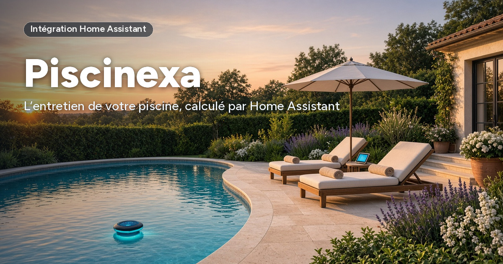
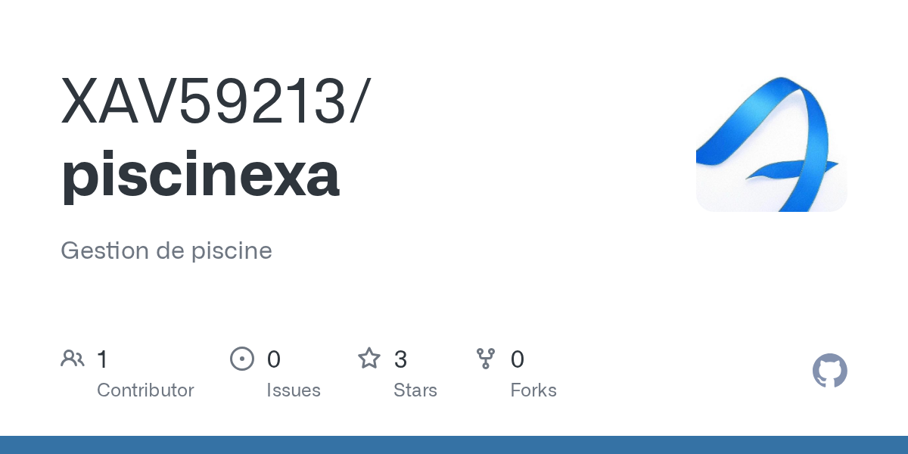
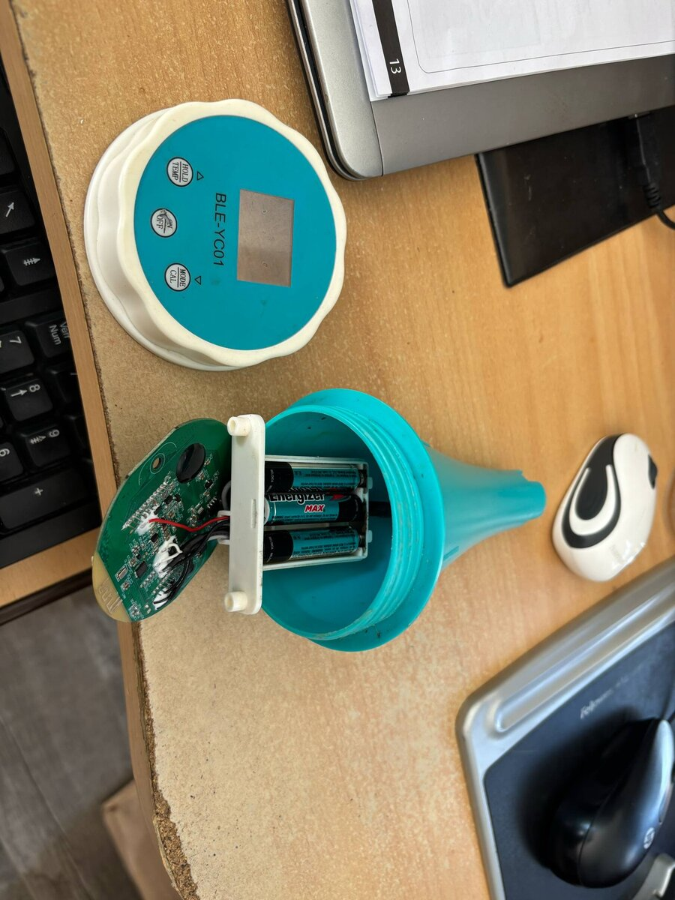
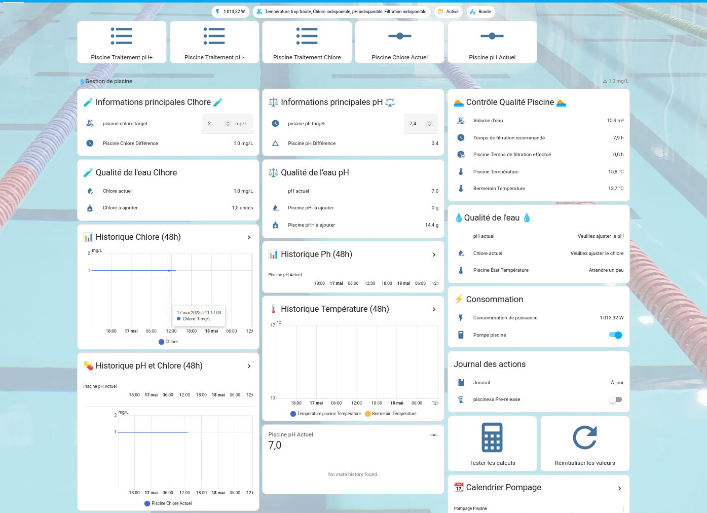

<a href="https://forumdomotique.com/forums/topic/133-projet-piscine-besoin-de-testeur/">Lire et commenter sur Forum Domotique</a> · <a href="https://github.com/XAV59213/piscinexa">Dépôt HACS : Piscinexa</a>

<section class="carousel photo-carousel" data-carousel data-lightbox aria-roledescription="carrousel" aria-label="Photos de l’article (9)" tabindex="0">

<figure class="photo-slide" data-slide>
  
</figure>
<figure class="photo-slide" data-slide>
  
</figure>
<figure class="photo-slide" data-slide>
  
</figure>
<figure class="photo-slide" data-slide>
  
</figure>
<figure class="photo-slide" data-slide>
  
</figure>
<figure class="photo-slide" data-slide>
  
</figure>
<figure class="photo-slide" data-slide>
  
</figure>
<figure class="photo-slide" data-slide>
  
</figure>
<figure class="photo-slide" data-slide>
  
</figure>

<button type="button" class="carousel-nav" data-prev aria-label="Photo précédente">‹</button>
<button type="button" class="carousel-nav" data-next aria-label="Photo suivante">›</button>

Faites défiler les photos, ou ouvrez-les pour les agrandir (si JavaScript est activé).

</section>

# Projet Piscine BESOIN DE TESTEUR

Bonjour à tous 👋

Il y a un an et demi, j’ouvrais ce sujet pour trouver des testeurs à mon projet piscine. Le projet a bien mûri, alors voici une présentation complète et à jour de **Piscinexa** 💧, mon intégration Home Assistant qui aide à **entretenir sa piscine** : quelle quantité de produit ajouter, combien de temps filtrer, et si l’eau est dans les clous.

🚧 **Petite précision importante : Piscinexa est toujours en cours de développement.** Elle est déjà utilisable, mais certaines fonctions vont encore évoluer, et quelques bugs peuvent subsister. Mon objectif est de la **finaliser au cours de l’année 2027**. En attendant, elle **n’est pas encore dans la bibliothèque officielle de HACS** : on l’installe comme **dépôt personnalisé**, ce qui ne prend que quelques secondes (tout est expliqué plus bas).

La version actuelle est la [**1.0.20**](https://github.com/XAV59213/piscinexa/releases/tag/1.0.20).

👉 **Le plus simple :** cliquez sur ce bouton. Même si l’intégration n’est pas encore dans la bibliothèque officielle, un clic l’ouvre directement dans votre HACS et ajoute le dépôt personnalisé automatiquement :

<!-- source : https://my.home-assistant.io/badges/hacs_repository.svg -->

<!-- source : https://raw.githubusercontent.com/XAV59213/piscinexa/main/images/Capture%20d%E2%80%99%C3%A9cran%20du%202025-05-18%2012-17-32.png -->

### 🤔 À quoi ça sert, concrètement ?

Quiconque a une piscine connaît la scène : on fait la mesure avec la trousse ou la bandelette, le pH est à 7,8, et là… combien de pH moins faut-il mettre pour 40 m³ ? Et combien de temps faire tourner la pompe avec l’eau à 26 °C ?

Piscinexa fait ces calculs pour vous. Vous lui décrivez votre bassin une fois pour toutes, puis vous lui donnez vos mesures (à la main, ou automatiquement si vous avez des sondes), et elle vous indique :

- 📏 le **volume d’eau**, calculé à partir des dimensions (piscine rectangulaire ou ronde)
- ⏱️ le **temps de filtration recommandé**, selon la température de l’eau
- 🧪 la **quantité de pH+, pH- ou chlore à ajouter** pour atteindre vos valeurs cibles, selon la forme du produit (liquide, granulés…)
- 🚦 l’**état** du pH, du chlore et de la température, d’un coup d’œil
- ⚡ la **consommation** de la pompe, si vous avez un capteur de puissance

Les sondes sont **facultatives** : sans aucun matériel connecté, vous pouvez saisir vos mesures dans Home Assistant et profiter des calculs.

### ✨ Ce qui a changé depuis le début du sujet

- 🔘 Les boutons **« Tester »** et **« Réinitialiser »** fonctionnent enfin, grâce à trois actions désormais bien enregistrées (1.0.17)
- 🧪 Nouvelle action **« Appliquer un traitement »** : vous indiquez le produit et la quantité ajoutés, Piscinexa estime le nouveau pH ou chlore et met la valeur à jour
- 🌍 Les textes en **français et en anglais**, et des messages d’erreur clairs dans l’assistant de configuration
- 🛠️ Un démarrage sans erreur, et la compatibilité avec les futures versions de Home Assistant
- 📦 Une installation propre via HACS (archive dédiée, compteur de téléchargements)
- 📊 Un **tableau de bord avancé** prêt à l’emploi, revu et corrigé

### 🛠️ Installation pas à pas (dépôt personnalisé HACS)

*Pour ceux qui débutent : HACS, c’est un peu le « magasin d’applications » communautaire de Home Assistant. Il permet d’installer et de mettre à jour en quelques clics des intégrations qui ne sont pas fournies d’origine. S’il n’est pas encore installé chez vous, le guide officiel est ici :* [*https://hacs.xyz/docs/use/*](https://hacs.xyz/docs/use/)

Piscinexa étant encore en développement, elle **n’est pas encore dans la bibliothèque officielle de HACS** : on l’ajoute comme **dépôt personnalisé**, ça prend trente secondes.

**Le plus rapide :** un clic sur ce bouton ouvre directement l’intégration dans votre HACS, et le dépôt est ajouté automatiquement :

<!-- source : https://my.home-assistant.io/badges/hacs_repository.svg -->

**Ou à la main :**

1. Dans Home Assistant, ouvrez **HACS** dans le menu de gauche
2. Cliquez sur les **⋮** en haut à droite, puis sur **Dépôts personnalisés**
3. Collez l’adresse `https://github.com/XAV59213/piscinexa`, choisissez le type **Intégration**, puis **Ajouter**
4. Cherchez **Piscinexa** dans HACS, ouvrez la fiche et cliquez sur **Télécharger**
5. Redémarrez Home Assistant (**Paramètres > Système > bouton ⏻ en haut à droite > Redémarrer**)
6. Allez dans **Paramètres > Appareils et services > + Ajouter une intégration**, et cherchez **Piscinexa**

⚠️ HACS ne fait que **télécharger les fichiers** : ce sont le redémarrage et l’étape 6 qui créent réellement l’intégration et ses entités.

Il faut Home Assistant **2025.4** ou plus récent.

Raccourci pour l’étape 6 : <https://my.home-assistant.io/redirect/config_flow_start/?domain=piscinexa>

### ⚙️ La configuration, étape par étape

L’assistant vous pose les questions dans l’ordre, sans aucun YAML :

1. **Nom** et **type** de piscine
2. **Dimensions** : longueur, largeur (ou diamètre) et profondeur, pour calculer le volume
3. **pH** : valeur actuelle et valeur cible, saisies à la main ou lues sur une sonde
4. **Chlore** : même principe, en mg/L
5. **Température** de l’eau : à la main ou via une sonde
6. **Puissance** de la pompe : facultatif, via un capteur de puissance
7. **Produits** utilisés pour le pH+, le pH- et le chlore
8. Un **récapitulatif**, et c’est terminé

Vous pouvez gérer **plusieurs bassins** (piscine et spa, par exemple) en ajoutant l’intégration une fois par bassin.

<!-- source : https://raw.githubusercontent.com/XAV59213/piscinexa/main/images/Capture%20d%E2%80%99%C3%A9cran%20du%202025-05-18%2012-18-23.png -->

### 📊 Le tableau de bord

Le dépôt fournit des tableaux de bord prêts à copier, dont un [tableau de bord avancé](https://github.com/XAV59213/piscinexa/blob/main/custom_components/piscinexa/piscine_dashboard_advanced.yaml) : graphiques pH et chlore, énergie des pompes, éclairage… Pour ceux qui veulent construire le leur pas à pas, mon tutoriel est toujours là : [Créer un tableau de bord de gestion de piscine dans Home Assistant](https://forumdomotique.com/forums/topic/90-cr%C3%A9er-un-tableau-de-bord-de-gestion-de-piscine-dans-home-assistant/).

<!-- source : https://raw.githubusercontent.com/XAV59213/piscinexa/main/images/Capture%20d%E2%80%99%C3%A9cran%20du%202025-05-18%2012-18-55.png -->

### 💬 @lakes, pour ta question de mai

Désolé pour le délai ! Pour répondre franchement : non, je n’ai pas encore pu tester d’analyseur pH et chlore connecté, faute d’avoir aujourd’hui un appareil sous la main. C’est un point que j’aimerais vraiment intégrer d’ici la version finale de 2027. Si toi ou quelqu’un d’autre en utilisez un (Flipr, iopool, sonde Zigbee ou Wi-Fi…), vos retours m’aideraient beaucoup à le prendre en charge correctement 🙏

### 🙋 On cherche toujours des testeurs !

Comme le projet est toujours en développement jusqu’à sa version finale prévue en 2027, les retours de ceux qui ont une piscine m’aident énormément, en particulier avec des sondes pH et chlore connectées. @lakes, @Carlito, @Alcha, @dekloo : merci pour votre intérêt, vos retours sur cette version sont les bienvenus avant la saison 😉

### 🔗 Liens

- Dépôt GitHub : <https://github.com/XAV59213/piscinexa>
- Dernière version (1.0.20) : <https://github.com/XAV59213/piscinexa/releases/tag/1.0.20>
- Signaler un bug ou proposer une idée : <https://github.com/XAV59213/piscinexa/issues>

Vos retours, idées et remontées de bugs sont les bienvenus, ici ou sur GitHub 😉

Bonne domotique ! 🏠  
Xavier (XAV59213)
