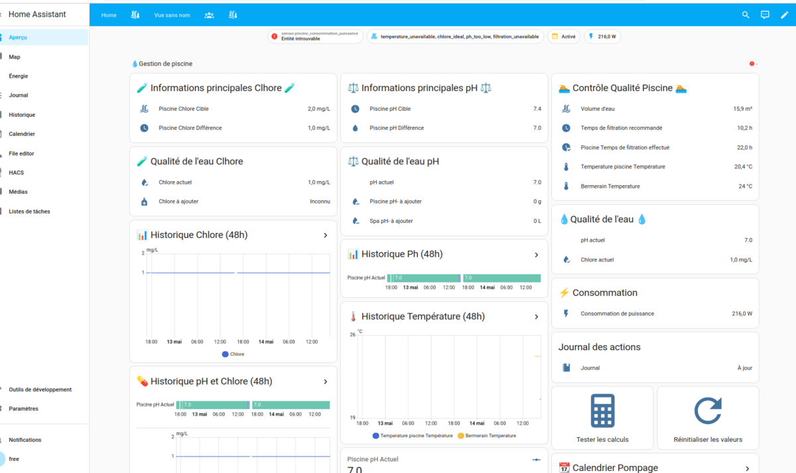

<p class="forum-cta"><a href="https://forumdomotique.com/forums/topic/134-domotiser-la-pompe-et-l%C3%A9clairage-de-piscine-avec-home-assistant-possible-et-comment-faire/">Lire et commenter sur Forum Domotique</a></p>

# Domotiser la pompe et l’éclairage de piscine avec Home Assistant : possible et comment faire ?

- **Catégorie :** [Jardin Connecté et Extérieurs](https://forumdomotique.com/forums/72-jardin-connect%C3%A9-et-ext%C3%A9rieurs/)
- **Sujet :** https://forumdomotique.com/forums/topic/134-domotiser-la-pompe-et-l%C3%A9clairage-de-piscine-avec-home-assistant-possible-et-comment-faire/
- **Auteur du premier message du sujet :** un autre membre (XAV59213 a répondu dans ce sujet)
- **Messages de XAV59213 dans ce sujet :** 1
- **Premier message de XAV59213 :** 14 mai 2025 à 16:53 (Europe/Paris)

---

## Message 1 — 14 mai 2025 à 16:53 (Europe/Paris)

- **Identifiant :** `290`
- **Lien :** https://forumdomotique.com/forums/topic/134-domotiser-la-pompe-et-l%C3%A9clairage-de-piscine-avec-home-assistant-possible-et-comment-faire/#findComment-290

Bonjour @[CyberDuck](https://forumdomotique.com/profile/78-cyberduck/) ,

Je suis actuellement en train de déployer une intégration personnalisée pour Home Assistant appelée **Piscinexa**, qui permet de gérer la qualité de l'eau de la piscine (pH, chlore, température, volume) et d'autres aspects comme la filtration. Bien que mon projet se concentre principalement sur la chimie de l'eau, je pense que certaines parties de mon expérience peuvent répondre à tes questions sur la domotisation de la pompe et de l'éclairage de ta piscine. Voici mes retours et suggestions pour ton projet :

### Réponses à tes questions

1. **Peut-on connecter tout cela à Home Assistant sans tout casser ?**  
   Oui, il est tout à fait possible de connecter ton tableau électrique dédié à la piscine à Home Assistant sans compromettre l'installation existante. L'idée est d'ajouter des modules connectés (relais ou interrupteurs intelligents) en parallèle de ton système actuel (horloge mécanique et interrupteurs manuels). Ainsi, tu conserves ton mode secours (horloge mécanique) en cas de panne de Home Assistant. L'intégration de modules compatibles avec Home Assistant te permettra de piloter la pompe et la lumière via ton téléphone tout en gardant la possibilité de basculer en mode manuel.
2. **Avez-vous déjà domotisé une installation similaire ?**  
   Avec mon intégration **Piscinexa** (disponible sur GitHub : <https://github.com/XAV59213/piscinexa>), je gère déjà la surveillance de la filtration via un capteur de puissance (power_sensor_entity_id) pour calculer le temps de filtration effectué. Bien que je ne pilote pas directement la pompe ou l'éclairage dans cette version, j'ai intégré des capteurs et des services qui pourraient être étendus pour inclure ces fonctionnalités. Par exemple, mon intégration utilise des capteurs comme sensor.piscinexa_<nom>_tempsfiltration_recommande et sensor.piscinexa_<nom>_consopuissance pour surveiller la pompe. Pour l'éclairage, un module relais connecté pourrait être ajouté facilement.
3. **Instructions détaillées pour novices**  
   Voici une approche étape par étape pour domotiser ta pompe et ton éclairage tout en gardant l'horloge mécanique comme secours :

   #### Étape 1 : Comprendre ton tableau électrique

   - **Horloge mécanique** : Elle contrôle probablement la pompe en mode "auto". Vérifie si elle alimente directement la pompe ou passe par un contacteur. Note la puissance de la pompe (en watts ou ampères) pour choisir un module adapté.
   - **Interrupteurs** : L'interrupteur pour la pompe à chaleur (modes manuel/auto/inactif) et celui pour la lumière sont probablement des interrupteurs simples ou des contacteurs. Vérifie leur tension (230V en général) et la puissance des appareils (pompe à chaleur et lumière).
   - **Sécurité** : Avant toute modification, coupe l'alimentation au tableau principal et fais appel à un électricien si tu n'es pas à l'aise avec les manipulations électriques.

   #### Étape 2 : Choisir les modules connectés

   Pour piloter la pompe et la lumière via Home Assistant, tu auras besoin de modules relais ou interrupteurs connectés compatibles avec ton protocole préféré (Zigbee, Z-Wave, ou Wi-Fi). Voici des recommandations :

   - **Pompe (haute puissance)** :

     - **Module recommandé** : Shelly 1PM ou Sonoff POWR3 (Wi-Fi), ou un module Zigbee comme le Qubino ZMNHJD1 (relais 16A). Ces modules supportent des charges élevées (jusqu'à 16A, vérifie la puissance de ta pompe).
     - **Installation** : Place le module en parallèle de l'horloge mécanique. Par exemple, connecte le module pour qu'il puisse activer la pompe indépendamment de l'horloge. Utilise un sélecteur manuel/auto dans Home Assistant pour basculer entre le contrôle connecté et l'horloge.
     - **Avantage** : Le Shelly 1PM ou le Sonoff POWR3 mesure aussi la consommation électrique, ce qui peut être intégré dans Home Assistant (similaire à mon capteur sensor.piscinexa_<nom>_consopuissance).
   - **Éclairage (basse puissance)** :

     - **Module recommandé** : Shelly 1, Sonoff Mini R2 (Wi-Fi), ou un module Zigbee comme le Aqara Relay. Ces modules sont adaptés pour des charges plus faibles comme les lumières de piscine (vérifie la puissance, souvent < 10A).
     - **Installation** : Connecte le module en parallèle de l'interrupteur existant pour permettre un contrôle manuel ou connecté.
     - **Avantage** : Simplicité et compatibilité avec Home Assistant via les intégrations Shelly ou Zigbee2MQTT.
   - **Protocole** :

     - **Zigbee** : Préférable pour une intégration robuste et un réseau maillé. Nécessite un coordinateur Zigbee (ex. ConBee II ou Sonoff Zigbee Bridge).
     - **Wi-Fi** : Plus simple à configurer (pas besoin de hub supplémentaire), mais peut surcharger ton réseau si tu as beaucoup d'appareils. Shelly et Sonoff sont très populaires et bien supportés.
     - **Z-Wave** : Fiable mais plus coûteux. Nécessite un dongle Z-Wave (ex. Aeotec Z-Stick).

   #### Étape 3 : Intégration dans Home Assistant

   - **Ajout des modules** :

     - Pour Shelly : Utilise l'intégration officielle Shelly dans Home Assistant.
     - Pour Sonoff : Utilise l'intégration eWeLink ou flashe les modules avec Tasmota pour plus de flexibilité.
     - Pour Zigbee : Configure Zigbee2MQTT ou ZHA.
   - **Configuration** :

     - Crée des entités pour la pompe (switch.pompe_piscine) et la lumière (light.piscine_light).
     - Ajoute ces entités à un tableau de bord Lovelace pour un contrôle via ton téléphone.
   - **Automatisations** :

     - Exemple pour la pompe : Crée une automatisation pour activer la pompe selon la température de l'eau (comme dans mon intégration Piscinexa, où sensor.piscinexa_<nom>_tempsfiltration_recommande dépend de la température).

```yaml
automation:
  - alias: "Activer pompe selon température"
    trigger:
      platform: numeric_state
      entity_id: sensor.piscinexa_piscine_temperature
      above: 20
    action:
      service: switch.turn_on
      entity_id: switch.pompe_piscine
```

. Exemple pour la lumière : Allume la lumière automatiquement au coucher du soleil.

```yaml
automation:
  - alias: "Allumer lumière piscine au coucher du soleil"
    trigger:
      platform: sun
      event: sunset
    action:
      service: light.turn_on
      entity_id: light.piscine_light
```

#### Étape 4 : Conserver le mode secours

- Laisse l'horloge mécanique connectée en parallèle. Ajoute un interrupteur physique ou un sélecteur dans Home Assistant pour basculer entre :

  - Mode connecté (contrôle via Home Assistant).
  - Mode horloge (contrôle via l'horloge mécanique).
- Exemple : Utilise un input_select dans Home Assistant pour choisir le mode :

```yaml
input_select:
  pompe_mode:
    name: Mode Pompe Piscine
    options:
      - Auto (Home Assistant)
      - Horloge Mécanique
      - Manuel
```

1. #### Étape 5 : Tester et sécuriser

   - Teste chaque composant (pompe, lumière) via Home Assistant.
   - Vérifie que l'horloge mécanique fonctionne toujours en mode secours.
   - Ajoute des notifications (ex. via Telegram ou l'appli Home Assistant) pour être alerté en cas de panne des modules.
2. **Modules recommandés**

   - **Shelly 1PM** (Wi-Fi, ~15€) : Idéal pour la pompe, mesure la consommation, facile à intégrer.
   - **Shelly 1** (Wi-Fi, ~12€) : Parfait pour l'éclairage.
   - **Sonoff POWR3** (Wi-Fi, ~30€) : Pour la pompe si haute puissance (>16A).
   - **Aqara Relay** (Zigbee, ~20€) : Pour l'éclairage, nécessite un hub Zigbee.
   - **Qubino ZMNHJD1** (Z-Wave, ~50€) : Pour la pompe, robuste mais plus cher.
   - **Coordinateur Zigbee** : Sonoff Zigbee Bridge ou ConBee II (~30-40€) si tu choisis Zigbee.

### Lien avec mon intégration Piscinexa

Mon intégration Piscinexa (version 1.0.13) est conçue pour gérer la qualité de l'eau et la filtration, mais elle peut être un complément à ton projet. Par exemple :

- Elle calcule le **temps de filtration recommandé** (sensor.piscinexa_<nom>_tempsfiltration_recommande) en fonction de la température, ce qui peut guider tes automatisations pour la pompe.
- Elle surveille la **consommation électrique** de la pompe (sensor.piscinexa_<nom>_consopuissance) si tu ajoutes un capteur de puissance (comme un Shelly 1PM).
- Tu pourrais étendre Piscinexa pour inclure le contrôle de la pompe et de l'éclairage en ajoutant des entités switch ou light dans le code (je peux t'aider si tu veux contribuer !).

### Conseils supplémentaires

- **Schéma** : Si tu as un schéma de ton tableau électrique, partage-le pour des conseils plus précis. Sinon, dessine un diagramme simple (horloge, interrupteurs, pompe, lumière) pour planifier les connexions.
- **Sécurité** : Les piscines impliquent de l'eau et de l'électricité, donc utilise des modules avec une protection IP65 si exposés à l'humidité. Fais vérifier ton installation par un professionnel après modifications.
- **Communauté** : Consulte le forum Home Assistant ou le Discord pour des retours d'expérience sur les modules Shelly/Zigbee. La communauté française est très active !

### Exemple de tableau de bord

Une fois tout configuré, tu peux créer un tableau de bord Lovelace comme le mien (piscine_dashboard_custom_component.yaml dans Piscinexa) avec :

- Un bouton pour allumer/éteindre la pompe.
- Un interrupteur pour la lumière.
- Des capteurs pour la température et la consommation.
- Un sélecteur pour le mode (Auto/Horloge/Manuel).

Si tu veux un exemple de code YAML pour le tableau de bord ou les automatisations, fais-moi signe !

Bonne chance avec ton projet de domotisation, et tiens-nous au courant de tes avancées ! Si tu veux tester Piscinexa pour la gestion de l'eau en parallèle, je peux te guider pour l'installation.

---

### 

Attention je suis encore en bêta sur mon intégration LE BUT EST DE NE PAS CODER JUSTE AJOUTER L INTÉGRATION ET LES CAPTEURS.

<https://forumdomotique.com/topic/133-projet-piscine-besoin-de-testeur/?do=embed>


<!-- source : https://cdn.forumdomotique.com/monthly_2025_05/Capturedcrandu2025-05-1416-43-20.png.f2d59899e1503816df011bf5862a5b76.png -->

---
