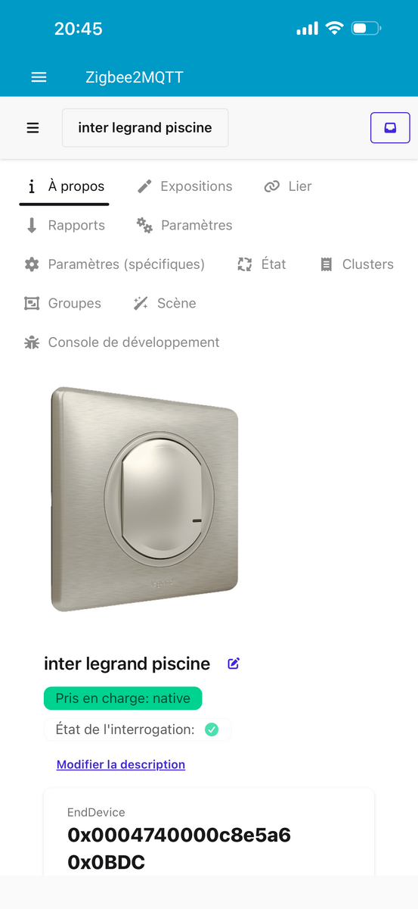
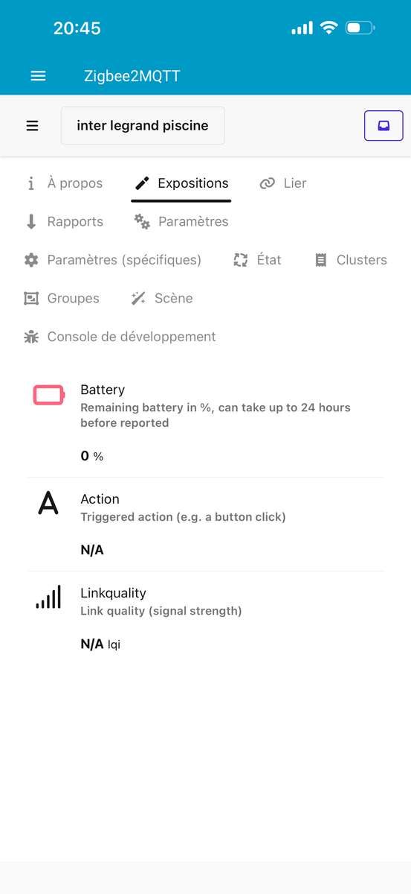
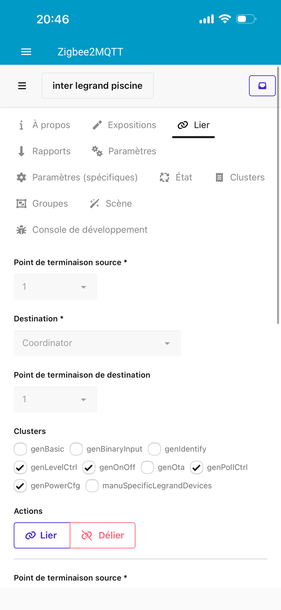
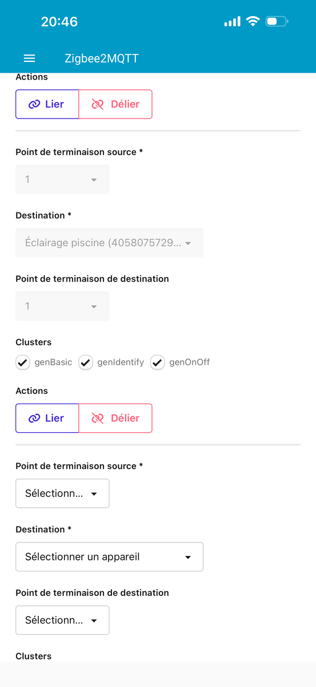

<a href="https://forumdomotique.com/forums/topic/146-interrupteur-netatmo/">Lire et commenter sur Forum Domotique</a>

# Interrupteur netatmo

- **Catégorie :** [Netatmo](https://forumdomotique.com/forums/48-netatmo/)
- **Sujet :** https://forumdomotique.com/forums/topic/146-interrupteur-netatmo/
- **Auteur du premier message du sujet :** un autre membre (XAV59213 a répondu dans ce sujet)
- **Messages de XAV59213 dans ce sujet :** 1
- **Premier message de XAV59213 :** 9 novembre 2025 à 20:49 (Europe/Paris)

---

## Message 1 — 9 novembre 2025 à 20:49 (Europe/Paris)

- **Identifiant :** `1187`
- **Lien :** https://forumdomotique.com/forums/topic/146-interrupteur-netatmo/#findComment-1187

Salut [@Krysc61](https://forumdomotique.com/profile/125-krysc61/)

Il faut sélectionner un point de terminaison source pour lier l’appareil que vous souhaitez contrôler. 🤓

Il faut réveiller l’appareil avant de faire la modification, sinon il ne prendra pas la configuration.

Appuie sur l’un des boutons de ton interrupteur pour le réveiller.

1.  **Ouvrez Zigbee2MQTT** : Allez sur l’interface web, cliquez sur votre interrupteur Legrand, puis sur l’onglet “lier”.

2.  **Remplissez le formulaire** :

•  **Point de terminaison source** : Choisissez “1” (ou l’endpoint du bouton si multi-boutons).

•  **Destination** : Sélectionnez l’appareil à contrôler (ex. : “Éclairage piscine”).

•  **Point de terminaison de destination** : Choisissez “1”.

•  **Clusters** : Cochez au moins “genOnOff” (et les autres si besoin, comme genBasic).

3.  **Liez** : Appuyez sur un bouton de l’interrupteur pour le réveiller (si sans fil), puis cliquez sur “**Lier**”.

4.  **Testez** : Appuyez sur l’interrupteur – l’appareil devrait s’allumer/s’éteindre.

---
