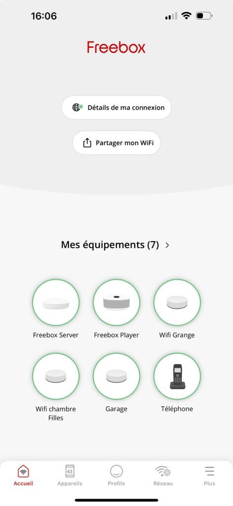
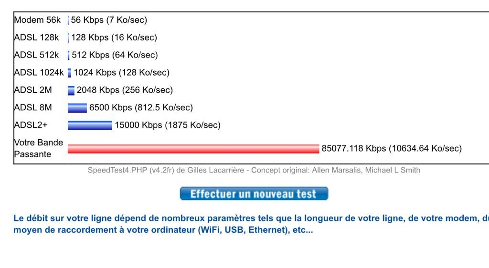

# Question sur les appareils déjà connectés et les mots de passe

- **Catégorie :** [Réseaux Domestiques](https://forumdomotique.com/forums/81-r%C3%A9seaux-domestiques/)
- **Sujet :** https://forumdomotique.com/forums/topic/151-question-sur-les-appareils-d%C3%A9j%C3%A0-connect%C3%A9s-et-les-mots-de-passe/
- **Auteur du premier message du sujet :** un autre membre (XAV59213 a répondu dans ce sujet)
- **Messages de XAV59213 dans ce sujet :** 1
- **Premier message de XAV59213 :** 22 mai 2025 à 16:11 (Europe/Paris)

---

## Message 1 — 22 mai 2025 à 16:11 (Europe/Paris)

- **Identifiant :** `341`
- **Lien :** https://forumdomotique.com/forums/topic/151-question-sur-les-appareils-d%C3%A9j%C3%A0-connect%C3%A9s-et-les-mots-de-passe/#findComment-341

Salut CACTUS,

Quel opérateur utilise-tu, et surtout, quel type de répéteur as-tu choisi ?

Si tu as des répéteurs Free tu na pas de mot de passe çà se repete, c’est top, mais dit-moi :

les as-tu connectés en RJ45 ou en mode répéteur WiFi ?

- Si tu branche en rj 45 tu n a pas de perte et pas de mot de passe ça reste le même réseau wifi
- Si tu tu est en wifi tu perd énormément et pas de mot de passe ça reste le même réseau wifi

<!-- source : https://cdn.forumdomotique.com/monthly_2025_05/XO8oXTOZ.jpeg.25e9ff86e26abaa582f30f6338d0d3aa.jpeg -->

<!-- source : https://cdn.forumdomotique.com/monthly_2025_05/BePPq9WK.jpeg.b9e2f5e1233ba72e2add0bef44b2369f.jpeg -->

Perso, j’utilise des répéteurs Free en RJ45, et cette configuration ma permis de couvrir de 1000 pour 2000 m2 de terrain avec 3 répéteurs.

Partage plus de détails de ton installation dit nous tous !

---
