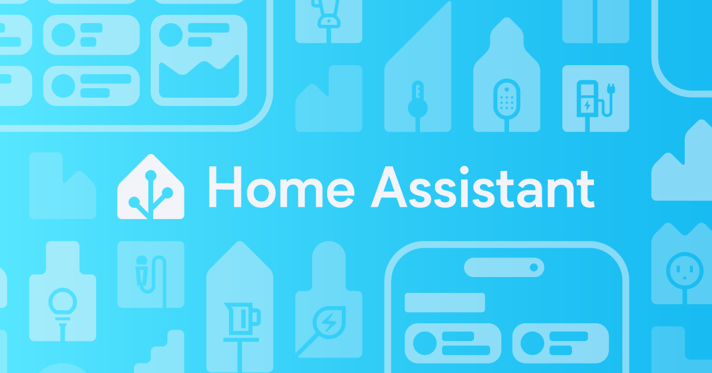

<p class="forum-cta"><a href="https://forumdomotique.com/forums/topic/152-tracker-connexions-wifi-freebox/">Lire et commenter sur Forum Domotique</a></p>

# Tracker connexions Wifi Freebox

- **Catégorie :** [Confort et Ambiance](https://forumdomotique.com/forums/67-confort-et-ambiance/)
- **Sujet :** https://forumdomotique.com/forums/topic/152-tracker-connexions-wifi-freebox/
- **Auteur du premier message du sujet :** un autre membre (XAV59213 a répondu dans ce sujet)
- **Messages de XAV59213 dans ce sujet :** 1
- **Premier message de XAV59213 :** 30 mai 2025 à 12:55 (Europe/Paris)

---

## Message 1 — 30 mai 2025 à 12:55 (Europe/Paris)

- **Identifiant :** `380`
- **Lien :** https://forumdomotique.com/forums/topic/152-tracker-connexions-wifi-freebox/#findComment-380

Bonjour [BièreNard](https://forumdomotique.com/profile/8-bi%C3%A8renard/) ,

Concernant la détection de présence avec l'intégration Freebox dans Home Assistant, il semble que la fonctionnalité de suivi des appareils connectés au Wi-Fi (device_tracker) ne soit pas activée par défaut pour les téléphones ou autres appareils. Voici quelques pistes pour résoudre votre problème et configurer une automatisation :

### 1. Vérification de l'intégration Freebox

L'intégration Freebox ne crée pas automatiquement des entités device_tracker pour chaque appareil connecté au Wi-Fi. Pour activer le suivi des appareils (comme les téléphones), vous devez :

créer un binary_sensor et assurez vous d'avoir fixer l ip

```yaml
binary_sensor:
  - platform: ping
    host: 192.168.1.96
    name: "Steve Phone"
    count: 1
    scan_interval: 5
```

- Accéder à l'interface de votre Freebox (via [**mafreebox.free.fr**](https://mafreebox.free.fr)).
- Aller dans **Paramètres > Gestion des accès > Home Assistant** et vérifier que l'option de suivi des appareils est activée.
- Dans Home Assistant, allez dans **Configuration > Intégrations > Freebox**, et vérifiez si des entités device_tracker supplémentaires (par exemple, device_tracker.nom_du_téléphone) apparaissent après avoir redémarré Home Assistant.
- Si aucune entité n'apparaît, il est possible que votre modèle de Freebox ou la version de l'intégration ne prenne pas en charge ce suivi. Dans ce cas, d'autres méthodes sont possibles (voir ci-dessous).

### 2. Alternative : Utilisation de l'application Home Assistant

Une méthode plus fiable pour détecter la présence d'un téléphone est d'utiliser l'application mobile Home Assistant (disponible sur iOS et Android). Une fois installée et connectée à votre instance Home Assistant, l'application crée automatiquement une entité device_tracker pour votre téléphone, basée sur sa localisation (GPS/Wi-Fi). Pour activer cela :

- Installez l'application Home Assistant sur votre téléphone.
- Connectez-vous à votre serveur Home Assistant.
- Activez le suivi de localisation dans les paramètres de l'application.
- Une entité comme device_tracker.votre_téléphone sera créée dans Home Assistant.

### 3. Exemple d'automatisation en YAML

Voici un exemple d'automatisation YAML qui utilise une entité device_tracker (par exemple, celle de l'application mobile ou, si disponible, celle de la Freebox) pour allumer une lumière lorsque vous rentrez chez vous :

```yaml
automation:
  - alias: Allumer lumière quand je rentre
    trigger:
      platform: state
      entity_id: device_tracker.votre_téléphone
      from: "not_home"
      to: "home"
    action:
      - service: light.turn_on
        target:
          entity_id: light.salon
```

**Explications :**

- **Trigger** : L'automatisation se déclenche lorsque l'état du device_tracker passe de not_home (absent) à home (présent).
- **Action** : La lumière du salon ([light.salon](https://light.salon)) s'allume.
- Remplacez device_tracker.votre_téléphone par l'entité réelle de votre téléphone et [light.salon](https://light.salon) par l'entité de votre lumière.

### 4. Recommandations supplémentaires

- Si vous ne trouvez pas d'entité device_tracker pour votre téléphone, vous pouvez aussi envisager d'autres intégrations comme **Nmap** ou **Ping** pour détecter les appareils sur votre réseau local. Ces intégrations nécessitent une configuration supplémentaire (voir la documentation Home Assistant).

##### Home Assistant


<!-- source : https://www.home-assistant.io/images/default-social.png -->

### Ping (ICMP)

Instructions on how to integrate Ping (ICMP)-based into Home Assistant.

- Consultez le journal de Home Assistant (**Configuration > Journaux**) pour identifier d'éventuelles erreurs liées à l'intégration Freebox.
- Pour plus d'exemples d'automatisations, la documentation officielle de Home Assistant (<https://www.home-assistant.io>) est une excellente ressource.

N'hésitez pas à me dire si vous avez besoin d'aide pour configurer une méthode spécifique ou pour adapter l'automatisation. Bonne chance avec votre première automatisation !

Cordialement,

---
