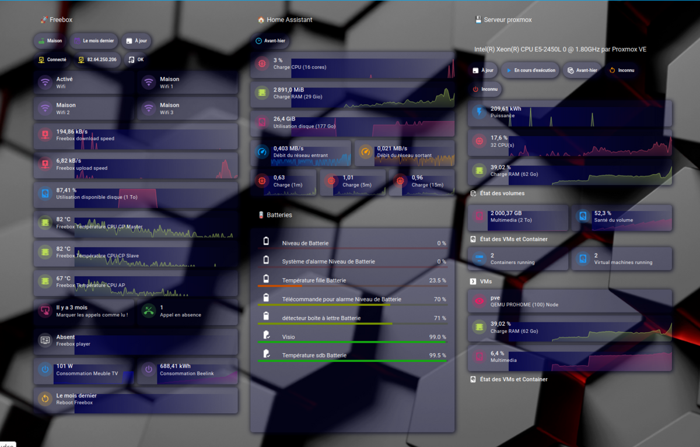

<a href="https://forumdomotique.com/forums/topic/176-installation-et-configuration-de-mon-tableau-de-bord-home-assistant-avec-le-th%C3%A8me-transparent-blue-et-hacs/">Lire et commenter sur Forum Domotique</a>

# Installation et configuration de mon tableau de bord Home Assistant avec le thème Transparent Blue et HACS

- **Catégorie :** [Intégrations et Add-ons](https://forumdomotique.com/forums/11-int%C3%A9grations-et-add-ons/)
- **Sujet :** https://forumdomotique.com/forums/topic/176-installation-et-configuration-de-mon-tableau-de-bord-home-assistant-avec-le-th%C3%A8me-transparent-blue-et-hacs/
- **Auteur du premier message du sujet :** XAV59213
- **Messages de XAV59213 dans ce sujet :** 1
- **Premier message de XAV59213 :** 30 mai 2025 à 10:01 (Europe/Paris)

---

## Message 1 — 30 mai 2025 à 10:01 (Europe/Paris)

- **Identifiant :** `378`
- **Lien :** https://forumdomotique.com/forums/topic/176-installation-et-configuration-de-mon-tableau-de-bord-home-assistant-avec-le-th%C3%A8me-transparent-blue-et-hacs/#findComment-378

## Bonjour à tous,

Suite à plusieurs demandes, voici les étapes pour installer et configurer un tableau de bord Home Assistant (HA) similaire à celui que j’ai partagé, avec le thème **Transparent Blue** et plusieurs modules de dashboard via HACS. Je détaille tout ci-dessous, et j’ai également inclus le code YAML de mon tableau de bord que vous pouvez adapter selon vos entités.

<!-- source : https://cdn.forumdomotique.com/monthly_2025_05/Capturedcrandu2025-05-3008-54-30.png.9e49cefe4ea237051bc3f57449e91fc5.png -->

---

#### **Étape 1 : Installation de HACS**

Voici les étapes pour installer HACS (Home Assistant Community Store), nécessaire pour ajouter des thèmes et cartes personnalisées :

1. Accéder à **HACS** via l’interface de Home Assistant.
2. Si HACS n’est pas encore installé, suivre les instructions sur [le site officiel de HACS](https://hacs.xyz/) (souvent via un téléchargement manuel ou une commande dans le terminal de HA).
3. Une fois HACS installé, redémarrer Home Assistant.

---

#### **Étape 2 : Installation du thème Transparent Blue**

Voici les étapes pour installer le thème **Transparent Blue**, qui donne cet effet translucide et moderne :

1. Dans HACS, aller dans l’onglet **Frontend**.
2. Rechercher **Transparent Blue** (ou ajouter manuellement le dépôt via l’URL : <https://github.com/JOHLC/transparentblue>).
3. Cliquer sur **Installer** pour ajouter le thème.
4. Activer le thème :

   - Aller dans **Configuration > Thèmes** dans Home Assistant.
   - Sélectionner **Transparent Blue** comme thème actif.
5. Redémarrer Home Assistant pour appliquer le thème.

---

#### **Étape 3 : Installation des modules de dashboard via HACS**

Voici les étapes pour installer les cartes personnalisées utilisées dans mon tableau de bord. Chaque module est ajouté via HACS dans l’onglet **Frontend** :

1. **Lovelace Mushroom** (<https://github.com/piitaya/lovelace-mushroom>) : cartes modernes pour entités (capteurs, interrupteurs, etc.).
2. **Mini Graph Card** (<https://github.com/kalkih/mini-graph-card>) : graphiques compacts (ex. température, consommation).
3. **Bubble Card** (<https://github.com/Clooos/Bubble-Card>) : cartes interactives stylisées (boutons, jauges).
4. **Button Card** (<https://github.com/custom-cards/button-card>) : boutons personnalisés (ex. "Reboot Freebox").
5. **Lovelace Card Mod** (<https://github.com/thomasloven/lovelace-card-mod>) : personnalisation CSS des cartes.
6. **HA Floorplan** (<https://github.com/ExperienceLovelace/ha-floorplan>) : plans interactifs (non utilisé ici).
7. **Custom Brand Icons** (<https://github.com/elax46/custom-brand-icons>) : icônes de marques (ex. Freebox).
8. **Calendar Card Pro** (<https://github.com/alexpfau/calendar-card-pro>) : calendrier avancé.
9. **Advanced Camera Card** (<https://github.com/dermotduffy/advanced-camera-card>) : flux de caméra.
10. **Kiosk Mode** (<https://github.com/NemesisRE/kiosk-mode>) : masque les éléments d’interface inutiles.
11. **Bar Card** (<https://github.com/custom-cards/bar-card>) : barres de progression (ex. niveau batterie, stockage).
12. **Universal Remote Card** (<https://github.com/Nerwyn/universal-remote-card>) : télécommande universelle.
13. **Stack in Card** (<https://github.com/custom-cards/stack-in-card>) : empile plusieurs cartes.
14. **Lovelace Template Entity Row** (<https://github.com/thomasloven/lovelace-template-entity-row>) : personnalisation des entités.
15. **MeteoFrance Weather Card** (<https://github.com/hacf-fr/lovelace-meteofrance-weather-card>) : prévisions Météo-France.
16. **Lovelace Pronote** (<https://github.com/delphiki/lovelace-pronote>) : intégration Pronote (devoirs, emploi du temps).
17. **Wallpanel Screensaver** (<https://github.com/Shreyas-R/lovelace-wallpanel-screensaver>) : économiseur d’écran.

Pour chaque module :

- Rechercher son nom dans HACS > Frontend.
- Cliquer sur **Installer**.
- Redémarrer HA après chaque installation si nécessaire.

---

#### **Étape 4 : Configuration du tableau de bord**

Voici les étapes pour configurer le tableau de bord :

1. Aller dans **Tableaux de bord** dans Home Assistant.
2. Créer un nouveau tableau de bord ou modifier un existant.
3. Ajouter des cartes en utilisant les modules installés (ex. **Mini Graph Card** pour les graphiques, **Bar Card** pour le stockage).
4. Organiser les cartes avec **Stack in Card** pour un layout propre.
5. Personnaliser avec **Card Mod** (ex. ajuster les couleurs ou la transparence).

---

#### **Étape 5 : Ajout des intégrations spécifiques**

Voici les étapes pour ajouter les données affichées (Freebox, Proxmox, etc.) :

- **Freebox** : Intégration officielle via **Configuration > Intégrations > Ajouter > Freebox**.
- **Proxmox** : Ajouter l’intégration Proxmox VE pour surveiller VMs et conteneurs (rechercher "Proxmox" dans les intégrations).
- **Autres entités** (température, appels) : Configurer les capteurs via les intégrations nécessaires (ex. capteurs de température, intégration téléphonique).

---

#### **Étape 6 : Redémarrage et vérification**

Voici les étapes finales :

1. Redémarrer Home Assistant pour appliquer tous les changements.
2. Vérifier que le tableau de bord affiche correctement les cartes et données.

---

### **Code YAML de mon tableau de bord**

Voici le code YAML de mon tableau de bord. **Il devra être adapté selon vos entités**, car les entités utilisées (comme celles de la Freebox, Proxmox, ou les capteurs de température) sont spécifiques à mon installation. Vous devrez remplacer les identifiants d’entités (ex. sensor.freebox_download_speed, sensor.node_pve_cpu_used) par ceux correspondant à votre configuration.

[monitoring.yaml](https://forumdomotique.com/applications/core/interface/file/attachment.php?id=169&key=0dff23aa6dfc871d3cb165b3f0ccbd8a)

<!-- source : https://cdn.forumdomotique.com/monthly_2025_05/Capturedcrandu2025-05-3008-54-30.png.9e49cefe4ea237051bc3f57449e91fc5.png -->

---
