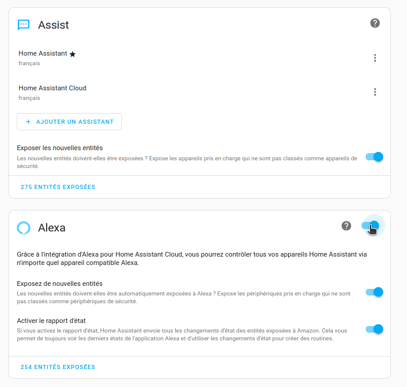
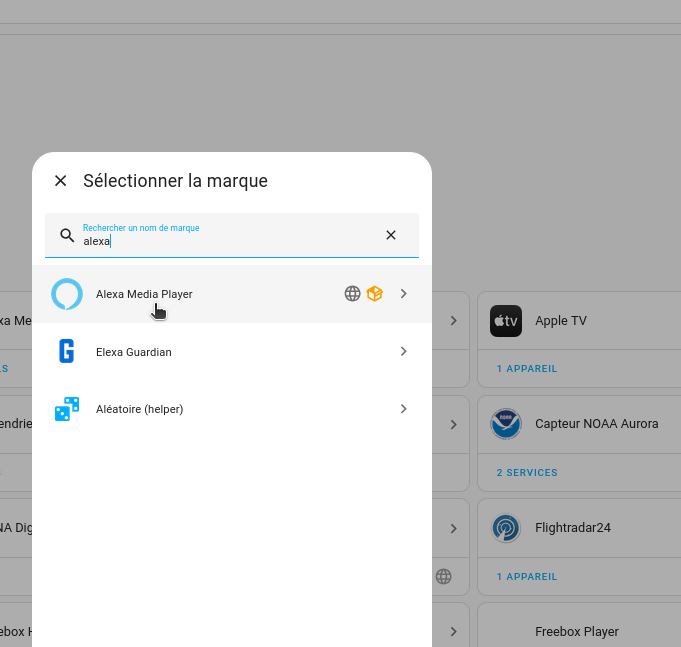
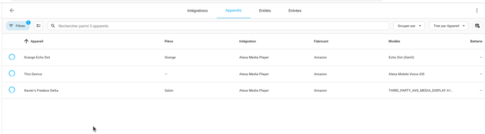

<p class="forum-cta"><a href="https://forumdomotique.com/forums/topic/178-integration-amazon-alexa-et-echo-et-freebox-player-alexa/">Lire et commenter sur Forum Domotique</a></p>


<section class="carousel photo-carousel" data-carousel data-lightbox aria-roledescription="carrousel" aria-label="Photos de l’article (3)" tabindex="0">
<div class="carousel-track" data-track>
<figure class="photo-slide" data-slide>
  <a href="images/Capturedcrandu2025-05-3013-08-05.png" data-full="images/Capturedcrandu2025-05-3013-08-05.png" data-alt="Photo 1 — Integration Amazon Alexa et Echo et freebox player alexa" aria-label="Agrandir la photo 1 : Photo 1 — Integration Amazon Alexa et Echo et freebox player alexa">
    
  </a>
</figure>
<figure class="photo-slide" data-slide>
  <a href="images/Capturedcrandu2025-05-3013-08-45.png" data-full="images/Capturedcrandu2025-05-3013-08-45.png" data-alt="Photo 2 — Integration Amazon Alexa et Echo et freebox player alexa" aria-label="Agrandir la photo 2 : Photo 2 — Integration Amazon Alexa et Echo et freebox player alexa">
    
  </a>
</figure>
<figure class="photo-slide" data-slide>
  <a href="images/Capturedcrandu2025-05-3013-09-16.png" data-full="images/Capturedcrandu2025-05-3013-09-16.png" data-alt="Photo 3 — Integration Amazon Alexa et Echo et freebox player alexa" aria-label="Agrandir la photo 3 : Photo 3 — Integration Amazon Alexa et Echo et freebox player alexa">
    
  </a>
</figure>
</div>
<button type="button" class="carousel-nav" data-prev aria-label="Photo précédente">‹</button>
<button type="button" class="carousel-nav" data-next aria-label="Photo suivante">›</button>
<div class="carousel-dots" data-dots></div>
<div class="carousel-live" data-live aria-live="polite"></div>
<p class="carousel-hint">Faites défiler les photos, ou ouvrez-les pour les agrandir (si JavaScript est activé).</p>
</section>

# Integration Amazon Alexa et Echo et freebox player alexa

- **Catégorie :** [Amazon Alexa et Echo](https://forumdomotique.com/forums/34-amazon-alexa-et-echo/)
- **Sujet :** https://forumdomotique.com/forums/topic/178-integration-amazon-alexa-et-echo-et-freebox-player-alexa/
- **Auteur du premier message du sujet :** XAV59213
- **Messages de XAV59213 dans ce sujet :** 2
- **Premier message de XAV59213 :** 30 mai 2025 à 13:21 (Europe/Paris)
- **Dernier message de XAV59213 :** 20 janvier 2026 à 11:22 (Europe/Paris)

---

## Message 1 — 30 mai 2025 à 13:21 (Europe/Paris)

- **Identifiant :** `381`
- **Lien :** https://forumdomotique.com/forums/topic/178-integration-amazon-alexa-et-echo-et-freebox-player-alexa/#findComment-381

Bonjour à tous,

Je vais vous expliquer comment j'ai intégré Alexa à Home Assistant pour créer une automatisation qui m'avertit quand il y a du courrier dans ma boîte aux lettres. Voici les étapes que j'ai suivies :

1. **Activation d'Alexa dans Home Assistant** :

   - Avant tout, **n'oubliez pas d'activer Alexa** dans l'interface de Home Assistant :

     - Allez dans **Configuration > Assistants vocaux > Assistants**.
     - Assurez-vous que l'assistant Alexa est activé. Si ce n'est pas le cas, suivez les instructions pour l'activer (vous devrez peut-être lier votre compte Amazon).
     - Redémarrez Home Assistant si nécessaire pour appliquer les changements.


<!-- source : https://cdn.forumdomotique.com/monthly_2025_05/Capturedcrandu2025-05-3013-08-05.png.1dee1d8ae3c8a1f35fa5361ff9fc3713.png -->

1. **Installation du composant Alexa Media Player** :

   - J'ai installé l'intégration personnalisée alexa_media_player depuis ce dépôt GitHub : <https://github.com/alandtse/alexa_media_player/>.
   - Pour cela, j'ai suivi les instructions du dépôt :

     - Téléchargement du composant via HACS (ou manuellement dans le dossier custom_components).
     - Configuration dans configuration.yaml avec mes identifiants Amazon pour lier mon compte Alexa.
     - Redémarrage de Home Assistant pour activer l'intégration.
   - Une fois configuré, mes appareils Alexa (comme l'Echo Dot et la Freebox Delta) sont apparus comme des entités media_player dans Home Assistant.


<!-- source : https://cdn.forumdomotique.com/monthly_2025_05/Capturedcrandu2025-05-3013-08-45.png.0de64945b7794ccb8a5fc5748e8085cd.png --> 
<!-- source : https://cdn.forumdomotique.com/monthly_2025_05/Capturedcrandu2025-05-3013-09-16.png.c89020b70a592dfbef82df765840c7ef.png -->

1. **Création de l'automatisation** :

   - J'ai créé une automatisation dans Home Assistant pour détecter quand mon capteur de boîte aux lettres (entité counter.detecteur_boite_a_lettre_count) dépasse 0, ce qui indique qu'il y a du courrier.
   - Voici le code YAML de l'automatisation que j'ai utilisé :

```yaml
alias: Il y a du courrier
description: Envoie un SMS si la valeur du compteur est au-dessus de 1.
triggers:
  - entity_id: counter.detecteur_boite_a_lettre_count
    above: 0
    trigger: numeric_state
conditions: []
actions:
  - action: notify.sms_papa
    data:
      message: Il y a du courrier !
  - action: notify.sms_maman
    metadata: {}
    data:
      message: Il y a du courrier !
  - data:
      volume_level: 1
    target:
      device_id: d33110eb08caf1e8ec5f28b1aa41cb46
    action: media_player.volume_set
  - action: notify.alexa_media_grange_echo_dot
    metadata: {}
    data:
      message: >-
        Bonjour la famille Descamps, il y a actuellement du courrier dans la boîte à lettre !!
  - delay:
      hours: 0
      minutes: 0
      seconds: 20
      milliseconds: 0
    enabled: true
  - data:
      volume_level: 0.49
    target:
      device_id:
        - d33110eb08caf1e8ec5f28b1aa41cb46
    action: media_player.volume_set
    enabled: true
  - action: notify.alexa_media_xavier_s_freebox_delta
    metadata: {}
    data:
      message: >-
        Bonjour la famille Descamps, il y a actuellement du courrier dans la boîte à lettre !!
mode: single
```

**Explication de l'automatisation** :

- **Déclencheur** : L'automatisation se déclenche quand le compteur counter.detecteur_boite_a_lettre_count dépasse 0.
- **Actions** :

  - Envoie un SMS à deux numéros (notify.sms_papa et notify.sms_maman) avec le message "Il y a du courrier !".
  - Règle le volume de l'appareil Alexa (identifié par device_id) à 100 %.
  - Diffuse un message vocal via l'Echo Dot (notify.alexa_media_grange_echo_dot) : "Bonjour la famille Descamps, il y a actuellement du courrier dans la boîte à lettre !!".
  - Attend 20 secondes.
  - Règle le volume de l'appareil Alexa à 49 %.
  - Diffuse le même message vocal via la Freebox Delta (notify.alexa_media_xavier_s_freebox_delta).

4. **Résultat** :

   - Quand du courrier est détecté, je reçois des SMS et mes appareils Alexa annoncent vocalement la présence de courrier. Le volume est ajusté pour garantir que l'annonce est audible, puis réduit pour ne pas déranger ensuite.

**Note** : Si vous rencontrez des problèmes, vérifiez que l'intégration Alexa est bien activée dans les paramètres des assistants vocaux et que vos identifiants Amazon sont correctement configurés dans alexa_media_player.

Si vous avez des questions ou besoin d'aide pour reproduire cette configuration, n'hésitez pas !

---

## Message 2 — 20 janvier 2026 à 11:22 (Europe/Paris)

- **Identifiant :** `1842`
- **Lien :** https://forumdomotique.com/forums/topic/178-integration-amazon-alexa-et-echo-et-freebox-player-alexa/#findComment-1842

Salut @frier74

Peux-tu me transmettre en YAML ton automatisation afin que je puisse comprendre ce que tu veux automatiser ?

---
