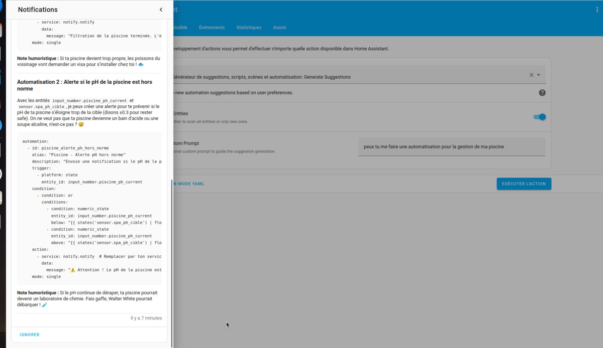
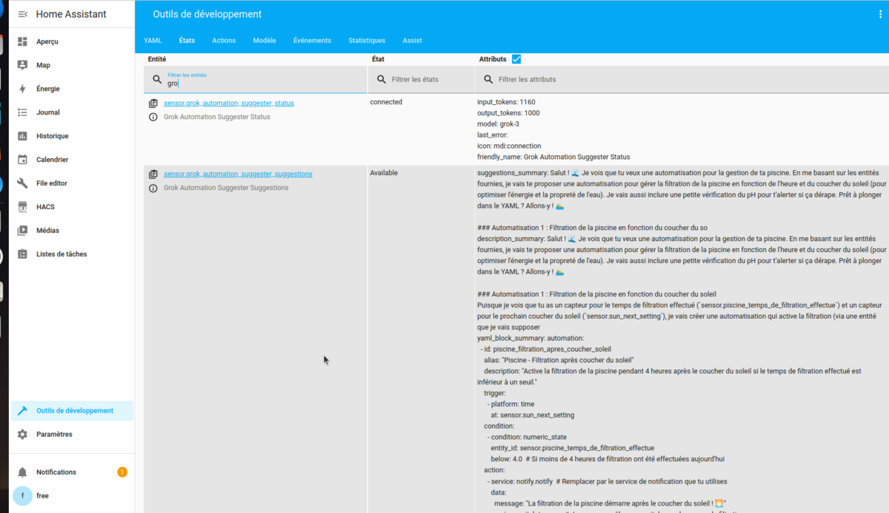
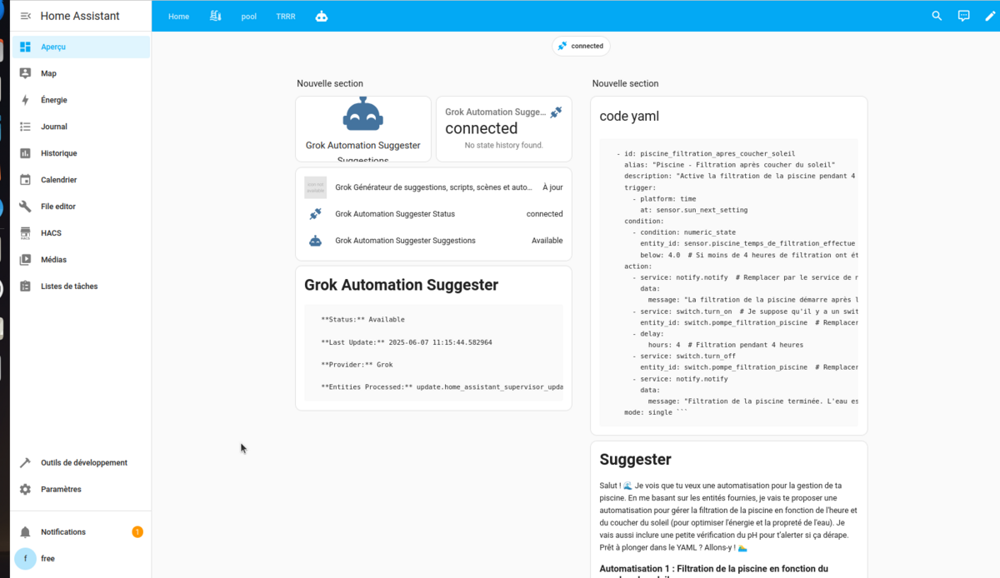


<p class="forum-cta"><a href="https://forumdomotique.com/forums/topic/192-%F0%9F%A7%A0-grok-automation-suggester-des-id%C3%A9es-dautomatisations-ia-directement-dans-home-assistant/">Lire et commenter sur Forum Domotique</a> · <a href="https://github.com/XAV59213/grok_automation_suggester">Dépôt HACS : Grok Automation Suggester</a></p>

# 🧠 Grok Automation Suggester – Des idées d’automatisations IA directement dans Home Assistant !

- **Catégorie :** [Projets et Personnalisations](https://forumdomotique.com/forums/12-projets-et-personnalisations/)
- **Sujet :** https://forumdomotique.com/forums/topic/192-%F0%9F%A7%A0-grok-automation-suggester-des-id%C3%A9es-dautomatisations-ia-directement-dans-home-assistant/
- **Auteur du premier message du sujet :** XAV59213
- **Messages de XAV59213 dans ce sujet :** 1
- **Premier message de XAV59213 :** 7 juin 2025 à 11:29 (Europe/Paris)

---

## Message 1 — 7 juin 2025 à 11:29 (Europe/Paris)

- **Identifiant :** `411`
- **Lien :** https://forumdomotique.com/forums/topic/192-%F0%9F%A7%A0-grok-automation-suggester-des-id%C3%A9es-dautomatisations-ia-directement-dans-home-assistant/#findComment-411

### 🔥 Une intégration fun, utile et inspirée par JARVIS & Le Guide du voyageur galactique !

---

### 🚀 C'est quoi Grok Automation Suggester ?

Grok Automation Suggester est une intégration personnalisée pour Home Assistant qui utilise **l'intelligence artificielle Grok de xAI** pour vous **suggérer des automatisations**, directement dans votre interface Home Assistant.

Vous connectez votre clé API, et l’intégration vous propose des idées adaptées à vos entités (lumières, capteurs, interrupteurs…), avec une **touche d’humour intergalactique** ✨

> Exemple de prompt IA :  
> *"Yo, j’ai repéré ton capteur de mouvement dans le salon, et je pense que ta lampe pourrait s’allumer toute seule. Voici une idée sympa en YAML..."*

---

### 📷 Aperçu en images

**Suggestions IA dans Home Assistant :**


<!-- source : https://cdn.forumdomotique.com/monthly_2025_06/Capturedcrandu2025-06-0711-23-20.png.9f6719a6dc0a183befa3e64e96a8acbe.png -->

**Capteur avec YAML généré :**


<!-- source : https://cdn.forumdomotique.com/monthly_2025_06/Capturedcrandu2025-06-0711-25-35.png.19b9ac6c95644c14cc901f555d83206c.png -->

**Service pour générer les idées d’automatisations :**  

<!-- source : https://cdn.forumdomotique.com/monthly_2025_06/Capturedcrandu2025-06-0711-25-57.png.31bc336bf3a969f41e7684105b226a58.png -->

---

### 💡 Fonctionnalités principales

- Génère des **automatisations intelligentes** grâce à l’IA Grok.
- Style unique & humoristique ✨
- Suggestions dans des **notifications persistantes** ou via **capteurs**.
- Compatible UI Home Assistant.
- Facile à utiliser, sans YAML compliqué.

---

### 🛠️ Installation

#### 📦 Via HACS (conseillé) :

1. Allez dans HACS > Intégrations > 3 points en haut > Dépôts personnalisés
2. Ajoutez ce dépôt :  
   👉 `https://github.com/XAV59213/grok_automation_suggester`
3. Recherchez **Grok Automation Suggester** et installez.
4. Redémarrez Home Assistant.

#### 📁 Installation manuelle :

1. Téléchargez le code ici :  
   👉 [GitHub – grok_automation_suggester](https://github.com/XAV59213/grok_automation_suggester)
2. Copiez le dossier `custom_components/grok_automation_suggester/` dans le dossier `config/custom_components/` de Home Assistant.
3. Redémarrez Home Assistant.

---

### ⚙️ Configuration

1. Allez dans **Paramètres > Appareils & Services > Ajouter une intégration**
2. Choisissez **Grok Automation Suggester**
3. Entrez votre clé API Grok : [console.x.ai](https://console.x.ai)
4. En option : personnalisez le modèle, le style de réponse, le nombre de tokens, etc.

---

### 🎯 Utilisation

#### ✅ Générer manuellement :

Allez dans **Développeur > Services**, appelez :  
`grok_automation_suggester.generate_suggestions`

Paramètres :

- `all_entities`: `true` ou `false`
- `custom_prompt`: *"Crée des automatisations pour la sécurité..."*

#### 🧠 Automatisation incluse :

Une automatisation (`grok_new_entity_automation.yaml`) déclenche automatiquement des suggestions à chaque fois qu’une **nouvelle entité est détectée**.

```yaml
- id: grok_new_entity_automation
  alias: Détection de nouvelle entité pour Grok Suggestions
  description: Déclenche la génération de suggestions lorsqu’une nouvelle entité est ajoutée au registre.
  trigger:
    - platform: event
      event_type: entity_registry_updated
  condition:
    - condition: template
      value_template: "{{ trigger.event is defined and trigger.event.data.action == 'create' and trigger.event.data.entity_id is defined }}"
  action:
    - service: system_log.write
      data:
        message: >
          Nouvelle entité détectée: {{ trigger.event.data.entity_id }}inconnue. Lancement des suggestions Grok.
        level: info
    - service: grok_automation_suggester.generate_suggestions
      data:
        all_entities: false
    - delay: 5
    - choose:
        - conditions:
            - condition: template
              value_template: "{{ states('sensor.grok_automation_suggestions') != 'No suggestions' }}"
          sequence:
            - service: notify.persistent_notification
              data:
                title: "Nouvelles suggestions d’automatisation Grok"
                message: >
                  Des suggestions ont été générées. État du capteur: {{ states('sensor.grok_automation_suggestions') }}.
                  Consultez sensor.grok_automation_suggestions ou grok_suggestions.yaml pour les détails.
```

---

### 🔐 Clé API requise

Vous aurez besoin d’une clé gratuite (ou payante) depuis le site officiel Grok de xAI :  
👉 [console.x.ai](https://console.x.ai)

---

### 🤝 Contribuer ou poser vos questions

📁 Dépôt GitHub :  
👉 <https://github.com/XAV59213/grok_automation_suggester>

🛠️ Suggestions / Bugs : utilisez les **Issues** sur GitHub ou laissez un message ici !

---

---

### 🛸 Alors, prêt à automatiser avec style et intelligence ?

> **Essayez Grok, et laissez votre maison devenir plus maligne que vous !** 😄

---

