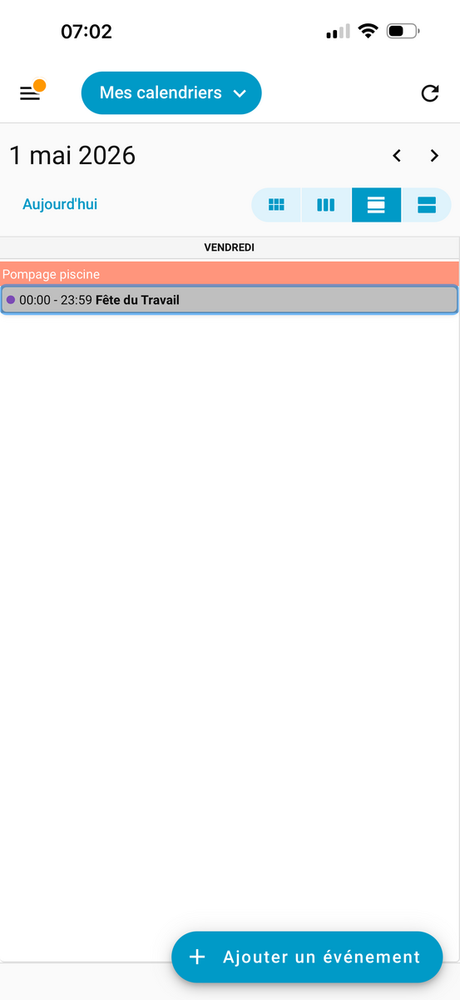


<p class="forum-cta"><a href="https://forumdomotique.com/forums/topic/194-%F0%9F%87%AB%F0%9F%87%B7-int%C3%A9gration-ha-jour-f%C3%A9ri%C3%A9-capteur-de-jours-f%C3%A9ri%C3%A9s/">Lire et commenter sur Forum Domotique</a> · <a href="https://github.com/XAV59213/jourferier">Dépôt HACS : Jour Férié</a></p>


<section class="carousel photo-carousel" data-carousel data-lightbox aria-roledescription="carrousel" aria-label="Photos de l’article (9)" tabindex="0">
<div class="carousel-track" data-track>
<figure class="photo-slide" data-slide>
  <a href="images/banner-jourferier.png" data-full="images/banner-jourferier.png" data-alt="Bannière — Jour Férié, intégration HACS officielle pour Home Assistant" aria-label="Agrandir la bannière">
    
  </a>
</figure>
<figure class="photo-slide" data-slide>
  <a href="images/Capturedcrandu2025-06-0809-22-23.png" data-full="images/Capturedcrandu2025-06-0809-22-23.png" data-alt="Photo 1 — ## 🇫🇷 [Intégration HA] Jour Férié – Capteur de jours fériés" aria-label="Agrandir la photo 1 : Photo 1 — ## 🇫🇷 [Intégration HA] Jour Férié – Capteur de jours fériés">
    
  </a>
</figure>
<figure class="photo-slide" data-slide>
  <a href="images/Capturedcrandu2025-06-0809-25-35.png" data-full="images/Capturedcrandu2025-06-0809-25-35.png" data-alt="Photo 2 — ## 🇫🇷 [Intégration HA] Jour Férié – Capteur de jours fériés" aria-label="Agrandir la photo 2 : Photo 2 — ## 🇫🇷 [Intégration HA] Jour Férié – Capteur de jours fériés">
    
  </a>
</figure>
<figure class="photo-slide" data-slide>
  <a href="images/Capturedcrandu2025-06-0809-54-33.png" data-full="images/Capturedcrandu2025-06-0809-54-33.png" data-alt="Photo 3 — ## 🇫🇷 [Intégration HA] Jour Férié – Capteur de jours fériés" aria-label="Agrandir la photo 3 : Photo 3 — ## 🇫🇷 [Intégration HA] Jour Férié – Capteur de jours fériés">
    
  </a>
</figure>
<figure class="photo-slide" data-slide>
  <a href="images/7273.png" data-full="images/7273.png" data-alt="Photo 4 — ## 🇫🇷 [Intégration HA] Jour Férié – Capteur de jours fériés" aria-label="Agrandir la photo 4 : Photo 4 — ## 🇫🇷 [Intégration HA] Jour Férié – Capteur de jours fériés">
    
  </a>
</figure>
<figure class="photo-slide" data-slide>
  <a href="images/Capturedcrandu2025-07-0514-48-45.png" data-full="images/Capturedcrandu2025-07-0514-48-45.png" data-alt="Photo 5 — ## 🇫🇷 [Intégration HA] Jour Férié – Capteur de jours fériés" aria-label="Agrandir la photo 5 : Photo 5 — ## 🇫🇷 [Intégration HA] Jour Férié – Capteur de jours fériés">
    
  </a>
</figure>
<figure class="photo-slide" data-slide>
  <a href="images/IMG_6843.jpeg" data-full="images/IMG_6843.jpeg" data-alt="Photo 6 — ## 🇫🇷 [Intégration HA] Jour Férié – Capteur de jours fériés" aria-label="Agrandir la photo 6 : Photo 6 — ## 🇫🇷 [Intégration HA] Jour Férié – Capteur de jours fériés">
    
  </a>
</figure>
<figure class="photo-slide" data-slide>
  <a href="images/IMG_6842.png" data-full="images/IMG_6842.png" data-alt="Photo 7 — ## 🇫🇷 [Intégration HA] Jour Férié – Capteur de jours fériés" aria-label="Agrandir la photo 7 : Photo 7 — ## 🇫🇷 [Intégration HA] Jour Férié – Capteur de jours fériés">
    
  </a>
</figure>
<figure class="photo-slide" data-slide>
  <a href="images/IMG_6841.png" data-full="images/IMG_6841.png" data-alt="Photo 8 — ## 🇫🇷 [Intégration HA] Jour Férié – Capteur de jours fériés" aria-label="Agrandir la photo 8 : Photo 8 — ## 🇫🇷 [Intégration HA] Jour Férié – Capteur de jours fériés">
    
  </a>
</figure>
</div>
<button type="button" class="carousel-nav" data-prev aria-label="Photo précédente">‹</button>
<button type="button" class="carousel-nav" data-next aria-label="Photo suivante">›</button>
<div class="carousel-dots" data-dots></div>
<div class="carousel-live" data-live aria-live="polite"></div>
<p class="carousel-hint">Faites défiler les photos, ou ouvrez-les pour les agrandir (si JavaScript est activé).</p>
</section>

# ## 🇫🇷 [Intégration HA] Jour Férié – Capteur de jours fériés

Bonjour à tous 👋

Ça faisait un moment que je n’avais pas donné de nouvelles ici ! Voici une présentation complète et à jour de **Jour Férié** 🇫🇷, l’intégration Home Assistant qui sait, chaque jour, si l’on est un jour férié en France, si demain en est un, et combien de jours il reste avant le prochain.

Grande nouvelle : depuis le 9 novembre 2026, elle fait partie de la **bibliothèque officielle de HACS**. Ceux qui l’avaient installée en dépôt personnalisé n’ont rien à faire, tout continue de fonctionner. La version actuelle est la [**1.2.8**](https://github.com/XAV59213/jourferier/releases/tag/1.2.8).

👉 **Le plus simple :** cliquez sur ce bouton. Un clic ouvre directement l’intégration dans votre HACS, et le dépôt est ajouté automatiquement :


<!-- source : https://my.home-assistant.io/badges/hacs_repository.svg -->


<!-- source : https://raw.githubusercontent.com/XAV59213/jourferier/main/image/logo.png -->

### 🤔 À quoi ça sert, concrètement ?

Un jour férié, ça change souvent le programme de la maison : pas de réveil à 6 h 30, le chauffage du bureau qui n’a pas besoin de démarrer, le ramassage des poubelles décalé… Le problème, c’est que Home Assistant ne le sait pas tout seul.

Jour Férié lui apprend. L’intégration calcule elle-même les jours fériés français, y compris ceux qui bougent chaque année comme **Pâques, l’Ascension ou la Pentecôte** : pas besoin de les saisir à la main, et ils se mettent à jour automatiquement d’une année sur l’autre. Tout se passe en local.

Elle crée :

- 🗓️ un capteur **Jour Férié** (`sensor.jour_ferie`) : le nom du jour férié du jour (ou « aucun »), le prochain jour férié, le nombre de jours restants et le prochain **pont** potentiel
- 🔀 un capteur **« Aujourd’hui est férié »** (`binary_sensor.est_ferie`) : allumé les jours fériés, parfait pour bloquer un réveil ou une alarme
- 🔀 un capteur **« Demain est férié »** (`binary_sensor.demain_est_ferie`) : pour tout préparer la veille
- 📅 un **calendrier** (`calendar.jour_ferie_calendar`) avec tous les jours fériés, visible dans l’onglet Calendrier de Home Assistant

### ✨ Ce qui a changé depuis la première version

Depuis la présentation de juin 2025 :

- ✅ **Dans la bibliothèque HACS par défaut**, après une revue du code par frenck
- 🔀 **Deux capteurs binaires** : aujourd’hui férié, demain férié
- 📅 **Le calendrier des jours fériés**
- 🌉 Le **prochain pont** potentiel dans les attributs du capteur
- 🎉 **Une carte Lovelace livrée avec l’intégration**, avec éditeur visuel
- 🧹 L’ancien service `jourferier.create_card` a été retiré : la carte native le remplace

### 🛠️ Installation pas à pas (bibliothèque officielle HACS)

*Pour ceux qui débutent : HACS, c’est un peu le « magasin d’applications » communautaire de Home Assistant. Il permet d’installer et de mettre à jour en quelques clics des intégrations qui ne sont pas fournies d’origine. S’il n’est pas encore installé chez vous, le guide officiel est ici :* [*https://hacs.xyz/docs/use/*](https://hacs.xyz/docs/use/)

L’intégration fait partie de la **bibliothèque HACS par défaut** : plus besoin d’ajouter un dépôt personnalisé.

**Le plus rapide :** un clic sur ce bouton ouvre directement l’intégration dans votre HACS, et le dépôt est ajouté automatiquement :


<!-- source : https://my.home-assistant.io/badges/hacs_repository.svg -->

**Ou à la main :**

1. Dans Home Assistant, ouvrez **HACS** dans le menu de gauche
2. Tapez **Jour Férié** dans la barre de recherche
3. Ouvrez la fiche, puis cliquez sur **Télécharger**
4. Redémarrez Home Assistant (**Paramètres > Système > bouton ⏻ en haut à droite > Redémarrer**)
5. Allez dans **Paramètres > Appareils et services > + Ajouter une intégration**, et cherchez **Jour Férié**

⚠️ Petite subtilité qui piège souvent au début : HACS ne fait que **télécharger les fichiers**. Ce sont les étapes 4 et 5 qui créent réellement l’intégration et ses entités. Si vous ne voyez qu’une entité `update.…` après l’installation, c’est normal : c’est HACS qui surveille les mises à jour, il reste juste l’étape 5.

Aucune configuration n’est demandée : les capteurs et le calendrier apparaissent dès l’ajout.

Raccourci pour l’étape 5 : <https://my.home-assistant.io/redirect/config_flow_start/?domain=jourferier>

### 🎉 La carte « Jours fériés »

1. Ouvrez votre tableau de bord en mode **Modifier**
2. **Ajouter une carte**, puis cherchez **« Jours fériés »**
3. Choisissez le capteur (par défaut `sensor.jour_ferie`) et le titre

Elle affiche par exemple : « Aujourd’hui, pas de jour férié. Le prochain jour férié est **Toussaint** dans **1 jour**. »

```plaintext
type: custom:jour-ferie-card
entity: sensor.jour_ferie
title: Jours fériés 
```

🎉

Si elle n’apparaît pas, videz le cache du navigateur.

### 💬 Et l’Alsace-Moselle ?

@thierryha54, merci pour ta question de mai : les jours propres à l’Alsace-Moselle (Vendredi saint, Saint-Étienne) ne sont pas encore intégrés dans cette version, c’est noté.

### ⏰ Exemple : pas de réveil les jours fériés

Dans votre automatisation de réveil, il suffit d’ajouter cette condition : elle ne se déclenchera que les jours **non** fériés.

```plaintext
condition:
  - condition: state
    entity_id: binary_sensor.est_ferie
    state: "off"
```

### 🔗 Liens

- Dépôt GitHub : <https://github.com/XAV59213/jourferier>
- Dernière version (1.2.8) : <https://github.com/XAV59213/jourferier/releases/tag/1.2.8>
- Signaler un bug ou proposer une idée : <https://github.com/XAV59213/jourferier/issues>

Vos retours, idées et remontées de bugs sont les bienvenus, ici ou sur GitHub 😉

Bonne domotique ! 🏠  
Xavier (XAV59213)


