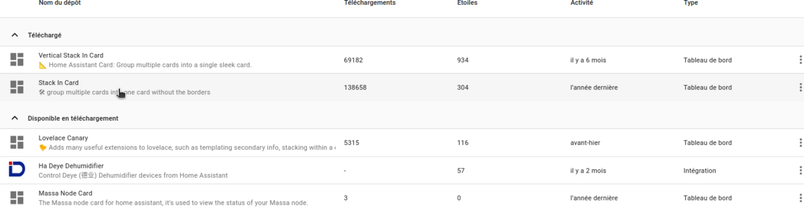


<p class="forum-cta"><a href="https://forumdomotique.com/forums/topic/194-%F0%9F%87%AB%F0%9F%87%B7-int%C3%A9gration-ha-jour-f%C3%A9ri%C3%A9-capteur-de-jours-f%C3%A9ri%C3%A9s/">Lire et commenter sur Forum Domotique</a> · <a href="https://github.com/XAV59213/jourferier">Dépôt HACS : Jour Férié</a></p>


<section class="carousel photo-carousel" data-carousel data-lightbox aria-roledescription="carrousel" aria-label="Photos de l’article (9)" tabindex="0">
<div class="carousel-track" data-track>
<figure class="photo-slide" data-slide>
  <a href="images/cover-jour-ferie.png" data-full="images/cover-jour-ferie.png" data-alt="Couverture — Jour Férié, intégration HACS officielle pour Home Assistant" aria-label="Agrandir la couverture">
    
  </a>
</figure>
<figure class="photo-slide" data-slide>
  <a href="images/Capturedcrandu2025-06-0809-22-23.png" data-full="images/Capturedcrandu2025-06-0809-22-23.png" data-alt="Photo 1 — ## 🇫🇷 [Intégration HA] Jour Férié – Capteur de jours fériés" aria-label="Agrandir la photo 1 : Photo 1 — ## 🇫🇷 [Intégration HA] Jour Férié – Capteur de jours fériés">
    
  </a>
</figure>
<figure class="photo-slide" data-slide>
  <a href="images/Capturedcrandu2025-06-0809-25-35.png" data-full="images/Capturedcrandu2025-06-0809-25-35.png" data-alt="Photo 2 — ## 🇫🇷 [Intégration HA] Jour Férié – Capteur de jours fériés" aria-label="Agrandir la photo 2 : Photo 2 — ## 🇫🇷 [Intégration HA] Jour Férié – Capteur de jours fériés">
    
  </a>
</figure>
<figure class="photo-slide" data-slide>
  <a href="images/Capturedcrandu2025-06-0809-54-33.png" data-full="images/Capturedcrandu2025-06-0809-54-33.png" data-alt="Photo 3 — ## 🇫🇷 [Intégration HA] Jour Férié – Capteur de jours fériés" aria-label="Agrandir la photo 3 : Photo 3 — ## 🇫🇷 [Intégration HA] Jour Férié – Capteur de jours fériés">
    
  </a>
</figure>
<figure class="photo-slide" data-slide>
  <a href="images/7273.png" data-full="images/7273.png" data-alt="Photo 4 — ## 🇫🇷 [Intégration HA] Jour Férié – Capteur de jours fériés" aria-label="Agrandir la photo 4 : Photo 4 — ## 🇫🇷 [Intégration HA] Jour Férié – Capteur de jours fériés">
    
  </a>
</figure>
<figure class="photo-slide" data-slide>
  <a href="images/Capturedcrandu2025-07-0514-48-45.png" data-full="images/Capturedcrandu2025-07-0514-48-45.png" data-alt="Photo 5 — ## 🇫🇷 [Intégration HA] Jour Férié – Capteur de jours fériés" aria-label="Agrandir la photo 5 : Photo 5 — ## 🇫🇷 [Intégration HA] Jour Férié – Capteur de jours fériés">
    
  </a>
</figure>
<figure class="photo-slide" data-slide>
  <a href="images/IMG_6843.jpeg" data-full="images/IMG_6843.jpeg" data-alt="Photo 6 — ## 🇫🇷 [Intégration HA] Jour Férié – Capteur de jours fériés" aria-label="Agrandir la photo 6 : Photo 6 — ## 🇫🇷 [Intégration HA] Jour Férié – Capteur de jours fériés">
    
  </a>
</figure>
<figure class="photo-slide" data-slide>
  <a href="images/IMG_6842.png" data-full="images/IMG_6842.png" data-alt="Photo 7 — ## 🇫🇷 [Intégration HA] Jour Férié – Capteur de jours fériés" aria-label="Agrandir la photo 7 : Photo 7 — ## 🇫🇷 [Intégration HA] Jour Férié – Capteur de jours fériés">
    
  </a>
</figure>
<figure class="photo-slide" data-slide>
  <a href="images/IMG_6841.png" data-full="images/IMG_6841.png" data-alt="Photo 8 — ## 🇫🇷 [Intégration HA] Jour Férié – Capteur de jours fériés" aria-label="Agrandir la photo 8 : Photo 8 — ## 🇫🇷 [Intégration HA] Jour Férié – Capteur de jours fériés">
    
  </a>
</figure>
</div>
<button type="button" class="carousel-nav" data-prev aria-label="Photo précédente">‹</button>
<button type="button" class="carousel-nav" data-next aria-label="Photo suivante">›</button>
<div class="carousel-dots" data-dots></div>
<div class="carousel-live" data-live aria-live="polite"></div>
<p class="carousel-hint">Faites défiler les photos, ou ouvrez-les pour les agrandir (si JavaScript est activé).</p>
</section>

# ## 🇫🇷 [Intégration HA] Jour Férié – Capteur de jours fériés

- **Catégorie :** [Projets et Personnalisations](https://forumdomotique.com/forums/12-projets-et-personnalisations/)
- **Sujet :** https://forumdomotique.com/forums/topic/194-%F0%9F%87%AB%F0%9F%87%B7-int%C3%A9gration-ha-jour-f%C3%A9ri%C3%A9-capteur-de-jours-f%C3%A9ri%C3%A9s/
- **Auteur du premier message du sujet :** XAV59213
- **Messages de XAV59213 dans ce sujet :** 11
- **Premier message de XAV59213 :** 7 juin 2025 à 15:54 (Europe/Paris)
- **Dernier message de XAV59213 :** 20 novembre 2026 à 12:04 (Europe/Paris)

---

## Message 1 — 7 juin 2025 à 15:54 (Europe/Paris)

- **Identifiant :** `413`
- **Lien :** https://forumdomotique.com/forums/topic/194-%F0%9F%87%AB%F0%9F%87%B7-int%C3%A9gration-ha-jour-f%C3%A9ri%C3%A9-capteur-de-jours-f%C3%A9ri%C3%A9s/#findComment-413

Bonjour à tous 👋

Je vous propose une **intégration Home Assistant** permettant d'afficher **si aujourd’hui est un jour férié en France**, et d’indiquer le **prochain jour férié** avec le nombre de jours restants.

### 🔍 Fonctionnalités

- `sensor.jour_ferie` :

  - Affiche le nom du jour férié (ou "Aucun")
  - Fournit les attributs suivants :

    - `holiday_name` : nom du jour férié
    - `date` : date du jour
    - `next_holiday` : prochain jour férié
    - `days_until` : jours restants
- Service `jourferier.create_card` : insère automatiquement une carte dans Lovelace
- Configuration **100% via l’interface utilisateur**, aucune ligne YAML requise ✅

---

### 🛠️ Installation (via HACS)

1. Ajoutez ce dépôt dans HACS :

   <https://github.com/XAV59213/jourferier>

   Recherchez **Jour Férié** dans les intégrations HACS et installez-la
2. Redémarrez Home Assistant
3. Ajoutez l’intégration via **Paramètres > Appareils & Services**

   🖼️ Exemple de carte Lovelace

   ```yaml
   type: entity
   entity: sensor.jour_ferie
   name: Jour Férié
   icon: mdi:calendar-star
   ```

   📂 Dépôt GitHub :  
   🔗 <https://github.com/XAV59213/jourferier>

   N’hésitez pas à me faire vos retours ou suggestions. Bonne domotique à tous !  
   — **xav59213**

---

## Message 2 — 7 juin 2025 à 17:40 (Europe/Paris)

- **Identifiant :** `416`
- **Lien :** https://forumdomotique.com/forums/topic/194-%F0%9F%87%AB%F0%9F%87%B7-int%C3%A9gration-ha-jour-f%C3%A9ri%C3%A9-capteur-de-jours-f%C3%A9ri%C3%A9s/#findComment-416

> **il y a une heure, Arubinu a dit :**
> Salut, tes liens GitHub sont erronés 😊  
> Sinon c'est plutôt cool, merci pour ce partage.  
>   
> - Peux-tu proposer une carte Lovelace d'exemple pour le prochain jour férié?  
> - Est-il possible de faire en sorte qu'il ajoute au besoin, ces jours au calendrier de Home Assistant?  
> - Peut-être aussi indiquer quand c'est un jour férié pour les vieux (excusez-moi de l'appellation mais je suis pas fana du concept 😁)

Désoler j'ai modifier

---

## Message 3 — 8 juin 2025 à 09:30 (Europe/Paris)

- **Identifiant :** `418`
- **Lien :** https://forumdomotique.com/forums/topic/194-%F0%9F%87%AB%F0%9F%87%B7-int%C3%A9gration-ha-jour-f%C3%A9ri%C3%A9-capteur-de-jours-f%C3%A9ri%C3%A9s/#findComment-418

> **Il y a 16 heures, Arubinu a dit :**
> Salut, tes liens GitHub sont erronés 😊 OK
>
> Sinon c'est plutôt cool, merci pour ce partage. MERCI  
>   
> - Peux-tu proposer une carte Lovelace d'exemple pour le prochain jour férié? OK ATTENTION UTILISATION DE stack-in-card DANS HACS
>
> 
<!-- source : https://cdn.forumdomotique.com/monthly_2025_06/Capturedcrandu2025-06-0809-22-23.png.a7fc5ccc39f4a59fbd515d6b063328f5.png -->
>
> ```markdown
> type: custom:stack-in-card
> title:  Jours fériés
> cards:
> - type: markdown
> content: >
> 
>
> 
>
> 
>
> 
>
> 
>
>
> 
> -  **Aujourd'hui, c'est {{ today_holiday }} !**
> 
> - Aujourd'hui, pas de jour férié.
> 
>
> 
> - Le prochain jour férié est **{{ next_holiday }}** dans **{{ days_until | int }} jour{{ 's' if days_until | int > 1 else '' }}**.
> 
> - Aucun jour férié à venir. Vérifiez la configuration du capteur {{ sensor }}.
> {{ log('Invalid or missing attributes for ' ~ sensor ~ ': next_holiday=' ~ next_holiday ~ ', days_until=' ~ days_until, level='warning') }}
> 
> card_mod:
> style: |
> ha-markdown {
> padding: 16px;
> background-color: var(--card-background-color);
> border-radius: 8px;
> }
> ha-markdown p:first-child {
> 
> color: #FF9800;
> font-weight: bold;
> font-size: 1.2em;
> 
> }
> ```
>
> 
<!-- source : https://cdn.forumdomotique.com/monthly_2025_06/Capturedcrandu2025-06-0809-25-35.png.f744225ca1886cc78a83f55e01bf765a.png -->
>
> - Est-il possible de faire en sorte qu'il ajoute au besoin, ces jours au calendrier de Home Assistant? NON il manque des class et des constantes a part demander l'ajout a home assitant
>
> - Peut-être aussi indiquer quand c'est un jour férié pour les vieux (excusez-moi de l'appellation mais je suis pas fana du concept 😁) OK
>
> 
<!-- source : https://cdn.forumdomotique.com/monthly_2025_06/Capturedcrandu2025-06-0809-54-33.png.9e99765a1b70870f2491921c193491a2.png -->
>
> AJOUT DE CONSTANTES
>
> ```yaml
> HOLIDAY_DESCRIPTIONS = {
>     "Jour de l’An": "Bonne année ! Que cette nouvelle année soit pleine de joie et de réussite !",
>     "Lundi de Pâques": "Joyeuses Pâques ! Profitez de cette journée festive en famille !",
>     "Fête du Travail": "Bonne fête du travail ! Une journée pour célébrer les travailleurs !",
>     "Victoire 1945": "Hommage à la victoire de 1945 ! Une journée de mémoire et de paix.",
>     "Ascension": "Joyeuse Ascension ! Une journée spirituelle et de repos.",
>     "Lundi de Pentecôte": "Bonne fête de Pentecôte ! Une journée pour célébrer l'Esprit Saint.",
>     "Fête Nationale": "Vive la France ! Joyeux 14 juillet, fête nationale !",
>     "Assomption": "Bonne fête de l’Assomption ! Une journée de célébration mariale.",
>     "Toussaint": "Bonne Toussaint ! Un moment pour honorer les saints et les défunts.",
>     "Armistice 1918": "Hommage aux héros de 1918 ! Une journée de recueillement.",
>     "Noël": "Joyeux Noël ! Une fête chaleureuse pour partager amour et cadeaux !"
> }
> ```

Cette intégration me permet de recevoir des notifications pour les jours fériés, notamment pour la collecte des poubelles. Par exemple, si la collecte est prévue un jeudi férié, une notification m'avertit que le ramassage est décalé au vendredi.

---

## Message 4 — 14 juin 2025 à 10:50 (Europe/Paris)

- **Identifiant :** `458`
- **Lien :** https://forumdomotique.com/forums/topic/194-%F0%9F%87%AB%F0%9F%87%B7-int%C3%A9gration-ha-jour-f%C3%A9ri%C3%A9-capteur-de-jours-f%C3%A9ri%C3%A9s/#findComment-458

Salut à tous,

Suite vos demandes, j’ai mis à jour mon intégration **Jour Férié** pour Home Assistant. Elle permet maintenant d’afficher les jours fériés français de 2025 directement dans le **calendrier** avec l’entité calendar.jour_ferie_calendar, en plus du capteur sensor.jour_ferie.

Testez-la via HACS : <https://github.com/xav59213/xav59213-jour-ferie> ou consultez le dépôt pour plus d’infos. Vos retours sont les bienvenus !

---

## Message 5 — 14 juin 2025 à 14:43 (Europe/Paris)

- **Identifiant :** `459`
- **Lien :** https://forumdomotique.com/forums/topic/194-%F0%9F%87%AB%F0%9F%87%B7-int%C3%A9gration-ha-jour-f%C3%A9ri%C3%A9-capteur-de-jours-f%C3%A9ri%C3%A9s/#findComment-459

> **Il y a 3 heures, XAV59213 a dit :**
> Salut à tous,
>
> Suite vos demandes, j’ai mis à jour mon intégration **Jour Férié** pour Home Assistant. Elle permet maintenant d’afficher les jours fériés français de 2025 directement dans le **calendrier** avec l’entité calendar.jour_ferie_calendar, en plus du capteur sensor.jour_ferie.
>
> Testez-la via HACS : <https://github.com/xav59213/xav59213-jour-ferie> ou consultez le dépôt pour plus d’infos. Vos retours sont les bienvenus !

J'ai une erreur l intégration n est plus visible mais il ajoute bien dans le calendrier je ne peux pas modifier actuellement

---

## Message 6 — 15 juin 2025 à 10:58 (Europe/Paris)

- **Identifiant :** `466`
- **Lien :** https://forumdomotique.com/forums/topic/194-%F0%9F%87%AB%F0%9F%87%B7-int%C3%A9gration-ha-jour-f%C3%A9ri%C3%A9-capteur-de-jours-f%C3%A9ri%C3%A9s/#findComment-466

✅ **Problème résolu**

L’intégration apparaît désormais correctement dans *Appareils & Services* après avoir modifié le champ `integration_type` dans le fichier `manifest.json` (passé de `"entity"` à `"hub"`), et après avoir ajouté correctement les attributs `device_info` dans les entités `sensor` et `calendar`.

De plus, la compatibilité avec le **calendrier Home Assistant** est pleinement intégrée : les jours fériés sont automatiquement ajoutés comme événements de type "journée entière" dans une entité `calendar.jour_ferie_calendar`.

Tout fonctionne parfaitement maintenant ! 🎉

🔗 Dépôt : <https://github.com/XAV59213/jourferier>

---

## Message 7 — 5 juillet 2025 à 14:54 (Europe/Paris)

- **Identifiant :** `544`
- **Lien :** https://forumdomotique.com/forums/topic/194-%F0%9F%87%AB%F0%9F%87%B7-int%C3%A9gration-ha-jour-f%C3%A9ri%C3%A9-capteur-de-jours-f%C3%A9ri%C3%A9s/#findComment-544

Ajout du Logo et de l'Icon


<!-- source : https://github.githubassets.com/favicons/favicon.svg -->

##### GitHub


<!-- source : https://opengraph.githubassets.com/260ece6a08efd1ab857f57373d77683cc112ea3302d856b3602cc8fe0a637d58/home-assistant/brands/pull/7273 -->

### Add icon and logo by XAV59213 · Pull Request #7273 · home...

Proposed change This PR adds both a logo and an icon for the custom Home Assistant integration &quot;Jour Férié&quot;, which displays whether today is a public holiday in France and dynamically in...


<!-- source : https://raw.githubusercontent.com/home-assistant/brands/dbb92d381387dcc16f9851a61e561dd1f6132694/custom_integrations/jourferier/icon.png -->


<!-- source : https://raw.githubusercontent.com/home-assistant/brands/dbb92d381387dcc16f9851a61e561dd1f6132694/custom_integrations/jourferier/logo.png -->


<!-- source : https://cdn.forumdomotique.com/monthly_2025_07/Capturedcrandu2025-07-0514-48-45.png.f3a9051c97561cabc6d1ebece692d0f1.png -->

---

## Message 8 — 24 avril 2026 à 07:03 (Europe/Paris)

- **Identifiant :** `2237`
- **Lien :** https://forumdomotique.com/forums/topic/194-%F0%9F%87%AB%F0%9F%87%B7-int%C3%A9gration-ha-jour-f%C3%A9ri%C3%A9-capteur-de-jours-f%C3%A9ri%C3%A9s/#findComment-2237

Salut [@Mobyo](https://forumdomotique.com/profile/89-mobyo/)

Rien à voir avec mon calendrier. J’ai déjà ajouté les jours fériés via ce fichier :

<https://github.com/XAV59213/jourferier/blob/main/custom_components/jourferier/const.py>

Avec le départ et son commentaire

Sur l’intégration que tu donne, il faut tout ajouter à la main.


<!-- source : https://cdn.forumdomotique.com/monthly_2026_04/IMG_6843.jpeg.b27f7bb96b338d3131f84baf7dad5e66.jpeg -->


<!-- source : https://cdn.forumdomotique.com/monthly_2026_04/IMG_6842.png.24ca146dc6a96b491a7ded3ae81ead4d.png -->


<!-- source : https://cdn.forumdomotique.com/monthly_2026_04/IMG_6841.png.cb2af6c5054c7ad03c4677bb15b775de.png -->

---

## Message 9 — 4 mai 2026 à 06:39 (Europe/Paris)

- **Identifiant :** `2258`
- **Lien :** https://forumdomotique.com/forums/topic/194-%F0%9F%87%AB%F0%9F%87%B7-int%C3%A9gration-ha-jour-f%C3%A9ri%C3%A9-capteur-de-jours-f%C3%A9ri%C3%A9s/#findComment-2258

Salut [@thierryha54](https://forumdomotique.com/profile/1705-thierryha54/),

Voici un retour précis sur tes deux questions et comment bien ajouter l’Alsace-Moselle.

**Oui, elles s’actualisent automatiquement tous les ans.**

Ton idée est bonne, mais il faut **conditionner** ces deux jours selon une option de configuration (sinon tout le monde en France aura ces jours en plus).

**Ajouter une option dans config_flow.py:**

```python
# Dans config_flow.py (à créer/améliorer si pas déjà fait)
import voluptuous as vol
from homeassistant import config_entries

class JourFerieConfigFlow(config_entries.ConfigFlow, domain=DOMAIN):
    async def async_step_user(self, user_input=None):
        if user_input is not None:
            return self.async_create_entry(title="Jour Férié", data=user_input)

        return self.async_show_form(
            step_id="user",
            data_schema=vol.Schema({
                vol.Optional("alsace_moselle", default=False): bool,
            }),
            description_placeholders={"title": "Configuration"}
        )
```

**Modifier const.py:**

```python
from datetime import date, timedelta

def get_holidays(year: int, alsace_moselle: bool = False) -> dict[date, str]:
    """Retourne les jours fériés (option Alsace-Moselle)."""
    
    # Calcul de Pâques (ton code existant)
    a = year % 19
    b = year // 100
    c = year % 100
    d = b // 4
    e = b % 4
    f = (b + 8) // 25
    g = (b - f + 1) // 3
    h = (19 * a + b - d - g + 15) % 30
    i = c // 4
    k = c % 4
    l = (32 + 2 * e + 2 * i - h - k) % 7
    m = (a + 11 * h + 22 * l) // 451
    month = (h + l - 7 * m + 114) // 31
    day = ((h + l - 7 * m + 114) % 31) + 1
    easter_sunday = date(year, month, day)

    holidays = {
        date(year, 1, 1): "Jour de l’An",
        easter_sunday + timedelta(days=1): "Lundi de Pâques",
        date(year, 5, 1): "Fête du Travail",
        date(year, 5, 8): "Victoire 1945",
        easter_sunday + timedelta(days=39): "Ascension",
        easter_sunday + timedelta(days=50): "Lundi de Pentecôte",
        date(year, 7, 14): "Fête Nationale",
        date(year, 8, 15): "Assomption",
        date(year, 11, 1): "Toussaint",
        date(year, 11, 11): "Armistice 1918",
        date(year, 12, 25): "Noël",
    }

    if alsace_moselle:
        holidays.update({
            easter_sunday + timedelta(days=-2): "Vendredi Saint",
            date(year, 12, 26): "Saint Étienne",
        })

    return holidays
```

**Mettre à jour sensor.py et calendar.py:**

Passe l’option alsace_moselle depuis l’entry :

```python
# Dans sensor.py
holidays = get_holidays(today.year, entry.data.get("alsace_moselle", False))
```

Fais pareil dans calendar.py.

---

## Message 10 — 20 novembre 2026 à 10:11 (Europe/Paris)

- **Identifiant :** `5579`
- **Lien :** https://forumdomotique.com/forums/topic/194-%F0%9F%87%AB%F0%9F%87%B7-int%C3%A9gration-ha-jour-f%C3%A9ri%C3%A9-capteur-de-jours-f%C3%A9ri%C3%A9s/#findComment-5579

Bonjour à tous 👋

Ça faisait un moment que je n’avais pas donné de nouvelles ici ! Voici une présentation complète et à jour de **Jour Férié** 🇫🇷, l’intégration Home Assistant qui sait, chaque jour, si l’on est un jour férié en France, si demain en est un, et combien de jours il reste avant le prochain.

Grande nouvelle : depuis le 9 novembre 2026, elle fait partie de la **bibliothèque officielle de HACS**. Ceux qui l’avaient installée en dépôt personnalisé n’ont rien à faire, tout continue de fonctionner. La version actuelle est la [**1.2.8**](https://github.com/XAV59213/jourferier/releases/tag/1.2.8).

👉 **Le plus simple :** cliquez sur ce bouton. Un clic ouvre directement l’intégration dans votre HACS, et le dépôt est ajouté automatiquement :


<!-- source : https://my.home-assistant.io/badges/hacs_repository.svg -->


<!-- source : https://raw.githubusercontent.com/XAV59213/jourferier/main/image/logo.png -->

### 🤔 À quoi ça sert, concrètement ?

Un jour férié, ça change souvent le programme de la maison : pas de réveil à 6 h 30, le chauffage du bureau qui n’a pas besoin de démarrer, le ramassage des poubelles décalé… Le problème, c’est que Home Assistant ne le sait pas tout seul.

Jour Férié lui apprend. L’intégration calcule elle-même les jours fériés français, y compris ceux qui bougent chaque année comme **Pâques, l’Ascension ou la Pentecôte** : pas besoin de les saisir à la main, et ils se mettent à jour automatiquement d’une année sur l’autre. Tout se passe en local.

Elle crée :

- 🗓️ un capteur **Jour Férié** (`sensor.jour_ferie`) : le nom du jour férié du jour (ou « aucun »), le prochain jour férié, le nombre de jours restants et le prochain **pont** potentiel
- 🔀 un capteur **« Aujourd’hui est férié »** (`binary_sensor.est_ferie`) : allumé les jours fériés, parfait pour bloquer un réveil ou une alarme
- 🔀 un capteur **« Demain est férié »** (`binary_sensor.demain_est_ferie`) : pour tout préparer la veille
- 📅 un **calendrier** (`calendar.jour_ferie_calendar`) avec tous les jours fériés, visible dans l’onglet Calendrier de Home Assistant

### ✨ Ce qui a changé depuis la première version

Depuis la présentation de juin 2025 :

- ✅ **Dans la bibliothèque HACS par défaut**, après une revue du code par frenck
- 🔀 **Deux capteurs binaires** : aujourd’hui férié, demain férié
- 📅 **Le calendrier des jours fériés**
- 🌉 Le **prochain pont** potentiel dans les attributs du capteur
- 🎉 **Une carte Lovelace livrée avec l’intégration**, avec éditeur visuel
- 🧹 L’ancien service `jourferier.create_card` a été retiré : la carte native le remplace

### 🛠️ Installation pas à pas (bibliothèque officielle HACS)

*Pour ceux qui débutent : HACS, c’est un peu le « magasin d’applications » communautaire de Home Assistant. Il permet d’installer et de mettre à jour en quelques clics des intégrations qui ne sont pas fournies d’origine. S’il n’est pas encore installé chez vous, le guide officiel est ici :* [*https://hacs.xyz/docs/use/*](https://hacs.xyz/docs/use/)

L’intégration fait partie de la **bibliothèque HACS par défaut** : plus besoin d’ajouter un dépôt personnalisé.

**Le plus rapide :** un clic sur ce bouton ouvre directement l’intégration dans votre HACS, et le dépôt est ajouté automatiquement :


<!-- source : https://my.home-assistant.io/badges/hacs_repository.svg -->

**Ou à la main :**

1. Dans Home Assistant, ouvrez **HACS** dans le menu de gauche
2. Tapez **Jour Férié** dans la barre de recherche
3. Ouvrez la fiche, puis cliquez sur **Télécharger**
4. Redémarrez Home Assistant (**Paramètres > Système > bouton ⏻ en haut à droite > Redémarrer**)
5. Allez dans **Paramètres > Appareils et services > + Ajouter une intégration**, et cherchez **Jour Férié**

⚠️ Petite subtilité qui piège souvent au début : HACS ne fait que **télécharger les fichiers**. Ce sont les étapes 4 et 5 qui créent réellement l’intégration et ses entités. Si vous ne voyez qu’une entité `update.…` après l’installation, c’est normal : c’est HACS qui surveille les mises à jour, il reste juste l’étape 5.

Aucune configuration n’est demandée : les capteurs et le calendrier apparaissent dès l’ajout.

Raccourci pour l’étape 5 : <https://my.home-assistant.io/redirect/config_flow_start/?domain=jourferier>

### 🎉 La carte « Jours fériés »

1. Ouvrez votre tableau de bord en mode **Modifier**
2. **Ajouter une carte**, puis cherchez **« Jours fériés »**
3. Choisissez le capteur (par défaut `sensor.jour_ferie`) et le titre

Elle affiche par exemple : « Aujourd’hui, pas de jour férié. Le prochain jour férié est **Toussaint** dans **1 jour**. »

```plaintext
type: custom:jour-ferie-card
entity: sensor.jour_ferie
title: Jours fériés 
```

🎉

Si elle n’apparaît pas, videz le cache du navigateur.

### 💬 Et l’Alsace-Moselle ?

@thierryha54, merci pour ta question de mai : les jours propres à l’Alsace-Moselle (Vendredi saint, Saint-Étienne) ne sont pas encore intégrés dans cette version, c’est noté.

### ⏰ Exemple : pas de réveil les jours fériés

Dans votre automatisation de réveil, il suffit d’ajouter cette condition : elle ne se déclenchera que les jours **non** fériés.

```plaintext
condition:
  - condition: state
    entity_id: binary_sensor.est_ferie
    state: "off"
```

### 🔗 Liens

- Dépôt GitHub : <https://github.com/XAV59213/jourferier>
- Dernière version (1.2.8) : <https://github.com/XAV59213/jourferier/releases/tag/1.2.8>
- Signaler un bug ou proposer une idée : <https://github.com/XAV59213/jourferier/issues>

Vos retours, idées et remontées de bugs sont les bienvenus, ici ou sur GitHub 😉

Bonne domotique ! 🏠  
Xavier (XAV59213)

---

## Message 11 — 20 novembre 2026 à 12:04 (Europe/Paris)

- **Identifiant :** `5586`
- **Lien :** https://forumdomotique.com/forums/topic/194-%F0%9F%87%AB%F0%9F%87%B7-int%C3%A9gration-ha-jour-f%C3%A9ri%C3%A9-capteur-de-jours-f%C3%A9ri%C3%A9s/#findComment-5586

> **Le 02/05/2026 à 05:32, thierryha54 a dit :**
> Hello,
>
> 2 petites questions:
>
> - les dates de Pâques et de l'ascension s'actualisent-elles tous les ans ?
> - Peut-on rajouter des dates: et oui en Alsace-Moselle, on a la chance d'avoir 2 jours fériés en plus (vendredi saint et 26 décembre)
>
> J'ai modifié comme cela mais je ne suis pas sur que cela fonctionnera:
>
> date(year, 1, 1): "Jour de l’An",
>
> **easter_sunday + timedelta(days=-2): "Vendredi Saint",**
>
> easter_sunday + timedelta(days=1): "Lundi de Pâques",
>
> date(year, 5, 1): "Fête du Travail",
>
> date(year, 5, 8): "Victoire 1945",
>
> easter_sunday + timedelta(days=39): "Ascension",
>
> easter_sunday + timedelta(days=50): "Lundi de Pentecôte",
>
> date(year, 7, 14): "Fête Nationale",
>
> date(year, 8, 15): "Assomption",
>
> date(year, 11, 1): "Toussaint",
>
> date(year, 11, 11): "Armistice 1918",
>
> date(year, 12, 25): "Noël",
>
> **date(year, 12, 26): "Saint Etienne"**
>
> Merci pour ton retour

Salut Thierry,

Merci pour ton retour ! Pour ta première question, oui : Pâques, l’Ascension et le lundi de Pentecôte sont recalculés automatiquement chaque année, il n’y a rien à modifier.

Et pour l’Alsace-Moselle, c’est intégré 🎉 Une option « Alsace-Moselle » ajoute le Vendredi Saint et la Saint Étienne (26 décembre). Tu peux la cocher à l’installation, ou après dans Paramètres > Appareils et services > Jour Férié > Configurer. Elle compte pour le capteur, le calendrier et le calcul des ponts.

Petit bonus avec la version 1.3.0 : on peut maintenant choisir n’importe quel pays et sa région (Monaco, Belgique, Suisse…), et l’interface est disponible en 7 langues.

Plus besoin de toucher au code : mets simplement l’intégration à jour via HACS. Dis-moi si tout fonctionne chez toi !

Xavier

Release : <https://github.com/XAV59213/jourferier/releases/tag/1.3.0>

---

