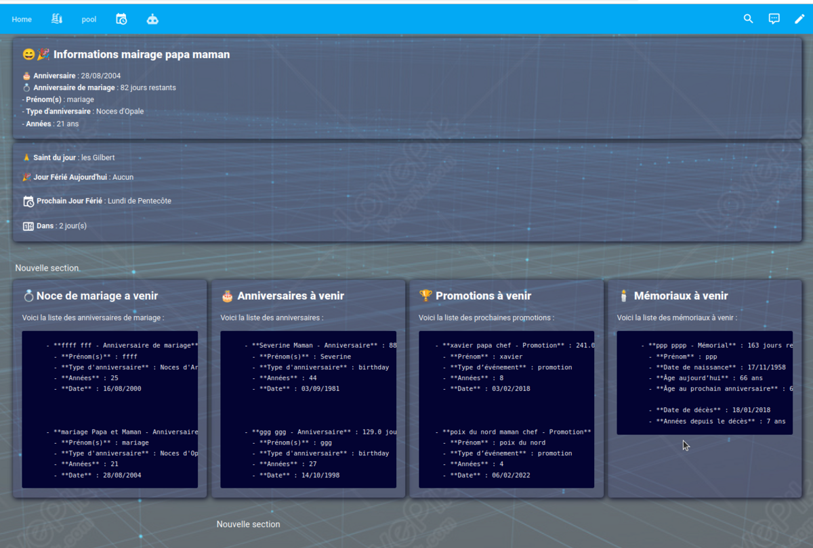
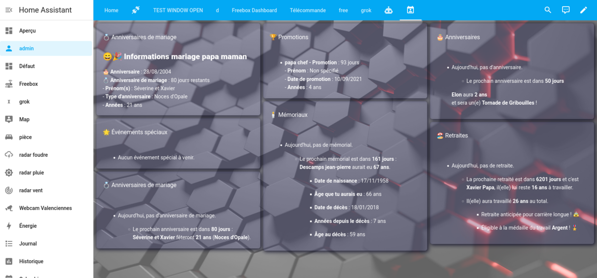


<p class="forum-cta"><a href="https://forumdomotique.com/forums/topic/196-%F0%9F%93%86-int%C3%A9gration-date-countdown-suivi-d%C3%A9v%C3%A9nements-personnels-dans-home-assistant/">Lire et commenter sur Forum Domotique</a> · <a href="https://github.com/XAV59213/date_countdown">Dépôt HACS : Souvenirs et Célébrations</a></p>

# 📆 [Intégration] Date Countdown – Suivi d’événements personnels dans Home Assistant

- **Catégorie :** [Projets et Personnalisations](https://forumdomotique.com/forums/12-projets-et-personnalisations/)
- **Sujet :** https://forumdomotique.com/forums/topic/196-%F0%9F%93%86-int%C3%A9gration-date-countdown-suivi-d%C3%A9v%C3%A9nements-personnels-dans-home-assistant/
- **Auteur du premier message du sujet :** XAV59213
- **Messages de XAV59213 dans ce sujet :** 3
- **Premier message de XAV59213 :** 7 juin 2025 à 18:31 (Europe/Paris)
- **Dernier message de XAV59213 :** 10 juin 2025 à 10:14 (Europe/Paris)

---

## Message 1 — 7 juin 2025 à 18:31 (Europe/Paris)

- **Identifiant :** `417`
- **Lien :** https://forumdomotique.com/forums/topic/196-%F0%9F%93%86-int%C3%A9gration-date-countdown-suivi-d%C3%A9v%C3%A9nements-personnels-dans-home-assistant/#findComment-417

# 📆 Date Countdown

**Date Countdown** est une intégration personnalisée pour [Home Assistant](https://www.home-assistant.io) qui permet de suivre les jours restants avant des événements personnels tels que : anniversaires, anniversaires de mariage, promotions, mémoriaux ou événements spéciaux.

### 🧠 Pourquoi cette intégration ?

Je voulais initialement utiliser le calendrier intégré de Home Assistant pour suivre mes événements importants. Cependant, celui-ci ne permet pas d’associer des classes ou types spécifiques à chaque événement (comme un anniversaire, un décès ou une promotion). Il m’a donc paru plus utile de créer une intégration dédiée avec une logique adaptée à chaque type d’événement.

Entièrement configurable via l’interface graphique, aucun YAML requis. Les capteurs sont automatiquement créés pour une utilisation dans vos dashboards Lovelace, automatisations, notifications ou alertes.

---

## ✨ Fonctionnalités

- ✅ Interface graphique pour ajouter, modifier ou supprimer des événements
- 📅 Types d’événements :

  - 🎂 Anniversaire
  - 💍 Anniversaire de mariage (avec intitulés des noces)
  - 🕯️ Mémorial (âge qu’aurait eu la personne, années depuis le décès)
  - 🏆 Promotion
  - 🌟 Événement spécial
- ⚙️ Capteurs automatiques :

  - État = nombre de jours restants
  - Attributs : type, date, prénom, années, intitulé des noces, etc.
- 🎨 Icônes dynamiques selon le type
- 🇫🇷 Interface et traduction en français
- 🔔 Prêt pour Lovelace, automatisations, TTS, notifications

---

## 🧱 Prérequis

- Home Assistant `>= 2024.6.0`
- [HACS](https://hacs.xyz) installé

---

## ⚙️ Installation via HACS

1. Ouvrez **HACS > Intégrations**
2. Cliquez sur **⋮ > Dépôt personnalisé**
3. Ajoutez ce dépôt : <https://github.com/XAV59213/date-countdown>
4. Type : **Intégration**
5. Installez **Date Countdown**
6. Redémarrez Home Assistant
7. Allez dans **Paramètres > Appareils & Services > Ajouter une intégration**
8. Recherchez **Date Countdown**

---

## 🔧 Configuration

### ➕ Ajouter un événement

- Type : sélectionnez parmi les 5 types disponibles
- Nom (obligatoire), Prénom (optionnel)
- Date : `JJ/MM/AAAA`
- Pour les mémoriaux : date de décès (optionnelle)

### 🔁 Modifier ou supprimer

- Dans l’intégration : `⋮ > Options`
- Choisissez l’action souhaitée : ajouter, modifier ou supprimer un événement en cour de codage pour l'instant il faut juste ajouter une entrée

---

## 🛰️ Capteurs générés

Format :

```plaintext
sensor.<type>_<nom>_<date>
```

Exemple :

```yaml
sensor.memorial_jean_01011950:
  state: 15
  attributes:
    friendly_name: "Jean - Mémorial"
    first_name: "Jean"
    event_type: "memorial"
    event_date: "01/01/1950"
    years: 76
    death_date: "15/06/2000"
    age_if_alive: 75
    years_since_death: 25
```

---

## 🖼️ Exemple Lovelace (mémoriaux à venir)

```yaml
type: markdown
content: |
  ##  Mémoriaux à venir
  
  
    
      
    
  
  
  - **{{ state_attr(e.entity_id, 'friendly_name') }}** : {{ e.state }} jours
    - Âge au prochain anniversaire : {{ state_attr(e.entity_id, 'years') }} ans
    - Âge s’il était en vie : {{ state_attr(e.entity_id, 'age_if_alive') }}
    
    - Décès : {{ state_attr(e.entity_id, 'death_date') }} ({{ state_attr(e.entity_id, 'years_since_death') }} ans)
    
  
```


<!-- source : https://cdn.forumdomotique.com/monthly_2025_06/Capturedcrandu2025-06-0718-23-28.png.4b1a6b676f20ca5951215c474910dde4.png -->

---

## 🔔 Exemple d’automatisation

```yaml
automation:
  - alias: "Rappel mémorial 7 jours avant"
    trigger:
      platform: numeric_state
      entity_id: sensor.memorial_jean_01011950
      value: 7
    action:
      service: notify.notify
      data:
        message: >
           Dans 7 jours : anniversaire de {{ state_attr('sensor.memorial_jean_01011950', 'friendly_name') }}.
          Âge s’il était en vie : {{ state_attr('sensor.memorial_jean_01011950', 'age_if_alive') }} ans.
```

---

## 🛠️ Dépannage

### Les capteurs n’apparaissent pas ?

- Vérifiez que les dates sont bien au format `JJ/MM/AAAA`
- Redémarrez Home Assistant après ajout ou suppression d’événements

### Problème avec les mémoriaux ?

- `death_date` : format `JJ/MM/AAAA`
- Vérifiez les attributs dans **Développeur > États**

### Activer les logs de debug

```yaml
logger:
  default: info
  logs:
    custom_components.date_countdown: debug
```

---

## 📁 Structure technique

| Fichier | Rôle |
| --- | --- |
| `__init__.py` | Initialisation du composant |
| `config_flow.py` | Flux de configuration UI |
| `sensor.py` | Création et mise à jour des capteurs |
| `const.py` | Types, formats, intitulés, noces |
| `translations/fr.json` | Traduction en français |
| `manifest.json` | Métadonnées HACS |

---

## 👨‍💻 Crédits

- Auteur : [@XAV59213](https://github.com/XAV59213)
- Licence : MIT
- Dépôt : [https://github.com/XAV59213/date_countdown](https://github.com/XAV59213/date-countdown)

---

## 📢 Support

💬 Pour toute question, bug ou suggestion :  
➡️ [Créer une issue sur GitHub](https://github.com/XAV59213/date-countdown/issues)

---

## Message 2 — 9 juin 2025 à 18:47 (Europe/Paris)

- **Identifiant :** `424`
- **Lien :** https://forumdomotique.com/forums/topic/196-%F0%9F%93%86-int%C3%A9gration-date-countdown-suivi-d%C3%A9v%C3%A9nements-personnels-dans-home-assistant/#findComment-424


<!-- source : https://cdn.forumdomotique.com/monthly_2025_06/Capturedcrandu2025-06-0918-46-02.png.b53584ad37c1801709889bed89538887.png -->

---

## Message 3 — 10 juin 2025 à 10:14 (Europe/Paris)

- **Identifiant :** `432`
- **Lien :** https://forumdomotique.com/forums/topic/196-%F0%9F%93%86-int%C3%A9gration-date-countdown-suivi-d%C3%A9v%C3%A9nements-personnels-dans-home-assistant/#findComment-432

> **Il y a 2 heures, Arubinu a dit :**
> Salut, je pense que c'est une carte Markdown (comme utilisé pour le style appliqué au texte sur Discord). Il y a une méthode donnée par Home Assistant pour y ajouter des entités.

Oui [@Arubinu](https://forumdomotique.com/profile/124-arubinu/) c'est une carte Markdown j'ai mis le code complet

salut [@zerocool38](https://forumdomotique.com/profile/178-zerocool38/) quand tu est dans ton dashabord en mode Edition tu fait ajouter une carte puis en haut a droite trois petit point tu va dessus et tu clic sur modifier en yaml puis tu colle tous le code

[dashabord.yam](https://forumdomotique.com/applications/core/interface/file/attachment.php?id=192&key=4f6efa3264ca4d444e56c3d860facea5)

---

