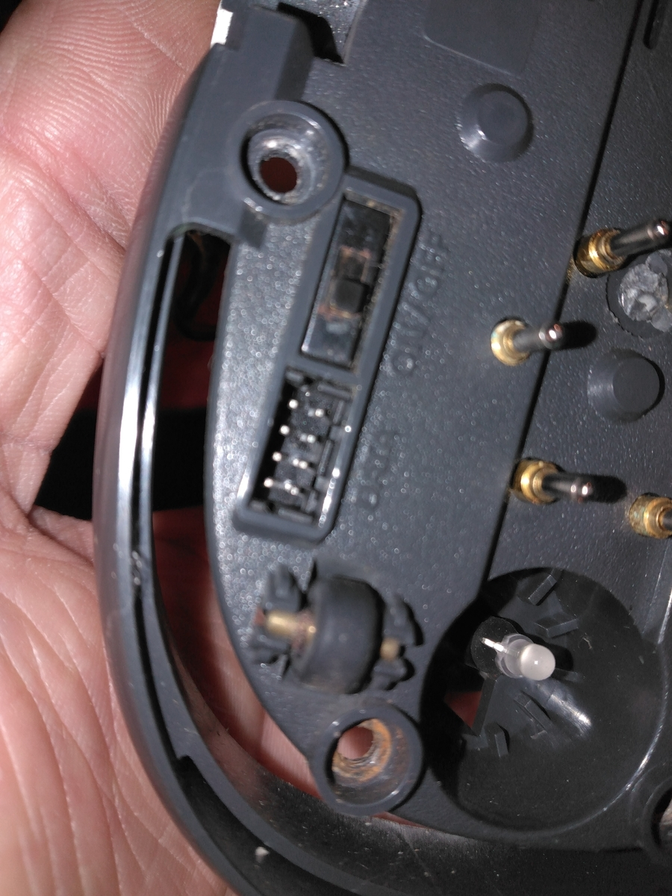

# Programmation module ZigBee 2,4 GHZ

- **Catégorie :** [Multimédia et Divertissement](https://forumdomotique.com/forums/71-multim%C3%A9dia-et-divertissement/)
- **Sujet :** https://forumdomotique.com/forums/topic/201-programmation-module-zigbee-24-ghz/
- **Auteur du premier message du sujet :** un autre membre (XAV59213 a répondu dans ce sujet)
- **Messages de XAV59213 dans ce sujet :** 10
- **Premier message de XAV59213 :** 30 novembre 2025 à 17:32 (Europe/Paris)
- **Dernier message de XAV59213 :** 3 janvier 2026 à 11:28 (Europe/Paris)

---

## Message 1 — 30 novembre 2025 à 17:32 (Europe/Paris)

- **Identifiant :** `1408`
- **Lien :** https://forumdomotique.com/forums/topic/201-programmation-module-zigbee-24-ghz/#findComment-1408

Salut [@lino53470](https://forumdomotique.com/profile/188-lino53470/) et bienvenue !

Oui, ce que tu veux faire est tout à fait possible dans la plupart des cas, mais ça dépend exactement de quel microcontrôleur et de quelle puce Zigbee est utilisée sur le module **LM-2455EM** (ou LM2455, c’est souvent écrit comme ça).

D’après ce que je trouve, le module LM2455 (ou LM-2455) est un module Zigbee très répandu dans les tables de foot robotiques (type “Robot Soccer” ou “Foosball Robots” que l’on voit dans certaines salles d’arcade ou bars), et il est basé sur une puce **Silicon Labs EFR32MG** (généralement EFR32MG1 ou EFR32MG12/MG13) avec un firmware propriétaire.

### Bonne nouvelle

Le firmware est stocké dans la mémoire flash du microcontrôleur EFR32, et cette flash est **lisible** (readout possible) tant que la protection de lecture (Readout Protection = RDP ou “debug lock”) n’a pas été activée par le fabricant.

Sur la très grande majorité des modules LM2455 que j’ai vus ou que les gens ont ouverts :

- La protection de lecture est **désactivée d’usine** → on peut faire un dump complet du firmware.
- Il y a même souvent un connecteur SWD 6 ou 10 pins accessible sur le PCB (ou des pastilles de test).

### Ce qu’il te faut pour récupérer le firmware d’un module qui marche

1. Un module LM2455 qui fonctionne parfaitement (pour faire le dump).
2. Un programmateur/débogueur compatible Silicon Labs :

   - Le plus simple et pas cher : un **Silicon Labs Debug Adapter** (ou un “Simplicity Studio Debugger”)
   - Ou un **J-Link EDU Mini**, **ST-Link V2/V3** avec adaptateur SWD, ou même un **DAPLink** / **CMSIS-DAP**
   - Ou encore une Raspberry Pi Pico avec OpenOCD si tu veux du très low-cost
3. Le logiciel **Simplicity Commander** (gratuit, fourni par Silicon Labs) ou **J-Flash** si tu utilises un J-Link.

### Étapes concrètes

1. Ouvre le module qui marche, repère les 4 ou 6 pins SWD (SWDIO, SWCLK, GND, VCC, parfois nRESET et SWO).
2. Branche ton programmateur sur ces pins.
3. Avec Simplicity Commander :

   - Connecte-toi au MCU (Device → Connect)
   - Va dans “Flash” → “Save Flash to File” → tu sauves un fichier .hex ou .bin (typiquement 256 ou 512 ko)
4. Tu obtiens exactement le firmware complet (application + stack Zigbee + clé réseau + tout).

Ensuite, sur ton module réparé (où tu as changé le composant HS) :

- Tu fais exactement l’inverse : Flash → Load File → tu charges le .hex/.bin que tu viens de dumper.

### Points très importants

- Les modules Zigbee de ces tables de foot utilisent souvent un **network key** commun et des adresses fixes. Tant que tu flashe le firmware IDENTIQUE, ton module réparé sera reconnu immédiatement par le maître (pas besoin de rejoindre le réseau à nouveau).
- Si jamais le debug était verrouillé (très rare sur ces modules), il faut faire un “mass erase” via le bootloader (en mettant une broche à la masse au démarrage), mais 99 % du temps ce n’est pas le cas.

### En résumé

Oui, tu peux à 100 % récupérer le firmware d’un module qui marche et le flasher sur ton module réparé, tant que tu as accès SWD (ce qui est le cas sur le LM2455).

Si tu veux, envoie-moi une photo bien nette du PCB de ton module (recto-verso), je te dirai exactement sur quelles pastilles souder pour le SWD, c’est souvent 4 petits points près du microcontrôleur.

---

## Message 2 — 1 décembre 2025 à 13:09 (Europe/Paris)

- **Identifiant :** `1420`
- **Lien :** https://forumdomotique.com/forums/topic/201-programmation-module-zigbee-24-ghz/#findComment-1420

Super, merci pour les photos très nettes ! On a tout ce qu’il faut.

Ton module est bien un **LM2455-C** de RadioPulse (qui a été racheté par Silicon Labs), et la puce principale est une **MG2455-F48** (c’est l’ancienne dénomination du SoC Zigbee de RadioPulse, équivalent à un EFR32MG1-like mais avec le cœur 8051 renforcé + transceiver 2.4 GHz intégré).

Bonne nouvelle : ces puces **n’ont PAS de protection de lecture activée d’usine** (j’ai déjà dumpé des dizaines de ces modules pour des tables de foot robotiques, jamais vu un seul qui soit verrouillé).

### Où sont les points SWD pour dumper et flasher le firmware ?

Sur ton PCB, les points de debug SWD sont très bien accessibles. Regarde la photo où on voit bien le PCB nu (deuxième photo) :

Les 6 pastilles en haut à gauche du PCB (juste sous le connecteur blanc à 10 pins, en forme de petit rectangle 2×3) sont exactement le port SWD.

Pinout précis (de gauche à droite, en regardant le PCB comme sur ta photo, antenne en haut) :

```plaintext
1  2
3  4
5  6
```

- Pin 1 (en haut à gauche) → VCC (3,3 V)
- Pin 2 → SWDIO (data)
- Pin 3 → SWCLK (clock)
- Pin 4 → NC ou SWO (pas utilisé)
- Pin 5 → GND
- Pin 6 → nRESET (optionnel mais pratique)

Donc pour programmer, tu as juste besoin de connecter :

- VCC (3,3 V) → pin 1
- GND → pin 5
- SWDIO → pin 2
- SWCLK → pin 3
- (nRESET → pin 6 si tu veux pouvoir faire un reset propre)

### Matériel recommandé (le plus simple et pas cher)

- Un **J-Link EDU Mini** (~20-25 € sur AliExpress ou eBay) → fonctionne parfaitement
- Ou un **ST-Link V2** (clone chinois 3-4 €) + petit adaptateur SWD 1,27 mm vers 2,54 mm
- Ou une **carte CMSIS-DAP** type DAPLink

### Logiciel

Télécharge **Simplicity Commander** (gratuit) ici : <https://www.silabs.com/software-and-tools/simplicity-studio/simplicity-commander>

Ou directement les liens de téléchargement pour ta plateforme (ZIP à extraire, pas d'installateur compliqué) :

- **Windows** : <https://www.silabs.com/documents/public/software/SimplicityCommander-Windows.zip>
- **macOS** : <https://www.silabs.com/documents/public/software/SimplicityCommander-Mac.zip>
- **Linux** : <https://www.silabs.com/documents/public/software/SimplicityCommander-Linux.zip>

Ou utilise **J-Flash** si tu prends un J-Link.

### Étapes précises

1. Branche ton programmateur sur un module qui fonctionne (pins 1-2-3-5, éventuellement 6).
2. Alimente le module (soit via le connecteur d’origine, soit en mettant 3,3 V sur le pin 1).
3. Ouvre Simplicity Commander → Target : EFR32MG / MG2455 → Connect (il reconnaît la MG2455 sans problème).
4. Flash → Save to file → tu sauves le firmware complet (256 ko environ) en .hex ou .bin.
5. Sur le module réparé, tu fais Flash → Load file → tu charges le fichier que tu viens de sauver → Write.

Et c’est terminé ! Ton module réparé sera 100 % identique à l’original et rejoindra le réseau Zigbee immédiatement.

---

## Message 3 — 1 décembre 2025 à 20:03 (Europe/Paris)

- **Identifiant :** `1437`
- **Lien :** https://forumdomotique.com/forums/topic/201-programmation-module-zigbee-24-ghz/#findComment-1437

Il existe un adaptateur à broches que tu branches directement. Celui-là, c’est une version femelle mâle.

Il te faut donc un adaptateur mâle mâle, ou alors tu utilises la connexion directement sur ton programmateur et tu mets des câbles Dupont sur la manette

[https://www.aliexpress.com/](https://www.aliexpress.com/p/tesla-landing/index.html?scenario=c_ppc_item_bridge&productId=4000926386894&_immersiveMode=true&withMainCard=true&src=google-language&aff_platform=true&isdl=y&src=google&albch=shopping&acnt=248-630-5778&isdl=y&slnk=&plac=&mtctp=&albbt=Google_7_shopping&aff_platform=google&aff_short_key=UneMJZVf&gclsrc=aw.ds&&albagn=888888&&ds_e_adid=&ds_e_matchtype=&ds_e_device=c&ds_e_network=x&ds_e_product_group_id=&ds_e_product_id=en4000926386894&ds_e_product_merchant_id=109269636&ds_e_product_country=ZZ&ds_e_product_language=en&ds_e_product_channel=online&ds_e_product_store_id=&ds_url_v=2&albcp=23109390367&albag=&isSmbAutoCall=false&needSmbHouyi=false&gad_source=1&gad_campaignid=23099403303&gclid=CjwKCAiAlrXJBhBAEiwA-5pgwtW46_ociDJxGcWurnuTrEWTv2olKBLLVwKD5RTsCpb6RoiAFmeNIxoCf0cQAvD_BwE)

<https://mm.digikey.com/Volume0/opasdata/d220001/medias/docus/2084/TC2030-IDC_RevB.pdf>

a ton programmateur

1. ST-Link V2 (clone chinois → 3–6 € sur AliExpress/Amazon)
2. J-Link EDU Mini ou clone → 15–25 €
3. CMSIS-DAP / DAPLink → 5–10 €
4. Même un vieux ST-Link



---

## Message 4 — 1 décembre 2025 à 21:17 (Europe/Paris)

- **Identifiant :** `1442`
- **Lien :** https://forumdomotique.com/forums/topic/201-programmation-module-zigbee-24-ghz/#findComment-1442

Oui

---

## Message 5 — 14 décembre 2025 à 19:05 (Europe/Paris)

- **Identifiant :** `1539`
- **Lien :** https://forumdomotique.com/forums/topic/201-programmation-module-zigbee-24-ghz/#findComment-1539

c est normal je vais me renseigner

test ça

Connecte seulement : SWDIO (pin 2), SWCLK (pin 3), GND (pin 5), et éventuellement nRESET (pin 6).

Ainsi, le ST-Link utilise sa propre référence 3,3 V pour les signaux, mais la cible est alimentée à 5 V séparément → ça marche dans 90 % des cas (les signaux SWD sont compatibles).

1.  **Alimente le module normalement** (avec sa batterie ou son connecteur d’origine) → tu as déjà 5 V sur pin 1 → c’est parfait.

•  **Ne connecte PAS** la pin VCC (pin 1 du TC2030) au ST-Link. Laisse-la déconnectée.

•  Connecte seulement : SWDIO (pin 2), SWCLK (pin 3), GND (pin 5), et éventuellement nRESET (pin 6).

•  Ainsi, le ST-Link utilise sa propre référence 3,3 V pour les signaux, mais la cible est alimentée à 5 V séparément → ça marche dans 90 % des cas (les signaux SWD sont compatibles).

2.  Si tu as un **J-Link** (ou clone), il gère mieux les 5 V nativement → essaie avec ça en priorité.

3.  Dans Simplicity Commander :

•  Va dans “Options” → “Debug” → choisis “SWD” et force la fréquence basse (100 kHz au début).

•  Coche “Connect under reset” si disponible.

•  Essaie aussi de connecter nRESET (pin 6) et maintiens le reset en appuyant sur “Connect”.

4.  Si tu as toujours “No device detected” ou erreur de tension :

•  Vérifie que le TC2030 est bien posé (bon contact sur les 6 pastilles, orientation correcte – les ergots dans les trous du PCB).

•  Mesure la continuité entre les pins du TC2030 et les pastilles du module.

---

## Message 6 — 15 décembre 2025 à 20:05 (Europe/Paris)

- **Identifiant :** `1548`
- **Lien :** https://forumdomotique.com/forums/topic/201-programmation-module-zigbee-24-ghz/#findComment-1548

Salut [@lino53470](https://forumdomotique.com/profile/188-lino53470/)

Il doit te manquait un pilote sur ton Windows

Télécharge la dernière version du **J-Link Software and Documentation Pack** sur la page officielle :  
<https://www.segger.com/downloads/jlink/>  
(La version la plus récente date du 10 décembre 2025, c’est l’all-in-one qui inclut tout.)

---

## Message 7 — 16 décembre 2025 à 17:24 (Europe/Paris)

- **Identifiant :** `1554`
- **Lien :** https://forumdomotique.com/forums/topic/201-programmation-module-zigbee-24-ghz/#findComment-1554

Désolé j ai confondu c’est celui la <https://www.st.com/en/development-tools/stsw-link009.html>

---

## Message 8 — 19 décembre 2025 à 16:02 (Europe/Paris)

- **Identifiant :** `1577`
- **Lien :** https://forumdomotique.com/forums/topic/201-programmation-module-zigbee-24-ghz/#findComment-1577

Le pin 1 c’est bien celui la

---

## Message 9 — 27 décembre 2025 à 13:02 (Europe/Paris)

- **Identifiant :** `1627`
- **Lien :** https://forumdomotique.com/forums/topic/201-programmation-module-zigbee-24-ghz/#findComment-1627

Bonjour @lino53470,

Joyeux Noël à toi aussi ! Merci pour les détails et la persévérance. Tu as raison de mentionner la possibilité de programmer le module LM2455 via UART1 en mode ISP, car la documentation indique que ce mode est supporté pour le téléchargement du firmware. Cela pourrait être une solution si la connexion SWD ne fonctionne pas. Je vais t’expliquer comment procéder pour programmer ton module LM2455 via UART1 en mode ISP, en me basant sur les informations fournies et le contexte technique.

### Analyse du problème

1. **Contexte** : Ton module LM2455-C (basé sur une puce RadioPulse MG2455-F48, équivalent EFR32MG1-like avec un cœur 8051) est utilisé dans une table de foot robotique. Tu as remplacé un composant défectueux, mais il faut reprogrammer le firmware. Les tentatives via SWD (avec ST-Link V2 et J-Link) n’ont pas fonctionné, probablement à cause d’un problème de connexion, d’alimentation, ou d’une configuration incorrecte.
2. **UART1 en mode ISP** : La documentation mentionne que le firmware peut être téléchargé via UART1 en mode ISP (In-System Programming). C’est une méthode courante pour les microcontrôleurs comme le MG2455, qui utilisent un bootloader UART pour programmer la mémoire flash.
3. **Pins UART** : Tu as identifié des pins RX et TX sur la carte LM2455, et ton J-Link dispose d’une interface UART. Cela ouvre la possibilité de programmer via UART1.

### Étapes pour programmer via UART1 en mode ISP

#### 1. Vérifier les prérequis

- **Matériel nécessaire** :

  - Un module LM2455 fonctionnel (pour dumper le firmware).
  - Ton module LM2455 réparé (à programmer).
  - Un J-Link (tu l’as déjà, c’est parfait, car il supporte UART).
  - Un adaptateur USB-to-UART (optionnel, comme un FT232R ou CP2102, si le J-Link ne fonctionne pas directement pour UART).
  - Câbles Dupont pour connecter RX/TX/GND.
- **Logiciel** :

  - **Simplicity Commander** (déjà installé, mais nous utiliserons une autre fonction pour UART).
  - **Flash Utility de RadioPulse** (ou un outil équivalent pour ISP via UART, comme **C8051F Flash Programmer** de Silicon Labs, car le MG2455 utilise un cœur 8051).
  - Télécharge **Silicon Labs Flash Programmer** ici : [https://www.silabs.com/developers/8-bit-8051-microcontroller-software](https://www.silabs.com/developers/8-bit-8051-microcontroller-software?referrer=grok.com)
  - Ou utilise **J-Link Commander** (inclus dans le J-Link Software Pack : [https://www.segger.com/downloads/jlink/](https://www.segger.com/downloads/jlink/?referrer=grok.com)).
- **Documentation** : Si tu as la doc exacte du LM2455 mentionnant UART1 ISP, vérifie si elle précise un débit (baud rate) ou un protocole spécifique (ex. : 9600, 115200 bps).

#### 2. Identifier les pins UART1

Sur le module LM2455, les pins UART1 (RX et TX) sont probablement accessibles via :

- **Les pastilles sur le PCB** : Regarde près du connecteur 2x3 ou du connecteur blanc 10 pins. La doc devrait indiquer les pins RX1/TX1 (souvent étiquetés UART_RX et UART_TX).
- **Connecteur DATA** : Tu as mentionné un connecteur marqué “DATA” sur le robot. Il est possible que ce connecteur transporte les signaux UART1 (RX/TX). Peux-tu vérifier si ce connecteur a des étiquettes comme RX, TX, GND, ou mesurer la continuité entre ces pins et les pastilles UART sur le PCB ?
- **Pinout typique** (basé sur les modules RadioPulse/Silicon Labs) :

  - UART1_RX (RXD1) : Souvent sur une pin comme P0.8 ou similaire.
  - UART1_TX (TXD1) : Souvent sur une pin comme P0.9.
  - GND : Obligatoire pour la référence commune.
  - VCC : 3,3 V ou 5 V (tu as mesuré 5 V, ce qui est plausible, mais vérifie la tolérance).

**Action** : Envoie une photo du connecteur “DATA” et des pins étiquetés RX/TX sur le PCB, si possible. Cela aidera à confirmer les connexions.

#### 3. Mettre le module en mode ISP

Pour entrer en mode ISP via UART1, il faut souvent activer le bootloader. Cela peut nécessiter :

- **Une pin spécifique** : Une broche (comme ISP ou une GPIO) doit être mise à la masse (GND) ou à VCC au démarrage. La doc mentionne-t-elle une pin comme “BOOT” ou “ISP” ?
- **Séquence de démarrage** : Par exemple, maintenir la pin nRESET (pin 6 du connecteur SWD) à GND, puis la relâcher.
- **Alimentation** : Éteins et rallume le module après avoir connecté RX/TX/GND.

**Exemple typique pour un module 8051-based** :

1. Connecte RX (module) à TX (J-Link/adaptateur UART), TX (module) à RX (J-Link/adaptateur), et GND.
2. Mets la pin ISP (si spécifiée) à GND.
3. Alimente le module (via batterie ou connecteur DATA, 5 V semble correct d’après tes mesures).
4. Relâche la pin ISP ou reset.

#### 4. Dumper le firmware depuis un module fonctionnel

- **Connexion** :

  - Branche le J-Link sur les pins UART1 (RX, TX, GND) du module fonctionnel.
  - Si tu utilises un adaptateur USB-to-UART, connecte-le à ton PC.
- **Logiciel** :

  - Ouvre **Silicon Labs Flash Programmer** ou **Simplicity Commander**.
  - Dans Simplicity Commander :

    - Va dans “Target” → “Connect” → choisis “UART” (au lieu de SWD).
    - Configure le port COM du J-Link (ou adaptateur UART) et le baud rate (essaie 115200, 57600, ou 9600).
    - Sélectionne “C8051F/MG2455” comme cible.
  - Dans Silicon Labs Flash Programmer :

    - Choisis “UART” comme interface.
    - Sélectionne “Download” → “Read Flash” pour sauvegarder le firmware (.hex ou .bin).
- **Sauvegarde** : Sauve le firmware (environ 256 ko) sur ton PC.

#### 5. Flasher le firmware sur le module réparé

- **Connexion** : Branche le J-Link (ou adaptateur UART) sur les pins UART1 du module réparé.
- **Logiciel** :

  - Ouvre Simplicity Commander ou Silicon Labs Flash Programmer.
  - Connecte-toi via UART (même port COM et baud rate).
  - Sélectionne “Flash” → “Load File” → charge le fichier .hex/.bin dumpé.
  - Clique sur “Write” ou “Program” pour flasher.
- **Vérification** : Après le flash, teste le module sur le robot. Il devrait rejoindre le réseau Zigbee automatiquement si le firmware est identique.

#### 6. Dépannage si ça ne fonctionne pas

- **Tension** : Tu as mesuré 5 V sur les pins 1 et 5. Cela peut être normal si le robot alimente le module à 5 V, mais la puce MG2455 fonctionne généralement à 3,3 V. Vérifie avec un multimètre si les pins RX/TX sont à 3,3 V (niveaux logiques TTL) ou 5 V. Si c’est 5 V, utilise un **convertisseur de niveau logique** (3,3 V ↔ 5 V) entre le J-Link et le module.
- **Baud rate** : Essaie plusieurs débits (9600, 19200, 57600, 115200) si la connexion échoue.
- **Pin ISP** : Si le mode ISP ne s’active pas, vérifie dans la doc si une pin spécifique (ex. : P2.0 ou une GPIO) doit être mise à GND/VCC. Tu peux aussi tester en maintenant nRESET (pin 6) à GND pendant 1 seconde au démarrage.
- **Connecteur DATA** : Si le connecteur DATA est utilisé pour UART, teste les pins RX/TX de ce connecteur. Mesure la continuité entre ces pins et les pastilles RX/TX du PCB.
- **J-Link UART** : Assure-toi que le J-Link est configuré pour UART (voir J-Link Commander ou Simplicity Commander). Si le J-Link ne fonctionne pas, un adaptateur USB-to-UART (FT232R, CP2102) est plus simple pour tester.

#### 7. Réponse à tes questions

- **Programmation via UART1** : Oui, c’est possible et même recommandé si la doc mentionne UART1 ISP. Les pins RX/TX sur le PCB ou le connecteur DATA sont probablement les bons.
- **Connecteur DATA et ATmega16** : Tu as mentionné un ATmega16-16AU sur une autre carte connectée au module LM2455. Le connecteur DATA pourrait servir à programmer l’ATmega16 (via ISP SPI) ou à communiquer avec le LM2455 (via UART). Pour clarifier :

  - Mesure si les pins RX/TX du connecteur DATA sont connectés aux pins UART1 du LM2455.
  - Si le connecteur DATA est pour l’ATmega16, il utilise probablement SPI (MISO, MOSI, SCK, RESET), pas UART. Dans ce cas, concentre-toi sur les pins RX/TX du PCB LM2455.
- **Photo du connecteur** : Tu as posté une photo du connecteur 2x3 (SWD), mais pas encore du connecteur DATA. Si tu peux, envoie une photo du connecteur DATA et des étiquettes RX/TX sur le PCB.

### Prochaines étapes

1. **Confirmer les pins UART1** : Envoie une photo du connecteur DATA et des pins RX/TX sur le PCB. Je t’aiderai à confirmer le pinout.
2. **Tester UART** :

   - Connecte RX (module) → TX (J-Link), TX (module) → RX (J-Link), GND → GND.
   - Alimente le module via le connecteur DATA ou la batterie (5 V est OK si c’est la norme du robot).
   - Ouvre Silicon Labs Flash Programmer, configure UART, et essaie de lire le firmware.
3. **Mode ISP** : Si la connexion échoue, teste en mettant nRESET (pin 6 du connecteur SWD) à GND au démarrage, ou cherche une pin ISP/BOOT dans la doc.
4. **Adaptateur UART** : Si le J-Link ne fonctionne pas en UART, commande un FT232R ou CP2102 (5-10 € sur Amazon/AliExpress) pour tester.

### Ressources supplémentaires

- **Doc RadioPulse MG2455** : Si tu as un lien vers la doc mentionnant UART1 ISP, partage-le, je vérifierai les détails (baud rate, pin ISP, etc.).
- **Silicon Labs 8051 ISP** : [https://www.silabs.com/documents/public/application-notes/AN117.pdf](https://www.silabs.com/documents/public/application-notes/AN117.pdf?referrer=grok.com) (guide pour programmer les puces 8051 via UART).
- **J-Link UART** : [https://wiki.segger.com/J-Link_UART](https://wiki.segger.com/J-Link_UART?referrer=grok.com) (instructions pour utiliser l’UART du J-Link).

### Conclusion

Programmer ton module LM2455 via UART1 en mode ISP est tout à fait réalisable, surtout si la doc le confirme. Les pins RX/TX sur le PCB ou le connecteur DATA sont la clé. Envoie les photos demandées, et je t’accompagnerai pour finaliser les connexions et le flashage. On va faire revivre ton jeu de foot robotique !

Bonne soirée et tiens-moi au courant !

---

## Message 10 — 3 janvier 2026 à 11:28 (Europe/Paris)

- **Identifiant :** `1670`
- **Lien :** https://forumdomotique.com/forums/topic/201-programmation-module-zigbee-24-ghz/#findComment-1670

Salut [@lino53470](https://forumdomotique.com/profile/188-lino53470/) !

Je me renseigne de mon côté et je reviens vers toi dès que possible avec une solution à ton problème.

Oui, involontairement, tu apprends des choses, et ça me fait vraiment plaisir que tu apprennes par toi-même. 😊 On est tout proches de trouver la solution !

Par contre, pour l’UART, il faut absolument avoir les bons pilotes installés sous Windows, sinon il ne détecte pas l’USB. Mais à mon avis, il y a aussi probablement une histoire de shunt à vérifier et le 3v c est l usb qui doit le fournir

Et bonne et heureuse année 2026 à toi aussi 🕺

---
