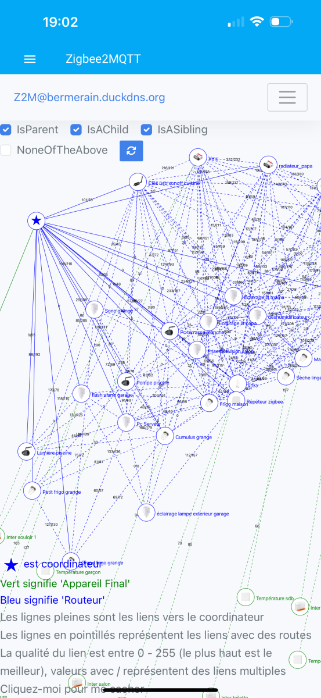

<a href="https://forumdomotique.com/forums/topic/215-port%C3%A9e-limit%C3%A9e-du-zigbee/">Lire et commenter sur Forum Domotique</a>

# Portée limitée du Zigbee

- **Catégorie :** [Zigbee](https://forumdomotique.com/forums/60-zigbee/)
- **Sujet :** https://forumdomotique.com/forums/topic/215-port%C3%A9e-limit%C3%A9e-du-zigbee/
- **Auteur du premier message du sujet :** un autre membre (XAV59213 a répondu dans ce sujet)
- **Messages de XAV59213 dans ce sujet :** 1
- **Premier message de XAV59213 :** 14 juin 2025 à 15:21 (Europe/Paris)

---

## Message 1 — 14 juin 2025 à 15:21 (Europe/Paris)

- **Identifiant :** `462`
- **Lien :** https://forumdomotique.com/forums/topic/215-port%C3%A9e-limit%C3%A9e-du-zigbee/#findComment-462

En z2mqtt il y a 2 mode router et coordinateur pour étendre ton maillage je suis plus de 30 mètre et de mon coté c est ok <https://forum.hacf.fr/t/flash-dongle-sonoff-p-en-mode-routeur-au-lieu-de-coordinateur/39372>

<!-- source : https://cdn.forumdomotique.com/monthly_2025_06/IMG_5538.png.20b6b487134bb21cee8f524949391ffd.png -->

<https://github.com/Koenkk/Z-Stack-firmware/releases/tag/Z-Stack_3.x.0_router_20221102>

---
