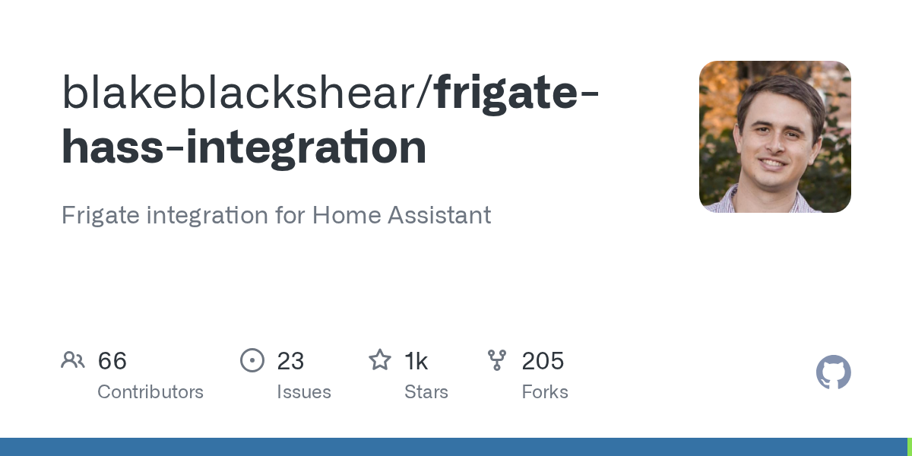

<a href="https://forumdomotique.com/forums/topic/223-g%C3%A9rer-des-appaeils-wifi-dans-ha/">Lire et commenter sur Forum Domotique</a>

# gérer des appaeils wifi dans HA

- **Catégorie :** [Installation et Configuration](https://forumdomotique.com/forums/8-installation-et-configuration/)
- **Sujet :** https://forumdomotique.com/forums/topic/223-g%C3%A9rer-des-appaeils-wifi-dans-ha/
- **Auteur du premier message du sujet :** un autre membre (XAV59213 a répondu dans ce sujet)
- **Messages de XAV59213 dans ce sujet :** 1
- **Premier message de XAV59213 :** 18 juin 2025 à 16:00 (Europe/Paris)

---

## Message 1 — 18 juin 2025 à 16:00 (Europe/Paris)

- **Identifiant :** `484`
- **Lien :** https://forumdomotique.com/forums/topic/223-g%C3%A9rer-des-appaeils-wifi-dans-ha/#findComment-484

Salut [@enthalpie](https://forumdomotique.com/profile/196-enthalpie/)

il y a plusieurs modules et plusieurs façon pour les camera

##### Home Assistant

<!-- source : https://www.home-assistant.io/images/default-social.png -->

### Generic Camera

Instructions on how to integrate IP cameras within Home Assistant.

<!-- source : https://github.githubassets.com/favicons/favicon.svg -->

##### GitHub

<!-- source : https://opengraph.githubassets.com/c52c83152d9cefa3e945131221f030f7a5c0f53983a52fa8fedb4548ec19c589/maciej-or/hikvision_next -->

### GitHub - maciej-or/hikvision_next: Home Assistant integra...

Home Assistant integration for Hikvision NVRs and IP cameras - maciej-or/hikvision_next

<!-- source : https://github.githubassets.com/favicons/favicon.svg -->

##### GitHub

<!-- source : https://opengraph.githubassets.com/62681c852d0bf2aa5149a34ecb57a1bc494a7f731ad58114c294c11c4727f6b5/blakeblackshear/frigate-hass-integration -->

### GitHub - blakeblackshear/frigate-hass-integration: Frigat...

Frigate integration for Home Assistant. Contribute to blakeblackshear/frigate-hass-integration development by creating an account on GitHub.

<!-- source : https://github.githubassets.com/favicons/favicon.svg -->

##### GitHub

<!-- source : https://opengraph.githubassets.com/7ad4de435aa9532757eee2e785aa8862dcb2b3bbeec618157f74034f07011a6b/AlexxIT/WebRTC -->

### GitHub - AlexxIT/WebRTC: Home Assistant custom component...

Home Assistant custom component for real-time viewing of almost any camera stream using WebRTC and other technologies. - AlexxIT/WebRTC

---
