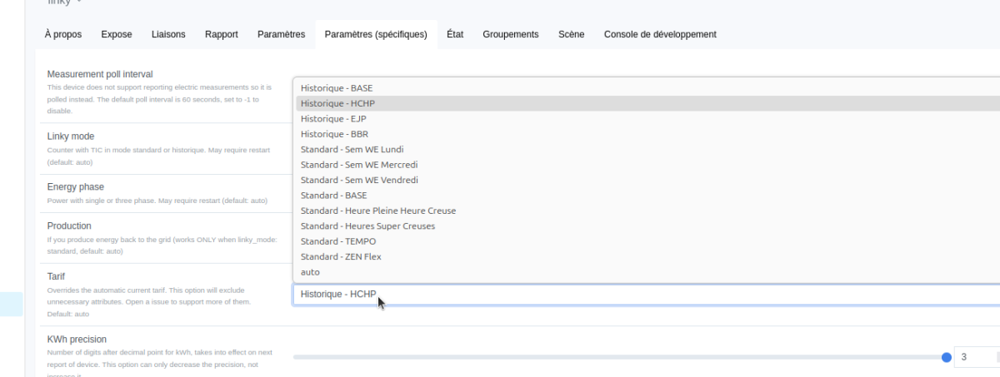
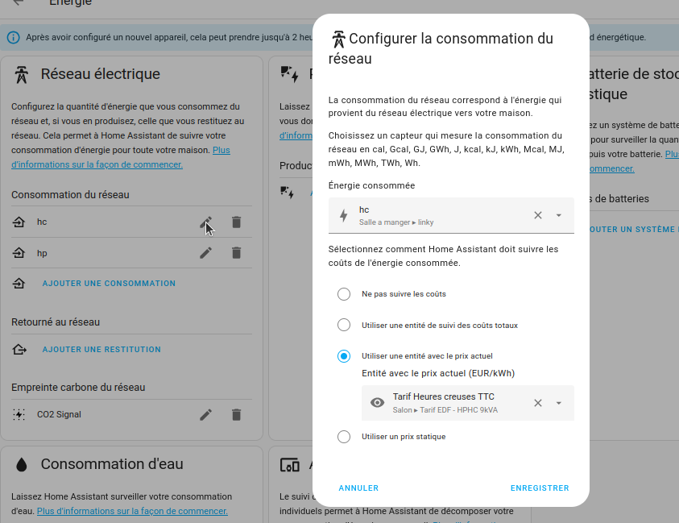
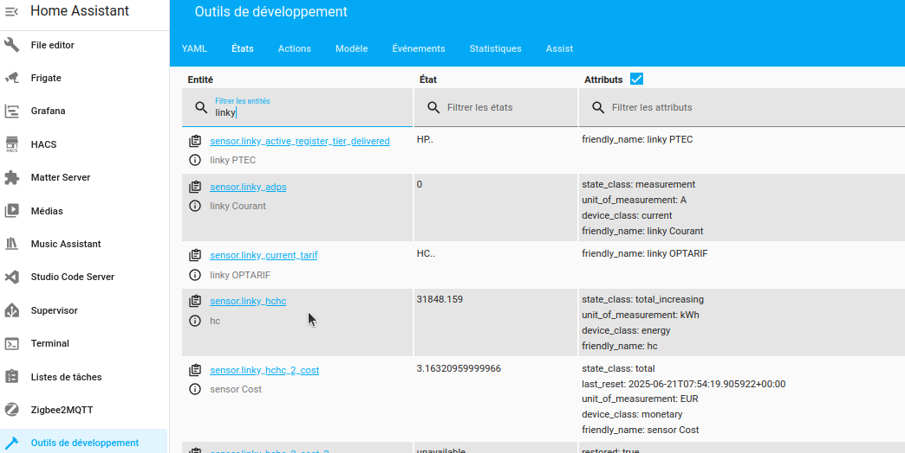

# Linky remonter

- **Catégorie :** [Installation et Configuration](https://forumdomotique.com/forums/8-installation-et-configuration/)
- **Sujet :** https://forumdomotique.com/forums/topic/225-linky-remonter/
- **Auteur du premier message du sujet :** un autre membre (XAV59213 a répondu dans ce sujet)
- **Messages de XAV59213 dans ce sujet :** 1
- **Premier message de XAV59213 :** 22 juin 2025 à 10:58 (Europe/Paris)

---

## Message 1 — 22 juin 2025 à 10:58 (Europe/Paris)

- **Identifiant :** `506`
- **Lien :** https://forumdomotique.com/forums/topic/225-linky-remonter/#findComment-506

Bonjour [@hermanos](https://forumdomotique.com/profile/198-hermanos/)

As-tu bien paramétré ta clé Zlinky dans Zigbee2MQTT ? Es-tu en mode historique ou standard ? Logiquement, pour un contrat Tempo, c'est du mode standard. As-tu fait la demande à ton opérateur pour activer le mode Tempo afin que ta clé puisse récupérer les données ?

<!-- source : https://cdn.forumdomotique.com/monthly_2025_06/Capturedcrandu2025-06-2210-41-25.png.4cc9d90b3910c2a2c285926f3f18cace.png -->

<!-- source : https://cdn.forumdomotique.com/monthly_2025_06/Capturedcrandu2025-06-2210-41-51.png.3c04841f681b311817f5599fc26024a2.png -->

### As-tu configuré ton entité énergie sur ton tableau de bord ?

<!-- source : https://cdn.forumdomotique.com/monthly_2025_06/Capturedcrandu2025-06-2210-43-02.png.95ad2371897fcfbc42fd40ddd681c45f.png -->

<!-- source : https://cdn.forumdomotique.com/monthly_2025_06/Capturedcrandu2025-06-2210-43-29.png.9eeb2726b52c02beb43be45a3a70f000.png -->

### As-tu vérifié si l'entité est bien créée ?

<!-- source : https://cdn.forumdomotique.com/monthly_2025_06/Capturedcrandu2025-06-2210-46-50.png.e141745fd41560e0b277e8a2256bc3e4.png -->

---
