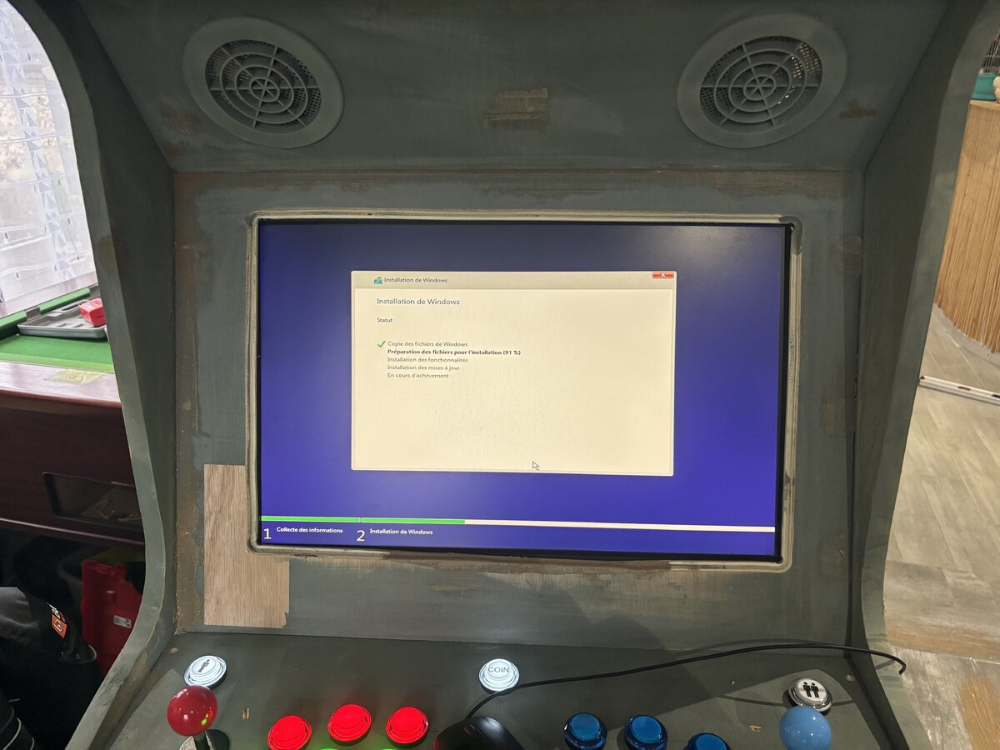
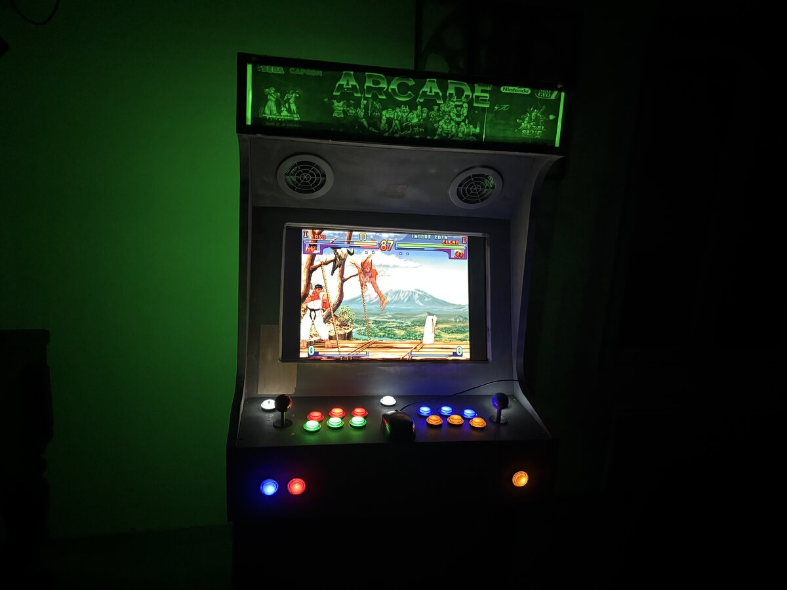
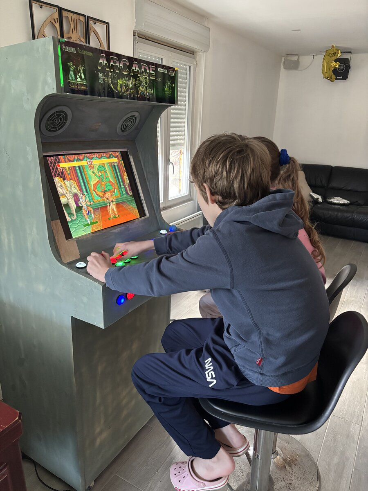

<a href="https://forumdomotique.com/forums/topic/234-demande-dinfo-sur-utilisation-raspberry-pi/">Lire et commenter sur Forum Domotique</a>

<section class="carousel photo-carousel" data-carousel data-lightbox aria-roledescription="carrousel" aria-label="Photos de l’article (3)" tabindex="0">

<figure class="photo-slide" data-slide>
  
</figure>
<figure class="photo-slide" data-slide>
  
</figure>
<figure class="photo-slide" data-slide>
  
</figure>

<button type="button" class="carousel-nav" data-prev aria-label="Photo précédente">‹</button>
<button type="button" class="carousel-nav" data-next aria-label="Photo suivante">›</button>

Faites défiler les photos, ou ouvrez-les pour les agrandir (si JavaScript est activé).

</section>

# Demande d’info sur utilisation Raspberry pi

- **Catégorie :** [Bien débuter en domotique](https://forumdomotique.com/forums/99-bien-d%C3%A9buter-en-domotique/)
- **Sujet :** https://forumdomotique.com/forums/topic/234-demande-dinfo-sur-utilisation-raspberry-pi/
- **Auteur du premier message du sujet :** un autre membre (XAV59213 a répondu dans ce sujet)
- **Messages de XAV59213 dans ce sujet :** 1
- **Premier message de XAV59213 :** 27 juin 2025 à 17:38 (Europe/Paris)

---

## Message 1 — 27 juin 2025 à 17:38 (Europe/Paris)

- **Identifiant :** `523`
- **Lien :** https://forumdomotique.com/forums/topic/234-demande-dinfo-sur-utilisation-raspberry-pi/#findComment-523

“J’ai commencé ce projet gaming cet hiver.

Je partagerai bientôt ma config et le matériel utilisé sur mon github

Je me suis un peu tapé la honte au café en sortant ma feuille et mon crayon gris 😅 et mon mètre pour prendre les cotes

Mais je suis content, ça prend forme !

Il ne me reste plus que les stickers à poser et quelques finitions à faire.”

<!-- source : https://cdn.forumdomotique.com/monthly_2025_06/IMG_4701.jpeg.fc7ef41bff78e5fe47c92ff480d671d4.jpeg -->

<!-- source : https://cdn.forumdomotique.com/monthly_2025_06/IMG_4699.jpeg.8c90183c2c124c3889aab968c8e9a93a.jpeg -->

<!-- source : https://cdn.forumdomotique.com/monthly_2025_06/IMG_4711.jpeg.1e3d3a71c1ca6388641b04a391a21bbe.jpeg -->

---
