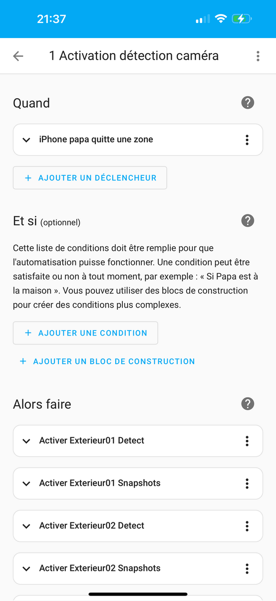

<p class="forum-cta"><a href="https://forumdomotique.com/forums/topic/243-automatisation-de-pr%C3%A9sence/">Lire et commenter sur Forum Domotique</a></p>

# Automatisation de présence

- **Catégorie :** [Installation et Configuration](https://forumdomotique.com/forums/8-installation-et-configuration/)
- **Sujet :** https://forumdomotique.com/forums/topic/243-automatisation-de-pr%C3%A9sence/
- **Auteur du premier message du sujet :** un autre membre (XAV59213 a répondu dans ce sujet)
- **Messages de XAV59213 dans ce sujet :** 1
- **Premier message de XAV59213 :** 3 juillet 2025 à 21:35 (Europe/Paris)

---

## Message 1 — 3 juillet 2025 à 21:35 (Europe/Paris)

- **Identifiant :** `530`
- **Lien :** https://forumdomotique.com/forums/topic/243-automatisation-de-pr%C3%A9sence/#findComment-530

> **Le 02/07/2025 à 16:37, Marjomax a dit :**
> Bonjour,
>
> Je commence les automatisation et j'ai un peu de mal....
>
> En fait je voudrai faire une automatisation qui dit : "je suis à la maison" (le déclencheur) "de telle heure à telle heure" (première condition) "alors je mets mes caméras en pause" (l'action).
>
> Mais je n'arrive pas à trouver le : "je suis à la maison" !!
>
> J'ai installé l'intégration Proximité, pour info.
>
> Les personnes sont bien créés (ma femme et moi), ainsi que ma maison.
>
> Merci de votre aide.
>
> Eric

Salut [@Marjomax](https://forumdomotique.com/profile/187-marjomax/) ,


<!-- source : https://cdn.forumdomotique.com/monthly_2025_07/IMG_5624.png.3f1537c5792ea5033a63672c48336365.png -->

Voici un bout de code que tu peux adapter

```yaml
alias: "1 Activation détection caméra "
description: ""
triggers:
  - device_id: 3809ec7cb93f51470f5a3a896fdbfe61
    domain: device_tracker
    entity_id: 99e3c99a6983ff8c1f7f2087ca18fd1a
    type: leaves
    trigger: device
    zone: zone.home
conditions: []
actions:
  - type: turn_on
    device_id: 8ba273989193f84af0d0e99eb9692f51
    entity_id: e2073340e44e51da5e1fd0e916365585
    domain: switch
  - type: turn_on
    device_id: 8ba273989193f84af0d0e99eb9692f51
    entity_id: 8374a49e41ea2b4672b92865613145eb
    domain: switch
  - type: turn_on
    device_id: bd41f53d311078633663f73671282b9d
    entity_id: 4074786a254d7ee5e0cfcb5486c2e85c
    domain: switch
  - type: turn_on
    device_id: bd41f53d311078633663f73671282b9d
    entity_id: f37b368143de5d56c2f5c0d612320d81
    domain: switch
  - type: turn_on
    device_id: 6747648255a2d0016d866a0c65a24ad5
    entity_id: 5e22c9167abfc7d04bb491d8fb880575
    domain: switch
  - type: turn_on
    device_id: 6747648255a2d0016d866a0c65a24ad5
    entity_id: da97140169fe3d901dcc1a1a60dc8656
    domain: switch
  - type: turn_on
    device_id: caf66bee32d306a585c343648b8a3a74
    entity_id: b9aca84ea222d8130c7bfe2bfb2918c5
    domain: switch
  - type: turn_on
    device_id: caf66bee32d306a585c343648b8a3a74
    entity_id: d10888054d7f020ee37a2abfba7de259
    domain: switch
  - type: turn_on
    device_id: 29e5ea14fda3da1c74e4a0d5cee59738
    entity_id: dd068858b49a82e3853634aed6afbb5c
    domain: switch
    enabled: false
  - type: turn_on
    device_id: 29e5ea14fda3da1c74e4a0d5cee59738
    entity_id: 43d6b66bede5488ad038f54ac0b2b66a
    domain: switch
    enabled: false
  - action: notify.sms_papa
    metadata: {}
    data:
      message: "Activation détection caméra "
mode: single
```

---
