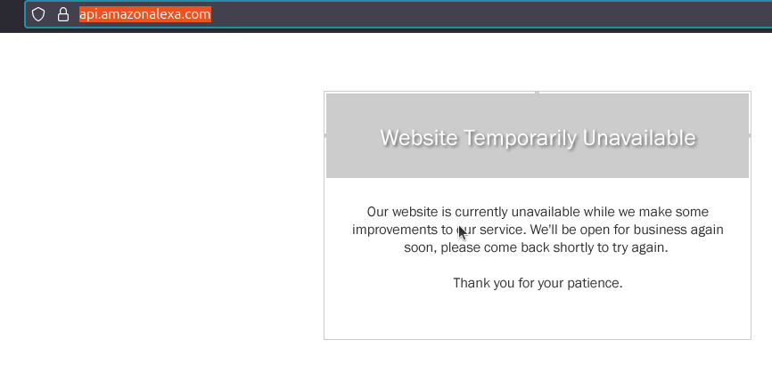

<a href="https://forumdomotique.com/forums/topic/247-alerte-panne-de-lint%C3%A9gration-des-appareils-alexa-alexa_device/">Lire et commenter sur Forum Domotique</a>

# Alerte : Panne de l'intégration des appareils Alexa  (alexa_device)

- **Catégorie :** [Amazon Alexa et Echo](https://forumdomotique.com/forums/34-amazon-alexa-et-echo/)
- **Sujet :** https://forumdomotique.com/forums/topic/247-alerte-panne-de-lint%C3%A9gration-des-appareils-alexa-alexa_device/
- **Auteur du premier message du sujet :** XAV59213
- **Messages de XAV59213 dans ce sujet :** 2
- **Premier message de XAV59213 :** 6 juillet 2025 à 12:25 (Europe/Paris)
- **Dernier message de XAV59213 :** 14 juillet 2025 à 19:25 (Europe/Paris)

---

## Message 1 — 6 juillet 2025 à 12:25 (Europe/Paris)

- **Identifiant :** `546`
- **Lien :** https://forumdomotique.com/forums/topic/247-alerte-panne-de-lint%C3%A9gration-des-appareils-alexa-alexa_device/#findComment-546

Bonjour à tous,

Actuellement, l'intégration des appareils Alexa est en panne en raison d'une maintenance en cours sur l'API d'Amazon : <https://api.amazonalexa.com/>.

<!-- source : https://cdn.forumdomotique.com/monthly_2025_07/Capturedcrandu2025-07-0612-22-55.png.d835a4e18e2250e763fbd46166cd59c0.png -->

<!-- source : https://cdn.forumdomotique.com/monthly_2025_07/Capturedcrandu2025-07-0612-24-09.png.bd8af459226ff6a28a230ab044e3af85.png -->

Une issue a été ouverte pour suivre le problème : <https://github.com/home-assistant/core/issues/148187>.

Nous vous tiendrons informés dès que la situation sera rétablie.

Merci de votre patience !

---

## Message 2 — 14 juillet 2025 à 19:25 (Europe/Paris)

- **Identifiant :** `577`
- **Lien :** https://forumdomotique.com/forums/topic/247-alerte-panne-de-lint%C3%A9gration-des-appareils-alexa-alexa_device/#findComment-577

Suite à la mise à jour core 2025.7.2

Fin de la panne 👍🤓

---
