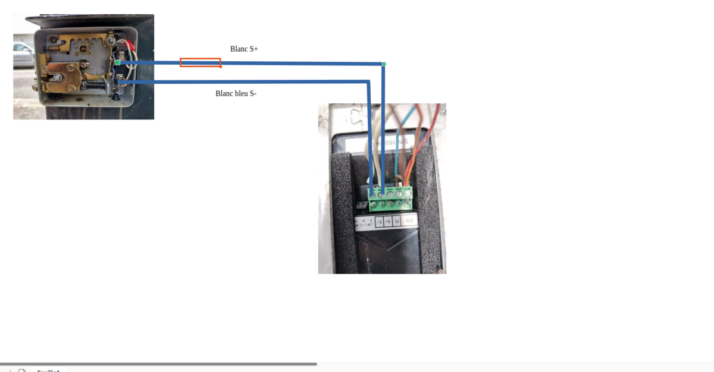
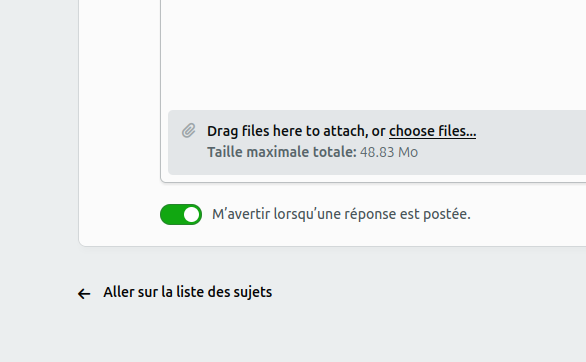

# Visiophone qui voit, entend mais refuse l'ouverture

- **Catégorie :** [Jardin Connecté et Extérieurs](https://forumdomotique.com/forums/72-jardin-connect%C3%A9-et-ext%C3%A9rieurs/)
- **Sujet :** https://forumdomotique.com/forums/topic/27-visiophone-qui-voit-entend-mais-refuse-louverture/
- **Auteur du premier message du sujet :** un autre membre (XAV59213 a répondu dans ce sujet)
- **Messages de XAV59213 dans ce sujet :** 3
- **Premier message de XAV59213 :** 26 avril 2025 à 15:42 (Europe/Paris)
- **Dernier message de XAV59213 :** 22 mai 2025 à 14:49 (Europe/Paris)

---

## Message 1 — 26 avril 2025 à 15:42 (Europe/Paris)

- **Identifiant :** `143`
- **Lien :** https://forumdomotique.com/forums/topic/27-visiophone-qui-voit-entend-mais-refuse-louverture/#findComment-143

Bonjour,

Pourriez-vous m'aider à préciser les points suivants concernant votre installation :

1. **Croquis de l'installation** :  
   Un schéma simple (même à main levée) indiquant les composants principaux (platine de rue, interphone, gâche électrique, etc.), les connexions et les couleurs des câbles utilisés. Veuillez préciser à quoi chaque câble est connecté (ex. : platine de rue, interphone maison, gâche, etc.).
2. **Nombre de câbles connectés** :  
   Combien de câbles sont reliés à chaque composant ? Par exemple, si le bus utilise 4 câbles pour la platine de rue, merci de confirmer et de détailler leurs fonctions.
3. **Tension et marque de la bobine** :  
   Quelle est la tension de la bobine (ex. : 24V DC, 230V AC) et quelle est la marque/modèle du composant (bobine, relais, module de bus) ?
4. **Test d’impulsion** :  
   Pouvez-vous confirmer si un test d’impulsion a été effectué sur la bobine ou le relais ? Si oui, quels sont les résultats ?
5. **Bus et modèle** :  
   Quel type de bus est utilisé (ex. : KNX, Modbus, autre) ? Pouvez-vous indiquer le modèle du module de bus et le protocole utilisé pour l’intégration avec Home Assistant ?

**Détails techniques requis** :

- Références ou modèles des composants (bobine, relais, module de bus, etc.).
- Tension d’alimentation (ex. : 24V DC, 230V AC).
- Type de bus de communication (ex. : KNX, Modbus, etc.).
- Si disponible, un plan ou schéma de l’installation serait très utile.

**Photos demandées** :

- Une vue d’ensemble de la centrale, montrant les câbles connectés (avec leurs couleurs si possible).
- Des photos des boîtiers ouverts (centrale, platine de rue, interphone, etc.) pour visualiser les connexions internes.
- Si applicable, une photo de la platine de rue et des câbles associés.

**Exemple de clarification** :  
 Si votre bus utilise 4 câbles pour la platine de rue, précisez leur rôle (ex. : alimentation, signal, commande de gâche). Indiquez également le protocole utilisé dans Home Assistant pour gérer l’interphone (ex. : MQTT, KNX, etc.).

Merci d’avance pour ces informations détaillées, elles me permettront de mieux vous accompagner !

---

## Message 2 — 22 mai 2025 à 14:45 (Europe/Paris)

- **Identifiant :** `339`
- **Lien :** https://forumdomotique.com/forums/topic/27-visiophone-qui-voit-entend-mais-refuse-louverture/#findComment-339

Salut [neophyte](https://forumdomotique.com/profile/62-neophyte/)

J'ai commencer peux tu finir 
<!-- source : https://cdn.forumdomotique.com/monthly_2025_05/Capturedcrandu2025-05-2214-43-10.png.f5b96f143cfcc5b0582be987cfc64166.png -->

---

## Message 3 — 22 mai 2025 à 14:49 (Europe/Paris)

- **Identifiant :** `340`
- **Lien :** https://forumdomotique.com/forums/topic/27-visiophone-qui-voit-entend-mais-refuse-louverture/#findComment-340

Oublie pas d'activer la notification :)

en bat a gauche

<!-- source : https://cdn.forumdomotique.com/monthly_2025_05/Capturedcrandu2025-05-2214-48-13.png.fe45634d573955b4d69ff6d52d93b997.png -->

---
