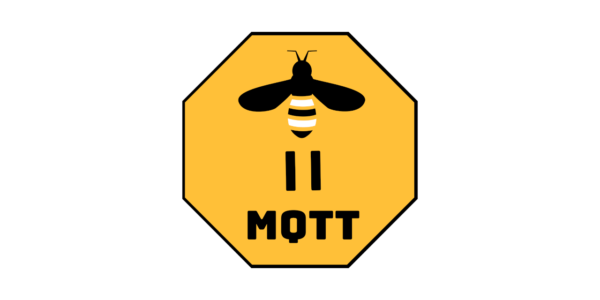
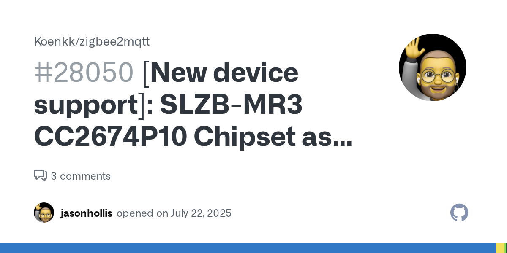

# SMLIGHT SZLB-06 - Mise à Jour et Z2M

- **Catégorie :** [Zigbee](https://forumdomotique.com/forums/60-zigbee/)
- **Sujet :** https://forumdomotique.com/forums/topic/279-smlight-szlb-06-mise-%C3%A0-jour-et-z2m/
- **Auteur du premier message du sujet :** un autre membre (XAV59213 a répondu dans ce sujet)
- **Messages de XAV59213 dans ce sujet :** 1
- **Premier message de XAV59213 :** 24 juillet 2025 à 18:46 (Europe/Paris)

---

## Message 1 — 24 juillet 2025 à 18:46 (Europe/Paris)

- **Identifiant :** `624`
- **Lien :** https://forumdomotique.com/forums/topic/279-smlight-szlb-06-mise-%C3%A0-jour-et-z2m/#findComment-624

Salut [@Drak69](https://forumdomotique.com/profile/280-drak69/)

À minima sauvegarde /homeassistant/zigbee2mqtt/configuration.yaml et mais en place un backup journalier automatique dans paramètres système sauvegarde et surtout avant de mettre à jour attends un peux que la version du update soit stable

<!-- source : https://github.githubassets.com/favicons/favicon.svg -->

##### GitHub

<!-- source : https://repository-images.githubusercontent.com/128636610/931edaa7-774b-4e12-8df1-4971a00e07b5 -->

### GitHub - Koenkk/zigbee2mqtt: Zigbee 🐝 to MQTT bridge 🌉,...

Zigbee 🐝 to MQTT bridge 🌉, get rid of your proprietary Zigbee bridges 🔨 - Koenkk/zigbee2mqtt

Et voici un exemple d une issue il y a 3 jours

<!-- source : https://github.githubassets.com/favicons/favicon.svg -->

##### GitHub

<!-- source : https://opengraph.githubassets.com/ec5b5baa56764b271897eed7059bf9fa9be868688e5a802be6bf6252747e609d/Koenkk/zigbee2mqtt/issues/28050 -->

### [New device support]: SLZB-MR3 CC2674P10 Chipset as rout...

Link https://smlight.tech/product/slzb-mr3/ Database entry [2025-07-22 14:21:40] debug: z2m:mqtt: Received MQTT message on 'zigbee2mqtt/bridge/request/device/interview' with data '{"id":"0x00124b00...

---
