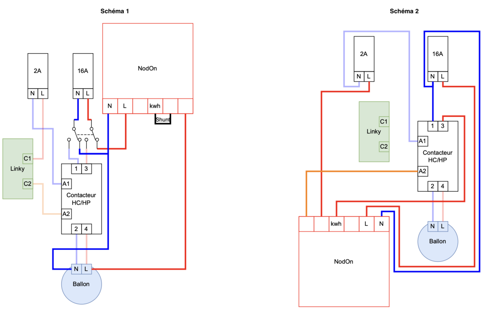
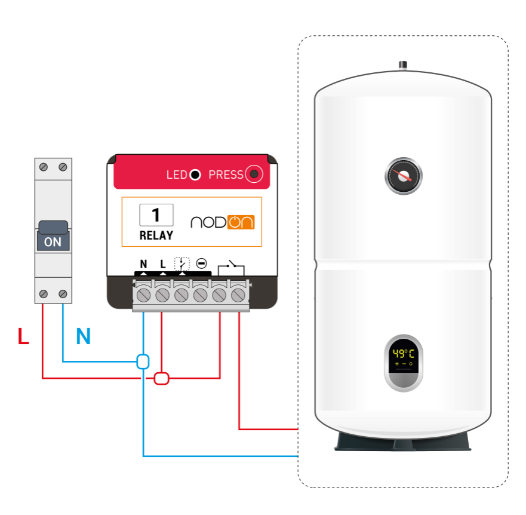

# Schéma de câblage NodOn SIN-4-1-21 pour chauffe-eau 1800 W pilotage et mesure de consommation avec solution de repli

- **Catégorie :** [Autres marques de matériel domotique](https://forumdomotique.com/forums/59-autres-marques-de-mat%C3%A9riel-domotique/)
- **Sujet :** https://forumdomotique.com/forums/topic/348-sch%C3%A9ma-de-c%C3%A2blage-nodon-sin-4-1-21-pour-chauffe-eau-1800-w-pilotage-et-mesure-de-consommation-avec-solution-de-repli/
- **Auteur du premier message du sujet :** un autre membre (XAV59213 a répondu dans ce sujet)
- **Messages de XAV59213 dans ce sujet :** 1
- **Premier message de XAV59213 :** 11 octobre 2025 à 06:56 (Europe/Paris)

---

## Message 1 — 11 octobre 2025 à 06:56 (Europe/Paris)

- **Identifiant :** `1033`
- **Lien :** https://forumdomotique.com/forums/topic/348-sch%C3%A9ma-de-c%C3%A2blage-nodon-sin-4-1-21-pour-chauffe-eau-1800-w-pilotage-et-mesure-de-consommation-avec-solution-de-repli/#findComment-1033

> **Le 19/08/2025 à 17:33, Pierre a dit :**
> Bonjour,
>
> En l'absence de réponse de la part de NodOn ainsi que Domadoo, je ne sais pas trop à qui adresser ma question quant au branchement du module. Aussi, je commence donc par ici dans l'espoir que quelqu'un puisse me répondre.
>
> Donc, j'ai acheté un SIN-4-1-21 dans l'idée de piloter et mesurer la consommation de mon chauffe-eau (1800W) et je ne trouve pas de schéma de branchement dans la notice ou sur le site du fabricant. Je pense avoir compris le fonctionnement du module et ai fait 2 schémas qui, je pense, pourraient fonctionner mais j'aimerais avoir une confirmation (ou infirmation le cas échéant).
>
> Point particulier : j'aimerais avoir une solution de replis en cas de défaillance de mon système domotique.
>
> J'ai donc d'abord pensé à un double inverseur (c.f. Schéma 1).  
> Mais j'ai ensuite pensé à utiliser le contacteur jour/nuit (c.f. Schéma 2). En premier lieu, cela m'évite l'achat du double inverseur, ainsi que l'espace qu'il occuperait dans le tableau. Mais cela permet aussi d'utiliser le contacteur pour gérer le chauffe-eau plutôt que de violenter le module (même s'il me semble que NodOn affirme que le module est prévu pour).
>
> Merci beaucoup.
>
> 

Salut [@Parisguapis](https://forumdomotique.com/profile/517-parisguapis/)[@Pierre](https://forumdomotique.com/profile/349-pierre/)

Moi pour les heures pleines heures creuse je laisse Enedis et mon télérupteurs géré le cumulus.

Pour le retour d état hc hp j’utilise le lixee.

J’utilise le SIN-4-1-20 pour couper la mis en service pendant les Hc ‘ exemple mode vacance ´.

Et pour récupérer ça consommation

Voici le schéma que j’utilise :

<!-- source : https://cdn.forumdomotique.com/monthly_2025_10/IMG_6047.png.73160bb4fc1dcec4c10208f591d06980.png -->

---
