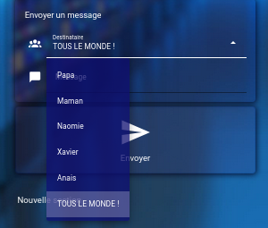
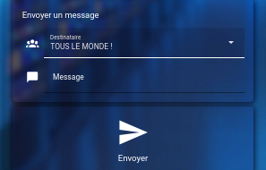
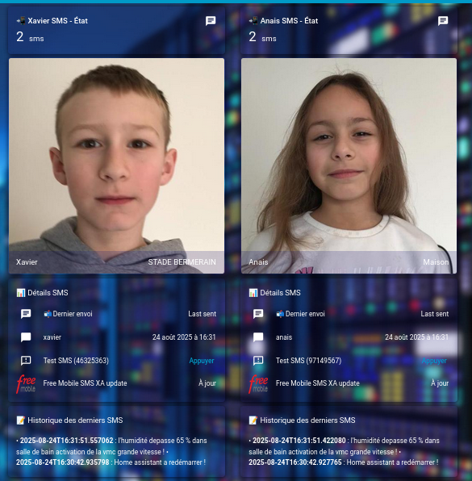
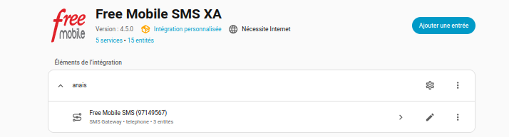
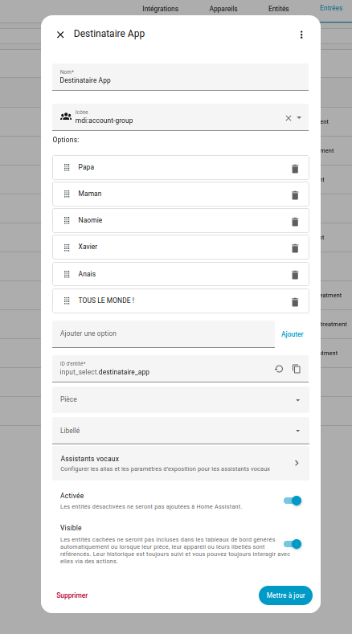
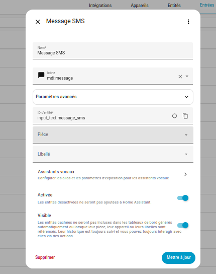
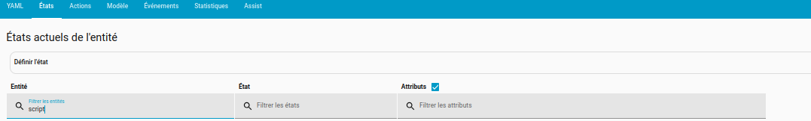
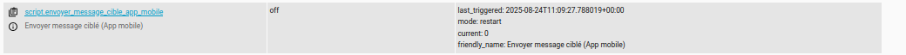


<p class="forum-cta"><a href="https://forumdomotique.com/forums/topic/353-envoyer-des-sms-depuis-le-dashboard-home-assistant-avec-lint%C3%A9gration-free-mobile-sms-xa/">Lire et commenter sur Forum Domotique</a> · <a href="https://github.com/XAV59213/freesmsxa">Dépôt HACS : Free Mobile SMS XA</a></p>

# Envoyer des SMS depuis le dashboard Home Assistant (avec l’intégration Free Mobile SMS XA)

- **Catégorie :** [Automatisations et Scénarios](https://forumdomotique.com/forums/9-automatisations-et-sc%C3%A9narios/)
- **Sujet :** https://forumdomotique.com/forums/topic/353-envoyer-des-sms-depuis-le-dashboard-home-assistant-avec-lint%C3%A9gration-free-mobile-sms-xa/
- **Auteur du premier message du sujet :** XAV59213
- **Messages de XAV59213 dans ce sujet :** 3
- **Premier message de XAV59213 :** 24 août 2025 à 17:15 (Europe/Paris)
- **Dernier message de XAV59213 :** 25 mai 2026 à 11:31 (Europe/Paris)

---

## Message 1 — 24 août 2025 à 17:15 (Europe/Paris)

- **Identifiant :** `779`
- **Lien :** https://forumdomotique.com/forums/topic/353-envoyer-des-sms-depuis-le-dashboard-home-assistant-avec-lint%C3%A9gration-free-mobile-sms-xa/#findComment-779

> **Important** : ce guide fonctionne **uniquement** avec l’intégration personnalisée **Free Mobile SMS XA** développée ici : `https://github.com/XAV59213/freesmsxa`  
> Elle expose des services `notify.*` et un service `freesmsxa.send_sms` pour envoyer des SMS via l’API Free Mobile.

---

## 🎯 Objectif

Mettre un **formulaire simple** sur Lovelace pour :

- choisir un destinataire (Papa, Maman, …),
- saisir un message,
- cliquer sur **Envoyer**,
- avoir une **confirmation** d’envoi et **vider le champ**.


<!-- source : https://cdn.forumdomotique.com/monthly_2025_08/Capturedcrandu2025-08-2416-46-25.png.2016a8e76f81ee3859362237961b2373.png -->


<!-- source : https://cdn.forumdomotique.com/monthly_2025_08/Capturedcrandu2025-08-2416-46-17.png.caa0cbefa8ebc9d1f8272478d6a9f01e.png -->

Optionnel : afficher l’**état** et l’**historique** des SMS grâce au capteur créé par l’intégration.


<!-- source : https://cdn.forumdomotique.com/monthly_2025_08/Capturedcrandu2025-08-2416-50-55.png.8c1f89f93957378bc7a0f7b5aa5949f5.png -->


<!-- source : https://cdn.forumdomotique.com/monthly_2025_08/Capturedcrandu2025-08-2417-14-50.png.01f3385cbefb684c16a0a66af7c1a3e0.png -->

---

## ✅ Prérequis

1. Avoir un ou plusieurs comptes Free Mobile avec l’option **“Notifications par SMS”** activée (identifiant + clé API).
2. Installer l’intégration personnalisée **Free Mobile SMS XA** :

   - via HACS → Dépôts personnalisés → `https://github.com/XAV59213/freesmsxa` → catégorie *Intégration* ;
   - redémarrer HA ;
   - **Paramètres → Appareils & services → Ajouter une intégration → Free Mobile SMS XA** ;
   - saisir `username` + `access_token` ; un SMS de test valide les identifiants.
3. Vérifier que des services `notify.*` ont été créés (ex. `notify.papa_sms`, `notify.maman_sms`) dans **Outils de développement → Services**.

> Si vous ne voyez pas vos `notify.*`, c’est que l’intégration n’est pas encore configurée ou a échoué.

---

## 🧱 Étape 1 — Créer 2 Entrées

**Paramètres → Appareils & services → Entrée → + Créer Entrée**

- **1 Liste (input_select)**

  - Nom : `Destinataire App` (ou `Destinataire SMS`)

    - Options (une par ligne) : **sans** le `notify.`

      ```plaintext
      papa
      maman
      ect..
      ```

  → entité : `input_select.destinataire_app`

  
<!-- source : https://cdn.forumdomotique.com/monthly_2025_08/Capturedcrandu2025-08-2417-02-55.png.9cf8c7f736e0e02f6609900e75e5fd77.png -->
- **2 Texte (input_text)**

  - Nom : `Message SMS`
  - (facultatif) Longueur max : 160  
    → entité : `input_text.message_sms`

  
<!-- source : https://cdn.forumdomotique.com/monthly_2025_08/Capturedcrandu2025-08-2417-05-19.png.29e75c7b18488e80ce06a6fa7c22964b.png -->

  ---

  ## 🧠 Étape 2 — Le script d’envoi

  Le script ci-dessous :

  - choisit le bon service `notify.<sélection>`,
  - **annule** si le message est vide,
  - crée une **notification de succès**,
  - **efface le message** après envoi.

  **Automatisations & scènes → Scripts → Nouveau → Éditeur YAML :**

```yaml
alias: Envoyer message ciblé (App mobile)
mode: restart
sequence:
  - variables:
      dest: "{{ states('input_select.destinataire_app') }}"
      msg: "{{ states('input_text.message_sms') }}"
  - choose:
      - conditions:
          - condition: template
            value_template: "{{ msg | trim == '' }}"
        sequence:
          - data:
              title: Envoi annulé
              message: Aucun message à envoyer. Merci de saisir un texte.
            action: persistent_notification.create
          - stop: Message vide
  - choose:
      - conditions:
          - condition: template
            value_template: "{{ dest == 'Maman' }}"
        sequence:
          - target:
              entity_id: notify.maman
            data:
              message: "{{ msg }}"
            action: notify.send_message
      - conditions:
          - condition: template
            value_template: "{{ dest == 'Papa' }}"
        sequence:
          - target:
              entity_id: notify.papa
            data:
              message: "{{ msg }}"
            action: notify.send_message
      - conditions:
          - condition: template
            value_template: "{{ dest == 'Naomie' }}"
        sequence:
          - target:
              entity_id: notify.naomie
            data:
              message: "{{ msg }}"
            action: notify.send_message
      - conditions:
          - condition: template
            value_template: "{{ dest == 'Xavier' }}"
        sequence:
          - target:
              entity_id: notify.xavier
            data:
              message: "{{ msg }}"
            action: notify.send_message
      - conditions:
          - condition: template
            value_template: "{{ dest == 'Anais' }}"
        sequence:
          - target:
              entity_id:
                - notify.anais
            data:
              message: "{{ msg }}"
            action: notify.send_message
      - conditions:
          - condition: template
            value_template: "{{ dest == 'TOUS LE MONDE !' }}"
        sequence:
          - target:
              entity_id:
                - notify.maman
                - notify.papa
                - notify.xavier
                - notify.naomie
                - notify.anais
            data:
              message: "{{ msg }}"
            action: notify.send_message
    default:
      - data:
          title: Envoi annulé
          message: Destinataire « {{ dest }} » inconnu. Vérifie ton sélecteur.
        action: persistent_notification.create
      - stop: Destinataire inconnu
  - data:
      title: Message envoyé 
      message: "Envoyé à « {{ dest }} » : {{ msg }}"
    action: persistent_notification.create
  - target:
      entity_id: input_text.message_sms
    data:
      value: ""
    action: input_text.set_value
description: ""
```

Variante si vous préférez **utiliser explicitement** le service de l’intégration :  
remplacez l’étape 2 par :

```yaml
- service: freesmsxa.send_sms
  data:
    target: "notify.{{ dest }}"
    message: "{{ msg }}"
```

## 🧩 Étape 3 — La carte Lovelace (dashboard)

**Tableau de bord → Modifier → + Ajouter une carte → Carte YAML :**

```yaml
type: vertical-stack
cards:
  - type: entities
    title: Envoyer un message SMS
    state_color: true
    entities:
      - entity: input_select.destinataire_app
        name: Destinataire
      - entity: input_text.message_sms
        name: Message

  - type: button
    name: Envoyer
    icon: mdi:send
    tap_action:
      action: call-service
      service: script.turn_on
      target:
        entity_id: script.envoyer_message_cible_app_mobile  # <-- adapte avec l'ID exact de ton script
```


<!-- source : https://cdn.forumdomotique.com/monthly_2025_08/Capturedcrandu2025-08-2417-25-44.png.cd0e7eba87980105b9217da337ef48bd.png -->


<!-- source : https://cdn.forumdomotique.com/monthly_2025_08/Capturedcrandu2025-08-2417-25-16.png.57b341091d97a45b3a7aef330b992281.png -->

> Pour connaître l’ID exact du script : **Outils de développement → États**, filtre `script.`.

---

## 🔎 (Optionnel) Carte “État + Historique des SMS”

Si vous avez configuré le **capteur** créé par l’intégration (nom ressemblant à `<Alias> - SMS`), vous pouvez afficher :

- le **compteur** d’envois,
- le **dernier envoi**,
- l’**historique** (10 derniers) depuis l’attribut `sms_log`.

Adaptez `sensor.TON_CAPTEUR` à votre entité réelle (voir **États**).

```yaml
type: vertical-stack
cards:
  - type: entity
    entity: sensor.TON_CAPTEUR
    name:  Maman SMS - État
    state_color: true
    unit: sms
    attribute: sms_count

  - type: markdown
    title:  Historique des derniers SMS
    content: >
      
      
      
      • **{{ item['time'] | as_datetime | as_local | strftime('%d/%m %H:%M:%S') }}** : {{ item['message'] }}
      
      
      Aucun SMS envoyé.
      
```

## 🧰 Dépannage (FAQ)

- **“Notify service not found”**  
  → Dans **Outils de développement → Services**, notez les noms exacts `notify.*`.  
  → Les **options** de `input_select.destinataire_app` doivent être **sans** `notify.` (ex. `papa_sms`, pas `notify.papa_sms`).  
  → Le script reconstruit `notify.{{ dest }}`.
- **Rien ne se passe en cliquant sur “Envoyer”**  
  → Vérifiez que la carte appelle bien `script.turn_on` et l’`entity_id` du script est correct (voir **États**).
- **Le champ ne se vide pas**  
  → Vérifiez que `input_text.message_sms` existe, et l’étape `input_text.set_value` est bien en fin de script.
- **Pas de capteur / pas d’historique**  
  → Ajoutez l’intégration et la ligne Free Mobile ; le capteur est créé par l’intégration lors de la config.  
  → L’historique s’alimente après vos premiers envois.

---

## 🔐 Remarques sécurité & vie privée

- Les clés Free Mobile sont **stockées dans la config** de l’intégration et ne s’affichent pas en clair dans le device registry.
- Pensez à **limiter l’accès** à cette carte Lovelace (utilisateurs/onglets) si nécessaire.

---

## 📦 Références

- Intégration **Free Mobile SMS XA** (obligatoire) : `https://github.com/XAV59213/freesmsxa`
- Home Assistant — Helpers (Aides), Scripts, Lovelace.

---

## 🏁 Conclusion

En quelques minutes, vous avez :

- un formulaire **Destinataire + Message + Bouton Envoyer**,
- un envoi **100 % SMS** via l’intégration **Free Mobile SMS XA**,
- une **confirmation** d’envoi et un champ **réinitialisé**,
- et, si vous voulez, un **suivi de l’historique** des SMS.

---

## Message 2 — 10 septembre 2025 à 18:04 (Europe/Paris)

- **Identifiant :** `843`
- **Lien :** https://forumdomotique.com/forums/topic/353-envoyer-des-sms-depuis-le-dashboard-home-assistant-avec-lint%C3%A9gration-free-mobile-sms-xa/#findComment-843

Merci ☺️

---

## Message 3 — 25 mai 2026 à 11:31 (Europe/Paris)

- **Identifiant :** `2304`
- **Lien :** https://forumdomotique.com/forums/topic/353-envoyer-des-sms-depuis-le-dashboard-home-assistant-avec-lint%C3%A9gration-free-mobile-sms-xa/#findComment-2304

**Salut !**

Merci pour ton retour et pour l’utilisation du script 👍

**Oui, il y a bien un moyen de faire des SMS multi-destinataires !**

### Comment ça marche :

L’intégration **Free Mobile SMS XA** est conçue exactement pour ça :

- Tu configures **une ligne par personne** (Papa, Maman, Xavier, Naomie, etc.) avec son propre **Identifiant utilisateur + Clé API**.
- Chaque ligne configurée crée automatiquement un service notify. distinct (notify.papa, notify.maman, notify.xavier…).

Pour envoyer **un même SMS à plusieurs personnes en même temps**, tu utilises simplement **un seul appel** au service notify.send_message en mettant plusieurs entity_id dans la cible :

```yaml
action: notify.send_message
data:
message: " Alarme activée !"
target:
entity_id:
- notify.maman
- notify.papa
- notify.xavier
- notify.naomie
- notify.anais
```

C’est exactement l’exemple que je mets dans le README pour les alarmes.

### Point important :

Chaque envoi va **uniquement vers le numéro de la ligne** liée à la clé API de cette configuration. C’est une limitation de l’API gratuite de Free Mobile (elle n’autorise pas l’envoi vers un numéro arbitraire, seulement vers « ta » ligne).

Donc pour notifier toute la famille, il suffit de configurer **une intégration par membre** → c’est rapide et propre.

---

