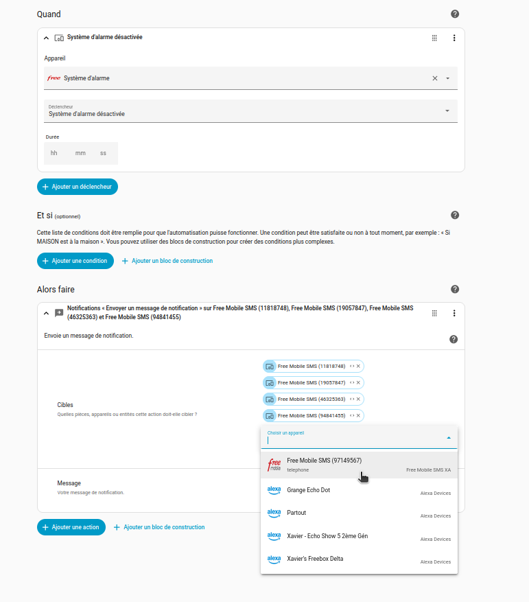

# Configurer l’envoi de notifications SMS dans vos automatisations Home Assistant via Free Mobile SMS XA

- **Catégorie :** [Automatisations et Scénarios](https://forumdomotique.com/forums/9-automatisations-et-sc%C3%A9narios/)
- **Sujet :** https://forumdomotique.com/forums/topic/354-configurer-lenvoi-de-notifications-sms-dans-vos-automatisations-home-assistant-via-free-mobile-sms-xa/
- **Auteur du premier message du sujet :** XAV59213
- **Messages de XAV59213 dans ce sujet :** 2
- **Premier message de XAV59213 :** 24 août 2025 à 17:45 (Europe/Paris)
- **Dernier message de XAV59213 :** 10 septembre 2025 à 18:05 (Europe/Paris)

---

## Message 1 — 24 août 2025 à 17:45 (Europe/Paris)

- **Identifiant :** `780`
- **Lien :** https://forumdomotique.com/forums/topic/354-configurer-lenvoi-de-notifications-sms-dans-vos-automatisations-home-assistant-via-free-mobile-sms-xa/#findComment-780

**Free Mobile SMS XA** (obligatoire) → <https://github.com/XAV59213/freesmsxa>

# 0) Prérequis (une fois pour toutes)

1. Installe et configure l’intégration **Free Mobile SMS XA** (HACS → Dépôts personnalisés → ajouter le dépôt → installer → redémarrer → *Paramètres → Appareils & services → Ajouter une intégration* → saisir identifiant + clé API).
2. Vérifie dans **Outils de développement → Services** que tu as des services `notify.*` (ex. `notify.papa_sms`, `notify.maman_sms`).

   > Ce sont ces services qui enverront les SMS.

---

# 1) Exemple simple (UI) — Alerte température

## Étapes UI

1. **Paramètres → Automatisations & scènes → Automatisations → + Créer**
2. **Déclencheur**

   - Type : *État numérique*
   - Entité : `sensor.temperature_eau` (par ex.)
   - Condition : *Au-dessus de* → `30`
3. **Action**

   - Action : **Appeler un service**

     - Service : `notify.message`
     - Données :

       - `message` : Alarme désactivé !

```yaml
alias: 2 Alarme désactiver
description: ""
triggers:
  - device_id: f9c723991602ba75c1b74953ce38b854
    domain: alarm_control_panel
    entity_id: 257d080f03fb6013a27d97ef9d37efec
    type: disarmed
    trigger: device
conditions: []
actions:
  - action: notify.send_message
    metadata: {}
    data:
      message: Alarme désactivé !
    target:
      device_id:
        - 6d04d6337c4ae1a8141ad189363b1548
        - ca341d2a6b3a7bc496221fd1cbf91ae8
        - 24d0e25144a5f0e2d30aeec53784671a
        - 1650b3db53cb7053c36440169fdea661
mode: single
```


<!-- source : https://cdn.forumdomotique.com/monthly_2025_08/Capturedcrandu2025-08-2417-30-36.png.06d43b5423b8115402a1b53a93030a91.png -->

---

## Message 2 — 10 septembre 2025 à 18:05 (Europe/Paris)

- **Identifiant :** `844`
- **Lien :** https://forumdomotique.com/forums/topic/354-configurer-lenvoi-de-notifications-sms-dans-vos-automatisations-home-assistant-via-free-mobile-sms-xa/#findComment-844

> **Il y a 9 heures, CedricMD a dit :**
> Avec Free, tu as tout compris 😂 Mais en effet cette API mise à disposition par Free est vraiment top pour nos systèmes domotiques !

Avant j’utiliser le service Notify

dans la configuration yaml pas très idéal d avoir les tokens en clair dans la configuration.

pour ça que j ai créé cette intégration !

✌️

---
