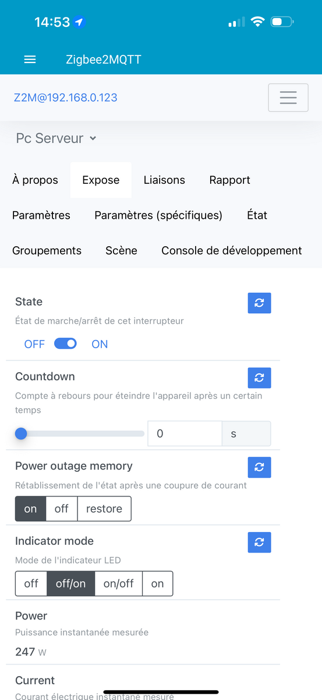

# Entités MQTT non disponibles dans Home Assistant avec Zigbee2MQTT

- **Catégorie :** [Dépannage et Support Technique](https://forumdomotique.com/forums/19-d%C3%A9pannage-et-support-technique/)
- **Sujet :** https://forumdomotique.com/forums/topic/355-entit%C3%A9s-mqtt-non-disponibles-dans-home-assistant-avec-zigbee2mqtt/
- **Auteur du premier message du sujet :** un autre membre (XAV59213 a répondu dans ce sujet)
- **Messages de XAV59213 dans ce sujet :** 1
- **Premier message de XAV59213 :** 25 août 2025 à 14:56 (Europe/Paris)

---

## Message 1 — 25 août 2025 à 14:56 (Europe/Paris)

- **Identifiant :** `782`
- **Lien :** https://forumdomotique.com/forums/topic/355-entit%C3%A9s-mqtt-non-disponibles-dans-home-assistant-avec-zigbee2mqtt/#findComment-782

Salut @Jeremy peux tu afficher la page zigbee2mqtt sur une page expose d un appareil et faire un test on off

<!-- source : https://cdn.forumdomotique.com/monthly_2025_08/IMG_5792.png.928fa37ca232b41801e0d6e56ece4c90.png -->

---
