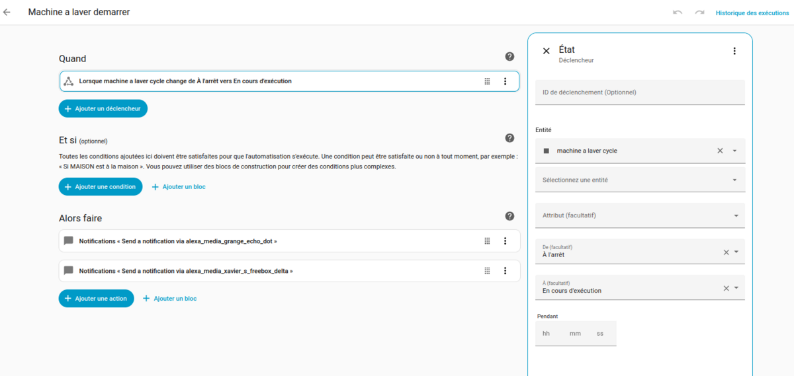

<p class="forum-cta"><a href="https://forumdomotique.com/forums/topic/370-google-home-peut-il-annoncer-porte-ouverte-et-porte-ferm%C3%A9e-avec-un-contact-de-porte-wifi/">Lire et commenter sur Forum Domotique</a></p>

# Google Home peut-il annoncer porte ouverte et porte fermée avec un contact de porte wifi ?

- **Catégorie :** [Google Nest et Google Home](https://forumdomotique.com/forums/33-google-nest-et-google-home/)
- **Sujet :** https://forumdomotique.com/forums/topic/370-google-home-peut-il-annoncer-porte-ouverte-et-porte-ferm%C3%A9e-avec-un-contact-de-porte-wifi/
- **Auteur du premier message du sujet :** un autre membre (XAV59213 a répondu dans ce sujet)
- **Messages de XAV59213 dans ce sujet :** 1
- **Premier message de XAV59213 :** 12 octobre 2025 à 13:10 (Europe/Paris)

---

## Message 1 — 12 octobre 2025 à 13:10 (Europe/Paris)

- **Identifiant :** `1040`
- **Lien :** https://forumdomotique.com/forums/topic/370-google-home-peut-il-annoncer-porte-ouverte-et-porte-ferm%C3%A9e-avec-un-contact-de-porte-wifi/#findComment-1040

Salut [@titi25520](https://forumdomotique.com/profile/216-titi25520/) ,

Moi J'utilise Alexa, et je suppose que le principe est similaire pour créer une automatisation.

Exemple :

```yaml
alias: Machine a laver demarrer
description: ""
triggers:
  - trigger: state
    entity_id:
      - binary_sensor.machine_a_laver_cycle
    from: "off"
    to: "on"
conditions: []
actions:
  - action: notify.alexa_media_grange_echo_dot
    metadata: {}
    data:
      message: Cycle de la machine a laver demarrer !
  - action: notify.alexa_media_xavier_s_freebox_delta
    metadata: {}
    data:
      message: Cycle de la machine a laver demarrer !
mode: single
```


<!-- source : https://cdn.forumdomotique.com/monthly_2025_10/Capturedcrandu2025-10-1213-07-30.png.3f3c1cbeae53a414f8d28c7ceca502e7.png -->

---
