# slzb-mr2: Silicon Labs Multiprotocol ne démarre pas et LiXee ZLinky TIC sans entités dans Zigbee2MQTT

- **Catégorie :** [Installation et Configuration](https://forumdomotique.com/forums/8-installation-et-configuration/)
- **Sujet :** https://forumdomotique.com/forums/topic/390-slzb-mr2-silicon-labs-multiprotocol-ne-d%C3%A9marre-pas-et-lixee-zlinky-tic-sans-entit%C3%A9s-dans-zigbee2mqtt/
- **Auteur du premier message du sujet :** un autre membre (XAV59213 a répondu dans ce sujet)
- **Messages de XAV59213 dans ce sujet :** 26
- **Premier message de XAV59213 :** 20 septembre 2025 à 15:25 (Europe/Paris)
- **Dernier message de XAV59213 :** 4 octobre 2025 à 09:03 (Europe/Paris)

---

## Message 1 — 20 septembre 2025 à 15:25 (Europe/Paris)

- **Identifiant :** `893`
- **Lien :** https://forumdomotique.com/forums/topic/390-slzb-mr2-silicon-labs-multiprotocol-ne-d%C3%A9marre-pas-et-lixee-zlinky-tic-sans-entit%C3%A9s-dans-zigbee2mqtt/#findComment-893

Salut [@Arubinu](https://forumdomotique.com/profile/124-arubinu/) et [@david](https://forumdomotique.com/profile/323-david/)

[@david](https://forumdomotique.com/profile/323-david/) regarde ta configuration spécifique dans Z2M LINKY mode HISTORIQUE

Après modification il faudra attendre c'est pas de l’instantané

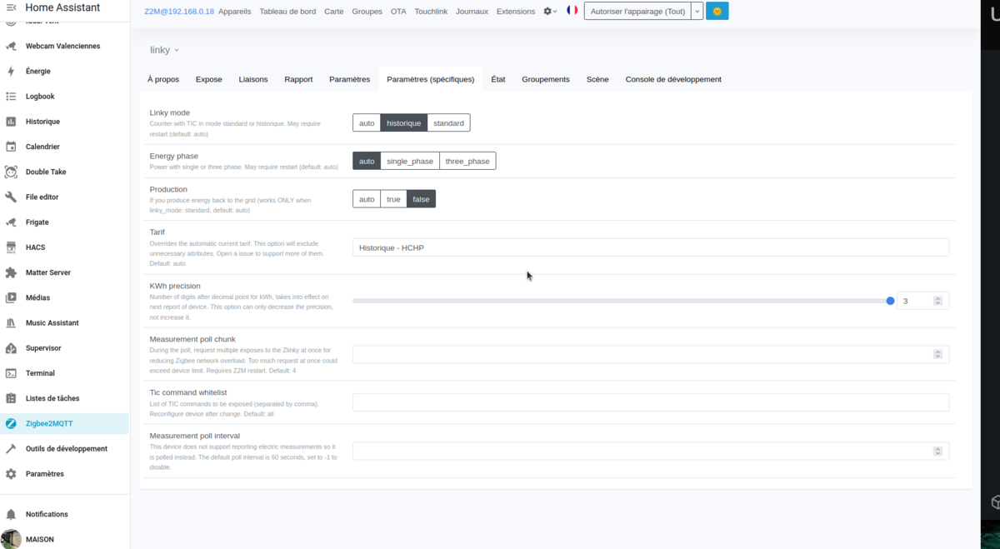

---

## Message 2 — 22 septembre 2025 à 12:54 (Europe/Paris)

- **Identifiant :** `901`
- **Lien :** https://forumdomotique.com/forums/topic/390-slzb-mr2-silicon-labs-multiprotocol-ne-d%C3%A9marre-pas-et-lixee-zlinky-tic-sans-entit%C3%A9s-dans-zigbee2mqtt/#findComment-901

Salut [@david](https://forumdomotique.com/profile/323-david/)

Je prépare un tuto concernant le zlinky

À tu un contrat injection réseau ?

Enedis doit modifier ton linky sur leur plateforme puis ça va faire apparaître injection sur ton linky et seulement la, tu aura accès au comptage de ton injection

1. Va sur ton linky clic sur l un des 2 boutons plusieurs fois tu devrais voir apparaître standard ou historique
2. Idem pour injection si activer
3. Voici une doc sur les zlinky <https://github.com/XAV59213/Zlinky_TIC.git>

---

## Message 3 — 22 septembre 2025 à 14:53 (Europe/Paris)

- **Identifiant :** `903`
- **Lien :** https://forumdomotique.com/forums/topic/390-slzb-mr2-silicon-labs-multiprotocol-ne-d%C3%A9marre-pas-et-lixee-zlinky-tic-sans-entit%C3%A9s-dans-zigbee2mqtt/#findComment-903

Re c’est ce modèle que tu a ?

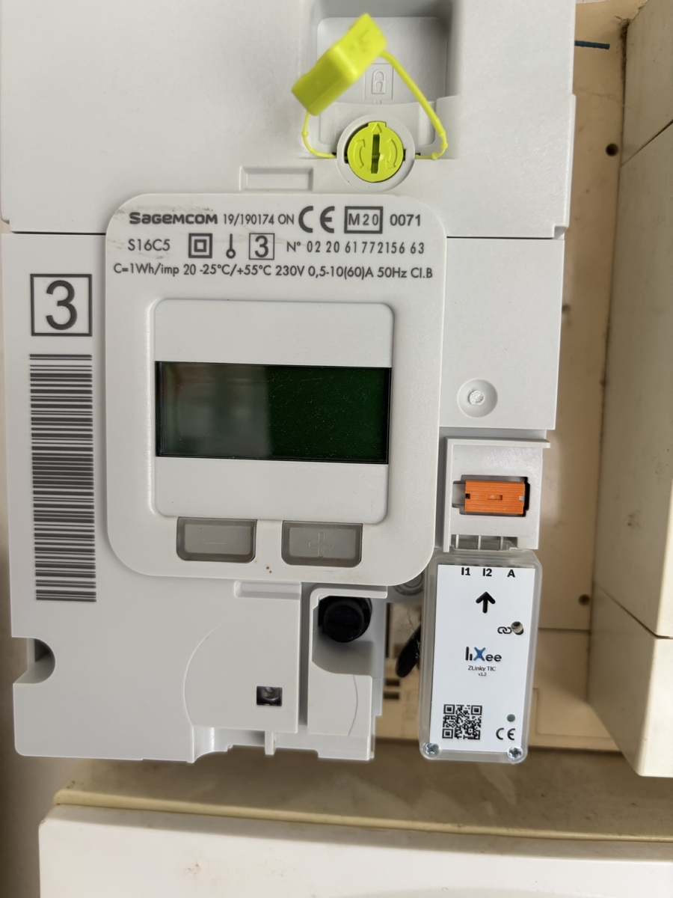

---

## Message 4 — 22 septembre 2025 à 15:08 (Europe/Paris)

- **Identifiant :** `904`
- **Lien :** https://forumdomotique.com/forums/topic/390-slzb-mr2-silicon-labs-multiprotocol-ne-d%C3%A9marre-pas-et-lixee-zlinky-tic-sans-entit%C3%A9s-dans-zigbee2mqtt/#findComment-904

RE [@david](https://forumdomotique.com/profile/323-david/)

Va dans outils de développement / états / cherche linky

Dit moi si il y a des valeurs

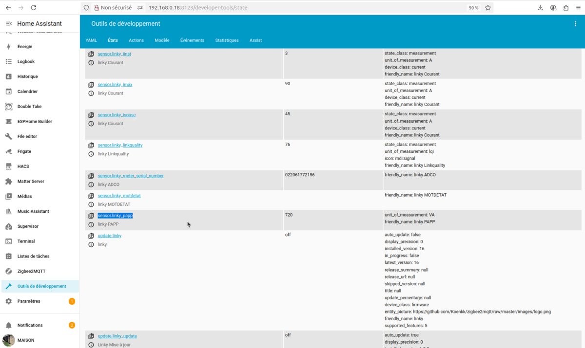

Il faut contrôler aussi mqtt va dans paramettre / appareil et service / mqtt voir si il est bien ajouter dans mqtt

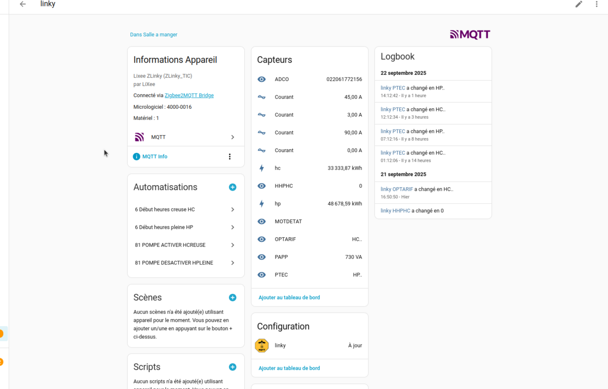
<!-- source : https://cdn.forumdomotique.com/monthly_2025_09/Capturedcrandu2025-09-2215-13-09.png.03128157ba0d4faa6e4a46c49bcb70fd.png -->

je viens de comprendre ton problème

```markdown
Interview state

Failed
```

OK il faut que tu re appareille ton zlinky ta pas besoin de le supprimer de Z2M vu que ton adresse 0x00158d00094edb9f ne bouge pas

avec un trombone reste appuie 10 secondes la ou il y a le logo infini et active appairage ça va reconstruit et la synchroniser

Après il faut attendre c'est pas instantané pour les donnée 5 a 24 heures pour toute les avoir

---

## Message 5 — 22 septembre 2025 à 15:52 (Europe/Paris)

- **Identifiant :** `907`
- **Lien :** https://forumdomotique.com/forums/topic/390-slzb-mr2-silicon-labs-multiprotocol-ne-d%C3%A9marre-pas-et-lixee-zlinky-tic-sans-entit%C3%A9s-dans-zigbee2mqtt/#findComment-907

re

Donc pendant un moment tu était bien connecter vu que mqtt a les infos

re-fait un appareillage et ne touche a rien dans les config

puis va dans les journaux de Z2M si il y a une erreur il va la donné fait un imprime ecran

---

## Message 6 — 22 septembre 2025 à 15:54 (Europe/Paris)

- **Identifiant :** `908`
- **Lien :** https://forumdomotique.com/forums/topic/390-slzb-mr2-silicon-labs-multiprotocol-ne-d%C3%A9marre-pas-et-lixee-zlinky-tic-sans-entit%C3%A9s-dans-zigbee2mqtt/#findComment-908

O

> **il y a 1 minute, david a dit :**
> Bon gemini me dit que je dois être impérativement en mode historique et pas standard .... c est peut être ça.....

oui peux être que ton compteur est en historique ça pourrai régler le Problème comme je te l’ai dit plus haut sur ton linky c’est écrit 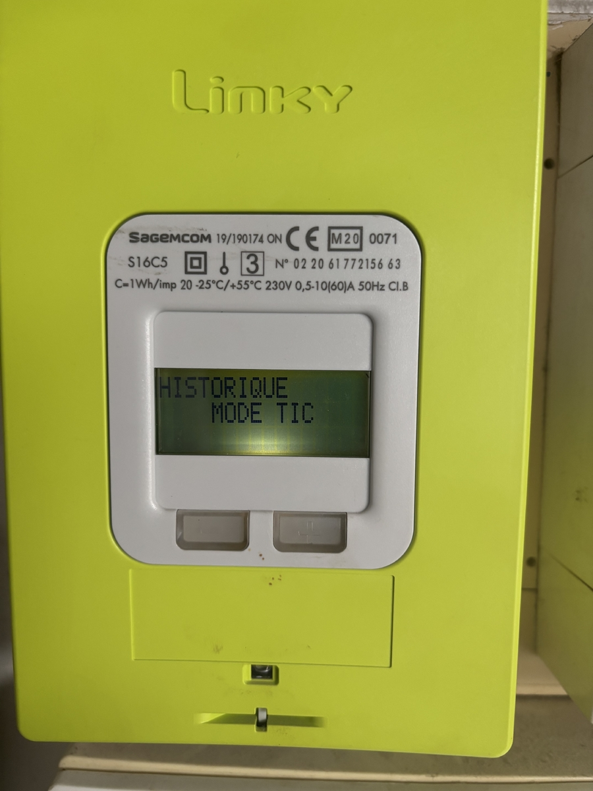

---

## Message 7 — 22 septembre 2025 à 16:07 (Europe/Paris)

- **Identifiant :** `910`
- **Lien :** https://forumdomotique.com/forums/topic/390-slzb-mr2-silicon-labs-multiprotocol-ne-d%C3%A9marre-pas-et-lixee-zlinky-tic-sans-entit%C3%A9s-dans-zigbee2mqtt/#findComment-910

Oui il faut faire la demande a enedis pour ça il te basculerons en standard et la tu pourra modifier ton zlinky

---

## Message 8 — 22 septembre 2025 à 16:08 (Europe/Paris)

- **Identifiant :** `911`
- **Lien :** https://forumdomotique.com/forums/topic/390-slzb-mr2-silicon-labs-multiprotocol-ne-d%C3%A9marre-pas-et-lixee-zlinky-tic-sans-entit%C3%A9s-dans-zigbee2mqtt/#findComment-911

Le compteur Linky offre deux modes de fonctionnement, à savoir le mode standard et le mode historique, chacun ayant ses avantages spécifiques :

1. **Précision de la mesure de puissance :** En mode standard, le compteur Linky offre une précision exceptionnelle, mesurant la puissance instantanée avec une précision de 1 watt, par opposition au mode historique qui présente une précision de 10 watts. Cela signifie que le mode standard fournit des données plus précises sur votre consommation électrique en temps réel.
2. **Surveillance de l'injection d'énergie :** Pour les utilisateurs équipés de panneaux photovoltaïques en autoconsommation qui revendent leur surplus d'électricité, le mode standard présente un avantage significatif. En mode standard, vous pouvez visualiser la puissance que vous injectez dans le réseau électrique, vous permettant ainsi de suivre de près votre production d'énergie solaire. En revanche, en mode historique, l'affichage indique une puissance injectée nulle, ce qui ne reflète pas la réalité de l'injection.

---

## Message 9 — 22 septembre 2025 à 16:09 (Europe/Paris)

- **Identifiant :** `912`
- **Lien :** https://forumdomotique.com/forums/topic/390-slzb-mr2-silicon-labs-multiprotocol-ne-d%C3%A9marre-pas-et-lixee-zlinky-tic-sans-entit%C3%A9s-dans-zigbee2mqtt/#findComment-912

Pour vérifier le mode de fonctionnement de votre compteur Linky, il vous suffit de faire défiler les écrans d'affichage. Si le mode standard est activé, l'écran indiquera "STANDARD MODE TIC", tandis que le mode historique sera identifié par l'affichage "HISTORIQUE MODE TIC".

Si vous souhaitez passer votre compteur Linky du mode historique au mode standard, la démarche est simple. Vous devez contacter votre Fournisseur d'Électricité et demander le passage de votre compteur Linky en mode standard en précisant qu'il s'agit de la prestation F185 auprès d'Enedis. Cette opération est gratuite, et en règle générale, le changement est effectué dans les 24 heures ouvrées, vous permettant ainsi de bénéficier des avantages du mode standard pour une gestion plus précise et efficace de votre consommation électrique.

---

## Message 10 — 22 septembre 2025 à 16:11 (Europe/Paris)

- **Identifiant :** `914`
- **Lien :** https://forumdomotique.com/forums/topic/390-slzb-mr2-silicon-labs-multiprotocol-ne-d%C3%A9marre-pas-et-lixee-zlinky-tic-sans-entit%C3%A9s-dans-zigbee2mqtt/#findComment-914

si tu ne modifie pas le mode chez ton opérateur çà fonctionnera jamais

---

## Message 11 — 22 septembre 2025 à 16:11 (Europe/Paris)

- **Identifiant :** `915`
- **Lien :** https://forumdomotique.com/forums/topic/390-slzb-mr2-silicon-labs-multiprotocol-ne-d%C3%A9marre-pas-et-lixee-zlinky-tic-sans-entit%C3%A9s-dans-zigbee2mqtt/#findComment-915

Tu a fait la demande quand ?

---

## Message 12 — 22 septembre 2025 à 16:13 (Europe/Paris)

- **Identifiant :** `916`
- **Lien :** https://forumdomotique.com/forums/topic/390-slzb-mr2-silicon-labs-multiprotocol-ne-d%C3%A9marre-pas-et-lixee-zlinky-tic-sans-entit%C3%A9s-dans-zigbee2mqtt/#findComment-916

Et a tu un contrat de revente pour l'injection au réseau ?

---

## Message 13 — 22 septembre 2025 à 16:18 (Europe/Paris)

- **Identifiant :** `917`
- **Lien :** https://forumdomotique.com/forums/topic/390-slzb-mr2-silicon-labs-multiprotocol-ne-d%C3%A9marre-pas-et-lixee-zlinky-tic-sans-entit%C3%A9s-dans-zigbee2mqtt/#findComment-917

Si c'est des panneaux sans contrat çà ne repasse pas dans ton zlinky et chez enedis le mode standard ne sert a rien

---

## Message 14 — 22 septembre 2025 à 16:26 (Europe/Paris)

- **Identifiant :** `919`
- **Lien :** https://forumdomotique.com/forums/topic/390-slzb-mr2-silicon-labs-multiprotocol-ne-d%C3%A9marre-pas-et-lixee-zlinky-tic-sans-entit%C3%A9s-dans-zigbee2mqtt/#findComment-919

> **il y a 4 minutes, david a dit :**
> Oui j ai un contrat edfoa .
>
> Je vais voir avec enedis pour être sur car j ai eu un changement de compteur linky, le précédent avez un problème....
>
> Mais bon si mon compteur l affiche logiquement c est que enedis a bien fait ce changement de historique vers standard ...

OK revient sur le forum des que tu a un retour et passe en mode historique çà coute rien de tester et dit moi si ça a changer demain

---

## Message 15 — 22 septembre 2025 à 16:43 (Europe/Paris)

- **Identifiant :** `923`
- **Lien :** https://forumdomotique.com/forums/topic/390-slzb-mr2-silicon-labs-multiprotocol-ne-d%C3%A9marre-pas-et-lixee-zlinky-tic-sans-entit%C3%A9s-dans-zigbee2mqtt/#findComment-923

> **à l’instant, david a dit :**
> Je viens d aller voir sur mon compte enedis et sur les infos de mon compteur je suis bien en mode tic standard pour la transmission des infos.
>
> Et àpriori c est bien le réglage pour avoir toutes les infos, conso et prod....
>
> J ai vraiment le sentiment que c est entre mqtt ha .....

Oui c'est possible mais la ou çà coince c'est dans z2m

**Disponibilité**

[Désactivé](https://www.zigbee2mqtt.io/guide/configuration/device-availability.html#availability-advanced-configuration)

et

**Interview state**

Failed

---

## Message 16 — 22 septembre 2025 à 16:48 (Europe/Paris)

- **Identifiant :** `925`
- **Lien :** https://forumdomotique.com/forums/topic/390-slzb-mr2-silicon-labs-multiprotocol-ne-d%C3%A9marre-pas-et-lixee-zlinky-tic-sans-entit%C3%A9s-dans-zigbee2mqtt/#findComment-925

Dans ton fichier de configuration de z2m assure toi d 'avoir

/homeassistant/zigbee2mqtt/configuration.yaml

```yaml
availability:
  enabled: true
```

la tu est sur false

```yaml
availability:
  enabled: false
```

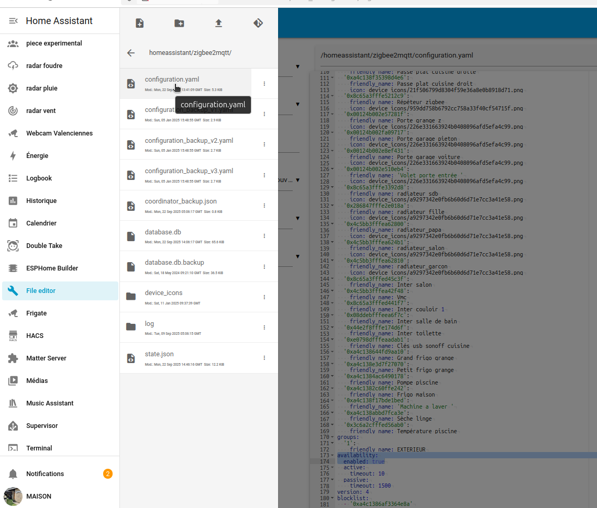
<!-- source : https://cdn.forumdomotique.com/monthly_2025_09/Capturedcrandu2025-09-2216-50-45.png.2ad44e2f0b681b41e05c42860d29e99f.png -->

---

## Message 17 — 22 septembre 2025 à 21:39 (Europe/Paris)

- **Identifiant :** `929`
- **Lien :** https://forumdomotique.com/forums/topic/390-slzb-mr2-silicon-labs-multiprotocol-ne-d%C3%A9marre-pas-et-lixee-zlinky-tic-sans-entit%C3%A9s-dans-zigbee2mqtt/#findComment-929

Ok ajoute le code à la fin

```yaml
availability:
  enabled: true
  active:
	timeout: 10
  passive:
	timeout: 1500
```

juste avant version

Fait une sauvegarde du fichier avant de valider puis reboot home assistant

---

## Message 18 — 22 septembre 2025 à 21:50 (Europe/Paris)

- **Identifiant :** `930`
- **Lien :** https://forumdomotique.com/forums/topic/390-slzb-mr2-silicon-labs-multiprotocol-ne-d%C3%A9marre-pas-et-lixee-zlinky-tic-sans-entit%C3%A9s-dans-zigbee2mqtt/#findComment-930

Je viens de voir un autre problème

```yaml
energy_phase: single_phase
```

Tu doit mettre auto

```yaml
energy_phase: auto
```

---

## Message 19 — 22 septembre 2025 à 22:00 (Europe/Paris)

- **Identifiant :** `931`
- **Lien :** https://forumdomotique.com/forums/topic/390-slzb-mr2-silicon-labs-multiprotocol-ne-d%C3%A9marre-pas-et-lixee-zlinky-tic-sans-entit%C3%A9s-dans-zigbee2mqtt/#findComment-931

Quand tu partage ton code peux tu le mettre dans un code bloc yaml ça évitera les sauts de ligne pour mieux voir le code

---

## Message 20 — 23 septembre 2025 à 11:39 (Europe/Paris)

- **Identifiant :** `935`
- **Lien :** https://forumdomotique.com/forums/topic/390-slzb-mr2-silicon-labs-multiprotocol-ne-d%C3%A9marre-pas-et-lixee-zlinky-tic-sans-entit%C3%A9s-dans-zigbee2mqtt/#findComment-935

À la fin

À tu tester en historique ?

Sur ton code que tu à publier efface ton mot de passe ne mais pas tes passe sur le forum

---

## Message 21 — 23 septembre 2025 à 14:58 (Europe/Paris)

- **Identifiant :** `939`
- **Lien :** https://forumdomotique.com/forums/topic/390-slzb-mr2-silicon-labs-multiprotocol-ne-d%C3%A9marre-pas-et-lixee-zlinky-tic-sans-entit%C3%A9s-dans-zigbee2mqtt/#findComment-939

Oui il a bien découvert ton zlinky

Mais toi en mode historique dans les paramètres zlink voir si ça te remonte les informations on sera fixé sur l erreur

---

## Message 22 — 23 septembre 2025 à 17:51 (Europe/Paris)

- **Identifiant :** `944`
- **Lien :** https://forumdomotique.com/forums/topic/390-slzb-mr2-silicon-labs-multiprotocol-ne-d%C3%A9marre-pas-et-lixee-zlinky-tic-sans-entit%C3%A9s-dans-zigbee2mqtt/#findComment-944

Ok on va faire un petit récapitulatif !

peux tu répondre par oui ou non et si tu arrive soit a me mettre les codes erreur soit tu fait une capture écran .

prend ton temps la solution on va la trouvé 😉

### A. État actuel

#### 1.A tu flasher le ZLinky_TIC :

**OUI / NON**

#### 2.A tu installer le Modules complémentaires Zigbee2MQTT [Open your Home Assistant instance and show the add add-on repository dialog with a specific repository URL pre-filled.](https://my.home-assistant.io/redirect/supervisor_add_addon_repository/?repository_url=https%3A%2F%2Fgithub.com%2Fzigbee2mqtt%2Fhassio-zigbee2mqtt):

**OUI / NON**

#### 3.A tu installer le Modules complémentaires MQTT [Open your Home Assistant instance and show the add add-on repository dialog with a specific repository URL pre-filled.](https://my.home-assistant.io/redirect/supervisor_addon/?addon=core_mosquitto):

**OUI / NON**

#### 4.A tu installer l'intégration **MQTT** config_flow_start.svg:

**OUI / NON**

#### 5.Ton compteur linky et bien en mode tic standard va sur le linky et appui sur le bouton de droite et défile :

**OUI / NON**

#### 6.Ton contrat et bien TEMPO :

**OUI / NON**

#### 7.A tu bien fait la demande a ton opérateur mode TIC standard et production d’énergie :

**OUI / NON**

#### **8.Avant le remplacement de ton compteur linky ton Zlinky**_TIC **fonctionner :**

**OUI / NON**

#### 9.Appairage du ZLinky_TIC a z2m :

**OUI / NON**

#### 10.A tu déjà réussi a avoir toute les infos de ton ZLinky_TIC qui remonte sur Z2M :

**OUI / NON**

#### 11.A tu déjà réussi a avoir toute les infos de ton ZLinky_TIC qui remonte sur MQTT

**OUI / NON**

#### 12.La LED de l'appareil clignote une fois toutes les 3 secondes : Le ZLinky_TIC fonctionne correctement. L'appareil décode correctement le Linky :

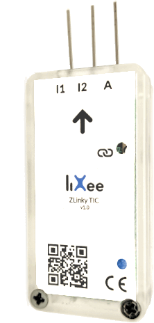

**OUI / NON**

#### 13.La LED bleu reste éteinte :

**OUI / NON**

#### 14.Les paramétrages dans z2m :

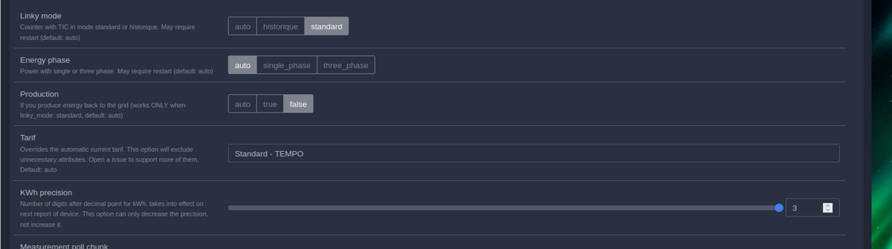

**OUI / NON**

#### 15.Dans les appareils de Z2M tu a bien l'appareil en ligne :


**OUI / NON**

#### 16.Dans l'appareil tu a bien Interview state Successful :

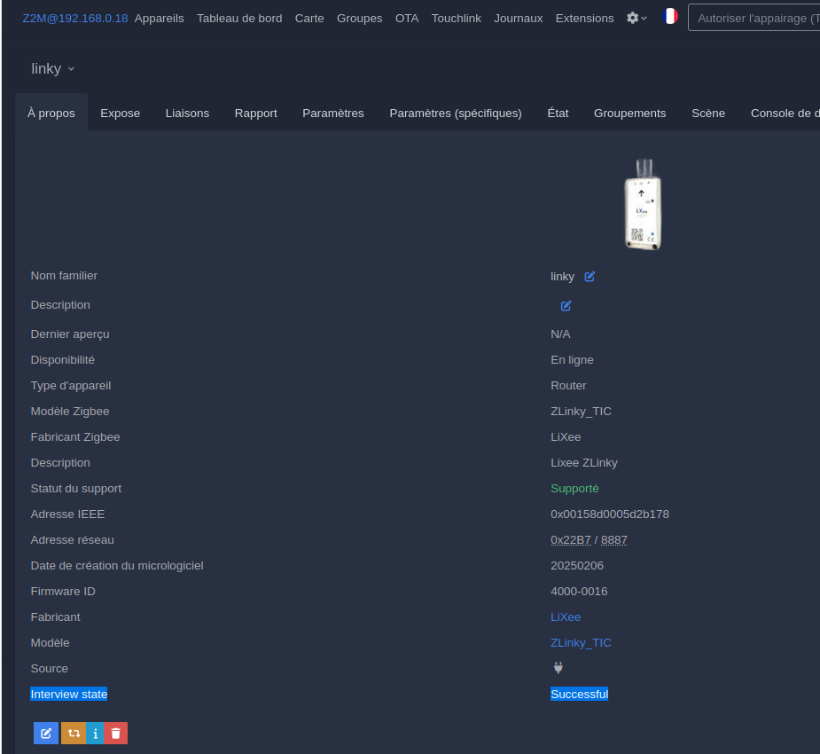

**OUI / NON**

#### 17.Dans l'onglet OTA de z2m a tu vérifié ta mise a jour :


**OUI / NON**

#### 18.Dans l'onglet journaux de z2m a tu des erreurs (j'ai créer une erreur pour te montrer)

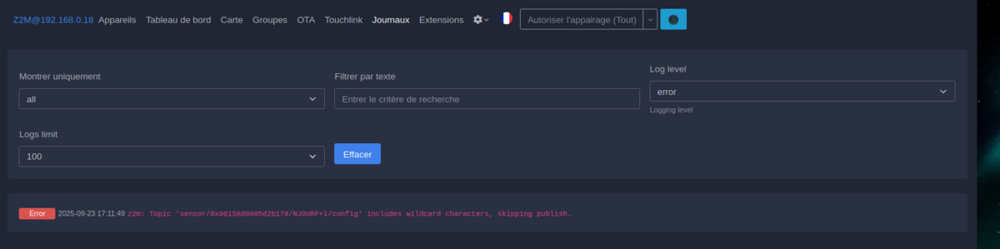

**OUI / NON**

#### 19.Maintenant dans paramètre / module complémentaire / Zigbee2MQTT / journal (a tu des erreurs voici celle que je viens de créer j ai juste débrancher ma prise pendant la mise a jour attention a ne pas reproduire et j ai modifier mon ZLinky_TIC dans les paramètre ) a tu des erreurs :

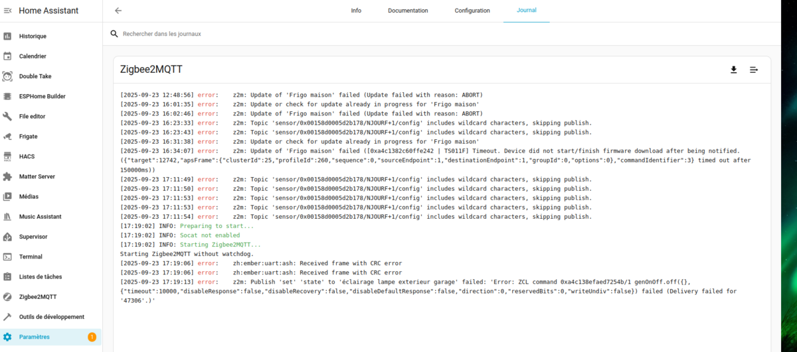

**OUI / NON**

#### 20.Dans mqtt paramètre / integrations / mqtt / a tu bien le ZLinky_TIC qui remonte les information :

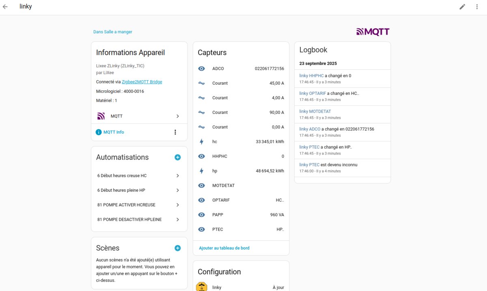

**OUI / NON**

**21.PEUX TU ME DONNER LA DISTANTE ENTRE TON DONGLE COORDINATEUR ET TON LINKY**

---

## Message 23 — 24 septembre 2025 à 11:05 (Europe/Paris)

- **Identifiant :** `947`
- **Lien :** https://forumdomotique.com/forums/topic/390-slzb-mr2-silicon-labs-multiprotocol-ne-d%C3%A9marre-pas-et-lixee-zlinky-tic-sans-entit%C3%A9s-dans-zigbee2mqtt/#findComment-947

Ok pour moi il y a un problème avec les envois de données erreur de la clé zlinky erreur inteview

Peux tu faire un test débranche ta clé du compteur linky pendant 30 minutes tu redémarre home assistant puis après 30 minutes tu rebranche ta clé sur le linky

---

## Message 24 — 25 septembre 2025 à 15:18 (Europe/Paris)

- **Identifiant :** `955`
- **Lien :** https://forumdomotique.com/forums/topic/390-slzb-mr2-silicon-labs-multiprotocol-ne-d%C3%A9marre-pas-et-lixee-zlinky-tic-sans-entit%C3%A9s-dans-zigbee2mqtt/#findComment-955

il y a bien bien un problème avec la clé maintenant tu supprime l'appareil zlinky tu redémarre homeassistant puis tu refait une installation de la clé la l'erreur que tu a signifie que ta clé n'est pas associé

lixee.ts (ligne 1817) doit être configuré

---

## Message 25 — 27 septembre 2025 à 20:27 (Europe/Paris)

- **Identifiant :** `978`
- **Lien :** https://forumdomotique.com/forums/topic/390-slzb-mr2-silicon-labs-multiprotocol-ne-d%C3%A9marre-pas-et-lixee-zlinky-tic-sans-entit%C3%A9s-dans-zigbee2mqtt/#findComment-978

Ta clé a du mal a garder ça connexion.

Combien a tu de distance entre ton coordinateur zigbee et la clé zlinky ?

Si plus de 20 mètres prend une rallonge a moitié de chemin et récupère ta pris nous de ta tablette

Elle fait routeur , sa va étendre ton réseau

Et tester si ton zlinky accroche le réseau

---

## Message 26 — 4 octobre 2025 à 09:03 (Europe/Paris)

- **Identifiant :** `1002`
- **Lien :** https://forumdomotique.com/forums/topic/390-slzb-mr2-silicon-labs-multiprotocol-ne-d%C3%A9marre-pas-et-lixee-zlinky-tic-sans-entit%C3%A9s-dans-zigbee2mqtt/#findComment-1002

**Super, @David !**

Grâce aux efforts que tu as déployés, je suis ravi que tu aies réussi ! Par contre, un score de 60 LQI est un peu faible.

Tu as dit : *"Je pense opter pour une rallonge afin de placer l’antenne dans une boîte étanche pour la sortir du boîtier EDF, qui est en plus situé derrière une murette de 1 m de hauteur. Ainsi, je devrais avoir un meilleur champ libre pour rejoindre le réseau de la maison."*

C’est une excellente idée ! Le mieux serait effectivement d’ajouter une prise intermédiaire pour optimiser ton maillage.

Avec ton Lixee et Zigbee2MQTT, tu vas être au top pour contribuer à la communauté ! 😎

N’oublie pas d’éditer ton post pour indiquer que la réponse a été trouvée.

---
