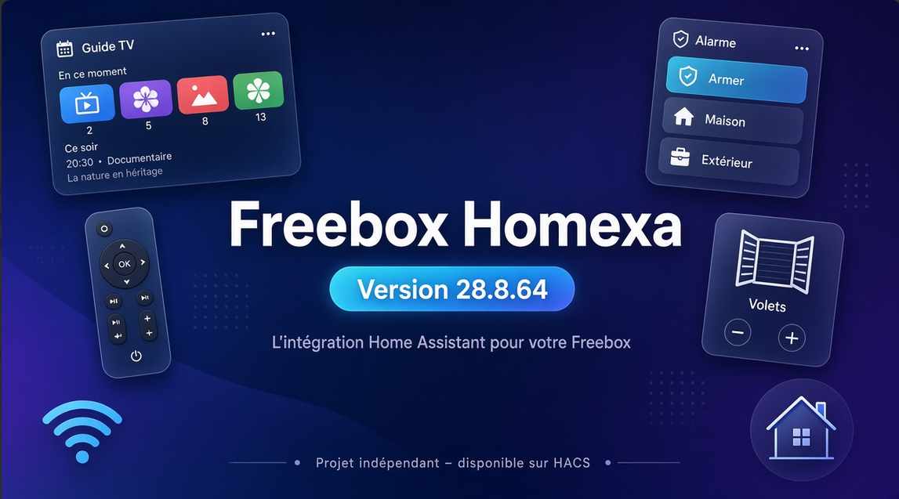

# 🏠 Freebox Homexa passe en 28.8.64 !

- **Catégorie :** [Intégrations et Add-ons](https://forumdomotique.com/forums/11-int%C3%A9grations-et-add-ons/)
- **Sujet :** https://forumdomotique.com/forums/topic/4063-%F0%9F%8F%A0-freebox-homexa-passe-en-28864/
- **Auteur du premier message du sujet :** XAV59213
- **Messages de XAV59213 dans ce sujet :** 1
- **Premier message de XAV59213 :** 25 octobre 2026 à 19:18 (Europe/Paris)

---

## Message 1 — 25 octobre 2026 à 19:18 (Europe/Paris)

- **Identifiant :** `5526`
- **Lien :** https://forumdomotique.com/forums/topic/4063-%F0%9F%8F%A0-freebox-homexa-passe-en-28864/#findComment-5526

##### Pas mal de nouveautés ces derniers jours dans mon intégration Home Assistant pour les Freebox : 📺 **Programme TNT intégré** ✅ Des capteurs « Programme TNT FR » pour chaque chaîne et un calendrier « Guide TV » ✅ Des rappels avant vos programmes, 5, 10 ou 15 min avant, par notification et/ou annonce vocale ✅ Le choix des chaînes directement dans les options de l'intégration 🎨 **Deux cartes Lovelace fournies, rien à installer en plus** ✅ La carte **Homexa TNT** (`custom:homexa-tnt-card`) : en ce moment, à suivre, 1re et 2e partie de soirée, guide TV par jour, chaînes favorites, affiches et notes TMDB (avec une clé TMDB personnelle) et rappels en un clic ✅ La carte **Freebox Homexa** (`custom:freebox-homexa-card`) : alarme (Présent, Absent, Désarmé), volet, détecteur de mouvement, Player et signal Wi-Fi, tout réuni sur une seule carte 👉 Les deux apparaissent directement dans le sélecteur de cartes. 🔧 **Fiabilité** ✅ La télécommande du Freebox Player marche maintenant aussi par action (`freebox_homexa.remote`), avec des messages d'erreur clairs ✅ Quand la Freebox ne répond plus, les entités passent en « indisponible » au lieu de garder une fausse valeur, et le journal n'affiche qu'un seul message ✅ Les capteurs Home hors de portée sont signalés aussi (sauf les volets RTS) ✅ Une nouvelle option pour choisir si on crée ou non un appareil par client réseau (rien ne change sur les installations existantes) ✅ Un code plus propre et plus fiable, aligné sur les standards de Home Assistant 📖 **Un README tout neuf :** actions, exemples YAML, dépannage et désinstallation Mise à jour dispo dans HACS 👉 https://github.com/XAV59213/freebox_homexa Merci à cyclope205 pour [Programme TNT FR](https://github.com/cyclope205/programme-tnt-fr), dont la carte TNT est adaptée. Projet indépendant, non affilié à Free. Vos retours sont les bienvenus !

---
