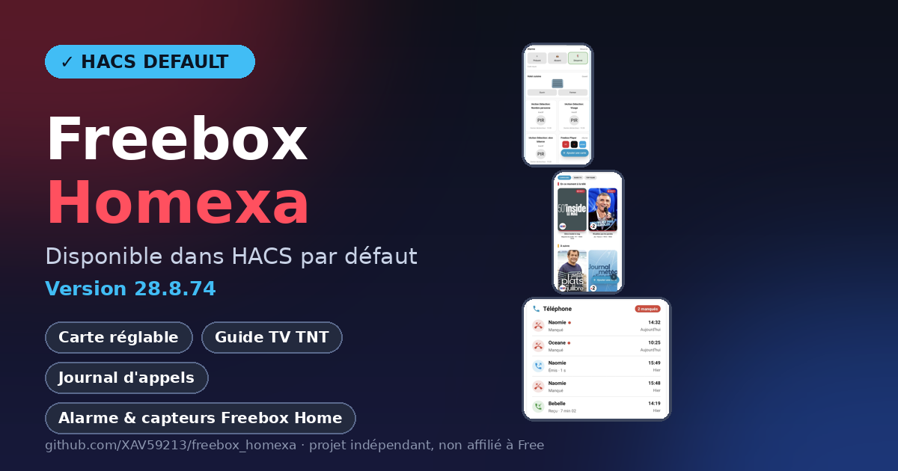
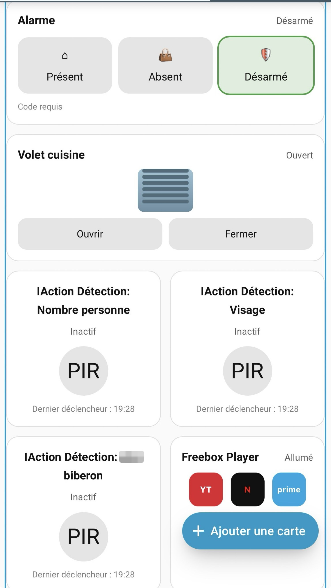
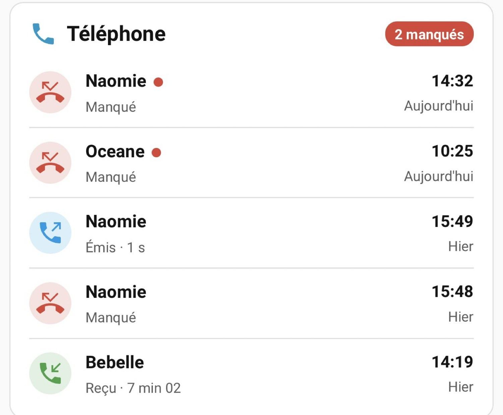

<a href="https://forumdomotique.com/forums/topic/4074-freebox-homexa-est-dans-hacs-par-d%C3%A9faut-%F0%9F%8E%89-et-pas-mal-de-nouveaut%C3%A9s/">Lire et commenter sur Forum Domotique</a> · <a href="https://github.com/XAV59213/freebox_homexa">Dépôt HACS : Freebox Homexa</a>

<section class="carousel photo-carousel" data-carousel data-lightbox aria-roledescription="carrousel" aria-label="Photos de l’article (4)" tabindex="0">

<figure class="photo-slide" data-slide>
  
</figure>
<figure class="photo-slide" data-slide>
  
</figure>
<figure class="photo-slide" data-slide>
  
</figure>
<figure class="photo-slide" data-slide>
  
</figure>

<button type="button" class="carousel-nav" data-prev aria-label="Photo précédente">‹</button>
<button type="button" class="carousel-nav" data-next aria-label="Photo suivante">›</button>

Faites défiler les photos, ou ouvrez-les pour les agrandir (si JavaScript est activé).

</section>

# **Freebox Homexa est dans HACS par défaut 🎉 (et pas mal de nouveautés)**

Bonjour à tous 👋

Quand j’ai présenté le projet en avril 2025, **Freebox Homexa** n’était qu’un projet : rassembler en une seule intégration Home Assistant tous les bouts de code éparpillés pour la Freebox. Un an et demi plus tard, le projet a bien grandi : il est dans la **bibliothèque officielle de HACS** depuis le 2 novembre 2026, et la version actuelle est la [**28.8.93**](https://github.com/XAV59213/freebox_homexa/releases/tag/28.8.93).

👉 **Le plus simple :** cliquez sur ce bouton. Un clic ouvre directement l’intégration dans votre HACS, et le dépôt est ajouté automatiquement :

<!-- source : https://my.home-assistant.io/badges/hacs_repository.svg -->

<!-- source : https://raw.githubusercontent.com/XAV59213/freebox_homexa/main/docs/images/freebox-homexa-card.jpg -->

### 🤔 À quoi ça sert, concrètement ?

Si vous êtes chez Free, votre Freebox fait beaucoup plus que donner Internet : elle gère le Wi-Fi, le téléphone, la télé avec le Player, et pour certains l’alarme et les détecteurs du pack **Freebox Home**. Freebox Homexa fait remonter tout ça dans Home Assistant, **en local**, via l’API officielle de Freebox OS :

- 🖥️ **Freebox Server** : état, débits, températures, Wi-Fi, disques, redémarrage
- 🏠 **Freebox Home** : détection automatique des interrupteurs, caméras, volets, détecteurs de mouvement et d’ouverture
- 🚨 **Alarme** : les trois modes de l’appli Free, **Présent / Absent / Désarmé**
- 📶 **Appareils connectés** : qui est à la maison (téléphones, PC…), la force du signal Wi-Fi, la bande, le répéteur utilisé
- 📡 **Répéteurs Wi-Fi Free** : en ligne ou non, et leurs clients
- 📺 **Freebox Player** (Devialet, Mini 4K, Pop) : volume, lecture, sources, télécommande
- 📞 **Téléphone** : journal d’appels, appels manqués, et même faire sonner le téléphone fixe
- 🗓️ **Programme TNT** : le guide TV, avec des rappels avant vos émissions

Projet indépendant, **non affilié à Free**.

### 🎨 Trois cartes livrées avec l’intégration

Rien à installer en plus : les cartes arrivent avec l’intégration et se règlent dans l’éditeur visuel.

- **Freebox Homexa** (`custom:freebox-homexa-card`) : alarme, volets, détecteurs, Player et signal Wi-Fi, une tuile par appareil
- **Homexa TNT** (`custom:homexa-tnt-card`) : en ce moment, à suivre, 1re et 2e partie de soirée, guide par jour, chaînes favorites, rappels en un clic, et maintenant un bouton **« Regarder sur… »** qui zappe directement sur le Player. Merci à **cyclope205**, dont le projet *Programme TNT FR* a servi de base

<!-- source : https://raw.githubusercontent.com/XAV59213/freebox_homexa/main/docs/images/homexa-tnt-card.jpg -->

- **Homexa Appels** (`custom:homexa-calls-card`) : le journal d’appels, avec les manqués, reçus et émis, l’heure, la durée et les non lus

<!-- source : https://raw.githubusercontent.com/XAV59213/freebox_homexa/main/docs/images/homexa-calls-card.jpg -->

### ✨ Les nouveautés récentes (depuis l’arrivée dans HACS)

- 📞 **Faire sonner le téléphone fixe** branché sur la Freebox (port FXS), avec deux boutons ou une action, pendant 1 à 300 secondes. Pratique pour retrouver le combiné, ou comme sonnette d’alerte
- 📺 **Bouton « Regarder sur… »** dans la carte TNT
- 🖼️ Le Player affiche l’**affiche du programme** ou le **logo de la chaîne**, et « YouTube » / « Netflix » quand c’est la source
- 🔧 On peut **changer l’adresse de la Freebox sans supprimer l’intégration** (par exemple passer de l’adresse `*.fbxos.fr` à `mafreebox.freebox.fr`)
- 🧭 La Freebox est reconnue par son adresse MAC : si son adresse change, l’intégration suit
- 🐛 De nombreuses corrections sur les Player sans API locale (Pop) et sur les réponses vides de la Freebox

Pour mettre à jour : **HACS > Freebox Homexa > Mettre à jour**, puis redémarrez Home Assistant.

### 🛠️ Installation pas à pas (bibliothèque officielle HACS)

*Pour ceux qui débutent : HACS, c’est un peu le « magasin d’applications » communautaire de Home Assistant. Il permet d’installer et de mettre à jour en quelques clics des intégrations qui ne sont pas fournies d’origine. S’il n’est pas encore installé chez vous, le guide officiel est ici :* [*https://hacs.xyz/docs/use/*](https://hacs.xyz/docs/use/)

L’intégration fait partie de la **bibliothèque HACS par défaut** : plus besoin d’ajouter un dépôt personnalisé.

**Le plus rapide :** un clic sur ce bouton ouvre directement l’intégration dans votre HACS, et le dépôt est ajouté automatiquement :

<!-- source : https://my.home-assistant.io/badges/hacs_repository.svg -->

**Ou à la main :**

1. Dans Home Assistant, ouvrez **HACS** dans le menu de gauche
2. Tapez **Freebox Homexa** dans la barre de recherche
3. Ouvrez la fiche, puis cliquez sur **Télécharger**
4. Redémarrez Home Assistant (**Paramètres > Système > bouton ⏻ en haut à droite > Redémarrer**)
5. Allez dans **Paramètres > Appareils et services > + Ajouter une intégration**, et cherchez **Freebox Homexa**

⚠️ Petite subtilité qui piège souvent au début : HACS ne fait que **télécharger les fichiers**. Ce sont les étapes 4 et 5 qui créent réellement l’intégration et ses entités. Si vous ne voyez qu’une entité `update.…` après l’installation, c’est normal : c’est HACS qui surveille les mises à jour, il reste juste l’étape 5.

⚠️ Il faut Home Assistant **2026.8** ou plus récent.

Raccourci pour l’étape 5 : <https://my.home-assistant.io/redirect/config_flow_start/?domain=freebox_homexa>

### 🔐 L’appairage avec la Freebox

C’est l’étape qui surprend la première fois, alors je détaille :

1. À l’étape 5, indiquez l’adresse de la Freebox : le plus souvent `mafreebox.freebox.fr` (ou votre adresse `xxx.fbxos.fr`)
2. **Validez l’appairage sur l’écran de la Freebox** (l’écran LCD du Server, avec les flèches). Vous avez un petit moment pour le faire
3. Ouvrez **Freebox OS > Paramètres > Gestion des accès > Applications** [http://mafreebox.freebox.fr](http://mafreebox.freebox.fr) et donnez les droits nécessaires à l’application Home Assistant : Home, Player, LAN, Téléphonie… selon ce que vous voulez piloter

Pas de jeton à copier dans `configuration.yaml` : tout passe par l’interface. Si vous utilisez aussi l’intégration Freebox officielle de Home Assistant, mieux vaut la désactiver : les deux en parallèle saturent l’API.

Les options (suivi des appareils connectés, signal Wi-Fi, intervalle du pack Home, code télécommande du Player…) se règlent ensuite dans **Paramètres > Appareils et services > Freebox Homexa > Configurer**.

### 📚 Pour aller plus loin

- [Guide utilisateur complet](https://forumdomotique.com/forums/topic/4008-guide-utilisateur-freebox-homexa-de-linstallation-%C3%A0-lutilisation-v28824/) (écrit pour la 28.8.24, toujours valable pour l’essentiel)
- [La présentation d’origine du projet (avril 2025)](https://forumdomotique.com/forums/topic/101-pr%C3%A9sentation-du-projet-freebox_homexa/)
- Wiki du projet : <https://github.com/XAV59213/freebox_homexa/wiki>

### 🔗 Liens

- Dépôt GitHub : <https://github.com/XAV59213/freebox_homexa>
- Dernière version (28.8.93) : <https://github.com/XAV59213/freebox_homexa/releases/tag/28.8.93>
- Signaler un bug ou proposer une idée : <https://github.com/XAV59213/freebox_homexa/issues>

Vos retours, idées et remontées de bugs sont les bienvenus, ici ou sur GitHub 😉

Bonne domotique ! 🏠  
Xavier (XAV59213)

Rappel : Freebox Homexa utilise uniquement l’API officielle de Freebox OS, et n’est ni affilié ni soutenu par Free / Iliad.
